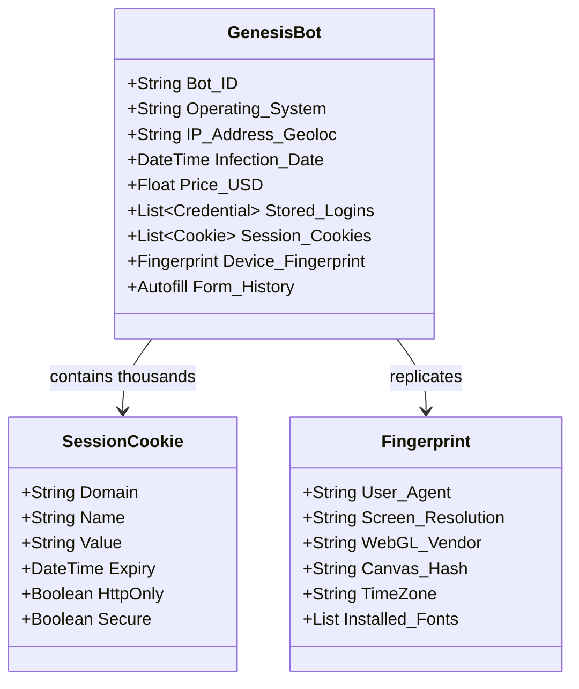

# 🌐 01: Genesis Market Overview — The Paradigm Shift to "Identity-as-a-Service"


> **Case Study:** Genesis Market  
> **Operation:** Operation Cookie Monster  
> **Operational Lifespan:** ~2018 – April 4, 2023  
> **Classification:** Cybercrime Marketplace / Initial Access Brokerage (IAB) / Identity-as-a-Service (IDaaS)  
> **Primary Commodities:** Stolen Credentials, Session Cookies, Browser Fingerprints, Autofill Vaults, Digital Identities  
> **Target Scale:** >1.5 Million Compromised Hosts ("Bots"), >2 Million Individual Digital Identities  

---

## 🎯 1. Introduction: The Death of the Simple Credential Dump

For decades, the cybercrime underground operated on a straightforward transactional model: attackers dumped database breaches containing usernames, emails, and hashed/plaintext passwords onto dark-web forums. Buyers purchased these lists in bulk, executing automated credential-stuffing attacks against unrelated corporate portals, email systems, and banking platforms.

However, between 2015 and 2018, enterprise defenses evolved significantly:
* **Multi-Factor Authentication (MFA):** Mandatory one-time passcodes (OTP), SMS verification, and authenticator apps rendered standalone passwords insufficient for account takeover.
* **Risk-Based Authentication (RBA):** Adaptive login engines analyzed client IP addresses, autonomous system numbers (ASNs), geographic velocity, and browser characteristics to challenge unfamiliar logins.
* **Device Fingerprinting:** Anti-fraud engines measured screen resolution, WebGL capabilities, hardware concurrency, and canvas rendering hashes to ensure the connecting client matched the legitimate user's profile.

In response to these defensive barriers, a sophisticated underground platform launched in late 2018 that redefined cybercrime: **Genesis Market**.

Genesis Market realized that in modern authentication, **a password alone is almost worthless**. The true currency of modern access is **a complete, functional digital identity**—combining active authentication session tokens, browser cookies, device fingerprints, and ambient behavioral metadata into a deployable digital twin.

---

## 🏗️ 2. What Was Genesis Market?

Genesis Market was an invitation-only, commercial dark-web and clear-web platform that operated as an **Identity-as-a-Service (IDaaS)** clearinghouse. It functioned not merely as a passive data repository, but as a full-featured commercial SaaS platform designed for cybercriminals.

```
+---------------------------------------------------------------------------------------------------------+
|                                    TRADITIONAL VS. GENESIS MARKET MODEL                                 |
+---------------------------------------------------------------------------------------------------------+
| TRADITIONAL UNDERGROUND DUMPS:                                                                          |
|   victor_analyst@enterprise.com : Password123!                                                          |
|   [!] Blocked by MFA, New Device Detection, IP Reputation, and Geofencing.                              |
+---------------------------------------------------------------------------------------------------------+
| GENESIS MARKET "BOT" IDENTITY:                                                                          |
|   ├── Stored Credentials (SSO, Email, AWS, GitHub, Banking, VPN)                                        |
|   ├── Active Web Session Cookies (Bypasses initial login & MFA prompts)                                 |
|   ├── Hardware & Canvas Fingerprints (Screen resolution, WebGL, GPU, CPU cores)                        |
|   ├── Browser Environment Metadata (User-Agent, installed plugins, time zone, fonts)                    |
|   ├── Autofill Data & Form History (Personal identity verification answers, addresses)                  |
|   └── Real-time Cookie Sync via Genesis API                                                             |
|   [✓] Bypasses MFA, Device Posture, and Risk Engines by masquerading as the victim's live machine.       |
+---------------------------------------------------------------------------------------------------------+
```

### Key Operational Characteristics:
1. **Access Model:** Controlled access via referral codes and invitation links, ensuring operational security and vetting of purchasers.
2. **Dual-Network Hosting:** Operated simultaneously across Tor onion services (`.onion`) and mirror domains hosted on clear-web infrastructure.
3. **Automated Inventory Ingestion:** Integrated directly with infostealer malware command-and-control (C2) servers via automated APIs, continuously replenishing inventory with freshly harvested endpoints.
4. **Subscription-Style Pricing:** Prices ranged from **$0.70 to several hundred dollars** per "bot," proportional to the value of the harvested corporate accounts, cryptocurrency wallets, or financial institutions present in the victim's profile.

---

## 🤖 3. Deconstructing the Genesis "Bot"

One of the most widely misunderstood aspects of Genesis Market was its terminology. In traditional cybersecurity vernacular, a "bot" refers to an infected computer enrolled in an active botnet, executing distributed denial-of-service (DDoS) floods or relaying spam under C2 instruction.

On Genesis Market, a **"Bot" was not a software client**—it was a **packaged digital identity bundle** representing an infected computer and the complete browsing persona harvested from it.



When an adversary purchased a "bot," they did not merely acquire a text dump. They gained access to:
* A structured archive of all stored usernames and passwords harvested from local browser credential vaults.
* Thousands of active session cookies for web platforms, cloud services, and internal enterprise tools.
* The exact browser fingerprint profile required to fool server-side anomaly detection engines.
* Continuous synchronization: if the victim remained infected and generated new session cookies, the Genesis backend updated the buyer's bot profile in real time.

---

## 📈 4. The Scale of the Enterprise

By the time international law enforcement disrupted the network in April 2023 under **Operation Cookie Monster**, Genesis Market had achieved staggering operational scale:

| Metric | Official Figure (Europol / DOJ) | Context & Impact |
|---|---|---|
| **Compromised Endpoints Offered** | **>1.5 Million Bots** | Distinct infected physical and virtual machines worldwide |
| **Individual Identities Represented** | **>2 Million Identities** | Unique human identities whose personal/corporate lives were exposed |
| **Inventory Turnover** | Real-time automated ingestion | New bots added daily via infostealer distribution networks |
| **Marketplace Lifespan** | ~5 Years (2018 – 2023) | Survived multiple law enforcement crackdowns on peer markets |
| **Economic Damage** | Hundreds of Millions USD | Enabled initial corporate breaches, wire fraud, and ransomware extortion |

---

## 🔄 5. The Cybercrime Industrialization

Genesis Market represented the **industrialization and modularization of cybercrime**. Prior to platforms like Genesis, a cybercriminal needed end-to-end expertise:
1. Authoring or acquiring malware.
2. Setting up bulletproof hosting and C2 infrastructure.
3. Conducting phishing campaigns or drive-by downloads.
4. Harvesting stolen files and parsing complex database formats.
5. Circumventing security controls and cashing out.

Genesis decomposed this monolithic process into a frictionless supply chain. The malware author, the traffic distributor, the marketplace operator, the initial access broker, and the final ransomware extortionist all specialized in their discrete domains. 

This division of labor drastically lowered the barrier to entry, enabling low-skilled adversaries to purchase enterprise footholds for pennies and execute attacks previously restricted to advanced persistent threat (APT) actors.

---

## ⏭️ Next Chapter
Proceed to [**02: Technical Architecture — How Genesis Replicated Digital Identities**](./02-technical-architecture.md) to explore the mechanics of browser fingerprint spoofing, cookie injection, and the custom Genesis Chromium browser plugin.
