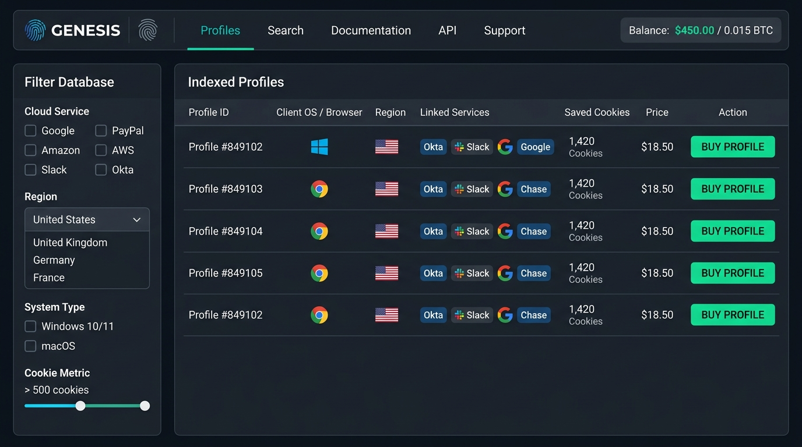
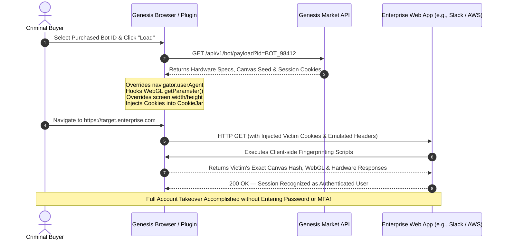

# ⚙️ 02: Technical Architecture — How Genesis Replicated Digital Identities


> **Core Innovation:** Digital Identity Synthesis & Session Cloning  
> **Key Tooling:** Genesis OS, Genesis Chromium Plugin, Cloud API Sync  
> **Vulnerability Exploited:** Session-Based Authentication vs. Credential-Based Authentication  

---

## 🔬 1. The Engineering Behind Digital Identity Emulation

The foundational technical breakthrough of Genesis Market was not merely harvesting data, but **building a client-side execution framework that allowed any criminal to seamlessly inhabit a victim's digital browser profile**.

When modern websites evaluate an incoming connection, they employ sophisticated client-side telemetry scripts (such as Akamai Bot Manager, Cloudflare Bot Management, F5 Distributed Cloud, or custom risk-based fraud heuristics). These engines collect hundreds of granular hardware, network, and browser signals to generate a **Browser Fingerprint**.

Genesis realized that if an attacker attempted to import stolen session cookies into their own default browser, the anti-fraud system would detect massive discrepancies:
* Different screen resolution and color depth.
* Different GPU rendering engine (WebGL vendor/renderer).
* Different hardware concurrency (number of CPU cores).
* Mismatched operating system and platform architecture.
* Unmatched font rendering, Canvas cryptographic hash, and AudioContext signatures.

Consequently, the target web application would immediately invalidate the session cookie or trigger a high-risk MFA re-authentication challenge.

Genesis defeated this entire defensive paradigm by building custom tooling to reconstruct the victim's exact client environment.

---

## 🧩 2. Anatomy of a Genesis "Bot" Package

When an infostealer infected an endpoint, it compiled an exhaustive hardware and software manifest. On Genesis Market, a complete bot profile comprised five synchronized data layers:

```
┌─────────────────────────────────────────────────────────────────────────────────┐
│                           GENESIS BOT DATA STRUCTURE                            │
├─────────────────────────────────────────────────────────────────────────────────┤
│ 1. HARDWARE & PERIPHERAL LAYER:                                                │
│    ├── Screen Resolution: 1920x1080 @ 60Hz (Color Depth: 24-bit)                │
│    ├── WebGL Vendor: "Google Inc. (NVIDIA)"                                     │
│    ├── WebGL Renderer: "ANGLE (NVIDIA, NVIDIA GeForce RTX 3070 Direct3D11...)"  │
│    ├── Hardware Concurrency: 16 logical cores                                   │
│    └── Device Memory: 16 GB RAM                                                 │
├─────────────────────────────────────────────────────────────────────────────────┤
│ 2. OPERATING SYSTEM & ENVIRONMENT:                                              │
│    ├── OS Platform: Windows NT 10.0; Win64; x64                                  │
│    ├── System Language: en-US, en;q=0.9                                         │
│    ├── Time Zone & Offset: America/New_York (UTC-5 / Daylight Savings: Active)   │
│    └── Installed System Fonts: DirectWrite enumeration (Calibri, Segoe UI, etc.)│
├─────────────────────────────────────────────────────────────────────────────────┤
│ 3. BROWSER INTERFACE & CANVAS:                                                  │
│    ├── User-Agent: Mozilla/5.0 (Windows NT 10.0; Win64; x64) AppleWebKit/537.36 │
│    ├── HTML5 Canvas Render Hash: 0x9A4F2C81                                     │
│    ├── WebRTC Local IP / Media Devices: Microphone, Speakers, Virtual Camera    │
│    └── AudioContext Dynamics Compressor Hash: 0x3E7B812A                        │
├─────────────────────────────────────────────────────────────────────────────────┤
│ 4. AUTHENTICATION & SESSION STATE:                                              │
│    ├── Active Session Cookies: Okta, AWS, GitHub, Google, Slack, Office 365    │
│    ├── LocalStorage & SessionStorage Vaults                                     │
│    └── Browser Autofill: Full names, addresses, phone numbers, credit card CVVs │
├─────────────────────────────────────────────────────────────────────────────────┤
│ 5. RECOVERED CREDENTIALS:                                                       │
│    └── Decrypted Passwords from Chromium 'Login Data' SQLite Database           │
└─────────────────────────────────────────────────────────────────────────────────┘
```

### Visual Dissection: The Authenticated Genesis Market Storefront
Threat intelligence researchers (F5 Labs, Sophos, Recorded Future) documented the commercial, e-commerce-style design of the Genesis Market portal:



* **Account Header & Balance:** Displays the authenticated buyer's username, active balance in USD and Bitcoin (BTC), cart, and navigation tabs (`Bots`, `Search`, `Wiki`, `API`, `Support`).
* **Granular Filter Sidebar:** Allows adversaries to filter 1.5M+ bots by specific corporate service (`Okta`, `AWS`, `Slack`, `Google`, `Chase`), country, operating system, and cookie weight.
* **Live Bot Catalog:** Presents compromised endpoints with unique Bot IDs, OS icons, country flags, compromised account badges, cookie density counters, price tags ($0.70 to $100s), and one-click purchase triggers.

---

## 🖥️ 3. The Genesis Chromium Plugin & Genesis Browser

To operationalize these harvested profiles, Genesis Market developed proprietary client-side software for its customers:

### A. The Genesis Browser Plugin
Genesis created a specialized **Chromium browser extension**. A buyer who purchased a bot profile could simply install the plugin into a fresh Chromium or Google Chrome instance, enter their Genesis API access key, and select the purchased Bot ID.

### B. Genesis OS
For advanced buyers, Genesis offered a custom, hardened browser build referred to as **Genesis OS**. Built directly on open-source Chromium, Genesis OS hooked the native V8 JavaScript engine and native C++ APIs to intercept fingerprinting calls at the browser runtime level:



---

## 🍪 4. Session Cookie Injection Mechanics

Understanding the difference between **Credential Authentication** and **Session Validation** is critical to comprehending Genesis Market's lethality.

### Credential Authentication Flow:
1. User supplies `Username + Password`.
2. Identity Provider (IdP) evaluates credentials.
3. IdP challenges user with `MFA Prompt (TOTP/Push/SMS)`.
4. User satisfies challenge.
5. IdP generates an encrypted, signed HTTP session cookie (e.g., `session_id`, `auth_token`, `JSESSIONID`) with attributes:
   * `Domain=.target.com`
   * `Path=/`
   * `HttpOnly` (preventing JavaScript access)
   * `Secure` (transmitted only over TLS)
   * `SameSite=Lax/Strict`
6. Browser stores this cookie in a local encrypted SQLite database (`Network\Cookies`).

### The Genesis Replay Attack:
An infostealer running on the victim's endpoint bypasses `HttpOnly` completely because it reads the cookie database directly from the filesystem, decrypts it using the victim's Windows Data Protection API (DPAPI) master key, and exfiltrates the raw cookie key-value pairs.

When the attacker imports these cookies into Genesis OS:
```javascript
// Conceptual representation of Genesis Cookie Injection
chrome.cookies.set({
    url: "https://enterprise.okta.com",
    name: "sid",
    value: "00aB_cDeF1234567890xYz",
    domain: ".enterprise.okta.com",
    path: "/",
    secure: true,
    httpOnly: true,
    expirationDate: Math.floor(Date.now() / 1000) + 86400
});
```

Because the target service trusts the valid signature of its own session cookie and sees an incoming browser whose fingerprint matches the historical record, **the server skips credential validation and MFA entirely**. The attacker is immediately presented with the logged-in dashboard.

---

## 🔄 5. Real-Time Cloud Synchronization

A common limitation of traditional data theft was temporal degradation: stolen session cookies typically expire within hours or days.

Genesis solved this problem through **continuous client-side synchronization**:
* As long as the victim's infected computer remained online, the resident infostealer periodically re-harvested fresh session cookies whenever the legitimate user logged into services.
* The infostealer transmitted these refreshed cookies to the Genesis C2 infrastructure.
* The Genesis Market backend updated the bot's cloud repository.
* The attacker's Genesis plugin automatically pulled the fresh cookies, keeping the hijacked session permanently active.

This turned one-off credential theft into a persistent **"living" identity subscription**.

---

## ⏭️ Next Chapter
Proceed to [**03: The Infostealer Ecosystem — The Malware Engine Behind Genesis**](./03-infostealer-ecosystem.md) to examine the malware strains (RedLine, Vidar, Raccoon) that fed data into Genesis Market.
