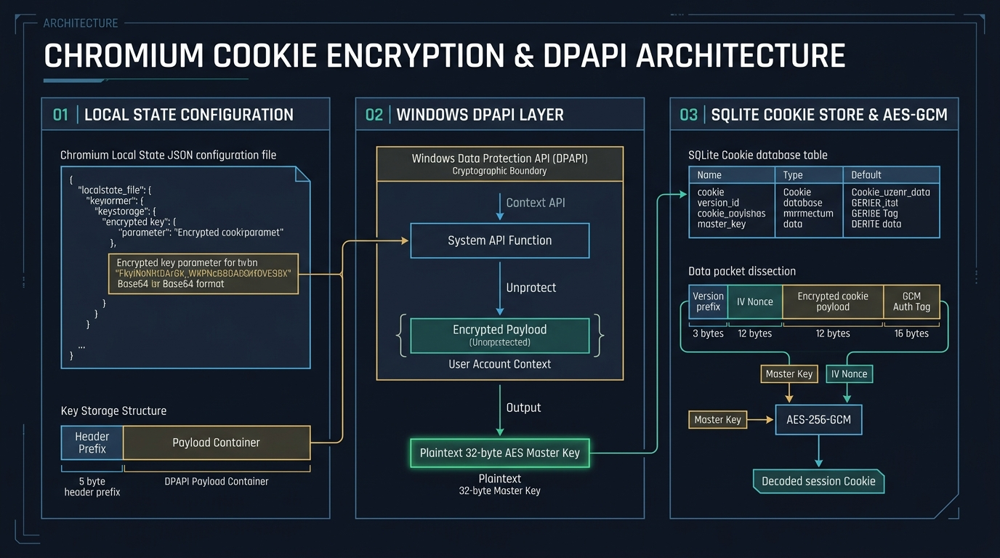

# 🦠 03: The Infostealer Ecosystem — The Malware Engine Behind Genesis


> **Malware Category:** Information Stealers (Infostealers)  
> **Key Malware Families:** RedLine, Vidar, Raccoon, Taurus, Mars, Lumma  
> **Initial Access Vectors:** Malvertising, Google Ads Abuse, SEO Poisoning, Cracked Software / Torrents, Phishing  
> **Primary Targets:** Chromium / Gecko Browsers, Crypto Wallets, Discord/Telegram Sessions, VPN & Cloud Credentials  

---

## 🔍 1. The Real Engine of Genesis: Infostealer Malware

While Genesis Market operated the storefront, it did not typically develop or distribute the initial malware that infected victim endpoints. Instead, Genesis relied on a vast, decentralized underworld of **Infostealer Operators**.

An **infostealer** is a specialized category of lightweight commodity trojan designed to execute rapidly, enumerate the victim's local storage and memory for high-value authentication secrets, package them into an encrypted archive, exfiltrate the bundle to a command-and-control (C2) server, and often self-terminate to minimize detection dwell time.

```
+---------------------------------------------------------------------------------------------------------+
|                                  THE INFOSTEALER HARVESTING LIFECYCLE                                   |
+---------------------------------------------------------------------------------------------------------+
| [1. Initial Delivery]                                                                                   |
|     User downloads cracked software / fake installer via Google Malvertising or SEO Poisoning.          |
|                                     │                                                                   |
|                                     ▼                                                                   |
| [2. Execution & Evasion]                                                                                |
|     Unpacks in memory, verifies locale (checks exclusion lists like CIS/Russian language), checks VM.    |
|                                     │                                                                   |
|                                     ▼                                                                   |
| [3. Vault Enumeration & DPAPI Decryption]                                                               |
|     Locates Chromium 'Local State' -> Decrypts Master Key with CryptUnprotectData()                     |
|     Locates 'Network\Cookies' & 'Login Data' -> Decrypts AES-256-GCM session tokens & credentials       |
|     Enumerates Firefox 'key4.db' & 'logins.json' -> Decrypts NSS encrypted credentials                 |
|                                     │                                                                   |
|                                     ▼                                                                   |
| [4. Peripheral Collection]                                                                              |
|     Exfiltrates: MetaMask/Phantom wallets, Discord/Telegram sessions, FileZilla, VPN configs, screen.   |
|                                     │                                                                   |
|                                     ▼                                                                   |
| [5. Staging & Exfiltration]                                                                             |
|     Compresses all assets into ZIP in %TEMP% -> Transmits via HTTP/TCP POST to C2 Server.               |
|                                     │                                                                   |
|                                     ▼                                                                   |
| [6. Ingestion into Genesis Market]                                                                      |
|     C2 Server parses data via Genesis Market API -> Ingests into Bot Catalog -> Ready for Buyer.        |
+---------------------------------------------------------------------------------------------------------+
```

---

## ⚔️ 2. Prominent Infostealer Strains Feeding Genesis

| Malware Family | Written In | Typical Cost / Model | Primary Technical Features |
|---|---|---|---|
| **RedLine Stealer** | .NET (C#) | MaaS ($150–$200/month or $900 lifetime) | Most prevalent supplier; grabs browser data, Discord tokens, crypto wallets, VPN credentials, and full hardware telemetry. |
| **Vidar Stealer** | C / C++ | MaaS ($250–$700/month) | Modular architecture; uses public Telegram channels / Steam profiles as dead-drop resolvers for C2 IPs. |
| **Raccoon Stealer** | C / C++ | MaaS ($200/month) | High-speed memory execution; dynamically downloads required SQLite and NSS DLLs from C2 at runtime to evade static detection. |
| **Lumma Stealer** | C / C++ | MaaS ($250–$1,000/month) | Advanced anti-analysis; employs control flow flattening, string encryption, and proactive evasion of sandbox environments. |
| **Mars / Taurus** | C++ / Assembly | MaaS ($160/month) | Ultra-lightweight footprint (<40 KB); direct syscalls bypassing API hooking. |

---

## 🔓 3. How Infostealers Decrypt Browser Vaults



To understand why traditional browser storage is vulnerable to infostealers, we must examine the internal cryptographic architecture of Chromium-based browsers (Google Chrome, Microsoft Edge, Brave, Opera, Vivaldi).

### The Chromium Encryption Architecture (v80+):
Prior to Chrome version 80, passwords were encrypted directly using the Windows `CryptProtectData` (DPAPI) function. Since Chrome v80 (2020), Google introduced a dual-layer encryption scheme:

1. **The Master Key:**
   When Chrome initializes, it generates an ephemeral 32-byte AES-256 encryption key. It encrypts this key using the operating system's **Windows DPAPI** (`CryptProtectData`), which ties the key to the logged-in user's Windows account credentials. Chrome stores this encrypted string in base64 format inside the file:
   ```
   %LOCALAPPDATA%\Google\Chrome\User Data\Local State
   ```
   Under JSON key: `os_crypt.encrypted_key`.

2. **The Encrypted Values:**
   Sensitive strings in SQLite databases—including:
   * `AppData\Local\Google\Chrome\User Data\Default\Network\Cookies` (`encrypted_value` column)
   * `AppData\Local\Google\Chrome\User Data\Default\Login Data` (`password_value` column)
   are encrypted using **AES-256-GCM**. The ciphertext is prefixed with a 3-byte signature (`v10` or `v11`), followed by a 12-byte initialization vector (IV), the encrypted payload, and a 16-byte authentication tag.

### How the Infostealer Decrypts This in Seconds:
Because the infostealer runs under the **same user context** as the victim (e.g., standard employee privileges), the operating system's DPAPI system willingly decrypts the master key for the malware process!


> [!CRITICAL]
> **Why Antivirus Often Missed It:**  
> The call to `CryptUnprotectData()` is a completely legitimate Win32 API used by hundreds of normal applications. Unless the endpoint detection and response (EDR) agent specifically inspects **which process** is reading the Chrome `Local State` file, the extraction occurs silently without triggering basic signature alerts.

---

## 📦 4. Non-Browser Harvest Targets

Modern infostealers extract far more than web logins. A typical infostealer collection manifest includes:

1. **Cryptocurrency Wallets & Extensions:**
   * Browser extensions: MetaMask, Phantom, Coinbase Wallet, TronLink, Binance Chain.
   * Desktop wallets: Bitcoin Core, Electrum, Exodus, Atomic Wallet (`wallet.dat` extraction).
2. **Session Tokens & Instant Messaging:**
   * Discord: Token extraction from `%APPDATA%\Discord\Local Storage\leveldb`.
   * Telegram: `%APPDATA%\Telegram Desktop\tdata` session folder extraction.
3. **Developer & Administrative Secrets:**
   * OpenVPN / WireGuard config files (`*.ovpn`, `*.conf`).
   * FileZilla XML credentials (`recentservers.xml`, `sitemanager.xml`).
   * SSH private keys (`~/.ssh/id_rsa`, `known_hosts`).
   * Git credentials and `.aws/credentials` configuration files.
4. **Machine Fingerprint & Reconnaissance:**
   * Operating system build, active username, computer hostname.
   * Public IP, geographic coordinates (via external lookup like `api.ipify.org`).
   * Desktop screenshot taken at the moment of infection.
   * List of running processes, installed security software, and hardware specs.

---

## 📡 5. The Exfiltration Pipeline to Genesis

Once data collection is complete:
1. The infostealer creates a directory in `%TEMP%` or `%APPDATA%`, formats the credentials into human-readable text files (`Passwords.txt`, `Cookies.txt`, `Autofill.txt`, `Information.txt`), and compresses them into a single archive (`<BotID>.zip`).
2. The archive is exfiltrated to the malware operator's panel via encrypted HTTP POST or raw TCP socket.
3. The stealer operator's backend connects via API to Genesis Market's ingestion endpoint:
   * The Genesis server unpacks the ZIP.
   * It parses the cookie formats into Genesis-compatible JSON schemas.
   * It verifies validity of high-profile credentials (e.g., checking if Amazon, PayPal, or Google logins respond).
   * It assigns a calculated price based on the presence of high-value domains.
   * The bot is immediately published on the Genesis Market public catalog.

---

## ⏭️ Next Chapter
Proceed to [**04: Genesis Market as an Initial Access Broker (IAB)**](./04-initial-access-broker.md) to explore how stolen bots directly facilitated enterprise ransomware intrusions, including the famous 2021 Electronic Arts (EA) breach.
