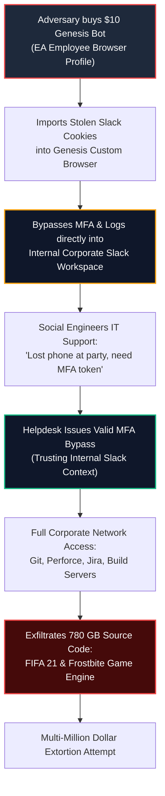

# 🎯 04: Initial Access Brokerage (IAB) & The Cybercrime Division of Labor


> **Key Role:** Initial Access Brokerage (IAB)  
> **Key Metric:** $10 Commodity Bot ➔ Multi-Million Dollar Enterprise Ransomware Breach  
> **Featured Case Study:** The 2021 Electronic Arts (EA) Security Breach  
> **Adversary Beneficiaries:** Ransomware Syndicates (Conti, LockBit, BlackCat/ALPHV), Corporate Espionage, Financial Fraud  

---

## 💼 1. The Rise of Initial Access Brokers (IABs)

In the early eras of cyber attacks, threat actor groups were vertically integrated: the same group that authored malware also conducted phishing campaigns, established persistence, moved laterally, escalated privileges, and carried out final extortion or data theft.

However, as enterprise defenses matured—with endpoint detection and response (EDR), Security Operations Centers (SOCs), network segmentation, and zero trust models—the technical complexity of each phase escalated exponentially.

This economic pressure spurred the emergence of **Initial Access Brokers (IABs)**. An IAB is a cybercriminal specialist whose sole business model is:
1. Gaining initial unauthorized access into an organization or cloud tenant.
2. Assessing the privilege level and value of that access.
3. Selling that access on dark-web marketplaces to other cybercriminals who specialize in extortion, ransomware, or espionage.

Genesis Market emerged as the **world's largest, automated Initial Access Broker platform**. Instead of an enterprise having to negotiate bespoke access deals with individual hackers on Russian-language forums, Genesis provided a searchable, self-service SaaS portal where an attacker could query corporate domains (e.g., `@microsoft.com`, `@ea.com`, `@target.com`) and purchase immediate, authenticated footholds with one click.

```
+---------------------------------------------------------------------------------------------------------+
|                                    CYBERCRIME DIVISION OF LABOR                                         |
+---------------------------------------------------------------------------------------------------------+
|                                                                                                         |
|   [1. Malware Author]       Creates RedLine / Vidar infostealer code.                                   |
|            │                                                                                            |
|            ▼                                                                                            |
|   [2. Traffic Distributor]  Spreads infostealer via Malvertising, Torrents, Phishing.                   |
|            │                                                                                            |
|            ▼                                                                                            |
|   [3. Victim Endpoint]      Compromised employee laptop harvests credentials & cookies.                |
|            │                                                                                            |
|            ▼                                                                                            |
|   [4. Genesis Market]       Packages data into "Bot", verifies logins, sets price ($0.70 - $100s).      |
|            │                                                                                            |
|            ▼                                                                                            |
|   [5. Criminal Buyer]       Ransomware Affiliate / Access Broker purchases Bot for $10.                 |
|            │                                                                                            |
|            ▼                                                                                            |
|   [6. Internal Corporate]   Bypasses MFA via session cookies -> Accesses Slack / VPN / Okta SSO.        |
|            │                                                                                            |
|            ▼                                                                                            |
|   [7. Post-Compromise]      Privilege Escalation -> Active Directory Tampering -> Ransomware Deployment.|
+---------------------------------------------------------------------------------------------------------+
```

---

## 🎮 2. Case Study: The 2021 Electronic Arts (EA) Breach

The most prominent, publicly documented enterprise intrusion directly attributed to Genesis Market was the **June 2021 intrusion of video gaming giant Electronic Arts (EA)**.

This incident serves as a textbook example of how a low-cost commodity bot can unravel multi-layered enterprise defenses.

### Phase 1: Purchasing the $10 Bot
In mid-2021, an adversary searched Genesis Market for domain matches associated with Electronic Arts. They discovered an inexpensive bot listing—reportedly costing approximately **$10**—harvested from an EA employee's home or corporate workstation.

The bot package contained:
* Saved browser credentials.
* **Active session authentication cookies for EA's internal Slack workspace**.
* The employee's browser fingerprint.

### Phase 2: Session Replay & Bypassing MFA
The attacker loaded the purchased profile into the Genesis Chromium browser plugin. Because the authentication cookies for EA's internal corporate Slack were valid and active, the attacker navigated to EA's Slack portal and was **immediately authenticated into the corporate chat environment without being prompted for the employee's password or second-factor authentication (MFA)**.

### Phase 3: Social Engineering IT Helpdesk on Slack
Once inside EA's internal Slack, the attacker located the internal IT Support channel. Posing as the legitimate employee whose identity they had hijacked, the attacker sent a direct message to an IT helpdesk administrator:

> *"Hey, I lost my phone at a party last night and can't receive my MFA push notification. Can you please generate a one-time MFA bypass token for my corporate account so I can log into the network?"*

Because the request originated from an already-authenticated, legitimate internal Slack account in good standing, the IT helpdesk administrator accepted the explanation and issued a valid MFA bypass token.

### Phase 4: Network Access & Lateral Movement
Armed with the newly minted corporate token, the attacker logged into EA's internal corporate network and developer infrastructure:
1. Accessed EA's internal Jira and development servers.
2. Gained access to source code management systems (Perforce / Git).
3. Located and staged proprietary game engines and internal development SDKs.

### Phase 5: Exfiltration & Extortion
The attackers exfiltrated **780 gigabytes** of proprietary intellectual property, including:
* The complete source code for **FIFA 21** and matchmaking server code.
* Proprietary source code for EA's proprietary **Frostbite game engine** (which powers Battlefield, FIFA, and other blockbuster franchises).
* Proprietary development frameworks and debug SDKs.

The attackers subsequently attempted to extort EA for millions of dollars, threatening to release the source code publicly if the ransom was not paid.



---

## 🔒 3. The Pipeline to Enterprise Ransomware

While the EA incident involved intellectual property extortion, the predominant consumers of Genesis Market inventory were **Ransomware-as-a-Service (RaaS) affiliates** associated with major cartels such as:
* **Conti**
* **LockBit 2.0 / 3.0**
* **BlackCat (ALPHV)**
* **REvil (Sodinokibi)**
* **Hive**

### The Economic Math for a Ransomware Affiliate:
* **Option A (Traditional Phishing):** Spend weeks crafting spear-phishing lures, buying lookalike domains, deploying reverse-proxy frameworks (Evilginx), and hoping an employee falls for it (success rate: <5%). Cost: thousands of dollars; Time: weeks.
* **Option B (Genesis Market):** Log into Genesis, search for the target company's corporate domain or target industry, filter by "High Cookie Weight" or "Admin Access," and purchase guaranteed access for **$50 to $200**. Immediate entry into corporate VPN or cloud SSO within 10 minutes.

The U.S. Department of Justice explicitly designated Genesis Market as **one of the primary engines fueling global ransomware proliferation**, stating that many high-profile ransomware deployments trace their original infection path to an inexpensive bot profile purchased on Genesis.

---

## ⏭️ Next Chapter
Proceed to [**05: Operation Cookie Monster — The Global Law Enforcement Takedown**](./05-operation-cookie-monster.md) to explore the multi-agency law enforcement offensive that dismantled Genesis Market's infrastructure.
