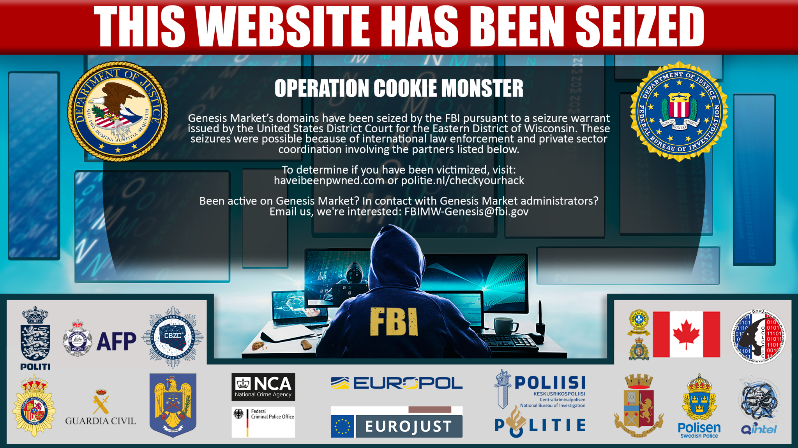
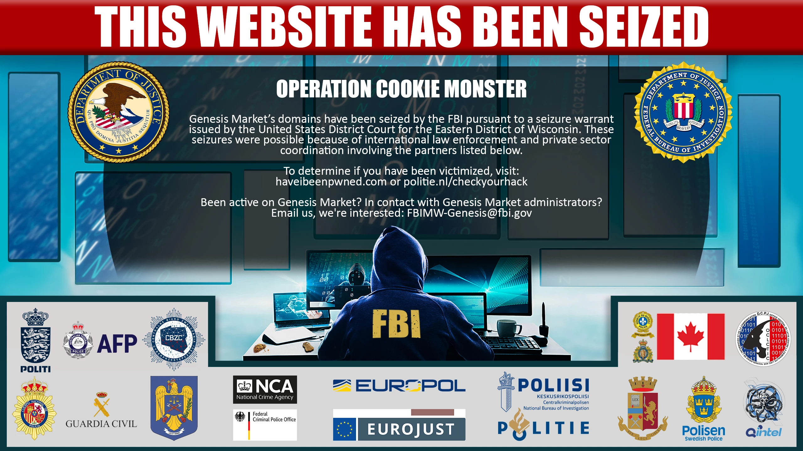
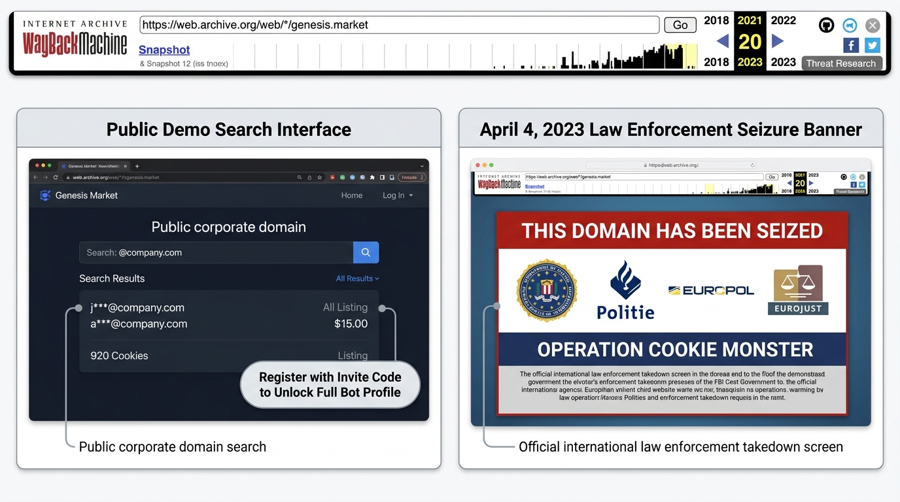

# 🍪 05: Operation Cookie Monster — The Global Law Enforcement Takedown


> **Operation Name:** Operation Cookie Monster  
> **Takedown Execution Date:** 4 April 2023  
> **Coordinating Bodies:** FBI, Dutch National Police (Politie), Europol (EC3), Eurojust  
> **Participating Nations:** 17 Countries (US, Netherlands, UK, Germany, Canada, Poland, Sweden, France, Italy, Australia, Spain, Switzerland, Romania, etc.)  
> **Operational Outcomes:** 119 Arrests, 208 Property Searches, 97 Knock-and-Talks, 11 Domain Seizures  

---

## 🏛️ 1. Genesis of the Investigation (2019 – 2023)

In early 2019, cybercrime investigators at the **Dutch National High Tech Crime Unit (NHTCU)** and the **Federal Bureau of Investigation (FBI)** identified an alarming pattern across enterprise breach investigations: compromised corporate credentials were being traded alongside real-time browser fingerprint profiles on an emerging marketplace called Genesis.

Because cybercrime infrastructure transcends national boundaries, Europol’s **European Cybercrime Centre (EC3)** and the **Joint Cybercrime Action Taskforce (JCAT)** established a dedicated multi-national operational task force in late 2019.

For nearly four years, international investigators executed a coordinated, covert intelligence-gathering campaign:
* **Infrastructure Mapping:** Identifying Genesis backend servers hosted across non-cooperative bulletproof hosting providers and European cloud providers.
* **Payment Tracing:** Tracking cryptocurrency transactions (Bitcoin, Monero, WebMoney) used to fund buyer account balances.
* **Undercover Operations:** Infiltrating the marketplace, analyzing backend source code and API endpoints, and mapping buyer-seller relationships.

---

## 💥 2. D-Day: 4 April 2023

On Tuesday, 4 April 2023, international law enforcement struck simultaneously across three continents. In a synchronized operation spanning multiple time zones, authorities dismantled Genesis Market's online presence, seized server hardware, and executed arrest warrants against key marketplace facilitators and high-volume buyers.

Visitors attempting to reach Genesis Market domains on both the clear web and the dark web were greeted by an official law enforcement splash page:

```
┌─────────────────────────────────────────────────────────────────────────────────┐
│                          THIS DOMAIN HAS BEEN SEIZED                            │
│                                                                                 │
│   This website has been seized by the Federal Bureau of Investigation, the      │
│   Dutch National Police (Politie), and international partners in accordance    │
│   with a seizure warrant issued under 18 U.S.C. §§ 981 and 982.                 │
│                                                                                 │
│          [FBI]      [DUTCH NATIONAL POLICE]      [EUROPOL]      [EUROJUST]      │
│                                                                                 │
│   OPERATION COOKIE MONSTER: 17 NATIONS WORKING TOGETHER TO DISRUPT CYBERCRIME   │
└─────────────────────────────────────────────────────────────────────────────────┘
```

The U.S. Department of Justice confirmed that a federal court had authorized the **seizure of 11 domain names** used by Genesis Market, effectively severing clear-web access to the platform.

### 📸 Authentic Law Enforcement Evidence & Seizure Photos


*Figure 5.2: Official Europol Action Day Press Photograph displaying the coordinated Operation Cookie Monster splash banner and international cybercrime coalition.*

<div align="center">
  
  <p><em>Figure 5.3: Authentic Genesis Market Logo with distinctive biometric thumbprint motif.</em></p>
</div>


*Figure 5.4: Live high-resolution screengrab of the seized Genesis.market web portal captured on 5 April 2023 following server infrastructure confiscation.*

### Visual Comparison: The Internet Archive (Wayback Machine) Preservation vs. Seizure
Historical snapshots on the Internet Archive preserve both the operational demo search page and the permanent law enforcement seizure splash screen:



* **Wayback Machine Header (Top):** Reflects the historical crawling timeline of `genesis.market` from 2018 up to the April 2023 takedown.
* **Public Demo Search Interface (Left):** Preserves the unauthenticated preview portal where prospective buyers could query target corporate domains (e.g., `@company.com`), review matched bot counts, inspect masked email addresses (`j***@company.com`), and view cookie counts before registering with an invite code.
* **Official Seizure Notice (Right):** Preserves the final landing page deployed on 4 April 2023 by the FBI, Dutch National Police, Europol, and Eurojust during Operation Cookie Monster.

---

## 📊 3. Operational Statistics & Impact

Europol, Eurojust, and the U.S. Department of Justice released comprehensive metrics illustrating the scale of the takedown:

```
+---------------------------------------------------------------------------------+
|                    OPERATION COOKIE MONSTER: KEY METRICS                        |
+---------------------------------------------------------------------------------+
|  [119]   Suspects Arrested Globally (Market administrators, heavy buyers, IABs) |
|  [208]   Physical Properties Searched Across 13+ Jurisdictions                  |
|  [97]    "Knock-and-Talk" Preventive Police Interventions                       |
|  [11]    Clear-Web and Dark-Web Domains Formally Seized                         |
|  [1.5M+] Compromised Endpoint Profiles Seized in Backend Databases              |
|  [2M+]   Digital Identities Recovered for Victim Notification                   |
|  [17]    Partner Countries Participating in Synchronized Enforcement            |
+---------------------------------------------------------------------------------+
```

### The "Knock-and-Talk" Strategy:
A unique hallmark of Operation Cookie Monster was the deployment of **97 "knock-and-talk" measures**, particularly by UK law enforcement (National Crime Agency - NCA) and European police. 

Instead of solely arresting apex cybercriminals, detectives visited the physical homes of lower-level individuals who had registered accounts or purchased small numbers of bots on Genesis. Investigators seized computer equipment, issued formal police cautions, and warned young offenders of the criminal penalties of cybercrime, effectively nipping emerging criminal careers in the bud.

---

## 🍪 4. The Origin of the Name "Cookie Monster"

The operation's codename—**Operation Cookie Monster**—became an instant pop-culture reference in cybersecurity circles.

While humorous on the surface, the name possessed deep technical and operational significance:
1. **The Technical Pivot:** Genesis Market's core commodity was not the password, but the **session cookie**. Stolen browser cookies formed the structural foundation of the marketplace's threat model.
2. **The "Monster" Scale:** With over 1.5 million infected hosts and over 2 million compromised digital identities, the marketplace was a veritable monster devouring the web's authentication tokens.
3. **The Cultural Touchpoint:** The playful reference highlighted that even the most complex cybercrime infrastructures can be dismantled when international law enforcement coordinates effectively.

---

## 🛡️ 5. Victim Notification & The "CheckYourHack" Portal

Unlike traditional cyber operations that end with server seizures, law enforcement placed a massive emphasis on **victim remediation**. Because Genesis Market contained millions of active sessions belonging to innocent individuals and corporate employees worldwide, leaving those credentials unattended would allow other criminals who had already downloaded the data to continue abusing accounts.

### A. The Dutch Police "CheckYourHack" Portal
The Dutch National Police (Politie) created a dedicated, secure web portal—**CheckYourHack** (`politie.nl/checkyourhack`)—allowing citizens worldwide to input their email addresses to check whether their digital identity was contained within the seized Genesis Market database. If a match was detected, the police automatically dispatched a secure verification email outlining specific remediation steps.

### B. Integration with Have I Been Pwned (HIBP)
Troy Hunt's globally recognized breach repository, **Have I Been Pwned**, partnered with law enforcement to ingest the non-sensitive metadata from the seized Genesis database. This allowed hundreds of millions of registered users and enterprise domains to receive instant automated alerts if their corporate accounts were compromised.

---

## 🎬 6. Official Documentary & Video Intelligence: "The Story Behind Operation Cookie Monster"

Following the successful takedown of Genesis Market, the **Dutch National Police (Politie Eenheid Rotterdam)**, in collaboration with **Europol**, published an official investigative documentary detailing the inside story of Operation Cookie Monster:

> **Official Documentary:** *"The story behind the international cybercrime investigation - Operation Cookie Monster (English)"*  
> **Publishing Agencies:** Politie Nederland & Europol EC3  
> **Investigative Scope:** 2019 to April 2023 synchronized raids  
> **Key Focus Areas:** Undercover infiltration, real-time database cloning, coordinated multi-national execution, and psychological disruption tactics.

```
┌─────────────────────────────────────────────────────────────────────────────────┐
│              POLITIE & EUROPOL DOCUMENTARY: OPERATIONAL TIMELINE                │
├─────────────────────────────────────────────────────────────────────────────────┤
│                                                                                 │
│   [Phase 1: Covert Infiltration]                                                │
│   • NHTCU undercover analysts register verified buyer profiles.                 │
│   • Covert purchases of bots to trace backend cryptocurrency wallet flows.       │
│   • Forensic reverse engineering of the custom Genesis Chromium Extension.     │
│                                                                                 │
│   [Phase 2: The Hague Joint Operational Command Post]                           │
│   • Multi-national task force deployed at Europol HQ in The Hague.              │
│   • Live cross-jurisdictional de-confliction across 17 national police forces.  │
│   • Simultaneous sync with FBI Cyber Task Force in Milwaukee and Washington.    │
│                                                                                 │
│   [Phase 3: Synchronized Strike Hour (08:00 CEST)]                              │
│   • Armed tactical entries across the UK, Netherlands, Canada, and Spain.       │
│   • Seizure of 11 DNS domains and live server clusters in European data centers.│
│   • Live confiscation of physical hardware, cold storage crypto, and laptops.    │
│                                                                                 │
│   [Phase 4: Psychological Interruption & Remediation]                           │
│   • Replacing Genesis frontend with seized splash page across all mirrors.      │
│   • Dynamic video warning messages displayed to logged-in cybercriminals.      │
│   • Activation of the public 'CheckYourHack' verification infrastructure.       │
│                                                                                 │
└─────────────────────────────────────────────────────────────────────────────────┘
```

### Key Takeaways from the Video Intelligence:
1. **The Tactical Advantage of Time:** In the documentary, lead Dutch cyber detectives revealed that law enforcement had gained silent access to the core Genesis database months before the public takedown. This allowed investigators to log every purchase, download, and login event committed by active cybercriminals in real time.
2. **Psychological Deterrence (The Takedown Video):** When users tried to log into Genesis on 4 April 2023, the portal did not just show a static FBI notice. In several mirrors, visitors were presented with an interactive warning screen showing that law enforcement possessed their full registration history, IP logs, and purchased bot identifiers.
3. **The Global Ripple Effect:** The documentary highlights footage from synchronized arrests in suburban homes across the United Kingdom, Quebec, and Western Europe, proving that buying stolen corporate identities on the dark web carries real-world criminal liability.

---

## ⏭️ Next Chapter
Proceed to [**06: Digital Forensics & Law Enforcement Intelligence Exploitation**](./06-investigation-and-forensics.md) to explore how investigators extracted actionable forensic intelligence from the seized Genesis servers.

