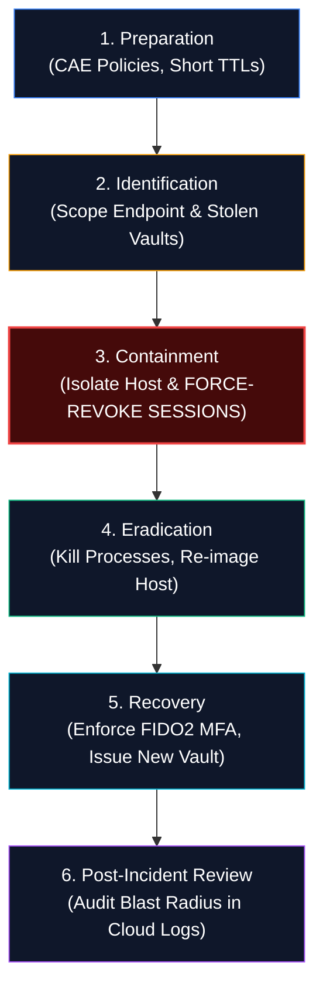

# 🚨 09: Incident Response Playbook — Infostealer Infection & Session Revocation


> **Framework:** NIST SP 800-61 Rev. 2 (Computer Security Incident Handling Guide)  
> **Critical Cardinal Rule:** **PASSWORD RESET ALONE DOES NOT STOP AN ACTIVE SESSION ATTACK!**  
> **Response Urgency:** Priority 1 / Critical (Active Corporate Account Takeover Risk)  
> **Key Automation Platforms:** SOAR, EDR APIs (CrowdStrike, Defender, SentinelOne), IdP APIs (Okta, Entra ID)  

---

## ⚡ 1. The Cardinal Rule of Session Compromise

The most catastrophic mistake security operations teams make during an infostealer investigation is executing a standard password reset and assuming the incident is contained.

```
┌─────────────────────────────────────────────────────────────────────────────────┐
│               THE FATAL IR TRAP: PASSWORD RESET VS. SESSION REVOCATION           │
├─────────────────────────────────────────────────────────────────────────────────┤
│                                                                                 │
│   1. Analyst detects infostealer on endpoint.                                   │
│   2. Analyst resets victim's Active Directory / SSO password.                   │
│   3. Analyst believes the incident is successfully closed.                      │
│                                                                                 │
│   [!] REALITY CHECK:                                                            │
│   The adversary on Genesis Market does NOT use the password.                    │
│   The adversary is using an already-authenticated HTTP SESSION COOKIE           │
│   issued BEFORE the password was reset.                                         │
│                                                                                 │
│   In many SaaS applications (Slack, AWS Console, Salesforce, Jira),             │
│   an active session cookie remains 100% valid until its natural expiration       │
│   date (hours or days later) unless an explicit SESSION REVOCATION API is called!│
│                                                                                 │
└─────────────────────────────────────────────────────────────────────────────────┘
```

---

## 🔄 2. The 6-Phase Incident Response Lifecycle



---

### Phase 1: Preparation (Pre-Incident Hardening)
Before an incident occurs, implement architectural guardrails:
* **Short Session Lifetimes:** Reduce SaaS and SSO cookie lifetimes from days to hours (e.g., 8–12 hours max).
* **Continuous Access Evaluation (CAE):** Enable Microsoft Entra ID CAE or Okta Identity Threat Protection to immediately invalidate tokens when a critical event (such as password change or IP change) occurs.
* **Prohibit Browser Password Storage:** Enforce enterprise Group Policy (GPO) or Intune configuration profiles disabling browser password and autofill caching (`PasswordManagerEnabled = false`).
* **Enforce Password Managers:** Deploy enterprise-managed password managers (1Password, Bitwarden, Keeper) with zero-knowledge master key architecture.

---

### Phase 2: Identification & Scoping
When an infostealer alert triggers:
1. **Identify the Infected Host & User:**
   * Determine the exact hostname, IP address, and logged-in user account.
2. **Determine the Infection Timestamp:**
   * Check EDR telemetry for the exact second the infostealer executed and decrypted the browser vaults.
   * This timestamp ($T_0$) defines the start of your **Vulnerability Window**.
3. **Inventory Harvested Browsers:**
   * Identify all browsers installed on the host (Chrome, Edge, Firefox, Brave).
   * Review browser history to see which corporate web applications were active.

---

### Phase 3: Immediate Containment (The 5-Step Lockdown)

Execute these five containment steps simultaneously within **15 minutes** of triage:

#### Step 1: Network Quarantine of Endpoint
Isolate the infected endpoint from the network via EDR console (CrowdStrike Network Containment, Defender Device Isolation). Do NOT power off the machine (preserve volatile RAM for memory acquisition).

#### Step 2: Global Cloud Session Revocation
Immediately revoke all active refresh and access tokens across all corporate Identity Providers (IdPs):
* **Microsoft Entra ID (PowerShell):**
  ```powershell
  # Revoke all active sessions and refresh tokens
  Revoke-AzureADUserAllRefreshToken -ObjectId "<User_Object_ID>"
  ```
* **Microsoft Graph PowerShell:**
  ```powershell
  Revoke-MgUserSignInSession -UserId "user@enterprise.com"
  ```
* **Okta API (cURL):**
  ```bash
  curl -X DELETE "https://enterprise.okta.com/api/v1/users/{userId}/sessions" \
       -H "Authorization: SSWS {api_token}"
  ```
* **Google Workspace Admin:**
  Sign out the user from all active browser sessions and wipe mobile device sessions.

#### Step 3: OAuth App & Refresh Token Revocation
Audit and revoke any OAuth third-party application authorizations linked to the user's account to prevent persistent API backdoors.

#### Step 4: Primary Credential Rotation
Reset the user's Active Directory and SSO passwords. Require a complex, non-reused password.

#### Step 5: Multi-Factor Authentication (MFA) Re-Verification
Log into the IdP administration portal and inspect all registered MFA factors:
* Verify that the attacker did not register a secondary phone number, authenticator app, or FIDO key during the compromised session window.
* Revoke all existing MFA devices and force a clean re-enrollment in the presence of an IT administrator.

---

### Phase 4: Eradication
1. **Memory & Triage Acquisition:**
   If required for legal or law enforcement proceedings, capture RAM (`winpmem.exe`) and triage artifacts (KAPE / CyLR).
2. **Re-imaging (Gold Standard):**
   Infostealers frequently drop secondary payloads, persistence mechanisms, or backdoors. **Never attempt to "clean" an infostealer endpoint**. Wipe the storage drive and re-image the machine from a known-good gold image.

---

### Phase 5: Recovery & Return to Service
1. Issue a freshly provisioned, hardened workstation to the employee.
2. Enroll the user with **FIDO2 Hardware Security Keys** (YubiKey) to enforce phishing-resistant authentication.
3. Verify that browser password saving remains disabled.
4. Conduct tailored security coaching with the user regarding the specific initial infection vector (e.g., malvertising, cracked software).

---

### Phase 6: Post-Incident Review & Blast Radius Scoping

This is where the SOC determines **what the attacker actually did** while in possession of the stolen session:
1. Query cloud audit logs (AWS CloudTrail, Entra ID Sign-ins, Okta System Log, Google Workspace Reports) from infection time ($T_0$) to session revocation time ($T_{\text{revoke}}$).
2. Check for:
   * Unauthorized downloads or exports in SharePoint, OneDrive, Google Drive, or Box.
   * New email forwarding rules or mailbox delegation permissions in Exchange Online.
   * New API keys, IAM users, or SSH keys created in cloud infrastructure (AWS/Azure/GCP).
   * Sensitive communications viewed in Slack, Teams, or corporate email.

---

## ⏭️ Next Chapter
Proceed to [**10: Comprehensive MITRE ATT&CK Matrix Mapping**](./10-mitre-attack-mapping.md) to inspect the full enterprise adversary tradecraft breakdown.
