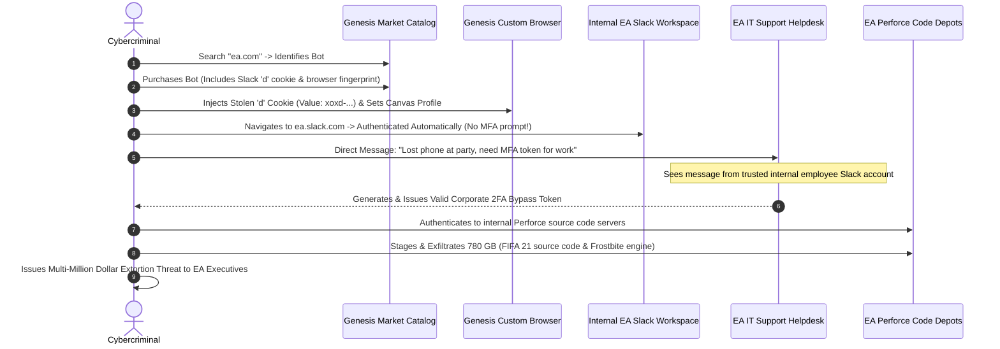
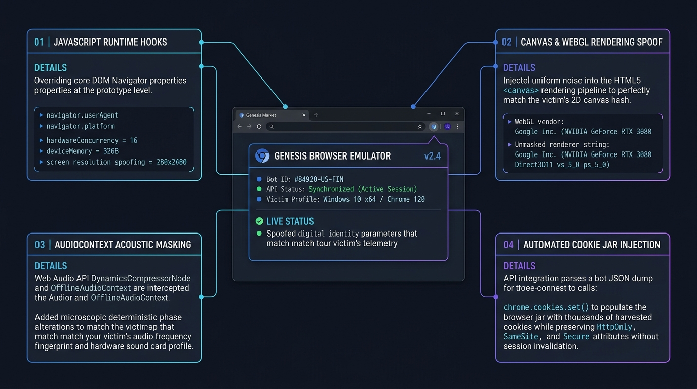

# 🔬 12: Deep R&D — Reverse Engineering, Cryptographic Dissection & Forensic Deconstruction


> **Research Focus:** In-Depth Cryptographic Engineering, Malware Forensics & Protocol Dissection  
> **Target Subsystems:** Chromium DPAPI / App-Bound Encryption, Genesis Extension CDP Hooks, Slack Session Replay  
> **Case Study Investigation:** Comprehensive Technical Post-Mortem of the 2021 Electronic Arts (EA) Breach  

---

## 🔐 1. Cryptographic Dissection: Chromium Vault Decryption & App-Bound Evolution


To understand how infostealers weaponized victim environments for Genesis Market, security researchers must analyze the precise low-level cryptographic architecture of Chromium's storage engines and how browser vendors are responding.

### A. The Chromium v80–v126 DPAPI + AES-256-GCM Implementation

Prior to Chrome version 80, browser passwords and cookies were encrypted individually using the Windows Data Protection API (`CryptProtectData`). In Chrome 80 (February 2020), Google re-architected storage to optimize encryption performance for large databases while continuing to rely on Windows DPAPI for root key protection.

```
┌─────────────────────────────────────────────────────────────────────────────────┐
│                    CHROMIUM COOKIE CIPHERTEXT BINARY ANATOMY                    │
├─────────────────────────────────────────────────────────────────────────────────┤
│                                                                                 │
│   Offset (Bytes)   Length (Bytes)   Field Name           Description            │
│   ──────────────   ──────────────   ──────────           ───────────            │
│   0x00 – 0x02            3          Version Tag          ASCII string 'v10'     │
│                                                          (0x76 0x31 0x30)       │
│   0x03 – 0x0E           12          Initialization       Random Nonce / IV      │
│                                     Vector (IV)          for AES-GCM            │
│   0x0F – (N-16)        N-31         Ciphertext Payload   AES-256 Encrypted      │
│                                                          Session Cookie Value   │
│   (N-16) – N            16          GCM Auth Tag         Galois Message         │
│                                                          Authentication Tag     │
│                                                                                 │
└─────────────────────────────────────────────────────────────────────────────────┘
```

#### The Extraction Routine Executed by RedLine / Vidar:
1. **Master Key Recovery:**
   * The malware opens `%LOCALAPPDATA%\Google\Chrome\User Data\Local State`.
   * It extracts the JSON key:
     `os_crypt.encrypted_key` (Base64-encoded).
   * It base64-decodes the string. The first 5 bytes represent the ASCII magic header `'DPAPI'` (0x44 0x50 0x41 0x50 0x49).
   * The malware strips the 5-byte header, passing the remaining payload to the Win32 API:
     ```c
     DATA_BLOB DataIn;
     DATA_BLOB DataOut;
     DataIn.pbData = (BYTE*)(encrypted_key_bytes + 5);
     DataIn.cbData = total_len - 5;

     // Calling DPAPI under current logged-in user context
     if (CryptUnprotectData(&DataIn, NULL, NULL, NULL, NULL, 0, &DataOut)) {
         // DataOut.pbData now contains the 32-byte (256-bit) plaintext AES Master Key!
     }
     ```
2. **SQLite Database Access:**
   * The malware copies the locked SQLite database:
     `%LOCALAPPDATA%\Google\Chrome\User Data\Default\Network\Cookies`
     to a temporary location (to bypass Windows file-lock restrictions).
   * It queries the table:
     ```sql
     SELECT host_key, name, path, encrypted_value, expires_utc, is_secure, is_httponly 
     FROM cookies;
     ```
3. **AES-256-GCM Decryption:**
   * For each record, the malware validates that `encrypted_value[0:3] == 'v10'`.
   * Nonce = `encrypted_value[3:15]` (12 bytes).
   * Tag = `encrypted_value[-16:]` (16 bytes).
   * Ciphertext = `encrypted_value[15:-16]`.
   * It executes hardware-accelerated AES-GCM decryption using the 32-byte Master Key recovered in Step 1, recovering the plaintext authentication cookie string.

---

### B. The Modern Response: Chrome 127+ App-Bound Encryption

In July 2024 (Chrome 127), Google introduced **Application-Bound (App-Bound) Encryption** to defeat commodity infostealers:
* Instead of calling `CryptProtectData` directly under the standard user token, Chrome delegates master key encryption to a **privileged Windows system service** running as `NT AUTHORITY\SYSTEM`.
* The service verifies the **identity, digital signature, and binary hash** of the calling process before decrypting the master key.
* If an untrusted process (such as `RedLine.exe` or an unverified script) attempts to request master key decryption, the system service denies the request with an access violation, neutralizing basic DPAPI theft.

---

## 🎮 2. Forensic Post-Mortem: The 2021 Electronic Arts (EA) Breach


The 2021 intrusion into Electronic Arts remains the most consequential enterprise security failure stemming directly from Genesis Market. Threat intelligence reconstruction reveals the precise tactical sequence:



### Forensic Anatomy of the Stolen Slack Cookie:
The critical artifact purchased on Genesis was the **Slack `d` cookie**:
* **Name:** `d`
* **Domain:** `.slack.com`
* **Format:** `xoxd-[A-Za-z0-9_-]+`
* **Behavior:** In Slack's web client architecture at the time, possession of a valid `d` cookie combined with a consistent browser User-Agent granted full session persistence. Even if an enterprise enforced Okta SSO with Push MFA at initial login, once the session was minted, the `d` cookie acted as an un-bound bearer token.

---

## 🛠️ 3. Reverse Engineering the Genesis Chromium Plugin & Genesis OS



Genesis Market did not merely sell data; they provided custom client software to ensure the purchased identities successfully bypassed commercial anti-fraud engines (Akamai, Cloudflare, ThreatMetrix, Sift).

### How Genesis OS Hooked the Browser Runtime:

Genesis OS was a modified build of Chromium that implemented low-level C++ hooks into Google’s **V8 JavaScript engine** and the **Blink layout engine**:

```
┌─────────────────────────────────────────────────────────────────────────────────┐
│                      GENESIS RUNTIME API HOOKING ENGINE                         │
├─────────────────────────────────────────────────────────────────────────────────┤
│                                                                                 │
│   1. NAVIGATOR ATTRIBUTES:                                                      │
│      Object.defineProperty(navigator, 'userAgent', {                            │
│          get: () => victim_fingerprint.userAgent                                │
│      });                                                                        │
│      Object.defineProperty(navigator, 'hardwareConcurrency', {                 │
│          get: () => victim_fingerprint.cores                                    │
│      });                                                                        │
│                                                                                 │
│   2. WEBGL SHADER INTERCEPTION:                                                 │
│      WebGLRenderingContext.prototype.getParameter = function(param) {           │
│          if (param === 0x1F00) return "Google Inc. (NVIDIA)"; // UNMASKED_VENDOR│
│          if (param === 0x1F01) return victim_fingerprint.webglRenderer;         │
│          return original_getParameter.apply(this, arguments);                   │
│      };                                                                         │
│                                                                                 │
│   3. CANVAS CRYPTOGRAPHIC SIGNATURE NOISE:                                      │
│      // Injects deterministic mathematical noise into Canvas to render the      │
│      // EXACT 32-bit CRC hash matching the victim's GPU drawing engine:         │
│      HTMLCanvasElement.prototype.toDataURL = function() { ... };                │
│                                                                                 │
│   4. AUDIOCONTEXT COMPRESSOR HOOKING:                                           │
│      // Spoofs DynamicsCompressorNode acoustic attenuation curve:               │
│      BaseAudioContext.prototype.createDynamicsCompressor = function() { ... };  │
│                                                                                 │
└─────────────────────────────────────────────────────────────────────────────────┘
```

Because these overrides occurred at the native browser runtime level (before web application JavaScript executed), client-side anti-bot scripts received 100% consistent signals. The remote server saw the victim's exact Canvas hash, WebGL hardware strings, display resolution, and active cookies.

---

## 🕵️ 4. Law Enforcement Tradecraft: Operation Cookie Monster

The disruption of Genesis Market was a masterclass in modern international cybercrime investigation:

### A. Non-Destructive Server Capture
A primary risk in taking down cybercrime infrastructure is triggering **encryption dead-man switches**. Many criminal platforms configure their hosting to wipe RAM and disk volumes if administrative access drops or unusual traffic is detected.
* Undercover investigators maintained long-term access, capturing live forensic RAM dumps of running server clusters across Europe before executing domain registrar seizure warrants.
* This preserved unencrypted databases containing buyer records, transaction ledgers, and plaintext bot archives.

### B. Blockchain Forensic Tracing
Genesis operated Bitcoin and Monero deposit rails:
* Investigators utilized heuristic wallet clustering to trace buyer deposits through intermediate mixers back to centralized cryptocurrency exchanges requiring **Know-Your-Customer (KYC)** documentation.
* This generated subpoena-ready warrants that unmasked real-world names, physical billing addresses, and linked bank accounts.

### C. The Deterrent Power of "Knock-and-Talks"
By executing **97 knock-and-talk deterrent visits** against lower-volume buyers in the UK and Europe, law enforcement shattered the psychological illusion of dark-web anonymity, proving that purchasing stolen data leaves an indelible digital footprint.

---

## 🌐 5. The Post-Genesis Threat Landscape: The Underground Adapts

Following Genesis Market's takedown on 4 April 2023, cybercrime did not disappear; it decentralized:

```
[Genesis Market Seizure] ──┬──> [Russian Market] (Web-based credential & cookie bazaar)
                           ├──> [2easy] (Automated bot marketplace)
                           └──> [Telegram Bot Storefronts] (Lumma, Stealc, Vidar C2 Bots)
```

1. **Telegram-Based Bot Bazaars:** Modern stealer developers sell access directly through automated Telegram bots, bypassing centralized web marketplaces that are vulnerable to domain seizure.
2. **Shortened Cookie Lifetimes:** Major identity providers have shortened cookie validity and implemented Continuous Access Evaluation (CAE).
3. **The Imperative for Token Binding:** The security community is standardizing on **DPoP (RFC 9449)** and **FIDO2 WebAuthn** to mathematically bind authentication credentials to physical hardware tokens, rendering stolen session cookies completely un-replayable.

---

## ⏭️ Navigation
* Return to [**Master Case Study Index**](./README.md)
* Explore the [**Interactive Demo Site**](./demo-site/index.html)
* Audit your endpoints with [`session_cookie_audit.py`](./scripts/session_cookie_audit.py)
