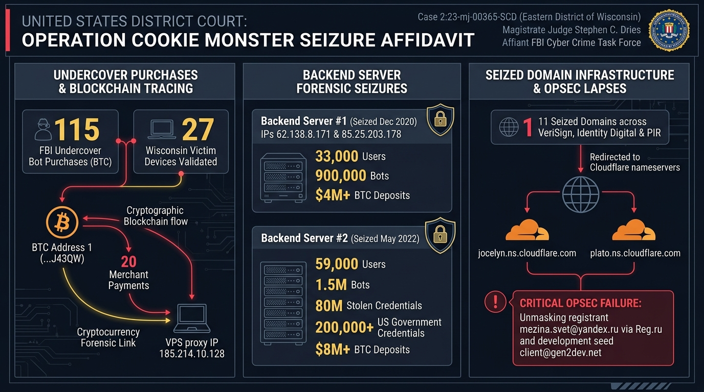
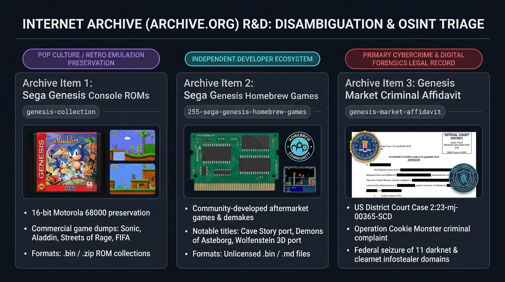

# 🏛️ 13: Primary Source Forensic R&D — Unsealed FBI Seizure Affidavit & Internet Archive OSINT Dissection



> **Primary Source Artifact:** *United States District Court for the Eastern District of Wisconsin*, Case No. `2:23-mj-00365-SCD`  
> **Investigation Focus:** Primary Legal-Forensic Analysis of the Operation Cookie Monster Search and Seizure Warrant  
> **Investigative Pillars:** Undercover Bot Purchases, Bitcoin Cluster Tracking, Multi-Server Seizures, OPSEC De-anonymization & Internet Archive R&D  

---

## 📑 Executive Overview & Case Docket Analysis

In April 2023, an unprecedented coalition of international law enforcement agencies led by the **Federal Bureau of Investigation (FBI)**, the **Dutch National Police (Politie)**, and **Europol's European Cybercrime Centre (EC3)** orchestrated **Operation Cookie Monster**, taking down the world’s most notorious digital identity and session credential marketplace: **Genesis Market**.

While secondary reporting and threat intelligence whitepapers provide broad overviews of the marketplace, the definitive technical, operational, and financial truth resides in the unsealed federal legal filings. The central primary legal artifact is the **Application and Affidavit for a Warrant to Seize Property Subject to Forfeiture**, filed by the FBI in the **U.S. District Court for the Eastern District of Wisconsin** on **March 30, 2023** (Case No. `2:23-mj-00365-SCD`), authorized by **U.S. Magistrate Judge Stephen C. Dries**.

```
┌─────────────────────────────────────────────────────────────────────────────────┐
│                    FEDERAL COURT DOCKET & LEGAL RECORD SUMMARY                  │
├─────────────────────────────────────────────────────────────────────────────────┤
│   Case Number:          Case 2:23-mj-00365-SCD                                  │
│   Court Jurisdiction:   United States District Court, Eastern District of WI    │
│   Presiding Judge:      Hon. Stephen C. Dries, U.S. Magistrate Judge            │
│   Affiant:              Special Agent, FBI Milwaukee Cyber Crime Task Force     │
│   Date of Execution:    March 30, 2023 (Approved) / April 4, 2023 (Takedown)    │
│   Primary Target:       11 Domain Names & Associated Web Infrastructure         │
│   Statutory Bases:      18 U.S.C. §§ 1028, 1029, 1030, 371, 1343                │
│   Forfeiture Statutes:  18 U.S.C. §§ 1028(b)(5), 1029(c)(1)(C), 1030(i)(1)(A),   │
│                         1030(j)(1), 21 U.S.C. § 853(f) & (l)                    │
│   Primary Custodians:   Identity Digital Inc., Public Interest Registry,        │
│                         VeriSign, Inc.                                          │
└─────────────────────────────────────────────────────────────────────────────────┘
```

The affidavit reveals four and a half years of undercover technical investigations, deep blockchain financial tracing, forensic analysis of multiple seized backend servers, and critical operational security (OPSEC) failures made by the Genesis administrators that unmasked their underlying infrastructure and identities.

---

## 🕵️‍♂️ 1. Undercover FBI Operations & Victim Ground-Truth Validation

The affidavit discloses that the FBI commenced active investigation of Genesis Market in **August 2018**. Rather than relying solely on passive intelligence or forum chatter, the FBI initiated an extensive, multi-year covert acquisition campaign:

```
                  UNDERCOVER OPERATIONAL TIMELINE (2018 – 2023)
  
    Sept 19, 2018          Dec 9, 2020             May 18, 2022           March 30, 2023
          │                      │                       │                      │
          ▼                      ▼                       ▼                      ▼
  FBI First Undercover    Seizure of Genesis      Seizure of Genesis     Affidavit Filed
     Bot Purchase         Backend Server #1       Backend Server #2      in E.D. Wisconsin
   (Total: 115 Bots)     (900k Bots, $4M BTC)    (1.5M Bots, $8M BTC)    (11 Domains Seized)
```

### Key Undercover Metrics:
1. **115 Controlled Undercover Purchases:** Between September 19, 2018, and March 2023, undercover FBI agents funded the direct purchase of approximately **115 compromised device "packages" (bots)** from Genesis Market using Bitcoin.
2. **Ground-Truth Victim Verification:**
   * Of the 115 purchased bots, **27 packages** contained stolen data from victim computers physically located within the State of Wisconsin.
   * **7 packages** were traced to victim computers located specifically within the **Eastern District of Wisconsin** (Milwaukee, Green Bay, and surrounding counties).
   * FBI Special Agents conducted physical, in-person interviews with the victim computer owners. Agents presented the exact usernames, plaintext passwords, and account handles extracted from the purchased Genesis bots.
   * **100% of the interviewed victims confirmed** that the credentials were genuine, currently active, and had been stolen without their authorization. This legally proved that Genesis Market was actively harvesting live credentials rather than recycling stale, historical breach dumps.
3. **Validation of the Genesis Architecture:** The FBI's purchases confirmed that when bots were sold with a "digital fingerprint," buyers received a proprietary Chromium browser extension enabling live session cookie injection, proxy chaining, and client-side anti-fraud evasion.

---

## ⛓️ 2. Financial Forensics: Blockchain Graph Clustering & The `J43QW` Wallet

Cybercrime marketplaces rely on virtual currency to conceal payments, but the immutable transparency of public blockchains frequently provides investigators with irrefutable evidence.

```
┌─────────────────────────────────────────────────────────────────────────────────┐
│             GENESIS MARKET INFRASTRUCTURE PAYMENT & BLOCKCHAIN CLUSTER          │
├─────────────────────────────────────────────────────────────────────────────────┤
│                                                                                 │
│   Genesis.market Infrastructure      Hosting Provider 1 Server Costs            │
│   [Server & Domain Invoices]   ────► [Paid via 3 Bitcoin Deposit Addresses]     │
│                                                     │                           │
│                                                     ▼                           │
│                                          Central Management Wallet              │
│                                          BTC Address: [ ...J43QW ]              │
│                                                     │                           │
│                        ┌────────────────────────────┴──────────────────────────┐│
│                        ▼                                                       ▼│
│         20 Merchant Transactions                  VPS Proxy Server Lease        │
│         [U.S. BTC Payment Processor 1]            IP: 185.214.10.128            │
│                        │                          [Hosting Provider 2]          │
│                        ▼                                   │                    │
│         Subscriber Records Unmasked:                       ▼                    │
│         Buyer: "Kenneth GXXXXXki"                 Forwarding Proxy to Genesis   │
│         Email: mmarora@XXX.de                     Backend IPs: 62.138.8.171 &   │
│         Location: Tempe, Arizona                  85.25.203.178                 │
│                                                                                 │
└─────────────────────────────────────────────────────────────────────────────────┘
```

### The Forensic Chain of Evidence:
1. **Hosting Provider 1 Invoices:** The FBI subpoenaed records from the hosting provider maintaining the main domain `genesis.market` ("Hosting Provider 1"). Records revealed three specific Bitcoin deposit addresses used to pay for server hosting fees.
2. **Clustering Analysis:** Using commercial blockchain analytics tools and heuristic clustering algorithms (such as common-input ownership), the FBI traced payments moving through these three addresses into a central consolidating Bitcoin address ending in **`...J43QW`** ("BTC Address 1").
3. **Merchant Disbursement Links:** Tracing the outflow from `BTC Address 1` revealed **20 distinct payments** dispatched to commercial merchants utilizing a regulated, U.S.-based Bitcoin payment processor ("BTC Payment Processor 1").
4. **Subscriber Identification:** BTC Payment Processor 1 complied with federal legal process, furnishing complete subscriber and transaction logs:
   * Transaction IP: **`185.214.10.128`**
   * Listed Buyer Name: **"Kenneth GXXXXXki"**
   * Buyer Physical Location: **Tempe, Arizona**
   * Registered Email: **`mmarora@XXX.de`**
5. **Connecting the VPS Proxy:** Network reconnaissance revealed that IP address `185.214.10.128` belonged to **Hosting Provider 2**, a European hosting provider specializing in Virtual Private Server (VPS) solutions.
6. **Federal Search Warrant on Hosting Provider 2:** Execution of a search warrant on Hosting Provider 2 confirmed that `BTC Address 1` had funded the VPS server at `185.214.10.128`. Forensic logs proved this VPS was operating as a **reverse proxy**, funneling web requests away from the public eye and directing them straight into Genesis Market's real backend servers.

---

## 💾 3. Seizure of Backend Servers: The 2020 vs. 2022 Forensic Images

A critical revelation in the affidavit is that **law enforcement had secretly captured full forensic images of Genesis Market's backend database twice** before the public takedown.

```
┌─────────────────────────────────────────────────────────────────────────────────┐
│                    DUAL BACKEND DATABASE FORENSIC METRICS COMPARISON             │
├─────────────────────────────────────────────────────────────────────────────────┤
│                                                                                 │
│   Metric / Asset                  Backend Server #1        Backend Server #2    │
│   ─────────────────────────────   ─────────────────        ─────────────────    │
│   Seizure Date                    December 9, 2020         May 18, 2022         │
│   Backend IP Addresses            62.138.8.171             Offshore Infrastructure│
│                                   85.25.203.178            (Ex-U.S. Jurisdiction)│
│   SSL Certificate                 Shared Single Cert       Updated Custom Cert  │
│   Registered User Accounts        ~33,000 Users            ~59,000 Users (+78%) │
│   Compromised Bots Listed/Sold    ~900,000 Bots            ~1,500,000 Bots (+66%)│
│   Stolen Account Credentials      Undisclosed Bulk         ~80,000,000 Records  │
│   Government (.gov) Credentials   Several Thousand         >200,000 Records     │
│   Cumulative Virtual Currency     >$4,000,000 USD          >$8,000,000 USD (+100%)│
│                                                                                 │
└─────────────────────────────────────────────────────────────────────────────────┘
```

### Forensic Significance of Backend Server #1:
* On **December 9, 2020**, foreign law enforcement partners executed a covert physical/logical seizure of the server hosting IP addresses `62.138.8.171` and `85.25.203.178`.
* The forensic image yielded raw backend relational databases containing complete user account tables, hashed passwords, plaintext contact Jabber handles, customer search logs, bot sales receipts, customer support helpdesk tickets, and Bitcoin deposit addresses.
* **The Migration Attempt:** Following the December 2020 seizure, Genesis Market experienced noticeable downtime. The administrators realized their infrastructure was unstable and hastily migrated their core database to new servers in non-extradition jurisdictions.

### Forensic Significance of Backend Server #2:
* By **January 2022**, the FBI and international partners re-located the new active backend server.
* On **May 18, 2022**, a second forensic image was captured by foreign law enforcement.
* The updated data revealed explosive growth: registered users jumped to **59,000**, compromised bots reached **1.5 million**, and stolen access credentials surpassed **80 million individual entries**.
* Crucially, the FBI catalogued **over 200,000 access credentials** tied to federal, state, and municipal government employees across the United States, cementing Genesis Market as an active threat to national security and critical infrastructure.

---

## 🚨 4. Operational Security (OPSEC) Failures of the Genesis Operators

Despite using encrypted reverse proxies, Tor hidden services, and offshore hosting, the Genesis Market administrative team made multiple fatal operational security blunders that provided federal investigators with pivotal forensic links.

```
┌─────────────────────────────────────────────────────────────────────────────────┐
│                  GENESIS OPERATOR DE-ANONYMIZATION ATTACK CHAIN                 │
├─────────────────────────────────────────────────────────────────────────────────┤
│                                                                                 │
│   1. WHOIS Privacy Lapses:                                                      │
│      Russian Registrar Reg.ru hosted g3n3sis.net (Domain 8).                   │
│      Admins failed to pay annual privacy renewal fee in 2022.                   │
│      Passive DNS exposed unredacted email: mezina.svet@yandex.ru               │
│                                                                                 │
│   2. Infrastructure Cross-Contamination:                                        │
│      The email mezina.svet@yandex.ru was simultaneously registered to:          │
│      gen2dev.net (Domain 7 - IP 109.123.95.165).                                │
│                                                                                 │
│   3. Development Seed Account:                                                  │
│      Forensic analysis of Backend Server #1 revealed that the very first user   │
│      account ever registered on Genesis Market (created in August 2017) was:   │
│      client@gen2dev.net (created months prior to public launch).                │
│                                                                                 │
│   4. Commercial Payment Re-Use:                                                 │
│      Proxy registration and DNS management for genesis-update.net (Domain 9)    │
│      and genesis-security.net (Domain 10) utilized administrative emails:       │
│      silverxXXXX@XXX.de and seaXXXX@XXXXX.ch, both linked to the same BTC      │
│      Address 1 (J43QW) cluster!                                                 │
│                                                                                 │
└─────────────────────────────────────────────────────────────────────────────────┘
```

### The Four Major OPSEC Errors:
1. **The Expired WHOIS Privacy Fee:** The operators registered auxiliary domain `g3n3sis.net` via Russian registrar `Reg.ru`. While they initially purchased whois privacy masking, they neglected to pay the annual renewal fee. When privacy masking dropped, historical WHOIS scrapers recorded the raw administrative email: **`mezina.svet@yandex.ru`**.
2. **The `gen2dev.net` Staging Fingerprint:** Threat hunters cross-referenced `mezina.svet@yandex.ru` and discovered it had also registered **`gen2dev.net`** (Domain 7), hosted on IP `109.123.95.165`.
3. **The Administrator Test Account ("Patient Zero"):** When the FBI inspected the user database on Backend Server #1, they sorted the user table by account creation timestamp (`created_at ASC`). The first recorded user, registered in **August 2017**—months before Genesis opened to the public—was **`client@gen2dev.net`**, definitively linking the staging server to Genesis Market's core development team.
4. **Reused Auxiliary Emails:** Genesis administrators utilized recurring email handles (`silverxXXXX@XXX.de` and `seaXXXX@XXXXX.ch`) across commercial domain name services and proxy server rentals, allowing investigators to cluster the administrative network across Germany, Switzerland, and Russia.

---

## 🌐 5. Technical Mechanics of the 11-Domain Seizure

The warrant targeted **11 critical domain names** that formed the backbone of Genesis Market's clear-web presence, proxy redirection, and API update pipelines.

```
┌────────────────────────────────────────────────────────────────────────────────────────┐
│                        THE 11 TARGET PROPERTIES SEIZED BY THE FBI                      │
├────────────────────────────────────────────────────────────────────────────────────────┤
│   Domain Name             Target ID        Authoritative Registry        Registry Location│
│   ──────────────────────  ──────────────   ────────────────────────────  ─────────────────│
│   genesis.market          Subject Domain 1 Identity Digital Inc.         Bellevue, WA     │
│   g3n3sis.pro             Subject Domain 2 Identity Digital Inc.         Bellevue, WA     │
│   [Redacted 11th Domain]  Subject Domain 11Identity Digital Inc.         Bellevue, WA     │
│   g3n3sis.org             Subject Domain 3 Public Interest Registry(PIR) Reston, VA       │
│   gsconnects.com          Subject Domain 4 VeriSign, Inc.                Reston, VA       │
│   approveconnects.com     Subject Domain 5 VeriSign, Inc.                Reston, VA       │
│   tracecontrol.net        Subject Domain 6 VeriSign, Inc.                Reston, VA       │
│   gen2dev.net             Subject Domain 7 VeriSign, Inc.                Reston, VA       │
│   g3n3sis.net             Subject Domain 8 VeriSign, Inc.                Reston, VA       │
│   genesis-update.net      Subject Domain 9 VeriSign, Inc.                Reston, VA       │
│   genesis-security.net    Subject Domain 10VeriSign, Inc.                Reston, VA       │
└────────────────────────────────────────────────────────────────────────────────────────┘
```

### Execution Protocol Under Attachments B-1, B-2, and B-3:
1. **Registry Restraint & Lock:** Identity Digital, PIR, and VeriSign were served with federal court orders compelling them to immediately lock the domain records to prevent transfer, modification, or deletion by the criminal operators.
2. **Authoritative Name Server Redirection:** The registries were ordered to point the authoritative NS records for all 11 domains to FBI-controlled Cloudflare nameservers:
   * **`jocelyn.ns.cloudflare.com`**
   * **`plato.ns.cloudflare.com`**
3. **Display of the Seizure Splash Screen:** The web traffic resolving to these domains was rerouted to law enforcement landing pages displaying official emblems of the FBI, Dutch Politie, Europol, and Eurojust, accompanied by contact channels for victim notification:
   * Investigative Intake: `FBIMW-Genesis@fbi.gov`
   * Victim Verification Portals: `haveibeenpwned.com` and `politie.nl/checkyourhack`

---

## 🔍 6. Internet Archive (Archive.org) R&D: Deep Disambiguation & OSINT Analysis



During open-source research and intelligence gathering, analysts frequently encounter overlapping keyword results across open repositories like the **Internet Archive (`archive.org`)**. A critical case study in OSINT triage is distinguishing between pop-culture preservation artifacts and genuine cybercrime forensic records.

### Comprehensive URL Disambiguation:

```
┌─────────────────────────────────────────────────────────────────────────────────┐
│              INTERNET ARCHIVE (ARCHIVE.ORG) ARTIFACT TRIAGE MATRIX              │
├─────────────────────────────────────────────────────────────────────────────────┤
│                                                                                 │
│   Artifact 1: Commercial Console ROMs                                           │
│   URL: https://archive.org/download/genesis-collection                          │
│   Nature: Digital Software Preservation (Video Games)                           │
│   Contents: Official 16-bit Sega Genesis / Mega Drive commercial game ROMs      │
│   Format: .zip archives containing raw binary ROM dumps                         │
│   Examples: Sonic the Hedgehog, Streets of Rage, Castlevania, Aladdin, FIFA     │
│   CTI Relevance: Zero cybercrime relevance; naming collision with "Genesis".    │
│   ───────────────────────────────────────────────────────────────────────────   │
│                                                                                 │
│   Artifact 2: Sega Genesis Homebrew & Aftermarket ROMs                          │
│   URL: https://archive.org/download/255-sega-genesis-homebrew-games/HOMEBREWS/  │
│   Nature: Community Software & Indie Game Development                           │
│   Contents: 255 aftermarket and public-domain (PD) games written for the        │
│             Motorola 68000 processor / Sega Genesis hardware                    │
│   Format: .md, .bin, .smd ROM files                                             │
│   Examples: Cave Story port, Demons of Asteborg, AlterEgo, Wolfenstein 3D port  │
│   CTI Relevance: Zero cybercrime relevance; retrocomputing enthusiast culture.  │
│   ───────────────────────────────────────────────────────────────────────────   │
│                                                                                 │
│   Artifact 3: Primary Cybercrime Legal Seizure Affidavit                        │
│   URL: https://archive.org/details/genesis-market-affidavit                     │
│   Nature: Federal Law Enforcement Primary Legal Record                          │
│   Contents: Complete 29-page unsealed FBI Search & Seizure Affidavit filed in   │
│             U.S. District Court (Eastern District of Wisconsin, Case 23-M-365)  │
│   Format: Scanned PDF, OCR text (genesis-market_djvu.txt), CHOCR, Page Indices │
│   Forensic Data: 11 seized domains, 115 undercover bot buys, BTC cluster       │
│                  ...J43QW, backend IPs 62.138.8.171 & 85.25.203.178, OPSEC logs│
│   CTI Relevance: CRITICAL PRIMARY INTELLIGENCE SOURCE for Operation Cookie      │
│                  Monster, initial access broker tradecraft, and cyber law.      │
│                                                                                 │
└─────────────────────────────────────────────────────────────────────────────────┘
```

### Methodological Lessons for Threat Intelligence Analysts:
1. **Handling Keyword Ambiguity:** Searching for terms like `"genesis"`, `"hydra"`, or `"silkroad"` in massive open-access repositories yields mixed results spanning mythology, video gaming, biological taxonomy, and darknet marketplaces. Rigorous OSINT methodology demands immediate schema inspection: examining creator tags, MIME types, court headers, and digital signatures.
2. **Primary vs. Secondary Legal Sourcing:** Journalists often summarize affidavits with generalized phrasing. Reviewing the raw legal affidavit (`genesis-market_djvu.txt` / `genesis-market.pdf`) uncovers exact IP addresses (`176.124.192.48`, `109.123.95.165`), email handles (`mezina.svet@yandex.ru`), and technical timing that are omitted in public press releases.
3. **The Internet Archive as a Forensic Archive:** Archive.org serves a dual role: preserving historical web snapshots via the Wayback Machine (allowing analysts to inspect Genesis Market’s public demo pages prior to seizure) and hosting public-interest judicial records that might otherwise remain locked behind PACER paywalls.

---

## 🛡️ 7. Key Takeaways for SOC Teams & Forensic Investigators

The unsealed affidavit provides crucial lessons for enterprise defenders:

1. **Infostealers Fuel Initial Access Brokers:** Genesis did not generate its own malware infections; it aggregated stolen vaults from commodity stealers (RedLine, Vidar, Racoon). Blocking stealer execution at the endpoint directly prevents enterprise credentials from being listed on IAB markets.
2. **Ground Truth Over Hype:** The FBI's in-person victim interviews confirmed that **credentials listed on IABs are active, functional, and dangerous**. When a corporate account appears in an infostealer leak, immediate credential revocation and active session termination are mandatory.
3. **Session Cookies Are Priority Assets:** Attackers paid premium prices for bots with active session cookies and fingerprints because they bypassed MFA. Implementing **FIDO2 / WebAuthn hardware tokens** and **Chromium App-Bound Encryption** represents the only architectural defense against session hijacking.
4. **Law Enforcement Collaboration:** Takedowns of decentralized cybercrime operations require simultaneous execution across domain registries, DNS authoritative providers, payment gateways, and foreign hosting facilities.

---

## 🔗 Related Chapters & Navigation

* [01. Genesis Market Overview](./01-genesis-market-overview.md)
* [02. Technical Architecture & Infiltration](./02-technical-architecture.md)
* [05. Operation Cookie Monster](./05-operation-cookie-monster.md)
* [06. Investigation & Forensics](./06-investigation-and-forensics.md)
* [12. Deep R&D: Cryptographic Dissection & Reverse Engineering](./12-deep-rnd-reverse-engineering-and-forensics.md)
* [Interactive Demonstration Site & Lab](./demo-site/index.html)
