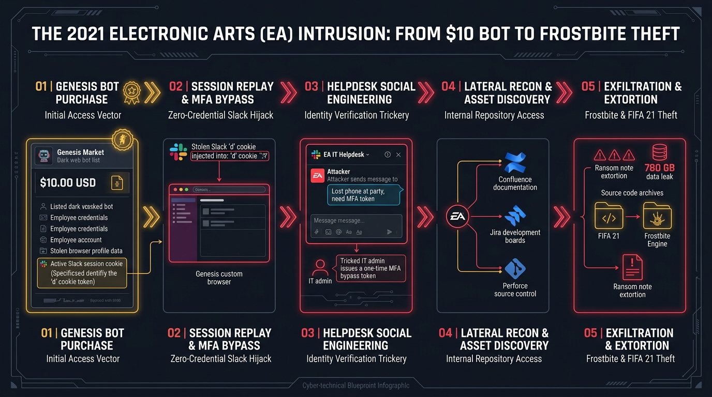

# 📚 14: Industry Reports Synthesis & Comparative Landmark Case Studies


> **Research Focus:** Synthesis of Landmark Threat Intelligence Reports (Trellix, Sophos, Group-IB, Mandiant, CISA)  
> **Comparative Matrix:** Genesis Market vs. EA Breach (2021) vs. Uber Intrusion (2022) vs. CircleCI Supply Chain Incident (2023)  
> **Evolutionary Scope:** Post-Genesis Marketplace Fragmentation (Russian Market, 2easy, Telegram Log Clouds) & Modern Architectural Countermeasures  

---

## 📑 1. Industry Research Synthesis: How Leading Threat Intelligence Labs Analyzed Genesis Market

The takedown of Genesis Market in **Operation Cookie Monster** was preceded and corroborated by extensive technical investigations conducted by the world's premier cybersecurity threat research organizations. Each organization analyzed Genesis Market through a specialized lens, providing defenders with a 360-degree technical understanding of its architecture, economics, and threat tradecraft.

```
┌─────────────────────────────────────────────────────────────────────────────────┐
│              GLOBAL THREAT INTELLIGENCE RESEARCH CONSENSUS MATRIX               │
├─────────────────────────────────────────────────────────────────────────────────┤
│                                                                                 │
│   [TRELLIX ADVANCED RESEARCH CENTER]      [SOPHOS X-OPS RESEARCH]               │
│   • Dynamic Bot Updating Daemon            • Infiltration via Malvertising      │
│   • Chrome DevTools Protocol (CDP) Hooking • Session Cookie Half-Life Metrics   │
│   • Tiered Bot Valuation Algorithms        • Migration to 2easy & Russian Market│
│                                                                                 │
│   [GROUP-IB THREAT INTELLIGENCE]          [MANDIANT & CISA JOINT ADVISORY]      │
│   • Hardware Fingerprint Dissection        • IAB to Ransomware Pipeline         │
│   • Canvas & WebGL Spoofing Mechanics      • Scattered Spider & Lapsus$ Vectors │
│   • Antidetect Browser Comparative Audits  • Enterprise SaaS & Cloud Hijacking  │
│                                                                                 │
└─────────────────────────────────────────────────────────────────────────────────┘
```

---

### A. Trellix Advanced Research Center: Dynamic Updates & The CDP Hooking Engine

Researchers at **Trellix Advanced Research Center** focused on Genesis Market's proprietary software engineering, uncovering that Genesis was far more sophisticated than static dump repositories:

1. **The Dynamic Bot Updating Daemon:**
   * Traditional credential markets sell a static `.txt` dump that decays in value within days as victims change passwords.
   * Trellix revealed that Genesis infected hosts ran a persistent **background telemetry daemon**. Whenever an infected victim authenticated to a new service (e.g., corporate Okta, AWS, or Coinbase) or had their browser refresh an expired cookie, the infostealer automatically intercepted the new token and pushed an encrypted differential update to the Genesis C2 server.
   * If a buyer purchased a "subscribed bot," their Genesis plugin received live cookie syncs in real-time, effectively maintaining continuous unauthorized access until the victim physically disinfected their machine.
2. **Chrome DevTools Protocol (CDP) Automation:**
   * Trellix reverse-engineered the Genesis browser extension, identifying that it communicated directly with Chromium's internal debugging interface using the **Chrome DevTools Protocol (CDP)**.
   * By issuing low-level commands such as `Network.setCookie` and `Emulation.setUserAgentOverride`, the Genesis extension bypassed standard browser extension security boundaries, injecting `HttpOnly` and `SameSite=Strict` cookies into the browser memory space before rendering the DOM.

---

### B. Sophos X-Ops: "Sour Cookies" & Infostealer Supply Chain Economics

The **Sophos X-Ops** investigative report (*"Sour Cookies: The Demise of Genesis Market"*) provided deep visibility into the underground economy feeding Genesis:

1. **Malware Distribution Trajectories:**
   * Sophos tracked how victims were initially compromised: **Google Ads Malvertising** (bidding on keywords like "Zoom installer", "Advanced IP Scanner", "OBS Studio", or "Notepad++"), malicious SEO campaigns, and weaponized software cracks hosted on YouTube video descriptions and GitHub repositories.
   * Commodity stealers (primarily **RedLine**, **Vidar**, and **Raccoon**) served as the primary harvesting harvesters, funneling data up to Genesis Market via bulk API integrations.
2. **Cookie Half-Life & Expiration Research:**
   * Sophos analyzed the temporal decay of stolen session tokens across popular enterprise platforms:
     * **Banking & Financial:** 15 minutes to 4 hours (rapid invalidation upon inactivity).
     * **Social Media & Consumer (Amazon, Google):** 14 to 30 days.
     * **Corporate SaaS (Slack, Discord):** **Months to indefinite** unless an enterprise administrator explicitly revoked active tokens from the workspace management console.
3. **The Marketplace Exodus:**
   * Following the April 4, 2023 seizure, Sophos observed immediate threat actor migration to secondary markets, notably **Russian Market**, **2easy**, and private invite-only Telegram bot channels selling raw "stealer logs" (.zip files containing `cookies.txt`, `passwords.txt`, and system metadata).

---

### C. Group-IB Threat Intelligence: Reverse Engineering the Digital Fingerprint Store

**Group-IB** was one of the earliest research teams to reverse-engineer Genesis Market's fingerprint synthesis engine, highlighting how Genesis defeated modern risk-based authentication:

1. **The Illusion of Legitimate Users:**
   * Modern anti-fraud engines (e.g., Arkose Labs, reCAPTCHA Enterprise, Cloudflare Turnstile, Sift) analyze hundreds of client-side browser attributes. If a login comes from an unknown browser configuration, a CAPTCHA or step-up MFA prompt is triggered.
   * Group-IB proved that Genesis Market did not randomize fingerprints (which triggers statistical anomaly flags); instead, it **cloned the victim's exact physical device profile**:
     * **HTML5 Canvas:** Replicating the unique sub-pixel rendering quirks of the victim's GPU and font rendering engine.
     * **WebGL Context:** Mirroring the victim's unmasked graphics vendor (e.g., `ANGLE (NVIDIA GeForce RTX 3080 Direct3D11 vs_5_0 ps_5_0)`).
     * **AudioContext:** Replicating the exact acoustic latency and frequency response curves generated by the victim's sound card drivers.
2. **Genesis OS vs. Commercial Antidetect Browsers:**
   * Group-IB compared the Genesis Chromium distribution against dedicated multi-accounting and privacy browsers such as **Linken Sphere**, **Kameleo**, **Dolphin Anty**, and **AdsPower**.
   * While commercial antidetect browsers focus on synthetic randomization for affiliate marketing, Genesis OS was custom-engineered for **stateful session replay**, seamlessly linking victim IP proxy pools with exact hardware parameters.

---

### D. Mandiant & CISA: Initial Access Brokering & Adversary Threat Groups

Reports from **Mandiant (Google Cloud)** and joint advisories from **CISA and the FBI** contextualized Genesis Market within the broader advanced persistent threat (APT) and cybercrime landscape:

1. **The IAB-to-Ransomware Pipeline:**
   * Mandiant established that Initial Access Brokers (IABs) operating on Genesis Market directly accelerated the ransomware lifecycle. Attackers no longer needed to spend weeks brute-forcing external perimeter services or conducting spear-phishing campaigns.
   * By purchasing a $15 bot belonging to a corporate contractor, ransomware affiliates (**LockBit**, **Conti**, **BlackCat/ALPHV**, and **Hive**) gained immediate foothold access to corporate Single Sign-On (SSO) gateways and VPNs.
2. **Adversary Tradecraft (Lapsus$ & Scattered Spider):**
   * Threat groups like **Lapsus$ (DEV-0537)** and **Scattered Spider (UNC3944 / Octo Tempest)** systematized the purchase of infostealer session cookies from Genesis and Russian Market.
   * These groups utilized stolen session cookies to bypass Okta, Duo, and Azure AD MFA challenges, proceeding to social engineer internal IT helpdesks via compromised internal Slack and Microsoft Teams channels.

---

## 🔬 2. Landmark Session Hijacking Breaches: Comparative Incident Analysis Matrix



To evaluate the operational impact of session hijacking and identity brokering in the enterprise, we must compare the Genesis Market paradigm against landmark real-world corporate intrusions that exploited identical session token vulnerabilities:

```
┌────────────────────────────────────────────────────────────────────────────────────────────────────────────────────────────────┐
│                                   LANDMARK SESSION HIJACKING BREACHES: COMPARATIVE MATRIX                                      │
├────────────────────────────────────────────────────────────────────────────────────────────────────────────────────────────────┤
│   Incident / Breach             Primary Vector           Bypassed Controls        Blast Radius             Defensive Antidote  │
│   ───────────────────────────   ──────────────────────   ─────────────────────    ──────────────────────   ─────────────────── │
│   1. Electronic Arts (EA)       $10 Genesis Market       Enterprise SSO,          780 GB proprietary data  Continuous Access   │
│      (June 2021)                Slack Session Cookie     MFA, Geofencing          (FIFA 21 source code &   Evaluation (CAE) &  │
│                                                          Policies                 Frostbite Engine)        DPoP Token Binding  │
│                                                                                                                                │
│   2. Uber Technologies          Infostealer on           Push Notification MFA,   Full internal Slack,     Phishing-Resistant  │
│      (September 2022)           Contractor Device,       Device Health Checks,    Google Workspace, AWS,   FIDO2/WebAuthn &    │
│                                 MFA Fatigue Attack       SSO Gateway              and HackerOne takeover   Hardware MFA Tokens │
│                                                                                                                                │
│   3. CircleCI DevOps            Infostealer Malware on   Single Sign-On (SSO),    Customer encrypted       Workstation App-    │
│      (January 2023)             Engineer Laptop,         Static IP Whitelisting,  project variables &      Bound Encryption &  │
│                                 Active Browser Session   OAuth Bearer Tokens      GitHub OAuth tokens      Device Certificate  │
│                                                                                                            Attestation (mTLS)  │
│                                                                                                                                │
│   4. Post-Genesis Landscape:    Decentralized Telegram   Legacy Anti-Fraud,       Ransomware Initial       Complete Zero Trust │
│      Russian Market & 2easy     Log Clouds & Lumma /     SMS/Push MFA, Password   Access (LockBit, ALPHV), Architecture & FIDO2 │
│      (2023–Present)             Stealc Commodity Stealers Complexity Rules        Cloud Tenant Takeover    Mandatory Auth      │
└────────────────────────────────────────────────────────────────────────────────────────────────────────────────────────────────┘
```

---

### Detailed Case Dissections:

#### 🎮 Case 1: Electronic Arts (EA) — The $10 Slack Bot Breach (2021)
* **The Exploit Sequence:** Attackers searched Genesis Market for `@ea.com` credentials and purchased an active bot profile for approximately **$10**. The bot contained an active Slack authentication cookie (`d` cookie).
* **Execution:** The adversary loaded the session cookie into their browser, instantly entering EA's internal corporate Slack without encountering an MFA prompt.
* **The Social Engineering Pivot:** Posing as the legitimate employee on Slack, the attacker direct-messaged EA's internal IT helpdesk: *"I lost my phone at a party last night, please generate a one-time MFA bypass token for my new device."* Tricked by the internal, authenticated chat context, IT support issued a valid MFA token.
* **Impact:** The intruders accessed EA's internal Jira boards, Confluence wikis, and Perforce source code repositories, exfiltrating **780 GB of proprietary source code**, including the *FIFA 21* game engine and the foundational *Frostbite* graphics engine.

#### 🚗 Case 2: The Uber Intrusion — MFA Fatigue Meets Infostealer Seeding (2022)
* **The Exploit Sequence:** An external contractor's personal computer was infected with infostealer malware, harvesting corporate credentials. The threat actor (attributed to the **Lapsus$** syndicate) purchased the credentials and attempted an internal VPN login.
* **The MFA Fatigue Escalation:** When confronted with Duo Push notification prompts, the attacker flooded the contractor with repeated mobile push requests over several hours, accompanied by a WhatsApp message impersonating Uber Corporate Security instructing the contractor to *"Accept the notification to stop the alerts."*
* **Impact:** Once inside the internal network, the attacker discovered a PowerShell script containing hardcoded plaintext administrator credentials for **Thycotic (Secret Server)**, Uber's enterprise Privileged Access Management (PAM) vault. The intruder gained full super-admin access to Uber's AWS console, Google Workspace, internal Slack, and VMware vSphere environments.

#### 🔄 Case 3: CircleCI — Software Supply Chain Compromise via Engineer Session Theft (2023)
* **The Exploit Sequence:** A DevOps engineer's personal computer was compromised with malware that bypassed local antivirus detection. The stealer extracted active browser session cookies associated with CircleCI's internal administrative portal.
* **The Execution:** Using the stolen session token, the adversary impersonated the employee, bypassing two-factor authentication because the session was already valid and authenticated.
* **Impact:** The attacker accessed internal customer database backups and exfiltrated encrypted environment variables, tokens, and keys used by CircleCI customers to integrate with AWS, Google Cloud, and GitHub. CircleCI was forced to mandate that all customers immediately rotate thousands of production API tokens and secrets.

---

## 🌐 3. The Post-Genesis Ecosystem: Fragmentation & Decentralization

The takedown of Genesis Market in April 2023 dealt a catastrophic blow to centralized identity-as-a-service marketplaces, but it also initiated an immediate **Darwinian adaptation** across the cybercrime ecosystem.

```
┌─────────────────────────────────────────────────────────────────────────────────┐
│                    THE EVOLUTION OF THE INFOSTEALER UNDERGROUND                 │
├─────────────────────────────────────────────────────────────────────────────────┤
│                                                                                 │
│   2018 – 2023: THE CENTRALIZED ERA (GENESIS MARKET)                             │
│   • Centralized clear-web and dark-web storefronts.                             │
│   • Proprietary custom browser plugins for instant cookie injection.            │
│   • Single point of failure allowing coordinated law enforcement takedown.      │
│                                                                                 │
│                                        │                                        │
│                                        ▼                                        │
│                                                                                 │
│   2023 – PRESENT: THE DECENTRALIZED ERA (POST-COOKIE MONSTER)                   │
│   • Russian Market & 2easy: Fast-moving, stripped-down web storefronts selling  │
│     raw browser archives without proprietary plugins.                           │
│   • Telegram Private "Cloud Logs": Automated subscription bots distributing     │
│     tens of gigabytes of fresh stealer archives daily via encrypted channels.   │
│   • Next-Gen Stealers (Lumma, Stealc, Meduza): Advanced anti-analysis,          │
│     polymorphic packing, and Chrome 127+ App-Bound Encryption bypass routines.  │
│                                                                                 │
└─────────────────────────────────────────────────────────────────────────────────┘
```

### Key Trends in the Modern Threat Landscape:
1. **Abandonment of Custom Browser Plugins:** Criminal operators recognized that custom Chromium extensions and proprietary antidetect frameworks created distinctive digital fingerprints that aided law enforcement investigations. Modern buyers utilize commercial antidetect browsers (e.g., Dolphin Anty, AdsPower) or raw Python scripts to inject cookies into standard Chrome instances.
2. **The Dominance of Telegram "Log Clouds":** Cybercrime syndicates increasingly distribute stolen logs through automated Telegram channels. Subscribers pay monthly cryptocurrency fees (e.g., $100 to $500/month) to receive real-time streams of thousands of newly harvested device logs.
3. **Arms Race Against App-Bound Encryption:** Following Google's deployment of **App-Bound Encryption** in Chrome 127 (July 2024)—which binds the DPAPI decryption key to a privileged Windows service—infostealers rapidly shifted tactics to inject into running browser processes via API hooking or tricking users into launching unprivileged debugging flags (`--remote-debugging-port`).

---

## 🛡️ 4. The Unified Defensive Roadmap: Engineering Immunity Against Session Hijacking

Defending against infostealers and session hijacking requires eliminating the assumption that an authenticated HTTP session cookie is a trusted bearer token. Organizations must deploy a **Three-Pillar Defensive Architecture**:

```
┌─────────────────────────────────────────────────────────────────────────────────┐
│              THREE-PILLAR ARCHITECTURE AGAINST SESSION HIJACKING                │
├─────────────────────────────────────────────────────────────────────────────────┤
│                                                                                 │
│   PILLAR 1: PHISHING-RESISTANT AUTHENTICATION (FIDO2 / WEBAUTHN)                │
│   • Replaces passwords with cryptographic public-private key pairs.             │
│   • Authentication ceremony is cryptographically bound to the domain URL origin.│
│   • Adversary proxying tools (Evilginx) cannot intercept credentials.           │
│                                                                                 │
│   PILLAR 2: CONTINUOUS ACCESS EVALUATION (CAE / ZTNA)                           │
│   • Terminates session tokens within seconds of network anomaly detection.      │
│   • Enforces real-time validation of IP velocity, device health, and user state.│
│   • Replaying a stolen cookie from an unknown host triggers instant revocation. │
│                                                                                 │
│   PILLAR 3: CRYPTOGRAPHIC TOKEN BINDING (RFC 9449 DPoP)                         │
│   • Binds access tokens to a private cryptographic key stored in client TPM.    │
│   • Bearer tokens become sender-constrained; possession of token is useless     │
│     without the corresponding private key signature.                            │
│                                                                                 │
└─────────────────────────────────────────────────────────────────────────────────┘
```

### Actionable Hardening Checklist:
1. **Enforce Device Health Attestation:** Mandate that cloud identity providers (Okta, Entra ID, Google Workspace) only issue session cookies to devices with verified, managed enterprise certificates (mTLS) and active EDR telemetry.
2. **Shorten Maximum Session Lifetimes:** Restrict corporate Slack, email, and cloud management consoles to maximum session lifetimes of **8 to 12 hours**, with re-authentication required for administrative actions.
3. **Deploy EDR Rules for Browser Vault File Access:** Implement endpoint detection rules (such as the Sigma and Splunk queries in Chapters 7 & 8) monitoring non-browser processes attempting to read `Local State` or `Network\Cookies`.
4. **Mandate Complete Incident Response Protocol:** In the event of an infostealer alert, follow Chapter 9's Playbook: **Never stop at a password reset**. Always execute active IdP session revocation, OAuth refresh token invalidation, and complete workstation isolation.

---

## 🔗 Related Chapters & Navigation

* [01. Genesis Market Overview — The Paradigm Shift to IDaaS](./01-genesis-market-overview.md)
* [02. Technical Architecture & Fingerprint Replay](./02-technical-architecture.md)
* [04. Initial Access Brokerage & The EA Breach](./04-initial-access-broker.md)
* [05. Operation Cookie Monster Global Takedown](./05-operation-cookie-monster.md)
* [12. Deep R&D: Cryptographic Dissection & Reverse Engineering](./12-deep-rnd-reverse-engineering-and-forensics.md)
* [13. Unsealed FBI Seizure Affidavit & Internet Archive OSINT](./13-fbi-affidavit-forensic-dissection.md)
* [Interactive Demonstration Site & Lab](./demo-site/index.html)
