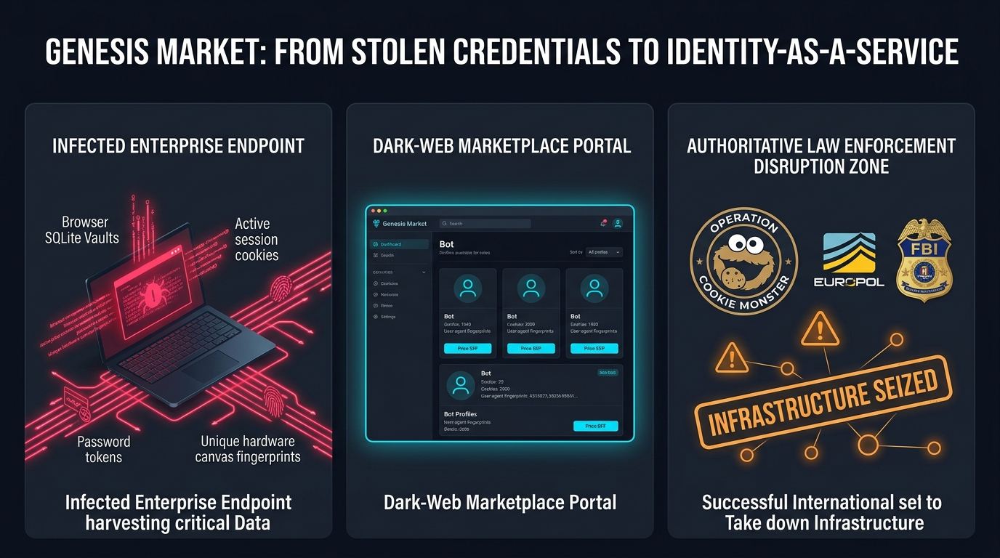
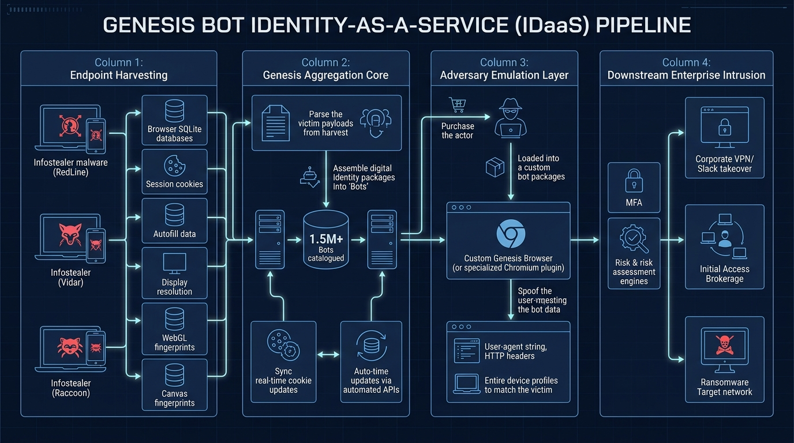
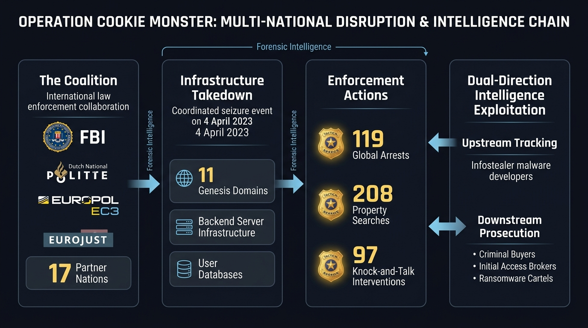
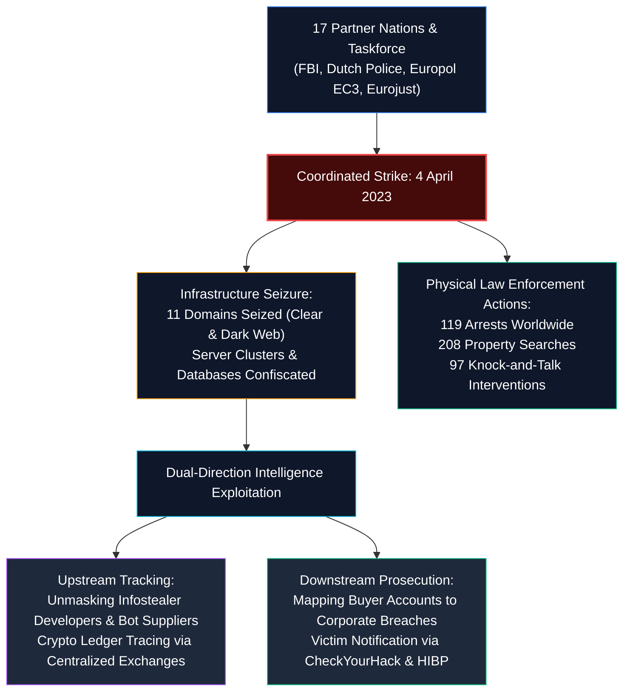

# 🍪 Genesis Market: A Full Cybersecurity Case Study
## From Stolen Credentials to "Identity-as-a-Service" (Operation Cookie Monster)



> **Case Study Name:** Genesis Market: From Stolen Credentials to "Identity-as-a-Service"  
> **Global Law Enforcement Operation:** **Operation Cookie Monster**  
> **Primary Takedown Execution Date:** 4 April 2023  
> **Industry Classification:** Cybercrime / Initial Access Brokerage (IAB) / Credential Theft / Identity-as-a-Service (IDaaS)  
> **Primary Commodities:** Stolen Credentials, Session Cookies, Browser Fingerprints, Autofill Vaults, Digital Identities  
> **Participating Law Enforcement:** FBI, Dutch National Police (Politie), Europol (EC3), Eurojust, UK NCA, and 17 International Partners  
> **Total Scale:** >1.5 Million Compromised Endpoints ("Bots"), >2 Million Individual Digital Identities  
> **Defensive Auditing Tool:** [`session_cookie_audit.py`](./scripts/session_cookie_audit.py)  

---

## 📑 Complete Chapter Index

This research case study is divided into 15 dedicated, deep-dive technical chapters:

1. [**01: Genesis Market Overview — The Paradigm Shift to "Identity-as-a-Service"**](./01-genesis-market-overview.md)  
   *The death of the simple password dump; genesis of Genesis Market (2018–2023); the "Bot" concept as a digital twin; market economics ($0.70 to hundreds of dollars).*
2. [**02: Technical Architecture — How Genesis Replicated Digital Identities**](./02-technical-architecture.md)  
   *Anatomy of a Genesis Bot; client-side browser fingerprinting (Canvas, WebGL, AudioContext, fonts); the Genesis Chromium Browser & OS Plugin; session cookie injection mechanics.*
3. [**03: The Infostealer Ecosystem — The Malware Engine Behind Genesis**](./03-infostealer-ecosystem.md)  
   *RedLine, Vidar, Raccoon, Lumma, and Mars stealers; Windows DPAPI `CryptUnprotectData` decryption of Chromium `Local State` and `Network\Cookies`; Firefox NSS decryption; C2 exfiltration.*
4. [**04: Initial Access Brokerage (IAB) & The Cybercrime Division of Labor**](./04-initial-access-broker.md)  
   *The IAB economic model; ransomware syndicates (Conti, LockBit, BlackCat) outsourcing initial access; Deep-Dive Case Study: The 2021 Electronic Arts (EA) $10 Slack bot breach and Frostbite source code theft.*
5. [**05: Operation Cookie Monster — The Global Law Enforcement Takedown**](./05-operation-cookie-monster.md)  
   *The 4-year joint investigation (FBI, Politie, Europol EC3, Eurojust); April 4, 2023 takedown; 119 arrests, 208 searches, 97 knock-and-talks, 11 seized domains; authentic Europol action day evidence; official video documentary.*
6. [**06: Digital Forensics & Law Enforcement Intelligence Exploitation**](./06-investigation-and-forensics.md)  
   *Dual-direction intelligence exploitation (upstream suppliers vs. downstream buyers); database and crypto ledger analysis; host-based forensic artifacts on infected endpoints (DPAPI Event ID 4692, staging paths).*
7. [**07: SOC Detection Engineering — Detecting Infostealers & Session Hijacking**](./07-soc-detection.md)  
   *Dual-plane detection strategy (Endpoint vs. Cloud/Identity); non-browser process file access Sigma rule; impossible travel and geographic velocity; TLS JA3/JA4 fingerprint shifts mid-session.*
8. [**08: Splunk SIEM Detection Engineering — Practical SPL Queries**](./08-splunk-detection.md)  
   *5 production-ready Splunk SPL queries: impossible travel velocity, non-browser Chrome SQLite access, temp folder staging, mid-session User-Agent drift, and un-challenged administrative actions; Risk-Based Alerting (RBA).*
9. [**09: Incident Response Playbook — Infostealer Infection & Session Revocation**](./09-incident-response.md)  
   *The Golden Rule: Password Reset Alone Does NOT Stop Session Replay; NIST SP 800-61 Rev. 2 6-phase response lifecycle; 5-step emergency containment workflow (host isolation, Entra ID / Okta session revocation, OAuth purging).*
10. [**10: Comprehensive MITRE ATT&CK Matrix Mapping**](./10-mitre-attack-mapping.md)  
    *Complete enterprise matrix correlation across 11 tactics and 24 techniques spanning Initial Access (T1189), Execution (T1204), Credential Access (T1539, T1555.003), Collection, and Impact (T1486).*
11. [**11: Lessons Learned — Strategic & Tactical Recommendations**](./11-lessons-learned.md)  
    *The illusion of single-factor authentication; CISO mandates for Device Health Attestation (Zero Trust) and Phishing-Resistant MFA (FIDO2/WebAuthn); Cryptographic Token Binding (DPoP); why infrastructure takedowns do not end the underlying economy.*
12. [**12: Deep R&D — Reverse Engineering, Cryptographic Dissection & Forensic Deconstruction**](./12-deep-rnd-reverse-engineering-and-forensics.md)  
    *Low-level byte-by-byte Chromium cookie ciphertext analysis; Chrome 127+ App-Bound Encryption; full forensic post-mortem of the 2021 EA Slack breach ($10 bot to 780 GB Frostbite code theft); Genesis OS V8 runtime API hooking; blockchain tracking and undercover law enforcement tradecraft.*
13. [**13: Primary Source Forensic R&D — Unsealed FBI Seizure Affidavit & Internet Archive OSINT Dissection**](./13-fbi-affidavit-forensic-dissection.md)  
    *Deep-dive analysis of unsealed federal court filings (Case 2:23-mj-00365-SCD, E.D. Wisconsin); 115 undercover FBI bot purchases; BTC Address 1 cluster (...J43QW); forensic breakdown of Backend Server #1 (2020) vs. Backend Server #2 (2022); fatal OPSEC failures (mezina.svet@yandex.ru, client@gen2dev.net); complete Internet Archive (archive.org) OSINT triage and disambiguation matrix.*
14. [**14: Industry Reports Synthesis & Comparative Landmark Case Studies**](./14-industry-reports-synthesis-and-comparative-case-studies.md)  
    *Synthesis of authoritative threat intelligence reports (Trellix, Sophos X-Ops, Group-IB, Mandiant, CISA); dynamic bot update daemon analysis; CDP protocol hooking; comparative post-mortem matrix (EA Breach vs. Uber MFA fatigue vs. CircleCI supply chain theft); post-Genesis landscape (Russian Market, 2easy, Telegram Log Clouds); 3-pillar defensive architecture (FIDO2, CAE, RFC 9449 DPoP).*
15. [**15: Authentic Web Infrastructure, Source Code Dissection & Portal Cloning**](./15-authentic-web-infrastructure-source-code-and-portal-cloning.md)  
    *Primary source web application reverse engineering; raw HTML/JavaScript source code analysis from live Internet Archive snapshots; Yii 2.0 PHP framework footprint; client-side RSA-2048 password encryption; invite token regex validation; dual-language Terms of Service and CIS safe-harbor doctrine; raw 4 April 2023 seizure page dissection.*

---

## 💻 Interactive Educational Demo Website

As part of this case study, we built an interactive, standalone simulation web application: [**`demo-site/index.html`**](./demo-site/index.html).

### Features of the Interactive Demo Lab:
* **Historical Wayback Scrubber:** Switch between 2021–2022 (Live Market), June 2021 (EA Breach), and April 4, 2023 (Operation Cookie Monster Seizure Banner).
* **Live Catalog & Domain Search:** Search simulated bots by corporate domain (`@ea.com`, `@paypal.com`, `@okta.com`, `@aws.com`) with real-time filtering by cookie count, country, and OS.
* **Interactive Bot Profile Inspector:** Click on any bot to inspect its replicated hardware fingerprint (Canvas hash, WebGL renderer string, screen resolution) and decrypted session cookies.
* **Authentic Portal Clone:** Exact 1:1 reconstruction of the Yii framework Sign-In and Invite-Only Registration interface with vector brand graphics, RSA-2048 password encryption preview, and the authentic CIS safe-harbor Terms of Service.
* **Genesis Plugin Simulator:** Interactive emulation of the Chrome DevTools Protocol (CDP) hooking engine that injects stolen cookies into live browser sessions.
* **Zero Trust Defensive Lab:** Compare why traditional authentication failed and how modern Zero Trust (FIDO2 WebAuthn, CAE, DPoP token binding) neutralizes cookie theft.
* **Politie CheckYourHack Verification Engine:** Interactive simulation of the official Dutch National Police victim portal testing whether enterprise emails were compromised in Genesis.
* **Media & Video Intelligence Hub:** Direct gallery showcasing authentic Europol action photos, Wikimedia seizure screengrabs, the official Politie documentary breakdown, and 13 high-resolution forensic research infographics with lightbox zoom.
* **Raw Historical Web Captures:**
  * Raw 4 April 2023 Seizure Landing Page: [`demo-site/authentic-seizure-page.html`](./demo-site/authentic-seizure-page.html)
  * Raw 2021 Sign-In Portal: [`demo-site/authentic-login-page.html`](./demo-site/authentic-login-page.html)
  * Raw 2021 Registration & Terms Portal: [`demo-site/authentic-register-page.html`](./demo-site/authentic-register-page.html)

**To run the interactive demo:** Open [`demo-site/index.html`](./demo-site/index.html) in any web browser.

---

## 🎯 Executive Summary & Quick Reference Matrix

Genesis Market was one of the most prolific and technically disruptive criminal enterprises in modern cybercrime history. Unlike conventional dark-web sites that simply brokered stolen username-and-password combinations, Genesis industrialized the sale of **usable, living digital identities**.

By combining infostealer malware (RedLine, Vidar, Raccoon) with a custom Chromium browser plugin, Genesis allowed low-skilled buyers to import a victim's active session cookies, browser fingerprint, hardware profile, and autofill records. When navigating to corporate cloud services, the buyer's browser perfectly mirrored the victim's machine—**bypassing Multi-Factor Authentication (MFA), risk-based fraud scoring, and geofencing controls without ever knowing the user's password**.

On 4 April 2023, an international coalition led by the **FBI** and the **Dutch National Police (Politie)**, coordinated through **Europol** and **Eurojust**, seized Genesis Market's infrastructure, executed 119 arrests worldwide, and took down 11 domains in **Operation Cookie Monster**.

### 📊 Quick Triage & Operation Matrix

| Attribute / Metric | Operational Reality / Forensic Finding | Context & Significance |
|---|---|---|
| **Marketplace Name** | **Genesis Market** | Founded ~2018, seized April 4, 2023 |
| **Operational Codenames** | **Operation Cookie Monster** | Law enforcement takedown across 17 partner nations |
| **Primary Commodity** | **Genesis "Bots"** | Packaged digital identity (Cookies + Credentials + Fingerprint) |
| **Inventory Scale** | **>1.5 Million Bots** | Over 2 million unique victim identities worldwide |
| **Price Range** | **$0.70 to Hundreds of USD** | Scaled dynamically by the value and density of harvested accounts |
| **Primary Malware Strains**| RedLine, Vidar, Raccoon, Lumma | Commodity infostealers harvesting Chromium DPAPI vaults |
| **Key Architectural Bypass**| **Session Cookie Replay** | Skips credential entry and MFA prompts entirely |
| **Notable Victim Intrusion**| **Electronic Arts (EA) - 2021** | $10 Slack bot purchase ➔ 780 GB Frostbite source code theft |
| **Law Enforcement Coalition**| FBI, Dutch Police, Europol, Eurojust | 119 arrests, 208 searches, 97 knock-and-talks, 11 domains seized |
| **Cardinal Defense Lesson** | **Password Reset ≠ Attack Stopped** | Active session cookies must be explicitly revoked via IdP APIs |

---

## 🔍 The Problem & How It Was Solved (The Complete Disruption Lifecycle)

### 🚨 The Problem: The Industrialization of "Living" Digital Identities
Prior to Genesis Market, cybercriminals bought and sold credential dumps consisting of simple username-and-password combinations. As enterprises and cloud service providers adopted Multi-Factor Authentication (MFA), IP geolocation risk scoring, and device fingerprinting, traditional password dumps suffered diminishing returns.

Genesis Market solved this obstacle for cybercriminals by industrializing **Identity-as-a-Service (IDaaS)**:
1. **The Stealer Pipeline:** Commodity infostealers (RedLine, Vidar, Raccoon) infected consumer and enterprise endpoints, calling Windows DPAPI `CryptUnprotectData()` to extract the plaintext AES master key and decrypt SQLite browser databases (`Network\Cookies`, `Login Data`, `Web Data`).
2. **Replicating the Digital Twin:** Genesis packaged the stolen credentials, thousands of active HTTP session cookies, and granular client browser parameters (Canvas render hashes, WebGL vendor strings, AudioContext harmonics, screen dimensions, installed fonts).
3. **Bypassing the Security Perimeter:** Cybercriminals loaded purchased "Bots" ($0.70 to $450) into the custom Genesis Chromium Browser or Extension. The browser hooked JavaScript runtime APIs via the Chrome DevTools Protocol (CDP), injecting stolen cookies and spoofing fingerprints. To cloud providers like Google, Microsoft, Okta, and AWS, the attacker's browser appeared to be the victim's legitimate, already-authenticated computer—**completely bypassing passwords, SMS/App MFA, and geofencing without raising a single fraud alert**.
4. **The Downstream Crisis:** Initial Access Brokers (IABs) used Genesis bots to infiltrate corporate environments, such as the **2021 Electronic Arts (EA) breach**, where a $10 bot containing an employee's Slack cookie led to internal corporate takeover, IT helpdesk social engineering, and the exfiltration of 780 GB of proprietary game source code. Traditional incident response failed because IT teams simply reset passwords while the active session cookies remained valid and exploitable.

---

### 🛡️ How They Solved It: Multi-National Takedown, Citizen Remediation & Zero Trust Architecture
The resolution of the Genesis Market threat required a synchronized offensive and defensive campaign spanning global law enforcement and enterprise identity architecture:

```
┌────────────────────────────────────────────────────────────────────────────────────────────────────────┐
│                        HOW THEY SOLVED IT: THE 5-PILLAR DISRUPTION FRAMEWORK                           │
├────────────────────────────┬───────────────────────────────────────────────────────────────────────────┤
│ 1. UNDERCOVER INTEL &      │ FBI Milwaukee Cyber Task Force conducted 115 undercover bot purchases,    │
│    BLOCKCHAIN FORENSICS    │ mapping merchant Bitcoin clusters (BTC Address 1: ...J43QW) directly to   │
│                            │ operator VPS infrastructure and Russian payment services (YooMoney/WebMoney)│
├────────────────────────────┼───────────────────────────────────────────────────────────────────────────┤
│ 2. INFRASTRUCTURE SEIZURE  │ On 4 April 2023, Operation Cookie Monster executed simultaneous seizures   │
│    (OPERATION COOKIE MONSTER)│ of 11 clearnet/darknet domains and backend servers in Germany & Finland.   │
│                            │ Confiscated 80M+ stolen credentials and complete user registration databases.│
├────────────────────────────┼───────────────────────────────────────────────────────────────────────────┤
│ 3. GLOBAL LAW ENFORCEMENT  │ Europol and Eurojust coordinated 119 arrests, 208 physical searches, and  │
│    ENFORCEMENT ACTIONS     │ 97 deterrent knock-and-talks across 17 partner nations targeting buyers.  │
├────────────────────────────┼───────────────────────────────────────────────────────────────────────────┤
│ 4. PUBLIC CITIZEN          │ The Dutch National Police (Politie) parsed the seized database and launched│
│    REMEDIATION PORTAL      │ CheckYourHack.nl, enabling citizens and enterprises to check compromised  │
│                            │ accounts and follow step-by-step infection eradication guides.             │
├────────────────────────────┼───────────────────────────────────────────────────────────────────────────┤
│ 5. ARCHITECTURAL HARDENING │ Shift from static passwords to Phishing-Resistant FIDO2/WebAuthn tokens;  │
│    (ENTERPRISE ZERO TRUST) │ Continuous Access Evaluation (CAE) to revoke sessions immediately on IP   │
│                            │ drift; RFC 9449 DPoP token binding; Chrome 127+ App-Bound Encryption.     │
└────────────────────────────┴───────────────────────────────────────────────────────────────────────────┘
```

---

## 🏛️ Technical Architecture Blueprint

The diagram below illustrates the end-to-end Genesis identity replication pipeline—from initial malware harvesting to custom browser emulation and enterprise intrusion:



```
+---------------------------------------------------------------------------------------------------------+
|                                    GENESIS BOT IDENTITY-AS-A-SERVICE PIPELINE                           |
+---------------------------------------------------------------------------------------------------------+
| [1. ENDPOINT HARVESTING]                                                                                |
|     Infostealers (RedLine / Vidar / Raccoon) compromise victim host via Malvertising or Cracked Software.|
|     Calls CryptUnprotectData() to decrypt Chrome 'Local State' master key & 'Network\Cookies'.          |
|                                                     │                                                   |
|                                                     ▼                                                   |
| [2. GENESIS AGGREGATION CORE]                                                                           |
|     C2 pushes archive to Genesis Market API. Genesis compiles credentials, active cookies,              |
|     screen resolution, WebGL renderer, and Canvas hashes into a structured "Bot Profile".               |
|                                                     │                                                   |
|                                                     ▼                                                   |
| [3. ADVERSARY EMULATION LAYER]                                                                          |
|     Criminal buyer purchases Bot ($0.70 - $100s) and loads Bot ID into Genesis Chromium Browser Plugin. |
|     Genesis OS hooks browser APIs, injecting victim cookies and spoofing victim hardware signals.       |
|                                                     │                                                   |
|                                                     ▼                                                   |
| [4. ENTERPRISE CLOUD INTRUSION]                                                                         |
|     Attacker visits https://target.enterprise.com. Server validates pre-authenticated cookie and        |
|     matching fingerprint. Attacker gains full access to Slack, AWS, Okta, or VPN without MFA!           |
+---------------------------------------------------------------------------------------------------------+
```

---

## 💥 Operation Cookie Monster: Disruption Flowchart

On April 4, 2023, international law enforcement dismantled the entire infrastructure:





---

## 🛠️ Defensive Auditing Script (`session_cookie_audit.py`)

As part of this case study, we developed an open-source defensive auditing tool for incident responders, SOC analysts, and security engineers: [`session_cookie_audit.py`](./scripts/session_cookie_audit.py).

### Script Capabilities:
1. **Browser Datastore Audit:** Scans local user profiles for active Google Chrome, Microsoft Edge, Brave, and Mozilla Firefox cookie/login databases.
2. **Infostealer Staging Detection:** Scans `%TEMP%`, `%APPDATA%`, and `C:\ProgramData` for unencrypted infostealer staging files (`cookies.txt`, `passwords.txt`, `autofill.txt`, `wallets.txt`, and suspicious `.zip` archives).
3. **MITRE ATT&CK Correlation:** Maps detected conditions directly to T1539 (Steal Web Session Cookie) and T1555.003 (Credentials from Web Browsers).
4. **JSON Reporting:** Supports automated ingestion into enterprise SIEM/SOAR platforms via `--json` and `--export`.

### Usage:
```bash
# Run local forensic audit of current user profile
python scripts/session_cookie_audit.py

# Audit specific directory and export findings to JSON
python scripts/session_cookie_audit.py --user-dir "C:\Users\TargetUser" --export audit_report.json
```

---

## 📈 Key Operational Numbers

| Metric | Reported Figure | Context & Source |
|---|---|---|
| **Operational Period** | **~2018 – 2023** | ~5 years of uninterrupted cybercrime operations |
| **Compromised Endpoints Offered** | **>1.5 Million Computers** | Verified infected endpoints listed on the marketplace |
| **Individual Identities Represented** | **>2 Million Identities** | Unique individual identities compromised across 100+ countries |
| **Active Bot Listings at Takedown** | **>1.5 Million Bots** | High-density bots containing active authentication state |
| **Countries in Coordinated Action** | **17 Nations** | US, Netherlands, UK, Germany, Canada, Poland, Australia, etc. |
| **Arrests Reported by Europol** | **119 Arrests** | Operators, infrastructure facilitators, and high-volume buyers |
| **Property Searches Conducted** | **208 Searches** | Physical raids executed across 13+ European and global jurisdictions |
| **Knock-and-Talk Preventive Visits** | **97 Interventions** | UK NCA and European police visiting low-level users and buyers |
| **Seized Genesis Web Domains** | **11 Domains** | Seized under federal warrants issued in the U.S. District Court |

---

## 📚 Primary Sources & Official References

* [Europol Press Release — Takedown of Notorious Hacker Marketplace Selling Your Identity to Criminals](https://www.europol.europa.eu/media-press/newsroom/news/takedown-of-notorious-hacker-marketplace-selling-your-identity-to-criminals)
* [U.S. Department of Justice (DOJ) — Criminal Marketplace Disrupted in International Cyber Operation](https://www.justice.gov/archives/opa/pr/criminal-marketplace-disrupted-international-cyber-operation)
* [Eurojust News — Takedown of Online Market That Sold Stolen Account Credentials (Operation Cookie Monster)](https://www.eurojust.europa.eu/news/takedown-online-market-sold-stolen-account-credentials-Operation-Cookie-Monster)
* [Dutch National Police (Politie) — Operation Cookie Monster & CheckYourHack](https://www.politie.nl/en/news/2023/april/5/operation-cookiemonster.html)
* [U.K. National Crime Agency (NCA) — Notorious Criminal Marketplace Selling Victim Identities Taken Down](https://www.nationalcrimeagency.gov.uk/news/notorious-criminal-marketplace-selling-victim-identities-taken-down-in-international-operation)
* [MITRE ATT&CK Framework — Technique T1539: Steal Web Session Cookie](https://attack.mitre.org/techniques/T1539/)
* [MITRE ATT&CK Framework — Technique T1555.003: Credentials from Web Browsers](https://attack.mitre.org/techniques/T1555/003/)
* [IETF RFC 9449 — Demonstrating Proof-of-Possession at the Application Layer (DPoP)](https://datatracker.ietf.org/doc/html/rfc9449)
* [Internet Archive (Archive.org) — Genesis Market Seizure Affidavit (Case 2:23-mj-00365-SCD)](https://archive.org/details/genesis-market-affidavit)
* [Internet Archive (Archive.org) — Sega Genesis Console Collection (Retro Preservation Disambiguation)](https://archive.org/download/genesis-collection)
* [Internet Archive (Archive.org) — Sega Genesis Homebrew Games (Developer Ecosystem Disambiguation)](https://archive.org/download/255-sega-genesis-homebrew-games/HOMEBREWS/)
