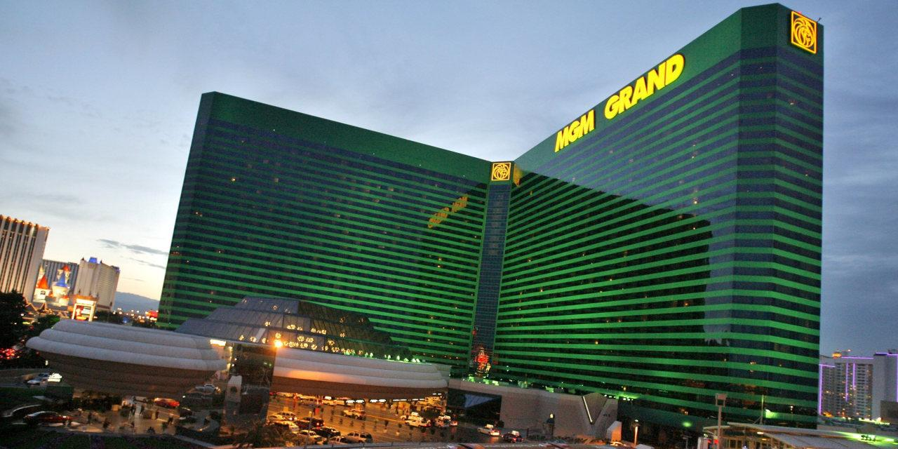
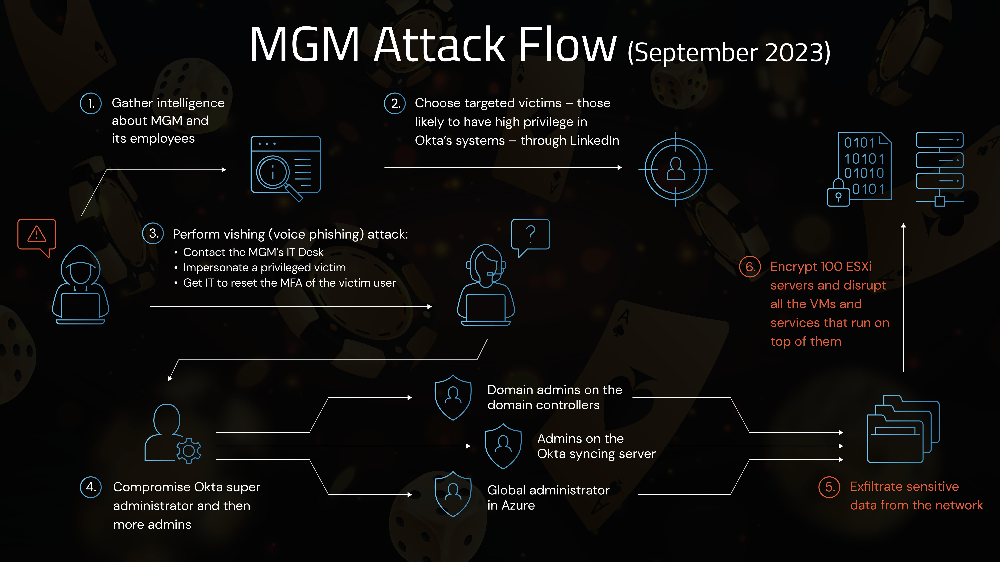
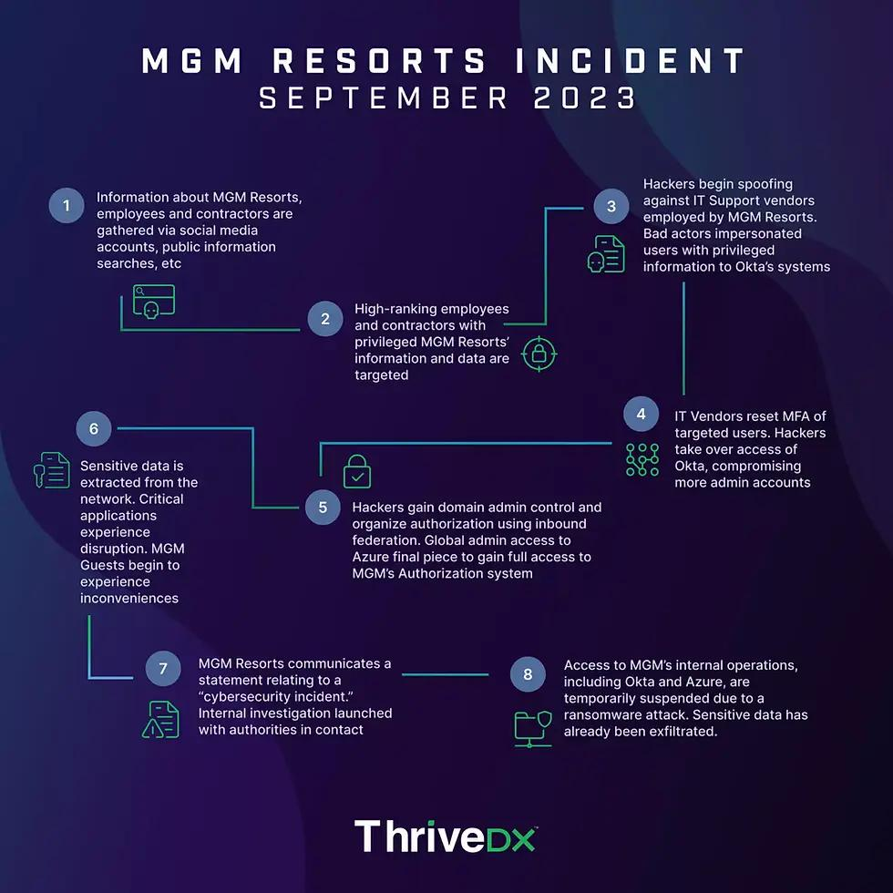
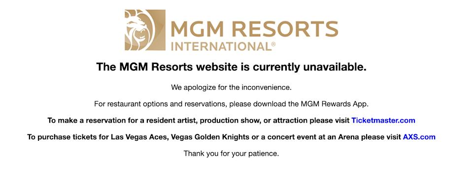
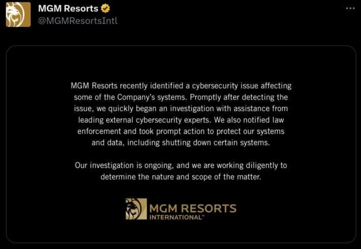

# Inside the MGM Resorts Cyberattack: How Social Engineering Became an Enterprise-Wide Cyber Incident

> **A Comprehensive Cybersecurity Seminar & Deep-Dive Case Study Suite**  
> **Courseware & Forensic Analysis:** MGM Resorts International Cyberattack (September 2023)  
> **Target Audience:** CISOs, Identity Architects, Incident Responders, Blue Teams, SOC Lead Analysts, Executive Leadership  
> **Repository Category:** Enterprise Threat Case Studies

---

## 📋 Executive Fact Sheet & Incident Parameters

| Parameter | Confirmed Forensic Details |
| :--- | :--- |
| **Target Organization** | **MGM Resorts International** (NYSE: MGM) |
| **Industry Sector** | Global Hospitality, Entertainment, Gaming, Financial Operations |
| **Primary Incident Date** | **September 10 – September 11, 2023** (Discovery and Emergency Network Severance) |
| **Threat Actors Associated** | **Scattered Spider** (UNC3944 / Octo Tempest / Muddled Libra) & **ALPHV/BlackCat** Ransomware Syndicate |
| **Initial Intrusion Vector** | **Voice Phishing (Vishing)** targeting the IT Service Desk using LinkedIn OSINT profiling |
| **Primary Compromise Layer** | **Identity and Access Management (IAM)**: Okta Workforce Identity Cloud & Microsoft Entra ID (Azure AD) |
| **Destructive Impact Layer** | **Virtualization Infrastructure**: VMware ESXi Hypervisor Clusters |
| **Encryption Locker** | **ALPHV/BlackCat Linux/ESXi Ransomware** (Rust-based multithreaded ELF locker) |
| **Direct Financial Loss** | **~$100 Million** negative impact to Adjusted Property EBITDAR (Form 8-K / 10-K filings); **<$10 Million** one-time IR advisory costs |
| **Operational Impact** | Tens of thousands of hotel digital door locks disabled, slot machines forced into tilt shutdown, POS credit card processing offline, customer check-in lines exceeding 4 hours |
| **Ransom Payment** | **$0 Paid** (MGM refused all extortion demands; executed full clean-state infrastructure rebuild) |

---

## 🖼️ Forensic Visual Evidence & Infographic Gallery

| Figure | Image Preview | Title & Description |
| :---: | :---: | :--- |
| **Fig 1** | [](image/mgm_grand_las_vegas.jpg) | **The Target: MGM Grand Las Vegas**<br>Iconic flagship resort and casino destination among 31 global properties impacted by the identity compromise. |
| **Fig 2** | [](image/mgm_attack_flow_diagram.jpg) | **End-to-End Attack Flow Vector**<br>Complete 6-stage architectural attack chain: LinkedIn OSINT ➔ Help Desk vishing ➔ Okta Admin ➔ Azure AD pivot ➔ VMware ESXi mass encryption. |
| **Fig 3** | [](image/mgm_thrivedx_attack_timeline.jpg) | **Incident Progression Timeline (ThriveDX)**<br>Chronological breakdown from initial target reconnaissance on September 8 through system severance and crisis management. |
| **Fig 4** | [](image/mgm_website_outage_notice.jpg) | **Public Portal Emergency Outage Banner**<br>Authentic web outage notice deployed across all public MGM reservation websites following proactive network isolation. |
| **Fig 5** | [](image/mgm_twitter_official_statement.jpg) | **Official Corporate Statement on X/Twitter**<br>Primary source statement released by @MGMResortsIntl on September 11, 2023, disclosing proactive system shutdowns. |

---

## 🔍 The Problem & How It Was Solved (The Identity Attack & Resilience Lifecycle)

### 🚨 The Problem: The Human Service Desk as the Enterprise Single Point of Failure
Prior to the September 2023 incident, enterprise cybersecurity focused predominantly on endpoint detection, firewalls, and cryptographic MFA tokens. The MGM Resorts incident demonstrated how advanced social engineering cartels completely circumvent perimeter investments by targeting the human identity verification layer.

The core failure modes and threat mechanics that created the crisis:
1. **OSINT Profiling & Service Desk Exploitation:** Threat actors from **Scattered Spider** (UNC3944) harvested employee rosters, full names, job titles, and mobile phone numbers from public LinkedIn profiles and commercial data brokers. Calling the MGM IT Help Desk, the adversary posed as a high-privilege corporate employee, claiming their registered smartphone was broken. Relying on outdated **Knowledge-Based Authentication (KBA)**—static data such as date of birth and employee ID—the helpdesk technician bypassed security protocols, cleared the legitimate employee's MFA device, and registered the attacker's phone.
2. **Escalation to Okta Super Administrator:** Using the newly provisioned MFA factor, the attacker authenticated into MGM's **Okta Workforce Identity Cloud** environment. Identifying accounts with elevated roles, the attacker escalated privileges to **Super Administrator**, granting them sovereign control over identity lifecycle management, single sign-on (SSO) applications, and enterprise directory sync.
3. **Inbound Federation Tampering & Stealth Persistence:** Anticipating that the incident response team would eventually identify compromised credentials and trigger administrative password resets, the attacker established a persistent architectural backdoor: **tampering with Inbound SAML Identity Provider (IdP) federation**. By registering a secondary, attacker-controlled rogue IdP trusted by MGM's Okta tenant, the threat actors could forge signed SAML assertions (`SAMLResponse`) and mint arbitrary session tokens on demand—rendering standard password and MFA resets completely ineffective.
4. **Cloud-to-On-Premises Lateral Pivot (Entra ID to vCenter):** Armed with federated identity access, the attackers pivoted into **Microsoft Entra ID (Azure AD)** and synchronized on-premises Active Directory environments. They compromised domain administrative accounts and extracted credentials for **VMware vCenter Server**.
5. **Virtualization Layer Destruction (Mass ESXi Encryption):** Rather than attempting to deploy ransomware across tens of thousands of individual Windows workstations running EDR agents, the attackers targeted the core virtualization engine: **over 100 VMware ESXi hypervisors**. Partnering with the **ALPHV/BlackCat** ransomware syndicate, they used `esxcli vm process kill` commands to terminate running virtual machines, and executed a multithreaded Linux/ESXi Rust ransomware payload that encrypted `.vmdk` virtual disks at hardware speed.
6. **The Operational Cascade:** The encrypted hypervisors took down slot machine tracking systems, hotel reservation databases, digital room key generation, casino cage payment terminals, and restaurant POS systems across 31 properties, forcing lines exceeding 4 hours and costing ~$100 million in lost EBITDAR.

---

### 🛡️ How They Solved It: Emergency Severance, Identity Eviction & Zero Trust Hardening
MGM Resorts resolved the incident through a combination of high-stakes executive crisis leadership, forensic eradication, and permanent architectural re-engineering:

```
┌────────────────────────────────────────────────────────────────────────────────────────────────────────┐
│                        HOW THEY SOLVED IT: THE 5-PILLAR RESILIENCE FRAMEWORK                           │
├────────────────────────────┬───────────────────────────────────────────────────────────────────────────┤
│ 1. EXECUTIVE RESOLVE:      │ MGM executive leadership and the Board made the principled decision to    │
│    ZERO RANSOM PAID ($0)   │ refuse extortion demands ($0 paid), unlike competitors who paid $15M.     │
│                            │ Prevents financing of cyber syndicates and guarantees full clean rebuild. │
├────────────────────────────┼───────────────────────────────────────────────────────────────────────────┤
│ 2. EMERGENCY SEVERANCE &   │ Facing rapid lateral movement, MGM took the unprecedented step of         │
│    CONTAINMENT             │ proactively severing internal networks and shutting down core systems to  │
│                            │ protect sensitive PCI cardholder databases and customer financial vaults. │
├────────────────────────────┼───────────────────────────────────────────────────────────────────────────┤
│ 3. IDENTITY EVICTION &     │ Partnering with Mandiant, responders audited all IdP logs, severed rogue │
│    CLEAN-STATE REBUILD     │ Inbound SAML federations, revoked all OAuth refresh tokens, and rebuilt   │
│                            │ global Okta and Entra ID administrative credentials from scratch.         │
├────────────────────────────┼───────────────────────────────────────────────────────────────────────────┤
│ 4. IMMUTABLE HYPERVISOR    │ Instead of negotiating for flawed decryptors, engineers provisioned clean │
│    RESTORATION             │ ESXi hosts from hardened golden images and restored virtual machines from │
│                            │ out-of-band, immutable, air-gapped backups in isolated recovery zones.    │
├────────────────────────────┼───────────────────────────────────────────────────────────────────────────┤
│ 5. PERMANENT ZERO TRUST    │ • Abolished all Knowledge-Based Authentication (KBA) at IT Help Desk.     │
│    ARCHITECTURE            │ • Mandatory Out-of-Band Live Video Verification with photo ID matching.   │
│                            │ • FIDO2/WebAuthn hardware tokens (YubiKeys) for all administrative roles. │
│                            │ • Complete network isolation of VMware ESXi management VLANs.             │
└────────────────────────────┴───────────────────────────────────────────────────────────────────────────┘
```

---

## 🛡️ Vulnerability Remediation & Incident Prevention Blueprint ("How to Solve the Vuln & How to Protect")

The MGM Resorts incident exposed how advanced identity-focused threat actors exploit structural weaknesses in service desk procedures, identity federation trust models, and hypervisor management architectures. The following blueprint details how to **solve the specific technical vulnerabilities** and **build proactive enterprise protection**.

```
┌────────────────────────────────────────────────────────────────────────────────────────────────────────┐
│                      MGM RESORTS: VULNERABILITY REMEDIATION & DEFENSE MATRIX                           │
├────────────────────────────┬────────────────────────────────────────────┬──────────────────────────────┤
│ COMPONENT / THREAT LAYER   │ THE TECHNICAL VULNERABILITY (CWE)          │ HOW TO SOLVE & PROTECT       │
├────────────────────────────┼────────────────────────────────────────────┼──────────────────────────────┤
│ 1. IT Help Desk Factor     │ CWE-303: Incorrect Implementation of       │ • Abolish Knowledge-Based    │
│    Reset Workflows         │ Authentication; CWE-287: Improper Auth.    │   Authentication (KBA).      │
│                            │ Bypassing MFA via static biographical PII. │ • Mandatory live video check │
│                            │                                            │   with corporate badge match.│
├────────────────────────────┼────────────────────────────────────────────┼──────────────────────────────┤
│ 2. Okta Inbound SAML       │ CWE-290: Authentication Bypass via         │ • Restrict IdP Federation to │
│    Federation Backdoor     │ Spoofing; CWE-347: Improper Verification   │   break-glass multi-custodian│
│                            │ of Cryptographic Signature.                │   approvals.                 │
│                            │ Rogue IdP mints arbitrary SAML tokens.     │ • Real-time SystemLog alert. │
├────────────────────────────┼────────────────────────────────────────────┼──────────────────────────────┤
│ 3. VMware ESXi Management  │ CWE-284: Improper Access Control;          │ • ESXi Strict Lockdown Mode. │
│    & Hypervisor Security   │ CWE-250: Execution with Unnecessary        │ • Out-of-Band isolated VLAN. │
│                            │ Privileges (`esxcli vm process kill`).     │ • Disable SSH permanently.   │
├────────────────────────────┼────────────────────────────────────────────┼──────────────────────────────┤
│ 4. Administrative Cloud    │ CWE-269: Improper Privilege Management.    │ • Just-In-Time (JIT) PAM.    │
│    Accounts (Entra/Okta)   │ 24/7 standing Super Admin privileges       │ • Phishing-resistant FIDO2   │
│                            │ without time-bound approvals.              │   hardware keys (YubiKeys).  │
└────────────────────────────┴────────────────────────────────────────────┴──────────────────────────────┘
```

### 🔧 1. How to Solve the Core Vulnerabilities

#### A. Solving the Help Desk KBA Vulnerability (CWE-303 / CWE-287)
* **The Vulnerability:** Help desk agents verified caller identity using **Knowledge-Based Authentication (KBA)**—asking for the employee's date of birth, home address, employee ID, or partial SSN. Because Scattered Spider obtained this information from LinkedIn and commercial data brokers, the verification protocol provided zero security assurance.
* **How It Is Solved:**
  1. **Strict KBA Prohibition (NIST SP 800-63B Rev 4):** Formally ban static biographical questions as proof of identity across all IT service desks.
  2. **Mandatory Cryptographic Out-of-Band (OOB) Verification:** When an employee calls requesting an MFA reset, the help desk must send a cryptographically signed push challenge to a pre-enrolled secondary corporate authenticator or trigger an automated voice callback to the employee's verified carrier-provisioned corporate mobile number on file.
  3. **High-Definition Live Video Verification:** If the user has lost all enrolled devices, factor resets must occur via a recorded, live video call where the employee holds their physical government ID and corporate employee badge up to the camera. The agent compares the face against the organization's HR photo-of-record.
  4. **Four-Eyes Dual Custodian Approval:** Configure Okta/Entra ID policy so that no single tier-1 support technician can clear an MFA factor or issue a temporary access pass. A second supervisory manager must cryptographically sign off on the ticket before the factor is activated.

#### B. Solving Inbound SAML Federation Tampering (CWE-290 / CWE-347)
* **The Vulnerability:** Once inside Okta with administrative privileges, the attackers registered an untrusted **Inbound SAML Identity Provider**. Okta accepted SAML assertions signed by the attacker's private key, granting the attackers persistent access even after the compromised admin's password was changed.
* **How It Is Solved:**
  1. **Dual-Authorization for IdP Configuration Changes:** Restrict the ability to add, edit, or delete Identity Providers (`/api/v1/idps`) to a dedicated "Break-Glass" emergency administrative account requiring multi-party authorization and hardware security keys.
  2. **Automated SOC Tripwire Alerting:** Implement a high-priority SOC alert in Splunk/Sentinel that triggers immediately upon any change to identity federation settings:
     ```sql
     index=okta eventType IN ("zone.idp.create", "zone.idp.update", "identity_provider.create", "system.idp.lifecycle.create")
     | stats count by actor.alternateId, client.ipAddress, displayMessage
     ```
  3. **Pinning and Hardening SAML Signing Certificates:** Enforce strict certificate validation for all federated SAML assertions, requiring valid CA chains and rejecting self-signed or unrecognized certificates.

#### C. Solving VMware ESXi Hypervisor Vulnerabilities (CWE-284 / CWE-250)
* **The Vulnerability:** Threat actors accessed ESXi hypervisors directly over corporate subnets, logged in via SSH using compromised domain credentials, terminated virtual machines using `esxcli vm process kill`, and executed an unvetted ELF binary (ALPHV ransomware) directly on the hypervisor OS.
* **How It Is Solved:**
  1. **Enable ESXi Strict Lockdown Mode:** In Strict Lockdown Mode, the ESXi Direct Console User Interface (DCUI) and SSH service are permanently disabled. The hypervisor can ONLY be administered through VMware vCenter Server:
     ```bash
     # Enable ESXi Strict Lockdown Mode via command line
     vim-cmd -U dcui vim-cmd /hostsvc/advopt/update Security.AccountLockFailures int 3
     esxcli system security lockdown set --mode=lockdownStrict
     ```
  2. **Enforce UEFI Secure Boot & Executable Signing:** Configure host hardware with UEFI Secure Boot and enforce VMware Installation Bundle (VIB) acceptance level to `VMwareCertified` or `PartnerSupported`:
     ```bash
     esxcli software acceptance set --level=PartnerSupported
     ```
     This prevents unverified ELF binaries or kernel modules from executing on the hypervisor.
  3. **Dedicated Out-of-Band Management VLAN:** Hypervisor management interfaces (VMkernel ports) must be isolated on a dedicated, non-routable management network with no direct internet access and zero routing from general enterprise user subnets.

---

### 🛡️ 2. How to Protect the Organization Against the Incident

#### A. Proactive Identity Architecture & Zero Trust Hardening
* **Deploy Phishing-Resistant FIDO2/WebAuthn Hardware Tokens:** Replace mobile push notifications and SMS codes with physical security keys (YubiKeys) for all administrative personnel. FIDO2 tokens bind the cryptographic handshake to the browser domain, neutralizing reverse-proxy phishing (Evilginx) and social engineering fatigue.
* **Implement Just-in-Time (JIT) Privileged Access Management (PAM):** Eliminate permanent "standing" administrative privileges. Administrative roles (such as Okta Super Admin or Entra Global Administrator) must be granted via Privileged Identity Management (PIM) for a maximum duration of 1 to 4 hours, requiring ticket justification and manager approval.
* **Residential Proxy & Tor Anomaly Detection:** Configure Okta ThreatInsight and Entra ID Identity Protection to block authentications originating from commercial proxy networks, residential proxies, and VPNs commonly used by Scattered Spider to bypass geofencing.

#### B. Virtualization Defense & Isolated Recovery Environments (IRE)
* **Air-Gapped Immutable Backups:** Maintain offline, immutable snapshots of core virtual machine disks (`.vmdk`). Backups must be written to write-once-read-many (WORM) storage targets with out-of-band management credentials that cannot be accessed from the primary corporate Active Directory domain.
* **Segment Critical OT / Casino Floor Operations:** Enforce micro-segmentation between corporate IT services, casino gaming engines, hotel reservation databases, and point-of-sale networks. A compromise of corporate identity should never have network connectivity to casino slot machine management controllers.

#### C. Ransomware Extortion Governance & Crisis Playbook
* **Establish a Pre-Approved Board Policy on Extortion:** MGM's decision to refuse ransom payment ($0 paid) prevented funding of violent cybercrime cartels. Organizations must establish clear board-level governance regarding extortion negotiations before an incident occurs.
* **Paper-Based Business Continuity Protocols:** Maintain documented, routinely practiced manual operational procedures (manual hotel room key issuance, manual casino cage voucher validation, offline credit card imprinting) allowing the business to sustain revenue while systems are isolated for forensic containment.

---

## 🎯 Why This Case Study Is Essential for Modern Defenders

At first glance, an executive might summarize the incident as: *"A casino got hit with ransomware."*

That description is fundamentally incomplete. The real lesson of MGM Resorts is:
```
Public LinkedIn Data ──► Help Desk Vishing ──► Okta Super Admin ──► Inbound Federation Tampering 
                                                                             │
                                                                             ▼
Mass Virtualization Disruption ◄── 100+ ESXi Hypervisors Encrypted ◄── Azure AD / Domain Admin
```

This makes the MGM Resorts cyberattack the quintessential case study for:
* **The Death of the Traditional Perimeter:** When valid administrative credentials are authenticated by Okta, next-generation firewalls and perimeter gateways are completely irrelevant.
* **The IT Service Desk as a Single Point of Failure (SPOF):** Enterprise organizations spend millions deploying phishing-resistant MFA tokens, only to permit a tier-1 support agent to clear those tokens based on easily discoverable static biographical data.
* **Virtualization as a High-Density Target:** Cybercrime syndicates increasingly target VMware ESXi hypervisors rather than individual Windows endpoints, bypassing endpoint EDR agents and taking down entire data centers with a single command line execution.

---

## 📚 Complete Seminar Curriculum & Chapter Modules

This seminar suite is organized into **13 dedicated technical chapters**, offering complete coverage across executive strategy, technical forensics, SOC detection engineering, and architectural hardening:

| Chapter | Title & Focus Area | Key Technical Topics Covered | Link |
| :---: | :--- | :--- | :---: |
| **01** | **[Executive Summary & Incident Overview](./01-executive-summary-and-incident-overview.md)** | Incident fact sheet, corporate profile, chronological timeline, $100M EBITDAR impact | [Read Chapter](./01-executive-summary-and-incident-overview.md) |
| **02** | **[Threat Actor Landscape: Scattered Spider & ALPHV](./02-threat-actor-landscape-scattered-spider-alphv.md)** | UNC3944 / Octo Tempest tradecraft, Rust ransomware architecture, affiliate revenue model, ALPHV public press release analysis | [Read Chapter](./02-threat-actor-landscape-scattered-spider-alphv.md) |
| **03** | **[Reconnaissance & Help Desk Voice Phishing](./03-reconnaissance-and-helpdesk-vishing.md)** | LinkedIn OSINT targeting, data broker enrichment, forensic dialogue script of the vishing call, failure of Knowledge-Based Authentication (KBA) | [Read Chapter](./03-reconnaissance-and-helpdesk-vishing.md) |
| **04** | **[Identity Compromise & Okta Administration](./04-identity-compromise-and-okta-administration.md)** | Factor re-enrollment, residential proxy routing, Okta Super Admin enumeration, Inbound SAML federation tampering, Golden SAML concepts | [Read Chapter](./04-identity-compromise-and-okta-administration.md) |
| **05** | **[Lateral Movement & ESXi Mass Encryption](./05-lateral-movement-and-esxi-mass-encryption.md)** | Okta-to-Azure pivot, Graph API enumeration, why attackers target ESXi, `esxcli vm process kill` mechanics, ALPHV Rust locker execution | [Read Chapter](./05-lateral-movement-and-esxi-mass-encryption.md) |
| **06** | **[Incident Response, Containment Dilemma & Impact](./06-incident-response-containment-dilemma-and-impact.md)** | The "Scorched Earth" containment dilemma, cascading identity collapse, Las Vegas Strip physical chaos, SEC Form 8-K analysis, FTC scrutiny | [Read Chapter](./06-incident-response-containment-dilemma-and-impact.md) |
| **07** | **[Control Breakdowns & Defensive Resilience](./07-control-breakdowns-and-defensive-resilience.md)** | The 6 root-cause control breakdowns vs. the 4 critical defensive victories ($0 ransom paid, PCI card vault protected, clean-slate rebuild) | [Read Chapter](./07-control-breakdowns-and-defensive-resilience.md) |
| **08** | **[Comprehensive MITRE ATT&CK Matrix Mapping](./08-comprehensive-mitre-attack-matrix.md)** | Complete mapping across 12 ATT&CK tactics, 23 technique IDs with specific adversary actions and detection data sources | [Read Chapter](./08-comprehensive-mitre-attack-matrix.md) |
| **09** | **[Blue Team & SOC Detection Playbooks](./09-blue-team-and-soc-detection-playbooks.md)** | Identity Threat Detection & Response (ITDR) workflows; 3 SOC Playbooks: Help Desk Impersonation, IdP Tampering, and ESXi Ransomware Hunting | [Read Chapter](./09-blue-team-and-soc-detection-playbooks.md) |
| **10** | **[SIEM Detection Engineering: Splunk & Sigma](./10-siem-detection-engineering-splunk-and-sigma.md)** | Production Splunk Search Processing Language (SPL) queries and production Sigma YAML rules for Okta SystemLog, Azure Audit, and ESXi Syslog | [Read Chapter](./10-siem-detection-engineering-splunk-and-sigma.md) |
| **11** | **[Identity Architecture & Help Desk Hardening](./11-identity-architecture-and-helpdesk-hardening.md)** | Zero Trust Continuous Access Evaluation Protocol (CAEP), the 4-pillar help desk verification framework, PAM JIT access, strict ESXi lockdown | [Read Chapter](./11-identity-architecture-and-helpdesk-hardening.md) |
| **12** | **[Comparative Case Study: MGM vs. Caesars](./12-comparative-case-study-mgm-vs-caesars.md)** | Deconstructing the twin August/September 2023 breaches: Caesars ($15M ransom paid, 100% uptime) vs MGM ($0 paid, $100M loss, downtime); ethical and fiduciary debate | [Read Chapter](./12-comparative-case-study-mgm-vs-caesars.md) |
| **13** | **[Seminar Handbook, Tabletop Exercises & Curriculum](./13-seminar-handbook-tabletop-exercises-and-curriculum.md)** | Deepfake GenAI audio cloning threat horizon, 4-phase "Operation Desert Spider" Tabletop Exercise (TTX), facilitator discussion guide | [Read Chapter](./13-seminar-handbook-tabletop-exercises-and-curriculum.md) |

---

## 🛠️ Interactive Lab & Custom Tooling

### 1. [Interactive Seminar Web Lab (`demo-site/index.html`)](./demo-site/index.html)
A standalone, zero-dependency browser-based simulation platform demonstrating:
* **Interactive Help Desk Vishing Simulator:** Real-time conversational branch simulation testing agent verification protocols against Scattered Spider psychological pressure.
* **Identity Attack Path Explorer:** Interactive node-graph mapping the pivot from LinkedIn OSINT through Okta Super Admin, Azure Entra ID, and VMware ESXi clusters.
* **SOC / Splunk Live Log Explorer:** Searchable, interactive SIEM console displaying mock Okta SystemLog and ESXi Syslog events with live filtering.
* **Help Desk Verification Policy Auditor:** Interactive calculator evaluating organizational vulnerability based on KBA usage, out-of-band video requirements, and manager sign-off workflows.
* **Forensic Evidence High-Res Gallery:** High-resolution modal inspector for all primary source images and outage notices.

### 2. [Identity & Help Desk Security Audit Script (`scripts/identity_helpdesk_audit.py`)](./scripts/identity_helpdesk_audit.py)
A specialized Python diagnostic tool that evaluates enterprise identity posture:
* Simulates Okta SystemLog anomaly detection for rapid factor deactivation/activation sequences.
* Evaluates help desk verification policies against the NIST SP 800-63-3 Digital Identity Guidelines.
* Assesses VMware ESXi hypervisor management interfaces against VMware Security Configuration Guides.

---

## 💡 Executive Seminar Discussion Questions

1. **The Fiduciary Dilemma:** From an executive and shareholder standpoint, compare Caesars Entertainment paying $15M to stay online with MGM Resorts losing $100M to stand on principle. Which company made the better long-term strategic decision?
2. **The Death of Knowledge-Based Auth:** If your organization still permits employees to reset passwords or MFA tokens by verifying their employee ID, birth date, or home address, how long before an attacker targets your service desk?
3. **The Hypervisor Blind Spot:** Does your enterprise SOC receive real-time alerting when an administrator executes command-line processes directly on VMware ESXi hosts, or is your hypervisor tier completely invisible to your detection engineers?

---

*Authored for the **Cyber-Blog** Threat Intelligence & Incident Analysis Repository.*
