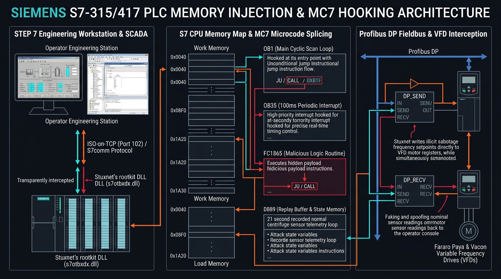
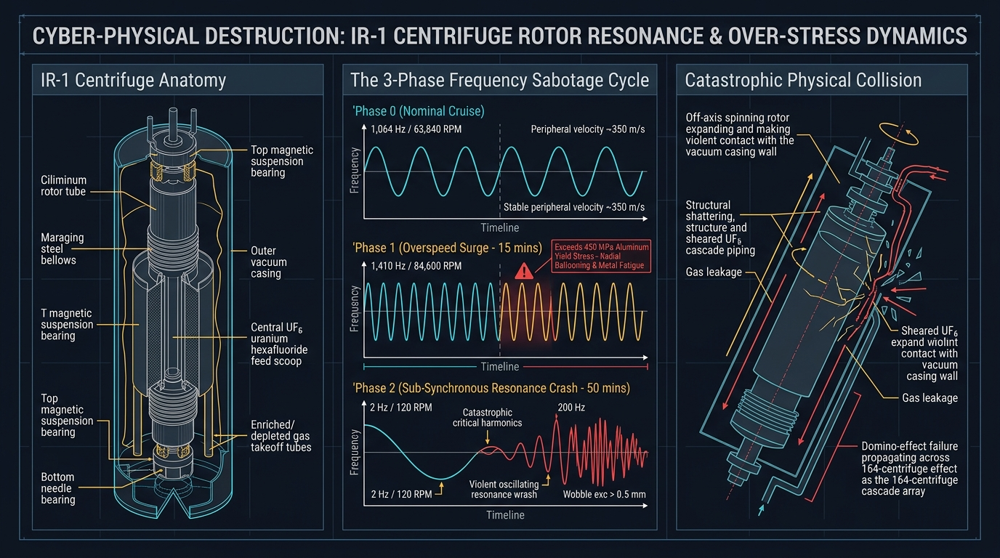

# Chapter 06: The PLC Payload & Centrifuge Sabotage Mechanics

> **Seminar Module:** Low-Level Industrial Sabotage, MC7 Assembly Bytecode & Rotational Physics  
> **Target Audience:** Malware Reverse Engineers, Industrial Automation Specialists, Nuclear Physics Analysts  
> **Core Concepts:** Siemens S7 MC7 Bytecode, Organization Blocks (OB1, OB35), Harmonic Resonance, VFD Sabotage

---

## 1. Deconstructing the Siemens S7 PLC Architecture

To understand how Stuxnet executed its attack at the controller level, one must examine how a Siemens **SIMATIC S7-300** and **S7-400** PLC executes software:

```
┌─────────────────────────────────────────────────────────────────────────────────┐
│                    SIEMENS S7 PLC PROGRAM EXECUTION MODEL                       │
├─────────────────────────────────────────────────────────────────────────────────┤
│                                                                                 │
│   ORGANIZATION BLOCKS (OB):                                                     │
│   • OB1: The Main Cyclic Loop. Executed continuously from top to bottom.        │
│   • OB35: Cyclic Interrupt Block. Executed precisely every 100 milliseconds.    │
│                                                                                 │
│   FUNCTION BLOCKS (FB / FC):                                                    │
│   • Subroutines containing mathematical logic, timers, and PID loops.           │
│   • Stuxnet injected its own malicious blocks: FC1865 through FC1874.           │
│                                                                                 │
│   DATA BLOCKS (DB):                                                             │
│   • Memory blocks storing process variables, sensor readings, and setpoints.    │
│   • Stuxnet created DB89 to store state-machine counters and recorded sensor.   │
│                                                                                 │
│   COMMUNICATION FUNCTION BLOCKS:                                                │
│   • DP_SEND (FC1): Sends Profibus data packets to external field devices.       │
│   • DP_RECV (FC2): Receives Profibus data packets from external field devices.  │
└─────────────────────────────────────────────────────────────────────────────────┘
```


*Figure 6.1: Industrial Control Systems (ICS) microcode injection blueprint: Showing S7 CPU memory layout, hooking of OB1 and OB35, execution of malicious FC1865 state-machine logic, and interception of Profibus DP communication to Variable Frequency Drives.*

---

## 2. Infiltrating the Cyclic Execution Loop: The OB1 and OB35 Hook

When Stuxnet's malicious `s7otbxdx.dll` identified a connected S7-315 controller, it did not overwrite the existing PLC program; doing so would have immediately triggered plant alarms. 

Instead, it **spliced itself into the execution flow**:

```
LEGITIMATE S7 EXECUTION:
[PLC OS] ──► [Legitimate OB1 Logic] ──► [Legitimate Outputs] ──► [Repeat]

STUXNET SPLICED EXECUTION:
[PLC OS] ──► [Stuxnet Injected Header]
                   │
                   ▼ (Check State Machine DB89)
             [Is Sabotage Sequence Active?]
             ├── NO  ──► [Call Original OB1 Logic] ──► [Normal Operation]
             └── YES ──► [Execute Malicious Frequency Routine (FC1865)]
                               │
                               ▼
                         [Manipulate DP_SEND to Overwrite VFD Speeds]
                               │
                               ▼
                         [Spoof DP_RECV to Report Normal Telemetry]
```

Stuxnet hooked two specific entry points:
1. **`OB1` (Main Cycle):** Used to initialize the state machine, verify peripheral hardware IDs, and execute slower background tasks.
2. **`OB35` (100ms High-Precision Timer):** Used for microsecond-accurate signal interception and real-time Profibus packet manipulation.

---

## 3. The Fieldbus Interception: Hooking DP_SEND and DP_RECV

The Siemens S7-315 CPU does not connect directly to Variable Frequency Drives via copper wires; it communicates via a **Siemens CP 342-5 Profibus communications module**.

The legitimate PLC program communicated with the CP 342-5 module using two standard Siemens library functions: `DP_SEND` (FC1) and `DP_RECV` (FC2).

Stuxnet executed an in-memory patch that **diverted all calls to `DP_SEND` and `DP_RECV` to its own malicious handlers**:
* **Intercepting `DP_SEND`:** When the legitimate program sent a command to maintain normal centrifuge speed ($1,064\text{ Hz}$), Stuxnet intercepted the packet buffer and overwrote the output frequency value with its malicious attack parameters!
* **Intercepting `DP_RECV`:** When the frequency converters reported their live rotational status back to the PLC, Stuxnet intercepted the incoming buffer, stripped the true abnormal speed readings, and replaced them with forged, normal values!

---

## 4. The Sabotage Sequences: Physics of Rotor Destruction

Stuxnet contained two distinct physical attack routines engineered to exploit the mechanical properties of Iran's **IR-1 gas centrifuges**.

```
┌─────────────────────────────────────────────────────────────────────────────────┐
│              STUXNET ATTACK SEQUENCE A: THE SPEED SABOTAGE CYCLE                │
├─────────────────────────────────────────────────────────────────────────────────┤
│                                                                                 │
│   NORMAL CRUISE SPEED: 1,064 Hz (63,840 RPM)                                    │
│                                                                                 │
│   STAGE 1: THE OVERSPEED ATTACK (15 Minutes)                                    │
│   • Stuxnet drives frequency converter output to: 1,410 Hz (84,600 RPM).        │
│   • Physical Consequence: Exceeds maximum yield strength of aluminum alloy      │
│     7075-T6. Rotors stretch radially, creating microscopic fractures.           │
│                                                                                 │
│   STAGE 2: THE DORMANCY CRUISE (27 Days)                                        │
│   • Speed drops back to: 1,064 Hz (63,840 RPM).                                 │
│   • Rotors operate normally for nearly a month, lulling operators into false    │
│     security while metal fatigue accumulates.                                   │
│                                                                                 │
│   STAGE 3: THE RESONANT SLOWDOWN CRASH (50 Minutes)                             │
│   • Stuxnet abruptly forces frequency converter output down to: 2 Hz (120 RPM). │
│   • Physical Consequence: The centrifuge slows down slowly due to inertia,      │
│     lingering inside critical harmonic resonance bands (~800 Hz and ~350 Hz).   │
│   • Violent lateral wobble causes spinning rotors to strike outer casings,      │
│     catastrophically shattering the centrifuges into aluminum shrapnel.         │
└─────────────────────────────────────────────────────────────────────────────────┘
```

```
Rotational Speed Profile Over Time
========================================================================
Frequency (Hz)
1500 |             ┌─── 1,410 Hz (Overspeed: 15 mins)
     |             │
1064 | ────────────┴───────────────────────┐ (Normal: 27 days)
     |                                     │
 500 |                                     │  Critical Resonance Zone
     |                                     │  [Rotors Wobble & Crash]
   2 |                                     └─── 2 Hz (Slowdown: 50 mins)
     +------------------------------------------------------------------► Time
```


*Figure 6.2: Mechanical and vibrational dynamics of the IR-1 rotor destruction cycle: Illustrating the nominal cruise baseline, the plastic yield overspeed phase at 1,410 Hz, and the sub-synchronous resonance crash at 2 Hz.*

---

## 5. Sequence B: The Cascade Overpressure Attack

While Sequence A targeted the S7-315 speed controllers, a second, earlier variant of Stuxnet (Stuxnet 0.5) targeted the **Siemens S7-417 PLCs** that controlled gas valves and pressure manifolds:

* **The Mechanism:** Gas centrifuges operate under high vacuum (near zero pressure). Uranium hexafluoride ($UF_6$) gas is transferred through cascades at delicate sub-atmospheric pressures.
* **The Sabotage:** Stuxnet closed isolation valves to individual centrifuge stages while keeping inlet feed valves open.
* **Physical Consequence:** Gas pressure spiked inside the centrifuges. When $UF_6$ gas pressure exceeds specific thresholds, the gas transitions into solid powder or introduces heavy aerodynamic drag, placing massive torsional loads on the magnetic suspension bearings and destroying the drive motors.

---

## 6. The Forensic Damage Toll at Natanz

The physical consequences of Stuxnet were documented in historical reports published by the **International Atomic Energy Agency (IAEA)** and analyzed by the **Institute for Science and International Security (ISIS)**:

```
┌─────────────────────────────────────────────────────────────────────────────────┐
│                    IAEA INSPECTION EVIDENCE & DAMAGE METRICS                    │
├─────────────────────────────────────────────────────────────────────────────────┤
│                                                                                 │
│ • November 2009: Iran operated ~4,700 active IR-1 centrifuges at Natanz.        │
│ • January 2010: Total operating centrifuges dropped precipitously to ~3,900.    │
│ • Estimated Loss: Approximately 1,000 centrifuges were dismantled,             │
│   decommissioned, or replaced during the peak Stuxnet infection window.         │
│ • Enrichment Delay: Iranian nuclear enrichment capacity was delayed by an       │
│   estimated 12 to 18 months, altering the geopolitical timeline.                │
└─────────────────────────────────────────────────────────────────────────────────┘
```

Importantly, Stuxnet did not destroy every machine simultaneously. By destroying 10% to 15% of centrifuges per month, the malware convinced Iranian engineers that their components were defective, their raw materials were substandard, or their technicians were incompetent—delaying recognition of a cyber attack for over a year.

---

## 7. Seminar Discussion Questions

1. **The Subtlety of Sabotage:** Why is an attack that destroys 10% of machines intermittently far more effective than an attack that destroys 100% of machines in a single afternoon?
2. **Deterministic Safety Systems:** Why didn't independent electrical circuit breakers trip when the frequency converters were pushed to 1,410 Hz, and how does hardwired, analog safety interlock design prevent software-based overspeed?
