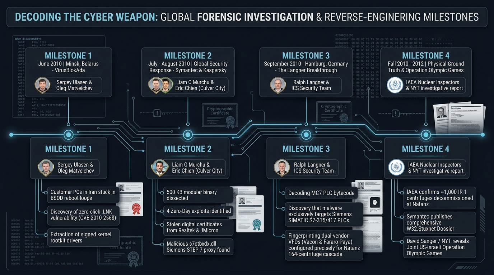

# Chapter 08: Discovery, Investigation & Forensic Reverse Engineering

> **Seminar Module:** Incident Discovery, Global Collaborative Forensics & Reverse Engineering  
> **Target Audience:** Incident Handlers, Threat Intelligence Leads, Malware Reverse Engineers, Historians  
> **Key Figures:** Sergey Ulasen (VirusBlokAda), Ralph Langner, Liam O'Murchu, Eric Chien, Nicolas Falliere (Symantec)

---

## 1. The Escape: How an Invisible Weapon Blew Its Own Cover

Stuxnet was designed to remain permanently invisible inside the subterranean cascade halls of Natanz. However, between late 2009 and early 2010, the authors deployed a revised code variant with **more aggressive lateral propagation routines**.

This aggressive propagation caused the worm to jump from contractor laptops onto thousands of corporate computers across Iran and eventually onto the global internet:

```
┌─────────────────────────────────────────────────────────────────────────────────┐
│                        GLOBAL ESCAPE & DISCOVERY CHAIN                          │
├─────────────────────────────────────────────────────────────────────────────────┤
│                                                                                 │
│   [Natanz Cascade Hall]                                                         │
│           │                                                                     │
│           ▼ (Contractor reconnects laptop to home office network in Tehran)     │
│   [Iranian Corporate Subnets] (Unintended rapid lateral propagation)            │
│           │                                                                     │
│           ▼ (Laptops connect to client networks across Asia)                    │
│   [Wildfire Global Spread] (Infections reported in India, Indonesia, US)        │
│           │                                                                     │
│           ▼ (Computers crash with BSOD in Isfahan, Iran)                        │
│   [Support Ticket Submitted to VirusBlokAda (Minsk, Belarus)]                   │
│           │                                                                     │
│           ▼                                                                     │
│   [GLOBAL CYBERSECURITY COMMUNITY DISCOVERY: JUNE 2010]                         │
└─────────────────────────────────────────────────────────────────────────────────┘
```


*Figure 8.1: The Global Forensic Investigation Roadmap: Chronicling the four major investigation milestones from VirusBlokAda's initial BSOD triage in Belarus, through Symantec's PE reconstruction in California, Ralph Langner's PLC disassembly breakthrough in Germany, to IAEA ground-truth verification of centrifuge destruction.*

The weapon that had operated silently in the dark for over two years suddenly became the center of a worldwide forensic investigation.

---

## 2. June 2010: The VirusBlokAda Breakthrough in Minsk

On **June 17, 2010**, an Iranian IT support firm contacted **VirusBlokAda**, a small antivirus software company located in Minsk, Belarus. The Iranian client reported that workstations were experiencing recurring Blue Screen of Death (BSOD) crashes and endless reboot loops.

Security researchers **Sergey Ulasen** and **Oleg Kupreev** analyzed memory dumps from the failing computers and made two shocking discoveries:

```
┌─────────────────────────────────────────────────────────────────────────────────┐
│                     THE INITIAL VIRUSBLOKADA DISCOVERIES                        │
├─────────────────────────────────────────────────────────────────────────────────┤
│                                                                                 │
│   DISCOVERY 1: ZERO-CLICK .LNK EXPLOIT (CVE-2010-2568)                          │
│   Workstations were being compromised simply by inserting a USB flash drive,    │
│   without any files being clicked or opened. This pointed to an unknown zero-day│
│   flaw in the Windows Shell icon rendering engine.                              │
│                                                                                 │
│   DISCOVERY 2: VALID REALTEK DIGITAL CODE-SIGNING CERTIFICATE                   │
│   The malicious kernel driver (`mrxnet.sys`) was not self-signed or broken; it  │
│   carried an authentic, cryptographic digital signature issued by VeriSign to   │
│   Realtek Semiconductor Corp., a multibillion-dollar Taiwanese hardware maker.  │
└─────────────────────────────────────────────────────────────────────────────────┘
```

Recognizing that they were holding a piece of malware of extraordinary sophistication, VirusBlokAda alerted Microsoft and the global security community on July 12, 2010.

---

## 3. July–August 2010: The Symantec Reverse Engineering Marathon

When the sample landed at **Symantec Security Response**, a dedicated reverse engineering team comprising **Liam O'Murchu, Eric Chien, and Nicolas Falliere** spent months deconstructing its 500-kilobyte encrypted payload.

```
                      THE ANATOMY OF STUXNET'S MAIN BINARY
                      
           ┌────────────────────────────────────────────────────────┐
           │ Encrypted Payload (Decrypted dynamically in memory)    │
           ├────────────────────────────────────────────────────────┤
           │ • 4 Distinct Windows Zero-Day Exploits                 │
           │ • 2 Signed Kernel-Mode Rootkits (mrxnet / mrxcls)      │
           │ • Windows RPC Propagation Engine (MS08-067 & Spooler)  │
           │ • P2P RPC Synchronization & C2 Communication Engine    │
           │ • Siemens STEP 7 DLL Hooking Engine (s7otbxdx.dll)     │
           │ • S7 PLC Assembly Payload (MC7 Bytecode: OB1, OB35)    │
           └────────────────────────────────────────────────────────┘
```

Initially, researchers assumed Stuxnet was a high-end corporate espionage tool designed to steal Siemens industrial design blueprints. However, as the team dissected the inner routines, they encountered sections of code that made no sense for traditional software:
* Why was the malware examining hardware register addresses (`IW`, `QW`)?
* Why was it counting frequency converters in groups of 33?
* Why did it contain thousands of lines of raw **MC7 bytecode** meant for industrial PLCs?

---

## 4. September 2010: Ralph Langner Decodes the Industrial Sabotage Engine

The final puzzle piece was unlocked by **Ralph Langner**, an independent German industrial control systems security consultant. 

Langner was one of the few researchers worldwide who understood both computer software and the low-level microcode of Siemens programmable logic controllers:

```
┌─────────────────────────────────────────────────────────────────────────────────┐
│                    RALPH LANGNER'S HISTORIC BREAKTHROUGH                        │
├─────────────────────────────────────────────────────────────────────────────────┤
│                                                                                 │
│   "Stuxnet is not a spy. Stuxnet is a direct physical sabotage weapon.          │
│    Its payload is designed to modify the operational logic of Siemens S7-315    │
│    PLCs and manipulate the speed of Variable Frequency Drives.                  │
│                                                                                 │
│    This is not cyber espionage. This is cyber warfare."                         │
│                                                                                 │
│    — Ralph Langner, September 16, 2010                                          │
└─────────────────────────────────────────────────────────────────────────────────┘
```

Langner's analysis shifted the global investigation from software engineering to nuclear physics.

---

## 5. Connecting the Dots: Linking the Mathematics to Natanz

Following Langner's discovery, Symantec and independent nuclear analysts at the **Institute for Science and International Security (ISIS)** matched the numerical parameters inside Stuxnet's PLC bytecode to the publicly known layout of Iran's nuclear infrastructure:

| Stuxnet Code Parameter | Industrial Hardware Equivalent | Physical Correlation at Natanz |
| :--- | :--- | :--- |
| **33 Frequency Converters** | 33 VFDs controlling 33 centrifuge motors. | Each stage of an Iranian IR-1 centrifuge cascade contained groups of centrifuges matching this drive geometry. |
| **164 Cascade Array** | 164 total centrifuges per cascade. | The exact number of IR-1 centrifuges installed in each cascade hall at the Natanz Fuel Enrichment Plant. |
| **Normal Speed: 1,064 Hz** | $63,840\text{ RPM}$ rotational speed. | The standard design operating speed of the Iranian IR-1 gas centrifuge. |
| **Overspeed: 1,410 Hz** | $84,600\text{ RPM}$ rotational speed. | The precise structural failure threshold of the aluminum alloy rotor tube. |
| **Target VFD Vendors** | Fararo Paya (Iran) & Vacon (Finland). | Iranian procurement records confirmed purchases of these exact drive brands. |

The conclusion was undeniable: **Stuxnet was built specifically to destroy the centrifuges enriching uranium at Natanz.**

---

## 6. Official Advisory: CISA & ICS-CERT Release

In September 2010, the U.S. Cybersecurity and Infrastructure Security Agency's industrial division (then operating as **ICS-CERT**) published the definitive government technical advisory: **ICSA-10-272-01**.

The advisory formally alerted critical infrastructure operators worldwide to:
* The weaponization of `.lnk` files and the Print Spooler service.
* The replacement and hooking of `s7otbxdx.dll` in Siemens engineering tools.
* The imperative for industrial facilities to verify PLC logic against pristine, offline project baselines.

---

## 7. Seminar Discussion Questions

1. **The Forensic Chain of Custody:** How did the collaborative effort between a small Belarusian antivirus firm, an independent German ICS engineer, and a major U.S. security vendor demonstrate the necessity of multi-disciplinary teams in cyber-physical investigations?
2. **The Runaway Worm Dilemma:** When nation-states deploy cyber weapons into targeted enclaves, is it technically possible to guarantee that the malware will never escape into the civilian internet?
