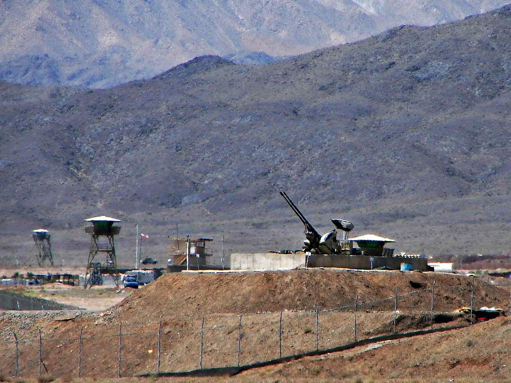
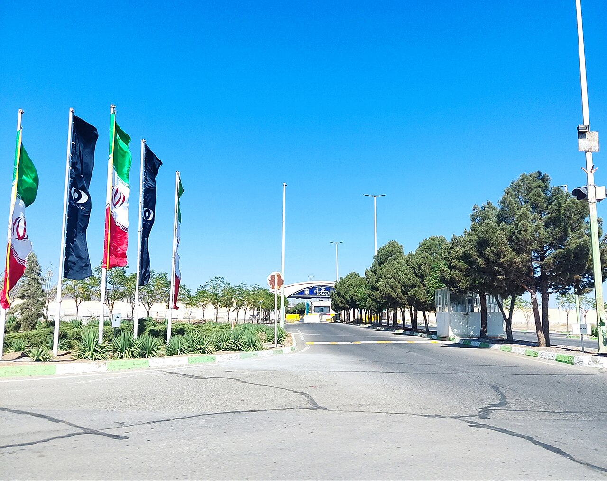
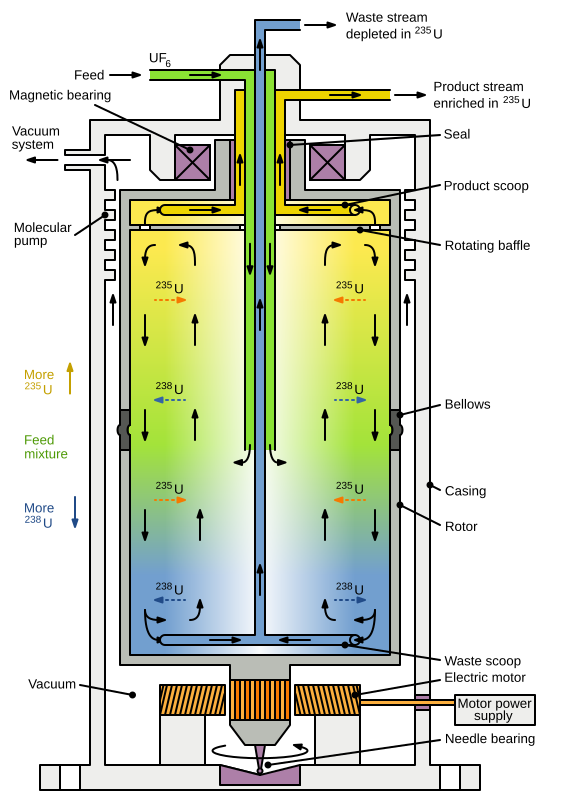
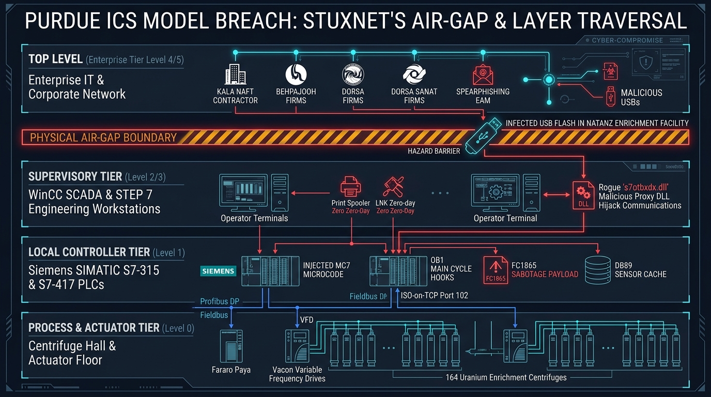
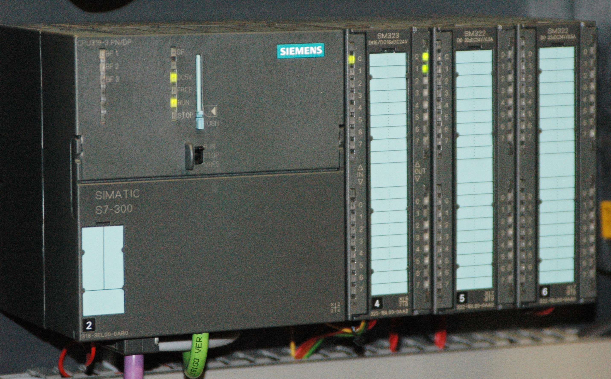
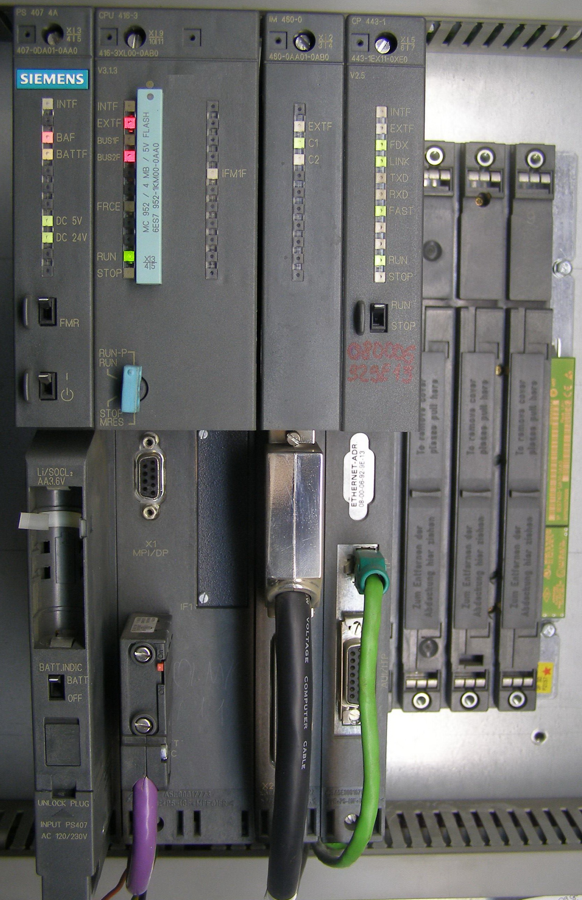
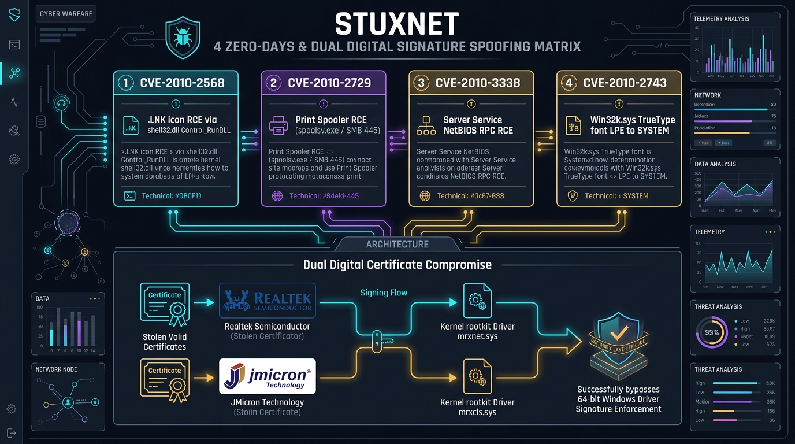
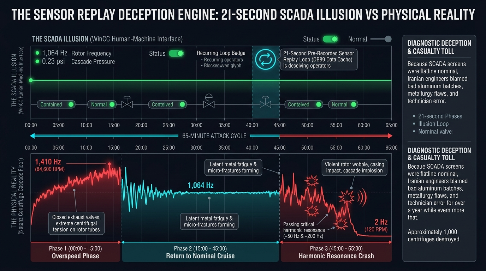

# STUXNET: When Cybersecurity Crossed Into the Physical World

> **An In-Depth Cyber-Physical Attack Case Study & Seminar Courseware Suite**  
> **Courseware Track:** Operational Technology (OT), Industrial Control Systems (ICS), SCADA & PLC Security  
> **Case Study Focus:** Siemens SIMATIC S7 Microcode Injection, Centrifuge Harmonic Resonance & The 21-Second Sensor Replay  
> **Target Audience:** Control Systems Engineers, Security Architects, Malware Analysts, CISOs, Government Policy Advisors

---

## 📋 Executive Fact Sheet & Case Parameters

| Parameter | Confirmed Technical & Historical Facts |
| :--- | :--- |
| **Case Name** | **Stuxnet: The First Cyber-Physical Weapon** |
| **Public Discovery** | **June 17, 2010** by Sergey Ulasen & Oleg Kupreev (VirusBlokAda, Belarus) |
| **Operational Window** | Active in development and deployment from **2007 through 2010** |
| **Target Organization** | **Atomic Energy Organization of Iran (AEOI)** — **Natanz Fuel Enrichment Plant (FEP)** |
| **Physical Target Equipment** | **IR-1 Gas Centrifuges** (supercritical spinning aluminum rotors for uranium enrichment) |
| **Industrial Hardware Targeted** | **Siemens SIMATIC S7-315 and S7-417 PLCs**, Profibus CP 342-5 modules, Fararo Paya and Vacon VFDs |
| **Engineering Environment** | **Siemens SIMATIC STEP 7** engineering software & **SIMATIC WinCC** supervisory SCADA systems |
| **Air-Gap Penetration Vector** | Weaponized USB flash drives via 5 Iranian industrial contractors (Behpajooh, Foolad Technic, etc.) |
| **Zero-Day Vulnerabilities** | **4 Windows Zero-Days**: CVE-2010-2568 (.LNK), CVE-2010-2729 (Spooler), CVE-2010-3338, CVE-2010-2743 |
| **Stolen Code-Signing Keys** | Cryptographic digital certificates from **Realtek Semiconductor Corp.** and **JMicron Technology Corp.** |
| **Sabotage Mechanism** | Alternating rotational speeds (1,064 Hz cruise ➔ 1,410 Hz overspeed ➔ 2 Hz harmonic resonance crash) |
| **Deception Technique** | Intercepting S7 communications and replaying a **21-second recorded buffer of normal sensor telemetry** |
| **Estimated Physical Impact** | Decommissioning and destruction of approximately **~1,000 IR-1 centrifuges** at Natanz |
| **Strategic Attribution** | Widely assessed as a joint U.S.-Israeli intelligence operation codenamed **"Operation Olympic Games"** |

---

## 🖼️ Forensic Visual Evidence & Infographic Gallery (15 Figures)

| Figure | Image Preview | Title & Technical Description |
| :---: | :---: | :--- |
| **Fig 1.1** | [](image/stuxnet_how_it_worked_infographic.jpg) | **How Stuxnet Worked: Multi-Stage Attack Vector**<br>High-resolution architectural breakdown: USB delivery ➔ target search ➔ zero-day exploit ➔ PLC microcode injection ➔ centrifuge destruction and sensor deception. |
| **Fig 1.2** | [](image/natanz_enrichment_facility_aerial.jpg) | **Natanz Fuel Enrichment Plant: Aerial Complex**<br>Authentic aerial photograph of the heavily fortified Natanz Fuel Enrichment Plant (FEP) in Isfahan Province, Iran. |
| **Fig 1.3** | [](image/natanz_underground_site_overview.jpg) | **Natanz Underground Site Overview**<br>Underground enrichment hall access portals and surface support infrastructure built beneath 8 meters of reinforced concrete. |
| **Fig 1.4** | [](image/stuxnet_natanz_centrifuges_cascade.jpg) | **The Target: Natanz IR-1 Centrifuge Cascades**<br>Authentic photograph of cylindrical aluminum IR-1 gas centrifuges connected in 164-unit cascade arrays inside the underground halls at Natanz. |
| **Fig 1.5** | [](image/countercurrent_gas_centrifuge_schematic.svg) | **Zippe-Type Countercurrent Gas Centrifuge Blueprint**<br>Authentic vector schematic of the Zippe centrifuge mechanism: rotating cylinder, vacuum casing, magnetic bearings, and $\text{UF}_6$ gas extraction scoops. |
| **Fig 1.6** | [](image/stuxnet_centrifuge_rotor_physics_breakdown.jpg) | **IR-1 Centrifuge Rotor Resonance & Over-Stress Dynamics**<br>Mechanical engineering blueprint: 1,064 Hz nominal cruise ($350\text{ m/s}$), 1,410 Hz overspeed hoop stress exceeding $450\text{ MPa}$, and 2 Hz harmonic resonance destructive collision. |
| **Fig 2.1** | [](image/stuxnet_purdue_model_deep_dive.jpg) | **Purdue ICS Model Layer-by-Layer Traversal Blueprint**<br>Multi-tier traversal: Enterprise contractor infection (L4/5) ➔ physical USB air-gap traversal ➔ WinCC SCADA/STEP 7 (L2/3) ➔ S7-315/417 PLCs (L1) ➔ VFD drives & centrifuges (L0). |
| **Fig 2.2** | [](image/stuxnet_scada_plc_network_architecture.jpg) | **Industrial Network & Hardware Topology**<br>Network topology interconnecting WinCC SCADA terminals, CP 343/443 cards, and S7 PLCs controlling fieldbus actuators. |
| **Fig 2.3** | [](image/siemens_simatic_s7_300_hardware.jpg) | **Siemens SIMATIC S7-300 Modular PLC Hardware**<br>Authentic photograph of the Siemens S7-300 modular PLC rack—the exact controller platform hijacked to manipulate centrifuge rotational speed. |
| **Fig 2.4** | [](image/siemens_simatic_s7_400_hardware.jpg) | **Siemens SIMATIC S7-400 High-End Controller Rack**<br>Authentic photograph of the Siemens S7-400 fault-tolerant rack—targeted by Stuxnet 0.5 to manipulate cascade isolation valves and overpressure manifolds. |
| **Fig 4.1** | [](image/stuxnet_windows_zero_days_internals.jpg) | **Four Zero-Days & Dual Certificate Spoofing Matrix**<br>Dissection of CVE-2010-2568 (.LNK), CVE-2010-2729 (Spooler), CVE-2010-3338, and CVE-2010-2743 with stolen Realtek and JMicron digital certificate bypass. |
| **Fig 5.1** | [](image/stuxnet_step7_dll_proxy_architecture.jpg) | **Siemens STEP 7 Man-in-the-Middle DLL Proxy**<br>The DLL proxy attack: replacing `s7otbxdx.dll` with a malicious wrapper and renaming the original to `s7otbxsx.dll` to hook `s7blk_read` and `s7blk_write`. |
| **Fig 6.1** | [](image/stuxnet_siemens_s7_mc7_bytecode_injection.jpg) | **Siemens S7 PLC Microcode Injection & MC7 Memory Layout**<br>S7 CPU memory layout, hooking of OB1 and OB35, execution of malicious FC1865 state-machine logic, and interception of Profibus DP communication. |
| **Fig 7.1** | [](image/stuxnet_deception_engine_replay_timeline.jpg) | **The 21-Second Replay Deception Engine Timeline**<br>65-minute comparative timeline: SCADA operator illusion (flatline 1,064 Hz, 0.23 psi) versus physical reality (overspeed stress, casing scraping, and rotor shattering). |
| **Fig 8.1** | [](image/stuxnet_global_investigation_and_forensics.jpg) | **Global Forensic Reverse-Engineering Roadmap**<br>4 investigation milestones: VirusBlokAda BSOD triage in Belarus, Symantec reverse engineering in California, Ralph Langner's PLC breakthrough in Germany, and IAEA ground truth. |

---

## 🔍 The Problem & How It Was Solved (The Cyber-Physical Sabotage & OT Remediation Lifecycle)

### 🚨 The Problem: Sabotaging Physical Centrifuges via Microcode While Blinding Operators
Prior to Stuxnet, cybersecurity assumed that physical air gaps protected industrial control systems (ICS) from external manipulation, and that Programmable Logic Controllers (PLCs) were immune to malware. Stuxnet proved that digital microcode could transcend computers, hijack industrial automation engines, and inflict catastrophic kinetic destruction on critical infrastructure.

The core failure modes, propagation paths, and physical sabotage mechanics:
1. **The Air-Gap Fallacy & Contractor Supply Chain Traversal:** The Natanz Fuel Enrichment Plant (FEP) was physically isolated (air-gapped) from the Internet to prevent network infiltration. The attackers bypassed this perimeter by compromising five Iranian third-party engineering contractors (e.g., Behpajooh, Foolad Technic) who serviced the Natanz cascades. Using the zero-click `.lnk` shortcut vulnerability (CVE-2010-2568) and stolen cryptographic certificates from Realtek Semiconductor and JMicron Technology, the malware weaponized USB flash drives. When contractor engineers connected their drives to Natanz engineering workstations, Stuxnet silently executed without any user interaction.
2. **Siemens STEP 7 Man-in-the-Middle DLL Proxying:** Rather than attacking generic operating system files, Stuxnet targeted the industrial engineering environment: **Siemens SIMATIC STEP 7** and **SIMATIC WinCC**. It replaced the authentic communication library `s7otbxdx.dll` with a malicious wrapper and renamed the original to `s7otbxsx.dll`. Whenever an engineer viewed, diagnosed, or edited PLC logic, Stuxnet intercepted `s7blk_read` and `s7blk_write` calls, concealing its malicious code and presenting clean, pristine ladder logic to the human operators.
3. **Subversive MC7 Microcode Injection on S7-315 and S7-417 PLCs:** Stuxnet verified that the host was connected to a precise hardware configuration: Siemens S7-315 and S7-417 PLCs communicating over Profibus CP 342-5 modules with specific variable frequency drives (VFDs) from Fararo Paya (Iran) and Vacon (Finland). Once verified, Stuxnet injected compiled MC7 bytecode directly into PLC memory, hooking cyclic execution block `OB1` (main program loop) and timed interrupt block `OB35` (100ms watchdog).
4. **Mechanical Resonance & Centrifugal Hoop Stress Destruction:** The injected PLC microcode executed a two-phase sabotage cycle on the spinning IR-1 uranium enrichment centrifuges:
   - **Phase 1: High-Speed Overpressure (1,410 Hz):** Stuxnet accelerated the aluminum rotors from their nominal operating speed of $1,064\text{ Hz}$ ($63,840\text{ RPM}$) up to $1,410\text{ Hz}$ ($84,600\text{ RPM}$). At $1,410\text{ Hz}$, centrifugal hoop stress exceeded $450\text{ MPa}$, exceeding the tensile yield limit of the aluminum alloy and causing rotor deformation and casing scraping.
   - **Phase 2: Sub-Synchronous Harmonic Resonance (2 Hz):** Following overspeed, Stuxnet cut drive power down to $2\text{ Hz}$ ($120\text{ RPM}$), forcing the spinning rotors through their critical natural resonance frequencies without active damping. The resulting lateral vibrations caused the $1\text{ mm}$ thin rotors to collide with the outer vacuum casing, disintegrating into high-speed shrapnel. Over ~1,000 centrifuges were destroyed.
5. **The 21-Second Deception Engine:** To prevent plant engineers from triggering emergency manual scrams, Stuxnet recorded 21 seconds of normal operating pressure and frequency signals into data block `DB89`. During the sabotage sequences, it replayed this recorded telemetry back to the SCADA WinCC monitoring screens, showing a steady $1,064\text{ Hz}$ and $0.23\text{ psi}$, completely blinding operators to the physical devastation occurring underground.

---

### 🛡️ How They Solved It: Forensic Reverse Engineering, Facility Eradication & OT Architecture Overhaul
Resolving the Stuxnet sabotage required a combination of pioneering reverse-engineering breakthroughs, nationwide operational decontamination, and fundamental architectural overhaul of industrial control networks:

```
┌────────────────────────────────────────────────────────────────────────────────────────────────────────┐
│                        HOW THEY SOLVED IT: THE 5-PILLAR OT REMEDIATION FRAMEWORK                       │
├────────────────────────────┬───────────────────────────────────────────────────────────────────────────┤
│ 1. FORENSIC BREAKTHROUGH   │ • VirusBlokAda (Belarus) isolated CVE-2010-2568 and the stolen certs.     │
│    & MC7 REVERSE ENG.      │ • Ralph Langner (Germany) decoded the STEP 7 DLL proxy and MC7 microcode, │
│                            │   identifying the precise target as S7-315 PLCs driving VFD centrifuges.  │
│                            │ • Symantec published the 15,000-function W32.Stuxnet Dossier blueprint.   │
├────────────────────────────┼───────────────────────────────────────────────────────────────────────────┤
│ 2. CERTIFICATE REVOCATION  │ Microsoft revoked the compromised Realtek and JMicron digital             │
│    & ZERO-DAY PATCHING     │ certificates and released emergency out-of-band security updates (MS10-046│
│                            │ and MS10-061) neutralizing the .LNK and print spooler propagation vectors.│
├────────────────────────────┼───────────────────────────────────────────────────────────────────────────┤
│ 3. NATANZ FACILITY         │ • Enacted an absolute quarantine and permanent ban on non-certified USBs. │
│    DECONTAMINATION         │ • Wiped and re-imaged all engineering workstations from clean media.      │
│                            │ • Performed cold memory purges and flashed verified logic on all PLCs.    │
│                            │ • Replaced ~1,000 ruined centrifuges with newly manufactured IR-1 units.  │
├────────────────────────────┼───────────────────────────────────────────────────────────────────────────┤
│ 4. HARDWARE KEYSWITCH      │ Locked all Siemens S7 PLC physical rotary keyswitches into the "RUN"      │
│    HARDENING TO "RUN"      │ position (away from "RUN-P"). In RUN mode, the PLC CPU hardware rejects   │
│                            │ network-based memory writes or block downloads, stopping rogue bytecode.  │
├────────────────────────────┼───────────────────────────────────────────────────────────────────────────┤
│ 5. UNIDIRECTIONAL DIODES & │ • Deployed hardware-based optical data diodes between OT (L2/3) and L4/5. │
│    OUT-OF-BAND ANALOG SIS  │ • Implemented hardwired, non-programmable analog Safety Instrumented       │
│                            │   Systems (SIS) with independent vibration/acoustic trips immune to code. │
└────────────────────────────┴───────────────────────────────────────────────────────────────────────────┘
```

---

## 🎯 Why Stuxnet Remains the Foundational Case Study in OT Security

Prior to Stuxnet, cybersecurity was conceived almost entirely as an **information problem**: keeping unauthorized users from viewing, copying, or altering digital records.

Stuxnet permanently demolished that boundary by proving:
```
Digital Bytecode ──► Engineering Software ──► PLC Memory ──► Frequency Inverter ──► Kinetic Metal Fatigue
                                                                                          │
                                                                                          ▼
Operator Deception ◄── Replayed 21s Sensor Baseline ◄── Supersonic Rotor Crash & Shrapnel Explosion
```

This makes Stuxnet the essential case study for:
* **The Death of the Air-Gap Myth:** Proving that physical isolation can be bridged via human supply chains and weaponized USB media.
* **The Living-in-the-Controller Threat:** Executing malicious assembly code directly on industrial PLCs below the operating system layer.
* **The Disconnect Between Display and Reality:** Proving that **Displayed Process State $\neq$ Guaranteed Physical State**, blinding operators with pre-recorded telemetry tapes.

---

## 📚 Complete Seminar Curriculum & Chapter Modules

This seminar courseware suite is structured into **13 comprehensive technical chapters**:

| Chapter | Title & Focus Area | Key Technical Topics Covered | Link |
| :---: | :--- | :--- | :---: |
| **01** | **[Executive Summary & The Cyber-Physical Paradigm](./01-executive-summary-and-cyber-physical-paradigm.md)** | Incident fact sheet, IT vs. OT paradigm shift, Natanz plant profile, IR-1 centrifuge physics | [Read Chapter](./01-executive-summary-and-cyber-physical-paradigm.md) |
| **02** | **[Industrial Architecture & The Purdue Model](./02-industrial-architecture-and-purdue-model.md)** | Purdue Model (Levels 0–5), WinCC SCADA, Siemens S7-315/S7-417 PLCs, Fararo Paya/Vacon VFDs | [Read Chapter](./02-industrial-architecture-and-purdue-model.md) |
| **03** | **[Air-Gap Traversal & Weaponized Propagation](./03-air-gap-traversal-and-weaponized-propagation.md)** | The myth of the air gap, the 5 Iranian contractor targets, zero-click `.lnk` (CVE-2010-2568), Realtek/JMicron certificates | [Read Chapter](./03-air-gap-traversal-and-weaponized-propagation.md) |
| **04** | **[The Four Zero-Days & Windows Internals](./04-the-four-zero-days-and-windows-internals.md)** | Deconstruction of 4 zero-days, process hollowing in `services.exe`, signed kernel rootkits (`mrxnet.sys`), kill switches | [Read Chapter](./04-the-four-zero-days-and-windows-internals.md) |
| **05** | **[Target Validation & Siemens STEP 7 Hooking](./05-target-validation-and-siemens-step7-hooking.md)** | Industrial selectivity checks, `s7otbxdx.dll` proxying, hooking `s7blk_read` and `s7blk_write` to cloak PLC code | [Read Chapter](./05-target-validation-and-siemens-step7-hooking.md) |
| **06** | **[The PLC Payload & Centrifuge Sabotage Mechanics](./06-the-plc-payload-and-centrifuge-sabotage-mechanics.md)** | S7 MC7 bytecode, hooking `OB1`/`OB35`, Profibus `DP_SEND`, 1,410 Hz overspeed and 2 Hz resonance crash routines | [Read Chapter](./06-the-plc-payload-and-centrifuge-sabotage-mechanics.md) |
| **07** | **[The Deception Engine & Sensor Replay Attacks](./07-the-deception-engine-and-sensor-replay-attacks.md)** | The 21-second recorded telemetry loop in DB89, operator blindness, suppressed alarm tripwires, out-of-band validation | [Read Chapter](./07-the-deception-engine-and-sensor-replay-attacks.md) |
| **08** | **[Discovery, Investigation & Forensic Reverse Engineering](./08-discovery-investigation-and-forensic-reverse-engineering.md)** | VirusBlokAda Minsk discovery, Ralph Langner's PLC breakthrough, Symantec reverse engineering team, CISA advisory | [Read Chapter](./08-discovery-investigation-and-forensic-reverse-engineering.md) |
| **09** | **[Comprehensive MITRE ATT&CK for ICS Matrix](./09-mitre-attack-for-ics-comprehensive-matrix.md)** | Full mapping across 12 ICS tactics and 22 technique IDs from Removable Media (T0847) to Damage to Property (T0879) | [Read Chapter](./09-mitre-attack-for-ics-comprehensive-matrix.md) |
| **10** | **[Blue Team SOC Playbooks & OT Detection Engineering](./10-blue-team-soc-playbooks-and-ot-detection-engineering.md)** | Suricata S7comm deep packet inspection rules, production Splunk SPL queries, YARA rules, and air-gapped incident playbooks | [Read Chapter](./10-blue-team-soc-playbooks-and-ot-detection-engineering.md) |
| **11** | **[OT Incident Response & Cyber-Physical Resilience](./11-ot-incident-response-and-cyber-physical-resilience.md)** | The IT vs. OT response dilemma, 10-step OT incident lifecycle, PLC hardware keyswitch to `RUN`, unidirectional data diodes | [Read Chapter](./11-ot-incident-response-and-cyber-physical-resilience.md) |
| **12** | **[Comparative Analysis: ICS Malware Evolution](./12-comparative-analysis-ics-malware-evolution.md)** | Comparing Stuxnet (2010), Shamoon (2012), BlackEnergy 3 (2015), Industroyer (2016), and Triton/TRISIS (2017) | [Read Chapter](./12-comparative-analysis-ics-malware-evolution.md) |
| **13** | **[Seminar Handbook, Tabletop Exercise & Curriculum](./13-seminar-handbook-tabletop-exercise-and-curriculum.md)** | 10-Act lecture script, 4-phase "Operation Centrifuge Shadow" Tabletop Exercise (TTX), 10 discussion questions with model answers | [Read Chapter](./13-seminar-handbook-tabletop-exercise-and-curriculum.md) |

---

## 🛠️ Interactive Lab & Diagnostic Tooling

### 1. [Interactive Cyber-Physical Attack Simulator (`demo-site/index.html`)](./demo-site/index.html)
A standalone, zero-dependency browser-based laboratory demonstrating:
* **Interactive Centrifuge Rotational Telemetry Lab:** Real-time visual frequency graph simulating normal cruise ($1,064\text{ Hz}$), dangerous overspeed ($1,410\text{ Hz}$), and resonant slowdown ($2\text{ Hz}$).
* **SCADA Operator Deception Simulator:** Toggle between the "True Physical Plant Reality" and the "Falsified SCADA WinCC Display" replaying the 21-second buffer.
* **Siemens S7 Block Inspector:** Interactive deconstruction of hooked `s7otbxdx.dll` calls, displaying injected `OB1`, `OB35`, and `DB89` blocks.
* **MITRE ATT&CK for ICS Matrix Explorer:** Interactive tactic-by-tactic breakdown of industrial adversary techniques.
* **Forensic Evidence High-Res Gallery:** High-resolution modal inspector for all primary source images and blueprints.

### 2. [S7comm Protocol & Industrial Audit Script (`scripts/stuxnet_s7comm_audit.py`)](./scripts/stuxnet_s7comm_audit.py)
A specialized Python diagnostic tool that evaluates industrial security posture:
* Simulates S7comm network traffic inspection on ISO-on-TCP port 102 to detect unauthorized block download requests (`0x1A`).
* Analyzes Windows endpoint directories for Stuxnet DLL proxying artifacts (`s7otbxsx.dll` creation and hash anomalies).
* Computes mechanical stress and resonance risk scores based on variable frequency drive output parameters.

### 3. [Interactive 20-Slide Seminar Presentation Deck (`presentation/index.html`)](./presentation/index.html)
A responsive, high-impact slide presentation platform for delivering the Stuxnet seminar:
* **20 Production-Grade Visual Slides:** Covering all technical chapters from air-gap traversal to S7 microcode disassembly and sensor deception.
* **Integrated Forensic Imagery:** Embedded high-resolution blueprints, cascade schematics, and attack timelines.
* **Speaker Notes & Keyboard Navigation:** Left/Right arrow navigation, jump-to-slide menu, and speaker discussion prompts.

---

## 💡 Key Seminar Discussion Questions

1. **The Cyber-Physical Threshold:** When an adversary executes malicious code that damages physical machines or risks human life, does that cyberattack constitute an "armed attack" under Article 51 of the UN Charter?
2. **The Illusion of Safety:** If an attacker can manipulate both the physical machine and the monitoring screen shown to the operator, how do we know that the industrial process we believe is safe is actually safe?
3. **The Air-Gap Defense:** If removable media and human contractors can bridge physical network disconnections, what architectural controls (such as hardware keyswitches and unidirectional data diodes) are mandatory to protect critical infrastructure?

---

*Authored for the **Cyber-Blog** Threat Intelligence & Incident Analysis Repository.*
