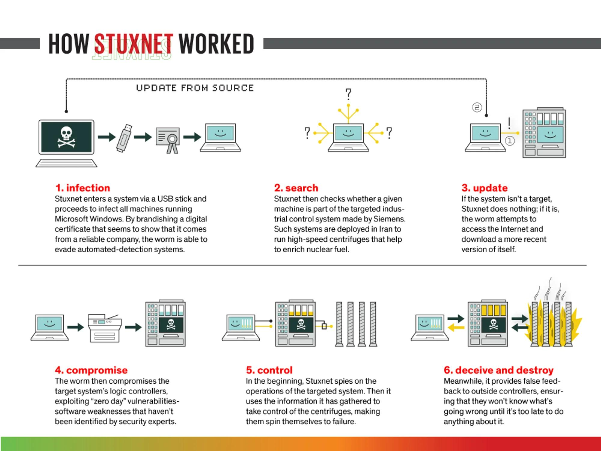
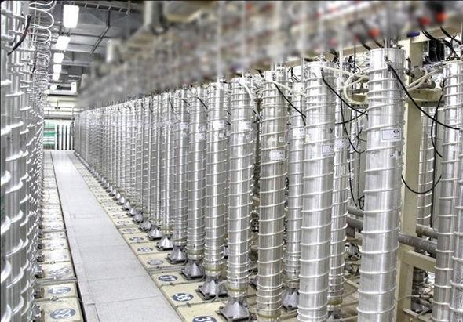
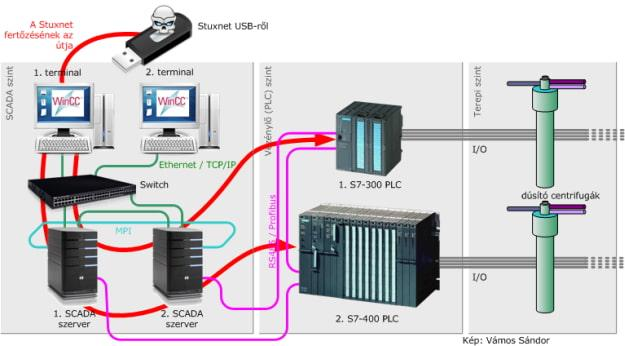
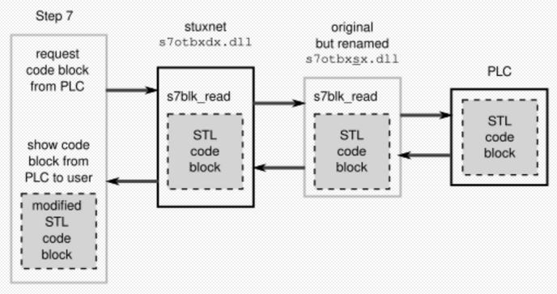

# STUXNET: When Cybersecurity Crossed Into the Physical World

> **An In-Depth Cyber-Physical Attack Case Study & Seminar Courseware Suite**  
> **Courseware Track:** Operational Technology (OT), Industrial Control Systems (ICS), SCADA & PLC Security  
> **Case Study Focus:** Siemens SIMATIC S7 Microcode Injection, Centrifuge Harmonic Resonance & The 21-Second Sensor Replay  
> **Target Audience:** Control Systems Engineers, Security Architects, Malware Analysts, CISOs, Government Policy Advisors

---

## 📋 Executive Fact Sheet & Case Parameters

| Parameter | Confirmed Technical & Historical Facts |
| :--- | :--- |
| **Case Name** | **Stuxnet: The First Cyber-Physical Weapon** |
| **Public Discovery** | **June 17, 2010** by Sergey Ulasen & Oleg Kupreev (VirusBlokAda, Belarus) |
| **Operational Window** | Active in development and deployment from **2007 through 2010** |
| **Target Organization** | **Atomic Energy Organization of Iran (AEOI)** — **Natanz Fuel Enrichment Plant (FEP)** |
| **Physical Target Equipment** | **IR-1 Gas Centrifuges** (supercritical spinning aluminum rotors for uranium enrichment) |
| **Industrial Hardware Targeted** | **Siemens SIMATIC S7-315 and S7-417 PLCs**, Profibus CP 342-5 modules, Fararo Paya and Vacon VFDs |
| **Engineering Environment** | **Siemens SIMATIC STEP 7** engineering software & **SIMATIC WinCC** supervisory SCADA systems |
| **Air-Gap Penetration Vector** | Weaponized USB flash drives via 5 Iranian industrial contractors (Behpajooh, Foolad Technic, etc.) |
| **Zero-Day Vulnerabilities** | **4 Windows Zero-Days**: CVE-2010-2568 (.LNK), CVE-2010-2729 (Spooler), CVE-2010-3338, CVE-2010-2743 |
| **Stolen Code-Signing Keys** | Cryptographic digital certificates from **Realtek Semiconductor Corp.** and **JMicron Technology Corp.** |
| **Sabotage Mechanism** | Alternating rotational speeds (1,064 Hz cruise ➔ 1,410 Hz overspeed ➔ 2 Hz harmonic resonance crash) |
| **Deception Technique** | Intercepting S7 communications and replaying a **21-second recorded buffer of normal sensor telemetry** |
| **Estimated Physical Impact** | Decommissioning and destruction of approximately **~1,000 IR-1 centrifuges** at Natanz |
| **Strategic Attribution** | Widely assessed as a joint U.S.-Israeli intelligence operation codenamed **"Operation Olympic Games"** |

---

## 🖼️ Forensic Visual Evidence & Infographic Gallery

| Figure | Image Preview | Title & Technical Description |
| :---: | :---: | :--- |
| **Fig 1** | [](image/stuxnet_how_it_worked_infographic.jpg) | **How Stuxnet Worked: Multi-Stage Attack Vector**<br>High-resolution architectural breakdown: USB delivery ➔ target search ➔ zero-day exploit ➔ PLC microcode injection ➔ centrifuge destruction and sensor deception. |
| **Fig 2** | [](image/stuxnet_natanz_centrifuges_cascade.jpg) | **The Target: Natanz IR-1 Centrifuge Cascades**<br>Authentic photograph of the cylindrical aluminum IR-1 gas centrifuges connected in 164-unit cascade arrays inside the underground halls at Natanz. |
| **Fig 3** | [](image/stuxnet_scada_plc_network_architecture.jpg) | **Industrial Network & Hardware Topology**<br>Network traversal architecture: USB ingress into Level 2 WinCC terminals, communicating over Industrial Ethernet/MPI to S7-300/S7-400 PLCs and field centrifuges. |
| **Fig 4** | [](image/stuxnet_step7_dll_proxy_architecture.jpg) | **Siemens STEP 7 Man-in-the-Middle DLL Proxy**<br>The DLL proxy attack: replacing `s7otbxdx.dll` with a malicious wrapper and renaming the original to `s7otbxsx.dll` to hook `s7blk_read` and `s7blk_write`. |

---

## 🎯 Why Stuxnet Remains the Foundational Case Study in OT Security

Prior to Stuxnet, cybersecurity was conceived almost entirely as an **information problem**: keeping unauthorized users from viewing, copying, or altering digital records.

Stuxnet permanently demolished that boundary by proving:
```
Digital Bytecode ──► Engineering Software ──► PLC Memory ──► Frequency Inverter ──► Kinetic Metal Fatigue
                                                                                          │
                                                                                          ▼
Operator Deception ◄── Replayed 21s Sensor Baseline ◄── Supersonic Rotor Crash & Shrapnel Explosion
```

This makes Stuxnet the essential case study for:
* **The Death of the Air-Gap Myth:** Proving that physical isolation can be bridged via human supply chains and weaponized USB media.
* **The Living-in-the-Controller Threat:** Executing malicious assembly code directly on industrial PLCs below the operating system layer.
* **The Disconnect Between Display and Reality:** Proving that **Displayed Process State $\neq$ Guaranteed Physical State**, blinding operators with pre-recorded telemetry tapes.

---

## 📚 Complete Seminar Curriculum & Chapter Modules

This seminar courseware suite is structured into **13 comprehensive technical chapters**:

| Chapter | Title & Focus Area | Key Technical Topics Covered | Link |
| :---: | :--- | :--- | :---: |
| **01** | **[Executive Summary & The Cyber-Physical Paradigm](./01-executive-summary-and-cyber-physical-paradigm.md)** | Incident fact sheet, IT vs. OT paradigm shift, Natanz plant profile, IR-1 centrifuge physics | [Read Chapter](./01-executive-summary-and-cyber-physical-paradigm.md) |
| **02** | **[Industrial Architecture & The Purdue Model](./02-industrial-architecture-and-purdue-model.md)** | Purdue Model (Levels 0–5), WinCC SCADA, Siemens S7-315/S7-417 PLCs, Fararo Paya/Vacon VFDs | [Read Chapter](./02-industrial-architecture-and-purdue-model.md) |
| **03** | **[Air-Gap Traversal & Weaponized Propagation](./03-air-gap-traversal-and-weaponized-propagation.md)** | The myth of the air gap, the 5 Iranian contractor targets, zero-click `.lnk` (CVE-2010-2568), Realtek/JMicron certificates | [Read Chapter](./03-air-gap-traversal-and-weaponized-propagation.md) |
| **04** | **[The Four Zero-Days & Windows Internals](./04-the-four-zero-days-and-windows-internals.md)** | Deconstruction of 4 zero-days, process hollowing in `services.exe`, signed kernel rootkits (`mrxnet.sys`), kill switches | [Read Chapter](./04-the-four-zero-days-and-windows-internals.md) |
| **05** | **[Target Validation & Siemens STEP 7 Hooking](./05-target-validation-and-siemens-step7-hooking.md)** | Industrial selectivity checks, `s7otbxdx.dll` proxying, hooking `s7blk_read` and `s7blk_write` to cloak PLC code | [Read Chapter](./05-target-validation-and-siemens-step7-hooking.md) |
| **06** | **[The PLC Payload & Centrifuge Sabotage Mechanics](./06-the-plc-payload-and-centrifuge-sabotage-mechanics.md)** | S7 MC7 bytecode, hooking `OB1`/`OB35`, Profibus `DP_SEND`, 1,410 Hz overspeed and 2 Hz resonance crash routines | [Read Chapter](./06-the-plc-payload-and-centrifuge-sabotage-mechanics.md) |
| **07** | **[The Deception Engine & Sensor Replay Attacks](./07-the-deception-engine-and-sensor-replay-attacks.md)** | The 21-second recorded telemetry loop in DB89, operator blindness, suppressed alarm tripwires, out-of-band validation | [Read Chapter](./07-the-deception-engine-and-sensor-replay-attacks.md) |
| **08** | **[Discovery, Investigation & Forensic Reverse Engineering](./08-discovery-investigation-and-forensic-reverse-engineering.md)** | VirusBlokAda Minsk discovery, Ralph Langner's PLC breakthrough, Symantec reverse engineering team, CISA advisory | [Read Chapter](./08-discovery-investigation-and-forensic-reverse-engineering.md) |
| **09** | **[Comprehensive MITRE ATT&CK for ICS Matrix](./09-mitre-attack-for-ics-comprehensive-matrix.md)** | Full mapping across 12 ICS tactics and 22 technique IDs from Removable Media (T0847) to Damage to Property (T0879) | [Read Chapter](./09-mitre-attack-for-ics-comprehensive-matrix.md) |
| **10** | **[Blue Team SOC Playbooks & OT Detection Engineering](./10-blue-team-soc-playbooks-and-ot-detection-engineering.md)** | Suricata S7comm deep packet inspection rules, production Splunk SPL queries, YARA rules, and air-gapped incident playbooks | [Read Chapter](./10-blue-team-soc-playbooks-and-ot-detection-engineering.md) |
| **11** | **[OT Incident Response & Cyber-Physical Resilience](./11-ot-incident-response-and-cyber-physical-resilience.md)** | The IT vs. OT response dilemma, 10-step OT incident lifecycle, PLC hardware keyswitch to `RUN`, unidirectional data diodes | [Read Chapter](./11-ot-incident-response-and-cyber-physical-resilience.md) |
| **12** | **[Comparative Analysis: ICS Malware Evolution](./12-comparative-analysis-ics-malware-evolution.md)** | Comparing Stuxnet (2010), Shamoon (2012), BlackEnergy 3 (2015), Industroyer (2016), and Triton/TRISIS (2017) | [Read Chapter](./12-comparative-analysis-ics-malware-evolution.md) |
| **13** | **[Seminar Handbook, Tabletop Exercise & Curriculum](./13-seminar-handbook-tabletop-exercise-and-curriculum.md)** | 10-Act lecture script, 4-phase "Operation Centrifuge Shadow" Tabletop Exercise (TTX), 10 discussion questions with model answers | [Read Chapter](./13-seminar-handbook-tabletop-exercise-and-curriculum.md) |

---

## 🛠️ Interactive Lab & Diagnostic Tooling

### 1. [Interactive Cyber-Physical Attack Simulator (`demo-site/index.html`)](./demo-site/index.html)
A standalone, zero-dependency browser-based laboratory demonstrating:
* **Interactive Centrifuge Rotational Telemetry Lab:** Real-time visual frequency graph simulating normal cruise ($1,064\text{ Hz}$), dangerous overspeed ($1,410\text{ Hz}$), and resonant slowdown ($2\text{ Hz}$).
* **SCADA Operator Deception Simulator:** Toggle between the "True Physical Plant Reality" and the "Falsified SCADA WinCC Display" replaying the 21-second buffer.
* **Siemens S7 Block Inspector:** Interactive deconstruction of hooked `s7otbxdx.dll` calls, displaying injected `OB1`, `OB35`, and `DB89` blocks.
* **MITRE ATT&CK for ICS Matrix Explorer:** Interactive tactic-by-tactic breakdown of industrial adversary techniques.
* **Forensic Evidence High-Res Gallery:** High-resolution modal inspector for all primary source images and blueprints.

### 2. [S7comm Protocol & Industrial Audit Script (`scripts/stuxnet_s7comm_audit.py`)](./scripts/stuxnet_s7comm_audit.py)
A specialized Python diagnostic tool that evaluates industrial security posture:
* Simulates S7comm network traffic inspection on ISO-on-TCP port 102 to detect unauthorized block download requests (`0x1A`).
* Analyzes Windows endpoint directories for Stuxnet DLL proxying artifacts (`s7otbxsx.dll` creation and hash anomalies).
* Computes mechanical stress and resonance risk scores based on variable frequency drive output parameters.

---

## 💡 Key Seminar Discussion Questions

1. **The Cyber-Physical Threshold:** When an adversary executes malicious code that damages physical machines or risks human life, does that cyberattack constitute an "armed attack" under Article 51 of the UN Charter?
2. **The Illusion of Safety:** If an attacker can manipulate both the physical machine and the monitoring screen shown to the operator, how do we know that the industrial process we believe is safe is actually safe?
3. **The Air-Gap Defense:** If removable media and human contractors can bridge physical network disconnections, what architectural controls (such as hardware keyswitches and unidirectional data diodes) are mandatory to protect critical infrastructure?

---

*Authored for the **Cyber-Blog** Threat Intelligence & Incident Analysis Repository.*
