<div align="center">

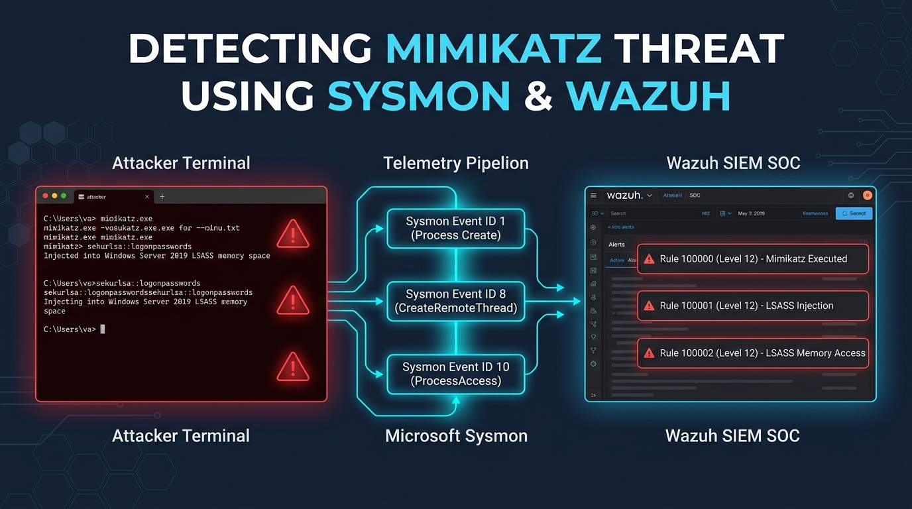

# 🛡️ Detecting Mimikatz Threat Using Sysmon and Wazuh
### Complete Endpoint Telemetry, Sysmon EventChannel Integration, Custom SIEM Rules & LSASS Credential Dumping Forensics

[](https://my.ine.com/labs/7a7d418e-9b1b-4154-9145-60b16ee6a128)
[](https://github.com/wazuh/wazuh)
[-8b5cf6?style=for-the-badge&logo=windows)](https://learn.microsoft.com/en-us/sysinternals/downloads/sysmon)
[-ef4444?style=for-the-badge&logo=target)](https://attack.mitre.org/techniques/T1003/001/)
[](./Detecting_Mimikatz_Threat_Using_Sysmon_and_Wazuh_Walkthrough.md)

**Lab URL:** [https://my.ine.com/labs/7a7d418e-9b1b-4154-9145-60b16ee6a128](https://my.ine.com/labs/7a7d418e-9b1b-4154-9145-60b16ee6a128)  
**Walkthrough Video:** [`Detecting Mimikatz Threat Using Sysmon and Wazuh.mp4`](./Detecting%20Mimikatz%20Threat%20Using%20Sysmon%20and%20Wazuh.mp4)  
**Forensic Analyzer Script:** [`mimikatz_sysmon_wazuh_analyzer.py`](./mimikatz_sysmon_wazuh_analyzer.py)

</div>

---

## 📑 Table of Contents

1. [About This Lab & Core Technologies](#-1-about-this-lab--core-technologies)
   - [What is Mimikatz?](#what-is-mimikatz)
   - [What is Wazuh?](#what-is-wazuh)
   - [What is Microsoft Sysmon?](#what-is-microsoft-sysmon)
2. [Lab Environment, Objective & Tasks](#-2-lab-environment-objective--tasks)
3. [Detection Architecture & Telemetry Pipeline](#-3-detection-architecture--telemetry-pipeline)
4. [Live Walkthrough Demonstration (Animated GIF)](#-4-live-walkthrough-demonstration-animated-gif)
5. [Step-by-Step Lab Solution (Tasks 1–5)](#-5-step-by-step-lab-solution-tasks-15)
   - [Step 1: Access the Lab Machines](#step-1-open-the-lab-link-to-access-the-machines)
   - [Task 1: Connect Wazuh Agent to the Wazuh Server (Steps 2–4)](#task-1-connect-wazuh-agent-to-the-wazuh-server)
   - [Task 2: Configure the Wazuh Agent to Collect Sysmon Logs (Steps 5–6)](#task-2-configure-the-wazuh-agent-to-collect-sysmon-logs)
   - [Task 3: Create Rules to Detect Mimikatz Attack (Step 6 - Server)](#task-3-create-rules-to-detect-mimikatz-attack)
   - [Task 4: Perform Mimikatz Attack (Steps 7–8)](#task-4-perform-mimikatz-attack)
   - [Task 5: Detection of Mimikatz Attack with Wazuh (Step 9)](#task-5-detection-of-mimikatz-attack-with-wazuh)
6. [Deep-Dive Forensic Telemetry Analysis (`0x1010` & `CallTrace`)](#-6-deep-dive-forensic-telemetry-analysis-0x1010--calltrace)
7. [Production Hardening: Detecting Renamed Mimikatz Binaries](#-7-production-hardening-detecting-renamed-mimikatz-binaries)
8. [Automation: Python Telemetry Analyzer (`mimikatz_sysmon_wazuh_analyzer.py`)](#-8-automation-python-telemetry-analyzer)
9. [Conclusion & References](#-9-conclusion--references)

---

## 🧠 1. About This Lab & Core Technologies

### What is Mimikatz?

**Mimikatz** (created by Benjamin Delpy, `@gentilkiwi`) is an open-source post-exploitation application allowing users to view and save authentication credentials such as **Kerberos tickets**, **NTLM password hashes**, **LM hashes**, and **plaintext passwords** cached in Windows memory. The toolset works with current releases of Windows and includes a collection of different network and credential attacks (`sekurlsa`, `kerberos`, `lsadump`, `crypto`, `privilege`, `token`) to help assess vulnerabilities.

Attackers commonly use Mimikatz to steal credentials and escalate privileges because, in many cases, traditional signature-based endpoint protection software and legacy antivirus systems do not detect or block in-memory credential harvesting. Conversely, penetration testers and red teams use Mimikatz to demonstrate credential exposure risks (such as Pass-the-Hash, Pass-the-Ticket, Golden Ticket, and DCSync) so defenders can harden endpoints and build behavioral detection rules.

* **Reference:** [Mimikatz 101 — A Guide for Beginners](https://medium.com/@mindhackdiva/mimikatz-101-a-guide-for-beginners-a29fe15004a4)

### What is Wazuh?

**Wazuh** is an open-source security monitoring platform (XDR and SIEM) that helps organizations detect and respond to cybersecurity threats. It is capable of protecting workloads across on-premises, virtualized, containerized, and cloud-based environments.

A Wazuh deployment consists of two primary components:
1. **Wazuh Endpoint Security Agent:** Deployed to monitored systems (Windows, Linux, macOS) to collect operating system logs, Windows EventChannel streams, file integrity changes, and process telemetry.
2. **Wazuh Management Server:** Collects, decodes, and analyzes telemetry gathered by the agents using a hierarchy of XML decoders and correlation rules (`/var/ossec/etc/rules/`). Built on top of the Elastic Stack / OpenSearch, Wazuh provides a rich web dashboard for searching, filtering, and visualizing security alerts mapped to MITRE ATT&CK.

* **Reference:** [https://github.com/wazuh/wazuh](https://github.com/wazuh/wazuh)

### What is Microsoft Sysmon?

**System Monitor (Sysmon)** is a Windows system service and device driver (`Sysmon64.exe` / `SysmonDrv.sys`) that remains resident across system reboots to monitor and log granular system activity to the Windows EventChannel `Microsoft-Windows-Sysmon/Operational`. While standard Windows Security Event Logs lack deep inter-process memory access telemetry, Sysmon captures crucial behavioral indicators required to catch Mimikatz:
* **Sysmon Event ID 1 (`ProcessCreate`):** Captures full command-line arguments, binary path (`Image`), PE metadata (`Company`, `Description`, `OriginalFileName`), and cryptographic hashes (`MD5`, `SHA256`, `IMPHASH`).
* **Sysmon Event ID 8 (`CreateRemoteThread`):** Detects when a source process (`SourceImage`) injects a thread into another process (`TargetImage`) via APIs such as `CreateRemoteThread` or `RtlCreateUserThread`.
* **Sysmon Event ID 10 (`ProcessAccess`):** Logs whenever one process (`SourceImage`) opens a handle to another process (`TargetImage`, such as `C:\Windows\system32\lsass.exe`), recording the exact access bitmask (`GrantedAccess`, e.g., `0x1010`) and full stack trace (`CallTrace`).

---

## 🌐 2. Lab Environment, Objective & Tasks

### Lab Environment Overview

In this lab environment, you have GUI access to three machines:
1. **Attacker Machine (Kali Linux):** Available in the lab environment.
2. **SOC Machine (Ubuntu 20.04 — Wazuh Server):** Hosts the Wazuh Manager and Wazuh Dashboard (`10.0.31.41`).
3. **Target Machine (Windows Server 2019 — Wazuh Agent):** Hostname `AttackDefense` (`10.0.25.100`), pre-loaded with Wazuh Agent, Sysmon v14.14, and Mimikatz v2.2.0 (`x64`).

Your task is to integrate the Wazuh Server and Wazuh Agent on the SOC and Target Machines, configure Sysmon to monitor process creation, remote thread creation, and inter-process access, author custom Wazuh detection rules, simulate a Mimikatz credential dumping attack on the target endpoint, and detect its activities using Sysmon logs in the Wazuh Dashboard.

> [!IMPORTANT]
> **Lab Objective:** To simulate a Mimikatz Attack and detect the threat using Sysmon and Wazuh.

### Access Credentials & Network Matrix

| Machine / Service | Hostname / OS | IP Address | Access URL / Path | Credentials |
| :--- | :--- | :--- | :--- | :--- |
| **SOC Machine (Wazuh Server)** | Ubuntu 20.04 (`ip-10-0-31-41`) | `10.0.31.41/20` (`ens5`) | `https://localhost` | **Username:** `admin`<br>**Password:** `wEe76ZfIQmisfbtS4g52*DXP5.?3H+fc` |
| **Target Machine (Wazuh Agent)** | Windows Server 2019 (`AttackDefense`) | `10.0.25.100` (Agent ID `001`) | `C:\Program Files (x86)\ossec-agent\ossec.conf` | Logged in as `Administrator` |
| **Attacker Machine** | Kali Linux | Lab Subnet | GUI Desktop | Logged in as `root` |

### Lab Tasks Breakdown

| Task # | Task Title | Key Action Performed |
| :---: | :--- | :--- |
| **Task 1** | **Connect Wazuh Agent to the Wazuh Server** | Discover Wazuh Server IP (`10.0.31.41`), update `ossec.conf` on Windows Target, and start `WazuhSvc`. |
| **Task 2** | **Configure the Wazuh agent to collect Sysmon logs** | Add `Microsoft-Windows-Sysmon/Operational` EventChannel to `ossec.conf`, create `sysconfig.xml`, and apply with `Sysmon64.exe -c`. |
| **Task 3** | **Create rules to detect Mimikatz Attack** | Add Rules `100000` (EID 1), `100001` (EID 8), and `100002` (EID 10) at Level `12` to `/var/ossec/etc/rules/local_rules.xml`. |
| **Task 4** | **Perform Mimikatz Attack** | Execute `mimikatz.exe` and run `privilege::debug`, `log`, and `sekurlsa::logonpasswords` on Target Machine. |
| **Task 5** | **Detection of Mimikatz Attack with Wazuh** | Filter Wazuh Security Events for **Level 12 or above alerts** and inspect Rule IDs `100000` and `100002`. |

### Tools Used in This Lab

* **PowerShell** (Service management, Sysmon configuration loading, and Mimikatz execution)
* **Sysmon (`Sysmon64.exe` v14.14)** (Kernel-level process and LSASS memory access telemetry)
* **Firefox** (Accessing Wazuh Dashboard over HTTPS)
* **Wazuh (`WazuhSvc` & `wazuh-manager`)** (Endpoint log shipping, decoding, rule matching, and alerting)
* **Mimikatz (`mimikatz.exe` v2.2.0 x64)** (Credential extraction via `sekurlsa::logonpasswords`)

---

## 🏗️ 3. Detection Architecture & Telemetry Pipeline

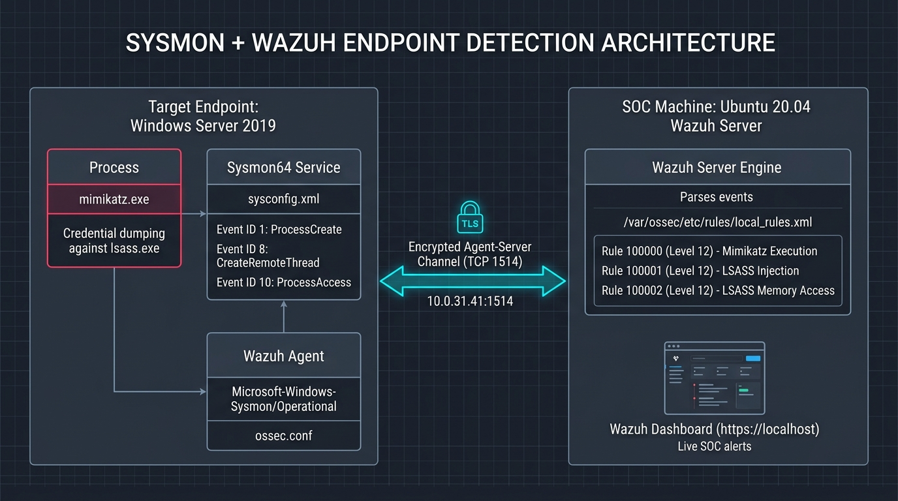

### End-to-End Telemetry Pipeline (Mermaid Diagram)

```mermaid
flowchart LR
    subgraph Target["🎯 Target Machine (Windows Server 2019 - 10.0.25.100)"]
        direction TB
        M["💀 mimikatz.exe (v2.2.0 x64)<br/>privilege::debug<br/>sekurlsa::logonpasswords"]
        L["🔒 lsass.exe<br/>(C:\\Windows\\system32\\lsass.exe)"]
        S["⚙️ Sysmon64 Service<br/>(sysconfig.xml - Schema 4.10)<br/>• EID 1: ProcessCreate<br/>• EID 8: CreateRemoteThread<br/>• EID 10: ProcessAccess"]
        E["📋 Windows EventChannel<br/>Microsoft-Windows-Sysmon/Operational"]
        A["📡 Wazuh Agent (WazuhSvc)<br/>ossec.conf (Agent ID: 001)"]

        M -->|"Opens Handle (0x1010)<br/>PROCESS_VM_READ"| L
        M -->|"Monitored by Kernel Driver"| S
        L -->|"Inter-Process Access Logged"| S
        S -->|"Writes XML/EVTX Events"| E
        E -->|"Subscribed via eventchannel"| A
    end

    subgraph SOC["🛡️ SOC Machine (Ubuntu 20.04 - 10.0.31.41)"]
        direction TB
        W["🧠 Wazuh Manager<br/>/var/ossec/etc/rules/local_rules.xml"]
        R1["🚨 Rule 100000 (Level 12)<br/>if_group: sysmon_event1<br/>Suspicious Process - mimikatz.exe"]
        R2["🚨 Rule 100001 (Level 12)<br/>if_group: sysmon_event8<br/>mimikatz.exe created remote thread"]
        R3["🚨 Rule 100002 (Level 12)<br/>if_group: sysmon_event_10<br/>mimikatz.exe accessed lsass.exe"]
        D["📊 Wazuh Dashboard<br/>https://localhost<br/>Security Events (Level >= 12)"]

        W --> R1 & R2 & R3
        R1 & R2 & R3 --> D
    end

    A ==>|"Encrypted TCP 1514<br/>(10.0.31.41)"| W

    style Target fill:#0f172a,stroke:#38bdf8,stroke-width:2px,color:#f8fafc
    style SOC fill:#0f172a,stroke:#22c55e,stroke-width:2px,color:#f8fafc
    style M fill:#450a0a,stroke:#ef4444,color:#ffffff
    style L fill:#1e1b4b,stroke:#818cf8,color:#ffffff
    style R1 fill:#450a0a,stroke:#f87171,color:#ffffff
    style R2 fill:#450a0a,stroke:#f87171,color:#ffffff
    style R3 fill:#450a0a,stroke:#f87171,color:#ffffff
```

### Mimikatz LSASS Credential Dumping & Sysmon Telemetry Workflow

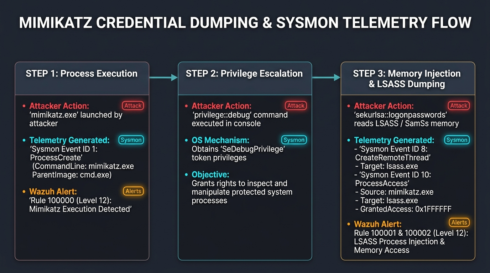

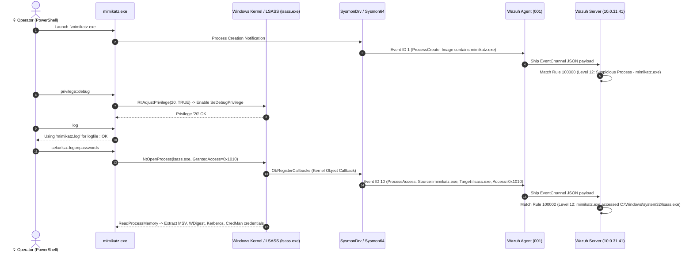

---

## 🎬 4. Live Walkthrough Demonstration (Animated GIF)

The animated walkthrough below cycles through all 9 stages of the lab—from discovering the Wazuh Manager IP (`10.0.31.41`) and enrolling the Windows Server 2019 agent (`AttackDefense`), to loading `sysconfig.xml`, configuring Wazuh Rules `100000`–`100002`, executing `sekurlsa::logonpasswords`, and triaging the resulting Level 12 alerts:

<div align="center">

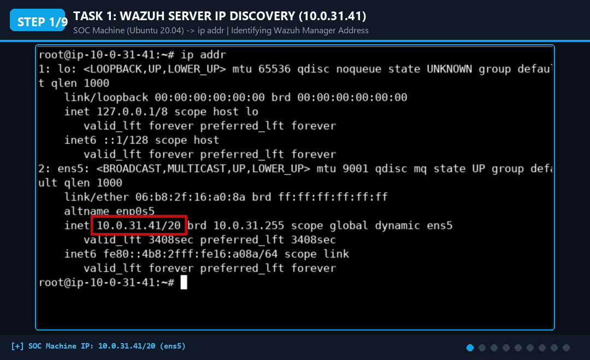

</div>

---

## 🛠️ 5. Step-by-Step Lab Solution (Tasks 1–5)

### Step 1: Open the lab link to access the machines

Open the lab link to access the three browser-based GUI virtual machines provided in the workspace:

1. **Attacker Machine (Kali):**

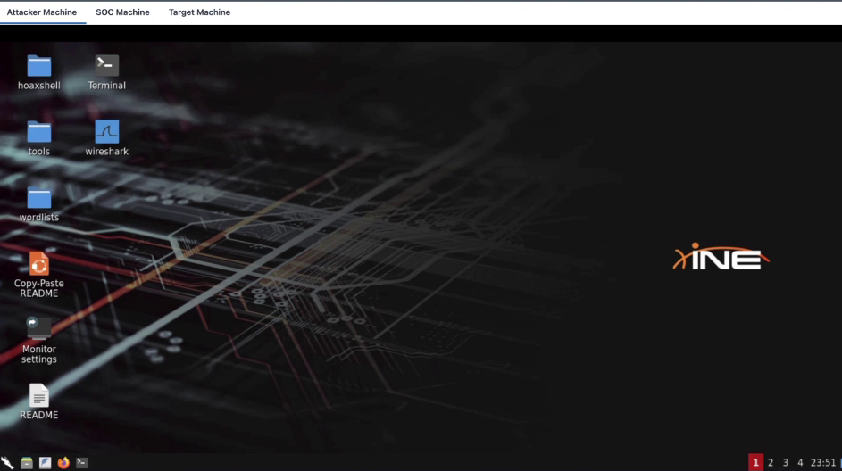

2. **SOC Machine (Wazuh Server):**

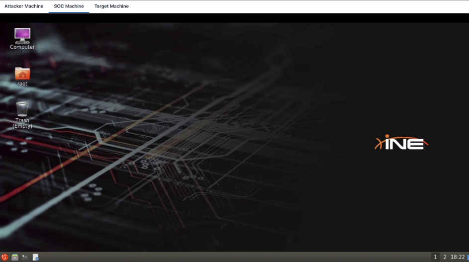

3. **Target Machine (Wazuh Agent):**

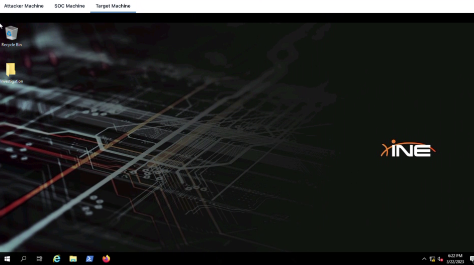

---

### Task 1: Connect Wazuh Agent to the Wazuh Server

First, we need to configure the Wazuh Agent on the **Target Machine** so that Wazuh can listen to all the event logs and visualize them in the Wazuh Dashboard. Before we run the Wazuh Agent, let's verify that Wazuh is up and running on the **SOC Machine**.

#### Step 2: Access the Wazuh Dashboard and Discover the Wazuh Server IP

On the **SOC Machine**, open Firefox and access the Wazuh Dashboard using the following credentials:
* **URL:** `https://localhost`
* **Username:** `admin`
* **Password:** `wEe76ZfIQmisfbtS4g52*DXP5.?3H+fc`

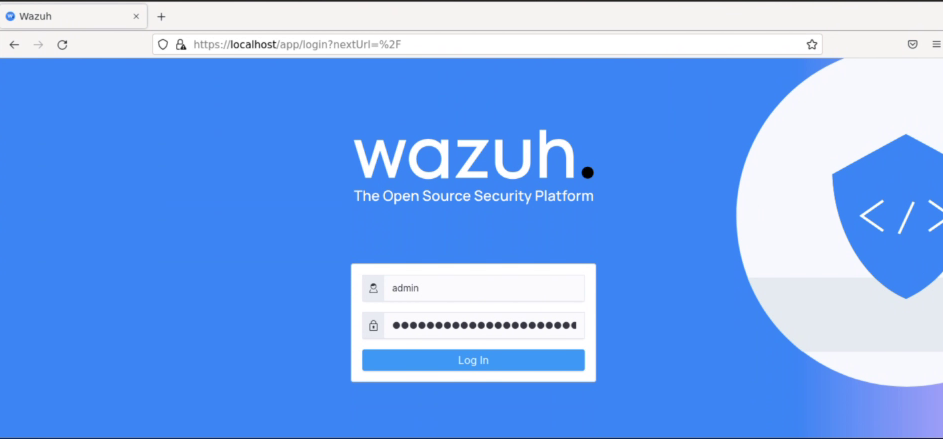

Below is the initial screenshot of the Wazuh Dashboard upon logging in:

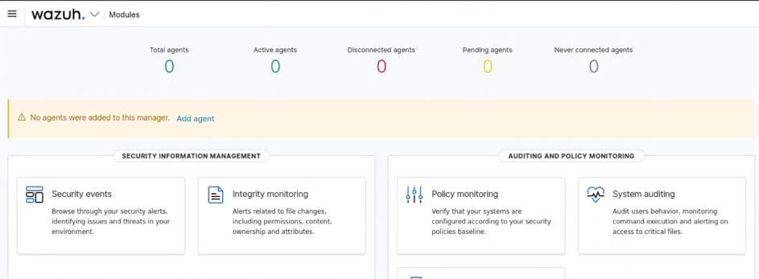

Notice that **there is currently no active agent connected to the Wazuh server** (`Total agents: 0`, `Active agents: 0`). Let's check the IP address of the Wazuh server machine by opening a terminal on the **SOC Machine** and running:

```bash
ip addr
```

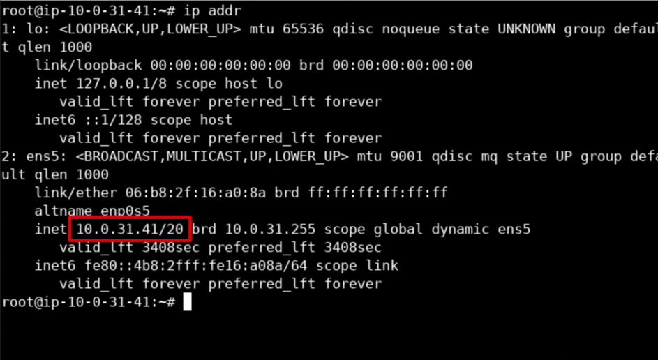

> [!NOTE]
> From the `ens5` network interface output (`inet 10.0.31.41/20`), the IP address of the **SOC Machine** where Wazuh Server is running is **`10.0.31.41`**.

---

#### Step 3: Configure `ossec.conf` on Target Machine and Start `WazuhSvc`

Switch to the **Target Machine (Windows Server 2019)**. Open the Wazuh Agent configuration file located at `C:\Program Files (x86)\ossec-agent\ossec.conf` using File Explorer / Notepad.

Locate the `<client><server><address>` tag and enter the Wazuh Server IP address **`10.0.31.41`**:

```xml
<ossec_config>
  <client>
    <server>
      <address>10.0.31.41</address>
      <port>1514</port>
      <protocol>tcp</protocol>
    </server>
    <config-profile>windows, windows2019, windows-server, windows-server-2019</config-profile>
    <crypto_method>aes</crypto_method>
    <notify_time>10</notify_time>
    <time-reconnect>60</time-reconnect>
    <auto_restart>yes</auto_restart>
  </client>
```

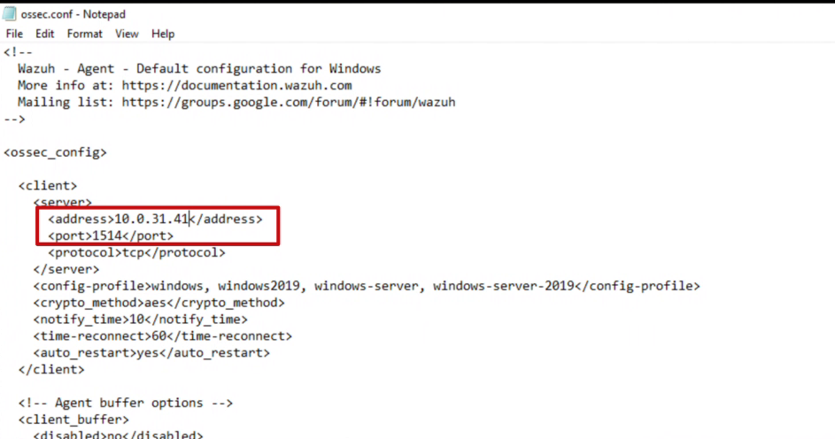

Save the file, wait a few moments, and start the Wazuh Agent Windows service by running the following command in an Administrator **PowerShell** window:

```powershell
Start-Service -Name WazuhSvc
```

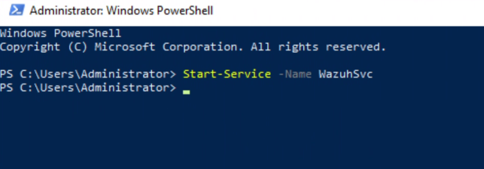

---

#### Step 4: Verify Active Agent Connection in Wazuh Dashboard

Switch back to the **SOC Machine** and refresh the Wazuh Dashboard page until you see an active agent:

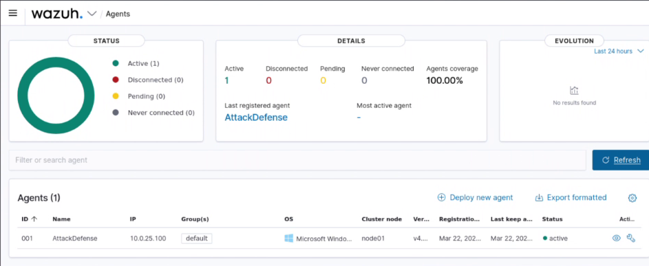

We have successfully connected the Wazuh Agent! The dashboard now shows:
* **Agent ID:** `001`
* **Agent Name:** `AttackDefense`
* **IP Address:** `10.0.25.100`
* **Operating System:** `Microsoft Windows Server 2019 Datacenter Evaluation`
* **Status:** `Active` (`100%`)

---

### Task 2: Configure the Wazuh Agent to Collect Sysmon Logs

Once the Wazuh Agent is installed and running on the monitored Windows Server 2019 endpoint, we must configure both the Wazuh Agent to subscribe to the Sysmon EventChannel and Sysmon itself to monitor Mimikatz-related process and memory events.

#### Step 5: Add the Sysmon EventChannel to `ossec.conf`

On the **Target Machine**, configure the Wazuh Agent to capture Sysmon events by adding the following `<localfile>` block to `C:\Program Files (x86)\ossec-agent\ossec.conf` under the `<!-- Log analysis -->` section:

```xml
<localfile>
  <location>Microsoft-Windows-Sysmon/Operational</location>
  <log_format>eventchannel</log_format>
</localfile>
```

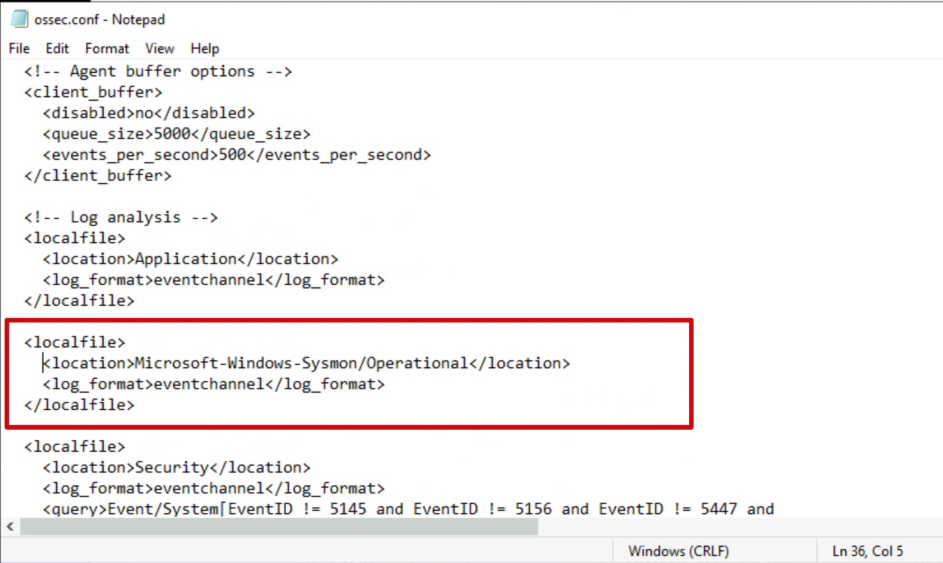

Save and close `ossec.conf`.

> [!TIP]
> **Why `eventchannel` instead of `eventlog`?**  
> Legacy `<log_format>eventlog</log_format>` only supports the three classic Windows NT logs (`Application`, `Security`, `System`). Specifying `<log_format>eventchannel</log_format>` instructs the Wazuh agent to use the modern Windows Eventing 6.0 API (`EvtSubscribe`) to stream structured XML events directly from Applications and Services channels such as `Microsoft-Windows-Sysmon/Operational`.

---

#### Step 6: Create `sysconfig.xml`, Load into Sysmon, and Restart Wazuh Agent

Now we need to configure Sysmon to track suspicious processes and inter-process actions. Specifically, we will monitor:
1. **Process Creation (`Event ID 1` — `ProcessCreate`)**
2. **Remote Thread Creation (`Event ID 8` — `CreateRemoteThread`)**
3. **Inter-Process Access (`Event ID 10` — `ProcessAccess`)**

Mimikatz is a command-line post-exploitation tool that executes privileged operations against `lsass.exe` and the Security Accounts Manager (`SamSs`), which are captured by Sysmon and recorded in the `Microsoft-Windows-Sysmon/Operational` Windows event log.

Create an XML configuration file named `sysconfig.xml` (or `sysmonconfig.xml`) inside the `Downloads` folder (`C:\Users\Administrator\Downloads\sysconfig.xml`) with the following content:

* **Reference:** [Learn to detect threats on Windows by monitoring Sysmon events](https://wazuh.com/blog/learn-to-detect-threats-on-windows-by-monitoring-sysmon-events/)

```xml
<Sysmon schemaversion="4.10">
   <HashAlgorithms>md5</HashAlgorithms>
   <EventFiltering>
      <!--SYSMON EVENT ID 1 : PROCESS CREATION-->
      <ProcessCreate onmatch="include">
         <Image condition="contains">mimikatz.exe</Image>
      </ProcessCreate>
      <!--SYSMON EVENT ID 2 : FILE CREATION TIME RETROACTIVELY CHANGED IN THE FILESYSTEM-->
      <FileCreateTime onmatch="include" />
      <!--SYSMON EVENT ID 3 : NETWORK CONNECTION INITIATED-->
      <NetworkConnect onmatch="include" />
      <!--SYSMON EVENT ID 4 : RESERVED FOR SYSMON STATUS MESSAGES, THIS LINE IS INCLUDED FOR DOCUMENTATION PURPOSES ONLY-->
      <!--SYSMON EVENT ID 5 : PROCESS ENDED-->
      <ProcessTerminate onmatch="include" />
      <!--SYSMON EVENT ID 6 : DRIVER LOADED INTO KERNEL-->
      <DriverLoad onmatch="include" />
      <!--SYSMON EVENT ID 7 : DLL (IMAGE) LOADED BY PROCESS-->
      <ImageLoad onmatch="include" />
      <!--SYSMON EVENT ID 8 : REMOTE THREAD CREATED-->
      <CreateRemoteThread onmatch="include">
         <SourceImage condition="contains">mimikatz.exe</SourceImage>
      </CreateRemoteThread>
      <!--SYSMON EVENT ID 9 : RAW DISK ACCESS-->
      <RawAccessRead onmatch="include" />
      <!--SYSMON EVENT ID 10 : INTER-PROCESS ACCESS-->
      <ProcessAccess onmatch="include">
         <SourceImage condition="contains">mimikatz.exe</SourceImage>
      </ProcessAccess>
      <!--SYSMON EVENT ID 11 : FILE CREATED-->
      <FileCreate onmatch="include" />
      <!--SYSMON EVENT ID 12 & 13 & 14 : REGISTRY MODIFICATION-->
      <RegistryEvent onmatch="include" />
      <!--SYSMON EVENT ID 15 : ALTERNATE DATA STREAM CREATED-->
      <FileCreateStreamHash onmatch="include" />
      <PipeEvent onmatch="include" />
   </EventFiltering>
</Sysmon>
```

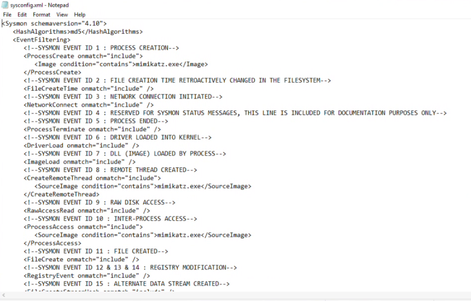

Save and close the file.

**Technical Breakdown of `sysconfig.xml` Directives:**
* `<Sysmon schemaversion="4.10">` & `<HashAlgorithms>md5</HashAlgorithms>`: Declares Sysmon configuration schema `4.10` and computes MD5 hashes on image creation/load events.
* `<ProcessCreate onmatch="include"><Image condition="contains">mimikatz.exe</Image></ProcessCreate>`: Generates **Sysmon Event ID 1** whenever an executable path containing `mimikatz.exe` is spawned.
* `<CreateRemoteThread onmatch="include"><SourceImage condition="contains">mimikatz.exe</SourceImage></CreateRemoteThread>`: Generates **Sysmon Event ID 8** if `mimikatz.exe` injects a remote thread into another process (such as `lsass.exe` during `sekurlsa` / `lsadump::lsa /inject`).
* `<ProcessAccess onmatch="include"><SourceImage condition="contains">mimikatz.exe</SourceImage></ProcessAccess>`: Generates **Sysmon Event ID 10** whenever `mimikatz.exe` opens a process handle to another process (such as `C:\Windows\system32\lsass.exe`).
* Empty `<... onmatch="include" />` tags for Event IDs `2, 3, 5, 6, 7, 9, 11, 12-14, 15, PipeEvent`: Because an empty `onmatch="include"` rule has no matching conditions inside it, Sysmon suppresses those noisy events entirely, ensuring zero false-positive noise and focusing telemetry exclusively on Event IDs `1`, `8`, and `10`.

Next, update and load the configuration file into the running Sysmon service from PowerShell:

```powershell
cd .\Downloads\Sysmon
.\Sysmon64.exe -c ..\sysconfig.xml
```

*(Note: Depending on what you named the file in `Downloads`, use `..\sysconfig.xml` or `..\sysmonconfig.xml`.)*

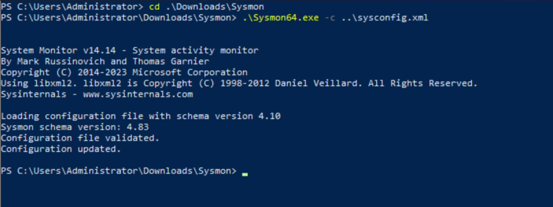

Verify the output confirms:
```text
Loading configuration file with schema version 4.10
Sysmon schema version: 4.83
Configuration file validated.
Configuration updated.
```

Now restart the Wazuh Agent service to apply the `ossec.conf` changes:

```powershell
Restart-Service -Name WazuhSvc
```

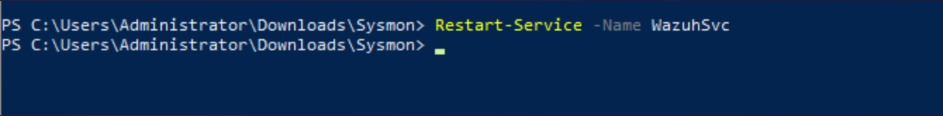

We have successfully restarted the Wazuh Agent to collect Sysmon logs.

---

### Task 3: Create Rules to Detect Mimikatz Attack

#### Step 6 (Server Side): Add Custom Detection Rules to `/var/ossec/etc/rules/local_rules.xml`

Switch to the **SOC Machine (Wazuh Server)** and open `/var/ossec/etc/rules/local_rules.xml` in an editor (`nano /var/ossec/etc/rules/local_rules.xml`). Add the following custom rule group at the bottom of the file:

```xml
<group name="windows, sysmon, sysmon_process-anomalies,">
   <rule id="100000" level="12">
      <if_group>sysmon_event1</if_group>
      <field name="win.eventdata.image">mimikatz.exe</field>
      <description>Sysmon - Suspicious Process - mimikatz.exe</description>
   </rule>

   <rule id="100001" level="12">
      <if_group>sysmon_event8</if_group>
      <field name="win.eventdata.sourceImage">mimikatz.exe</field>
      <description>Sysmon - Suspicious Process mimikatz.exe created a remote thread</description>
   </rule>

   <rule id="100002" level="12">
      <if_group>sysmon_event_10</if_group>
      <field name="win.eventdata.sourceImage">mimikatz.exe</field>
      <description>Sysmon - Suspicious Process mimikatz.exe accessed $(win.eventdata.targetImage)</description>
   </rule>
</group>
```

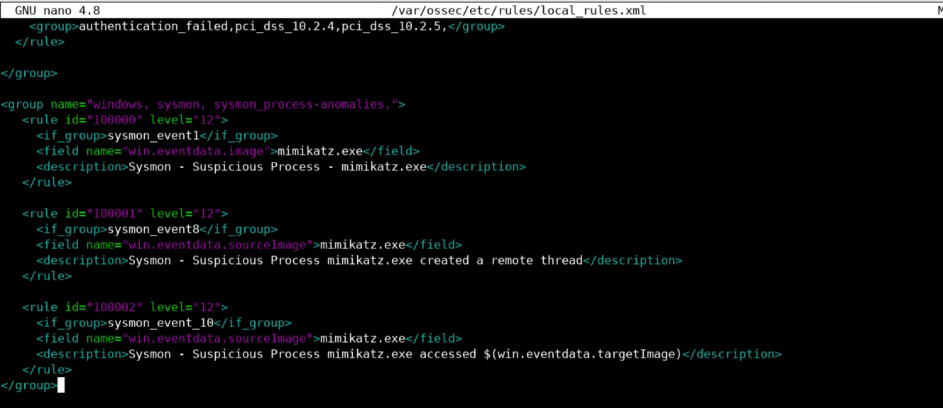

Save and close the file.

**Detailed Breakdown of the Custom Wazuh Rules:**

| Rule ID | Alert Level | Parent Decoder Group (`<if_group>`) | Matched Field (`<field>`) | Alert Description & Purpose |
| :---: | :---: | :--- | :--- | :--- |
| **`100000`** | **`12`** (High Severity) | `sysmon_event1` (Sysmon Event ID 1: Process Creation) | `win.eventdata.image` matches `mimikatz.exe` | **`Sysmon - Suspicious Process - mimikatz.exe`** — Detects the initial execution of the Mimikatz binary. |
| **`100001`** | **`12`** (High Severity) | `sysmon_event8` (Sysmon Event ID 8: CreateRemoteThread) | `win.eventdata.sourceImage` matches `mimikatz.exe` | **`Sysmon - Suspicious Process mimikatz.exe created a remote thread`** — Detects remote thread injection initiated by Mimikatz. |
| **`100002`** | **`12`** (High Severity) | `sysmon_event_10` (Sysmon Event ID 10: ProcessAccess) | `win.eventdata.sourceImage` matches `mimikatz.exe` | **`Sysmon - Suspicious Process mimikatz.exe accessed $(win.eventdata.targetImage)`** — Dynamically interpolates the accessed target process path (e.g., `C:\Windows\system32\lsass.exe`). |

> [!IMPORTANT]
> **Notice the Naming Convention in Built-in Wazuh Sysmon Rules:**  
> In Wazuh's default ruleset (`0595-win-sysmon_rules.xml`), Event ID 1 is grouped as `sysmon_event1` (no underscore), Event ID 8 is grouped as `sysmon_event8` (no underscore), whereas Event ID 10 is grouped as **`sysmon_event_10`** (with an underscore). Matching these exact `<if_group>` names is essential for child rule inheritance!

Restart the Wazuh Manager service on the **SOC Machine** to compile and activate the new rules:

```bash
systemctl restart wazuh-manager
```

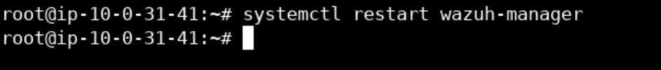

We have successfully restarted and configured the Wazuh Manager to start using the new local rules.

---

### Task 4: Perform Mimikatz Attack

#### Step 7 & Step 8: Simulate the Mimikatz Credential Dumping Attack

Two primary operations are executed with Mimikatz to generate the telemetry events that match our custom Wazuh rules:
1. **Operation 1 (Process Execution):** Running `mimikatz.exe` from PowerShell, which triggers a **Sysmon Event ID 1 (`ProcessCreate`)** log and fires **Wazuh Rule `100000`**.
2. **Operation 2 (Privilege Escalation & LSASS Credential Harvesting):** Enabling debug privileges (`privilege::debug`) and extracting cached logon credentials (`sekurlsa::logonpasswords`) from LSASS (`C:\Windows\system32\lsass.exe`), which triggers a **Sysmon Event ID 10 (`ProcessAccess`)** log and fires **Wazuh Rule `100002`**.

Switch to the **Target Machine (Windows Server 2019)**, open PowerShell as Administrator, navigate to the Mimikatz `x64` directory, and launch `mimikatz.exe`:

```powershell
cd .\Desktop\Investigation\Mimikatz\mimikatz_trunk\x64\
.\mimikatz.exe
```

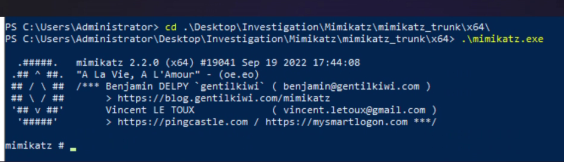

Next, inside the interactive `mimikatz #` console, run the following three commands sequentially:

```text
privilege::debug
log
sekurlsa::logonpasswords
```

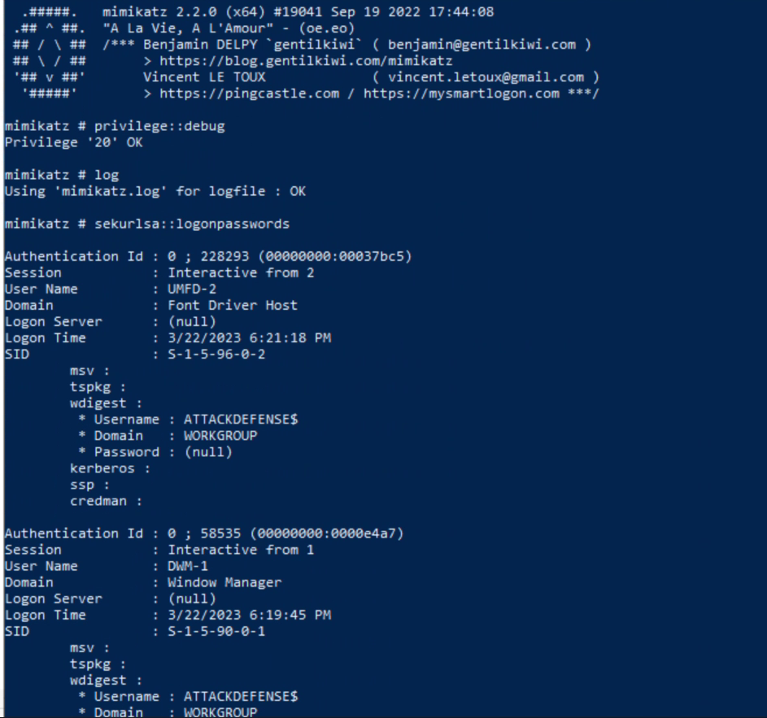

**Technical Explanation of Each Mimikatz Command Executed:**

1. **`privilege::debug`**
   * **Output:** `Privilege '20' OK`
   * **How It Works:** Calls the Windows Native API `RtlAdjustPrivilege(20, TRUE, FALSE, ...)` to enable `SeDebugPrivilege` (Privilege constant `20`) in the current process access token. `SeDebugPrivilege` grants a process the right to open handles (`NtOpenProcess`) with `PROCESS_VM_READ` (`0x0010`) to protected system processes owned by `NT AUTHORITY\SYSTEM`, specifically `lsass.exe`.
2. **`log`**
   * **Output:** `Using 'mimikatz.log' for logfile : OK`
   * **How It Works:** Instructs Mimikatz to mirror all console output—including dumped hashes, Kerberos tickets, and plaintext credentials—into a local file named `mimikatz.log` in the current working directory (`C:\Users\Administrator\Desktop\Investigation\Mimikatz\mimikatz_trunk\x64\mimikatz.log`).
3. **`sekurlsa::logonpasswords`**
   * **Output:** Iterates through active Windows logon sessions (`Authentication Id`) and queries each loaded Local Security Authority (LSA) authentication package (`msv`, `tspkg`, `wdigest`, `kerberos`, `ssp`, `credman`) inside `lsass.exe` memory.
   * **Telemetry Triggered:** To read LSASS memory structures, `mimikatz.exe` calls `OpenProcess` (`NtOpenProcess`) targeting `C:\Windows\system32\lsass.exe` with access mask `0x1010` (`PROCESS_VM_READ | PROCESS_QUERY_LIMITED_INFORMATION`). This immediately triggers **Sysmon Event ID 10 (`ProcessAccess`)**.

---

### Task 5: Detection of Mimikatz Attack with Wazuh

#### Step 9: Triage Level 12 Security Alerts in the Wazuh Dashboard

1. Switch back to the **SOC Machine** and open the **Wazuh Dashboard** (`https://localhost`). Notice that under **Security Information Management**, **Security events** now displays **`288`** total events. Click on **Security events**:

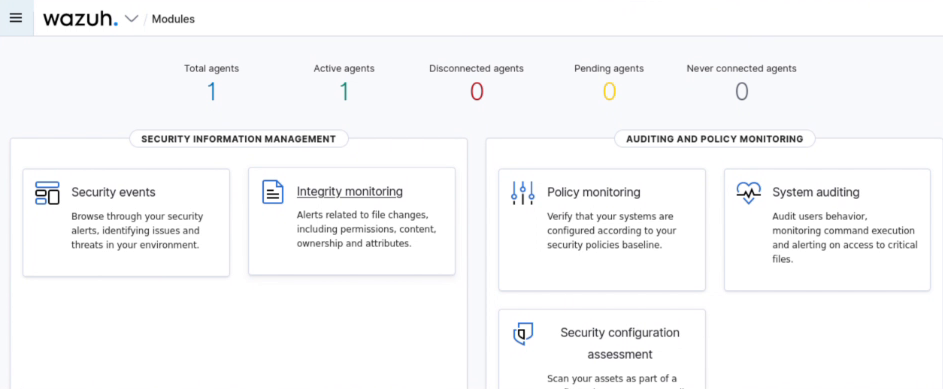

2. In the **Security events** dashboard overview, look at the summary metrics at the top:
   * **Total:** `286`
   * **Level 12 or above alerts:** **`2`**
   * **Authentication failure:** `0`
   * **Authentication success:** `2`

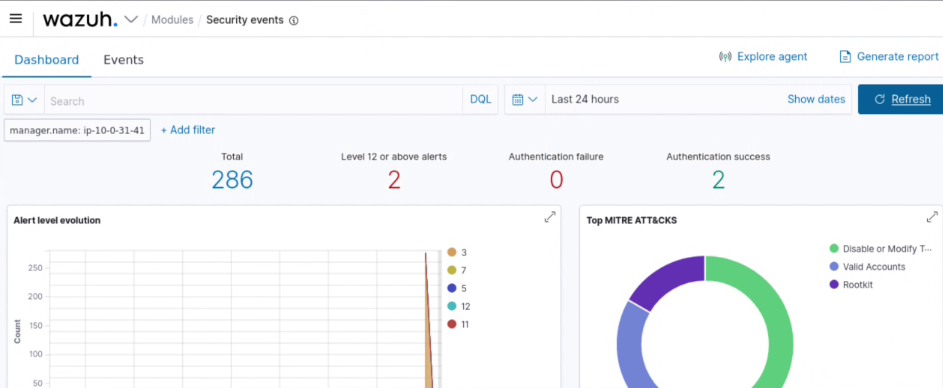

3. Click on **`Level 12 or above alerts`** (`2`) to automatically add the filter `rule.level: 12 to *` and isolate severe alerts generated by our custom rules in `local_rules.xml`:

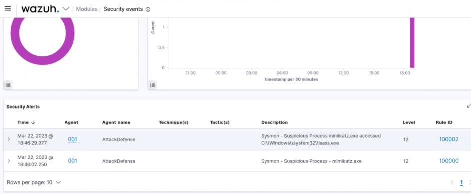

Both high-severity alerts (`Level 12`) are displayed chronologically in the **Security Alerts** table:

| Timestamp | Agent ID | Agent Name | Description | Level | Rule ID |
| :--- | :---: | :--- | :--- | :---: | :---: |
| `Mar 22, 2023 @ 18:46:29.977` | `001` | `AttackDefense` | `Sysmon - Suspicious Process mimikatz.exe accessed C:\Windows\system32\lsass.exe` | **`12`** | **`100002`** |
| `Mar 22, 2023 @ 18:46:02.250` | `001` | `AttackDefense` | `Sysmon - Suspicious Process - mimikatz.exe` | **`12`** | **`100000`** |

4. **Expand Rule ID `100000`** to inspect the detailed Sysmon Event ID 1 (`ProcessCreate`) telemetry:

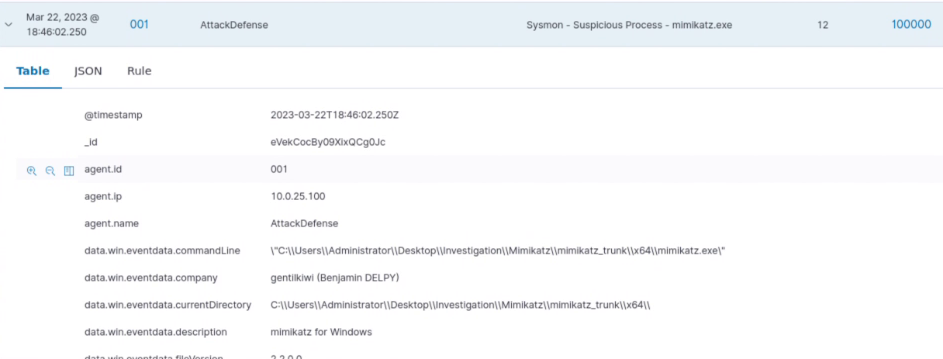

5. **Expand Rule ID `100002`** to inspect the detailed Sysmon Event ID 10 (`ProcessAccess`) telemetry showing `mimikatz.exe` accessing `C:\Windows\system32\lsass.exe`:

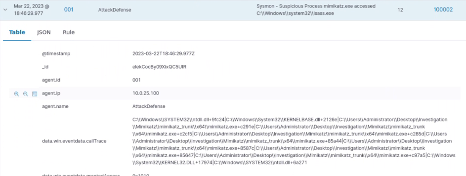

---

## 🔬 6. Deep-Dive Forensic Telemetry Analysis (`0x1010` & `CallTrace`)

Examining the expanded fields in **Rule ID `100000`** (`21.png`) and **Rule ID `100002`** (`22.png`) reveals critical forensic artifacts that SOC analysts use to validate true-positive credential dumping:

### Alert 1: Rule ID `100000` — Process Creation (`Sysmon Event ID 1`)

| Field Name | Captured Value | Forensic Significance |
| :--- | :--- | :--- |
| `@timestamp` | `2023-03-22T18:46:02.250Z` | Exact UTC timestamp when `mimikatz.exe` was launched. |
| `_id` | `eVekCocBy09XixQCg0Jc` | Unique Elasticsearch/OpenSearch document ID. |
| `agent.id` / `agent.name` | `001` / `AttackDefense` | Compromised Windows Server 2019 endpoint (`10.0.25.100`). |
| `data.win.eventdata.commandLine` | `\"C:\Users\Administrator\Desktop\Investigation\Mimikatz\mimikatz_trunk\x64\mimikatz.exe\"` | Full command line executed by the user. |
| `data.win.eventdata.company` | `gentilkiwi (Benjamin DELPY)` | PE version resource `Company` metadata embedded in the binary. |
| `data.win.eventdata.currentDirectory` | `C:\Users\Administrator\Desktop\Investigation\Mimikatz\mimikatz_trunk\x64\` | Working directory where `mimikatz.log` was subsequently written. |
| `data.win.eventdata.description` | `mimikatz for Windows` | PE header `FileDescription` metadata. |
| `data.win.eventdata.fileVersion` | `2.2.0.0` | PE header `FileVersion` metadata. |

### Alert 2: Rule ID `100002` — LSASS Memory Access (`Sysmon Event ID 10`)

| Field Name | Captured Value | Forensic Significance |
| :--- | :--- | :--- |
| `@timestamp` | `2023-03-22T18:46:29.977Z` | Executed **27.7 seconds** after launching `mimikatz.exe` when `sekurlsa::logonpasswords` was run. |
| `_id` | `eIekCocBy09XixQC5UIR` | Unique Elasticsearch/OpenSearch document ID. |
| `data.win.eventdata.targetImage` | `C:\\Windows\\system32\\lsass.exe` | Confirms the target of the inter-process handle is the Local Security Authority Subsystem Service (`LSASS`). |
| `data.win.eventdata.grantedAccess` | **`0x1010`** | Bitwise combination of **`0x0010` (`PROCESS_VM_READ`)** + **`0x1000` (`PROCESS_QUERY_LIMITED_INFORMATION`)** — the exact minimum access mask used by `sekurlsa::logonpasswords` to read LSASS virtual memory. |
| `data.win.eventdata.callTrace` | `ntdll.dll+9fc24 \| KERNELBASE.dll+2126e \| mimikatz.exe+c291e ...` | Proves that the `NtOpenProcess` syscall originated directly from unbacked/untrusted code inside `mimikatz.exe` rather than a legitimate Windows system service. |

---

## 🛡️ 7. Production Hardening: Detecting Renamed Mimikatz Binaries

> [!WARNING]
> **Limitation of Filename-Only Filtering:**  
> In this lab, `sysconfig.xml` and `local_rules.xml` filter on `Image contains mimikatz.exe` and `SourceImage contains mimikatz.exe`. If an attacker simply renames `mimikatz.exe` to `svchost_helper.exe`, filename-based filters will miss the execution!

In a production SOC environment, harden your Sysmon and Wazuh detection engineering using **three behavioral layers**:

### 1. Monitor PE Metadata (`OriginalFileName`) and Hashes (`IMPHASH`) in Sysmon Event ID 1
Even when renamed, standard Mimikatz binaries retain `OriginalFileName=mimikatz.exe` and `Company=gentilkiwi (Benjamin DELPY)` in their PE version resource header.

### 2. Target-Centric Sysmon Event ID 10 Filtering (`TargetImage is lsass.exe`)
Instead of filtering `ProcessAccess` by `SourceImage contains mimikatz.exe`, filter by **`TargetImage is C:\Windows\system32\lsass.exe`** and **`GrantedAccess`** masks (`0x1010`, `0x1410`, `0x1F0FFF`, `0x1FFFFF`):

```xml
<!-- Production-Hardened Sysmon Event ID 10 Filter for Any LSASS Credential Dumper -->
<ProcessAccess onmatch="include">
   <TargetImage condition="image">lsass.exe</TargetImage>
</ProcessAccess>
```

### 3. Production Wazuh Rule for Any Unauthorized Process Reading `lsass.exe`

```xml
<group name="windows, sysmon, credential_access,">
   <rule id="100010" level="14">
      <if_group>sysmon_event_10</if_group>
      <field name="win.eventdata.targetImage" type="pcre2">(?i)\\\\lsass\.exe$</field>
      <field name="win.eventdata.grantedAccess" type="pcre2">0x(1010|1410|1438|143a|1f0fff|1fffff)</field>
      <description>MITRE T1003.001: Suspicious LSASS Memory Read by $(win.eventdata.sourceImage) (Access: $(win.eventdata.grantedAccess))</description>
      <mitre>
         <id>T1003.001</id>
      </mitre>
   </rule>
</group>
```

---

## 🐍 8. Automation: Python Telemetry Analyzer

This repository includes [`mimikatz_sysmon_wazuh_analyzer.py`](./mimikatz_sysmon_wazuh_analyzer.py), a standalone Python script that validates the `sysconfig.xml` and `local_rules.xml` configurations, decodes the `0x1010` `GrantedAccess` bitmask, unwinds the 11 stack frames in `data.win.eventdata.callTrace`, and regenerates the animated walkthrough GIF.

### Running the Analyzer

```powershell
# Print formatted forensic summary report
python mimikatz_sysmon_wazuh_analyzer.py

# Output structured JSON telemetry report
python mimikatz_sysmon_wazuh_analyzer.py --json

# Regenerate the animated walkthrough GIF
python mimikatz_sysmon_wazuh_analyzer.py --generate-gif
```

### Sample Console Output

```text
==============================================================================
 MIMIKATZ SYSMON & WAZUH TELEMETRY ANALYZER -- FORENSIC SUMMARY
==============================================================================
 [+] Wazuh Server IP   : 10.0.31.41
 [+] Enrolled Agent    : AttackDefense (ID: 001, IP: 10.0.25.100)
 [+] Sysmon Schema     : v4.10 (HashAlgorithms: md5)
------------------------------------------------------------------------------
 [+] Custom Wazuh Detection Rules Validated:
     - Rule 100000 (Level 12): [sysmon_event1] Sysmon - Suspicious Process - mimikatz.exe
     - Rule 100001 (Level 12): [sysmon_event8] Sysmon - Suspicious Process mimikatz.exe created a remote thread
     - Rule 100002 (Level 12): [sysmon_event_10] Sysmon - Suspicious Process mimikatz.exe accessed $(win.eventdata.targetImage)
------------------------------------------------------------------------------
 [+] Decoded LSASS ProcessAccess Mask (0x1010):
     - 0x0010 (PROCESS_VM_READ): Required to read memory in a process using ReadProcessMemory (core Mimikatz sekurlsa requirement).
     - 0x1000 (PROCESS_QUERY_LIMITED_INFORMATION): Required to retrieve subset of process information (used by Mimikatz alongside PROCESS_VM_READ).
------------------------------------------------------------------------------
 [+] Sysmon Event ID 10 CallTrace Stack (Top 4 Frames):
     #01 C:\Windows\SYSTEM32\ntdll.dll+0x9fc24 -> Windows Native API Syscall (NtOpenProcess)
     #02 C:\Windows\System32\KERNELBASE.dll+0x2126e -> Win32 KernelBase Wrapper (OpenProcess)
     #03 C:\Users\Administrator\Desktop\Investigation\Mimikatz\mimikatz_trunk\x64\mimikatz.exe+0xc291e -> Mimikatz Sekurlsa LSASS Memory Reader
     #04 C:\Users\Administrator\Desktop\Investigation\Mimikatz\mimikatz_trunk\x64\mimikatz.exe+0xc2cf5 -> Mimikatz Sekurlsa LSASS Memory Reader
==============================================================================
```

---

## 🏁 9. Conclusion & References

### Conclusion

In this lab, we demonstrated how to use the **Mimikatz** post-exploitation tool to experiment with Windows security and monitor and report each event of interest using the Windows `eventchannel` log format. By combining **Microsoft Sysmon** (`Event ID 1: ProcessCreate`, `Event ID 8: CreateRemoteThread`, and `Event ID 10: ProcessAccess`) with custom **Wazuh** correlation rules (`100000`, `100001`, and `100002`), we achieved immediate **Level 12** visibility into both the execution of `mimikatz.exe` and its `0x1010` memory read against `C:\Windows\system32\lsass.exe`.

### Official References

* **[Learn to detect threats on Windows by monitoring Sysmon events](https://wazuh.com/blog/learn-to-detect-threats-on-windows-by-monitoring-sysmon-events/)** — *Wazuh Official Blog*
* **[Wazuh Open Source Security Platform](https://github.com/wazuh/wazuh)** — *GitHub Repository*
* **[Mimikatz threat against Windows security (`gentilkiwi/mimikatz`)](https://github.com/gentilkiwi/mimikatz)** — *GitHub Repository*
* **[Mimikatz 101: A Guide for Beginners](https://medium.com/@mindhackdiva/mimikatz-101-a-guide-for-beginners-a29fe15004a4)** — *Medium Guide*
* **[MITRE ATT&CK T1003.001 — OS Credential Dumping: LSASS Memory](https://attack.mitre.org/techniques/T1003/001/)** — *MITRE Corporation*
