<div align="center">

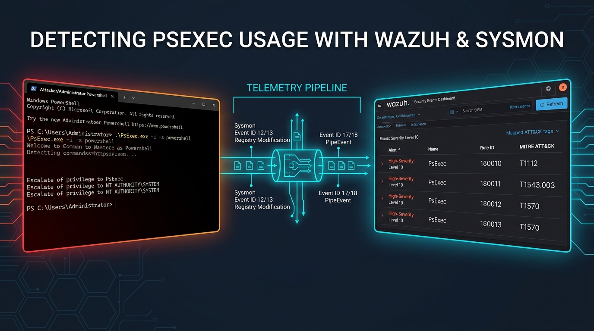

# 🛡️ Detecting PsExec with Wazuh
### Complete Endpoint Telemetry, Sysmon Registry & Named Pipe Monitoring, Custom SIEM Rules & SYSTEM Privilege Escalation Forensics

[](https://my.ine.com/labs/ebf73ec9-5b02-4d28-8089-3c1ba3501604)
[](https://github.com/wazuh/wazuh)
[-8b5cf6?style=for-the-badge&logo=windows)](https://learn.microsoft.com/en-us/sysinternals/downloads/psexec)
[](https://attack.mitre.org/software/S0029/)
[](./Detecting_PsExec_with_Wazuh_Walkthrough.md)

**Lab URL:** [https://my.ine.com/labs/ebf73ec9-5b02-4d28-8089-3c1ba3501604](https://my.ine.com/labs/ebf73ec9-5b02-4d28-8089-3c1ba3501604)  
**Walkthrough Video:** [`Detecting PsExec with Wazuh.mp4`](./Detecting%20PsExec%20with%20Wazuh.mp4)  
**Forensic Analyzer Script:** [`psexec_wazuh_telemetry_analyzer.py`](./psexec_wazuh_telemetry_analyzer.py)

</div>

---

## 📑 Table of Contents

1. [About This Lab & Core Technologies](#-1-about-this-lab--core-technologies)
   - [What is PsExec?](#what-is-psexec)
   - [What is Wazuh?](#what-is-wazuh)
   - [How Sysmon Enriches Endpoint Telemetry for PsExec Detection](#how-sysmon-enriches-endpoint-telemetry-for-psexec-detection)
2. [Lab Environment, Objective & Tasks](#-2-lab-environment-objective--tasks)
3. [Detection Architecture & PsExec Execution Lifecycle](#-3-detection-architecture--psexec-execution-lifecycle)
4. [Live Walkthrough Demonstration (Animated GIF)](#-4-live-walkthrough-demonstration-animated-gif)
5. [Step-by-Step Lab Solution (Tasks 1–5)](#-5-step-by-step-lab-solution-tasks-15)
   - [Step 1: Open the Lab Link to Access the Machines](#step-1-open-the-lab-link-to-access-the-machines)
   - [Task 1: Connect Wazuh Agent to the Wazuh Server (Steps 2–4)](#task-1-connect-wazuh-agent-to-the-wazuh-server)
   - [Task 2: Configure the Wazuh Agent to Collect Sysmon Logs (Step 5)](#task-2-configure-the-wazuh-agent-to-collect-sysmon-logs)
   - [Task 3: Create Rules to Detect PsExec Usage (Step 6)](#task-3-create-rules-to-detect-psexec-usage)
   - [Task 4: Perform Privilege Escalation with PsExec (Step 7)](#task-4-perform-privilege-escalation-with-psexec)
   - [Task 5: Detection of PsExec Usage with Wazuh (Step 8)](#task-5-detection-of-psexec-usage-with-wazuh)
6. [Deep-Dive Forensic Telemetry Analysis (Rules `160010`–`160013`)](#-6-deep-dive-forensic-telemetry-analysis-rules-160010160013)
7. [Production Hardening: Detecting Renamed PsExec (`-r` Flag)](#-7-production-hardening-detecting-renamed-psexec--r-flag)
8. [Automation: Python Telemetry Analyzer (`psexec_wazuh_telemetry_analyzer.py`)](#-8-automation-python-telemetry-analyzer)
9. [Conclusion & References](#-9-conclusion--references)

---

## 🧠 1. About This Lab & Core Technologies

### What is PsExec?

**PsExec** ([MITRE ATT&CK Software S0029](https://attack.mitre.org/software/S0029/)) is part of Microsoft Windows Sysinternals' command-line suite named **PsTools** (authored by Mark Russinovich). It facilitates system administration and can execute processes interactively on local and remote Windows systems.

While PsExec itself is a legitimate administrative utility and not inherently malicious, numerous advanced persistent threat (APT) actors and cybercrime groups—including **Turla**, **FIN6**, and **Cleaver**—heavily abuse PsExec for **lateral movement** (`T1570`) and **privilege escalation** (`T1543.003`) to `NT AUTHORITY\SYSTEM` within enterprise networks. Because PsExec is digitally signed by Microsoft, it frequently bypasses application allowlisting and signature-based antivirus, making behavioral detection via Sysmon and Wazuh essential.

* **Reference:** [Detecting PsExec usage with Wazuh](https://wazuh.com/blog/detecting-psexec-usage-with-wazuh/)

### What is Wazuh?

**Wazuh** is an open-source security monitoring platform (XDR and SIEM) that helps detect and respond to cybersecurity threats across on-premises, virtualized, containerized, and cloud-based environments. The Wazuh solution consists of:
1. **Wazuh Endpoint Security Agent:** Deployed to monitored endpoints to capture real-time operating system logs, Windows EventChannel telemetry, file integrity changes, and registry modifications.
2. **Wazuh Management Server:** Collects, decodes, and correlates data gathered by the agents against built-in and custom XML rulesets (`/var/ossec/etc/rules/local_rules.xml`). Built on top of the Elastic Stack / OpenSearch, Wazuh provides a unified web dashboard for threat hunting, MITRE ATT&CK mapping, and alert visualization.

* **Reference:** [https://github.com/wazuh/wazuh](https://github.com/wazuh/wazuh)

### How Sysmon Enriches Endpoint Telemetry for PsExec Detection

When `PsExec.exe` executes locally (e.g., `.\PsExec.exe -i -s powershell`) or remotely over SMB (`ADMIN$`), it performs a deterministic four-stage sequence of operating system actions that **Microsoft Sysmon** captures in `Microsoft-Windows-Sysmon/Operational`:

1. **EULA Acceptance Registry Write (`Sysmon Event ID 13 — RegistryEvent: SetValue`):**  
   On first execution (or when `-accepteula` is passed), PsExec writes a `DWORD` value to `HKCU\Software\Sysinternals\PsExec\EulaAccepted`.
2. **Service Binary Drop & Windows Service Creation (`Sysmon Event ID 11 & Event ID 12/13`):**  
   PsExec extracts its embedded service resource to `C:\Windows\PSEXESVC.exe` and registers the `PSEXESVC` service under `HKLM\System\CurrentControlSet\Services\PSEXESVC` via the Service Control Manager (`services.exe` running as `NT AUTHORITY\SYSTEM`).
3. **Named Pipe Inter-Process Communication (`Sysmon Event ID 17/18 — PipeEvent: CreatePipe / ConnectPipe`):**  
   `C:\Windows\PSEXESVC.exe` creates control and standard I/O named pipes (`\PSEXESVC`, `\PSEXESVC-<Host>-<PID>-stdin`, `-stdout`, `-stderr`) to redirect console input/output.
4. **Service Cleanup & Key Deletion (`Sysmon Event ID 12/13 — RegistryEvent: SetValue / DeleteKey`):**  
   Upon session termination or handoff, `services.exe` disables/deletes the `HKLM\System\CurrentControlSet\Services\PSEXESVC` registry key.

---

## 🌐 2. Lab Environment, Objective & Tasks

### Lab Environment Overview

In this lab environment, you will use the **Target Machine** running **Windows Server 2019** (`AttackDefense`) to configure the Wazuh Agent and Sysmon, and then execute **PsExec** to escalate privileges from `Administrator` to `NT AUTHORITY\SYSTEM`. You will use **Ubuntu 20.04 (SOC Machine)** running the Wazuh Manager and Wazuh Dashboard to author custom detection rules that monitor Sysmon registry and named pipe events and detect PsExec usage.

> [!IMPORTANT]
> **Lab Objective:** To examine and detect PsExec usage with Wazuh.

### Access Credentials & Network Matrix

| Machine / Service | Hostname / OS | IP Address | Access URL / Tool | Credentials |
| :--- | :--- | :--- | :--- | :--- |
| **SOC Machine (Wazuh Server)** | Ubuntu 20.04 (`ip-10-0-28-182`) | `10.0.28.182/20` (`ens5`) | `https://localhost` | **Username:** `admin`<br>**Password:** `wEe76ZfIQmisfbtS4g52*DXP5.?3H+fc` |
| **Target Machine (Wazuh Agent)** | Windows Server 2019 (`AttackDefense`) | `10.0.17.171` (Agent ID `001`) | Wazuh Agent Manager (`v4.3.10`) & `ossec.conf` | Logged in as `Administrator` |
| **Attacker Machine** | Kali Linux | Lab Subnet | GUI Desktop | Logged in as `root` |

### Lab Tasks Breakdown

| Task # | Task Title | Key Action Performed |
| :---: | :--- | :--- |
| **Task 1** | **Connect Wazuh Agent to the Wazuh Server** | Discover Wazuh Server IP (`10.0.28.182`), configure it in **Wazuh Agent Manager**, and start `WazuhSvc`. |
| **Task 2** | **Configure the Wazuh agent to collect Sysmon logs** | Add `Microsoft-Windows-Sysmon/Operational` EventChannel to `ossec.conf` and install Sysmon via `.\Sysmon64.exe -accepteula -i sysmonconfig.xml`. |
| **Task 3** | **Create rules to detect PsExec usage** | Add custom Rules `160010` (`T1112`), `160011` (`T1543.003`), `160012` (`T1543.003`), and `160013` (`T1570`) to `/var/ossec/etc/rules/local_rules.xml`. |
| **Task 4** | **Perform Privilege escalation with PsExec** | Run `.\PsExec.exe -i -s powershell` on Target Machine and verify `nt authority\system` privileges via `whoami`. |
| **Task 5** | **Detection of PsExec usage with Wazuh** | Inspect Wazuh Security Events and expand alerts for Rule IDs `160011`, `160012`, and `160013`. |

### Tools Used in This Lab

* **PowerShell** (Installing Sysmon, managing `WazuhSvc`, and executing `PsExec.exe`)
* **Sysmon (`Sysmon64.exe` v14.14)** (Monitoring Registry `SetValue`/`DeleteKey` and `CreatePipe` events)
* **Firefox** (Accessing Wazuh Dashboard over HTTPS)
* **Wazuh (`v4.3.10`)** (Endpoint EventChannel collection, PCRE2 rule correlation, and MITRE ATT&CK alerting)
* **PsExec (`PsExec.exe` v2.4)** (Escalating an interactive PowerShell session to `NT AUTHORITY\SYSTEM`)

---

## 🏗️ 3. Detection Architecture & PsExec Execution Lifecycle

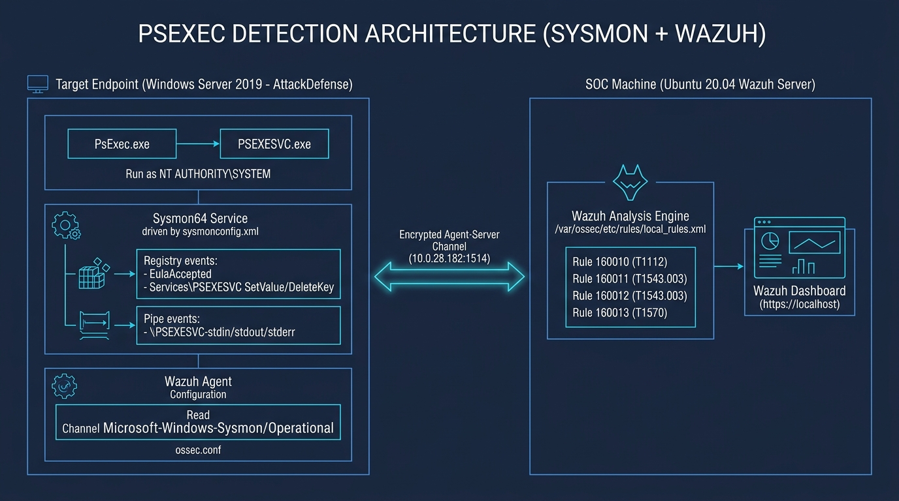

### End-to-End Telemetry Pipeline (Mermaid Diagram)

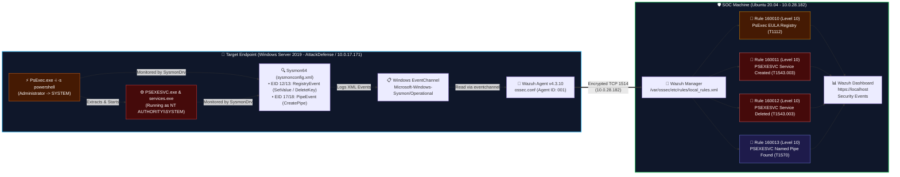

### PsExec 4-Stage Execution Lifecycle & Sysmon Telemetry Flow

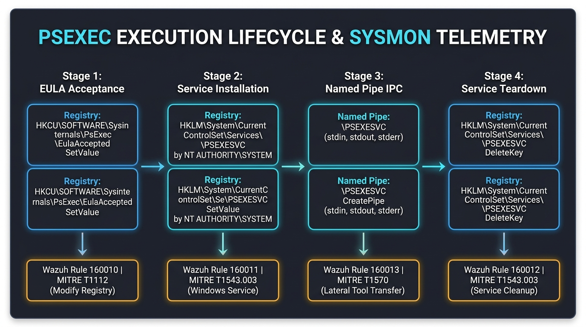

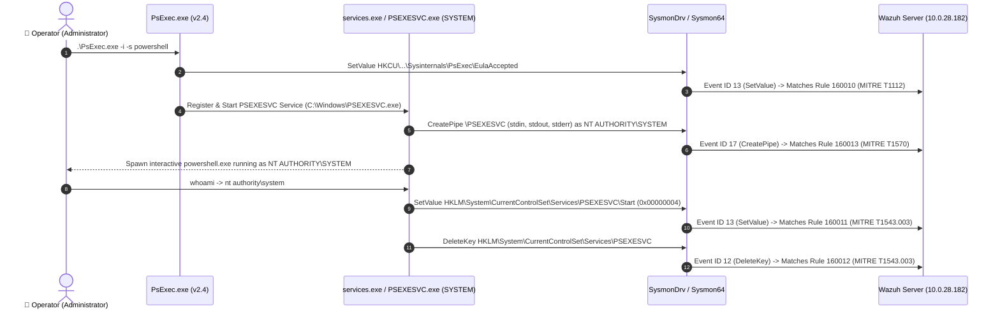

---

## 🎬 4. Live Walkthrough Demonstration (Animated GIF)

The 10-stage animated walkthrough below demonstrates the complete lab workflow—from discovering the Wazuh Server IP (`10.0.28.182`) and configuring the Wazuh Agent Manager GUI (`v4.3.10`), to installing Sysmon (`sysmonconfig.xml`), authoring custom Wazuh Rules `160010`–`160013`, escalating privileges via `.\PsExec.exe -i -s powershell`, and analyzing the resulting MITRE ATT&CK alerts in the Wazuh Dashboard:

<div align="center">

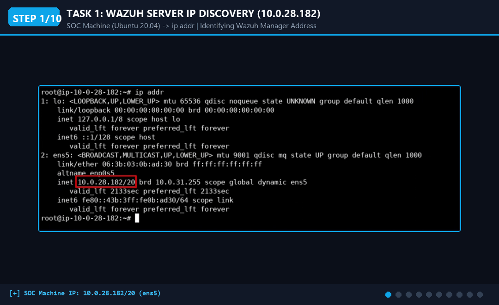

</div>

---

## 🛠️ 5. Step-by-Step Lab Solution (Tasks 1–5)

### Step 1: Open the lab link to access the machines

Open the lab link to access the three virtual machines provided in the lab environment:

1. **Attacker Machine (Kali):**

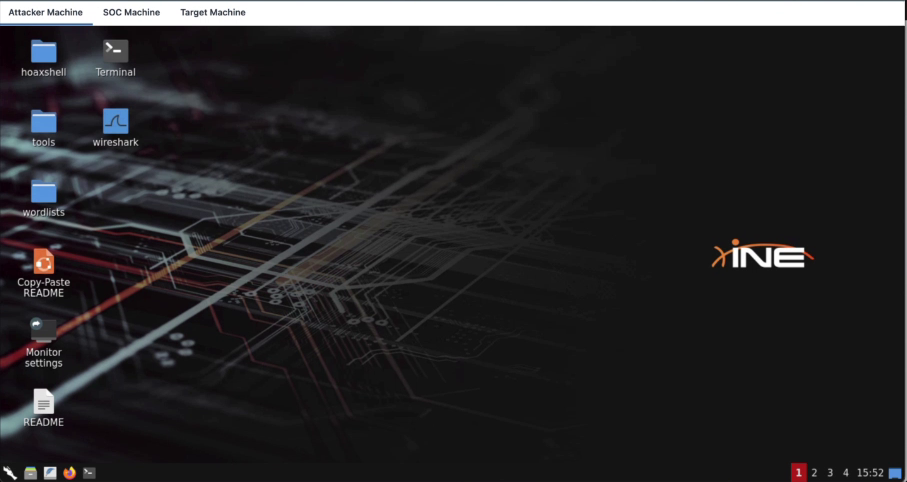

2. **SOC Machine (Wazuh Server):**

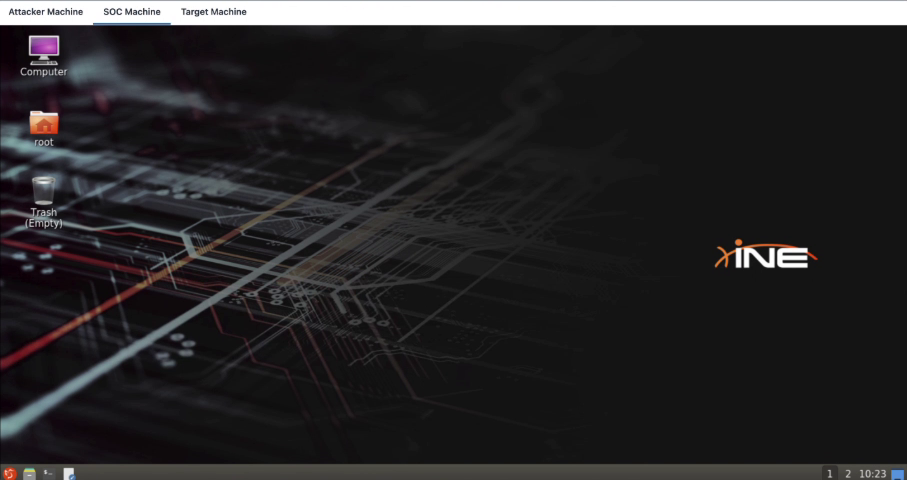

3. **Target Machine (Wazuh Agent):**

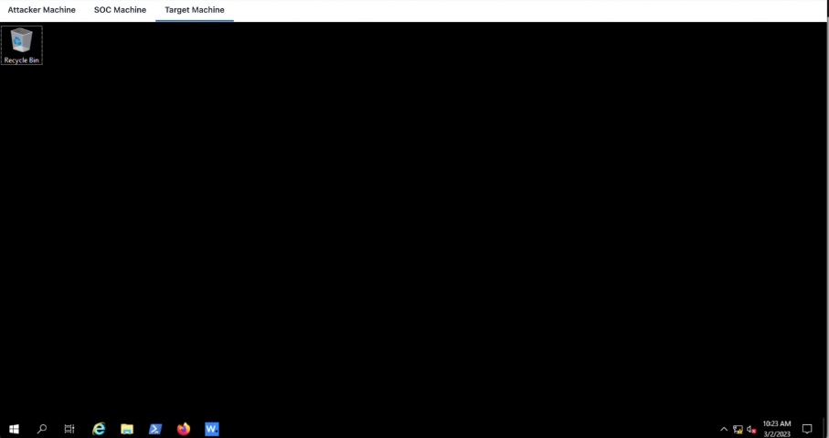

---

### Task 1: Connect Wazuh Agent to the Wazuh Server

First, we need to configure the Wazuh Agent on the **Target Machine** so that Wazuh can listen to all the event logs and visualize them in the Wazuh Dashboard. Before we run the Wazuh Agent, check if Wazuh is up and running on the **SOC Machine**.

#### Step 2: Access the Wazuh Dashboard and Check the Wazuh Server IP

On the **SOC Machine**, open Firefox and access the Wazuh Dashboard using the following credentials:
* **URL:** `https://localhost`
* **Username:** `admin`
* **Password:** `wEe76ZfIQmisfbtS4g52*DXP5.?3H+fc`

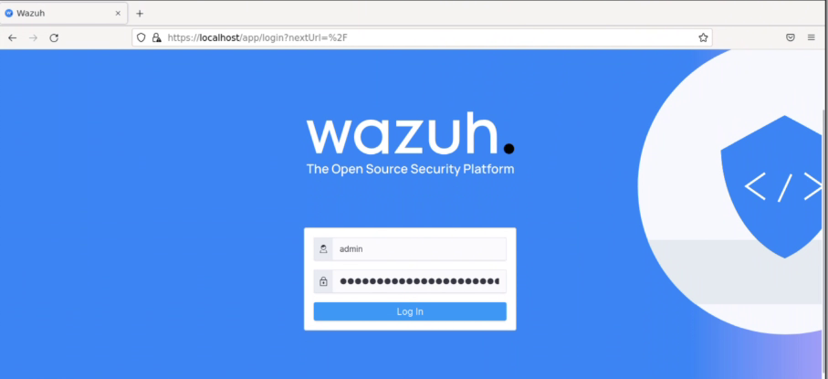

Below is the screenshot of the Wazuh Dashboard upon logging in:

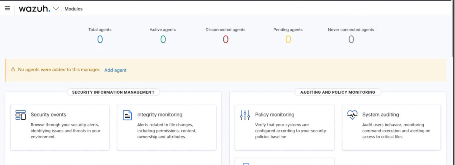

There is currently **no active agent** connected to the Wazuh server (`Total agents: 0`, `Active agents: 0`). Let's check the IP address of the Wazuh server machine by opening a terminal on the **SOC Machine** and running:

```bash
ip addr
```

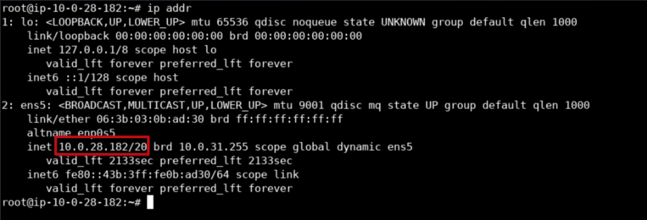

> [!NOTE]
> The IP address of the **SOC Machine** where Wazuh is running is **`10.0.28.182`** (`inet 10.0.28.182/20` on interface `ens5`).

---

#### Step 3: Configure Wazuh Agent Manager on the Target Machine and Start `WazuhSvc`

Switch to the **Target Machine (Windows Server 2019)**. Open the **Wazuh Agent Manager** (`Wazuh v4.3.10`) from the Windows Taskbar.

Enter the Wazuh Server IP **`10.0.28.182`** into the **Manager IP:** field and click **Save**:

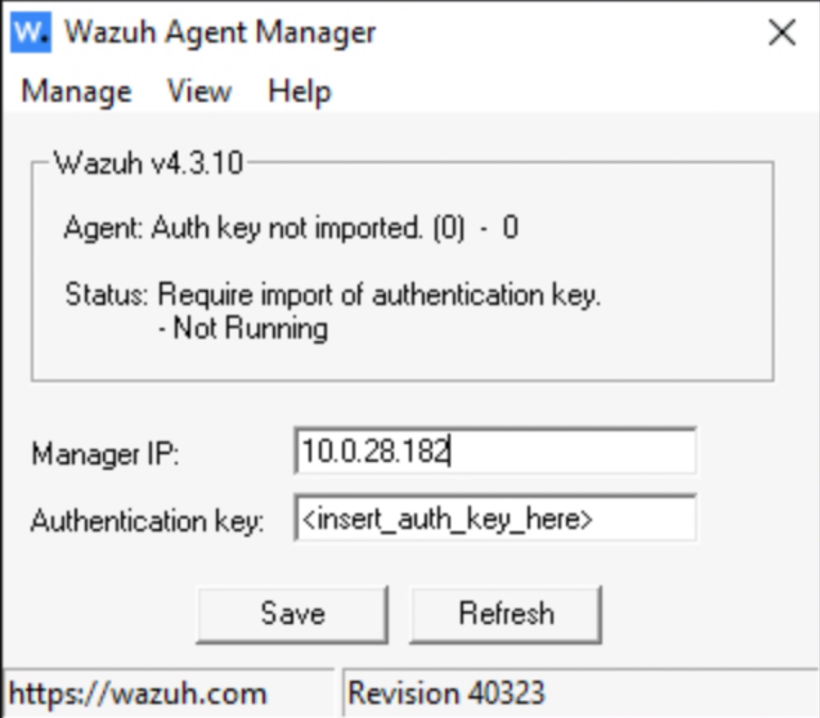

Wait for a few moments and then start the Wazuh Agent service using the following command in **PowerShell**:

```powershell
Start-Service -Name WazuhSvc
```

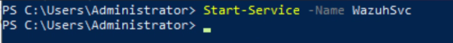

---

#### Step 4: Refresh the Wazuh Dashboard to Verify Active Agent Connection

Now, switch back to the **SOC Machine** and refresh the Wazuh Dashboard page until you see an active agent:

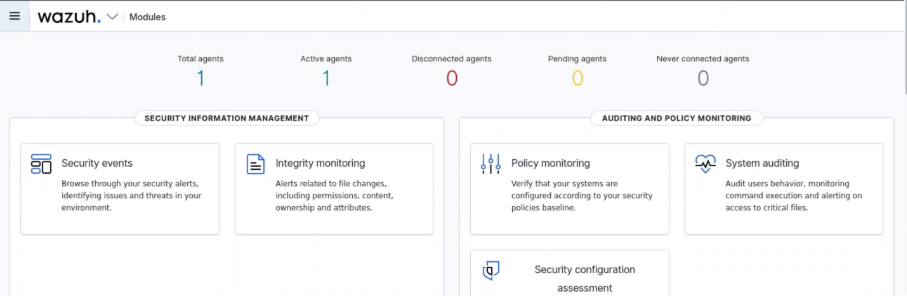

We have successfully connected the Wazuh Agent (`Active agents: 1` — `AttackDefense` / `10.0.17.171`).

---

### Task 2: Configure the Wazuh Agent to Collect Sysmon Logs

We can detect PsExec attack activities by enriching the victim endpoint logs with **Sysmon**. These logs are then analyzed against a custom ruleset defined on the Wazuh server.

#### Step 5: Configure `ossec.conf`, Install Sysmon (`sysmonconfig.xml`), and Restart `WazuhSvc`

On the **Target Machine**, configure the Wazuh Agent to capture Sysmon events by adding the following `<localfile>` block to the agent configuration file located at `C:\Program Files (x86)\ossec-agent\ossec.conf`:

```xml
<localfile>
  <location>Microsoft-Windows-Sysmon/Operational</location>
  <log_format>eventchannel</log_format>
</localfile>
```

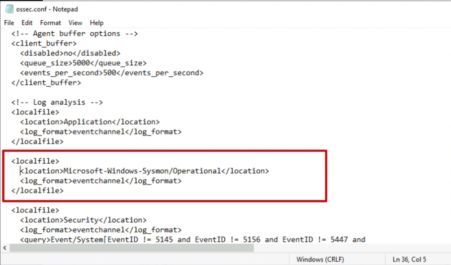

Save and close the file.

Next, open **PowerShell** as Administrator to install and configure Sysmon using the pre-supplied `sysmonconfig.xml` configuration file:
* **Reference:** `https://wazuh.com/resources/blog/emulation-of-attack-techniques-and-detection-with-wazuh/sysmonconfig.xml`

```powershell
cd .\Downloads\Sysmon
.\Sysmon64.exe -accepteula -i sysmonconfig.xml
```

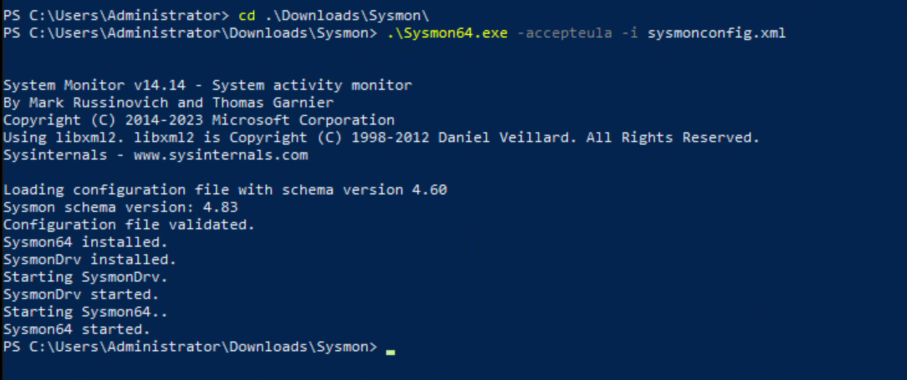

As shown in the PowerShell output, verify that Sysmon has been installed and started successfully:
```text
Loading configuration file with schema version 4.60
Sysmon schema version: 4.83
Configuration file validated.
Sysmon64 installed.
SysmonDrv installed.
Starting SysmonDrv.
SysmonDrv started.
Starting Sysmon64..
Sysmon64 started.
```

Now restart the Wazuh Agent service to apply the changes:

```powershell
Restart-Service -Name WazuhSvc
```

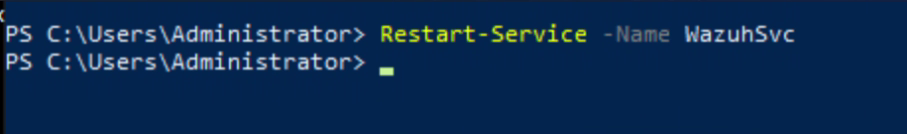

We have successfully restarted the Wazuh Agent to collect Sysmon logs.

---

### Task 3: Create Rules to Detect PsExec Usage

#### Step 6: Add Custom PsExec Detection Rules to `/var/ossec/etc/rules/local_rules.xml`

On the **SOC Machine (Wazuh Server)**, add the following custom detection rules to `/var/ossec/etc/rules/local_rules.xml`:

```xml
<group name="windows,sysmon">
  <rule id="160010" level="10">
    <if_group>windows,sysmon</if_group>
    <field name="win.eventdata.eventType" type="pcre2" >SetValue</field>
    <field name="win.eventdata.targetObject" type="pcre2" >\\\\SOFTWARE\\\\Sysinternals\\\\PsExec\\\\EulaAccepted</field>
    <options>no_full_log</options>
    <description>PsExec EULA registry found on $(win.system.computer)</description>
    <mitre>
      <id>T1112</id>
    </mitre>
  </rule>

  <rule id="160011" level="10">
    <if_group>windows,sysmon</if_group>
    <field name="win.eventdata.targetObject" type="pcre2" >HKLM\\\\System\\\\CurrentControlSet\\\\Services\\\\PSEXESVC</field>
    <field name="win.eventdata.eventType" type="pcre2" >^SetValue$</field>
    <field name="win.eventdata.user" type="pcre2" >NT AUTHORITY\\\\SYSTEM</field>
    <options>no_full_log</options>
    <description>PsExec service running as $(win.eventdata.user) has been created on $(win.system.computer)</description>
    <mitre>
      <id>T1543.003</id>
    </mitre>
  </rule>

  <rule id="160012" level="10">
    <if_group>windows,sysmon</if_group>
    <field name="win.eventdata.targetObject" type="pcre2" >HKLM\\\\System\\\\CurrentControlSet\\\\Services\\\\PSEXESVC</field>
    <field name="win.eventdata.eventType" type="pcre2" >^DeleteKey$</field>
    <field name="win.eventdata.user" type="pcre2" >NT AUTHORITY\\\\SYSTEM</field>
    <options>no_full_log</options>
    <description>PsExec service running as $(win.eventdata.user) has been deleted on $(win.system.computer)</description>
    <mitre>
      <id>T1543.003</id>
    </mitre>
  </rule>

  <rule id="160013" level="10">
    <if_group>windows,sysmon</if_group>
    <field name="win.eventdata.eventType" type="pcre2" >CreatePipe</field>
    <field name="win.eventdata.image" type="pcre2" >\\\\PSEXESVC.exe</field>
    <match type="pcre2">(?i)(PSEXESVC|stdin|stdout|stderr)</match>
    <field name="win.eventdata.user" type="pcre2" >NT AUTHORITY\\\\SYSTEM</field>
    <options>no_full_log</options>
    <description>PsExec named pipe running as $(win.eventdata.user) has been found on $(win.system.computer)</description>
    <mitre>
      <id>T1570</id>
    </mitre>
  </rule>
</group>
```

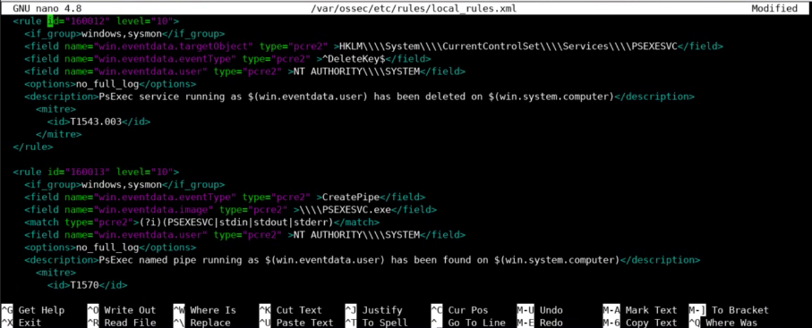

Save and close the file.

---

#### MITRE ATT&CK Deep Dive: `T1543.003` — Create or Modify System Process: Windows Service

* **Persistence & Service Configuration:** Adversaries may create or modify Windows services to repeatedly execute malicious payloads as part of persistence. When Windows boots up, it starts programs or applications called services that perform background system functions. Windows service configuration information, including the file path to the service's executable or recovery programs/commands, is stored in the Windows Registry (`HKLM\System\CurrentControlSet\Services\`).
* **Modification Vectors:** Adversaries may install a new service or modify an existing service to execute at startup to persist on a system. Service configurations can be set or modified using system utilities (such as `sc.exe`), by directly modifying the Registry, or by interacting directly with the Windows API.
* **Kernel Drivers, Rootkits & BYOVD:** Adversaries may also use services to install and execute malicious drivers. For example, after dropping a driver file (e.g., `.sys`) to disk, the payload can be loaded and registered via Native API functions such as `CreateServiceW()` (or manually via functions such as `ZwLoadDriver()` and `ZwSetValueKey()`), by creating the required service Registry values (i.e., Modify Registry), or by using command-line utilities such as `PnPUtil.exe`. Adversaries may leverage these drivers as **Rootkits** to hide the presence of malicious activity on a system, or load a signed yet vulnerable driver onto a compromised machine (known as **"Bring Your Vulnerable Driver" (BYOVD)**) as part of Exploitation for Privilege Escalation.
* **Privilege Escalation to `SYSTEM` & Masquerading:** Services may be created with administrator privileges but are executed under `SYSTEM` privileges, so an adversary may also use a service to escalate privileges (exactly as `PsExec -s` does via `PSEXESVC`). Adversaries may also directly start services through Service Execution, or incorporate Masquerade Task or Service (e.g., using a service and/or payload name related to a legitimate OS or benign software component).
* **Reference:** [https://attack.mitre.org/techniques/T1543/003/](https://attack.mitre.org/techniques/T1543/003/)

---

#### Summary of Custom Wazuh Rule Logic (`160010`–`160013`)

| Rule ID | Level | Sysmon Event Type | Matched Fields / Regex (`pcre2`) | MITRE ATT&CK ID | Detection Purpose |
| :---: | :---: | :--- | :--- | :---: | :--- |
| **`160010`** | `10` | `SetValue` (Sysmon EID 13) | `targetObject`: `\\SOFTWARE\\Sysinternals\\PsExec\\EulaAccepted` | **[T1112](https://attack.mitre.org/techniques/T1112)** (Modify Registry) | Detects the creation/modification of the PsExec EULA acceptance registry value on `$(win.system.computer)`. |
| **`160011`** | `10` | `^SetValue$` (Sysmon EID 13) | `targetObject`: `HKLM\\System\\CurrentControlSet\\Services\\PSEXESVC`<br>`user`: `NT AUTHORITY\\SYSTEM` | **[T1543.003](https://attack.mitre.org/techniques/T1543/003/)** (Windows Service) | Detects a newly created/configured `PSEXESVC` service running as `NT AUTHORITY\SYSTEM`. |
| **`160012`** | `10` | `^DeleteKey$` (Sysmon EID 12) | `targetObject`: `HKLM\\System\\CurrentControlSet\\Services\\PSEXESVC`<br>`user`: `NT AUTHORITY\\SYSTEM` | **[T1543.003](https://attack.mitre.org/techniques/T1543/003)** (Windows Service) | Detects when the `PSEXESVC` service registry key running as `NT AUTHORITY\SYSTEM` is deleted upon cleanup. |
| **`160013`** | `10` | `CreatePipe` (Sysmon EID 17) | `image`: `\\PSEXESVC.exe`<br>`match`: `(?i)(PSEXESVC\|stdin\|stdout\|stderr)`<br>`user`: `NT AUTHORITY\\SYSTEM` | **[T1570](https://attack.mitre.org/techniques/T1570)** (Lateral Tool Transfer) | Detects when `PSEXESVC.exe` creates named pipes associated with `stdin`, `stdout`, or `stderr` as `NT AUTHORITY\SYSTEM`. |

Restart the Wazuh Manager on the **SOC Machine** to start using the new rules:

```bash
systemctl restart wazuh-manager
```

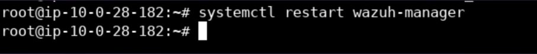

We have successfully restarted and configured the Wazuh Manager to start using the new local rules.

---

### Task 4: Perform Privilege Escalation with PsExec

#### Step 7: Simulate the Privilege Escalation Attack (`Administrator` $\rightarrow$ `NT AUTHORITY\SYSTEM`)

Privilege escalation techniques allow an adversary to gain a higher privilege level on a system or network. Examples of elevated privileges include escalating from a standard user account to an Administrator, or from a local Administrator account to the local **`SYSTEM`** account (`NT AUTHORITY\SYSTEM`). The `SYSTEM` account is the highest privilege level in the Windows user model and is used by the operating system and core services.

Switch to the **Target Machine (Windows Server 2019)**. Run the following commands in PowerShell to escalate a Windows PowerShell process from `Administrator` to `NT AUTHORITY\SYSTEM`:

```powershell
cd .\Downloads\PSTools
.\PsExec.exe -i -s powershell
```

**Command Flag Breakdown:**
* **`-i` (Interactive):** Runs the target program (`powershell.exe`) so that it interacts with the desktop of the current session on the system.
* **`-s` (SYSTEM Account):** Runs the target process inside the **`NT AUTHORITY\SYSTEM`** account context (via the `PSEXESVC` Windows service).

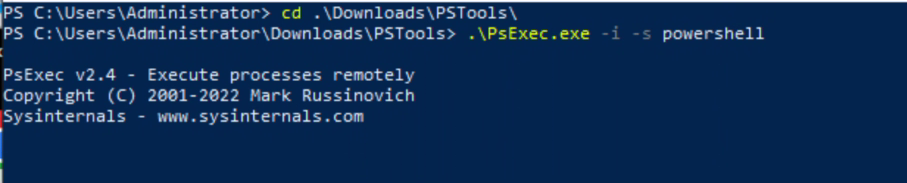

A new black PowerShell console window opens (`Administrator: C:\Windows\System32\WindowsPowerShell\v1.0\powershell.exe` in directory `PS C:\Windows\system32>`). Check the privilege level in the new PowerShell instance using:

```powershell
whoami
```

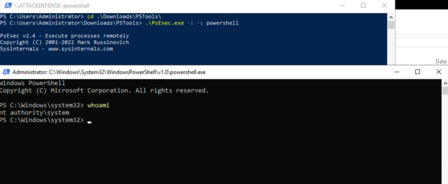

Output:
```text
PS C:\Windows\system32> whoami
nt authority\system
```

We can confirm the new instance of PowerShell is now running as **`nt authority\system`**, which is the highest level of privilege on Windows. We have successfully escalated privileges using PsExec.

---

### Task 5: Detection of PsExec Usage with Wazuh

#### Step 8: Inspect Security Alerts in the Wazuh Dashboard

1. Switch to the **SOC Machine** and open the **Wazuh Dashboard** (`https://localhost`). Notice that under **Security Information Management**, **Security events** now displays **`289`** total events:

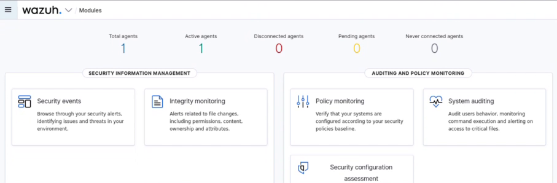

2. Click on **Security events** to open the Security Events overview (`Total: 289`, `Level 12 or above alerts: 1`):

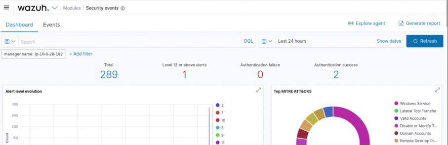

3. Scroll down to the **Security Alerts** table to view the alerts triggered by our custom local rules (`160011`, `160012`, and `160013`):

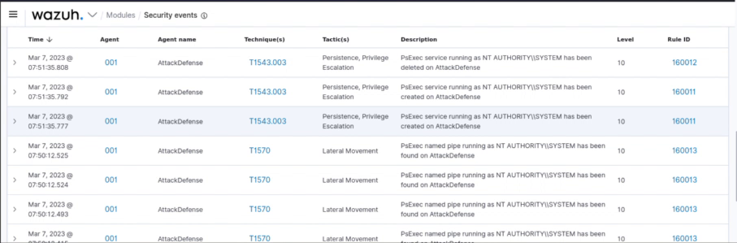

| Timestamp | Agent | Agent Name | Technique(s) | Tactic(s) | Description | Level | Rule ID |
| :--- | :---: | :--- | :---: | :--- | :--- | :---: | :---: |
| `Mar 7, 2023 @ 07:51:35.808` | `001` | `AttackDefense` | `T1543.003` | Persistence, Privilege Escalation | `PsExec service running as NT AUTHORITY\\SYSTEM has been deleted on AttackDefense` | **`10`** | **`160012`** |
| `Mar 7, 2023 @ 07:51:35.792` | `001` | `AttackDefense` | `T1543.003` | Persistence, Privilege Escalation | `PsExec service running as NT AUTHORITY\\SYSTEM has been created on AttackDefense` | **`10`** | **`160011`** |
| `Mar 7, 2023 @ 07:51:35.777` | `001` | `AttackDefense` | `T1543.003` | Persistence, Privilege Escalation | `PsExec service running as NT AUTHORITY\\SYSTEM has been created on AttackDefense` | **`10`** | **`160011`** |
| `Mar 7, 2023 @ 07:50:12.525` | `001` | `AttackDefense` | `T1570` | Lateral Movement | `PsExec named pipe running as NT AUTHORITY\\SYSTEM has been found on AttackDefense` | **`10`** | **`160013`** |
| `Mar 7, 2023 @ 07:50:12.524` | `001` | `AttackDefense` | `T1570` | Lateral Movement | `PsExec named pipe running as NT AUTHORITY\\SYSTEM has been found on AttackDefense` | **`10`** | **`160013`** |
| `Mar 7, 2023 @ 07:50:12.493` | `001` | `AttackDefense` | `T1570` | Lateral Movement | `PsExec named pipe running as NT AUTHORITY\\SYSTEM has been found on AttackDefense` | **`10`** | **`160013`** |

4. **Expand Rule ID `160011`** to inspect the detailed service creation/modification telemetry:

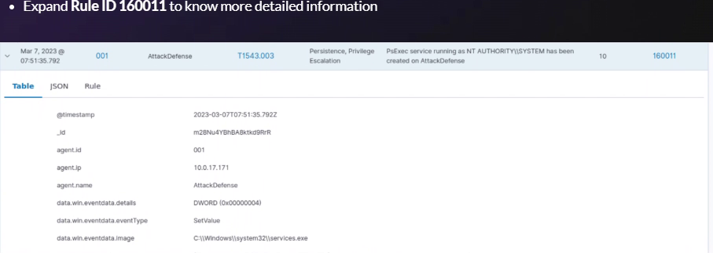

5. **Expand Rule ID `160012`** to inspect the detailed service deletion (`DeleteKey`) telemetry:

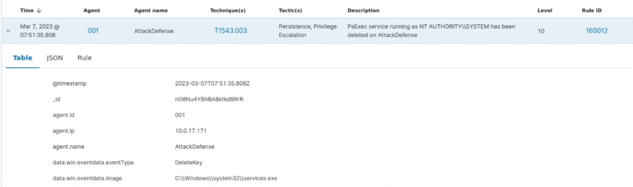

6. **Expand Rule ID `160013`** to inspect the detailed named pipe (`CreatePipe`) telemetry:

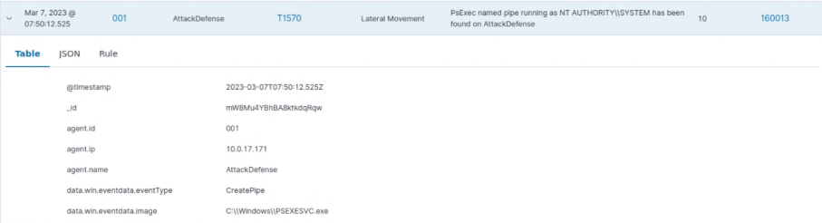

---

## 🔬 6. Deep-Dive Forensic Telemetry Analysis (Rules `160010`–`160013`)

Comparing the expanded alert fields across **Rule `160013`** (`22.png`), **Rule `160011`** (`20.png`), and **Rule `160012`** (`21.png`) provides a complete forensic timeline of how `PsExec.exe` operates under the hood:

| Alert Attribute | Rule `160013` (Named Pipe Creation) | Rule `160011` (Service Registry `SetValue`) | Rule `160012` (Service Registry `DeleteKey`) |
| :--- | :--- | :--- | :--- |
| **`@timestamp`** | `2023-03-07T07:50:12.525Z` | `2023-03-07T07:51:35.792Z` | `2023-03-07T07:51:35.808Z` |
| **Document `_id`** | `mW8Mu4YBhBA8ktkdqRqw` | `m28Nu4YBhBA8ktkd9RrR` | `nG8Nu4YBhBA8ktkd9RrR` |
| **`agent.id` / `agent.name`** | `001` / `AttackDefense` (`10.0.17.171`) | `001` / `AttackDefense` (`10.0.17.171`) | `001` / `AttackDefense` (`10.0.17.171`) |
| **`data.win.eventdata.eventType`** | `CreatePipe` (Sysmon Event ID 17) | `SetValue` (Sysmon Event ID 13) | `DeleteKey` (Sysmon Event ID 12) |
| **`data.win.eventdata.image`** | `C:\\Windows\\PSEXESVC.exe` | `C:\\Windows\\system32\\services.exe` | `C:\\Windows\\system32\\services.exe` |
| **`data.win.eventdata.details`** | Pipe `stdin` / `stdout` / `stderr` | `DWORD (0x00000004)` (`SERVICE_DISABLED`) | Key `HKLM\...\Services\PSEXESVC` removed |
| **MITRE ATT&CK** | `T1570` (*Lateral Movement*) | `T1543.003` (*Persistence, Privilege Escalation*) | `T1543.003` (*Persistence, Privilege Escalation*) |

> [!TIP]
> **Why did `Rule 160013` fire multiple times at `07:50:12`?**  
> When `PSEXESVC.exe` initializes, it creates **four separate named pipes**: one main control pipe (`\PSEXESVC`) and three standard I/O redirection pipes (`\PSEXESVC-<Host>-<PID>-stdin`, `-stdout`, and `-stderr`). Each `CreatePipe` event matches `<match type="pcre2">(?i)(PSEXESVC|stdin|stdout|stderr)</match>`, producing a burst of `160013` alerts!

---

## 🛡️ 7. Production Hardening: Detecting Renamed PsExec (`-r` Flag)

> [!WARNING]
> **Adversary Evasion via `PsExec.exe -r <ServiceName>`:**  
> PsExec supports the `-r` command-line flag (e.g., `PsExec.exe -r WinDefendUpdate -i -s powershell`), which renames the remote service, dropped executable (`C:\Windows\WinDefendUpdate.exe`), registry key (`HKLM\System\CurrentControlSet\Services\WinDefendUpdate`), and named pipes (`\WinDefendUpdate-...-stdin`)!

To catch adversaries who use `PsExec.exe -r` to evade static `PSEXESVC` string matching, add these two behavioral detection rules in production:

### 1. Match PE Header Metadata (`OriginalFileName = psexesvc.exe`)
Even when renamed via `-r`, the extracted service binary retains its compiled PE header resource `OriginalFileName=psexesvc.exe` and `InternalName=psexesvc` in **Sysmon Event ID 1 (`ProcessCreate`)**.

### 2. Match Anonymous/Custom `-stdin`/`-stdout`/`-stderr` Named Pipes Created by Unsigned/Temp Services
Regardless of the `-r` name chosen, PsExec always appends `-stdin`, `-stdout`, and `-stderr` to its redirection pipes:

```xml
<group name="windows,sysmon,psexec_evasion,">
  <rule id="160020" level="12">
    <if_group>sysmon_event1</if_group>
    <field name="win.eventdata.originalFileName" type="pcre2">(?i)^psexesvc\.exe$</field>
    <description>MITRE T1543.003: PsExec Service Binary Executed (Possible Renamed -r Service: $(win.eventdata.image))</description>
    <mitre>
      <id>T1543.003</id>
      <id>T1036.005</id>
    </mitre>
  </rule>

  <rule id="160021" level="12">
    <if_group>windows,sysmon</if_group>
    <field name="win.eventdata.eventType" type="pcre2">^CreatePipe$</field>
    <field name="win.eventdata.pipeName" type="pcre2">-(stdin|stdout|stderr)$</field>
    <options>no_full_log</options>
    <description>MITRE T1570: PsExec-Style Standard I/O Redirection Pipe ($(win.eventdata.pipeName)) Created by $(win.eventdata.image)</description>
    <mitre>
      <id>T1570</id>
    </mitre>
  </rule>
</group>
```

---

## 🐍 8. Automation: Python Telemetry Analyzer

This repository includes [`psexec_wazuh_telemetry_analyzer.py`](./psexec_wazuh_telemetry_analyzer.py), a companion Python script that validates the custom Wazuh XML rules (`160010`–`160013`), maps captured Sysmon Registry and Pipe telemetry to MITRE ATT&CK (`T1112`, `T1543.003`, `T1570`), outputs a structured JSON incident report, and builds the 10-frame animated walkthrough GIF.

### Running the Analyzer

```powershell
# Print formatted forensic summary report
python psexec_wazuh_telemetry_analyzer.py

# Output structured JSON telemetry report
python psexec_wazuh_telemetry_analyzer.py --json

# Regenerate the 10-frame animated walkthrough GIF
python psexec_wazuh_telemetry_analyzer.py --generate-gif
```

### Sample Console Output

```text
================================================================================
 PSEXEC SYSMON & WAZUH TELEMETRY ANALYZER -- FORENSIC SUMMARY
================================================================================
 [+] Wazuh Server IP   : 10.0.28.182
 [+] Enrolled Agent    : AttackDefense (ID: 001, IP: 10.0.17.171)
 [+] Attack Command    : .\PsExec.exe -i -s powershell -> nt authority\system
--------------------------------------------------------------------------------
 [+] Custom Wazuh Detection Rules Validated:
     - Rule 160010 (Level 10) [MITRE T1112]: PsExec EULA registry found on $(win.system.computer)
     - Rule 160011 (Level 10) [MITRE T1543.003]: PsExec service running as $(win.eventdata.user) has been created on $(win.system.computer)
     - Rule 160012 (Level 10) [MITRE T1543.003]: PsExec service running as $(win.eventdata.user) has been deleted on $(win.system.computer)
     - Rule 160013 (Level 10) [MITRE T1570]: PsExec named pipe running as $(win.eventdata.user) has been found on $(win.system.computer)
--------------------------------------------------------------------------------
 [+] Chronological Telemetry Timeline Captured in Wazuh:
     * 2023-03-07T07:50:12.525Z | Rule 160013 (Level 10) | CreatePipe -> C:\\Windows\\PSEXESVC.exe
     * 2023-03-07T07:51:35.792Z | Rule 160011 (Level 10) | SetValue -> C:\\Windows\\system32\\services.exe
     * 2023-03-07T07:51:35.808Z | Rule 160012 (Level 10) | DeleteKey -> C:\\Windows\\system32\\services.exe
================================================================================
```

---

## 🏁 9. Conclusion & References

### Conclusion

In this lab, we demonstrated how to detect the usage of **PsExec** on a monitored Windows Server 2019 endpoint. While PsExec service creation can be detected out-of-the-box by built-in Wazuh rules, enriching endpoint telemetry with **Microsoft Sysmon** (`sysmonconfig.xml`) and authoring custom **Wazuh** correlation rules (`160010`, `160011`, `160012`, and `160013`) gives SOC analysts complete visibility across the entire PsExec lifecycle: EULA registry modification (`T1112`), `PSEXESVC` service creation and teardown (`T1543.003`), and `stdin`/`stdout`/`stderr` named pipe communication (`T1570`).

### Official References

* **[PsExec, Software S0029 | MITRE ATT&CK®](https://attack.mitre.org/software/S0029/)** — *MITRE Corporation*
* **[Create or Modify System Process: Windows Service (T1543.003)](https://attack.mitre.org/techniques/T1543/003/)** — *MITRE ATT&CK®*
* **[Modify Registry (T1112)](https://attack.mitre.org/techniques/T1112)** — *MITRE ATT&CK®*
* **[Lateral Tool Transfer (T1570)](https://attack.mitre.org/techniques/T1570)** — *MITRE ATT&CK®*
* **[Detecting PsExec usage with Wazuh](https://wazuh.com/blog/detecting-psexec-usage-with-wazuh/)** — *Wazuh Official Blog*
* **[Wazuh Open Source Security Platform](https://github.com/wazuh/wazuh)** — *GitHub Repository*
* **[PsExec – Windows Sysinternals](https://learn.microsoft.com/en-us/sysinternals/downloads/psexec)** — *Microsoft Learn*
