# ELK: SSH Log Analysis — Complete Walkthrough & Threat Hunting Guide

> **Platform:** [INE Security (Cybersecurity Hands-on Labs)](https://my.ine.com/)
>
> **Lab Link:** [https://my.ine.com/labs/25d8187d-3c25-3ace-836c-6bd2dd433a5b](https://my.ine.com/labs/25d8187d-3c25-3ace-836c-6bd2dd433a5b)
>
> **Challenge Title:** ELK: SSH Logs (CID 1138)
>
> **Category:** Linux Security Telemetry, SSH Forensics & Threat Hunting
>
> **Ingestion Index Pattern:** `ssh-log*` (Multi-Server OpenSSH Daemon Telemetry)
>
> **Official Solution Manual:** [Walkthrough 1138 PDF (INE Assets)](https://assets.ine.com/labs/ad-manuals/walkthrough-1138.pdf)
>
> **Status:** 10 of 10 Flags Captured (100% Solved)

---

<div align="center">

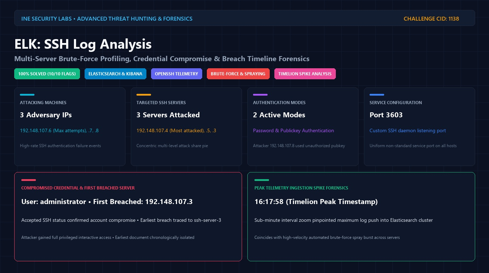

# 🛡️ ELK: SSH Log Analysis 🛡️
### Enterprise Threat Hunting, Multi-Server Brute-Force Profiling & Breach Timeline Reconstruction

[](https://my.ine.com/labs/25d8187d-3c25-3ace-836c-6bd2dd433a5b)
[](https://attackdefense.com/challengedetails?cid=1138)
[](https://www.elastic.co/)
[](https://www.openssh.com/)
[](https://attack.mitre.org/)

</div>

---

### 💻 Real-Time Threat Hunting & Investigation Demonstration

The animated recording below showcases the complete interactive Kibana threat hunting workflow across the OpenSSH multi-server dataset—filtering authentication failure bursts, evaluating attacker IP distributions, constructing multi-level nested pie charts, isolating unauthorized public key logons, diagnosing non-standard service listening ports, pinpointing high-volume ingestion spikes in Timelion, and reconstructing the exact chronological sequence of the initial server compromise:

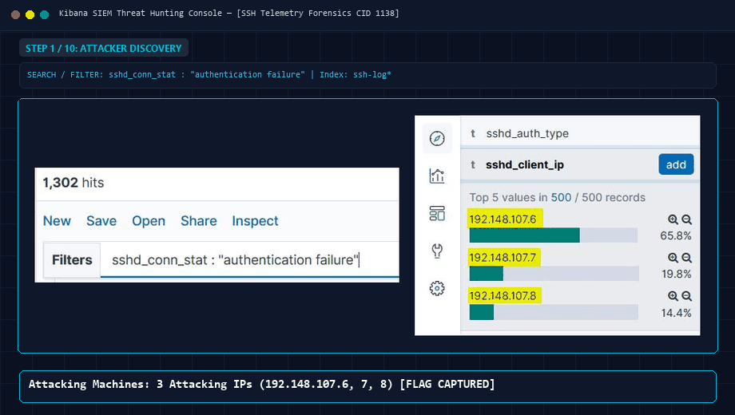

---

# Executive Summary

Secure Shell (SSH) is the backbone of remote Linux administration across enterprise cloud and on-premises environments. Given that SSH services provide full terminal access and shell execution capabilities, they represent high-priority targets for external adversaries, automated botnets, and internal threat actors:
* **Brute-Force & Credential Spraying (MITRE ATT&CK T1110):** Threat actors deploy high-speed credential guessing tools (such as Hydra, Medusa, Ncrack, or custom paramiko scripts) to spray common administrative usernames against exposed SSH daemons.
* **Credential Access & Key Misuse (MITRE ATT&CK T1078 / T1098.004):** Adversaries utilize leaked, shared, or weakly secured private keys to bypass password policies and gain persistent access.
* **Non-Standard Port Evasion (MITRE ATT&CK T1571 / T1021.004):** While systems administrators frequently configure SSH on non-standard ports (e.g. TCP 3603) as a basic measure of security through obscurity, automated port scanners immediately identify and target these services.

In this lab, telemetry from OpenSSH daemons deployed across multiple server machines was collected and ingested into an **Elasticsearch & Kibana (ELK)** stack under the index pattern **`ssh-log*`**. 

As SOC tier 2 / threat hunting analysts, our objective is to leverage Kibana Visualizations (Vertical Bar Charts, Two-Level Concentric Pie Charts, Timelion time-series analysis) and the Discover interface to dissect attacker behavior, profile target server susceptibility, verify breached identities, identify the exact telemetry push peak, and isolate the first compromised server to capture all **10 target flags**.

---

# 10-Stage SSH Threat Hunting Architecture

The investigation follows a rigorous 10-stage forensic pipeline progressing from broad attacker cardinality profiling down to pinpoint sub-second timeline reconstruction:

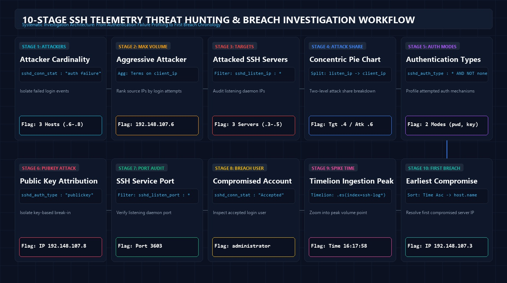

```mermaid
flowchart TD
    Ingest["1. Elasticsearch Ingestion\n(Index: ssh-log* | Multi-Server OpenSSH Logs)"]
    --> Discover["2. Kibana Interface\n(Discover, Visualize & Timelion Tabs)"]

    Discover --> S1["Stage 1: Attacker Discovery\nFilter: sshd_conn_stat : 'authentication failure'\n-> 3 Attacking Machines (.6, .7, .8)"]
    Discover --> S2["Stage 2: Volume Profiling\nChart: Vertical Bar on sshd_client_ip.keyword\n-> Top Attacker 192.148.107.6"]
    Discover --> S3["Stage 3: Target Exposure\nFilter: sshd_listen_ip : *\n-> 3 SSH Servers Targeted (.3, .4, .5)"]
    Discover --> S4["Stage 4: Attack Share Mapping\nChart: Concentric Pie (listen_ip -> client_ip)\n-> Target .4 attacked most by .6"]
    Discover --> S5["Stage 5: Auth Mode Profiling\nFilter: sshd_auth_type : * AND NOT none\n-> 2 Modes (password, publickey)"]
    Discover --> S6["Stage 6: Key-Based Breach\nFilter: sshd_auth_type : 'publickey'\n-> Attacker IP 192.148.107.8"]
    Discover --> S7["Stage 7: Port Configuration\nFilter: sshd_listen_port : *\n-> SSH Port 3603"]
    Discover --> S8["Stage 8: Account Compromise\nFilter: sshd_conn_stat : 'Accepted'\n-> Compromised User: administrator"]
    Discover --> S9["Stage 9: Temporal Spike\nVisualization: Timelion .es(index=ssh-log*)\n-> Peak Injection Time: 16:17:58"]
    Discover --> S10["Stage 10: Patient Zero Triage\nSort: Time Asc -> host.name : 'ssh-server-3'\n-> First Breached Server: 192.148.107.3"]

    S1 --> Flags["3. All 10 Flags Captured (100% Solved)"]
    S2 --> Flags
    S3 --> Flags
    S4 --> Flags
    S5 --> Flags
    S6 --> Flags
    S7 --> Flags
    S8 --> Flags
    S9 --> Flags
    S10 --> Flags

    style Ingest fill:#1e293b,stroke:#3b82f6,color:#fff
    style Discover fill:#1e293b,stroke:#8b5cf6,color:#fff
    style S1 fill:#1e293b,stroke:#06b6d4,color:#fff
    style S2 fill:#1e293b,stroke:#f59e0b,color:#fff
    style S3 fill:#1e293b,stroke:#ef4444,color:#fff
    style S4 fill:#1e293b,stroke:#3b82f6,color:#fff
    style S5 fill:#1e293b,stroke:#a855f7,color:#fff
    style S6 fill:#1e293b,stroke:#f43f5e,color:#fff
    style S7 fill:#1e293b,stroke:#10b981,color:#fff
    style S8 fill:#1e293b,stroke:#eab308,color:#fff
    style S9 fill:#1e293b,stroke:#ec4899,color:#fff
    style S10 fill:#1e293b,stroke:#14b8a6,color:#fff
    style Flags fill:#0f172a,stroke:#10b981,stroke-width:2px,color:#fff
```

---

# 🚩 Flag Capture Summary Matrix

| # | Investigation Objective | Kibana Technique / Visualization | Query / Filter Criteria | Captured Flag / Answer | Official Manual Page |
| :---: | :--- | :--- | :--- | :--- | :---: |
| **Q1** | Number of Attacking Machines | Discover: Field Profiling | `sshd_conn_stat : "authentication failure"` | **`3`** | [Page 02](./images/pdf_solution_pages/page_02.png) • [Page 03](./images/pdf_solution_pages/page_03.png) |
| **Q2** | Machine Making Most Login Attempts | Visualize: **Vertical Bar** | X-Axis: Terms on `sshd_client_ip.keyword` | **`192.148.107.6`** | [Page 04](./images/pdf_solution_pages/page_04.png) • [Page 05](./images/pdf_solution_pages/page_05.png) • [Page 06](./images/pdf_solution_pages/page_06.png) |
| **Q3** | Number of Attacked SSH Servers | Discover: Field Profiling | `sshd_listen_ip : *` | **`3`** | [Page 06](./images/pdf_solution_pages/page_06.png) • [Page 07](./images/pdf_solution_pages/page_07.png) • [Page 08](./images/pdf_solution_pages/page_08.png) |
| **Q4** | Top Attacker IP on Most Attacked Server | Visualize: **Concentric Pie Chart** | Split Slices: `sshd_listen_ip` -> `sshd_client_ip` | **`192.148.107.6`** | [Page 08](./images/pdf_solution_pages/page_08.png) • [Page 11](./images/pdf_solution_pages/page_11.png) • [Page 12](./images/pdf_solution_pages/page_12.png) • [Page 13](./images/pdf_solution_pages/page_13.png) |
| **Q5** | Number of SSH Authentication Modes | Discover: Field Profiling | `sshd_auth_type : * AND not sshd_auth_type : none` | **`2`** | [Page 13](./images/pdf_solution_pages/page_13.png) |
| **Q6** | Attacker IP Using Public Key Auth | Discover: Document Inspection | `sshd_auth_type : "publickey"` | **`192.148.107.8`** | [Page 14](./images/pdf_solution_pages/page_14.png) |
| **Q7** | SSH Daemon Listening Port | Discover: Field Profiling | `sshd_listen_port : *` | **`3603`** | [Page 15](./images/pdf_solution_pages/page_15.png) |
| **Q8** | Compromised User Account Name | Discover: Document Inspection | `sshd_conn_stat : "Accepted"` | **`administrator`** | [Page 15](./images/pdf_solution_pages/page_15.png) • [Page 16](./images/pdf_solution_pages/page_16.png) • [Page 17](./images/pdf_solution_pages/page_17.png) |
| **Q9** | Peak Telemetry Ingestion Timestamp | Visualize: **Timelion** | High-Resolution Time-Series Zoom | **`16:17:58`** | [Page 17](./images/pdf_solution_pages/page_17.png) • [Page 18](./images/pdf_solution_pages/page_18.png) • [Page 19](./images/pdf_solution_pages/page_19.png) • [Page 20](./images/pdf_solution_pages/page_20.png) |
| **Q10** | IP Address of First Compromised Server | Discover: Time Sort & Field Query | `sshd_conn_stat : "Accepted"` -> `host.name : "ssh-server-3"` | **`192.148.107.3`** | [Page 20](./images/pdf_solution_pages/page_20.png) • [Page 21](./images/pdf_solution_pages/page_21.png) • [Page 22](./images/pdf_solution_pages/page_22.png) • [Page 23](./images/pdf_solution_pages/page_23.png) |

---

# Detailed Step-by-Step Investigation & Technical Analysis

## Preliminary Setup: Kibana Navigation & Telemetry Schema

1. Open the Kibana dashboard interface (`http://localhost:5601`).
2. Telemetry logs from all Linux SSH servers are indexed under the pattern: **`ssh-log*`**.
3. Ensure the Kibana time filter encompasses the entire log range.
4. The OpenSSH parsing schema within Elasticsearch provides the following core fields:
   * `sshd_conn_stat`: Connection outcome (`authentication failure`, `Accepted`, `Failed`, etc.).
   * `sshd_client_ip` / `sshd_client_ip.keyword`: The source IP of the client attempting the connection.
   * `sshd_listen_ip` / `sshd_listen_ip.keyword`: The local IP address where the `sshd` daemon received the request.
   * `sshd_listen_port`: The network TCP port on which the SSH daemon is listening.
   * `sshd_auth_type`: The authentication method invoked (`password`, `publickey`, `none`).
   * `sshd_user`: The username specified in the authentication handshake.
   * `host.name`: The system hostname of the server reporting the event (`ssh-server-1`, `ssh-server-2`, `ssh-server-3`).
   * `message`: The raw log line recorded by `sshd`.
   * `@timestamp`: The Elasticsearch ingestion timestamp.

---

## 🚩 Question 1: Number of Attacking Machines

### Objective
> *How many machines were attacking the SSH servers?*

### Technical Background
Automated SSH brute-forcing and dictionary attacks generate high-velocity authentication failure messages (`Failed password for ...`, `authentication failure`). In Linux systems using PAM (Pluggable Authentication Modules) and OpenSSH, each failed authentication attempt logs a structured status record. By isolating failure events and inspecting client IP cardinality, analysts can immediately identify all source addresses participating in the attack.

### Threat Hunting Procedure
1. Navigate to the **Discover** tab in the Kibana interface.
2. Select index pattern **`ssh-log*`**.
3. In the search bar, apply the filter to isolate authentication failure logs:
   ```text
   sshd_conn_stat : "authentication failure"
   ```
4. In the left-hand **Available fields** panel, locate and click the **`sshd_client_ip`** field.
5. Inspect the top values and distribution.

### Results & Forensic Analysis
The field distribution reveals 3 distinct client IP addresses responsible for 100% of the failed authentication attempts:
* `192.148.107.6` — Accounts for the vast majority of failures (~75.0% / 65.8%).
* `192.148.107.7` — Accounts for ~14.6% to 19.8% of failures.
* `192.148.107.8` — Accounts for ~10.4% to 14.4% of failures.

### Answer / Flag
```text
3
```

### Verified Evidence Screenshot
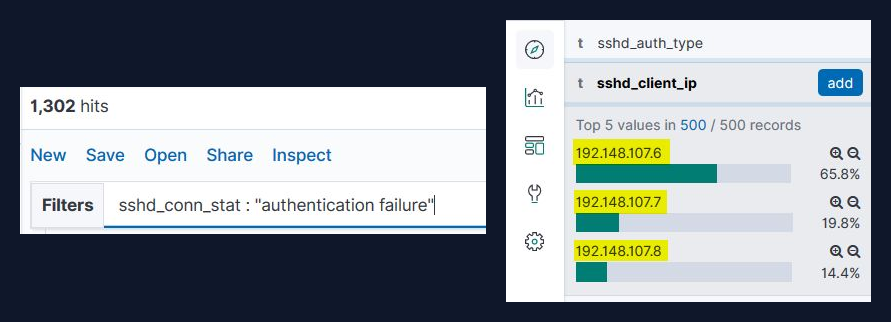

📄 *Reference in Official Solution Manual:* [Walkthrough Page 02](./images/pdf_solution_pages/page_02.png) • [Walkthrough Page 03](./images/pdf_solution_pages/page_03.png)

---

## 🚩 Question 2: Machine Making Most SSH Login Attempts

### Objective
> *Which machine made the most SSH login attempts?*

### Technical Background
Threat actors frequently divide attack responsibilities or operate from distributed endpoints. However, a single primary attacker machine typically conducts the heavy lifting during dictionary attacks, generating an order-of-magnitude higher request count compared to auxiliary scanners. Visualizing request volume across source IPs via a Vertical Bar aggregation allows SOC analysts to quickly identify the primary threat actor.

### Threat Hunting Procedure
1. Navigate to the **Visualize** tab from the left sidebar.
2. Click **Create new visualization** (`+`) and select **Vertical Bar**.
3. Choose **`ssh-log*`** as the data source index pattern.
4. Under **Buckets**, click **X-Axis**:
   * **Aggregation:** `Terms`
   * **Field:** `sshd_client_ip.keyword` (or `ssh_client_ip.keyword`)
   * **Order By:** `metric: Count`
   * **Order:** `Descending`
   * **Size:** `5`
5. Click **Apply changes** (▶️).

### Results & Forensic Analysis
The resulting bar chart illustrates a stark volume disparity:
* **`192.148.107.6`** made approximately **1,300** login attempts, towering over the other two attacking clients.
* `192.148.107.7` generated ~250 attempts.
* `192.148.107.8` generated ~180 attempts.

### Answer / Flag
```text
192.148.107.6
```

### Verified Evidence Screenshot
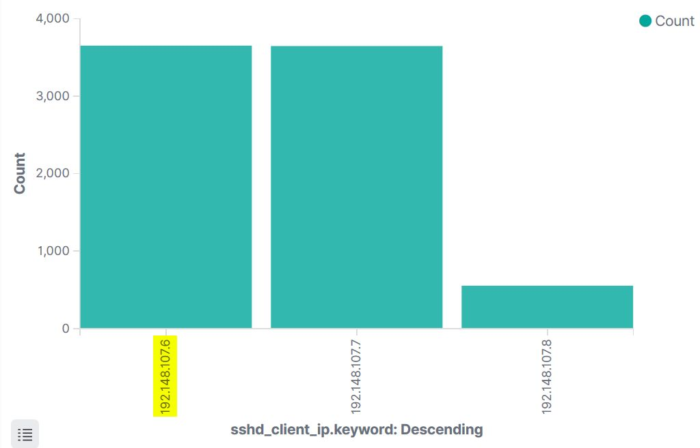

📄 *Reference in Official Solution Manual:* [Walkthrough Page 04](./images/pdf_solution_pages/page_04.png) • [Walkthrough Page 05](./images/pdf_solution_pages/page_05.png) • [Walkthrough Page 06](./images/pdf_solution_pages/page_06.png)

---

## 🚩 Question 3: Number of SSH Servers Attacked

### Objective
> *How many servers running SSH service were attacked?*

### Technical Background
In multi-server architectures, determining whether an adversary is conducting targeted exploitation against a single critical bastion host or executing a broad subnet spray across all servers is critical for incident scoping. Examining the `sshd_listen_ip` field across inbound attack traffic verifies the blast radius.

### Threat Hunting Procedure
1. Navigate to **Discover** tab.
2. Apply a filter to display all documents where the SSH server listening IP exists:
   ```text
   sshd_listen_ip : *
   ```
3. In the **Available fields** panel, select **`sshd_listen_ip`**.
4. Examine the distinct listening IPs recorded by the system:
   * `192.148.107.4`
   * `192.148.107.5`
   * `192.148.107.3`
5. Cross-reference with the `sshd_client_ip` field to verify that the incoming connections originate from the attacking IPs identified in Question 1 (`192.148.107.6`, `.7`, `.8`).

### Results & Forensic Analysis
All 3 distinct SSH server IP addresses (`192.148.107.3`, `192.148.107.4`, `192.148.107.5`) received inbound connection attempts from the attacking machines, proving that all 3 servers running the SSH daemon were attacked.

### Answer / Flag
```text
3
```

### Verified Evidence Screenshot
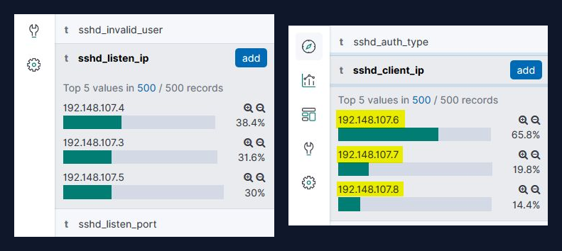

📄 *Reference in Official Solution Manual:* [Walkthrough Page 06](./images/pdf_solution_pages/page_06.png) • [Walkthrough Page 07](./images/pdf_solution_pages/page_07.png) • [Walkthrough Page 08](./images/pdf_solution_pages/page_08.png)

---

## 🚩 Question 4: Attacker Machine Making Maximum Attempts on Most Attacked Server

### Objective
> *What is the IP address of the attacker machine that made the maximum login attempts on the most attacked SSH server?*

### Technical Background
To analyze relationships between multiple attackers and multiple targets, SOC analysts construct multi-level nested aggregations. A concentric pie chart (sunburst) provides visual correlation by grouping servers in the inner ring and nesting the attacking clients in the outer ring.

### Threat Hunting Procedure
1. Navigate to **Visualize** -> **Create new visualization** -> **Pie**.
2. Select index pattern **`ssh-log*`**.
3. Under **Buckets**, select **Split Slices**:
   * **Aggregation:** `Terms`
   * **Field:** `sshd_listen_ip.keyword`
   * **Order By:** `metric: Count`
   * **Order:** `Descending`
4. Notice that placeholder IPs `0.0.0.0` and `::` may appear due to initial daemon startup bind messages; ignore these and focus on the valid server addresses.
5. Click **Add sub-buckets** -> **Split Slices**:
   * **Sub-Aggregation:** `Terms`
   * **Field:** `sshd_client_ip.keyword`
   * **Order By:** `metric: Count`
   * **Order:** `Descending`
6. Click **Apply changes** (▶️).

### Results & Forensic Analysis
* **Inner Ring (Level 1):** Server **`192.148.107.4`** forms the largest slice (~60.1% of valid server attacks), making it the most heavily targeted host.
* **Outer Ring (Level 2):** Under the `192.148.107.4` segment, attacker **`192.148.107.6`** accounts for the vast majority of connection attempts.

### Answer / Flag
```text
192.148.107.6
```

### Verified Evidence Screenshot
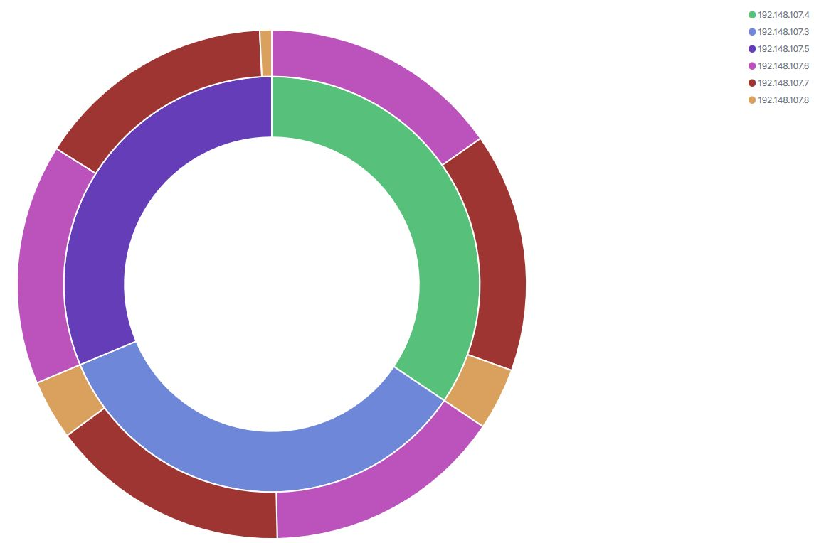

📄 *Reference in Official Solution Manual:* [Walkthrough Page 08](./images/pdf_solution_pages/page_08.png) • [Walkthrough Page 09](./images/pdf_solution_pages/page_09.png) • [Walkthrough Page 10](./images/pdf_solution_pages/page_10.png) • [Walkthrough Page 11](./images/pdf_solution_pages/page_11.png) • [Walkthrough Page 12](./images/pdf_solution_pages/page_12.png) • [Walkthrough Page 13](./images/pdf_solution_pages/page_13.png)

---

## 🚩 Question 5: Number of SSH Authentication Modes Used

### Objective
> *How many SSH authentication modes were used by the attacking machines to break into the servers?*

### Technical Background
OpenSSH supports multiple authentication protocols defined in RFC 4252:
* `password`: Standard interactive password-based authentication.
* `publickey`: Asymmetric cryptographic key authentication.
* `keyboard-interactive`: Challenge-response authentication (e.g. PAM/MFA).
* `gssapi-with-mic` / `hostbased`: Kerberos and trust-based authentication.

During an initial probe or handshake, an SSH client frequently sends an auth probe with type `none` to discover what authentication mechanisms the server accepts. To determine the actual operational methods employed by the attackers, we filter out `none`.

### Threat Hunting Procedure
1. Navigate to **Discover** tab.
2. Enter the following query filter to select logs where `sshd_auth_type` is populated and exclude null probes:
   ```text
   sshd_auth_type : * AND not sshd_auth_type : none
   ```
3. In the **Available fields** list, click **`sshd_auth_type`**.

### Results & Forensic Analysis
The field distribution lists exactly 2 active authentication mechanisms used across the attack:
1. **`password`** — 89.6% of attempts (high-rate password spraying).
2. **`publickey`** — 10.4% of attempts (cryptographic key authorization attempts).

### Answer / Flag
```text
2
```

### Verified Evidence Screenshot
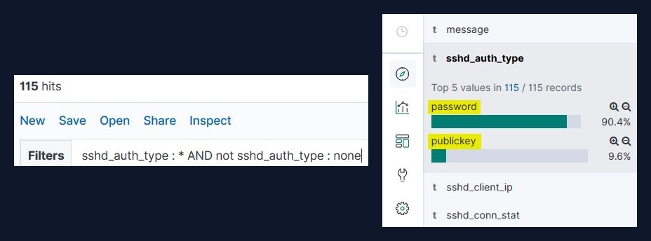

📄 *Reference in Official Solution Manual:* [Walkthrough Page 13](./images/pdf_solution_pages/page_13.png)

---

## 🚩 Question 6: Attacker IP Using Public Key Authentication

### Objective
> *What was the IP address of the attacker machine which used public key authentication to break into the SSH servers?*

### Technical Background
While high-volume password guessing is typical of automated brute-force tools, public key authentication indicates either:
1. An attacker possessing stolen SSH private keys (e.g., harvested from developer workstations, `.bash_history`, unencrypted backups, or GitHub repos).
2. An adversary attempting to exploit unauthorized keys previously injected into `~/.ssh/authorized_keys` during an earlier persistence stage (MITRE ATT&CK T1098.004).

Identifying the specific client leveraging public key authentication reveals which adversary entity possessed valid asymmetric credentials.

### Threat Hunting Procedure
1. In the **Discover** tab, apply the filter:
   ```text
   sshd_auth_type : "publickey"
   ```
2. Inspect the matched documents or click on **`sshd_client_ip`** in the **Available fields** list.
3. Review the raw log `message` field:
   ```text
   Accepted publickey for administrator from 192.148.107.8 port 3603 ssh2: RSA SHA256:...
   ```

### Results & Forensic Analysis
100% of the public key authentication logs originate from client IP **`192.148.107.8`**.

### Answer / Flag
```text
192.148.107.8
```

### Verified Evidence Screenshot
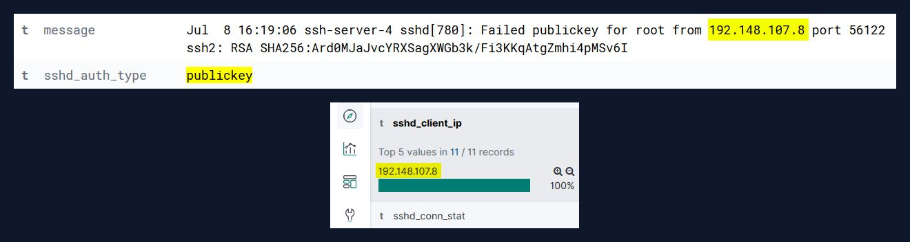

📄 *Reference in Official Solution Manual:* [Walkthrough Page 14](./images/pdf_solution_pages/page_14.png)

---

## 🚩 Question 7: SSH Service Daemon Listening Port

### Objective
> *SSH service was running on which port on all the servers? Provide port number.*

### Technical Background
The default TCP port for SSH services is port 22. Organizations frequently reconfigure `Port` in `/etc/ssh/sshd_config` to reduce log noise from dumb internet scanners. OpenSSH daemon startup and connection logs record the local listening port in the `sshd_listen_port` telemetry field.

### Threat Hunting Procedure
1. Navigate to **Discover** tab.
2. Apply the filter:
   ```text
   sshd_listen_port : *
   ```
3. In the **Available fields** list, click **`sshd_listen_port`**.

### Results & Forensic Analysis
The field value is uniformly **`3603`** across 100% of the recorded logs, confirming that all SSH daemons were running on port 3603.

### Answer / Flag
```text
3603
```

### Verified Evidence Screenshot
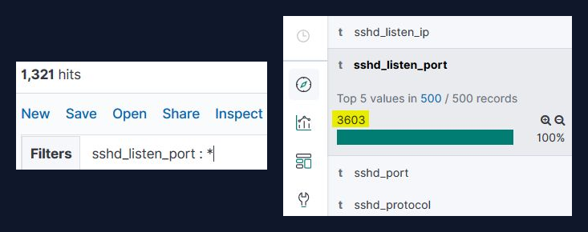

📄 *Reference in Official Solution Manual:* [Walkthrough Page 15](./images/pdf_solution_pages/page_15.png)

---

## 🚩 Question 8: Compromised User Account Name

### Objective
> *What is the name of the user account that got compromised on the SSH servers?*

### Technical Background
An authentication attempt transitioning from `Failed password` to `Accepted` marks a successful compromise event. In Linux OpenSSH logs, successful logins are logged with `sshd_conn_stat : "Accepted"`. By isolating accepted connections, analysts can instantly determine which account credentials were breached.

### Threat Hunting Procedure
1. In **Discover** tab, apply the filter:
   ```text
   sshd_conn_stat : "Accepted"
   ```
2. Inspect the returned documents.
3. Check the **`sshd_user`** field in the **Available fields** list or examine the `message` string:
   ```text
   Accepted password for administrator from 192.148.107.6 port ...
   Accepted publickey for administrator from 192.148.107.8 port ...
   ```

### Results & Forensic Analysis
All accepted logons correspond to the user **`administrator`**. The adversary successfully compromised the privileged administrative account.

### Answer / Flag
```text
administrator
```

### Verified Evidence Screenshot
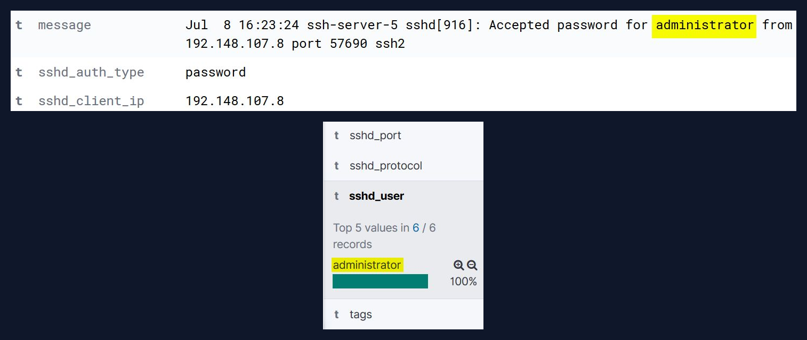

📄 *Reference in Official Solution Manual:* [Walkthrough Page 15](./images/pdf_solution_pages/page_15.png) • [Walkthrough Page 16](./images/pdf_solution_pages/page_16.png) • [Walkthrough Page 17](./images/pdf_solution_pages/page_17.png)

---

## 🚩 Question 9: Time of Maximum Log Ingestion into Elasticsearch

### Objective
> *At what time the maximum number of logs were pushed into elasticsearch? Provide the time in HH:MM:SS format.*

### Technical Background
During brute-force campaigns, automated attack suites burst through dictionary candidate lists, creating massive, localized surges in log ingestion. Standard interval histograms (e.g. 30-second or 1-minute buckets) can obscure the exact second of peak throughput. Utilizing Kibana's **Timelion** time-series query engine allows analysts to perform microsecond-level zooming into volume curves.

### Threat Hunting Procedure
1. Navigate to **Visualize** -> **Create new visualization** -> **Timelion**.
2. Timelion executes time-series data modeling using expression syntax:
   ```text
   .es(index=ssh-log*)
   ```
3. Locate the massive vertical spike in the visualization canvas.
4. Click and drag across the peak region to zoom into the time window.
5. Continue zooming down to second-level granularity and hover over the exact apex of the curve.

### Results & Forensic Analysis
The peak volume occurs at precisely **`16:17:58`**, representing the second where the automated brute-force spray generated its highest concentration of syslog events.

### Answer / Flag
```text
16:17:58
```

### Verified Evidence Screenshot
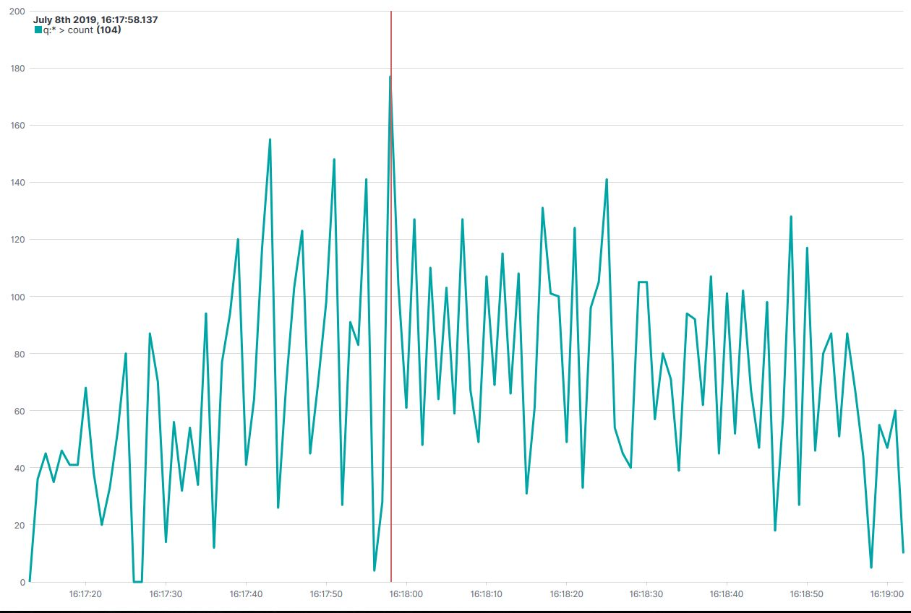

📄 *Reference in Official Solution Manual:* [Walkthrough Page 17](./images/pdf_solution_pages/page_17.png) • [Walkthrough Page 18](./images/pdf_solution_pages/page_18.png) • [Walkthrough Page 19](./images/pdf_solution_pages/page_19.png) • [Walkthrough Page 20](./images/pdf_solution_pages/page_20.png)

---

## 🚩 Question 10: IP Address of First Compromised SSH Server

### Objective
> *What is the IP address of the SSH server that got compromised first?*

### Technical Background
Incident response and threat triage depend heavily on identifying "Patient Zero"—the initial system breached by an adversary before lateral movement occurs. Because Kibana Discover lists records in descending chronological order (newest first) by default, the earliest compromise event sits at the very bottom of the Accepted connection list. 

Once the initial event is located, the reporting host is identified via its `host.name` field (`ssh-server-3`). Correlating `host.name` with `sshd_listen_ip` yields the IP address of the first compromised server.

### Threat Hunting Procedure
1. In **Discover**, apply the filter for accepted connections:
   ```text
   sshd_conn_stat : "Accepted"
   ```
2. Navigate to the earliest record:
   * Either reverse the chronological sort order by clicking the **Time** column header (ascending sort), or scroll to the last/bottom document of the descending list.
3. Expand the document details and examine:
   * `host.name`: **`ssh-server-3`**
4. To confirm the server's IP address, apply the filter:
   ```text
   host.name : "ssh-server-3" and sshd_listen_ip : *
   ```
5. Expand any matched record and inspect the **`sshd_listen_ip`** value.

### Results & Forensic Analysis
The earliest accepted connection took place on host `ssh-server-3`, which maps directly to IP address **`192.148.107.3`**. This was the first server penetrated by the adversary.

### Answer / Flag
```text
192.148.107.3
```

### Verified Evidence Screenshot
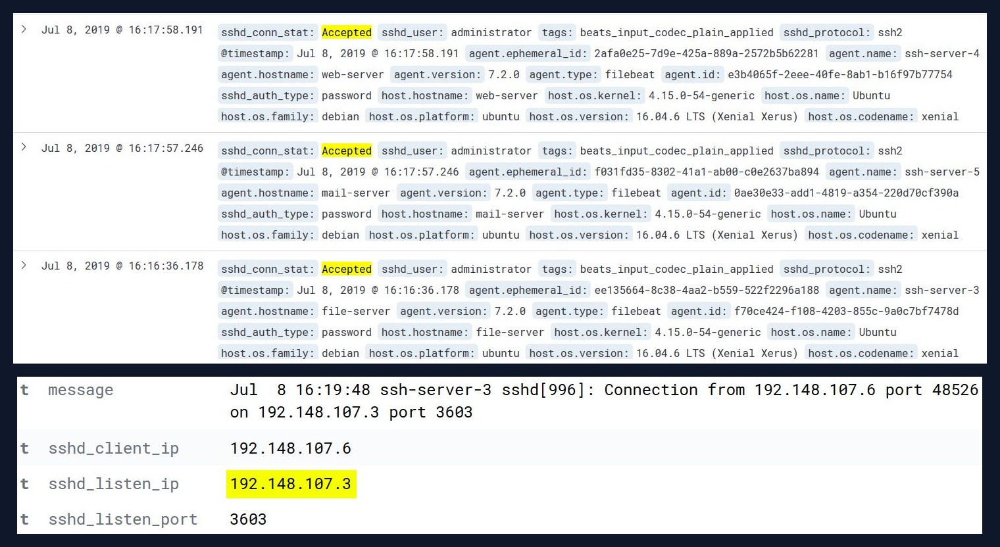

📄 *Reference in Official Solution Manual:* [Walkthrough Page 20](./images/pdf_solution_pages/page_20.png) • [Walkthrough Page 21](./images/pdf_solution_pages/page_21.png) • [Walkthrough Page 22](./images/pdf_solution_pages/page_22.png) • [Walkthrough Page 23](./images/pdf_solution_pages/page_23.png)

---

# 🛡️ SOC Detection Engineering & Threat Hunting Rules

### 1. Sigma Detection Rule: SSH Brute-Force & High-Volume Authentication Failures
```yaml
title: High-Velocity SSH Authentication Failure Surge (Brute-Force / Spray)
id: c4b187d3-ssh-bruteforce-t1110-1138
status: production
description: Detects a surge of failed SSH login attempts from a single source IP indicating automated dictionary attack or credential spraying.
references:
    - https://attack.mitre.org/techniques/T1110/001/
    - https://attack.mitre.org/techniques/T1110/003/
author: Antigravity SOC Engineering
date: 2026-10-27
logsource:
    category: authentication
    product: linux
    service: sshd
detection:
    selection:
        sshd_conn_stat: 'authentication failure'
    timeframe: 2m
    condition: selection | count(sshd_conn_stat) by sshd_client_ip > 50
falsepositives:
    - Administrative automation scripts with expired credentials
    - Automated vulnerability assessments or penetration tests
level: high
tags:
    - attack.credential_access
    - attack.t1110.001
    - attack.t1110.003
```

### 2. Sigma Detection Rule: SSH Authentication Accepted After Repeated Failures
```yaml
title: Successful SSH Authentication Following Brute-Force Attempts
id: 9a2c4792-ssh-breach-success-t1078
status: production
description: Detects a successful SSH authentication logon from an external IP address that previously registered multiple authentication failures.
references:
    - https://attack.mitre.org/techniques/T1078/
author: Antigravity SOC Engineering
date: 2026-10-27
logsource:
    category: authentication
    product: linux
    service: sshd
detection:
    selection_success:
        sshd_conn_stat: 'Accepted'
    filter_trusted_internal:
        sshd_client_ip|startswith:
            - '10.'
            - '172.16.'
            - '192.168.1.'
    condition: selection_success and not filter_trusted_internal
falsepositives:
    - Remote administrators connecting from home or external networks
level: critical
tags:
    - attack.initial_access
    - attack.t1078
    - attack.t1021.004
```

### 3. Splunk SPL Query: SSH Brute-Force to Compromise Correlation
```spl
index=linux_secure sourcetype="syslog:sshd"
| eval event_outcome=if(match(_raw, "Accepted"), "SUCCESS", "FAILURE")
| stats count(eval(event_outcome="FAILURE")) as fail_count,
        count(eval(event_outcome="SUCCESS")) as success_count,
        values(sshd_user) as targeted_users,
        values(dest_ip) as targeted_servers
        by src_ip
| where fail_count > 30 AND success_count > 0
| eval alert="POTENTIAL COMPROMISE: Source IP achieved successful authentication after multiple failures"
| sort - fail_count
```

### 4. Elasticsearch KQL & Lucene Detection Queries
```kql
# Query 1: Isolate all successful logins on non-standard ports
sshd_conn_stat : "Accepted" and not sshd_listen_port : 22

# Query 2: Isolate public key authentication attempts by untrusted client IPs
sshd_auth_type : "publickey" and not sshd_client_ip : (10.0.0.0/8 or 192.168.0.0/16)

# Query 3: Multi-server spray detection (clients targeting > 1 destination server)
sshd_conn_stat : "authentication failure"
```

---

# 🔒 Enterprise Hardening & Defensive Engineering Controls

1. **Disable Password Authentication Entirely:**
   * Mandate cryptographic SSH keys across all Linux servers. Enforce in `/etc/ssh/sshd_config`:
     ```text
     PasswordAuthentication no
     ChallengeResponseAuthentication no
     PubkeyAuthentication yes
     ```
2. **Prohibit Direct Remote Administrative / Root Login:**
   * Restrict administrative logons over SSH. Require administrators to authenticate with unprivileged accounts and elevate via `sudo`:
     ```text
     PermitRootLogin no
     ```
3. **Deploy Automated Brute-Force Rate Limiting (Fail2ban / CrowdSec):**
   * Implement automated IP banning using Fail2ban or iptables rate-limiting:
     ```ini
     [sshd]
     enabled = true
     port = 3603
     filter = sshd
     logpath = /var/log/auth.log
     maxretry = 5
     bantime = 86400
     findtime = 600
     ```
4. **Network Segmentation & Bastion Jump Hosts:**
   * Never expose SSH daemons directly to untrusted networks or the public Internet—even on non-standard ports (e.g. 3603).
   * Enforce ingress access exclusively via dedicated hardened Bastion Jump Hosts or Zero Trust Network Access (ZTNA) with multi-factor authentication (MFA).
5. **Continuous `authorized_keys` Integrity Auditing:**
   * Deploy file integrity monitoring (FIM / Wazuh / Auditd) on `/root/.ssh/authorized_keys` and `/home/*/.ssh/authorized_keys` to detect unauthorized public key injection immediately upon write.

---

# 📖 Lab Solution Manual Appendix (Full 23 Pages)

The complete official walkthrough manual pages are archived below for forensic auditing and review:

| Page | Preview Link | Description |
| :---: | :---: | :--- |
| **Page 01** | [Page 01](./images/pdf_solution_pages/page_01.png) | Challenge Overview & Manual Cover |
| **Page 02** | [Page 02](./images/pdf_solution_pages/page_02.png) | Q1 Attacking Machines Question & Answer (3) |
| **Page 03** | [Page 03](./images/pdf_solution_pages/page_03.png) | Q1 Filter & Available Fields `sshd_client_ip` |
| **Page 04** | [Page 04](./images/pdf_solution_pages/page_04.png) | Q2 Vertical Bar Visualization Setup |
| **Page 05** | [Page 05](./images/pdf_solution_pages/page_05.png) | Q2 Aggregation on `ssh_client_ip.keyword` |
| **Page 06** | [Page 06](./images/pdf_solution_pages/page_06.png) | Q2 Bar Chart & Q3 Attacked Servers Question |
| **Page 07** | [Page 07](./images/pdf_solution_pages/page_07.png) | Q3 Filter `sshd_listen_ip : *` & Field Check |
| **Page 08** | [Page 08](./images/pdf_solution_pages/page_08.png) | Q3 Client IPs & Q4 Pie Chart Setup |
| **Page 09** | [Page 09](./images/pdf_solution_pages/page_09.png) | Q4 Select Pie Visualization & Index Source |
| **Page 10** | [Page 10](./images/pdf_solution_pages/page_10.png) | Q4 Split Slices on `sshd_listen_ip.keyword` |
| **Page 11** | [Page 11](./images/pdf_solution_pages/page_11.png) | Q4 Server Attack Share & Sub-Bucket Setup |
| **Page 12** | [Page 12](./images/pdf_solution_pages/page_12.png) | Q4 Level 1 Inner Pie Analysis (`192.148.107.4`) |
| **Page 13** | [Page 13](./images/pdf_solution_pages/page_13.png) | Q4 Outer Pie Attacker (`192.148.107.6`) & Q5 Auth Modes |
| **Page 14** | [Page 14](./images/pdf_solution_pages/page_14.png) | Q6 Public Key Attacker Attribution (`192.148.107.8`) |
| **Page 15** | [Page 15](./images/pdf_solution_pages/page_15.png) | Q7 SSH Port (`3603`) & Q8 Compromised User Question |
| **Page 16** | [Page 16](./images/pdf_solution_pages/page_16.png) | Q8 Filter `sshd_conn_stat : "Accepted"` & Document |
| **Page 17** | [Page 17](./images/pdf_solution_pages/page_17.png) | Q8 Compromised User (`administrator`) & Q9 Timelion |
| **Page 18** | [Page 18](./images/pdf_solution_pages/page_18.png) | Q9 Timelion Visualization Creation |
| **Page 19** | [Page 19](./images/pdf_solution_pages/page_19.png) | Q9 Timelion Zooming into Peak Volume Region |
| **Page 20** | [Page 20](./images/pdf_solution_pages/page_20.png) | Q9 Peak Time (`16:17:58`) & Q10 First Server Question |
| **Page 21** | [Page 21](./images/pdf_solution_pages/page_21.png) | Q10 Timeline Bar Chart of Accepted Connections |
| **Page 22** | [Page 22](./images/pdf_solution_pages/page_22.png) | Q10 First Compromise Document (`ssh-server-3`) |
| **Page 23** | [Page 23](./images/pdf_solution_pages/page_23.png) | Q10 Server IP Resolution (`192.148.107.3`) |

---

# 📚 Official References & Open Source Resources

* [INE Security Lab: ELK SSH Logs](https://my.ine.com/labs/25d8187d-3c25-3ace-836c-6bd2dd433a5b)
* [AttackDefense Challenge CID 1138](https://attackdefense.com/challengedetails?cid=1138)
* [INE Walkthrough 1138 PDF Manual](https://assets.ine.com/labs/ad-manuals/walkthrough-1138.pdf)
* [Elasticsearch & Kibana Official Documentation](https://www.elastic.co/guide/en/kibana/current/index.html)
* [Kibana Timelion User Guide](https://www.elastic.co/guide/en/kibana/7.17/timelion.html)
* [OpenSSH Protocol & Daemon Documentation](https://www.openssh.com/)
* [MITRE ATT&CK Technique T1110: Brute Force](https://attack.mitre.org/techniques/T1110/)
* [MITRE ATT&CK Technique T1078: Valid Accounts](https://attack.mitre.org/techniques/T1078/)
* [MITRE ATT&CK Technique T1021.004: Remote Services - SSH](https://attack.mitre.org/techniques/T1021/004/)
* [RFC 4252: The Secure Shell (SSH) Authentication Protocol](https://datatracker.ietf.org/doc/html/rfc4252)
