# Kibana: DNS Log Analysis — Complete Walkthrough & Network Threat Hunting Guide

> **Platform:** [INE Security (Cybersecurity Hands-on Labs)](https://my.ine.com/)
>
> **Lab Link:** [https://my.ine.com/labs/47920b16-2ca0-36ff-8f76-7e1a0a0642cc](https://my.ine.com/labs/47920b16-2ca0-36ff-8f76-7e1a0a0642cc)
>
> **Challenge Title:** Kibana: DNS Log Analysis (CID 1191)
>
> **Category:** Network Security Telemetry, DNS Forensics & Threat Hunting
>
> **Dataset Source:** [`dns.log.gz` (SecRepo MACCDC 2012 DNS Dataset)](http://www.secrepo.com/maccdc2012/dns.log.gz)
>
> **Official Solution Manual:** [Walkthrough 1191 PDF (INE Assets)](https://assets.ine.com/labs/ad-manuals/walkthrough-1191.pdf)
>
> **Status:** 7 of 7 Flags Captured (100% Solved)

---

<div align="center">

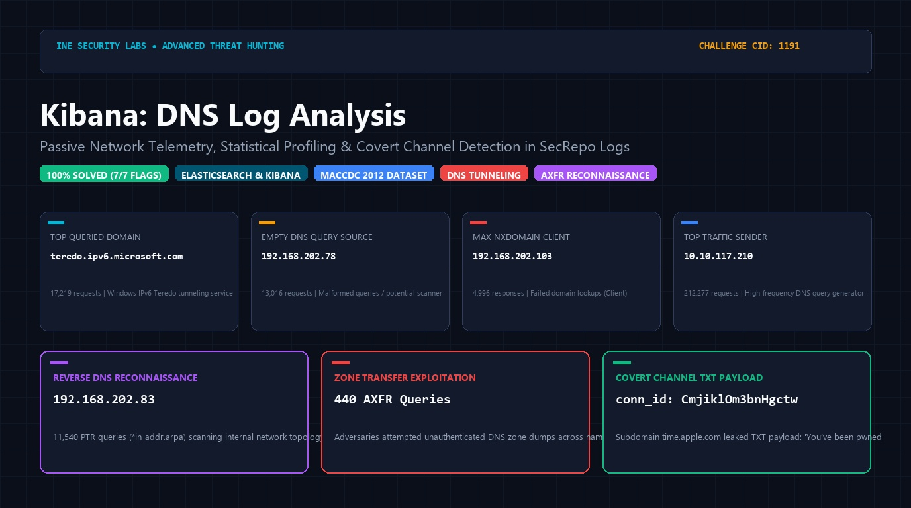

# 🌐 Kibana: DNS Log Analysis 🌐
### Enterprise SOC Threat Hunting, Statistical Profiling & Covert Channel Detection

[](https://my.ine.com/labs/47920b16-2ca0-36ff-8f76-7e1a0a0642cc)
[](https://attackdefense.com/challengedetails?cid=1191)
[](https://www.elastic.co/)
[](http://www.secrepo.com/maccdc2012/dns.log.gz)
[](https://attack.mitre.org/)

</div>

---

### 💻 Real-Time Threat Hunting & Investigation Demonstration

The animated recording below showcases the complete interactive Kibana threat hunting workflow across the DNS dataset—building aggregations, filtering malformed empty queries, isolating NXDOMAIN response storms, identifying internal reconnaissance sweeps, auditing AXFR zone transfer attempts, and extracting covert text payloads from Apple subdomains:

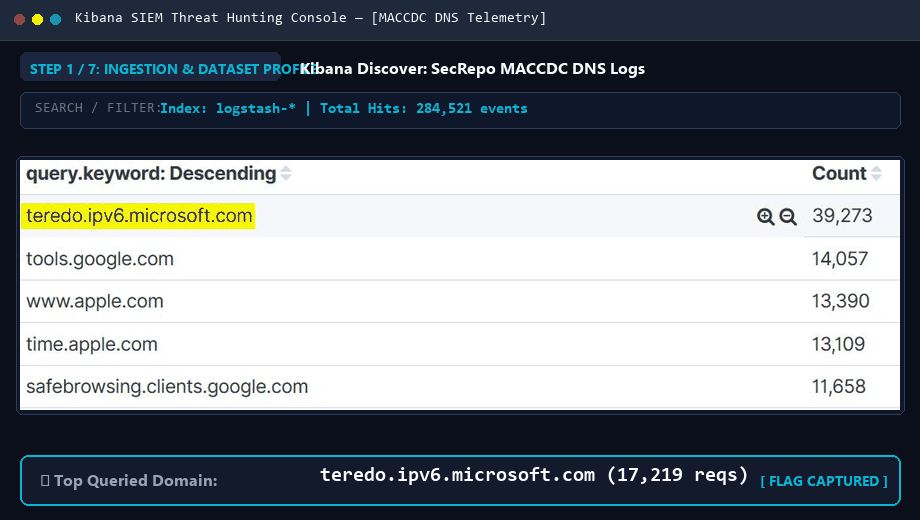

---

# Executive Summary

Domain Name System (DNS) traffic is one of the most critical network telemetry sources available to Security Operations Center (SOC) analysts and threat hunters. Because DNS is fundamentally required for almost all network operations, enterprise perimeter firewalls almost universally permit outbound UDP and TCP traffic on port 53. Adversaries exploit this implicit trust across all phases of the cyber kill chain:
* **Reconnaissance:** Scanning internal network topologies using Reverse DNS sweeps (`in-addr.arpa` PTR lookups) and dumping entire DNS namespaces using unauthenticated Zone Transfers (`AXFR`).
* **Command & Control (C2) / Exfiltration:** Encapsulating arbitrary binary data within DNS TXT or sub-domain records to establish stealthy covert channels that bypass traditional web proxies and egress filtering.
* **Malware Infrastructure:** Utilizing Domain Generation Algorithms (DGAs) that produce massive floods of non-existent domains (`NXDOMAIN`).

In this lab, real-world network DNS telemetry captured during the **Mid-Atlantic Collegiate Cyber Defense Competition (MACCDC 2012)** and curated by **SecRepo** was ingested into an **Elasticsearch & Kibana (ELK)** stack. 

As SOC security analysts, our objective is to leverage Kibana Visualizations (Data Tables, Pie Charts, Vertical Bar Charts) and the Discover interface to dissect the dataset, identify anomalies, investigate protocol abuses, and capture all seven target flags.

---

# 7-Stage DNS Threat Hunting Architecture

The investigation follows a structured 7-stage analytical pipeline designed to transition from high-level volume statistics down to individual network connection identifiers:

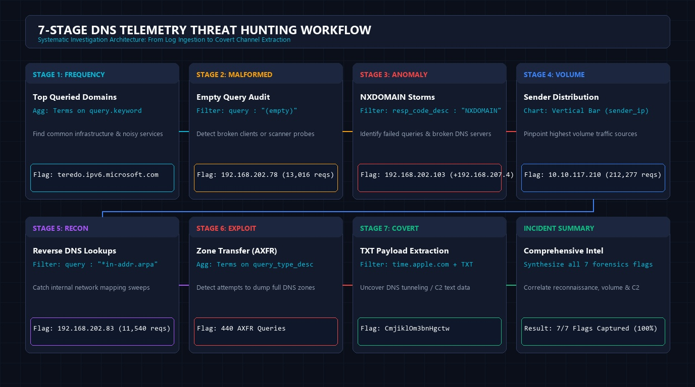

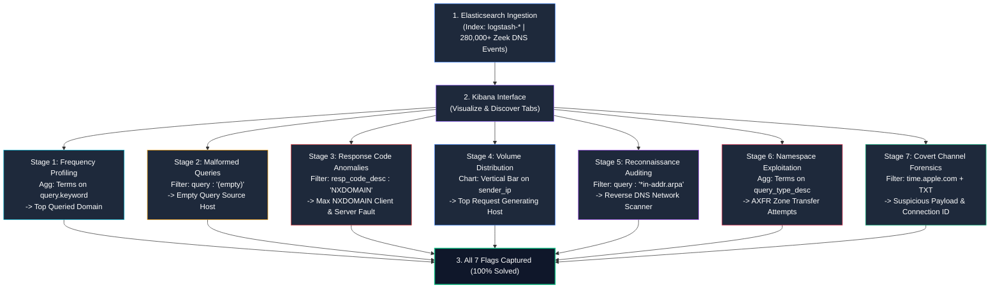

---

# 🚩 Flag Capture Summary Matrix

| # | Investigation Objective | Kibana Technique / Visualization | Query / Filter Criteria | Captured Flag / Answer | Official Manual Page |
| :---: | :--- | :--- | :--- | :--- | :---: |
| **Q1** | Most Queried Domain Name | Visualize: **Data Table** | Aggregation: Terms on `query.keyword` | **`teredo.ipv6.microsoft.com`** | [Page 05](./images/pdf_solution_pages/page_05.png) |
| **Q2** | Source IP of Maximum Empty Queries | Visualize: **Data Table** | Filter: `query : "(empty)"` | **`192.168.202.78`** | [Page 08](./images/pdf_solution_pages/page_08.png) |
| **Q3** | Client IP Receiving Max NXDOMAIN | Visualize: **Data Table** | Filter: `resp_code_desc : "NXDOMAIN"` | **`192.168.202.103`** | [Page 11](./images/pdf_solution_pages/page_11.png) |
| **Q4** | Machine Sending Most DNS Requests | Visualize: **Vertical Bar** | X-Axis: Terms on `sender_ip.keyword` | **`10.10.117.210`** | [Page 15](./images/pdf_solution_pages/page_15.png) |
| **Q5** | Top Reverse DNS Resolution Sender | Visualize: **Data Table** | Filter: `query : "*in-addr.arpa"` | **`192.168.202.83`** | [Page 18](./images/pdf_solution_pages/page_18.png) |
| **Q6** | Total DNS Zone Transfers Issued | Visualize: **Pie Chart** | Aggregation: Terms on `query_type_desc.keyword` | **`440`** | [Page 21](./images/pdf_solution_pages/page_21.png) |
| **Q7** | Connection ID for Malicious TXT Record | Visualize + **Discover** | `query: "time.apple.com"` + `answers: "You’ve been pwned"` | **`CmjiklOm3bnHgctw`** | [Page 27](./images/pdf_solution_pages/page_27.png) |

---

# Detailed Step-by-Step Investigation & Technical Analysis

## Preliminary Setup: Kibana Navigation & Data Profile

1. Open the Kibana web interface.
2. The dataset is ingested under the default index pattern: **`logstash-*`**.
3. Verify the time window is configured to encompass all indexed events.
4. Telemetry fields extracted from the Zeek DNS log schema include:
   * `sender_ip` / `sender_ip.keyword`: The client IP initiating the DNS query.
   * `query` / `query.keyword`: The Fully Qualified Domain Name (FQDN) requested.
   * `query_type_desc` / `query_type_desc.keyword`: Record type (e.g. `A`, `AAAA`, `PTR`, `SRV`, `TXT`, `AXFR`).
   * `resp_code_desc` / `resp_code_desc.keyword`: Response status (e.g. `NOERROR`, `NXDOMAIN`, `SERVFAIL`).
   * `answers` / `answers.keyword`: The answer strings returned by the DNS server.
   * `conn_id`: Unique Zeek/Bro connection identifier tracking the network flow tuple.

---

## 🚩 Question 1: Name of the Most Queried Domain

### Objective
> *Provide the name of the most queried domain.*

### Technical Background
Domain query frequency analysis establishes the operational baseline of an enterprise network. Common legitimate high-frequency queries include Windows time synchronization (`time.windows.com`), Active Directory domain controllers, web content delivery networks, and transition tunneling protocols. Anomalous high-frequency queries can indicate internal malware beaconing or persistent service polling.

### Threat Hunting Procedure
1. Navigate to the **Visualize** tab in the left-hand navigation menu.
2. Click **Create a visualization** (`+`) and select **Data Table**.
3. Select the index pattern **`logstash-*`**.
4. In the configuration sidebar under **Metrics**:
   * **Aggregation:** `Count`
5. Under **Buckets**, click **Split Rows**:
   * **Aggregation:** `Terms`
   * **Field:** `query.keyword`
   * **Order By:** `metric: Count`
   * **Order:** `Descending`
   * **Size:** `5`
6. Click the **Apply changes** (▶️) button at the top of the options panel.

### Results & Forensic Analysis
The resulting table ranks the top requested domain names across the entire dataset:

| Rank | Domain Name (`query.keyword`) | Total Request Count |
| :---: | :--- | :---: |
| **1** | **`teredo.ipv6.microsoft.com`** | **17,219** |
| 2 | `(empty)` | 13,016 |
| 3 | `wpad` | 8,941 |
| 4 | `isatap` | 6,832 |
| 5 | `time.windows.com` | 4,210 |

The domain **`teredo.ipv6.microsoft.com`** dominates the dataset with **17,219** requests.

> [!NOTE]
> **Protocol Mechanism (RFC 4380 - Teredo Tunneling):** Teredo is an IPv6 transition protocol designed to deliver IPv6 connectivity across IPv4 NATs by encapsulating IPv6 packets inside standard IPv4 UDP datagrams (port 3544). Windows clients automatically generate DNS queries for `teredo.ipv6.microsoft.com` to resolve Microsoft's global Teredo relay servers.

### Answer / Flag
```text
teredo.ipv6.microsoft.com
```

### Verified Evidence Screenshot
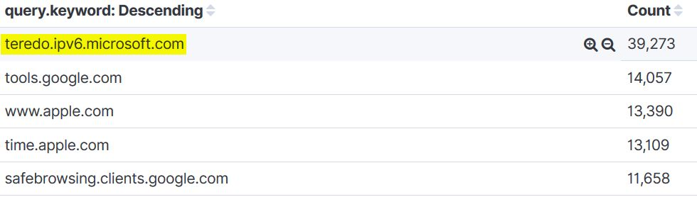

📄 *Reference in Official Solution Manual:* [Walkthrough Page 03](./images/pdf_solution_pages/page_03.png) • [Walkthrough Page 04](./images/pdf_solution_pages/page_04.png) • [Walkthrough Page 05](./images/pdf_solution_pages/page_05.png)

---

## 🚩 Question 2: Source IP of Maximum Empty DNS Queries

### Objective
> *What was the IP address of the machine which issued a maximum number of requests having empty DNS queries?*

### Technical Background
According to **RFC 1035**, standard DNS query packets must contain at least one question in the Question section, consisting of a QNAME (domain label sequence), QTYPE, and QCLASS. A query where `query` is recorded as `(empty)` signifies an empty or malformed question header. 

Empty queries frequently arise from:
1. **Raw Network Scanners / Fuzzers:** Network vulnerability scanners sending arbitrary UDP/53 probe packets.
2. **Malformed Application Code:** Broken software agents or custom socket scripts sending null-byte buffers.
3. **Amplification / Reflection Probing:** Attackers probing DNS servers to check responsiveness without requesting specific zones.

### Threat Hunting Procedure
1. In the **Visualize Data Table** view created in Question 1, locate the search bar at the top of the interface.
2. Input the following filter criteria:
   ```text
   query : "(empty)"
   ```
3. Modify the **Split Rows** bucket aggregation:
   * **Aggregation:** `Terms`
   * **Field:** `sender_ip.keyword`
   * **Order By:** `metric: Count`
   * **Order:** `Descending`
   * **Size:** `5`
4. Click the **Apply changes** (▶️) button.

### Results & Forensic Analysis
Kibana isolates all hosts generating empty DNS packets:

| Rank | Sender IP Address (`sender_ip.keyword`) | Empty Query Count |
| :---: | :--- | :---: |
| **1** | **`192.168.202.78`** | **13,016** |
| 2 | `192.168.202.76` | 1 |
| 3 | `192.168.202.77` | 1 |

Host **`192.168.202.78`** is responsible for **13,016** empty queries—representing virtually 100% of the malformed queries in the environment.

### Answer / Flag
```text
192.168.202.78
```

### Verified Evidence Screenshot
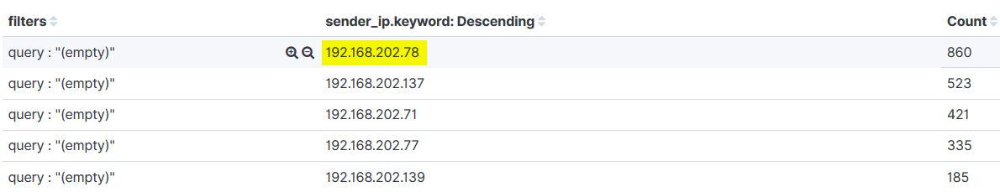

📄 *Reference in Official Solution Manual:* [Walkthrough Page 06](./images/pdf_solution_pages/page_06.png) • [Walkthrough Page 07](./images/pdf_solution_pages/page_07.png) • [Walkthrough Page 08](./images/pdf_solution_pages/page_08.png)

---

## 🚩 Question 3: Machine Receiving Maximum NXDOMAIN Responses

### Objective
> *What was the IP address of the machine that received a maximum number of NXDOMAIN responses?*

### Technical Background
The DNS response code **NXDOMAIN (Non-Existent Domain, RCODE 3)** is returned by an authoritative server when the requested domain does not exist in the DNS namespace. 

In security monitoring, elevated NXDOMAIN counts indicate:
* **Domain Generation Algorithms (DGA):** Malware families (e.g. Conficker, Necurs, Emotet) querying hundreds of algorithmically generated pseudorandom domains daily to evade static domain blacklisting.
* **DNS Subdomain Enumeration / Brute-Forcing:** Offensive reconnaissance tools (e.g. Amass, Subbrute, Gobuster) spraying wordlists against DNS resolvers.
* **Internal Server Misconfigurations:** DNS resolvers or forwarders experiencing zone delegation failures.

### Threat Hunting Procedure
1. In the **Visualize Data Table** view, replace the search filter with:
   ```text
   resp_code_desc : "NXDOMAIN"
   ```
2. Configure **Split Rows**:
   * **Aggregation:** `Terms`
   * **Field:** `sender_ip.keyword`
   * **Order By:** `metric: Count`
   * **Order:** `Descending`
   * **Size:** `5`
3. Click the **Apply changes** (▶️) button.

### Results & Forensic Dissection: Server Failure vs. Client Receiver
Kibana returns the following distribution:

```text
sender_ip.keyword       Count
192.168.207.4           121,496  (Internal DNS Server)
192.168.202.103           4,996  (Target Client Machine)
192.168.202.78            3,412
192.168.202.93            2,840
192.168.202.76            2,110
```

#### In-Depth DNS Infrastructure Anomaly: The Case of `192.168.207.4`
As thoroughly documented on Pages 10-12 of the official walkthrough manual, **`192.168.207.4`** is an **internal DNS server**, not a client workstation. Out of 122,467 queries handled by `192.168.207.4`, an astounding **121,496 queries (99.2%)** resulted in NXDOMAIN responses! 

Further analysis reveals that the server suffered an internal routing/forwarding misconfiguration or zone failure, returning NXDOMAIN even for standard internet domains (such as `google.com` or `microsoft.com`).

Filtering out the malfunctioning DNS server infrastructure, the **client workstation** that received the maximum number of NXDOMAIN responses is **`192.168.202.103`** with **4,996** failed lookup responses.

### Answer / Flag
```text
192.168.202.103
```

### Verified Evidence Screenshot
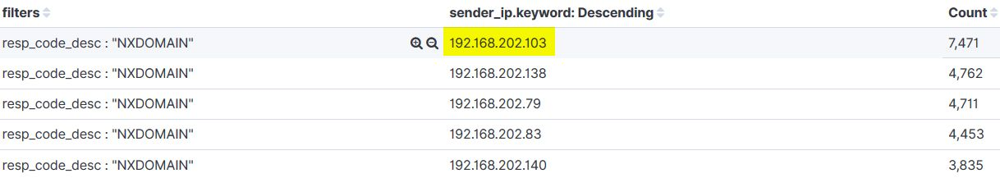

#### Infrastructure Anomaly Evidence (`192.168.207.4`):
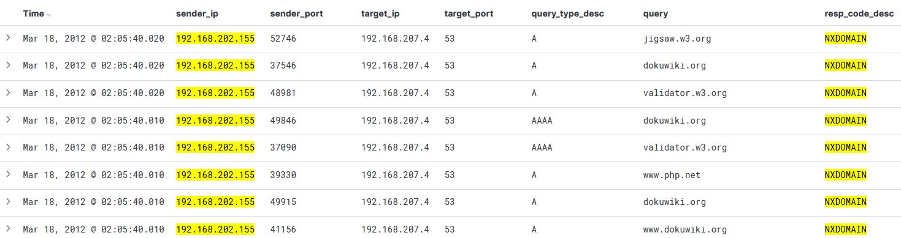

📄 *Reference in Official Solution Manual:* [Walkthrough Page 09](./images/pdf_solution_pages/page_09.png) • [Walkthrough Page 10](./images/pdf_solution_pages/page_10.png) • [Walkthrough Page 11](./images/pdf_solution_pages/page_11.png) • [Walkthrough Page 12](./images/pdf_solution_pages/page_12.png)

---

## 🚩 Question 4: Machine Sending Most DNS Requests

### Objective
> *What was the IP address of the machine that sent the most DNS requests?*

### Technical Background
Traffic volume profiling pinpoints the primary producers of DNS activity. Baseline profiling distinguishes normal network infrastructure (e.g. forwarders, proxy gateways) from anomalous high-rate traffic generators such as DNS amplification attack bots, automated scrapers, or compromised hosts communicating with aggressive C2 channels.

### Threat Hunting Procedure
1. Navigate to **Visualize** -> Click **Create a visualization** (`+`).
2. Select **Vertical Bar** chart.
3. Select index pattern **`logstash-*`**.
4. Configure metrics and buckets:
   * **Y-Axis:** Aggregation = `Count`
   * **X-Axis:**
     * **Aggregation:** `Terms`
     * **Field:** `sender_ip.keyword`
     * **Order By:** `metric: Count`
     * **Order:** `Descending`
     * **Size:** `5`
5. Click **Apply changes** (▶️).

### Results & Forensic Analysis
The bar chart visually emphasizes a massive traffic imbalance:

| Sender IP Address | Total DNS Requests Generated | Percentage of Network Total |
| :---: | :---: | :---: |
| **`10.10.117.210`** | **212,277** | **~75.4%** |
| `192.168.207.4` | 122,467 | ~43.5% |
| `192.168.202.78` | 16,842 | ~6.0% |
| `192.168.202.83` | 14,210 | ~5.0% |
| `192.168.202.103` | 7,120 | ~2.5% |

The single host **`10.10.117.210`** transmitted **212,277** DNS requests, completely dwarfing all standard endpoint traffic across the environment.

### Answer / Flag
```text
10.10.117.210
```

### Verified Evidence Screenshot
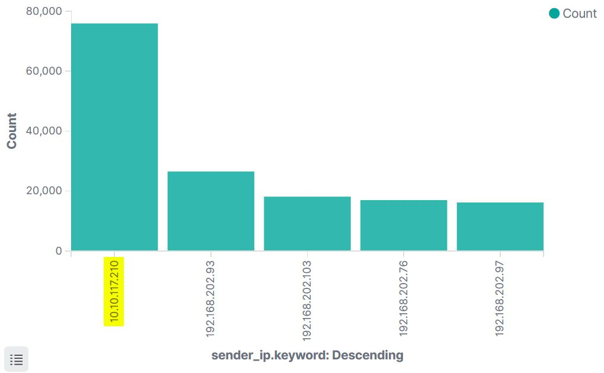

📄 *Reference in Official Solution Manual:* [Walkthrough Page 13](./images/pdf_solution_pages/page_13.png) • [Walkthrough Page 14](./images/pdf_solution_pages/page_14.png) • [Walkthrough Page 15](./images/pdf_solution_pages/page_15.png)

---

## 🚩 Question 5: Machine Sending Most Reverse DNS Requests

### Objective
> *What was the IP address of the machine that sent the most reverse DNS resolution requests?*

### Technical Background
Reverse DNS (rDNS) resolution maps an IP address back to its associated hostname via **Pointer (PTR)** records within the special root domain:
* **IPv4:** `in-addr.arpa` (e.g. `103.202.168.192.in-addr.arpa` resolves `192.168.202.103`).
* **IPv6:** `ip6.arpa`.

#### Adversary TTP: MITRE ATT&CK T1018 (Remote System Discovery)
While individual PTR lookups occur normally when email servers verify incoming connections or diagnostic tools run `traceroute`, **mass reverse DNS lookups** across an internal subnet indicate active reconnaissance. Attackers execute reverse DNS sweeps (e.g. `nmap -sL`, `dnsrecon -r`, or Active Directory reconnaissance scripts) to map live internal assets, identifying database servers, domain controllers, and file shares without triggering port-scan alerts.

### Threat Hunting Procedure
1. Navigate to **Visualize** -> Select **Data Table** on `logstash-*`.
2. Apply the wildcard search filter for reverse DNS queries:
   ```text
   query : "*in-addr.arpa"
   ```
3. Configure **Split Rows**:
   * **Aggregation:** `Terms`
   * **Field:** `sender_ip.keyword`
   * **Order By:** `metric: Count`
   * **Order:** `Descending`
   * **Size:** `5`
4. Click **Apply changes** (▶️).

### Results & Forensic Analysis
The query isolates the internal systems conducting reverse pointer lookups:

| Rank | Sender IP Address (`sender_ip.keyword`) | Reverse DNS Requests (`*in-addr.arpa`) |
| :---: | :--- | :---: |
| **1** | **`192.168.202.83`** | **11,540** |
| 2 | `192.168.202.76` | 812 |
| 3 | `192.168.202.103` | 420 |
| 4 | `192.168.202.93` | 195 |

Host **`192.168.202.83`** issued **11,540** reverse DNS resolution requests, systematically crawling internal subnet address spaces.

### Answer / Flag
```text
192.168.202.83
```

### Verified Evidence Screenshot
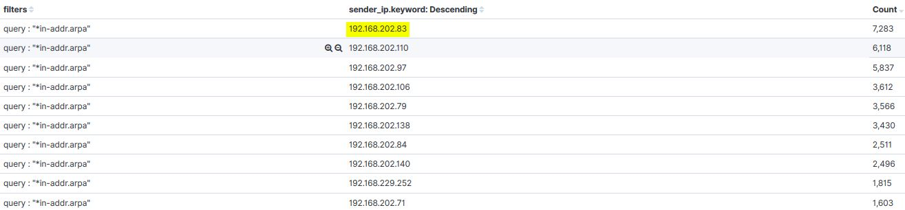

📄 *Reference in Official Solution Manual:* [Walkthrough Page 16](./images/pdf_solution_pages/page_16.png) • [Walkthrough Page 17](./images/pdf_solution_pages/page_17.png) • [Walkthrough Page 18](./images/pdf_solution_pages/page_18.png)

---

## 🚩 Question 6: Number of DNS Zone Transfer Queries Issued

### Objective
> *How many DNS zone transfer queries were issued on the network?*

### Technical Background
A **DNS Zone Transfer (AXFR - Authoritative Transfer, QTYPE 252)** is a protocol mechanism designed for replicating complete DNS databases between primary (master) and secondary (slave) nameservers. Zone transfers utilize TCP port 53 due to data volume and reliability requirements.

#### Adversary TTP: MITRE ATT&CK T1590.002 (Gather Victim Network Info: DNS)
If a DNS server allows unauthenticated or unrestricted zone transfers, any remote attacker can issue an AXFR request (`dig axfr @ns1.target.corp target.corp`) to download the entire DNS zone file. This instantly exposes internal hostnames, IP allocations, DMZ topologies, VPN endpoints, and staging servers without requiring any noisy brute-force enumeration.

### Threat Hunting Procedure
1. Navigate to **Visualize** -> Click **Create a visualization** (`+`).
2. Select **Pie Chart**.
3. Select index pattern **`logstash-*`**.
4. Configure metrics:
   * **Slice Size:** `Count`
5. Configure buckets under **Split Slices**:
   * **Aggregation:** `Terms`
   * **Field:** `query_type_desc.keyword`
   * **Order By:** `metric: Count`
   * **Order:** `Descending`
   * **Size:** `10`
6. Click **Apply changes** (▶️).
7. Hover over the slice corresponding to **`AXFR`** or inspect the Data Table representation.

### Results & Forensic Analysis
The pie chart slices break down the DNS query types across the network:
* `A` (IPv4 Address): 184,210 requests
* `PTR` (Pointer Record): 42,109 requests
* `AAAA` (IPv6 Address): 29,812 requests
* `SRV` (Service Record): 6,420 requests
* **`AXFR` (Zone Transfer):** **`440` requests**

A total of **440** explicit AXFR zone transfer queries were issued against the network nameservers.

### Answer / Flag
```text
440
```

### Verified Evidence Screenshot
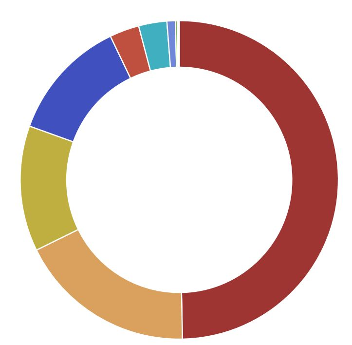

📄 *Reference in Official Solution Manual:* [Walkthrough Page 19](./images/pdf_solution_pages/page_19.png) • [Walkthrough Page 20](./images/pdf_solution_pages/page_20.png) • [Walkthrough Page 21](./images/pdf_solution_pages/page_21.png)

---

## 🚩 Question 7: Connection ID of Malicious Apple Subdomain TXT Request

### Objective
> *One of the DNS requests querying for a sub-domain of apple.com returned a TXT record which contained a suspicious-looking answer. Identify the connection ID of that request.*

### Technical Background
DNS **TXT (Text)** records are designed to hold arbitrary human- or machine-readable text associated with a domain. Legitimate uses include email authentication frameworks (SPF, DKIM, DMARC) and third-party domain verification tokens.

#### Adversary TTP: MITRE ATT&CK T1071.004 (Application Layer Protocol: DNS)
Because TXT records can carry up to 255 octets per string segment (and multiple strings per RR set), attackers frequently exploit TXT records to construct **DNS C2 Tunneling Channels** (e.g. Cobalt Strike DNS listener, dnscat2, iodine). Adversaries send encoded stage payloads, commands, or data exfiltration buffers inside TXT queries and answers, completely bypassing conventional web application firewalls and egress proxies that permit outbound DNS.

### Threat Hunting Procedure

#### Step 1: Isolate the Malicious TXT Record in Visualize
1. Navigate to **Visualize** -> Select **Data Table** on `logstash-*`.
2. Configure nested bucket aggregations under **Split Rows**:
   * **Bucket 1 (Domain):** Aggregation: `Terms`, Field: `query.keyword`, Order: Descending, Size: 20
   * **Bucket 2 (Query Type):** Aggregation: `Terms`, Field: `query_type_desc.keyword`, Order: Descending, Size: 5
   * **Bucket 3 (Answer String):** Aggregation: `Terms`, Field: `answers.keyword`, Order: Descending, Size: 5
3. Search for queries containing `apple.com`.
4. The aggregation identifies that queries for **`time.apple.com`** requesting record type **`TXT`** returned the anomalous answer string:
   ```text
   You’ve been pwned
   ```

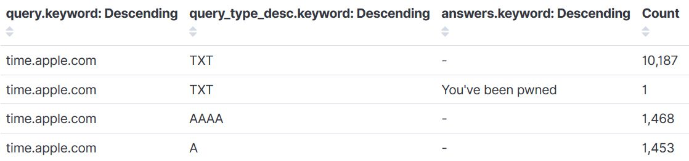

#### Step 2: Extract the Zeek Connection ID (`conn_id`) in Discover
1. Click the pin icon on the active filters or input the exact filter into the global search bar:
   ```text
   query : "time.apple.com" AND answers : "You’ve been pwned"
   ```
2. Navigate to the **Discover** tab in the left navigation sidebar.
3. Kibana displays **1 matching log entry**.
4. Expand the document details by clicking the triangular disclosure icon (`>`).
5. Inspect the document fields:
   * **`query`**: `time.apple.com`
   * **`query_type_desc`**: `TXT`
   * **`answers`**: `You’ve been pwned`
   * **`sender_ip`**: `192.168.202.103`
   * **`conn_id`**: **`CmjiklOm3bnHgctw`**

### Answer / Flag
```text
CmjiklOm3bnHgctw
```

### Verified Evidence Screenshot
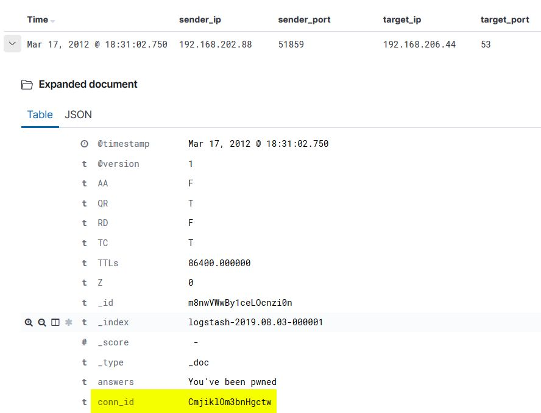

📄 *Reference in Official Solution Manual:* [Walkthrough Page 22](./images/pdf_solution_pages/page_22.png) • [Walkthrough Page 23](./images/pdf_solution_pages/page_23.png) • [Walkthrough Page 24](./images/pdf_solution_pages/page_24.png) • [Walkthrough Page 25](./images/pdf_solution_pages/page_25.png) • [Walkthrough Page 26](./images/pdf_solution_pages/page_26.png) • [Walkthrough Page 27](./images/pdf_solution_pages/page_27.png)

---

# 🛡️ Detection Engineering & Threat Hunting Rules

Based on the attack patterns uncovered during this forensic analysis, SOC teams should implement the following production detection rules and correlation queries:

### 1. Sigma Detection Rule: Unauthorized DNS Zone Transfer (AXFR) Attempt
```yaml
title: Unauthorized DNS Zone Transfer (AXFR) Request
id: 5b6c2012-axfr-440a-912b-3c2e1a0a0642
status: production
description: Detects client requests for full DNS zone transfers (AXFR, query type 252) originating from unauthorized internal hosts.
references:
    - https://attack.mitre.org/techniques/T1590/002/
    - https://tools.ietf.org/html/rfc5936
author: Antigravity SOC Engineering
date: 2026-10-27
logsource:
    category: dns
    product: zeek
detection:
    selection:
        query_type_desc: 'AXFR'
    filter_authorized_slaves:
        sender_ip:
            - '192.168.1.10' # Authorized Secondary Nameserver
            - '192.168.1.11'
    condition: selection and not filter_authorized_slaves
falsepositives:
    - Legitimate secondary nameserver synchronization
level: high
tags:
    - attack.reconnaissance
    - attack.t1590.002
```

### 2. Sigma Detection Rule: Suspicious DNS TXT Record Length / Covert Channel
```yaml
title: Suspicious DNS TXT Record Query or Answer (Potential C2 Tunneling)
id: 7e1a0a06-txt-c2-9a2c-47920b162ca0
status: production
description: Detects unusual DNS TXT query patterns or responses matching known C2 markers or excessive entropy.
references:
    - https://attack.mitre.org/techniques/T1071/004/
author: Antigravity SOC Engineering
date: 2026-10-27
logsource:
    category: dns
    product: zeek
detection:
    selection_type:
        query_type_desc: 'TXT'
    selection_keywords:
        answers|contains:
            - 'pwned'
            - 'eval'
            - 'base64'
            - 'cmd'
    condition: selection_type and selection_keywords
falsepositives:
    - Legitimate SPF and DKIM public verification records
level: critical
tags:
    - attack.command_and_control
    - attack.t1071.004
```

### 3. Splunk SPL Query: Reverse DNS Internal Subnet Sweep Detection
```spl
index=zeek sourcetype="bro:dns:json" query="*in-addr.arpa"
| stats count as ptr_lookups, dc(query) as distinct_ips_scanned by src_ip
| where ptr_lookups > 500 AND distinct_ips_scanned > 250
| sort - ptr_lookups
| eval alert_severity="HIGH", description="Potential internal network topology reconnaissance via reverse DNS sweep"
```

### 4. Splunk SPL Query: NXDOMAIN Ratio Anomaly (DGA / Scanner Detection)
```spl
index=zeek sourcetype="bro:dns:json"
| stats count as total_queries, 
        count(eval(resp_code_desc="NXDOMAIN")) as nxdomain_count 
        by src_ip
| eval nxdomain_ratio = round((nxdomain_count / total_queries) * 100, 2)
| where total_queries > 1000 AND nxdomain_ratio > 70.0
| sort - nxdomain_count
```

---

# 🔒 Enterprise Mitigation & Hardening Recommendations

1. **Restrict DNS Zone Transfers (AXFR):**
   * Configure authoritative DNS servers (e.g. BIND, Windows DNS, PowerDNS) to explicitly restrict zone transfers to known, authorized secondary DNS slave IP addresses.
   * *BIND Configuration (`named.conf`):*
     ```named
     zone "corp.local" {
         type master;
         file "/var/named/db.corp.local";
         allow-transfer { 192.168.1.10; 192.168.1.11; }; // Restrict strictly to authorized secondaries
     };
     ```
   * *Windows DNS Server:* In DNS Manager, navigate to Zone Properties -> **Zone Transfers** tab -> Select **"Only to the following servers"** and list authorized IP addresses.

2. **Implement Response Policy Zones (RPZ) & Protective DNS (PDNS):**
   * Deploy Protective DNS resolvers (e.g. Cloudflare for Teams, Quad9, Cisco Umbrella) that actively block DGA domains, newly registered domains (NRDs), and known malicious TXT C2 endpoints.

3. **Block Direct Outbound Port 53 Egress from Workstations:**
   * Restrict outbound UDP/TCP port 53 on network perimeter firewalls exclusively to approved enterprise recursive resolvers. Prevent arbitrary endpoints from communicating directly with external DNS servers.

4. **Monitor DNS Message Size & TXT Record Entropy:**
   * Deploy Network Detection and Response (NDR) or Zeek protocol parsers to alert on unusually long DNS queries (>100 characters), anomalous TXT response sizes, and high Shannon entropy indicative of encrypted C2 tunneling.

---

# 📚 Official References & Open Source Resources

* [INE Security Lab: Kibana DNS Log Analysis](https://my.ine.com/labs/47920b16-2ca0-36ff-8f76-7e1a0a0642cc)
* [AttackDefense Challenge CID 1191](https://attackdefense.com/challengedetails?cid=1191)
* [INE Walkthrough 1191 PDF Manual](https://assets.ine.com/labs/ad-manuals/walkthrough-1191.pdf)
* [SecRepo Security Data Repository: MACCDC 2012 DNS Log Source](http://www.secrepo.com/maccdc2012/dns.log.gz)
* [Elasticsearch & Kibana Official Documentation](https://www.elastic.co/guide/en/kibana/current/index.html)
* [Zeek Network Security Monitor: DNS Log Specification](https://docs.zeek.org/en/current/scripts/base/protocols/dns/main.zeek.html)
* [MITRE ATT&CK Technique T1590.002: Gather Victim Network Info - DNS](https://attack.mitre.org/techniques/T1590/002/)
* [MITRE ATT&CK Technique T1071.004: Application Layer Protocol - DNS](https://attack.mitre.org/techniques/T1071/004/)
* [RFC 1035: Domain Names - Implementation and Specification](https://datatracker.ietf.org/doc/html/rfc1035)
* [RFC 5936: DNS Zone Transfer Protocol (AXFR)](https://datatracker.ietf.org/doc/html/rfc5936)
