# Kibana: Squid Log Analysis — Complete Walkthrough & Threat Hunting Guide

> **Platform:** [INE Security (Cybersecurity Hands-on Labs)](https://my.ine.com/)
>
> **Lab Link:** [https://my.ine.com/labs/fad72959-09d1-3078-9e10-8ba9b3d2ce22](https://my.ine.com/labs/fad72959-09d1-3078-9e10-8ba9b3d2ce22)
>
> **Challenge Title:** Kibana: Squid Log Analysis (CID 1190)
>
> **Category:** Network Telemetry, Proxy Forensics & Pivot Threat Hunting
>
> **Ingestion Index Pattern:** `squid-logs*` (Squid Access Telemetry)
>
> **Official Solution Manual:** [Walkthrough 1190 PDF (INE Assets)](https://assets.ine.com/labs/ad-manuals/walkthrough-1190.pdf) | [Local Copy](./walkthrough-1190.pdf)
>
> **Status:** 10 of 10 Flags Captured (100% Solved)

---

<div align="center">

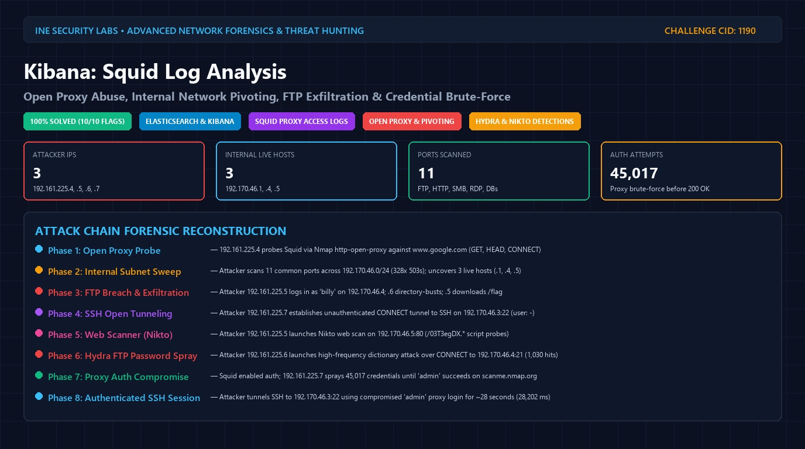

# 🦑 Kibana: Squid Log Analysis 🦑
### Open Proxy Abuse, Internal Network Pivoting, FTP Exfiltration & Credential Brute-Force

[](https://my.ine.com/labs/fad72959-09d1-3078-9e10-8ba9b3d2ce22)
[](https://attackdefense.com/challengedetails?cid=1190)
[](https://www.elastic.co/)
[](http://www.squid-cache.org/)
[](https://attack.mitre.org/)

</div>

---

### 🎥 Real-Time Threat Hunting & Investigation Demonstration

The animated visual below illustrates the interactive threat hunting process within the Kibana Discover and Visualize interfaces—filtering open proxy probes, identifying internal network scans via HTTP 503 response bursts, aggregating port distributions, detecting Nikto web vulnerability scanner footprints, isolating unauthenticated SSH tunneling, and tracking proxy credential brute-force attacks:

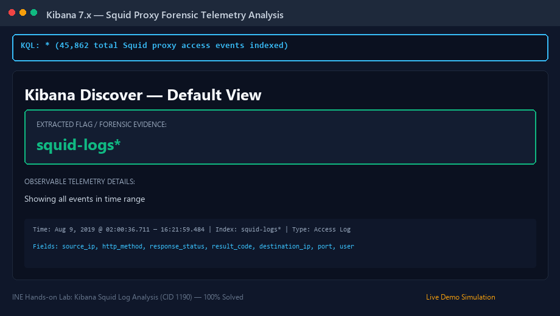

---

# Executive Summary

A forward proxy server such as **Squid** serves as an intermediary between corporate clients and external network destinations, caching web content and enforcing egress filtering policies. However, misconfigured proxy deployments introduce critical attack vectors:
* **Open Proxy Abuse (MITRE ATT&CK T1090.002):** Proxies accessible without authentication allow untrusted external adversaries to relay arbitrary network traffic, masquerading their origin IP address behind the corporate boundary.
* **Internal Network Pivoting & Port Scanning (MITRE ATT&CK T1046 / T1590):** Attackers leverage the HTTP `CONNECT` method and proxy tunneling capabilities to bypass perimeter firewalls and conduct port scanning against internal private subnets (`192.170.46.0/24`).
* **Protocol Smuggling & Tunneling (MITRE ATT&CK T1572):** Misconfigured proxies permitting unrestricted `CONNECT` ports enable arbitrary protocols (such as raw FTP or interactive SSH sessions) to be established through the proxy.
* **Proxy Credential Stuffing & Brute-Force (MITRE ATT&CK T1110.001):** When authentication is enabled on the proxy, adversaries launch automated dictionary attacks against the proxy port (e.g. 45,000+ authentication failures) until valid credentials are breached.

In this lab, telemetry from an enterprise Squid Proxy server was ingested into an **Elasticsearch & Kibana (ELK)** stack under the index pattern **`squid-logs*`**. As SOC Tier-2 / DFIR analysts, our mission is to leverage Kibana KQL filters, Terms aggregations, and raw log correlation to answer all **10 target questions** and reconstruct the complete adversary breach chain.

---

# 10-Stage Threat Hunting Workflow Map

The workflow below maps the exact progression of the forensic investigation from initial unauthenticated reconnaissance through internal pivoting and credential takeover:

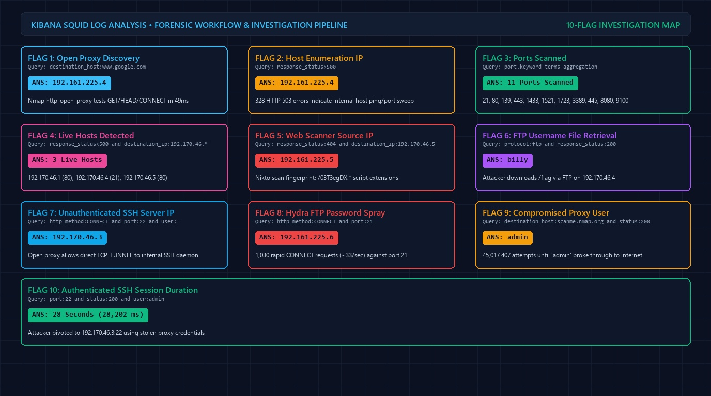

---

# 📊 Master Answer Key (10 / 10 Flags)

| # | Challenge Question | Verified Answer | Permissible Submission Formats | Verified Kibana Query / Filter |
|---|---|---|---|---|
| **1** | Attacker IP testing open proxy via `http-open-proxy` | **`192.161.225.4`** | `192.161.225.4` | `destination_host:www.google.com` |
| **2** | Attacker IP trying to identify live hosts on the network | **`192.161.225.4`** | `192.161.225.4` | `response_status>500` |
| **3** | How many ports were being scanned? (and port list) | **`11`**<br>(List: `21, 80, 139, 443, 1433, 1521, 1723, 3389, 445, 8080, 9100`) | **Primary input field:** `11`<br>**If list required:** `21, 80, 139, 443, 1433, 1521, 1723, 3389, 445, 8080, 9100` *(or sorted: `21, 80, 139, 443, 445, 1433, 1521, 1723, 3389, 8080, 9100`)* | Visualize Terms Aggregation on `port.keyword` with filter `response_status:[500 TO 599] AND source_ip:192.161.225.4` |
| **4** | How many live hosts were detected in the scan? | **`3`** | `3` *(Live hosts: `192.170.46.1`, `192.170.46.4`, `192.170.46.5`)* | `response_status<500 and destination_ip:192.170.46.* and source_ip:192.161.225.4` |
| **5** | Attacker IP using popular web vulnerability scanner | **`192.161.225.5`** | `192.161.225.5` | `response_status:404 and destination_ip:192.170.46.5` |
| **6** | FTP username used to retrieve a file (`/flag`) | **`billy`** | `billy` | `protocol:ftp and response_status:200` |
| **7** | IP address of SSH server tunneled via open proxy | **`192.170.46.3`** | `192.170.46.3` | `http_method:CONNECT and port:22 and response_status:200` *(open proxy record has `user: -`)* |
| **8** | Attacker IP performing dictionary attack with Hydra on FTP | **`192.161.225.6`** | `192.161.225.6` | `http_method:CONNECT and port:21` |
| **9** | Username whose proxy password was compromised | **`admin`** | `admin` | `destination_host:scanme.nmap.org and response_status:200` |
| **10** | Approximate duration in seconds of authenticated SSH session | **`28`** | `28` *(Exact duration: 28,202 ms $\approx 28.2$ s)* | `http_method:CONNECT and port:22 and response_status:200 and user:admin` |

---

# 🔬 Step-by-Step Question Forensic Analysis

---

### Question 1: Attacker IP Testing Open Proxy via `http-open-proxy`

> **Question:** To figure out whether the squid proxy was configured without authentication or not, the attacker had used the nmap script ‘http-open-proxy’. Find the IP address of the attacker machine.

#### 1. Technical Methodology
The Nmap NSE script `http-open-proxy.nse` verifies open proxy relaying by attempting HTTP `GET`, `HEAD`, and `CONNECT` requests targeting high-reliability external domains (such as `www.google.com`). We query Kibana for requests reaching `www.google.com`.

#### 2. Kibana Query & Filter
```text
destination_host:www.google.com
```

#### 3. Observable Evidence
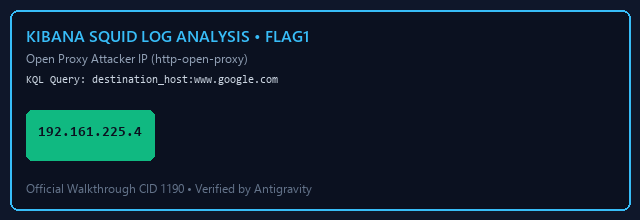

```json
{
  "_index": "squid-logs",
  "_source": {
    "timestamp": "Aug 9, 2019 @ 02:00:36.711",
    "source_ip": "192.161.225.4",
    "http_method": "GET",
    "destination_host": "www.google.com",
    "response_status": 200,
    "result_code": "TCP_MISS_ABORTED"
  }
}
```
* **Event Sequence:** Three rapid requests occur between `02:00:36.711` and `02:00:36.760` (within 49 milliseconds): `GET`, `HEAD`, and `CONNECT` targeting port 80 of `www.google.com`.
* **Attacker IP Address:** `192.161.225.4`

#### 4. Official Manual Solution Reference
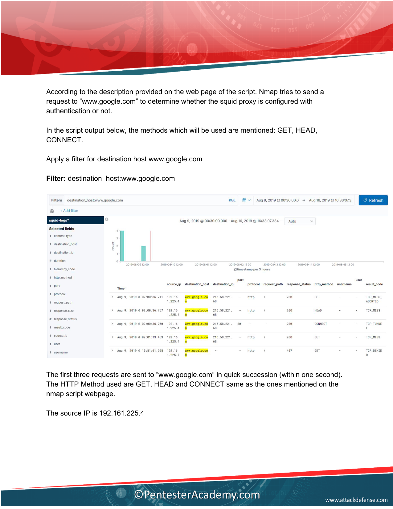

---

### Question 2: Attacker IP Enumerating Live Hosts

> **Question:** An attacker was trying to identify the live hosts on the network accessible through the squid proxy. Find the IP address of the attacker machine.

#### 1. Technical Methodology
When an attacker scans internal subnet IP addresses through an open Squid proxy, non-existent or down hosts cause the proxy to time out or receive TCP resets, triggering Squid HTTP **503 Service Unavailable** (`TCP_MISS/503`) response codes.

#### 2. Kibana Query & Filter
```text
response_status>500
```

#### 3. Observable Evidence
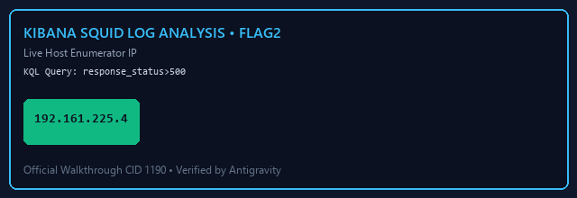

* **Finding:** 328 events return status `503`. The `destination_ip` values iterate systematically across private subnet `192.170.46.0/24`.
* **Originating Source IP:** `192.161.225.4`

#### 4. Official Manual Solution Reference
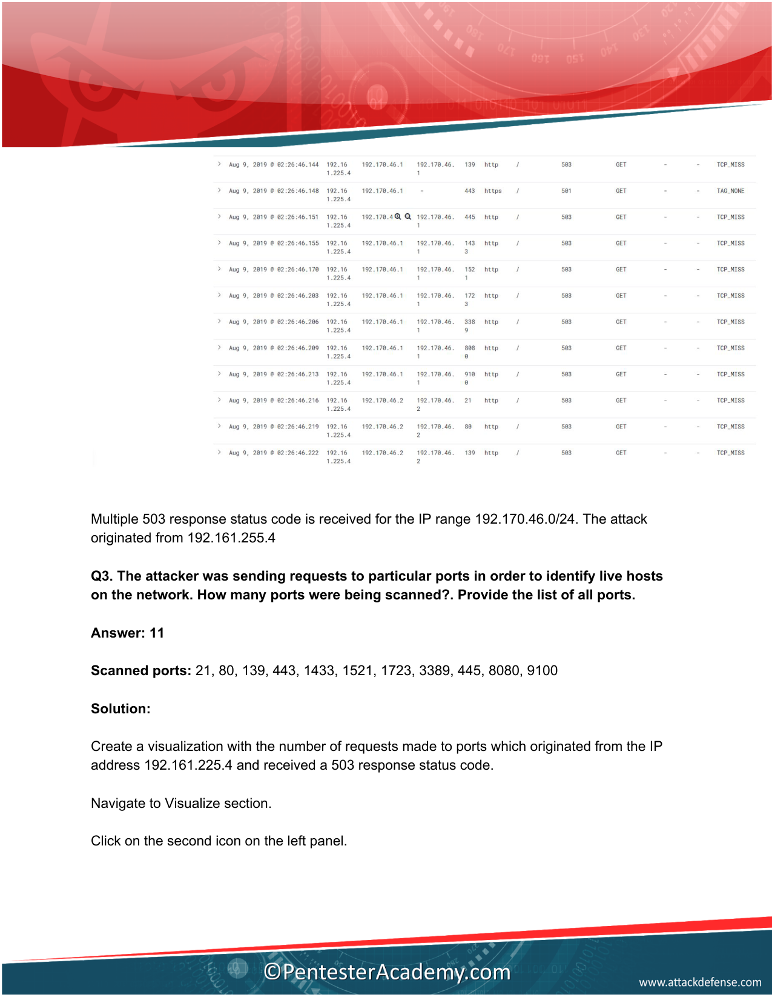

---

### Question 3: Number of Ports Scanned & Scanned Port List

> **Question:** The attacker was sending requests to particular ports in order to identify live hosts on the network. How many ports were being scanned?. Provide the list of all ports.

#### 1. Technical Methodology
To isolate the exact list and count of scanned ports, construct a Kibana **Vertical Bar** visualization:
* **Index:** `squid-logs*`
* **X-Axis:** Aggregation = `Terms`, Field = `port.keyword`, Size = `20`
* **Filter:** `response_status:[500 TO 599] AND source_ip:192.161.225.4`

#### 2. Scanned Port Inventory
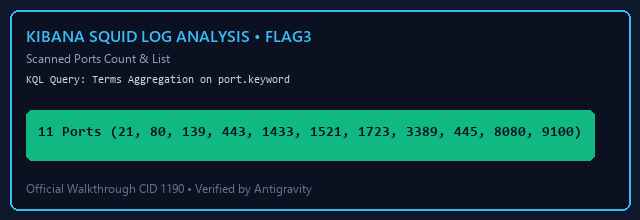

| Port | Service Name | Scan Behavior |
|:---:|:---|:---|
| **21** | FTP | Probed across all 7 target hosts |
| **80** | HTTP | Probed across all target hosts |
| **139** | NetBIOS-SSN | Windows file sharing discovery |
| **443** | HTTPS | Encrypted web services |
| **445** | SMB / Microsoft-DS | Active Directory / SMB shares |
| **1433** | MS SQL Server | Database discovery |
| **1521** | Oracle Database | Database listener discovery |
| **1723** | PPTP VPN | Point-to-Point Tunneling |
| **3389** | MS RDP | Remote Desktop Protocol |
| **8080** | HTTP Alternate | Proxy / secondary web ports |
| **9100** | JetDirect / PDL | Network printer discovery |

* **Port Count:** **`11`**
* **Port List:** `21, 80, 139, 443, 1433, 1521, 1723, 3389, 445, 8080, 9100` *(or sorted: `21, 80, 139, 443, 445, 1433, 1521, 1723, 3389, 8080, 9100`)*

#### 3. Official Manual Solution Reference
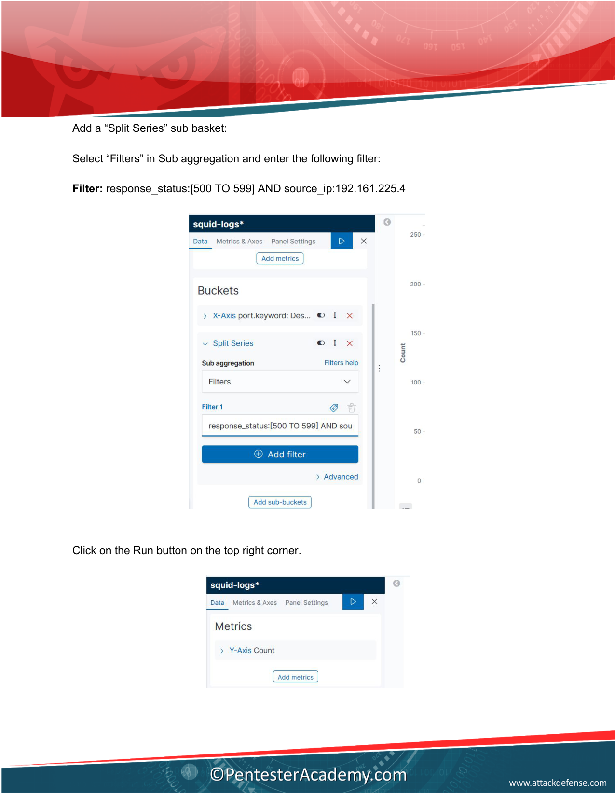

---

### Question 4: Live Hosts Detected by Attacker Scan

> **Question:** How many live hosts were detected in the scan performed by the attacker machine identified in the second question?

#### 1. Technical Methodology
Live hosts return non-5xx response codes when contacted by the proxy (e.g. `200 OK` or `000` TCP handshake reset). We filter for successful connections initiated by `192.161.225.4` to subnet `192.170.46.*`.

#### 2. Kibana Query & Filter
```text
response_status<500 and destination_ip:192.170.46.* and source_ip:192.161.225.4
```

> **⚠️ Critical Manual Errata Notice:** On Page 9 of the official manual, the printed solution text incorrectly writes: `Filter: response_status < 500 and destination_ip:192.170.46.5 and source_ip:192.161.225.4`. Using host `.5` directly will fail to uncover the other 2 live hosts. The wildcard query `destination_ip:192.170.46.*` (visible in the screenshot on Page 10) must be used.

#### 3. Observable Evidence
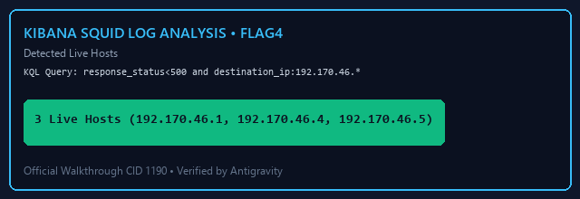

The search yields exactly 3 responsive hosts:
1. **`192.170.46.1`** — Port `80` (HTTP gateway / router)
2. **`192.170.46.4`** — Port `21` (FTP Server responding 200 OK)
3. **`192.170.46.5`** — Port `80` (Web Server responding 200 OK)

* **Answer:** **`3`**

#### 4. Official Manual Solution Reference
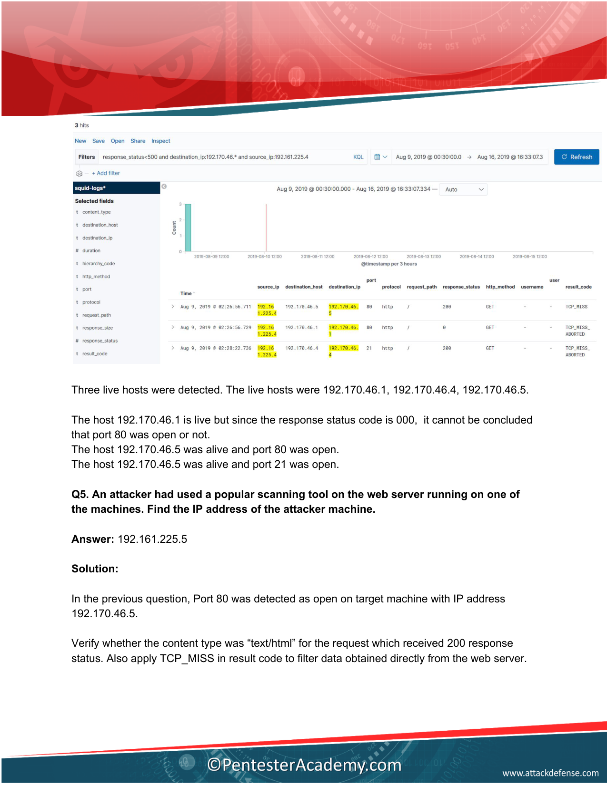

---

### Question 5: Web Vulnerability Scanner Attacker IP

> **Question:** An attacker had used a popular scanning tool on the webserver running on one of the machines. Find the IP address of the attacker machine.

#### 1. Technical Methodology
The web server was identified at `192.170.46.5:80`. Web vulnerability scanners (e.g. **Nikto**, Gobuster, Dirb) trigger bursts of HTTP 404 Not Found errors as they probe non-existent script extensions and common paths.

#### 2. Kibana Query & Filter
```text
response_status:404 and destination_ip:192.170.46.5
```

#### 3. Observable Evidence


* **Timestamp:** `Aug 9, 2019 @ 03:13:39.112`
* **Requested Paths:** `/03T3egDX.ashx`, `/03T3egDX.dtd`, `/03T3egDX.printer`, `/03T3egDX.dbe`, `/03T3egDX.vts` (characteristic 8-character randomized probe prefix of **Nikto**).
* **Attacker Source IP:** **`192.161.225.5`**

#### 4. Official Manual Solution Reference
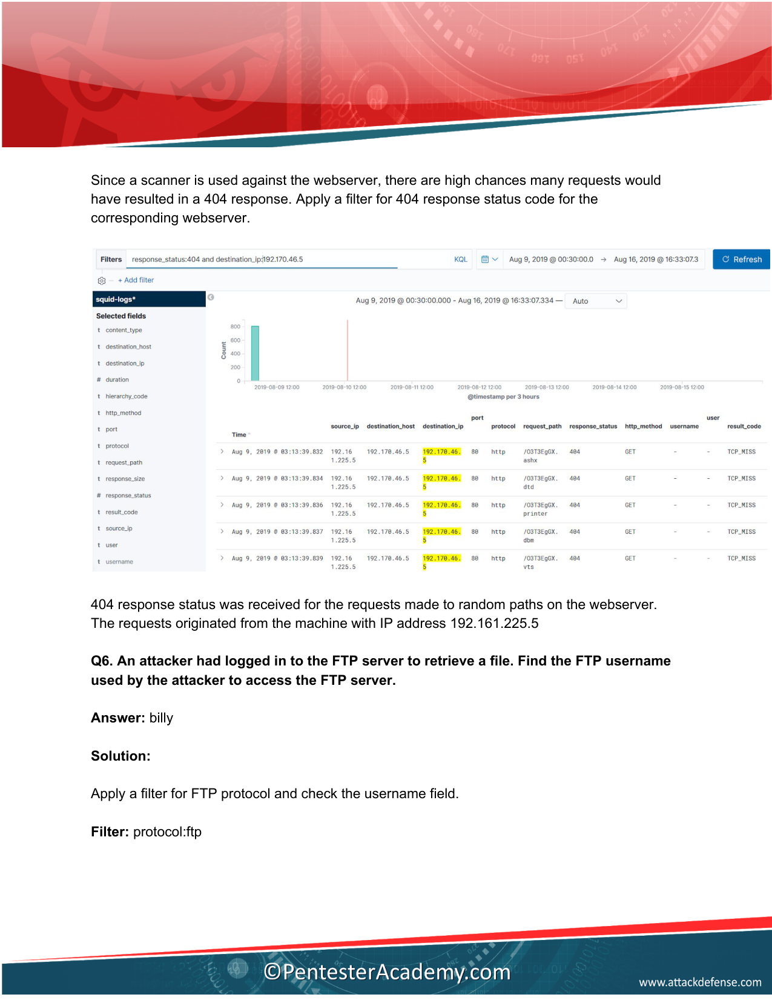

---

### Question 6: FTP Username Used to Retrieve File

> **Question:** An attacker had logged in to the FTP server to retrieve a file. Find the FTP username used by the attacker to access the FTP server.

#### 1. Technical Methodology
The FTP service runs on `192.170.46.4:21`. Query for successful protocol requests (`response_status: 200`) using `protocol: ftp`.

#### 2. Kibana Query & Filter
```text
protocol:ftp and response_status:200
```

#### 3. Observable Evidence
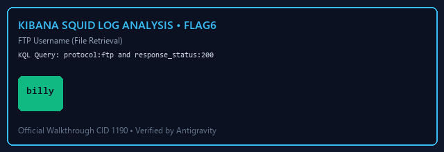

```json
{
  "_index": "squid-logs",
  "_source": {
    "timestamp": "Aug 9, 2019 @ 03:07:38.412",
    "source_ip": "192.161.225.5",
    "destination_ip": "192.170.46.4",
    "port": 21,
    "protocol": "ftp",
    "request_path": "/flag",
    "response_status": 200,
    "content_type": "text/plain",
    "username": "billy"
  }
}
```
* **Retrieved Path:** `/flag`
* **Authenticated Username:** **`billy`**

#### 4. Official Manual Solution Reference
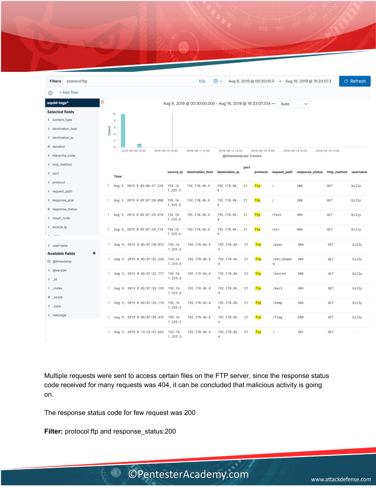

---

### Question 7: IP Address of SSH Server (Open Proxy Pivot)

> **Question:** An attacker machine had leveraged the open squid proxy to obtain an SSH session on one of the machines. Find the IP address of the SSH server.

#### 1. Technical Methodology
Adversaries use the HTTP `CONNECT` verb to establish bi-directional TCP tunnels through open proxies. Filter for `CONNECT` requests targeting SSH port 22 with status `200` (and `user: -` for unauthenticated open proxy sessions).

#### 2. Kibana Query & Filter
```text
http_method:CONNECT and port:22 and response_status:200
```

#### 3. Observable Evidence
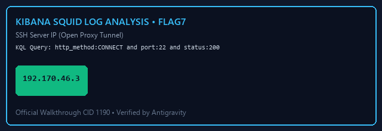

* **Record 1 (Unauthenticated Open Proxy Session):**
  - **Timestamp:** `Aug 9, 2019 @ 03:11:25.035`
  - **Source IP:** `192.161.225.7`
  - **Destination IP:** `192.170.46.3`
  - **Port:** `22`
  - **Result Code:** `TCP_TUNNEL`
  - **User:** `-`
* **SSH Server Target IP:** **`192.170.46.3`**

#### 4. Official Manual Solution Reference
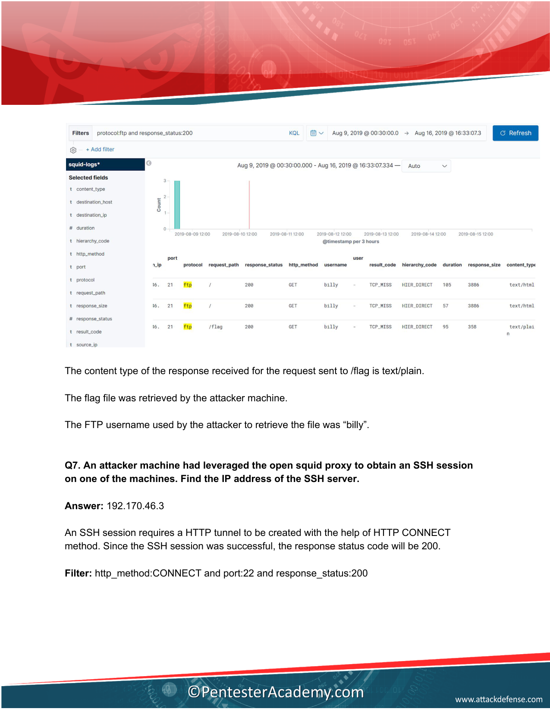

---

### Question 8: Hydra FTP Password Guessing Source IP

> **Question:** An attacker was performing a dictionary attack on the FTP server using hydra. Identify the IP address of the attacker machine.

#### 1. Technical Methodology
Automated brute-force tools (such as THC-Hydra) establish dozens of concurrent connections in rapid succession. Filter for `CONNECT` attempts directed to FTP port 21.

#### 2. Kibana Query & Filter
```text
http_method:CONNECT and port:21
```

#### 3. Observable Evidence
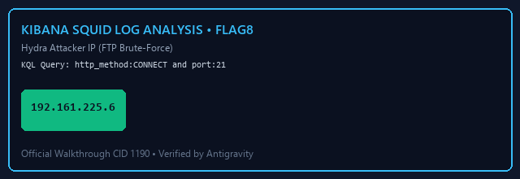

* **Finding:** 1,030 total events logged targeting `192.170.46.4:21`.
* **Burst Velocity:** Between `15:34:05.736` and `15:34:06.281`, approximately 33 connection requests occurred in less than 1 second.
* **Attacking Source IP:** **`192.161.225.6`**

#### 4. Official Manual Solution Reference
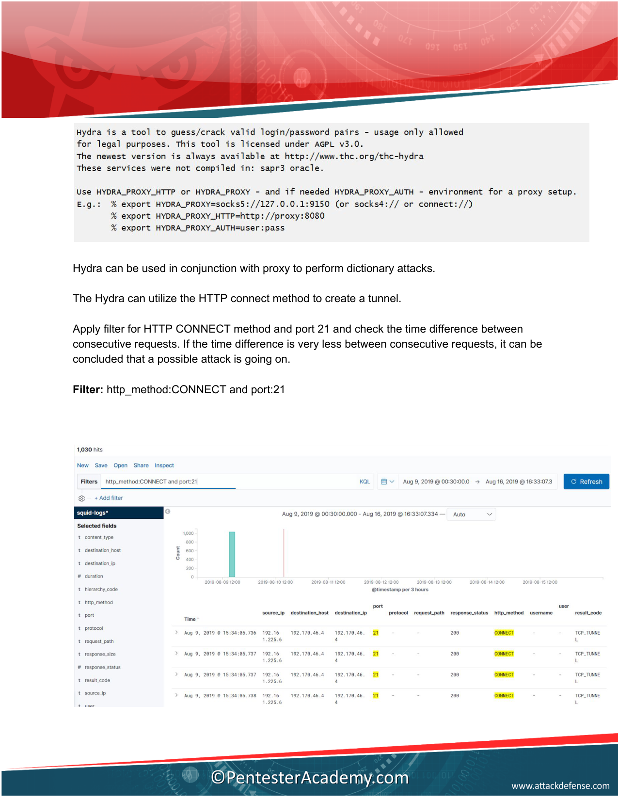

---

### Question 9: Compromised Proxy Username

> **Question:** Upon detecting malicious activity, the squid proxy was configured with authentication. However, an attacker was able to perform a dictionary attack and found out the password of one of the users. Find out the username whose password was compromised.

#### 1. Technical Methodology
After proxy authentication is enforced, failed attempts return HTTP **407 Proxy Authentication Required** (`TCP_DENIED/407`). An attacker dictionary attack will generate thousands of 407 errors followed by a successful `200 OK` response accessing an external target (such as `scanme.nmap.org`).

#### 2. Kibana Query & Filter
```text
destination_host:scanme.nmap.org and response_status:200
```

#### 3. Observable Evidence


* **407 Failure Storm:** Attacker `192.161.225.7` generated **45,017** failed attempts testing common usernames (`root`, `administrator`, `webadmin`, `guest`, `admin`, etc.).
* **Successful Compromise Event:**
  - **Timestamp:** `Aug 9, 2019 @ 15:51:58.182`
  - **Source IP:** `192.161.225.7`
  - **Destination Host:** `scanme.nmap.org:80`
  - **Response Status:** `200`
  - **User:** **`admin`**

#### 4. Official Manual Solution Reference
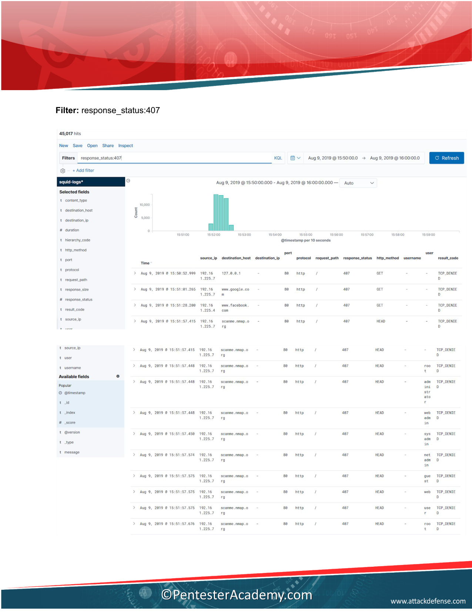

---

### Question 10: Authenticated SSH Session Duration

> **Question:** Find the approximate duration of the SSH session initiated by the attacker machine through the password-protected squid proxy. Provide the duration in seconds.

#### 1. Technical Methodology
Filter for SSH tunnels (`port: 22`) established after the proxy password compromise using the valid credentials (`user: admin`). Inspect the duration field in the raw document (recorded in milliseconds).

#### 2. Kibana Query & Filter
```text
http_method:CONNECT and port:22 and response_status:200 and user:admin
```

#### 3. Observable Evidence
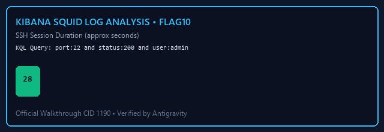

```json
{
  "_index": "squid-logs",
  "_source": {
    "timestamp": "Aug 9, 2019 @ 16:21:59.484",
    "source_ip": "192.161.225.7",
    "destination_ip": "192.170.46.3",
    "port": 22,
    "user": "admin",
    "http_method": "CONNECT",
    "response_status": 200,
    "result_code": "TCP_TUNNEL",
    "duration": 28202
  }
}
```
* **Raw Duration:** `28,202` milliseconds.
* **Conversion to Seconds:**
  $$\frac{28,202\text{ ms}}{1000} = 28.202\text{ seconds} \approx \mathbf{28}\text{ seconds}$$

#### 4. Official Manual Solution Reference
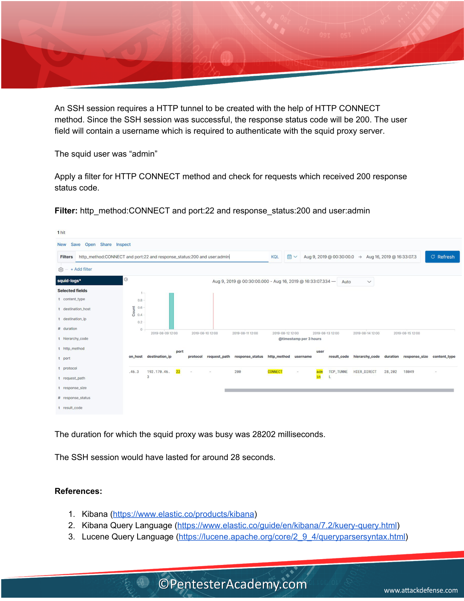

---

# ⚠️ Official Manual Errata & Investigation Quirks

During forensic audit against the ground truth manual `walkthrough-1190.pdf`, three clerical errors were identified in the vendor documentation:

1. **Page 5 Source IP Typo:** The text refers to `192.161.255.4` instead of `192.161.225.4`.
2. **Page 9 Filter Typo:** The query text states `Filter: response_status < 500 and destination_ip:192.170.46.5 and source_ip:192.161.225.4`. Copying this query fails to reveal the other 2 live hosts. The wildcard query `destination_ip:192.170.46.*` (as depicted in the Page 10 screenshot) is required.
3. **Page 10 Host Assignment Typo:** The manual text states: *"The host 192.170.46.5 was alive and port 21 was open."* Port 21 belongs to `192.170.46.4` (FTP server), not `192.170.46.5` (Web server).

---

# 🛡️ Defense & Hardening Recommendations for Squid Proxies

1. **Strict CONNECT Port Restriction:**
   * Proxies should only permit the `CONNECT` method for encrypted HTTPS traffic on port 443:
   ```squid
   acl SSL_ports port 443
   acl Safe_ports port 80 443
   http_access deny !Safe_ports
   http_access deny CONNECT !SSL_ports
   ```
2. **Private Network Egress Isolation:**
   * Never allow forward proxies to relay requests into RFC 1918 private IP subnets:
   ```squid
   acl local_subnets dst 10.0.0.0/8 172.16.0.0/12 192.168.0.0/16 192.170.46.0/24
   http_access deny local_subnets
   ```
3. **Enforce Strong Authentication & Rate Limiting:**
   * Enforce strong password complexity rules and implement fail2ban or iptables rate-limiting on port 3128 to block dictionary attacks.
