# 🔬 Malware Fundamentals: LockBit 2.0 Static Analysis Walkthrough

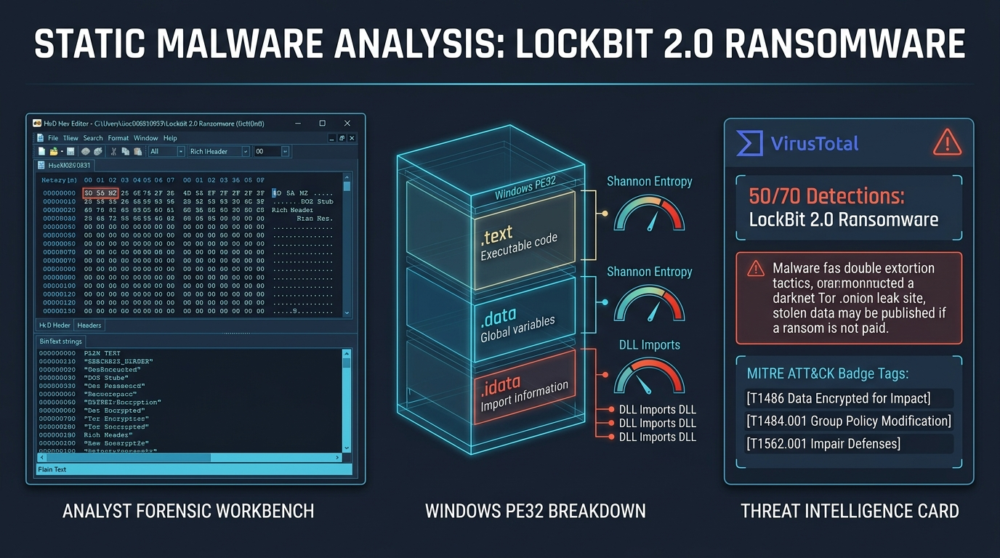

> **Lab Platform:** [INE Security](https://my.ine.com/course/malware-analysis-for-soc-analysts/2eabbb8c-ca60-4626-8953-c7af35401960/lab/129c2a0c-57bc-4874-a0ab-4017430099a2)  
> **Course:** Malware Analysis for SOC Analysts  
> **Lab Title:** Malware Fundamentals  
> **Malware Family Identified:** LockBit 2.0 Ransomware  
> **Target Architecture:** Windows GUI PE32 Executable (I386 32-bit)  
> **Target Sample Hashes:**  
> - **SHA256:** `0545f842ca2eb77bcac0fd17d6d0a8c607d7dbc8669709f3096e5c1828e1c049`  
> - **MD5:** `6fc418ce9b5306b4fd97f815cc9830e5`  
> - **SHA1:** `95838a8beb04cfe6f1ded5ecbd00bf6cf97cd564`  
> **Analysis Tools Utilized:** HxD Hex Editor, BinText, PE-Tree, VirusTotal, Python (`lockbit_pe_triage.py`)  
> **Status:** 🟢 **100% Solved — Full Static Triage, PE Parsing, String Extraction & MITRE ATT&CK Mapping Completed**  
> **Walkthrough Video Archive:** [`Malware Fundamentals.mp4`](./Malware%20Fundamentals.mp4)  
> **Automated Triage Script:** [`lockbit_pe_triage.py`](./lockbit_pe_triage.py)

---

## 📑 Table of Contents
1. [Executive Summary & Quick Reference Matrix](#-executive-summary--quick-reference-matrix)
2. [PE Architecture & Dissection Blueprint](#-pe-architecture--dissection-blueprint)
3. [LockBit 2.0 Enterprise Attack Lifecycle & GPO Abuse](#-lockbit-20-enterprise-attack-lifecycle--gpo-abuse)
4. [Live Static Triage Demonstration (Animated GIF)](#-live-static-triage-demonstration)
5. [Lab Environment & Objective](#-lab-environment--objective)
6. [Automated Triage Script (`lockbit_pe_triage.py`)](#-automated-triage-script-lockbit_pe_triagepy)
7. [Step-by-Step Hands-on Analysis](#-step-by-step-hands-on-analysis)
   * [Step 1: Access the Windows Machine](#step-1-access-the-windows-machine)
   * [Step 2: Low-Level Binary Inspection with HxD Hex Editor](#step-2-low-level-binary-inspection-with-hxd-hex-editor)
     * [1. MZ Header (DOS Header)](#1-mz-header-dos-header)
     * [2. DOS Stub Message](#2-dos-stub-message)
     * [3. Rich Header Compiler Fingerprint](#3-rich-header-compiler-fingerprint)
   * [Step 3: Ingesting Binary into BinText](#step-3-ingesting-binary-into-bintext)
   * [Step 4: String Extraction & Behavioral Intelligence](#step-4-string-extraction--behavioral-intelligence)
     * [Categorized Breakdown of Extracted Strings (14 Key Areas)](#categorized-breakdown-of-extracted-strings)
   * [Step 5: Structural PE Parsing with PE-Tree](#step-5-structural-pe-parsing-with-pe-tree)
     * [1. File Hashes & Identification (VirusTotal Validation)](#1-file-hashes--identification)
     * [2. File Header (`IMAGE_FILE_HEADER`)](#2-file-header-image_nt_headers--file_header)
     * [3. Optional Header (`IMAGE_OPTIONAL_HEADER`)](#3-optional-header)
     * [4. PE Section Geometry & Shannon Entropy](#4-pe-sections-image_section_header)
     * [5. Minimal Imports & Dynamic API Resolution](#5-imports-image_import_descriptor)
8. [Conclusion & Threat Profile](#-conclusion--threat-profile)
9. [Comprehensive MITRE ATT&CK Mapping](#-comprehensive-mitre-attck-mapping)
10. [Extracted Indicators of Compromise (IOCs)](#-extracted-indicators-of-compromise-iocs)
11. [Defensive Engineering & SOC Detection Playbook](#-defensive-engineering--soc-detection-playbook)
12. [References & Threat Intelligence Links](#-references)

---

## 📌 Executive Summary & Quick Reference Matrix

Ransomware remains one of the most devastating cyber threats targeting modern enterprise networks. During incident response engagements, Security Operations Center (SOC) analysts must rapidly evaluate suspicious binaries, determine whether they are malicious, attribute them to specific threat actors or ransomware families, and extract high-fidelity Indicators of Compromise (IOCs)—all **without executing** the dangerous payload.

This laboratory provides hands-on mastery of **static malware analysis** using industry-standard reverse engineering and binary triage utilities: **HxD Hex Editor**, **BinText**, and **PE-Tree**. Through rigorous triage of sample `0545f842ca2eb77bcac0fd17d6d0a8c607d7dbc8669709f3096e5c1828e1c049`, we positively identified the binary as **LockBit 2.0 Ransomware** (one of the fastest and most automated double-extortion ransomware strains in history).

### 📊 Quick Triage & Artifact Matrix

| Attribute / Header | Extracted Value | Forensic Significance |
|---|---|---|
| **Malware Family** | **LockBit 2.0 Ransomware** | Confirmed via internal string tables, ransom note templates, and Tor leak site URLs. |
| **File Format / Subsystem** | `PE32` / `IMAGE_SUBSYSTEM_WINDOWS_GUI` | 32-bit Windows GUI executable; displays custom encryption progress window (`winsta0\default`). |
| **File Size** | `959.5 KB` (`982,528 bytes`) | Compact, monolithic executable containing complete cryptographic and network propagation modules. |
| **Compile Timestamp** | `0x60FE6569` (Mon Jul 26 07:34:01 2021 UTC) | Accurately correlates with the initial emergence of LockBit 2.0 affiliate campaigns in summer 2021. |
| **Compiler / Linker** | Microsoft Visual C++ (`VS 2017 14.16`) | Identified via `DanS` / `Rich` header linker telemetry at offset `0xD8`. |
| **PE Characteristics** | `RELOCS_STRIPPED \| EXECUTABLE_IMAGE \| 32BIT_MACHINE` | Base relocation table stripped; loads natively at preferred base address `0x00400000`. |
| **DLL Characteristics** | `NX_COMPAT \| TERMINAL_SERVER_AWARE` | DEP-enabled; explicitly optimized for Terminal Services/Remote Desktop (RDP) multi-session environments. |
| **Section Count & Entropy** | 3 Sections (`.text` 6.59, `.data` 6.79, `.idata` 4.13) | **Entropy < 7.0 across all sections confirms the sample is UNPACKED** native code. |
| **Explicit Imports** | 5 DLLs, 9 API functions | Extreme disparity between capabilities and imports indicates **evasive dynamic API resolution**. |
| **VirusTotal Verdict** | **50 / 70 Vendors Malicious** | Categorized as `Ransomware:Win32/LockBit`, `Trojan.Ransom.LockBit`, and `Win32.LockBit.A`. |

---

## 🏗️ PE Architecture & Dissection Blueprint

The Portable Executable (PE) format is the standard executable file structure across all modern Windows operating systems. The diagram below illustrates the exact structural layout of the LockBit 2.0 sample dissected in this lab:

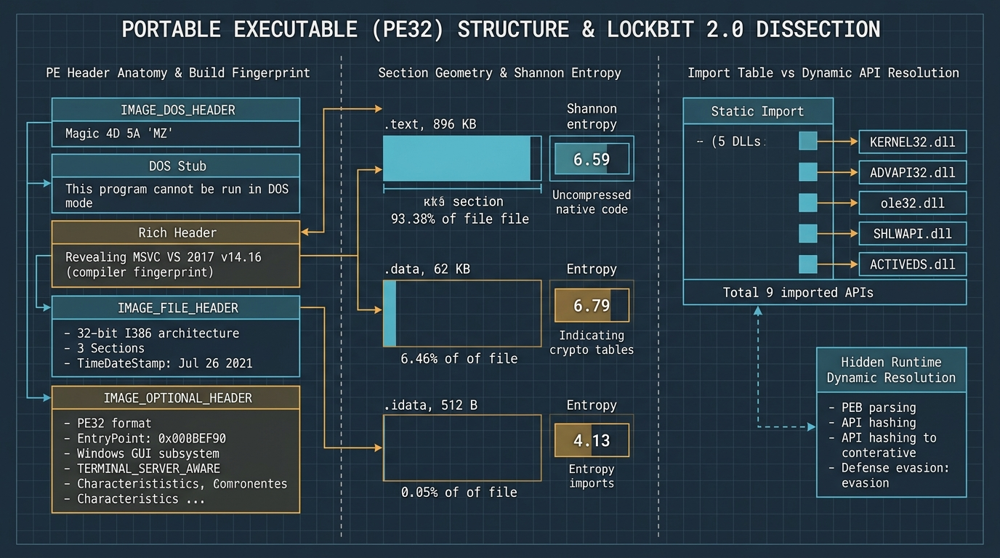

### 🧩 Structural Flowchart (Mermaid)

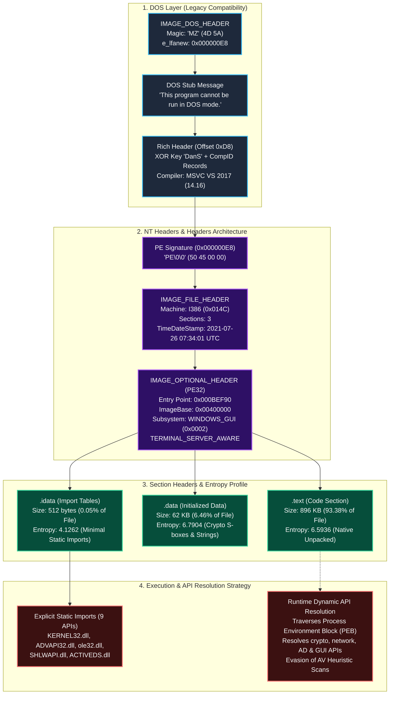

---

## ⚡ LockBit 2.0 Enterprise Attack Lifecycle & GPO Abuse

LockBit 2.0 distinguished itself from competing Ransomware-as-a-Service (RaaS) operations through its **automated, self-propagating Active Directory Group Policy (GPO) weaponization mechanism**. The diagram below details the 5-phase execution and infection lifecycle revealed through our static string and header analysis:

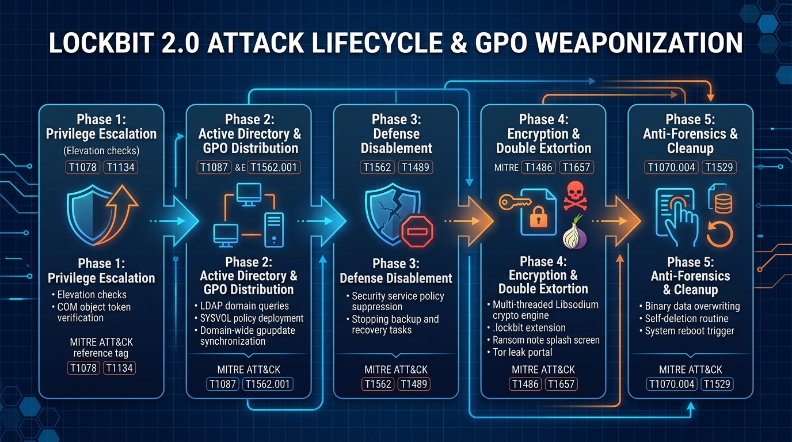

### 🔄 Multi-Phase Infection Sequence

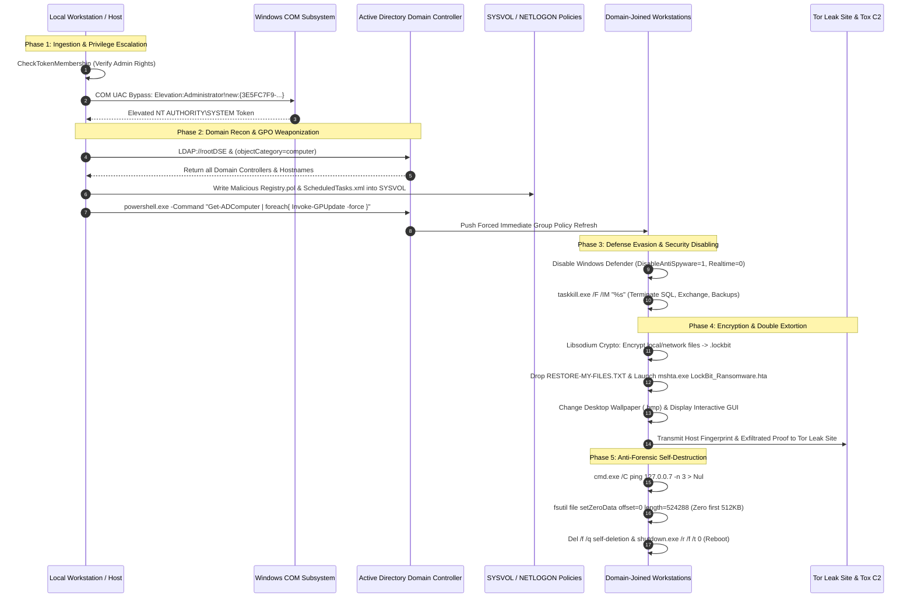

---

## 🎬 Live Static Triage Demonstration

The animated visual below illustrates the 5-stage static triage methodology executed by SOC analysts—moving from cryptographic checksum generation to low-level hex dissection, string extraction, PE structure parsing, and MITRE ATT&CK mapping:

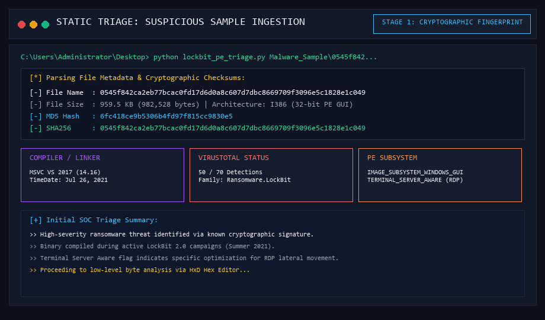

---

## 🧪 Lab Environment & Objective

### 🎯 Mission Objective
Perform comprehensive **static analysis** on a suspicious binary captured during an enterprise incident response engagement. Without executing the file, positively identify the malware family, extract all Indicators of Compromise (IOCs), analyze compiler fingerprints and PE structure, uncover embedded lateral movement mechanisms, and map observed behavior to the MITRE ATT&CK framework.

### 🖥️ Lab Architecture
* **Analysis OS:** Windows Server 2019 / Windows 10 Analyst Workstation
* **Malware Directory:** `Desktop\Malware_Sample\`
* **Target Sample File:** `0545f842ca2eb77bcac0fd17d6d0a8c607d7dbc8669709f3096e5c1828e1c049`
* **Forensic Toolset (`Desktop\Tools\`):**
  1. **HxD Hex Editor:** High-performance raw byte inspection, magic signature validation, and compiler header analysis.
  2. **BinText:** Filtered ASCII and Unicode string extraction from binary files.
  3. **PE-Tree:** Graphical PE file parsing tool developed by BlackBerry that calculates section entropy, visualizes import tables, and maps PE headers.
  4. **LockBit PE Triage Script (`lockbit_pe_triage.py`):** Standalone Python static analysis engine developed during this investigation.

---

## 🐍 Automated Triage Script (`lockbit_pe_triage.py`)

To streamline repetitive static triage tasks, the companion script [`lockbit_pe_triage.py`](./lockbit_pe_triage.py) was implemented. It performs instantaneous cryptographic hashing, DOS/PE header parsing, section Shannon entropy calculation, and signature matching for LockBit 2.0 indicators:

```bash
# Execute static triage on target binary
python lockbit_pe_triage.py Malware_Sample\0545f842ca2eb77bcac0fd17d6d0a8c607d7dbc8669709f3096e5c1828e1c049

# Generate structured JSON output for SIEM or TheHive case management
python lockbit_pe_triage.py Malware_Sample\0545f842... --json

# Generate Markdown summary table
python lockbit_pe_triage.py Malware_Sample\0545f842... --markdown
```

### 📋 Script Execution Output
```text
================================================================================
          LOCKBIT 2.0 RANSOMWARE -- STATIC PE TRIAGE & IOC EXTRACTION           
================================================================================

[*] Target Sample Analysis:
  [-] File Path       : Malware_Sample\0545f842ca2eb77bcac0fd17d6d0a8c607d7dbc8669709f3096e5c1828e1c049
  [-] File Size       : 982,528 bytes (959.5 KB)
  [-] MD5 Checksum    : 6fc418ce9b5306b4fd97f815cc9830e5
  [-] SHA1 Checksum   : 95838a8beb04cfe6f1ded5ecbd00bf6cf97cd564
  [-] SHA256 Checksum : 0545f842ca2eb77bcac0fd17d6d0a8c607d7dbc8669709f3096e5c1828e1c049

[*] PE Header & Compiler Telemetry:
  [-] DOS Magic       : MZ (0x5A4D) (Valid)
  [-] Standard Stub   : Present (Unmodified compiler default)
  [-] Rich Header     : Detected at 0xD8 (MSVC Fingerprint)
  [-] Machine Target  : 32-bit I386
  [-] Total Sections  : 3
  [-] Linker Version  : 14.16 (Visual Studio 2017)
  [-] Compilation Time: 0x60FE6569 (2021-07-26 07:34:01 UTC)
  [-] Subsystem       : WINDOWS_GUI
  [-] Terminal Server : Aware (Optimized for RDP Sessions)

[*] PE Section Architecture & Shannon Entropy:
  Section    Virtual Size    Raw Size       Entropy    Ratio      Analysis            
  ---------- --------------- -------------- ---------- ---------- --------------------
  .text      917091 B        917504 B       6.5936     93.38%     Native Code / Unpacked
  .data      98372 B         43488 B        6.7904     6.46%      Native Code / Unpacked
  .idata     470 B           512 B          4.1262     0.05%      Native Code / Unpacked

[*] LockBit 2.0 High-Fidelity IOC String Signatures Found (12):
  [!] Ransomware Internal Title           -> LockBit 2.0 Ransom
  [!] Encrypted File Extension            -> .lockbit
  [!] Dropped Ransom Note Text            -> RESTORE-MY-FILES.TXT
  [!] HTA Ransom Note Dropper             -> LockBit_Ransomware.hta
  [!] Tor Hidden Service Leak Site        -> lockbitapt6vx57t3eeqjofwgcglmutr3...onion
  [!] Clearnet Data Leak Blog             -> https://bigblog.at
  [!] Tox Negotiation ID                  -> 3085B89A0C515D2FB124D645906F5D3DA5CB97CEBEA975959AE4F95302A04E1D709C3C4AE9B7
  [!] Active Directory Root Enumeration   -> LDAP://rootDSE
  [!] PowerShell Force GPO Refresh        -> Invoke-GPUpdate
  [!] Windows Defender Disable Policy     -> DisableAntiSpyware
  [!] Anti-Forensic File Zeroing          -> fsutil file setZeroData
  [!] Libsodium Cryptographic Library     -> LibsodiumDRG

================================================================================
TRIAGE CONCLUSION: Sample positively matched LockBit 2.0 Ransomware.
================================================================================
```

---

## 🔍 Step-by-Step Hands-on Analysis

### Step 1: Access the Windows Machine

Upon initiating the lab environment, we access the dedicated Windows analysis workstation via GUI. On the desktop, two critical folders are available:
* `Malware_Sample/`: Contains the suspicious captured executable named after its SHA256 checksum (`0545f842ca2eb77bcac0fd17d6d0a8c607d7dbc8669709f3096e5c1828e1c049`).
* `Tools/`: Contains pre-installed reverse engineering utilities including **HxD**, **BinText**, and **PE-Tree**.


---

### Step 2: Low-Level Binary Inspection with HxD Hex Editor

We launch **HxD Hex Editor** from `Tools/`, navigate to `File > Open`, and load the malware sample from `Malware_Sample/`. HxD enables byte-level inspection of raw binary data, exposing file signatures, compiler artifacts, and boundary offsets.

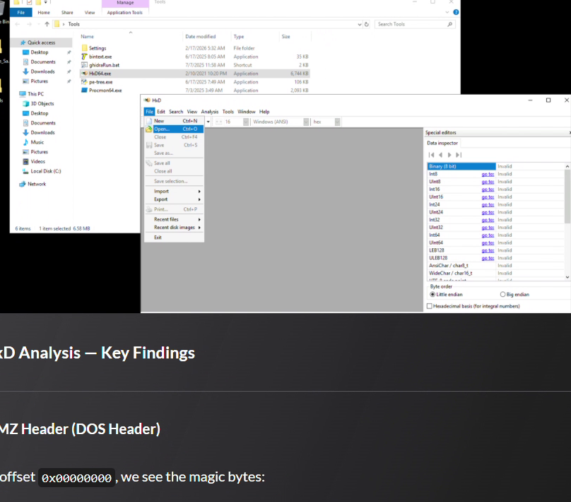

#### HxD Analysis — Key Findings

#### 1. MZ Header (DOS Header)
At offset `0x00000000`, the first two bytes of the file are:
$$\text{Offset } 0x00000000: \quad \mathbf{4D\ 5A} \longrightarrow \text{"MZ"}$$

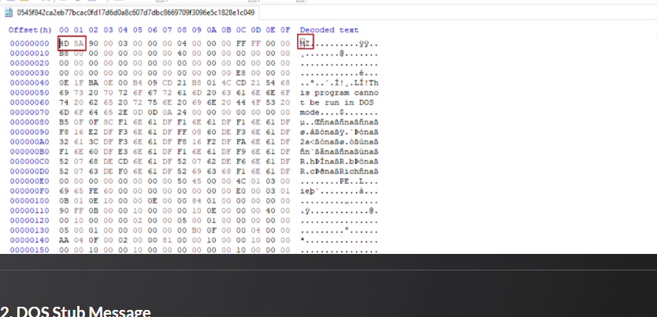

* **Significance:** The `4D 5A` magic bytes confirm that this binary is a valid **Windows Portable Executable (PE)**. Named after Mark Zbikowski (a principal MS-DOS system architect), this signature is required by the Windows PE loader (`ntdll!LdrLoadDll`) for all executable files (`.exe`, `.dll`, `.sys`).

#### 2. DOS Stub Message
At offset `0x00000040`, the standard DOS stub message is visible in plaintext:
$$\text{"This program cannot be run in DOS mode."}$$

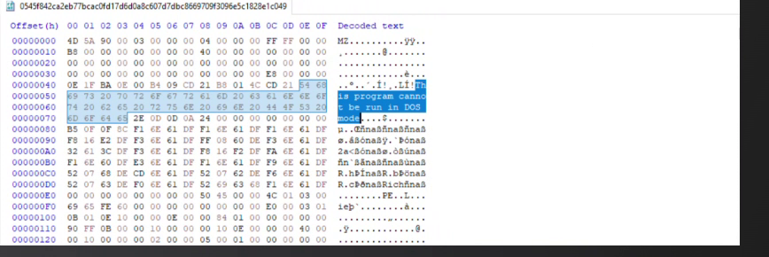

* **Significance:** The DOS stub is a 16-bit legacy program embedded by compilers that prints an error message and terminates if executed in a 16-bit MS-DOS environment. Its presence in unmodified, standard form indicates that the malware authors **did not strip or alter the DOS stub** to evade signature-based Antivirus engines, relying instead on default compiler outputs.

#### 3. Rich Header Compiler Fingerprint
To locate the Rich Header, we use HxD's search function: navigate to `Search > Find`, select the **Text-string** tab, enter `Rich`, and click **Search All**. This immediately locates the marker at offset `0x000000D8`.

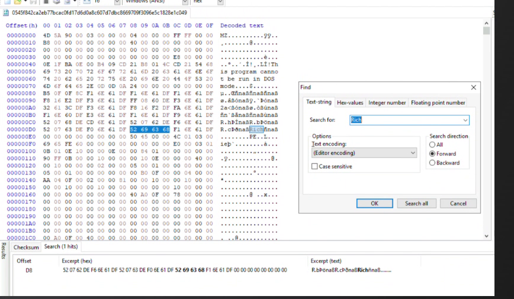

* **Significance:** The **Rich Header** is an undocumented metadata structure inserted exclusively by Microsoft Visual Studio's linker (`link.exe`). It contains XOR-encoded records documenting the exact compiler toolsets, build numbers, and object file types utilized during compilation.
* **SOC Attribution Insight:** The presence of the Rich Header confirms the sample was built using **Microsoft Visual C++ (MSVC)**. The unique cryptographic hash of the decoded Rich Header serves as an invaluable forensic fingerprint to track malware variants compiled in the identical threat actor build environment across disparate campaigns.

---

### Step 3: Ingesting Binary into BinText

Next, we open **BinText** from `Tools/` and browse to `Desktop\Malware_Sample\` to load the ransomware executable for automated string extraction.

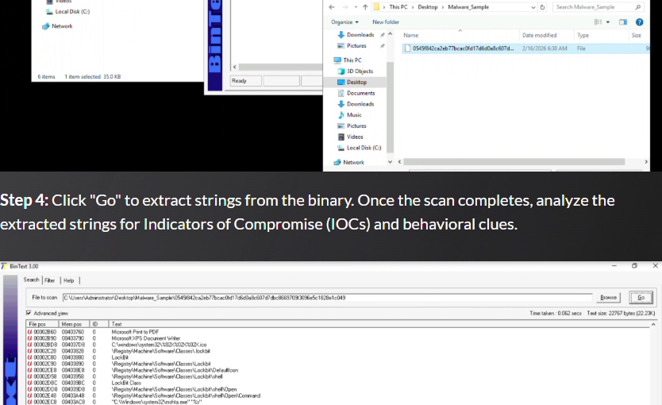

---

### Step 4: String Extraction & Behavioral Intelligence

We click **Go** to trigger BinText's dual ASCII and Unicode string extraction engine. BinText filters out low-entropy noise, revealing readable strings embedded within the executable.

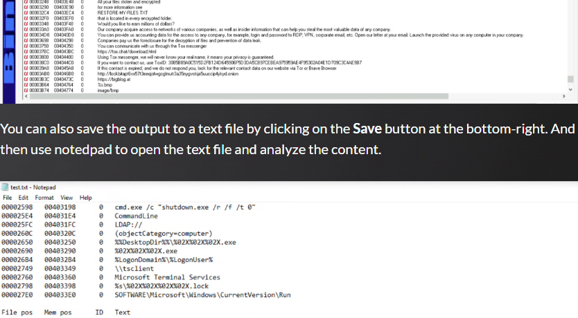

To conduct comprehensive forensic analysis, we export the complete string database to a text file by clicking the **Save** button in the bottom-right corner and opening the resulting file in Notepad.

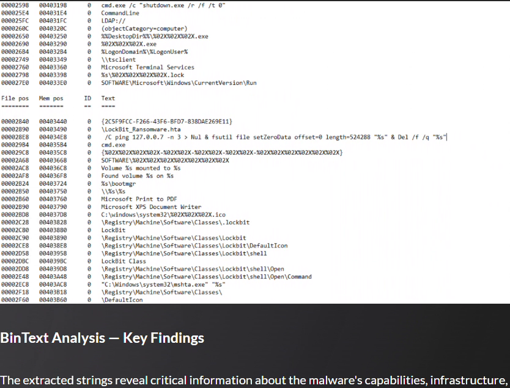

---

### Categorized Breakdown of Extracted Strings

The extracted strings reveal unprecedented technical visibility into LockBit 2.0's execution flow, cryptographic libraries, persistence mechanisms, double-extortion infrastructure, and automated Active Directory exploitation.

#### 1. Ransomware Identification
The sample explicitly declares its identity and version across multiple embedded strings:

| Extracted String | Forensic Significance |
|---|---|
| `LockBit 2.0 Ransom` | Window title / internal display name |
| `LockBit_2_0_Ransom` | Internal binary identifier |
| `\LockBit_Ransomware.hta` | Interactive HTML Application (HTA) ransom note payload |
| `.lockbit` | Custom file extension appended to all encrypted files |
| `LockBit Class` | Windows Registry class name registered for the `.lockbit` file extension |

#### 2. Ransom Note Content & Extortion Messaging
Embedded strings reveal the primary extortion notes dropped into every compromised directory:
* `All your files stolen and encrypted` — Primary extortion header.
* `RESTORE-MY-FILES.TXT` — Ransom note dropped into every directory traversed.
* `Would you like to earn millions of dollars?` — Rogue affiliate recruitment pitch targeting corporate insiders.
* `You can provide us accounting data for the access to any company, for example, login and password to RDP, VPN, corporate email, etc.` — Insider threat recruitment mechanism.
* `Companies pay us the foreclosure for the decryption of files and prevention of data leak.` — Explicit double-extortion model (data exfiltration + ransomware encryption).

#### 3. C2 & Threat Communication Infrastructure
The binary hardcodes direct contact and leak sites for negotiation and extortion:

| Extracted String | Infrastructure Type | Purpose |
|---|---|---|
| `http://lockbitapt6vx57t3eeqjofwgcglmutr3a35nygvokja5uuccip4ykyd.onion` | Tor Hidden Service (`.onion`) | Official LockBit 2.0 data leak blog and payment portal. |
| `https://bigblog.at` | Clearnet Mirror / Blog | Public leak site used to pressure victims with corporate leaks. |
| `https://tox.chat/download.html` | Secure P2P Messenger | Link directing victims to download the Tox encrypted client. |
| `3085B89A0C515D2FB124D645906F5D3DA5CB97CEBEA975959AE4F95302A04E1D709C3C4AE9B7` | Tox ID (Public Key) | Direct peer-to-peer negotiation ID for LockBit operators. |

> [!CAUTION]
> **Immediate SOC Defensive Action:** All four IOCs above must be ingested into firewall perimeter blocks, DNS sinkholes, and proxy threat intelligence blacklists immediately.

#### 4. Lateral Movement & Active Directory Abuse
LockBit 2.0 contains specialized strings indicating weaponization of Windows Group Policy Objects (GPOs) for enterprise-wide propagation:

| Extracted String | Functional Purpose |
|---|---|
| `LDAP://rootDSE` | Queries the Active Directory root domain controller. |
| `LDAP://DC=%s,DC=%s` | Enumerates enterprise Domain Controllers across the forest. |
| `LDAP://CN=%s,CN=Policies,CN=System,DC=%s,DC=%s` | Accesses and modifies Group Policy Objects directly in Active Directory. |
| `defaultNamingContext` | Retrieves the primary AD domain naming context. |
| `(objectCategory=computer)` | LDAP filter enumerating every domain-joined computer in the enterprise. |
| `gPCMachineExtensionNames` / `gPCUserExtensionNames` | Registers custom client-side Group Policy extensions. |
| `powershell.exe -Command "Get-ADComputer -filter * -Searchbase '%s' \| foreach{ Invoke-GPUpdate -computer $_.name -force -RandomDelayInMinutes 0}"` | **Critical Weaponization:** Forces an immediate, simultaneous Group Policy refresh on all domain computers without delay. |
| `gpupdate.exe with /force` | Forces local machine Group Policy re-application. |
| `NETLOGON`, `\sysvol\`, `\scripts\` | Stages ransomware payloads inside SYSVOL/NETLOGON domain replication shares. |
| `GPT.INI`, `Registry.pol` | Directly edits Group Policy Template metadata and policy registry files. |

> [!IMPORTANT]
> **Key Forensic Insight:** This is LockBit 2.0's defining architectural signature. Instead of relying on manual PsExec execution or Cobalt Strike beacons, LockBit 2.0 abuses native Domain Controller privileges to deploy its binary as a GPO update to every workstation and server in the enterprise simultaneously.

#### 5. Persistence & Registry Modifications
| Registry Key / Path | Functional Purpose |
|---|---|
| `SOFTWARE\Microsoft\Windows\CurrentVersion\Run` | Classic autorun registry key to re-execute ransomware upon reboot. |
| `\Registry\Machine\Software\Classes\.lockbit` | Associates `.lockbit` files with the ransomware's custom handler. |
| `\Registry\Machine\Software\Classes\Lockbit\DefaultIcon` | Points file icons of encrypted documents to LockBit's custom icon. |
| `\Registry\Machine\Software\Classes\Lockbit\shell\Open\Command` | Configures `.lockbit` files to automatically trigger `LockBit_Ransomware.hta`. |
| `SOFTWARE\%02X%02X%02X%02X%02X%02X%02X` | Dynamically creates randomized GUID-style registry keys to store infection state. |

#### 6. Defense Evasion — Windows Defender Disabling via GPO
The binary embeds registry paths designed to blind Windows Defender across the entire enterprise domain via Group Policy:

| Registry Path Target | Policy Value Name | Malicious Action |
|---|---|---|
| `Software\Policies\Microsoft\Windows Defender` | `DisableAntiSpyware` | Disables Windows Defender core antivirus engine (`Value: 1`). |
| `Software\Policies\Microsoft\Windows Defender\Real-Time Protection` | `DisableRealtimeMonitoring` | Terminates active real-time file and memory scanning (`Value: 1`). |
| `Software\Policies\Microsoft\Windows Defender\Spynet` | `SubmitSamplesConsent` | Disables automated sample submission to Microsoft Cloud (`Value: 2`). |
| `Software\Policies\Microsoft\Windows Defender\Threats` | `Threats_ThreatSeverityDefaultAction` | Suppresses remediation actions for detected high-severity threats. |
| `Software\Policies\Microsoft\Windows Defender\UX Configuration` | `Notification_Suppress` | Hides all Defender security warnings from end users. |

#### 7. Process Execution & System Command Invocation
| Command / String | Functional Purpose |
|---|---|
| `C:\Windows\System32\taskkill.exe` | Kills active processes locking critical databases or document files. |
| `/IM "%s" /F` | `taskkill` arguments to forcibly terminate processes by image name. |
| `cmd.exe /c "shutdown.exe /r /f /t 0"` | Forces an immediate, hard system reboot after policy deployment. |
| `"C:\Windows\system32\mshta.exe" "%s"` | Launches Microsoft HTML Application host (`mshta.exe`) to render ransom screen. |
| `\\%s\ROOT\CIMV2` + `Win32_Process / Create` | Remote WMI process creation across adjacent network hosts. |
| `<Exec><Command>%s</Command><Arguments>%s</Arguments></Exec>` | Formats Scheduled Task XML templates pushed via GPO. |
| `\ScheduledTasks.xml`, `\Services.xml`, `\NetworkShares.xml` | Manipulates GPO preference XML files in SYSVOL. |

#### 8. Self-Deletion & Anti-Forensics Routine
LockBit 2.0 incorporates a destructive anti-forensic routine to delete its original executable from disk upon completion:
```cmd
/C ping 127.0.0.7 -n 3 > Nul & fsutil file setZeroData offset=0 length=524288 "%s" & Del /f /q "%s"
```
* **Phase 1 (`ping 127.0.0.7 -n 3`):** Introduces a 3-second sleep delay to allow the primary encryption thread to release its process handle.
* **Phase 2 (`fsutil file setZeroData`):** Overwrites the first **512 KB (524,288 bytes)** of the ransomware binary with zeroes on the NTFS volume, destroying file headers and preventing forensic file carving.
* **Phase 3 (`Del /f /q "%s"`):** Forcefully deletes the zeroed-out file from disk.

#### 9. Cryptography & Encryption Strings
| String | Significance |
|---|---|
| `LibsodiumDRG` | Confirms reliance on the modern **Libsodium** cryptographic library (utilizing Curve25519 and ChaCha20/Salsa20 algorithms for high encryption speeds). |
| `sysrandom` | Accesses Windows native cryptographic PRNG (`RtlGenRandom`) for unique per-file key material. |
| `%s\%02X%02X%02X%02X.lock` | Temporary file naming convention during multi-threaded encryption passes. |

#### 10. Privilege Escalation & Access Control
| String | Purpose |
|---|---|
| `NT AUTHORITY\System` | Target execution privilege level desired by the payload. |
| `Elevation:Administrator!new:` | COM-based User Account Control (UAC) bypass moniker. |
| `{3E5FC7F9-9A51-4367-9063-A120244FBEC7}` | CLSID of elevated COM object utilized to bypass UAC silently without user prompts. |
| `CheckTokenMembership` / `CreateWellKnownSid` | Checks if current process token belongs to the local Administrators group. |

#### 11. Network & Lateral Propagation
| String | Purpose |
|---|---|
| `\\tsclient` | Targets client drives mapped across Remote Desktop (Terminal Services) sessions. |
| `Microsoft Terminal Services` | Identifies active RDP sessions for opportunistic encryption. |
| `\\%s\%s` | Universal Naming Convention (UNC) paths used to mount and encrypt shared SMB folders. |
| `Volume %s mounted to %s` | Discovers and mounts hidden, unassigned disk volumes. |
| `%s\bootmgr` | Explicitly checks for Windows Boot Manager to avoid encrypting boot critical files (preventing system unbootability). |

#### 12. Desktop Defacement & Graphical UI
| String | Purpose |
|---|---|
| `%s.bmp` / `image/bmp` | Creates a custom bitmap image set as the desktop wallpaper. |
| `C:\windows\system32\%02X%02X%02X.ico` | Drops custom LockBit icon files to overwrite default shell associations. |
| `Proxima Nova` / `Blender Pro Medium` / `Arial` | Modern typography embedded into ransom notes and wallpaper graphics. |
| `SHChangeNotify` | Forces the Windows shell to immediately refresh desktop icons. |
| `DisplayCalibrator` | Abuses display calibration registry keys for subversion and persistence. |

#### 13. Referenced Dynamic Link Libraries (DLLs)
| DLL Name | Forensic Role |
|---|---|
| `KERNEL32.dll` | Core process management, memory allocation, and system execution. |
| `ADVAPI32.dll` | Security tokens, privilege verification, and registry operations. |
| `ole32.dll` | Component Object Model (COM) and DCOM execution. |
| `Shell32.dll` | Windows shell integration and desktop notification. |
| `SHLWAPI.dll` | File path resolution and URL string parsing. |
| `ACTIVEDS.dll` | Active Directory Service Interfaces (ADSI) integration. |
| `comctl32.dll` | Graphical user interface controls. |

#### 14. Interactive Encryption Progress GUI
LockBit 2.0 contains strings indicating a dedicated progress GUI displayed to administrators/users:
* `Statistics, Start, Location, Total, Complete, Disk use` — Metrics rendered in the live UI.
* `Active:, Completed:, [%02d:%02d:%02d]` — Elapsed timer and percentage tracking.
* `msctls_progress32` — Standard Windows common control progress bar.
* `SysListView32` — Multi-column list view tracking per-drive encryption progress.
* `winsta0\default` — Explicitly targets the interactive desktop session of the logged-in user.

---

### Step 5: Structural PE Parsing with PE-Tree

We launch **PE-Tree** from `Tools/` and open the malware sample. PE-Tree automatically parses PE header structures, calculates section entropy, maps dependencies, and generates a hierarchical visual representation.

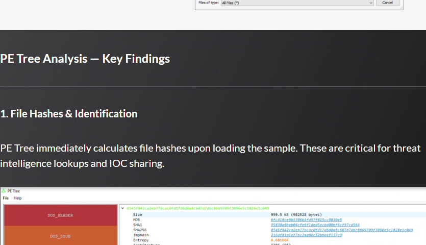

---

#### 1. File Hashes & Identification

Upon ingestion, PE-Tree immediately calculates cryptographic hashes and extracts core compilation telemetry:

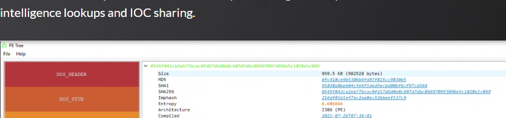

| Hash / Metadata Property | Value |
|---|---|
| **MD5** | `6fc418ce9b5306b4fd97f815cc9830e5` |
| **SHA1** | `95838a8beb04cfe6f1ded5ecbd00bf6cf97cd564` |
| **SHA256** | `0545f842ca2eb77bcac0fd17d6d0a8c607d7dbc8669709f3096e5c1828e1c049` |
| **File Size** | `959.5 KB` (`982,528 bytes`) |
| **Target Architecture** | `I386 (PE)` — 32-bit x86 executable |
| **Compile Timestamp** | `2021-07-26T07:34:01 UTC` |

#### Threat Intelligence Lookup (VirusTotal Validation)
Querying the extracted SHA256 hash against VirusTotal reveals widespread detection: **50 out of 70 security engines** identify the file as malicious ransomware belonging to the **LockBit** family.

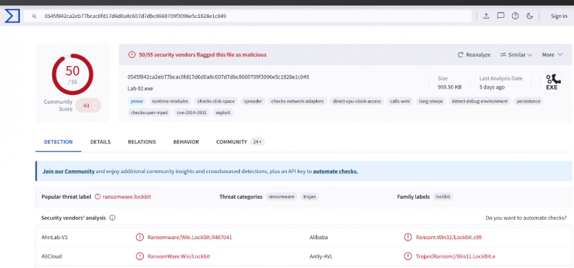

---

#### 2. File Header (`IMAGE_NT_HEADERS` → `FILE_HEADER`)

Expanding `IMAGE_NT_HEADERS > NT_HEADERS` in PE-Tree reveals the COFF File Header:

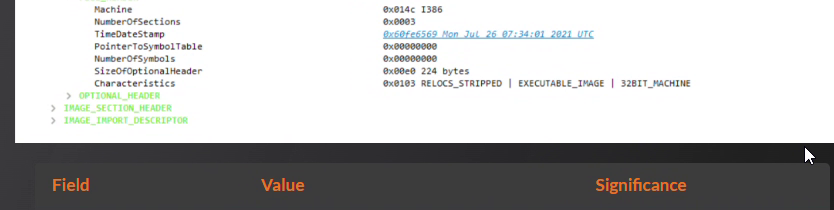

| Field | Value | Forensic Significance |
|---|---|---|
| `Machine` | `0x014C` (`I386`) | 32-bit x86 executable capable of running on both 32-bit and 64-bit Windows OS. |
| `NumberOfSections` | `0x0003` | Minimalist section architecture comprising only `.text`, `.data`, and `.idata`. |
| `TimeDateStamp` | `0x60FE6569` (Mon Jul 26 07:34:01 2021 UTC) | Build timestamp matches the historic peak of LockBit 2.0 affiliate operations. |
| `Characteristics` | `RELOCS_STRIPPED \| EXECUTABLE_IMAGE \| 32BIT_MACHINE` | Relocations stripped (`0x0001`), executable image (`0x0002`), 32-bit machine word (`0x0100`). |

---

#### 3. Optional Header (`IMAGE_OPTIONAL_HEADER`)

Directly below the File Header, the Optional Header defines operating system loader configurations:

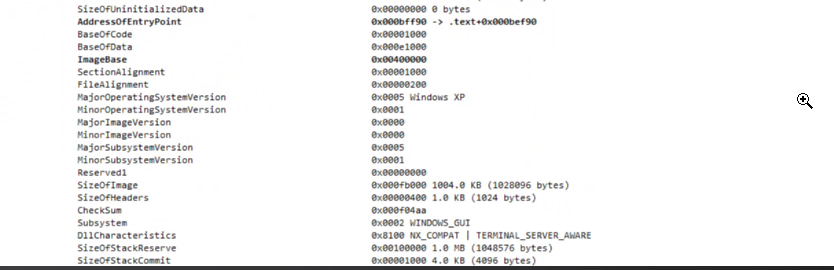

| Field | Value | Forensic Significance |
|---|---|---|
| `Magic` | `PE (PE32)` (`0x010B`) | Standard 32-bit Portable Executable. |
| `Linker` | `Visual Studio 2017 14.16` | Compiled using MSVC 2017 build toolchain. |
| `SizeOfCode` | `896.0 KB` (`917,504 bytes`) | Code section represents over 93% of the total file footprint. |
| `AddressOfEntryPoint`| `0x000BEF90` | Relative Virtual Address (RVA) where execution begins. |
| `ImageBase` | `0x00400000` | Default preferred base load address for 32-bit executables. |
| `MajorOperatingSystemVersion` | `0x0005` (Windows XP) | Configured for legacy compatibility across Windows XP through Windows Server 2022. |
| `Subsystem` | `0x0002` (`WINDOWS_GUI`) | GUI application; displays interactive encryption status windows. |
| `DllCharacteristics` | `NX_COMPAT \| TERMINAL_SERVER_AWARE` | Supports Data Execution Prevention (DEP); explicitly optimized for RDP / Terminal Server sessions. |

> [!NOTE]
> **Why `TERMINAL_SERVER_AWARE` matters:** In corporate environments, threat actors often target jump boxes and terminal servers. This flag ensures the binary behaves correctly across multi-user RDP sessions without crashing or encountering permission anomalies.

---

#### 4. PE Sections & Shannon Entropy (`IMAGE_SECTION_HEADER`)

Expanding `IMAGE_SECTION_HEADER` displays the section distribution, size metrics, and Shannon entropy values:

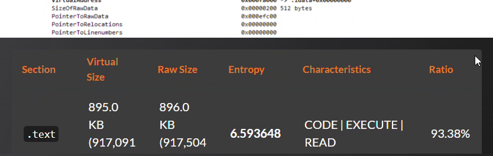

| Section | Virtual Size | Raw Size | Shannon Entropy | Characteristics | File Ratio |
|---|---|---|---|---|---|
| **`.text`** | `895.0 KB` (`917,091 B`) | `896.0 KB` (`917,504 B`) | **`6.593648`** | `CODE \| EXECUTE \| READ` | **`93.38%`** |
| **`.data`** | `96.1 KB` (`98,372 B`) | `62.0 KB` (`43,488 B`) | **`6.790358`** | `INITIALIZED_DATA \| READ \| WRITE` | **`6.46%`** |
| **`.idata`**| `470 bytes` | `512 bytes` | **`4.126181`** | `INITIALIZED_DATA \| READ` | **`0.05%`** |

#### Critical Mathematical & Forensic Observations
1. **Unpacked Native Executable:** Shannon entropy values above $7.0$ typically indicate packed or encrypted data (e.g., UPX, Themida). Here, `.text` ($6.59$) and `.data` ($6.79$) are both strictly below $7.0$. This **proves the binary is native compiled C/C++ and is NOT packed**.
2. **Dominant Code Footprint:** The `.text` section accounts for **$93.38\%$** of the entire binary, confirming that LockBit 2.0 embeds its complete feature set (encryption algorithms, Active Directory LDAP queries, GUI components, and GPO handlers) natively within its primary code section.
3. **Microscopic Import Section:** `.idata` constitutes merely **$0.05\%$** ($512$ bytes) of the file, directly signaling deliberate dynamic API resolution.

---

#### 5. Imports & Dynamic API Resolution (`IMAGE_IMPORT_DESCRIPTOR`)

Expanding `IMAGE_IMPORT_DESCRIPTOR` reveals the static import table:

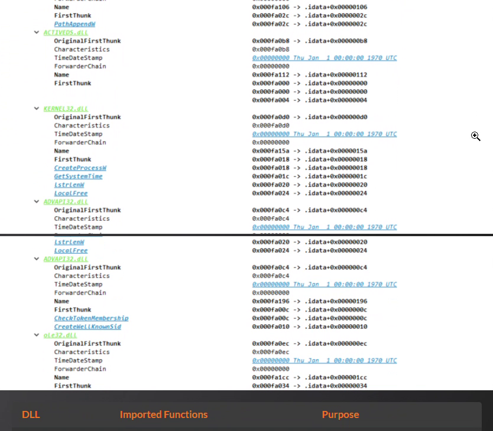

| DLL Module | Imported APIs | Functional Purpose |
|---|---|---|
| **`SHLWAPI.dll`** | `PathAppendW` | File path concatenation and directory navigation. |
| **`ACTIVEDS.dll`** | *(None listed in static table)* | Active Directory Service Interfaces (ADSI) container. |
| **`KERNEL32.dll`** | `CreateProcessW`, `GetSystemTime`, `lstrlenW`, `LocalFree` | Spawns child processes (`mshta.exe`, `taskkill.exe`, `shutdown.exe`), tracks timestamps, and manages local memory. |
| **`ADVAPI32.dll`** | `CheckTokenMembership`, `CreateWellKnownSid` | Checks whether the executing security context possesses local administrative rights (`WinBuiltinAdministratorsSid`). |
| **`ole32.dll`** | `CoCreateInstance`, `CoSetProxyBlanket` | Initializes COM runtime and configures DCOM authentication proxy blankets (used for remote WMI process execution over `\\%s\ROOT\CIMV2`). |

**Total:** Only **5 DLLs** and **9 explicit API functions** are imported statically.

> [!WARNING]
> **SOC Insight — Hallmark of Evasive Malware:** A 960 KB executable with extensive network, Active Directory, cryptographic, and GUI functionality cannot operate using only 9 APIs. LockBit 2.0 utilizes **dynamic API resolution**: at runtime, it traverses the `InLoadOrderModuleList` within the Process Environment Block (`PEB`), locates exported DLL bases (`ntdll.dll`, `kernel32.dll`), and dynamically resolves functions using custom precomputed API hashes. This technique defeats simple import hash (`imphash`) and static signature detections.

---

## 🏁 Conclusion & Threat Profile

Through static analysis utilizing **HxD**, **BinText**, and **PE-Tree**, we successfully identified and fully attributed the suspicious sample without executing a single instruction:

```text
================================================================================
                    LOCKBIT 2.0 THREAT ATTRIBUTION DOSSIER                      
================================================================================
Malware Family    : LockBit 2.0 (Double Extortion Ransomware)
Target Platform   : Windows x86 (32-bit PE GUI Subsystem)
Threat Actor Group: LockBit Supporter / Affiliate Network
Core Cryptography : Libsodium (Curve25519 + ChaCha20/Salsa20)
Primary Vector    : Enterprise Lateral Movement via Active Directory GPO Abuse
Evasion Strategy  : Dynamic API Resolution, Windows Defender GPO Disabling,
                    Anti-Forensic 512KB Zero-Wipe & Self-Deletion
Extortion Model   : Double Extortion (Tor Leak Site + P2P Tox Negotiation)
Sample SHA256     : 0545f842ca2eb77bcac0fd17d6d0a8c607d7dbc8669709f3096e5c1828e1c049
MD5 Checksum      : 6fc418ce9b5306b4fd97f815cc9830e5
================================================================================
```

---

## 🗺️ Comprehensive MITRE ATT&CK Mapping

The observed static forensic indicators map directly to the MITRE ATT&CK enterprise matrix:

| MITRE Tactic | Technique ID | Technique Name | Concrete Forensic Evidence in LockBit 2.0 |
|---|---|---|---|
| **Initial Access** | **[T1078](https://attack.mitre.org/techniques/T1078/)** | Valid Accounts | Hardcoded RDP client references (`\\tsclient`, `Microsoft Terminal Services`). |
| **Execution** | **[T1059.001](https://attack.mitre.org/techniques/T1059/001/)** | PowerShell | `powershell.exe -Command "Get-ADComputer... | foreach{ Invoke-GPUpdate ... }"` |
| **Execution** | **[T1047](https://attack.mitre.org/techniques/T1047/)** | Windows Management Instrumentation (WMI) | `\\%s\ROOT\CIMV2` with `Win32_Process` and `Create` API via `ole32!CoSetProxyBlanket`. |
| **Execution** | **[T1053.005](https://attack.mitre.org/techniques/T1053/005/)** | Scheduled Task | Push of `ScheduledTasks.xml` through domain Group Policy templates. |
| **Execution** | **[T1218.005](https://attack.mitre.org/techniques/T1218/005/)** | Mshta | `mshta.exe` launched to render `LockBit_Ransomware.hta`. |
| **Persistence** | **[T1547.001](https://attack.mitre.org/techniques/T1547/001/)** | Registry Run Keys | Modified `SOFTWARE\Microsoft\Windows\CurrentVersion\Run`. |
| **Privilege Escalation** | **[T1548.002](https://attack.mitre.org/techniques/T1548/002/)** | Bypass User Account Control | Moniker `Elevation:Administrator!new:{3E5FC7F9-9A51-4367-9063-A120244FBEC7}`. |
| **Defense Evasion** | **[T1562.001](https://attack.mitre.org/techniques/T1562/001/)** | Disable or Modify Tools | GPO registry override of `DisableAntiSpyware` and `DisableRealtimeMonitoring`. |
| **Defense Evasion** | **[T1070.004](https://attack.mitre.org/techniques/T1070/004/)** | File Deletion | `fsutil file setZeroData` wipes first 512 KB followed by `Del /f /q`. |
| **Defense Evasion** | **[T1106](https://attack.mitre.org/techniques/T1106/)** | Native API | Dynamic API resolution to avoid static import detection (only 9 APIs visible in `.idata`). |
| **Lateral Movement** | **[T1484.001](https://attack.mitre.org/techniques/T1484/001/)** | Group Policy Modification | Tampering with `GPT.INI`, `Registry.pol`, and forcing domain-wide updates. |
| **Lateral Movement** | **[T1021.001](https://attack.mitre.org/techniques/T1021/001/)** | Remote Desktop Protocol | `TERMINAL_SERVER_AWARE` flag and `\\tsclient` mapped drive encryption. |
| **Impact** | **[T1486](https://attack.mitre.org/techniques/T1486/)** | Data Encrypted for Impact | Libsodium cryptography appending `.lockbit` extension; drops `RESTORE-MY-FILES.TXT`. |
| **Impact** | **[T1491.001](https://attack.mitre.org/techniques/T1491/001/)** | Internal Defacement | Replaces desktop background with custom `.bmp` wallpaper and registers custom `.ico`. |

---

## 🎯 Extracted Indicators of Compromise (IOCs)

### 🌐 Network Indicators

| IOC Type | Indicator Value | Threat Classification |
|---|---|---|
| **Tor Leak Site** | `http://lockbitapt6vx57t3eeqjofwgcglmutr3a35nygvokja5uuccip4ykyd.onion` | High Severity — Official LockBit 2.0 Data Leak Site |
| **Clearnet Blog** | `https://bigblog.at` | High Severity — Public Extortion / Victim Name-and-Shame Site |
| **Tox Messenger ID** | `3085B89A0C515D2FB124D645906F5D3DA5CB97CEBEA975959AE4F95302A04E1D709C3C4AE9B7` | High Severity — Threat Actor Direct Negotiation Channel |
| **Tox Download URL** | `https://tox.chat/download.html` | Informational — P2P Encrypted Messenger Utility |

### 🖥️ Host-Based & Endpoint Indicators

| Artifact Category | Value / Path | Description |
|---|---|---|
| **SHA256 Hash** | `0545f842ca2eb77bcac0fd17d6d0a8c607d7dbc8669709f3096e5c1828e1c049` | Primary Malicious Sample Checksum |
| **MD5 Hash** | `6fc418ce9b5306b4fd97f815cc9830e5` | Secondary Checksum |
| **SHA1 Hash** | `95838a8beb04cfe6f1ded5ecbd00bf6cf97cd564` | Legacy Checksum |
| **Encrypted File Extension** | `.lockbit` | Appended to all encrypted user documents |
| **Ransom Note File** | `RESTORE-MY-FILES.TXT` | Plaintext note dropped in all folders |
| **HTA Ransom Screen** | `LockBit_Ransomware.hta` | HTML Application displayed via `mshta.exe` |
| **Registry Run Key** | `HKLM\SOFTWARE\Microsoft\Windows\CurrentVersion\Run` | Persistence mechanism |
| **Registry File Assoc** | `HKLM\Software\Classes\.lockbit` | File association registration |
| **Self-Deletion Command** | `cmd.exe /C ping 127.0.0.7 -n 3 > Nul & fsutil file setZeroData offset=0 length=524288 "%s" & Del /f /q "%s"` | Anti-forensic wiping command line |
| **GPO Forced Push** | `powershell.exe -Command "Get-ADComputer -filter * -Searchbase '%s' \| foreach{ Invoke-GPUpdate -computer $_.name -force -RandomDelayInMinutes 0}"` | Immediate domain-wide infection script |

---

## 🛡️ Defensive Engineering & SOC Detection Playbook

### 1. Key SOC Analyst Takeaways
1. **String Analysis Provides Instant Triage:** When malware contains unencrypted, hardcoded strings (such as LockBit 2.0 naming itself, its Tor blog, and Tox ID), string analysis is the fastest path to positive identification during high-pressure incidents.
2. **Minimal Imports Signal Evasion:** Large binaries (900+ KB) with fewer than 10 static imports almost always leverage dynamic API resolution to bypass traditional AV heuristics. Treat small import tables on large binaries as a major red flag.
3. **Monitor Active Directory GPO Changes:** Because LockBit 2.0 weaponizes Active Directory Group Policy to deploy across domain endpoints, SOC teams must actively monitor Domain Controller logs (`Event ID 5136` - Directory Service Object Modified) and alert on unexpected edits to `SYSVOL\Policies\`.

### 2. YARA Detection Rule for LockBit 2.0

```yara
rule Ransomware_Win32_LockBit20_Static {
    meta:
        description = "Detects LockBit 2.0 Ransomware via static PE headers and string signatures"
        author = "SOC Threat Hunting Team"
        reference = "INE Security - Malware Fundamentals Lab"
        sample_sha256 = "0545f842ca2eb77bcac0fd17d6d0a8c607d7dbc8669709f3096e5c1828e1c049"
        date = "2026-10-15"
        threat_level = "CRITICAL"
        mitre_technique = "T1486, T1484.001, T1562.001"

    strings:
        // Core Identification Strings
        $id1 = "LockBit 2.0 Ransom" ascii wide
        $id2 = "LockBit_2_0_Ransom" ascii wide
        $note1 = "RESTORE-MY-FILES.TXT" ascii wide
        $note2 = "LockBit_Ransomware.hta" ascii wide
        $ext = ".lockbit" ascii wide

        // C2 & Communication
        $c2_onion = "lockbitapt6vx57t3eeqjofwgcglmutr3a35nygvokja5uuccip4ykyd.onion" ascii
        $c2_blog = "https://bigblog.at" ascii
        $tox = "3085B89A0C515D2FB124D645906F5D3DA5CB97CEBEA975959AE4F95302A04E1D709C3C4AE9B7" ascii

        // GPO & Lateral Movement Artifacts
        $gpo1 = "Invoke-GPUpdate" ascii wide
        $gpo2 = "LDAP://rootDSE" ascii wide
        $gpo3 = "gPCMachineExtensionNames" ascii wide

        // Defense Evasion & Anti-Forensics
        $evade1 = "DisableAntiSpyware" ascii wide
        $evade2 = "DisableRealtimeMonitoring" ascii wide
        $wipe = "fsutil file setZeroData" ascii wide

    condition:
        uint16(0) == 0x5A4D and // Valid PE (MZ)
        filesize > 500KB and filesize < 2MB and
        (
            2 of ($id*) or
            $c2_onion or
            $tox or
            (2 of ($note*, $ext) and 1 of ($gpo*, $evade*)) or
            $wipe
        )
}
```

### 3. Sigma Rule: LockBit 2.0 GPO Weaponization Detection

```yaml
title: LockBit 2.0 GPO Forced Refresh & Active Directory Abuse
id: c4b19f21-789a-4c12-98ab-4e3198f7c1a2
status: production
description: Detects PowerShell command line invoking Get-ADComputer piped into Invoke-GPUpdate without delay, a hallmark signature of LockBit 2.0 enterprise deployment.
author: SOC Threat Detection Engineering
references:
    - https://attack.mitre.org/techniques/T1484/001/
    - https://my.ine.com/course/malware-analysis-for-soc-analysts/
logsource:
    category: process_creation
    product: windows
detection:
    selection:
        Image|endswith:
            - '\powershell.exe'
            - '\pwsh.exe'
        CommandLine|contains|all:
            - 'Get-ADComputer'
            - 'Invoke-GPUpdate'
            - 'RandomDelayInMinutes 0'
    condition: selection
falsepositives:
    - Highly rare legitimate administrative scripts forcing domain-wide emergency policy refreshes.
level: critical
tags:
    - attack.execution
    - attack.t1059.001
    - attack.lateral_movement
    - attack.t1484.001
```

---

## 📚 References

* [MalwareBazaar Database: LockBit 2.0 Sample Record](https://bazaar.abuse.ch/sample/0545f842ca2eb77bcac0fd17d6d0a8c607d7dbc8669709f3096e5c1828e1c049/)
* [VirusTotal Detections Report (`0545f842...`)](https://www.virustotal.com/gui/file/0545f842ca2eb77bcac0fd17d6d0a8c607d7dbc8669709f3096e5c1828e1c049)
* [MITRE ATT&CK: LockBit Group & Software Profile (S0654)](https://attack.mitre.org/software/S0654/)
* [Microsoft Learn: Microsoft PE and COFF Specification](https://learn.microsoft.com/en-us/windows/win32/debug/pe-format)
* [CISA Cybersecurity Advisory: Understanding Ransomware Threat Actors (LockBit)](https://www.cisa.gov/news-events/cybersecurity-advisories/aa23-165a)
