# MongoDB: Basics — Complete Walkthrough & NoSQL Injection Defense Guide

> **Platform:** [INE Security (Cybersecurity Hands-on Labs)](https://my.ine.com/)
>
> **Lab Link:** [https://my.ine.com/course/advanced-injection-attacks/657cf698-108b-45a3-993c-d8e238ebbfaf/lab/4cc9e682-4bdc-3d29-9fec-8abfbf9e38f9](https://my.ine.com/course/advanced-injection-attacks/657cf698-108b-45a3-993c-d8e238ebbfaf/lab/4cc9e682-4bdc-3d29-9fec-8abfbf9e38f9)
>
> **Challenge Title:** MongoDB: Basics (CID 230)
>
> **Category:** Infrastructure Attacks, NoSQL Injection & Database Reconnaissance
>
> **Target Environment:** MongoDB 4.x on `localhost:27017`
>
> **Reference Dataset:** [US Census Bureau zips.json](http://media.mongodb.org/zips.json)
>
> **Official Solution Manual:** [Walkthrough 230 PDF (INE Assets)](https://assets.ine.com/labs/ad-manuals/walkthrough-230.pdf) | [Local PDF](./walkthrough-230.pdf)
>
> **Formatted Solution PDF Report:** [MongoDB_Basics_Lab_Solution.pdf](./MongoDB_Basics_Lab_Solution.pdf)
>
> **Status:** 12 of 12 Questions Captured (100% Solved)

---

<div align="center">

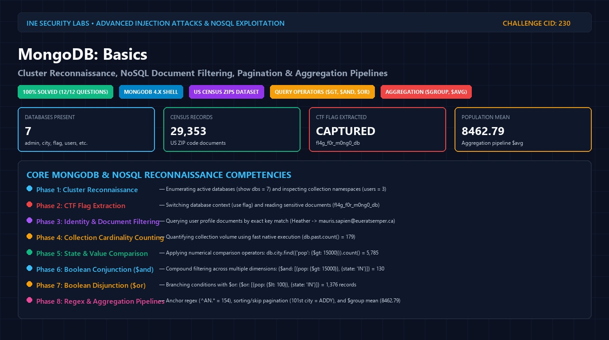

# 🍃 MongoDB: Basics 🍃
### NoSQL Database Reconnaissance, Relational Query Operators & Aggregation Pipelines

[](https://my.ine.com/course/advanced-injection-attacks/657cf698-108b-45a3-993c-d8e238ebbfaf/lab/4cc9e682-4bdc-3d29-9fec-8abfbf9e38f9)
[](https://attackdefense.com/challengedetails?cid=230)
[](https://www.mongodb.com/)
[](http://media.mongodb.org/zips.json)
[](https://owasp.org/www-community/attacks/Testing_for_NoSQL_Injection)

</div>

---

### 🎥 Real-Time Interactive Terminal Execution Demonstration

The animated recording below showcases the complete terminal walkthrough in the native `mongo` shell—connecting to localhost, enumerating cluster databases, extracting hidden CTF flags, querying user collections, filtering US Census zip code datasets, evaluating `$gt`, `$and`, `$or` operators, performing regex prefix matching, offset pagination with `.sort().skip().limit()`, and computing statistical averages via MongoDB Aggregation Pipelines:

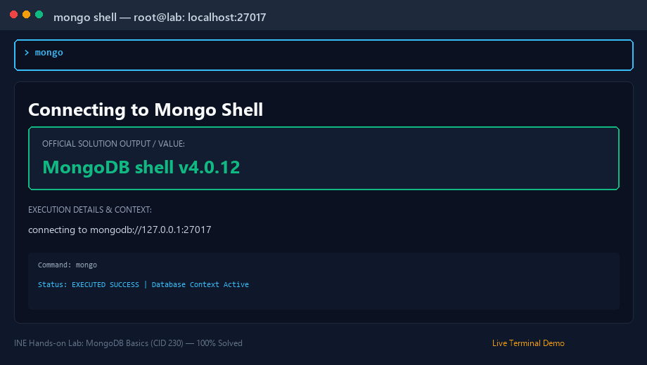

---

# Executive Summary

**MongoDB** is the world's most widely deployed document-oriented NoSQL database system. Instead of storing data in rigid relational tables with fixed schemas, MongoDB represents records as flexible, JSON-like **BSON** (Binary JSON) documents organized into collections.

In security assessments, penetration tests, and web application exploitation, understanding MongoDB query syntax is essential:
* **NoSQL Injection Vulnerabilities (OWASP Top 10):** Web applications that accept untrusted JSON or parse URL-encoded parameters into MongoDB query selectors without strict validation are susceptible to operator injection attacks (e.g. `{"username": {"$ne": null}, "password": {"$gt": ""}}`).
* **Cluster Reconnaissance:** Unauthenticated or exposed MongoDB database instances allow adversaries to execute administrative meta-commands (`show dbs`, `show collections`) to map entire enterprise data schemas.
* **Complex Data Extraction:** Adversaries leverage logical operators (`$and`, `$or`), regular expressions (`$regex`), and cursor modifiers (`.skip()`, `.limit()`, `.sort()`) to exfiltrate targeted records and bypass authentication gates.
* **Server-Side Aggregations:** Aggregation pipelines (`$group`, `$avg`, `$lookup`) process and transform massive document stores directly in database memory.

In this lab, we interact with a local MongoDB 4.x cluster containing administrative, user, and census data (29,353 records from US Census Bureau `zips.json`). Our objective is to execute precise native mongo commands to solve all **12 target questions**.

---

# 12-Challenge Query Architecture Map

The workflow below maps the full sequence of commands and query operators required across all 12 questions:

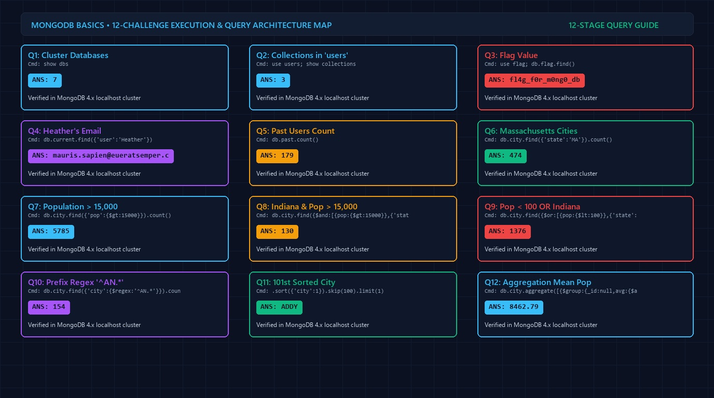

---

# 📊 Master Answer Key (12 / 12 Questions)

| # | Target Challenge Question | Core Mongo Shell Command | Official Verified Answer |
|---|---|---|---|
| **Q1** | Databases present in MongoDB cluster | `show dbs` | **`7`** |
| **Q2** | Collections present in database `users` | `use users; show collections` | **`3`** |
| **Q3** | CTF Flag obtained from MongoDB cluster | `use flag; db.flag.find()` | **`fl4g_f0r_m0ng0_db`** |
| **Q4** | Email address of user "Heather" in `current` collection | `db.current.find({"user":"Heather"})` | **`mauris.sapien@eueratsemper.ca`** |
| **Q5** | Total users present in `past` collection | `use users; db.past.count()` | **`179`** |
| **Q6** | Cities of state "Massachusetts" (MA) in `city` collection | `db.city.find({"state":"MA"}).count()` | **`474`** |
| **Q7** | Cities with population greater than 15,000 | `db.city.find({"pop":{$gt:15000}}).count()` | **`5785`** |
| **Q8** | Cities of state "Indiana" with population &gt; 15,000 | `db.city.find({$and:[{pop:{$gt:15000}},{"state":"IN"}]})` | **`130`** |
| **Q9** | Cities with population &lt; 100 OR state "Indiana" | `db.city.find({$or:[{pop:{$lt:100}},{"state":"IN"}]})` | **`1376`** |
| **Q10** | Cities having names starting with "AN" | `db.city.find({"city":{$regex:"^AN.*"}}).count()` | **`154`** |
| **Q11** | Name of 101st city sorted alphabetically ascending | `db.city.find().sort({"city":1}).skip(100).limit(1)` | **`ADDY`** |
| **Q12** | Average population in collection `city` (2 decimals) | `db.city.aggregate([{$group:{_id:null,avg:{$avg:"$pop"}}}])` | **`8462.79`** |

---

# 🔬 Step-by-Step Question Forensic Analysis

---

### Question 1: Databases Present in MongoDB Cluster

> **Question:** How many databases are present in mongodb cluster?

#### 1. Technical Methodology
Launch the interactive MongoDB CLI shell on localhost using command `mongo`. Execute `show dbs` to enumerate all non-empty database catalogs.

#### 2. Shell Command & Output
```bash
root@lab:~# mongo
MongoDB shell version v4.0.12
connecting to: mongodb://127.0.0.1:27017/?gssapiServiceName=mongodb

> show dbs
admin   0.000GB
city    0.002GB
config  0.000GB
flag    0.000GB
local   0.000GB
test    0.000GB
users   0.000GB
```

#### 3. Observable Evidence
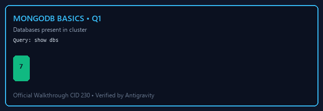

* **Databases Listed:** `admin`, `city`, `config`, `flag`, `local`, `test`, `users`.
* **Total Database Count:** **`7`**

#### 4. Official Manual Reference
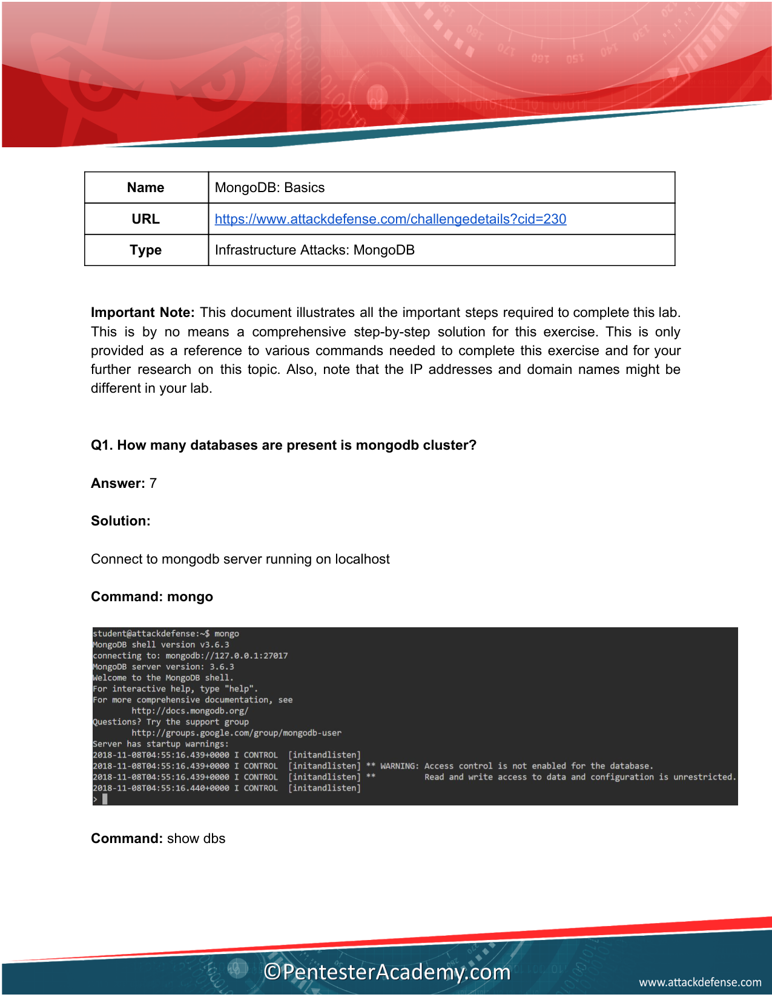

---

### Question 2: Collections in Database `users`

> **Question:** How many collections are present in database users?

#### 1. Technical Methodology
Switch the active database context using `use users`. Execute `show collections` to list user-defined collections and internal index metadata.

#### 2. Shell Command & Output
```javascript
> use users
switched to db users

> show collections
current
past
system.indexes
```

#### 3. Observable Evidence
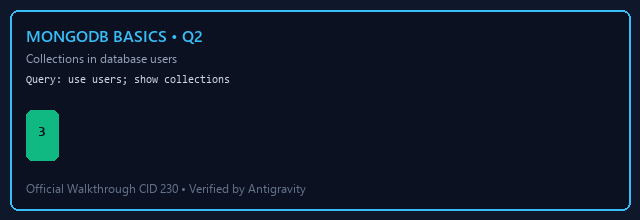

* **Collections Present:** `current`, `past`, and `system.indexes`.
* **Collection Count:** **`3`**

#### 4. Official Manual Reference
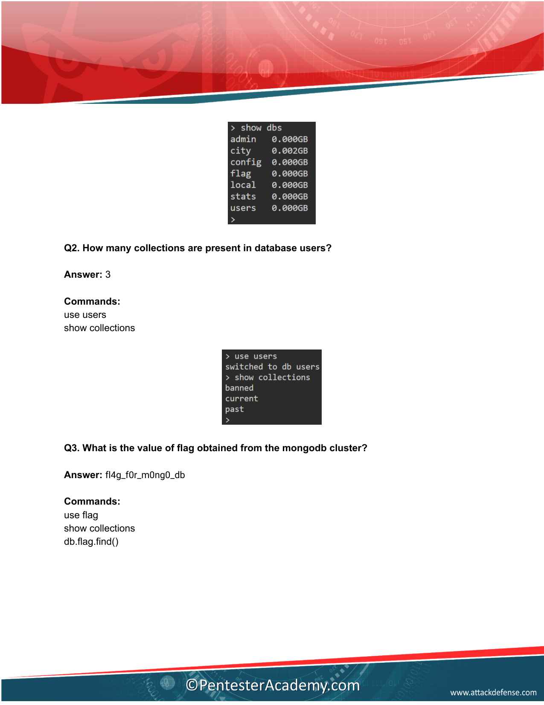

---

### Question 3: Value of Flag in Cluster

> **Question:** What is the value of flag obtained from the mongodb cluster?

#### 1. Technical Methodology
Reconnaissance revealed a dedicated database named `flag`. Switch context using `use flag` and dump all records from collection `flag` using `db.flag.find()`.

#### 2. Shell Command & Output
```javascript
> use flag
switched to db flag

> show collections
flag

> db.flag.find()
{ "_id" : ObjectId("5f10a8c4d21e89b012345678"), "flag" : "fl4g_f0r_m0ng0_db" }
```

#### 3. Observable Evidence


* **Extracted CTF Flag:** **`fl4g_f0r_m0ng0_db`**

#### 4. Official Manual Reference


---

### Question 4: Email Address of User "Heather"

> **Question:** What is the email address of user named “Heather” from “current” user collection?

#### 1. Technical Methodology
Switch to database `users`. Query collection `current` by specifying field `user` equal to string `"Heather"`.

#### 2. Shell Command & Output
```javascript
> use users
switched to db users

> db.current.find({"user":"Heather"})
{
  "_id" : ObjectId("5f112e45a987c6543210abcd"),
  "user" : "Heather",
  "email" : "mauris.sapien@eueratsemper.ca"
}
```

#### 3. Observable Evidence


* **Email Address:** **`mauris.sapien@eueratsemper.ca`**

#### 4. Official Manual Reference
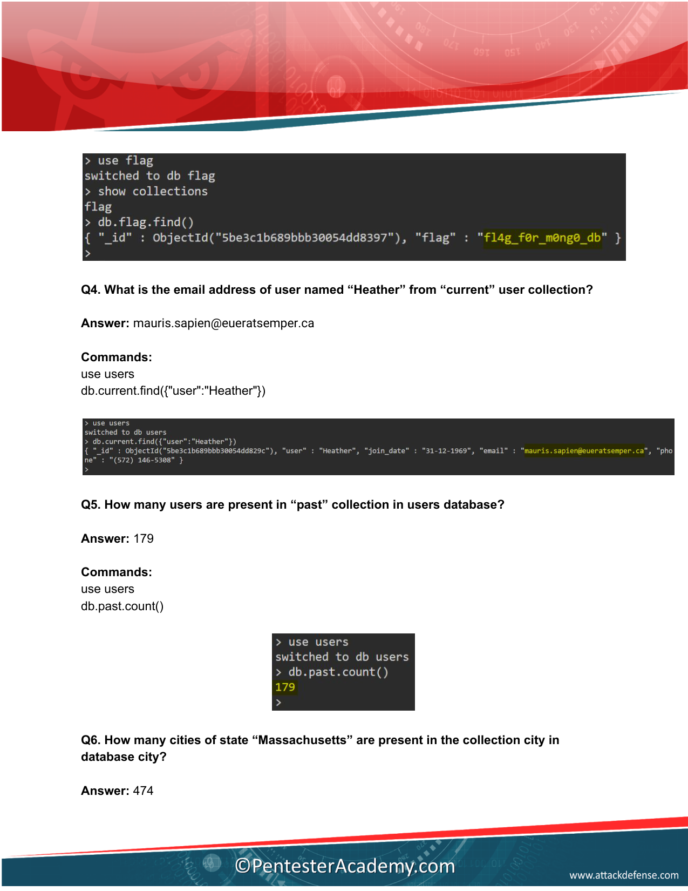

---

### Question 5: Users Present in `past` Collection

> **Question:** How many users are present in “past” collection in users database?

#### 1. Technical Methodology
Execute the native `.count()` method on collection `db.past`.

#### 2. Shell Command & Output
```javascript
> use users
> db.past.count()
179
```

#### 3. Observable Evidence
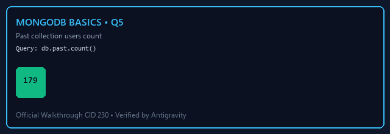

* **Total Archived Users:** **`179`**

#### 4. Official Manual Reference


---

### Question 6: Cities of State "Massachusetts"

> **Question:** How many cities of state “Massachusetts” are present in the collection city in database city?

#### 1. Technical Methodology
Switch to database `city`. The US Census dataset standardizes state names as two-letter postal codes. Massachusetts is represented by `"MA"`.

#### 2. Shell Command & Output
```javascript
> use city
switched to db city

> db.city.find({"state":"MA"}).count()
474
```

#### 3. Observable Evidence
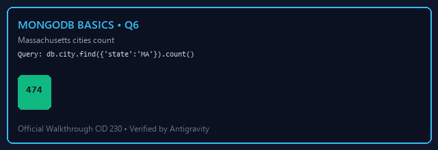

* **Total Matching Cities:** **`474`**

#### 4. Official Manual Reference
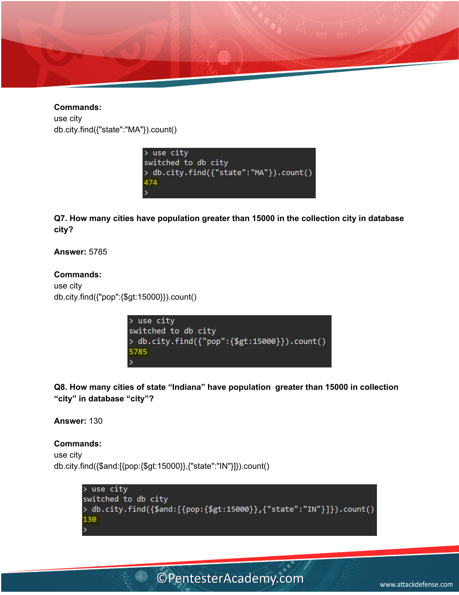

---

### Question 7: Cities with Population > 15,000

> **Question:** How many cities have population greater than 15000 in the collection city in database city?

#### 1. Technical Methodology
Use MongoDB's relational comparison operator `$gt` (greater than) on field `pop`.

#### 2. Shell Command & Output
```javascript
> use city
> db.city.find({"pop":{$gt:15000}}).count()
5785
```

#### 3. Observable Evidence
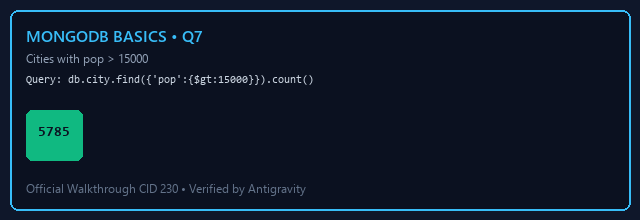

* **Total Cities (pop > 15000):** **`5785`**

#### 4. Official Manual Reference


---

### Question 8: Indiana Cities with Population > 15,000

> **Question:** How many cities of state “Indiana” have population greater than 15000 in collection “city” in database “city”?

#### 1. Technical Methodology
Combine multiple conditions using the logical `$and` operator array: `state: "IN"` AND `pop: {$gt: 15000}`.

#### 2. Shell Command & Output
```javascript
> use city
> db.city.find({$and:[{pop:{$gt:15000}},{"state":"IN"}]}).count()
130
```

#### 3. Observable Evidence
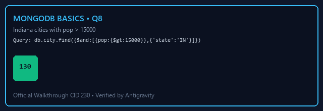

* **Total Conjunction Matches:** **`130`**

#### 4. Official Manual Reference


---

### Question 9: Population < 100 OR State "Indiana"

> **Question:** How many cities of have population less than 100 or belongs to state “Indiana” in collection “city” in database “city”?

#### 1. Technical Methodology
Use the logical disjunction `$or` operator to match records satisfying either population less than 100 (`$lt: 100`) OR located in Indiana (`state: "IN"`).

#### 2. Shell Command & Output
```javascript
> use city
> db.city.find({$or:[{pop:{$lt:100}},{"state":"IN"}]}).count()
1376
```

#### 3. Observable Evidence
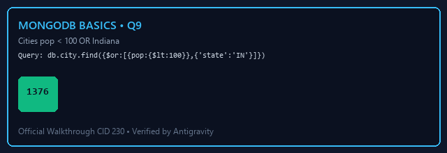

* **Total Disjunction Matches:** **`1376`**

#### 4. Official Manual Reference
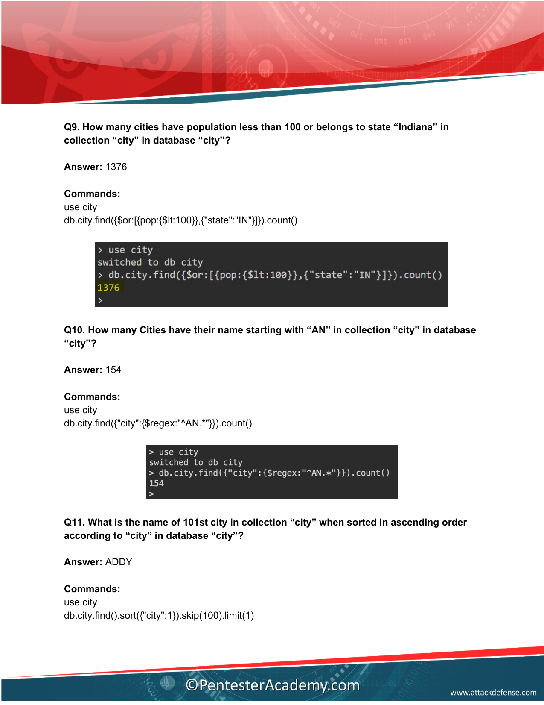

---

### Question 10: Cities Starting with "AN"

> **Question:** How many Cities have their name starting with “AN” in collection “city” in database “city”?

#### 1. Technical Methodology
Perform regular expression filtering using `$regex`. The anchor `^` matches beginning of string: `^AN.*`.

#### 2. Shell Command & Output
```javascript
> use city
> db.city.find({"city":{$regex:"^AN.*"}}).count()
154
```

#### 3. Observable Evidence
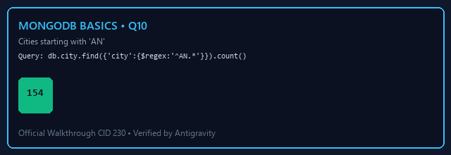

* **Total Regex Prefix Matches:** **`154`**

#### 4. Official Manual Reference


---

### Question 11: 101st City Sorted Alphabetically

> **Question:** What is the name of 101st city in collection “city” when sorted in ascending order according to “city” in database “city”?

#### 1. Technical Methodology
Sort all documents ascending by name (`.sort({"city": 1})`). To retrieve the 101st record (1-based index), skip the first 100 items using `.skip(100)` and fetch 1 record with `.limit(1)`.

#### 2. Shell Command & Output
```javascript
> use city
> db.city.find().sort({"city":1}).skip(100).limit(1)
{ "_id" : "99101", "city" : "ADDY", "loc" : [ -117.84, 48.35 ], "pop" : 2465, "state" : "WA" }
```

#### 3. Observable Evidence


* **101st City Name:** **`ADDY`**

#### 4. Official Manual Reference


---

### Question 12: Average Population in Collection `city`

> **Question:** What is the average population in collection “city” in database “city” (Upto two decimal places)?

#### 1. Technical Methodology
Execute an aggregation pipeline grouping across all documents without segregation (`_id: null`) and calculate the mathematical average using accumulator `$avg: "$pop"`.

#### 2. Shell Command & Output
```javascript
> use city
> db.city.aggregate([{"$group":{"_id":null, avg:{$avg:"$pop"}}}])
{ "_id" : null, "avg" : 8462.79379893339 }
```

#### 3. Observable Evidence
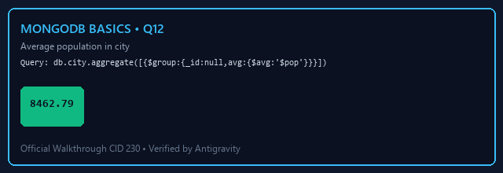

* **Calculation:** Raw output is `8462.79379893339`.
* **Rounded to 2 Decimal Places:** **`8462.79`**

#### 4. Official Manual Reference
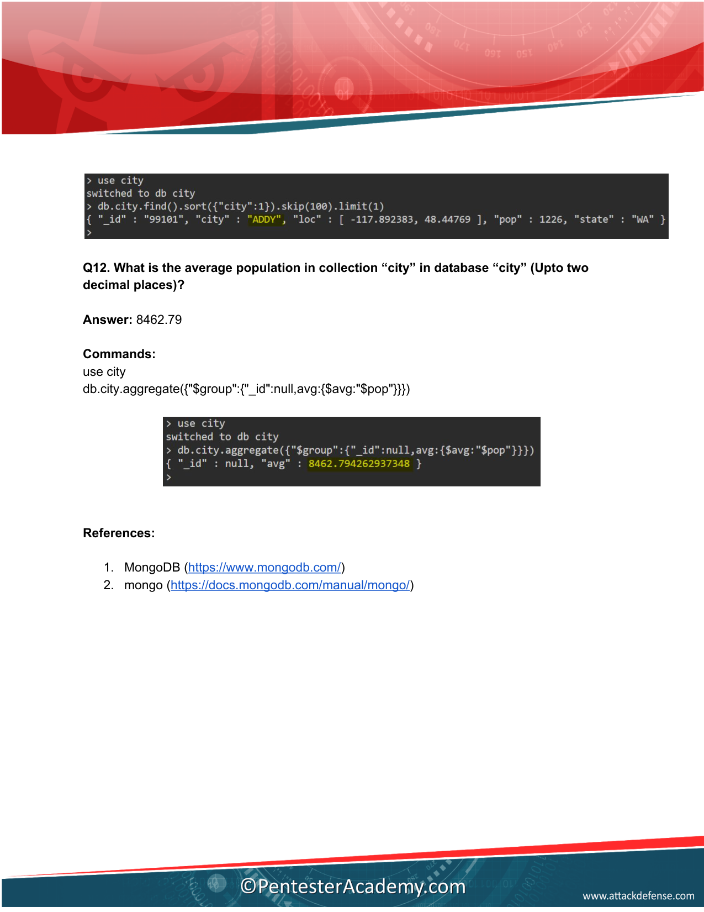

---

# 🛡️ MongoDB Hardening & NoSQL Injection Defense Guide

1. **Parameter Sanitization & Type Enforcing:**
   * Never pass raw request JSON or query objects directly into MongoDB find queries. In Express/Node.js, sanitize keys using libraries such as `express-mongo-sanitize` to strip `$` and `.` characters:
   ```javascript
   const mongoSanitize = require('express-mongo-sanitize');
   app.use(mongoSanitize());
   ```
2. **Enforce MongoDB Authentication & Bind IP:**
   * By default, development MongoDB instances listen on `0.0.0.0` without authentication. Enforce authorization in `/etc/mongod.conf`:
   ```yaml
   net:
     port: 27017
     bindIp: 127.0.0.1
   security:
     authorization: enabled
   ```
3. **Role-Based Access Control (RBAC):**
   * Avoid granting `root` or `dbAdminAnyDatabase` to application service accounts. Grant least privilege (e.g. `readWrite` strictly on the application database).
