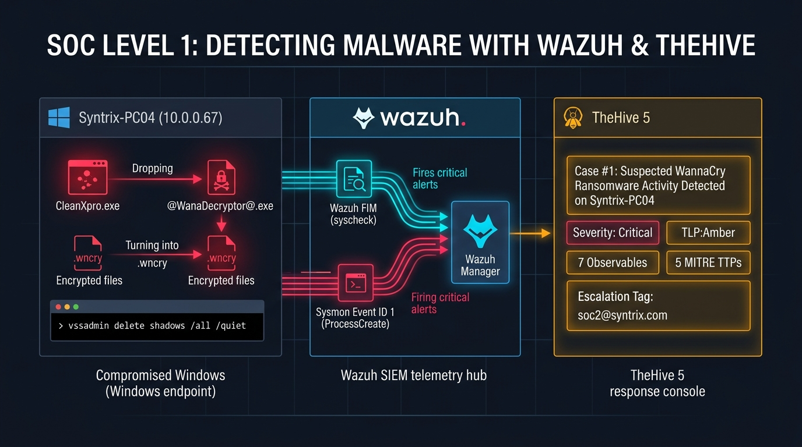
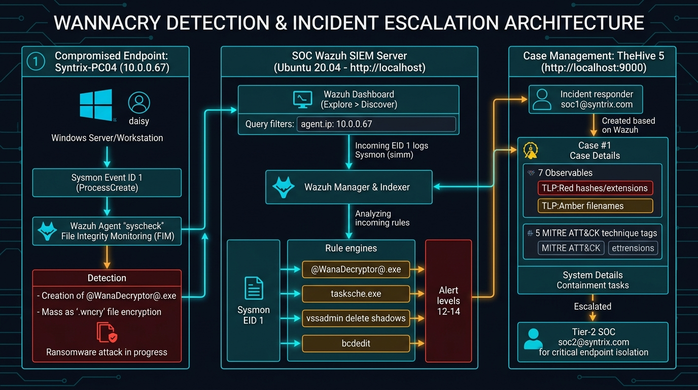
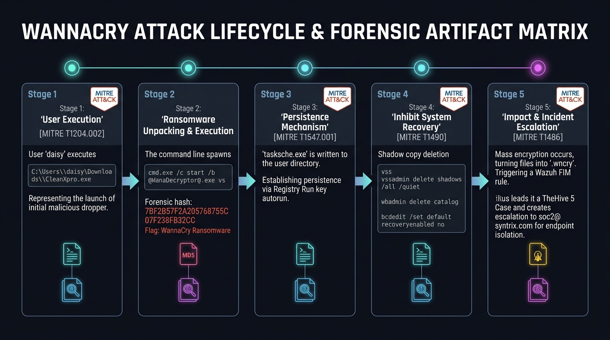
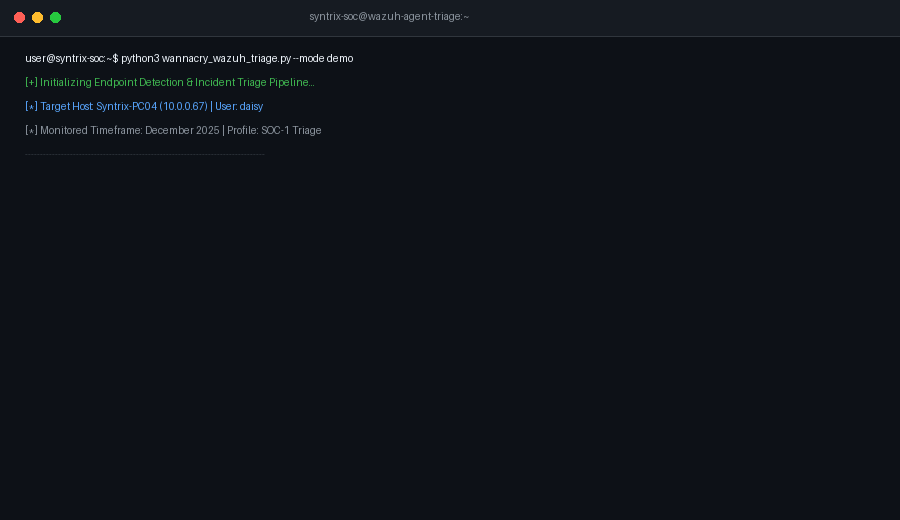
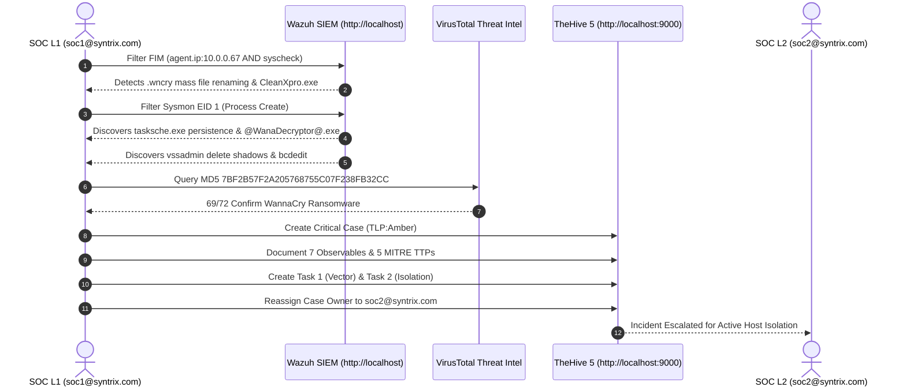

# SOC-1: Detecting Malware — Wazuh FIM, Sysmon Telemetry & TheHive Incident Response

[](https://my.ine.com/course/malware-analysis-for-soc-analysts/2eabbb8c-ca60-4626-8953-c7af35401960/lab/969dfe87-d96f-4e66-ac95-bd400236856d)
[](https://wazuh.com/)
[](https://thehive-project.org/)
[](https://www.virustotal.com/)
[](https://attack.mitre.org/)
[](#)

---

## 📌 Executive Overview

In this incident response engagement, a corporate workstation identified as **Syntrix-PC04** (`10.0.0.67`) experienced unusual system degradation and widespread file tampering under the account of user **`daisy`**. As a **SOC Level 1 Analyst**, endpoint telemetry and event logs within **Wazuh SIEM** were analyzed for **December 2025**.

The forensic investigation identified the execution of a malicious loader **`CleanXpro.exe`**, which delivered the infamous **WannaCry (WanaCrypt0r 2.0)** ransomware payload **`@WanaDecryptor@.exe`** (MD5: `7BF2B57F2A205768755C07F238FB32CC`). The threat actor established autostart persistence via **`tasksche.exe`** in the registry `Run` key, systematically purged Volume Shadow Copies and system recovery points using `vssadmin` and `bcdedit`, and encrypted documents with the **`.wncry`** extension.

All forensic artifacts were formalized into an incident case in **TheHive 5**, mapped to **5 MITRE ATT&CK techniques**, assigned **2 containment tasks**, and escalated to **SOC Level 2** (`soc2@syntrix.com`).

---

## 🖼️ Operations Center Infographics

### 1. Operations Center Hero Banner


### 2. Detection & Escalation Architecture


### 3. WannaCry Attack Lifecycle & Forensics Matrix


---

## 🔬 Lab Environment & Credentials

| Component | Target / Host | IP / URL | Credentials / Profile |
|:---|:---|:---|:---|
| **Compromised Host** | `Syntrix-PC04` | `10.0.0.67` | Windows Workstation / User: `daisy` |
| **Wazuh SIEM Server** | Ubuntu 20.04 | `http://localhost` | Default Web UI Session |
| **TheHive Case Management**| Ubuntu 20.04 | `http://localhost:9000` | User: `soc1@syntrix.com` / Pass: `pass123` |
| **Escalated Analyst** | Syntrix SOC | Internal Escalation | `soc2@syntrix.com` (SOC Level 2) |
| **Target Timeframe** | Log Analysis | Historical Range | **December 2025** |

---

## 💻 Automated Incident Triage Tool (`wannacry_wazuh_triage.py`)

A custom Python engine has been developed to automate the triage pipeline, parse Sysmon and FIM indicators, cross-reference VirusTotal threat intelligence, and export structured TheHive 5 case packages.

### Terminal Demonstration


### CLI Commands & Features
```bash
# Run interactive incident simulation & telemetry parsing
python wannacry_wazuh_triage.py --mode demo

# Display structured forensic matrix of all 7 observables & MITRE TTPs
python wannacry_wazuh_triage.py --mode analyze

# Export TheHive 5 JSON import payload
python wannacry_wazuh_triage.py --mode export-thehive --output thehive_case_export.json

# Generate executive and technical Markdown incident report
python wannacry_wazuh_triage.py --mode generate-report --output WANNACRY_INCIDENT_REPORT.md

# Query VirusTotal intelligence for @WanaDecryptor@.exe MD5
python wannacry_wazuh_triage.py --mode virustotal
```

---

## 🚨 Indicators of Compromise (IOC) Matrix

| Observable ID | Type | Artifact Value | TLP | PAP | IOC Status | Sighted Timestamp | Forensic Context & Relevance |
|:---|:---|:---|:---|:---|:---|:---|:---|
| **OBS-01** | `other` | `daisy` | Amber | Amber | Context (No) | `2025-12-05 05:53:09` | Local user context initiating the malicious execution sequence. |
| **OBS-02** | `filename` | `C:\Users\daisy\Downloads\CleanXpro.exe` | Amber | Amber | **IOC (Yes)** | `2025-12-05 05:53:09` | Initial dropper disguised as system utility; spawned cmd processes. |
| **OBS-03** | `filename` | `C:\Users\daisy\Downloads\@WanaDecryptor@.exe` | **Red** | **Red** | **IOC (Yes)** | `2025-12-05 05:52:55` | Primary WannaCry ransomware decryptor & encryption engine. |
| **OBS-04** | `hash` | `7BF2B57F2A205768755C07F238FB32CC` | **Red** | **Red** | **IOC (Yes)** | `2025-12-05 05:52:55` | MD5 hash of `@WanaDecryptor@.exe` (VirusTotal: 69/72 WannaCry). |
| **OBS-05** | `filename` | `C:\Users\daisy\Downloads\tasksche.exe` | Amber | Amber | **IOC (Yes)** | `2025-12-05 05:53:09` | Malicious executable registered to `Run` registry key for persistence. |
| **OBS-06** | `other` | `.wncry` | **Red** | **Red** | **IOC (Yes)** | `2025-12-05 05:52:30` | Characteristic encrypted file extension appended during attack. |
| **OBS-07** | `other` | `Deletion of Volume Shadow Copies and disabling of Windows recovery mechanisms` | Amber | Amber | **IOC (Yes)** | `2025-12-05 05:52:55` | Command string executing `vssadmin`, `wbadmin`, and `bcdedit`. |

---

## 🛡️ MITRE ATT&CK Mapping

```
+---------------------------------------------------------------------------------------------------------+
|                                    MITRE ATT&CK ENTERPRISE MATRIX                                       |
+---------------------+-------------------+---------------------------------------------------------------+
| TACTIC              | TECHNIQUE ID      | EVIDENCE & OPERATIONAL ATTRIBUTION                            |
+---------------------+-------------------+---------------------------------------------------------------+
| **Execution**       | `T1204.002`       | User `daisy` executed downloaded binary `CleanXpro.exe`.      |
| **Execution**       | `T1059.003`       | Malware spawned `cmd.exe /c` for registry & decryptor launch. |
| **Persistence**     | `T1547.001`       | Registry key `HKLM\...\Run` modified to autostart `tasksche`. |
| **Impact**          | `T1490`           | Executed `vssadmin delete shadows` and `bcdedit recovery=no`. |
| **Impact**          | `T1486`           | Mass document renaming and encryption using `.wncry` ext.     |
+---------------------+-------------------+---------------------------------------------------------------+
```

---

## 📋 TheHive 5 Case Configuration Summary

- **Case Title:** `Suspected WannaCry Ransomware Activity Detected on Syntrix-PC04`
- **Severity Rating:** `Critical`
- **Sharing Protocol:** `TLP:Amber` / `PAP:Amber`
- **Tags:** `ransomware`, `wannacry`, `file-encryption`, `persistence`, `windows`
- **Case Tasks:**
  1. **Task 1 — Initial Infection Vector Review:** Context on suspected initial foothold and execution path (`soc2@syntrix.com`).
  2. **Task 2 — Containment and Isolation Considerations:** Context on potential containment and host isolation (`soc2@syntrix.com`).
- **Escalation Target:** Reassigned case owner from `soc1@syntrix.com` to **`soc2@syntrix.com`**.

---

## 🔍 Investigation Workflow Summary



---

## 🛡️ Recommended Containment & Remediation Actions

1. **Host Isolation:** Immediately detach `Syntrix-PC04` (`10.0.0.67`) from the corporate LAN/VLAN to prevent propagation via SMBv1 / EternalBlue (`MS17-010`).
2. **Account Revocation:** Invalidate all active session tokens and reset passwords for user `daisy`.
3. **Registry Remediation:** Remove the persistence entry:
   ```cmd
   reg delete HKLM\SOFTWARE\Microsoft\Windows\CurrentVersion\Run /v "tasksche" /f
   ```
4. **Perimeter Firewall Rules:** Block outbound port 445 (SMB) and block communication to known WannaCry command-and-control / kill-switch domains.
5. **System Re-imaging:** Since Volume Shadow Copies and system recovery catalogs were purged, re-image the machine from a known clean gold master and restore user documents from verified offline backups.

---

## 📖 Complete Walkthrough Guide
For the complete step-by-step documentation with raw log extracts and expanded screenshots, see:  
👉 **[SOC_1_Detecting_Malware_Walkthrough.md](SOC_1_Detecting_Malware_Walkthrough.md)**
