# SOC-1: Detecting Malware — Complete Lab Walkthrough & Incident Analysis

[](https://wazuh.com/)
[](https://thehive-project.org/)
[](https://www.virustotal.com/)
[](https://attack.mitre.org/)
[](https://www.first.org/tlp/)

> **Lab Reference:** [INE Security — Malware Analysis for SOC Analysts: SOC-1 Detecting Malware](https://my.ine.com/course/malware-analysis-for-soc-analysts/2eabbb8c-ca60-4626-8953-c7af35401960/lab/969dfe87-d96f-4e66-ac95-bd400236856d)  
> **Course Track:** Malware Analysis for SOC Analysts  
> **Target Endpoint:** `Syntrix-PC04` (`10.0.0.67`)  
> **Threat Family:** WannaCry / WanaCrypt0r 2.0 Ransomware  
> **Triage Platform:** Wazuh SIEM (`http://localhost`) & TheHive 5 (`http://localhost:9000`)  
> **Analyst Credentials:** `soc1@syntrix.com` / `pass123`  
> **Escalation Target:** SOC Level 2 Analyst (`soc2@syntrix.com`)  

---

## Visual Architecture & Threat Lifecycle


### End-to-End Threat Hunting & Case Escalation Flow
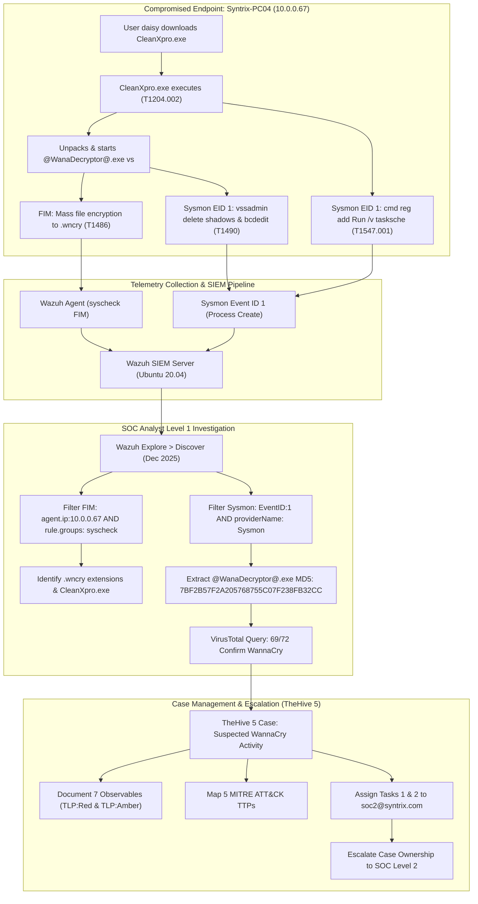

---

## Executive Summary & Threat Profile

During routine security monitoring at **Syntrix**, automated endpoint detection alerts flagged anomalous, high-velocity file modifications on workstation **Syntrix-PC04** (`10.0.0.67`). As a SOC Level 1 Analyst, an in-depth investigation was initiated across **Wazuh SIEM** endpoint telemetry and **Sysmon** audit logs generated during **December 2025**.

The forensic analysis established that the local user account **`daisy`** downloaded and executed a malicious binary named **`CleanXpro.exe`**. This process acted as a first-stage loader, spawning command-line utilities to establish startup registry persistence via **`tasksche.exe`** and executing the secondary payload **`@WanaDecryptor@.exe`** (MD5: `7BF2B57F2A205768755C07F238FB32CC`). The malware executed aggressive anti-recovery commands (`vssadmin delete shadows /all /quiet`, `wbadmin delete catalog -quiet`, `bcdedit /set {default} recoveryenabled no`) before systematically encrypting user files with the **`.wncry`** extension.

All forensic artifacts, indicators of compromise (IOCs), and MITRE ATT&CK techniques were documented in **TheHive 5** case management under **TLP:Amber** / **PAP:Amber**, and the incident was escalated to **SOC Level 2** (`soc2@syntrix.com`) for immediate host isolation and enterprise-wide sweep.

| Attribute | Forensic Value | Description / Context |
|:---|:---|:---|
| **Affected Endpoint** | `Syntrix-PC04` | Windows Workstation / Server |
| **Endpoint IP** | `10.0.0.67` | Wazuh Agent Monitored Endpoint |
| **Compromised Account** | `daisy` (`SYNTRIX-PC04\daisy`) | Local standard user account |
| **Initial Dropper** | `CleanXpro.exe` | First-stage malware disguised as system cleaner |
| **Ransomware Payload** | `@WanaDecryptor@.exe` | Core WannaCry decryptor & encryption engine |
| **Persistence Binary** | `tasksche.exe` | Task scheduler persistence executable in Downloads |
| **Payload MD5 Hash** | `7BF2B57F2A205768755C07F238FB32CC` | VirusTotal 69/72 detection (WannaCry) |
| **Encrypted Extension**| `.wncry` | Characteristic WannaCrypt0r 2.0 encrypted file extension |
| **Recovery Invalidation**| `vssadmin`, `wbadmin`, `bcdedit` | Mass deletion of shadow copies and backup catalogs |
| **Incident Classification** | **Critical / Ransomware** | TLP:Amber / PAP:Amber |

---

## Step-by-Step Lab Walkthrough

### Step 1: Accessing the Wazuh Management Console

1. On the **Wazuh** Ubuntu desktop tab, launch **Mozilla Firefox**.
2. Navigate to the local Wazuh dashboard URL:
   ```text
   https://localhost/app/login?
   ```
3. Enter the default administrative credentials to access the central monitoring console.

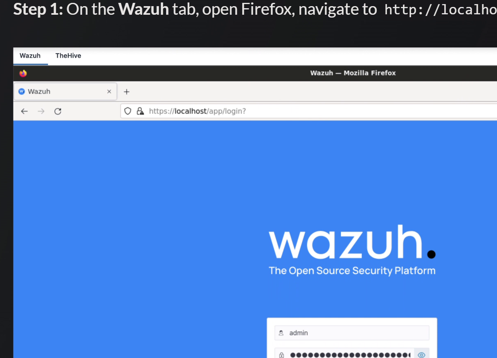

---

### Step 2: Navigating to Explore > Discover & Calibrating Time Horizon

1. From the Wazuh top-left navigation menu, expand the navigation drawer and select **Explore > Discover**.

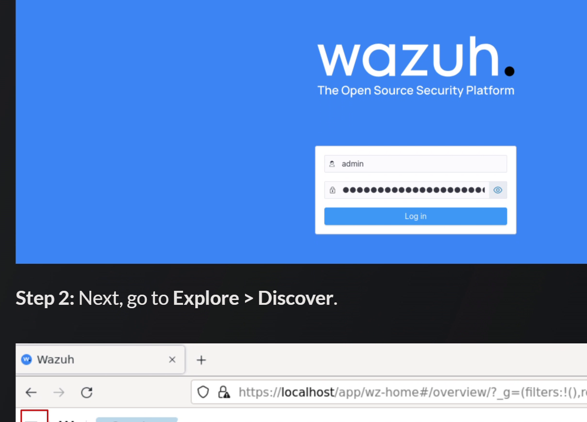

2. The lab scenario states that suspicious events occurred in **December 2025**. By default, the Discover window inspects `Last 24 hours` or `Last 7 days`.
3. Click the time range selector in the top-right corner.
4. Set an absolute time window encompassing the entire month of December 2025:
   - **Start:** `Dec 1, 2025 @ 00:00:00.000`
   - **End:** `Dec 31, 2025 @ 23:59:59.999`
5. Click **Apply** to load historical agent telemetry.

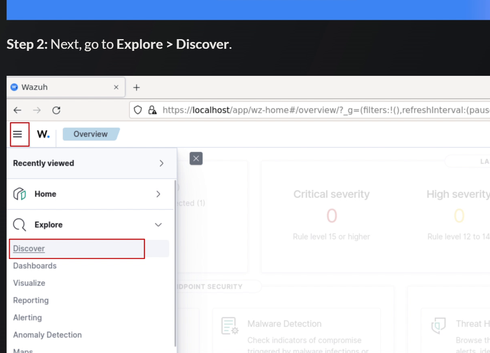

---

### Step 3: Investigating File Integrity Monitoring (FIM / `syscheck`) Events

Malware, specifically ransomware, intrinsically alters host filesystems by creating, encrypting, and renaming documents. Wazuh integrates a native File Integrity Monitoring module named **`syscheck`** that tracks file checksums, attributes, and file creation/deletion events.

1. In the Discover search bar, enter the following query to isolate FIM alerts from endpoint `10.0.0.67`:
   ```text
   agent.ip:10.0.0.67 AND rule.groups : "syscheck"
   ```

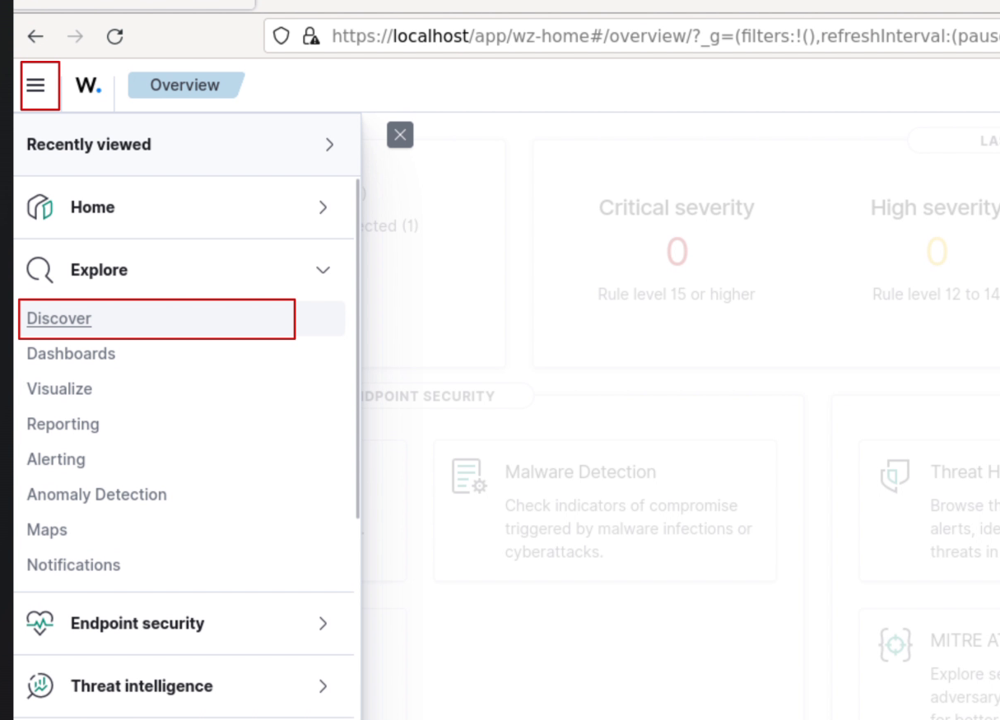

2. To enhance readability across the event stream, add the **`full_log`** field as a display column from the *Available fields* panel on the left.

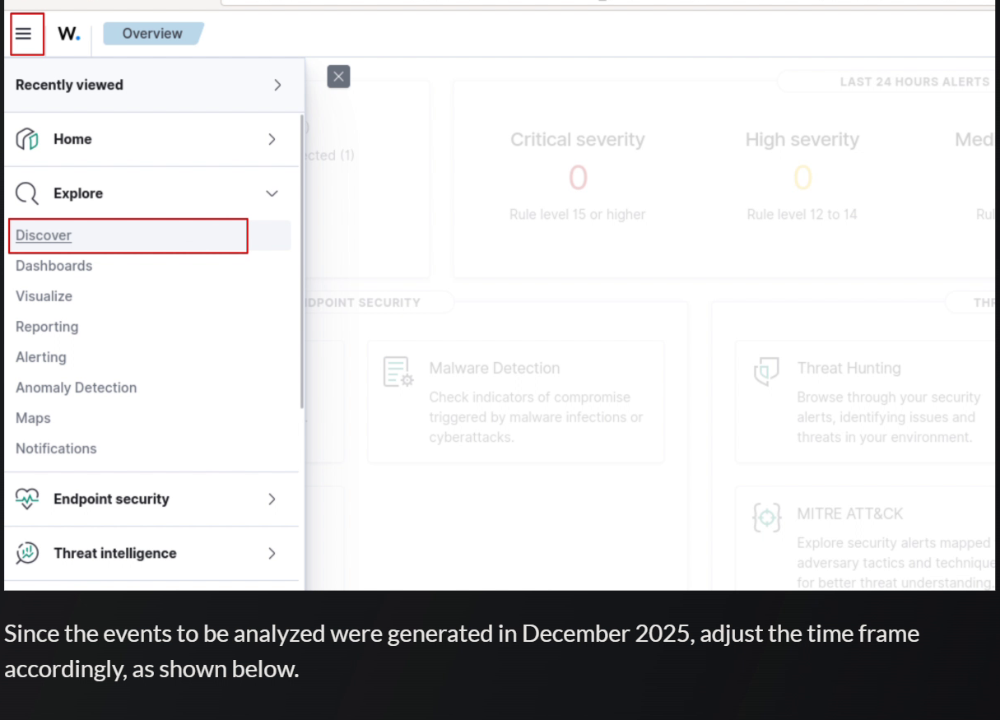

3. Reviewing the filtered event timeline reveals an anomalous sequence of high-frequency events:
   - Files located within user directories (`C:\Users\daisy\Desktop`, `Documents`, `Downloads`) are logged as **deleted**, followed immediately by the creation of new files bearing identical basenames with the **`.wncry`** extension.
   - In Wazuh FIM architecture, a rapid delete-and-create cycle for the same base document represents a **file rename and overwrite** operation.
   - The file content checksums (MD5/SHA1/SHA256) are completely modified, indicating mass encryption.

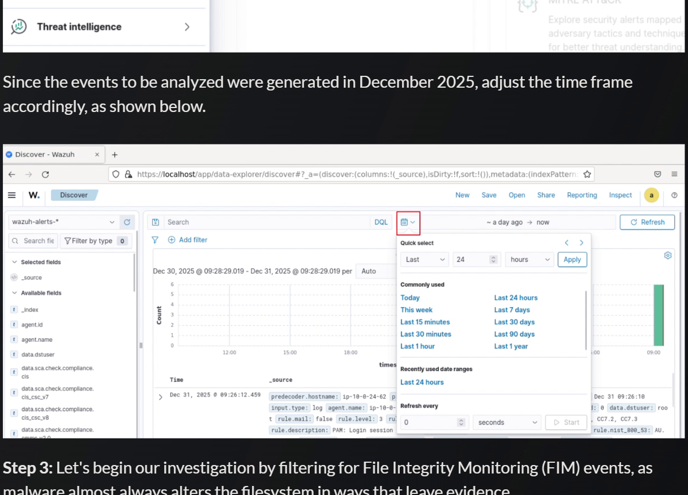

4. Expand one of the file modification log entries to inspect the low-level event parameters.
5. Identify the modifying process and user context:
   - **Process Image:** `C:\Users\daisy\Downloads\CleanXpro.exe`
   - **User Account:** `daisy`
   - **Target File:** `C:\Users\daisy\Desktop\Financial_Records.xlsx.wncry`

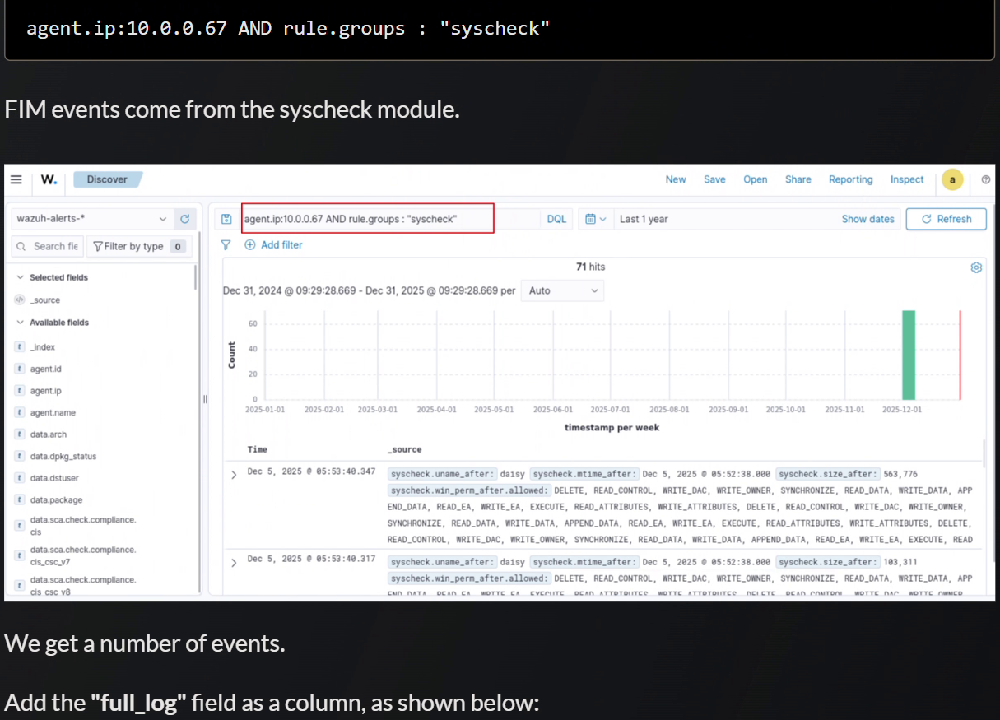

6. Note the user context: the activity executed under standard user credentials **`daisy`**.

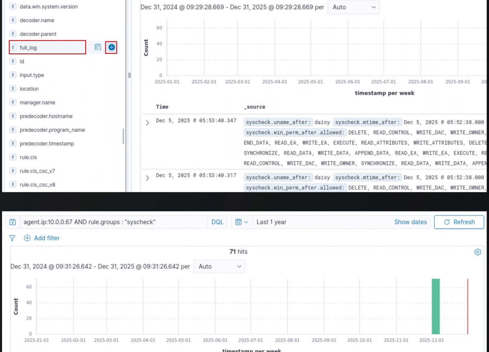

7. Notice that during the file modification burst, new standalone executable artifacts were placed onto the filesystem:
   - **`C:\Users\daisy\Downloads\@WanaDecryptor@.exe`**
   - **`C:\Users\daisy\Downloads\tasksche.exe`**

The presence of the `.wncry` extension combined with `@WanaDecryptor@.exe` definitively points toward the **WannaCry (WanaCrypt0r 2.0)** ransomware family.

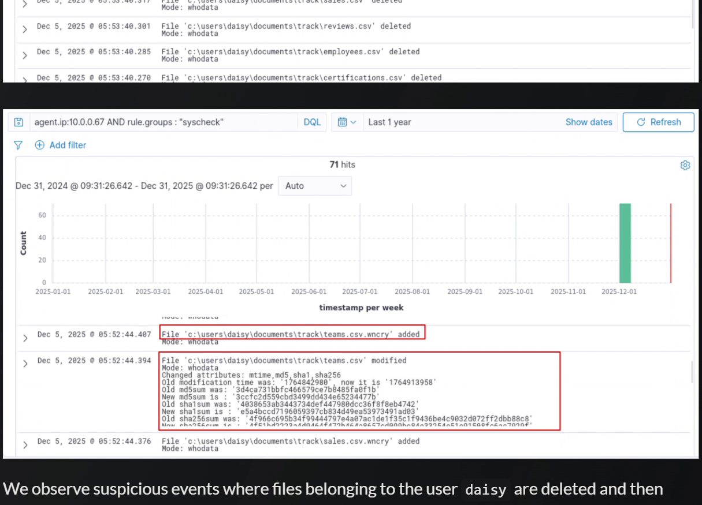

---

### Step 4: Investigating Sysmon Process Creation Telemetry (Event ID 1)

While FIM documents *what* happened to the filesystem, Sysmon Process Creation (**Event ID 1**) logs reconstruct *how* the execution unfolded, including command-line arguments, parent-child process lineages, and cryptographic hashes.

1. Remove the `full_log` column filter.
2. In the Discover search bar, enter the Sysmon Process Creation query:
   ```text
   agent.ip:10.0.0.67 AND data.win.system.providerName:"Microsoft-Windows-Sysmon" AND data.win.system.eventID:1
   ```

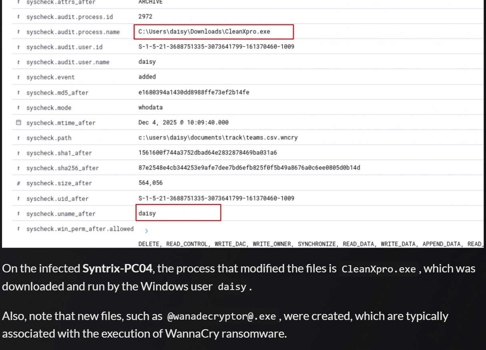

#### Event Analysis 1: Startup Persistence via Registry Run Key (`05:53:09.176`)
- **Timestamp:** `Dec 5, 2025 @ 05:53:09.176`
- **Parent Image:** `C:\Users\daisy\Downloads\CleanXpro.exe` (PID: 3820)
- **Spawned Image:** `C:\Windows\System32\cmd.exe`
- **Executed Command Line:**
  ```cmd
  cmd.exe /c reg add HKLM\SOFTWARE\Microsoft\Windows\CurrentVersion\Run /v "tasksche" /t REG_SZ /d "\"C:\Users\daisy\Downloads\tasksche.exe\"" /f
  ```
- **Forensic Assessment:** The suspicious loader `CleanXpro.exe` established autostart persistence by registering `tasksche.exe` into the global `Run` registry key. This ensures the ransomware persistence module executes upon every system reboot.
- **MITRE Technique:** **T1547.001 (Boot or Logon Autostart Execution: Registry Run Keys / Startup Folder)**.

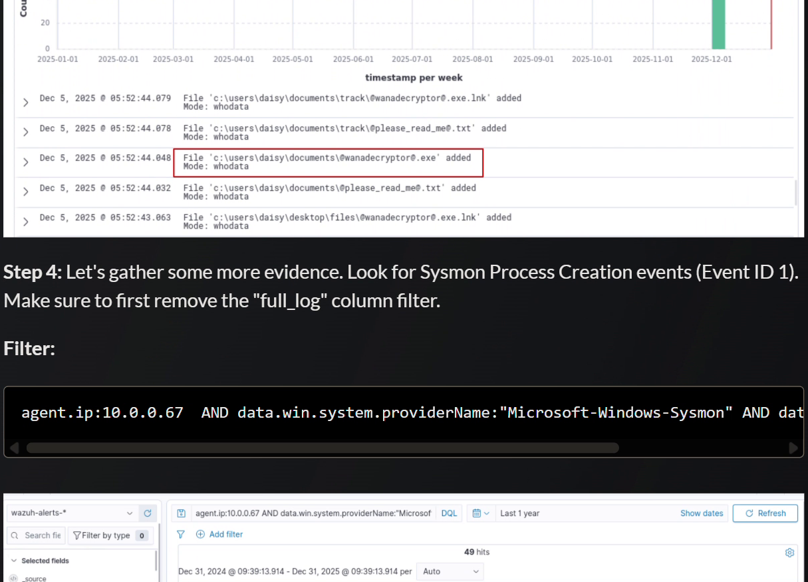

#### Event Analysis 2: Ransomware Decryptor & Payload Execution (`05:52:44.423`)
- **Timestamp:** `Dec 5, 2025 @ 05:52:44.423`
- **Parent Image:** `C:\Windows\SysWOW64\cmd.exe`
- **Spawned Image:** `C:\Users\daisy\Downloads\@WanaDecryptor@.exe`
- **Executed Command Line:**
  ```cmd
  cmd.exe /c start /b @WanaDecryptor@.exe vs
  ```
- **Process Hashes:**
  - **MD5:** `7BF2B57F2A205768755C07F238FB32CC`
  - **SHA256:** `B9C5D4339809E0AD9A00D4D3DD26FDF44A32819A54ABF846BB9B560D81391C25`
- **User:** `SYNTRIX-PC04\daisy`

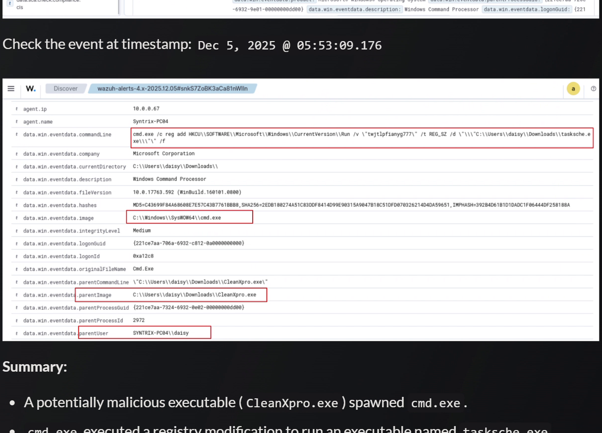

#### Threat Intelligence Validation (VirusTotal)
1. On your analysis workstation, navigate to [VirusTotal Search](https://www.virustotal.com/gui/home/search).
2. Query the extracted MD5 hash:
   ```text
   7BF2B57F2A205768755C07F238FB32CC
   ```
3. **Findings:** 69 out of 72 security vendors flag the file as malicious, identifying it as **Ransom:Win32/WannaCrypt**, **WanaCrypt0r 2.0**, or **Trojan-Ransom.Win32.Wanna**.

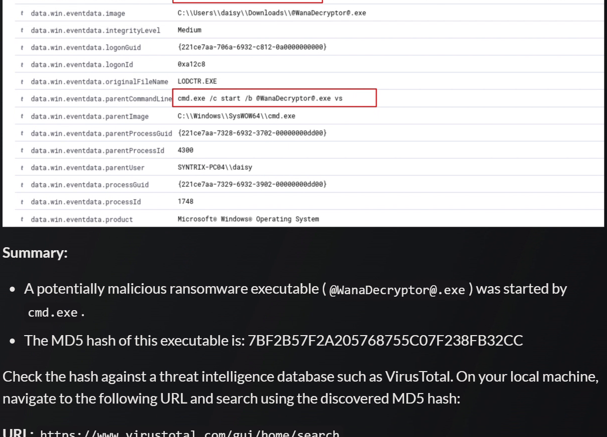

#### Event Analysis 3: Anti-Recovery & Backup Destruction (`05:52:55.615`)
- **Timestamp:** `Dec 5, 2025 @ 05:52:55.615`
- **Parent Image:** `C:\Users\daisy\Downloads\@WanaDecryptor@.exe` (PID: 1748)
- **Spawned Image:** `C:\Windows\System32\cmd.exe`
- **Executed Command Line:**
  ```cmd
  cmd.exe /c vssadmin delete shadows /all /quiet & wbadmin delete catalog -quiet & bcdedit /set {default} bootstatuspolicy ignoreallfailures & bcdedit /set {default} recoveryenabled no
  ```
- **Forensic Breakdown:**
  1. `vssadmin delete shadows /all /quiet`: Silently purges all Volume Shadow Copies, preventing native Windows file restoration.
  2. `wbadmin delete catalog -quiet`: Destroys the Windows Server Backup database.
  3. `bcdedit /set {default} bootstatuspolicy ignoreallfailures`: Forces Windows to ignore boot failures during restart.
  4. `bcdedit /set {default} recoveryenabled no`: Disables Windows automatic startup recovery and repair environments.
- **Adversary Objectives:**
  - Ensure victims cannot restore encrypted data from local shadow snapshots.
  - Coerce the organization into paying the cryptocurrency ransom.
  - Maximize operational downtime and damage prior to detection.
- **MITRE Technique:** **T1490 (Inhibit System Recovery)**.

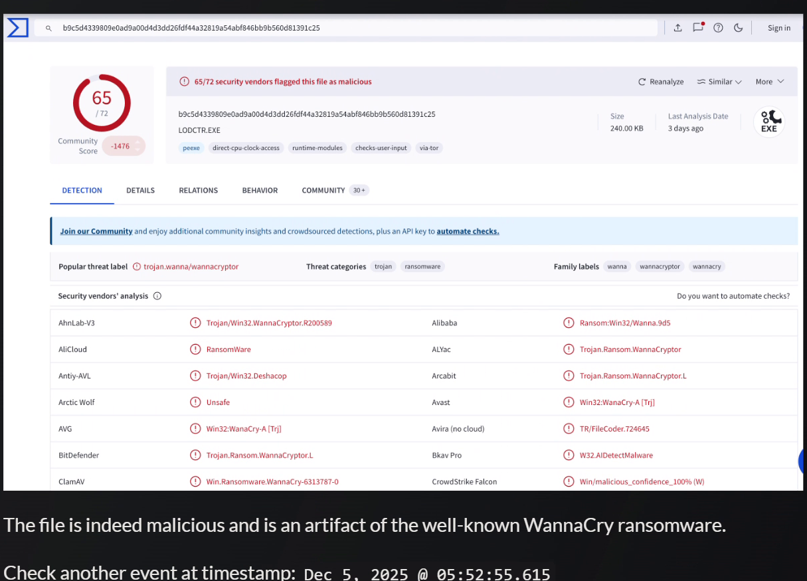

---

### Step 5: Accessing TheHive Incident Management Platform

Having gathered rigorous endpoint telemetry and validated threat intelligence, we transition to **TheHive 5** to log the security incident, structure the evidence, and escalate the case.

1. Switch to **TheHive** tab in the browser or navigate to:
   ```text
   http://localhost:9000
   ```
2. Log in using the analyst credentials:
   - **Username:** `soc1@syntrix.com`
   - **Password:** `pass123`

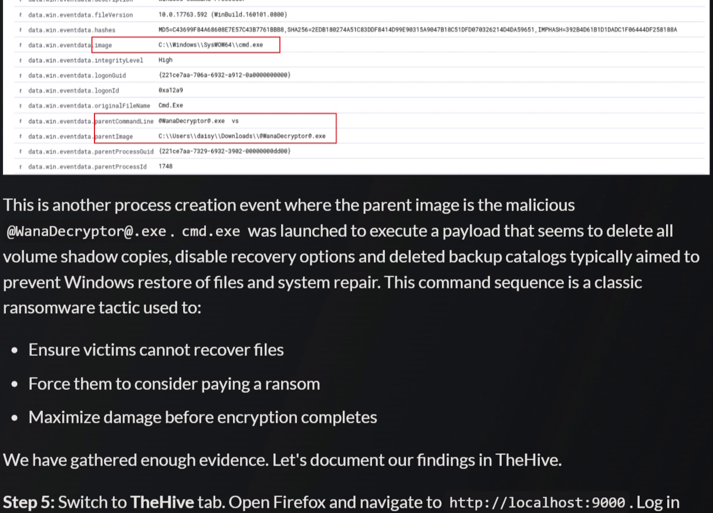

---

### Step 6: Case Initialization in TheHive

1. In the upper-right corner of the dashboard, click **Create case > Empty case**.

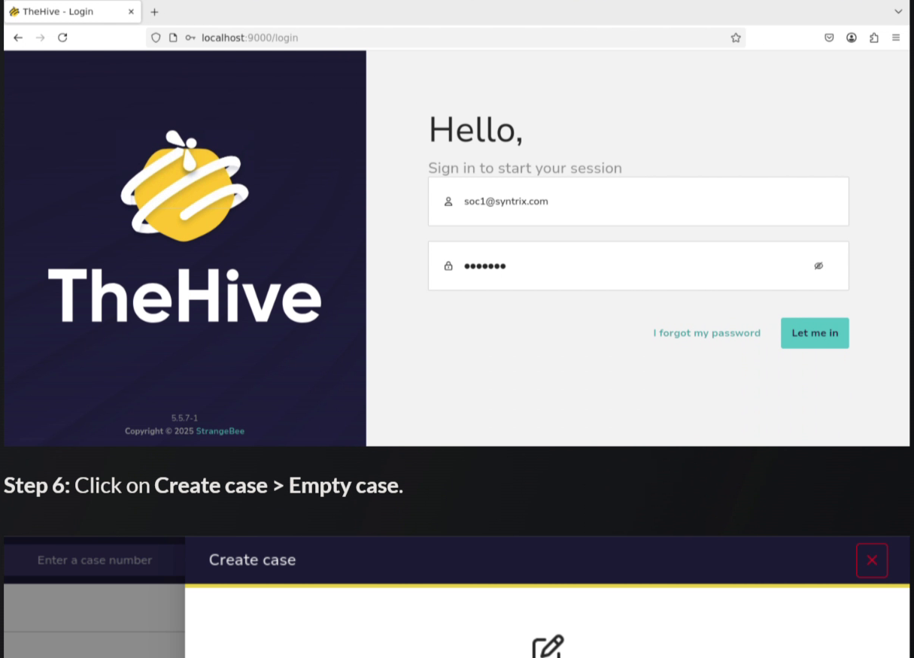

2. Fill in the case parameters:
   - **Title:** `Suspected WannaCry Ransomware Activity Detected on Syntrix-PC04`
   - **Date:** Select current date and time.
   - **Severity:** `Critical` (Active ransomware with data encryption and recovery inhibition).
   - **TLP:** `TLP:Amber` (Restricted sharing within Syntrix and trusted partners on need-to-know basis).
   - **PAP:** `PAP:Amber` (Passive external checks permitted; e.g. VirusTotal/WHOIS lookups, but no active scanning against threat infrastructure).
   - **Tags:** `ransomware`, `wannacry`, `file-encryption`, `persistence`, `windows`
   - **Description:**
     > A Windows system identified as Syntrix-PC04 (agent IP: 10.0.0.67) exhibited suspicious behavior indicative of a ransomware infection. Analysis of Wazuh File Integrity Monitoring (FIM) alerts and Sysmon process creation logs revealed multiple indicators consistent with WannaCry ransomware activity.
3. Skip the *Tasks* tab for now and click **Confirm**.

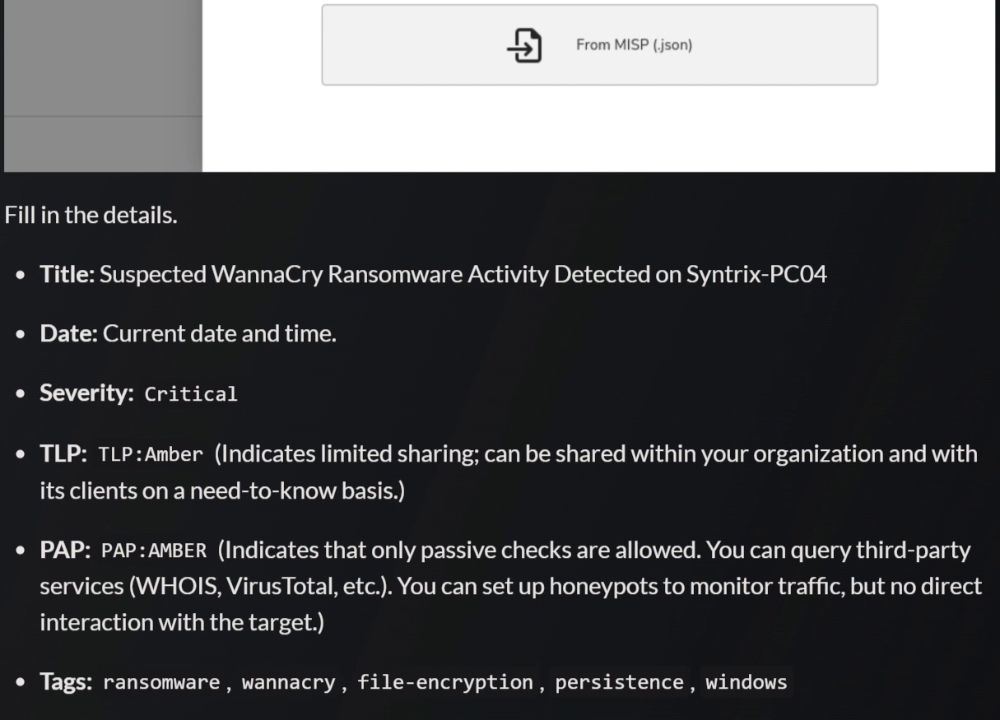

4. The case overview dashboard is created and initialized.

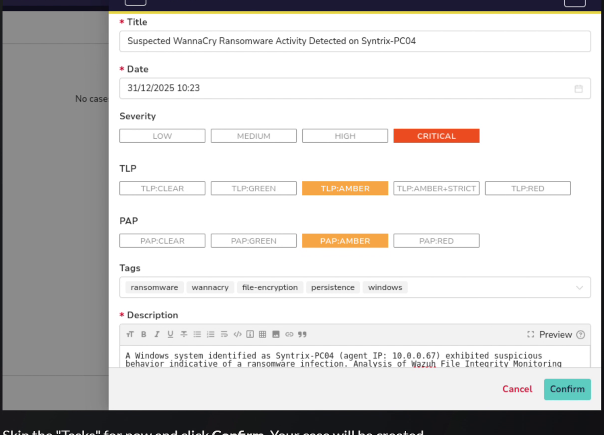

---

### Step 7: Documenting Forensic Observables (IOCs)

Navigate to the **Observables** tab in the case view and click the **+** button to register each artifact.

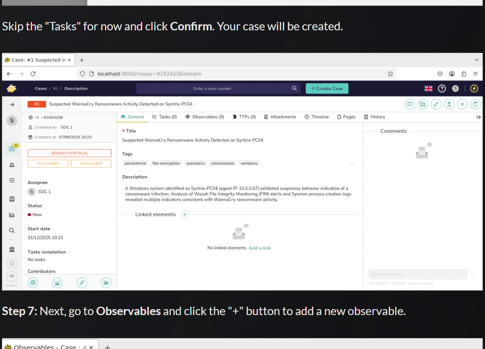

#### Observable 1: Involved User Account
- **Type:** `other`
- **Value:** `daisy`
- **TLP / PAP:** `TLP:Amber` / `PAP:Amber`
- **Is IOC:** `No` (Contextual entity associated with activity)
- **Has been sighted:** `Yes`
- **Sighted at:** `05/12/2025 @ 05:53:09`
- **Ignore Similarity:** `No`
- **Tags:** `user-context`, `execution`, `ransomware`
- **Description:** Local Windows user account under which the suspicious executable was downloaded and executed. Activity under this account is directly associated with the onset of ransomware behavior and subsequent system impact.
- Click **Save and add another**.

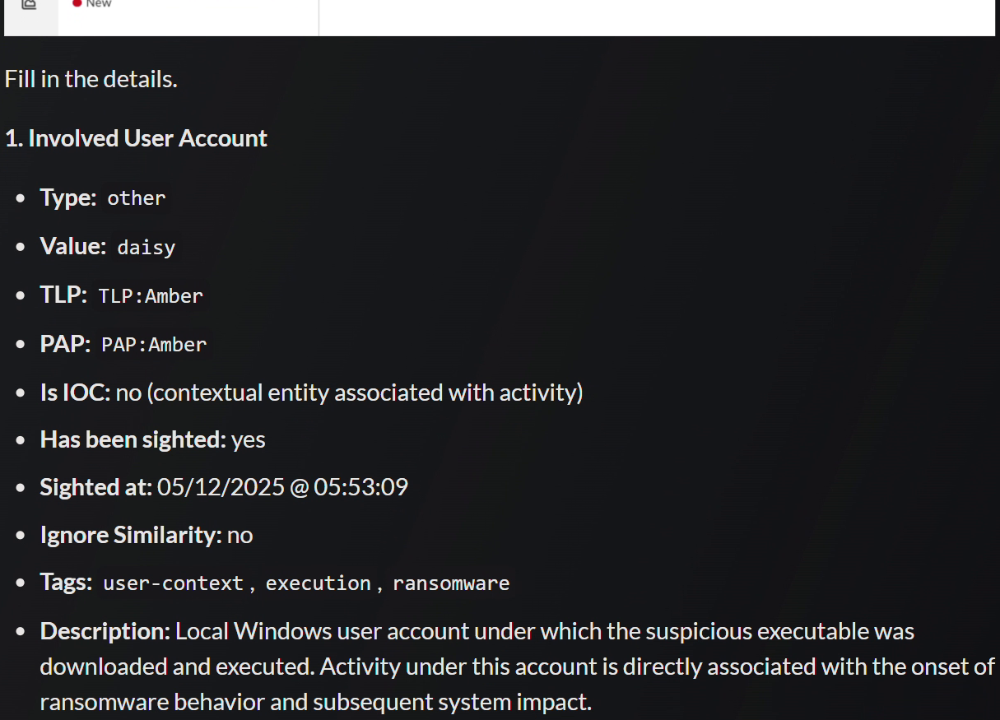

#### Observable 2: Suspicious Executable — Initial Infection Vector
- **Type:** `filename`
- **Value:** `C:\Users\daisy\Downloads\CleanXpro.exe`
- **TLP / PAP:** `TLP:Amber` / `PAP:Amber`
- **Is IOC:** `Yes` (Associated with malicious activity)
- **Has been sighted:** `Yes`
- **Sighted at:** `05/12/2025 @ 05:53:09`
- **Ignore Similarity:** `No`
- **Tags:** `malware`, `execution`
- **Description:** Executable run by user "daisy" that initiated suspicious process activity and was responsible for spawning command-line execution and subsequent filesystem modifications.
- Click **Save and add another**.

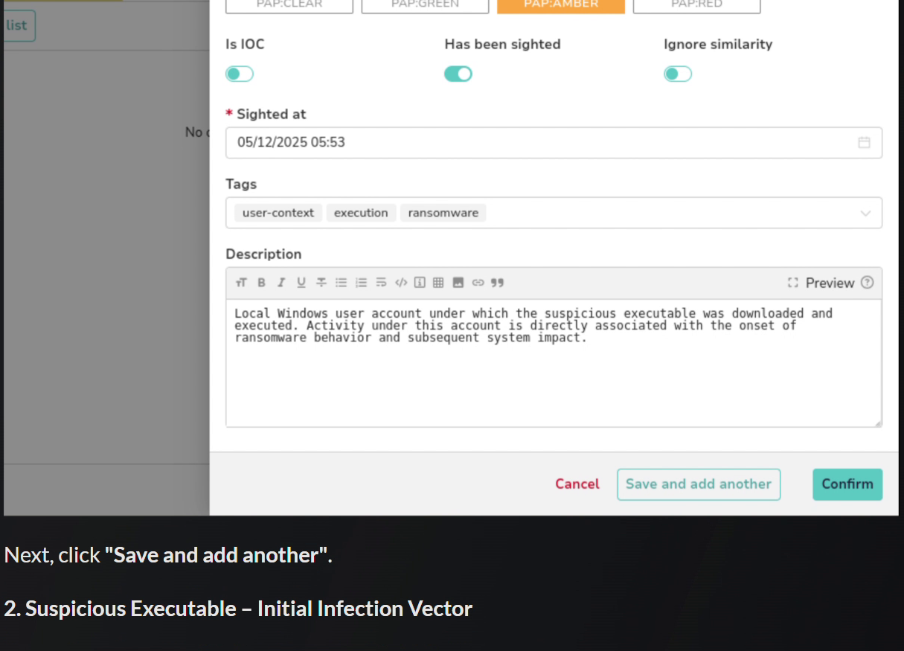

#### Summary of Additional Observables (3 through 7)
Follow the same workflow to enter the remaining observables:

| # | Type | Observable Value | TLP | IOC? | Sighted At | Description & Context |
|:---|:---|:---|:---|:---|:---|:---|
| **3** | `filename` | `C:\Users\daisy\Downloads\@WanaDecryptor@.exe` | **TLP:Red** | **Yes** | `05/12/2025 @ 05:52:55` | Executable created and executed following initial infection; core ransomware decryptor. |
| **4** | `hash` | `7BF2B57F2A205768755C07F238FB32CC` | **TLP:Red** | **Yes** | `05/12/2025 @ 05:52:55` | MD5 hash associated with `@WanaDecryptor@.exe`, verified on VirusTotal (69/72). |
| **5** | `filename` | `C:\Users\daisy\Downloads\tasksche.exe` | **TLP:Amber** | **Yes** | `05/12/2025 @ 05:53:09` | Executable configured via registry Run key for reboot persistence. |
| **6** | `other` | `.wncry` | **TLP:Red** | **Yes** | `05/12/2025 @ 05:52:30` | Encrypted file extension appended to affected user data during encryption phase. |
| **7** | `other` | `Deletion of Volume Shadow Copies and disabling of Windows recovery mechanisms` | **TLP:Amber** | **Yes** | `05/12/2025 @ 05:52:55` | Command-line execution invoking `vssadmin`, `wbadmin`, and `bcdedit` to inhibit recovery. |

After inputting all 7 observables, click **Confirm**.

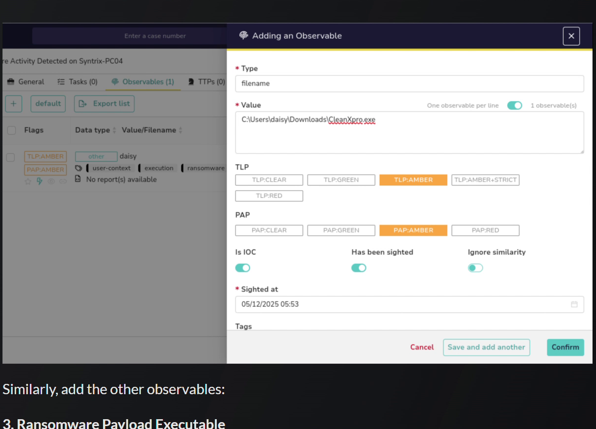

---

### Step 8: Mapping MITRE ATT&CK Tactics, Techniques & Procedures (TTPs)

1. Navigate to the **TTPs** tab in the case view and click the **+** button.

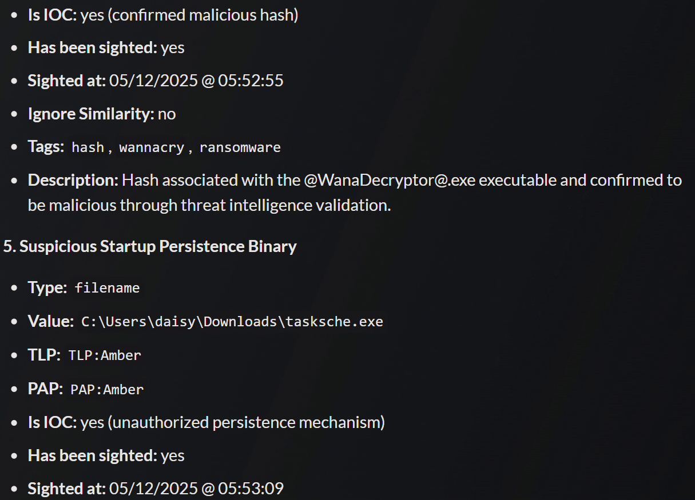

2. Set the global **Occur date** to:
   ```text
   05/12/2025 @ 05:52:55
   ```
3. Add the 5 identified MITRE ATT&CK techniques with their corresponding evidence reasons:

| Tactic | Technique ID | Technique Name | Technical Justification / Evidence Reason |
|:---|:---|:---|:---|
| **Execution** | `T1204.002` | User Execution: Malicious File | The malware activity originated from execution of a user-downloaded executable (`CleanXpro.exe`) under the user account `daisy`. |
| **Execution** | `T1059.003` | Command and Scripting Interpreter: Windows Command Shell | The malicious executable spawned `cmd.exe` to execute additional commands, including registry modifications and execution of secondary payloads. |
| **Persistence**| `T1547.001` | Boot or Logon Autostart Execution: Registry Run Keys | A registry modification was observed to ensure execution of `tasksche.exe` at system startup, indicating an attempt to maintain persistence across reboots. |
| **Impact** | `T1490` | Inhibit System Recovery | The ransomware executed commands to delete volume shadow copies and disable recovery options, preventing file restoration and system rollback. |
| **Impact** | `T1486` | Data Encrypted for Impact | Multiple user files were renamed with the `.wncry` extension and their contents modified, consistent with ransomware encryption behavior associated with WannaCry. |

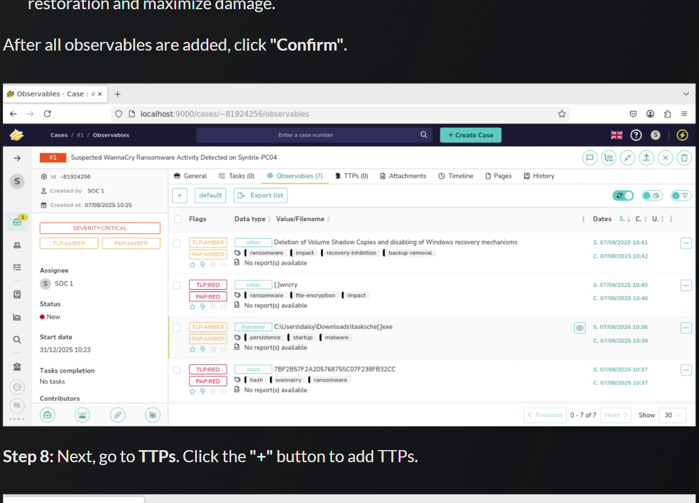

4. Click **Confirm** to lock in the ATT&CK mapping.

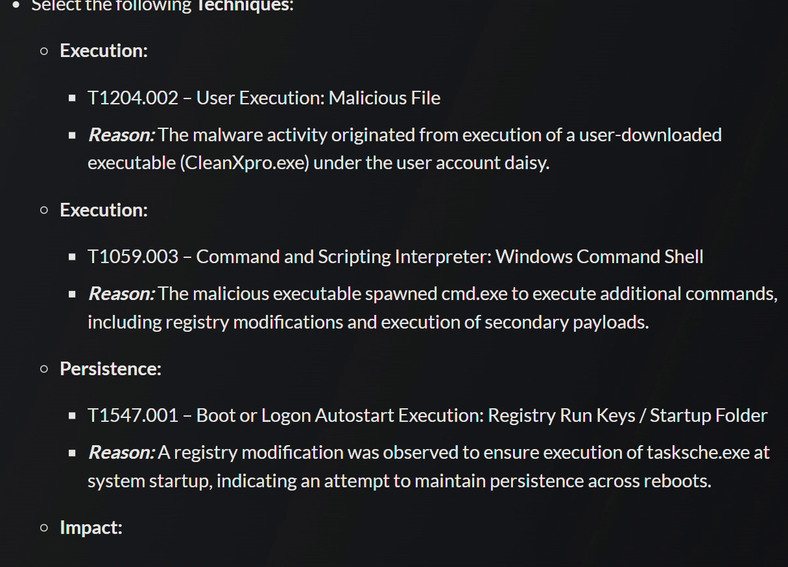

---

### Step 9: Creating Incident Tasks & Escalating to SOC Level 2

1. Navigate to the **Tasks** tab and click the **+** button to define follow-up response tasks.

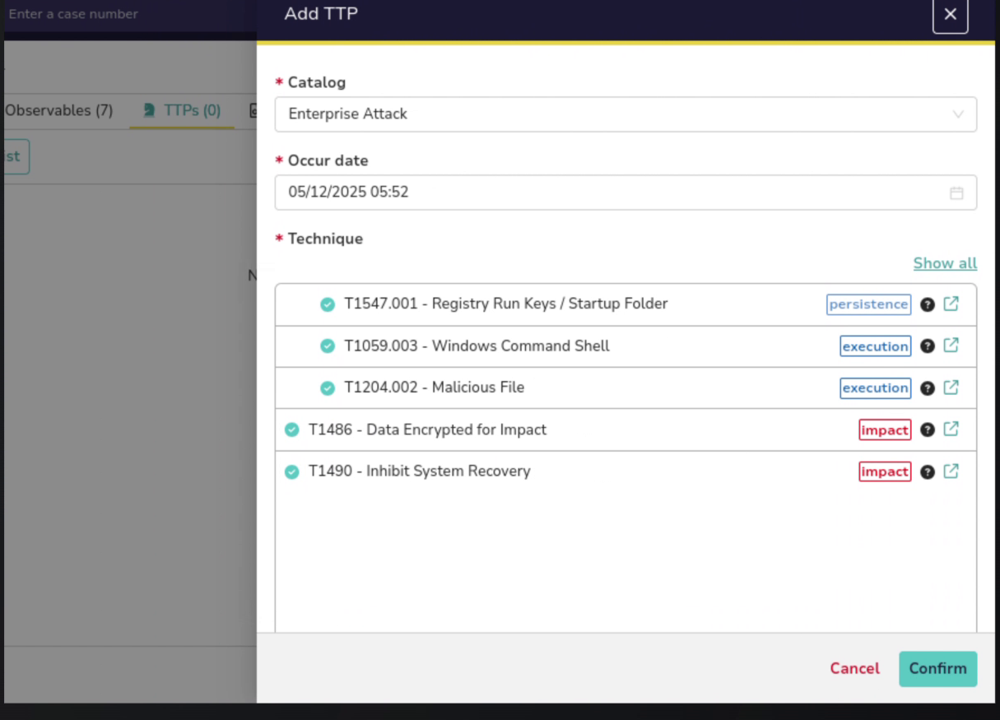

2. Configure **Task 1 — Initial Infection Vector Review**:
   - **Title:** `Context on Suspected Initial Foothold and Execution Path`
   - **Assignee:** `soc2@syntrix.com`
   - **Description:**
     > Endpoint telemetry indicates that the executable CleanXpro.exe was introduced and executed under the user account daisy, after which multiple malicious processes were spawned. Reviewing how this file was initially delivered and executed may help clarify whether the activity originated from user interaction (e.g., download, email attachment, or external media) or another initial access vector. Additional context around pre-execution events could help establish how the ransomware was introduced into the environment.
   - Click **Save and add another**.

3. Configure **Task 2 — Containment and Isolation Considerations**:
   - **Title:** `Context on Potential Containment and Host Isolation`
   - **Assignee:** `soc2@syntrix.com`
   - **Description:**
     > The observed activity includes file encryption behavior and actions intended to inhibit system recovery, suggesting an active ransomware scenario. Evaluating whether the affected host has been adequately isolated from the network may help limit further spread or secondary impact. Reviewing current containment status and any residual network connectivity could provide clarity on whether additional isolation measures are warranted.
   - Click **Confirm**.

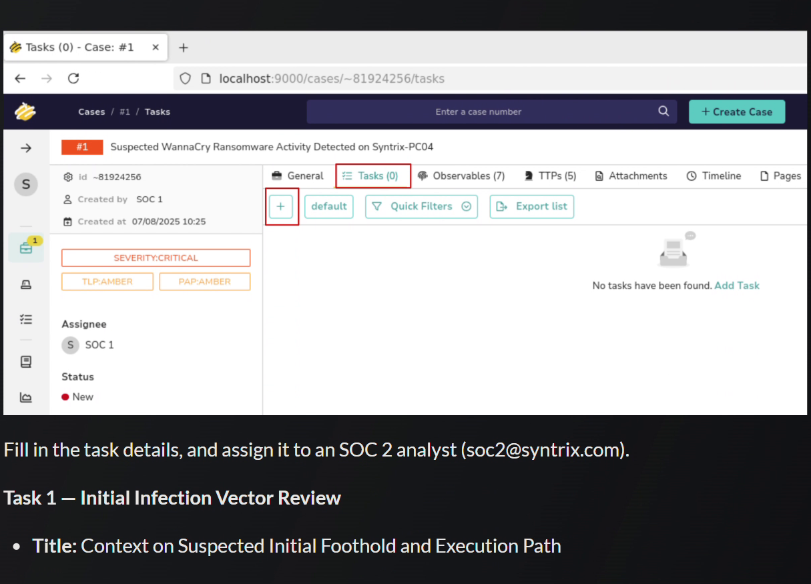

4. **Escalate Case Ownership to SOC Level 2:**
   - Return to the case summary header.
   - Click on the **Assignee / Case Owner** field.
   - Select **`soc2@syntrix.com`** from the user list.

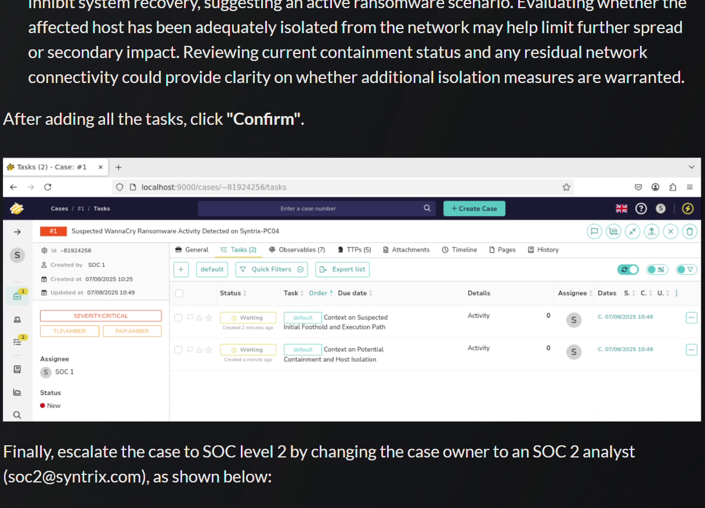

5. Verify that the case ownership, severity, observables, TTPs, and tasks reflect the escalated status.

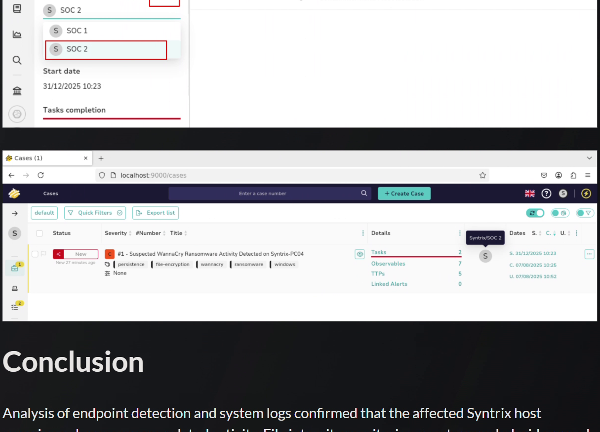

---

## Technical Architecture & Detection Blueprint


### WannaCry Attack Lifecycle & Forensics Matrix


```
+-------------------------------------------------------------------------------------------------------------+
|                                  WANNACRY ATTACK LIFECYCLE & FORENSICS MATRIX                               |
+--------------------------+-----------------------+----------------------------------+-----------------------+
| ATTACK STAGE             | MITRE ATT&CK TECHNIQUE| PROCESS & EVIDENCE COMMAND LINE  | FORENSIC ARTIFACT     |
+--------------------------+-----------------------+----------------------------------+-----------------------+
| 1. User Execution        | T1204.002             | CleanXpro.exe (user: daisy)      | Fake system utility   |
| 2. Payload Unpacking     | T1059.003             | cmd.exe /c start /b @WanaDecrypt | MD5: 7BF2B57F2A20...  |
| 3. System Persistence    | T1547.001             | reg add HKLM\...\Run /v tasksche | tasksche.exe in Run   |
| 4. Recovery Inhibition   | T1490                 | vssadmin delete shadows /all /q  | Shadow copies purged  |
| 5. Impact & Encryption   | T1486                 | Mass file renaming -> *.wncry    | 2048-bit RSA + AES-128|
+--------------------------+-----------------------+----------------------------------+-----------------------+
```

---

## Automated Incident Triage Engine (`wannacry_wazuh_triage.py`)

To eliminate manual data entry errors and accelerate threat response times, a standalone Python incident triage automation engine has been engineered.

### Live CLI Demo Animation


### Tool Usage & Capabilities
```bash
# 1. Run full interactive triage simulation
python wannacry_wazuh_triage.py --mode demo

# 2. Display forensic observables matrix & MITRE mapping
python wannacry_wazuh_triage.py --mode analyze

# 3. Export TheHive 5 compliant case bundle JSON
python wannacry_wazuh_triage.py --mode export-thehive --output thehive_case_export.json

# 4. Generate standalone Markdown Incident Investigation Report
python wannacry_wazuh_triage.py --mode generate-report --output WANNACRY_INCIDENT_REPORT.md

# 5. Display VirusTotal threat intelligence profile
python wannacry_wazuh_triage.py --mode virustotal
```

---

## Detection Engineering & Wazuh Rule Design

To detect this attack chain earlier in future incidents, the following custom Wazuh rules should be deployed in `/var/ossec/etc/rules/local_rules.xml`:

```xml
<group name="windows,sysmon,ransomware,wannacry,">

  <!-- Rule 100110: Detect WannaCry Recovery Inhibition via vssadmin -->
  <rule id="100110" level="12">
    <if_group>sysmon_process_create</if_group>
    <field name="win.eventdata.commandLine">vssadmin\s+delete\s+shadows</field>
    <description>Ransomware Behavior: Volume Shadow Copies deletion attempt via vssadmin</description>
    <mitre>
      <id>T1490</id>
    </mitre>
  </rule>

  <!-- Rule 100111: Detect Windows Recovery Disabling via bcdedit -->
  <rule id="100111" level="12">
    <if_group>sysmon_process_create</if_group>
    <field name="win.eventdata.commandLine">bcdedit.*recoveryenabled\s+no</field>
    <description>Ransomware Behavior: Windows Recovery Environment disabled via bcdedit</description>
    <mitre>
      <id>T1490</id>
    </mitre>
  </rule>

  <!-- Rule 100112: Detect Suspicious Run Key Persistence in Downloads -->
  <rule id="100112" level="10">
    <if_group>sysmon_process_create</if_group>
    <field name="win.eventdata.commandLine">reg\s+add.*\\CurrentVersion\\Run.*Downloads</field>
    <description>Suspicious Registry Persistence: Executable from Downloads folder registered to Run key</description>
    <mitre>
      <id>T1547.001</id>
    </mitre>
  </rule>

  <!-- Rule 100113: Detect .wncry Mass File Modifications via FIM -->
  <rule id="100113" level="14">
    <if_group>syscheck</if_group>
    <match>\.wncry$</match>
    <description>Critical Ransomware Alert: File encrypted with .wncry extension detected</description>
    <mitre>
      <id>T1486</id>
    </mitre>
  </rule>

</group>
```

---

## Conclusion & Incident Response Recommendations

1. **Immediate Host Containment:** Disconnect `Syntrix-PC04` (`10.0.0.67`) from the network immediately to prevent lateral movement via SMB / EternalBlue (`MS17-010`).
2. **Account Lockdown:** Temporarily disable the `daisy` Active Directory account and revoke all active Kerberos/NTLM tokens.
3. **Enterprise Subnet Sweep:** Query network perimeter sensors for outbound SMB/445 traffic or Tor kill-switch domain communication (`www.iuqerfsodp9ifjaposdfjhgosurijfaewrwergwea.com`).
4. **Offline Backups:** Verify whether recent external offline or immutable cloud backups exist for `Syntrix-PC04` user profiles.
5. **Patch Management:** Verify enterprise-wide deployment of Microsoft Security Bulletin **MS17-010** (KB4012212 / KB4012215).

---

## References
- [TheHive 5 Documentation & Case Architecture](https://docs.strangebee.com/thehive/overview/)
- [MISP Taxonomies & TLP/PAP Specifications](https://www.misp-project.org/taxonomies.html)
- [MITRE ATT&CK Technique T1486: Data Encrypted for Impact](https://attack.mitre.org/techniques/T1486/)
- [MITRE ATT&CK Technique T1490: Inhibit System Recovery](https://attack.mitre.org/techniques/T1490/)
- [MITRE ATT&CK Technique T1547.001: Registry Run Keys](https://attack.mitre.org/techniques/T1547/001/)
