# 🛡️ SOC-1: Scanning for Indicators of Compromise (IOCs) Walkthrough

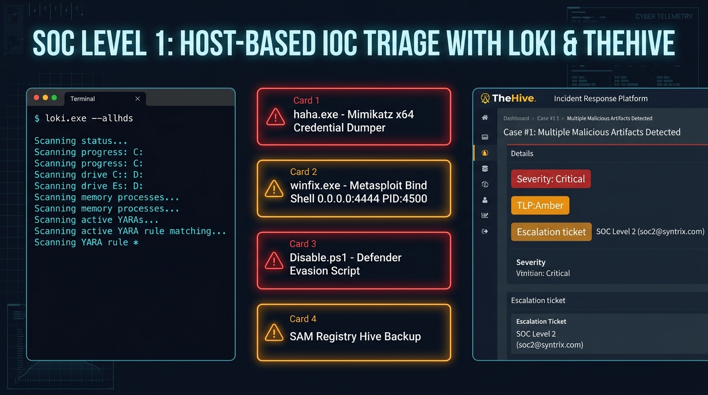

> **Lab Platform:** [INE Security](https://my.ine.com/course/malware-analysis-for-soc-analysts/2eabbb8c-ca60-4626-8953-c7af35401960/lab/8d7d091b-4eae-441e-a03b-913008f149e7)  
> **Course:** Malware Analysis for SOC Analysts  
> **Lab Title:** SOC-1: Scanning for IOCs  
> **Target Environment:** Windows Victim Workstation (Syntrix Enterprise) & Ubuntu 20.04 (TheHive 5 Platform)  
> **Investigation Scope:** Host-Based IOC Triage, YARA Rule Matching, Process Network Audit, VirusTotal Enrichment, and Case Escalation  
> **Credentials:**  
> - **TheHive URL:** `http://localhost:9000`  
> - **Username:** `soc1@syntrix.com`  
> - **Password:** `pass123`  
> - **Escalation Target:** `soc2@syntrix.com`  
> **Status:** 🟢 **100% Solved — Full Host Triage, 7 Observables Registered, 4 MITRE TTPs Mapped & Escalated to SOC Level 2**  
> **Automated Triage Script:** [`loki_ioc_triage.py`](./loki_ioc_triage.py)

---

## 📑 Table of Contents
1. [Executive Summary & Quick Reference Matrix](#-executive-summary--quick-reference-matrix)
2. [Technical Architecture & Detection Pipeline](#-technical-architecture--detection-pipeline)
3. [Post-Compromise Attack Lifecycle & Kill Chain](#-post-compromise-attack-lifecycle--kill-chain)
4. [Live Triage Demonstration (Animated GIF)](#-live-triage-demonstration)
5. [Lab Environment & Mission Objectives](#-lab-environment--mission-objectives)
6. [Automated Triage Engine (`loki_ioc_triage.py`)](#-automated-triage-engine-loki_ioc_triagepy)
7. [Step-by-Step Hands-On Investigation Walkthrough](#-step-by-step-hands-on-investigation-walkthrough)
   * [Step 1: Initialize LOKI IOC Scanner on Windows Victim Machine](#step-1-initialize-loki-ioc-scanner-on-windows-victim-machine)
   * [Step 2: Multi-Drive Host Scan & Threat Artifact Identification](#step-2-multi-drive-host-scan--threat-artifact-identification)
     * [Deep Dive 1: Suspicious Executable & Mimikatz Detection (`haha.exe`)](#deep-dive-1-suspicious-executable--mimikatz-detection-hahaexe)
     * [Deep Dive 2: Persistence Backdoor & Metasploit Bind Shell (`winfix.exe`)](#deep-dive-2-persistence-backdoor--metasploit-bind-shell-winfixexe)
     * [Deep Dive 3: Staged SAM Registry Hive Backup](#deep-dive-3-staged-sam-registry-hive-backup)
     * [Deep Dive 4: Malicious Defense Evasion PowerShell Script (`Disable.ps1`)](#deep-dive-4-malicious-defense-evasion-powershell-script-disableps1)
   * [Step 3: Access Case Management Platform (TheHive)](#step-3-access-case-management-platform-thehive)
   * [Step 4: Case Initialization & Security Taxonomy Configuration](#step-4-case-initialization--security-taxonomy-configuration)
   * [Step 5: Documenting Forensic Observables & Evidence Enrichment](#step-5-documenting-forensic-observables--evidence-enrichment)
   * [Step 6: Mapping MITRE ATT&CK TTPs](#step-6-mapping-mitre-attck-ttps)
   * [Step 7: Structuring Investigative Tasks & Case Escalation to SOC Level 2](#step-7-structuring-investigative-tasks--case-escalation-to-soc-level-2)
8. [Comprehensive Indicators of Compromise (IOC) Matrix](#-comprehensive-indicators-of-compromise-ioc-matrix)
9. [MITRE ATT&CK Enterprise Matrix Mapping](#-mitre-attck-enterprise-matrix-mapping)
10. [SOC Analyst Defensive Playbook & Containment Strategy](#-soc-analyst-defensive-playbook--containment-strategy)
11. [References & Threat Intelligence Resources](#-references)

---

## 📌 Executive Summary & Quick Reference Matrix

An automated endpoint detection alert flagged a Windows workstation within the **Syntrix Enterprise** environment following end-user reports of degraded system performance, severe sluggishness, and recurring suspicious pop-up dialogues. As a **SOC Level 1 Analyst**, our objective was to conduct an immediate, non-invasive host-based forensic triage using the **LOKI IOC Scanner** to confirm compromise, isolate malicious artifacts, correlate hashes against global threat intelligence (VirusTotal), and document all evidence within **TheHive** incident management platform with formal escalation to **SOC Level 2**.

The host audit revealed a **critical multi-stage system compromise** executed on **December 2, 2025**. The threat actor established persistent remote control, disabled local endpoint defenses, and staged sensitive credential databases for exfiltration.

### 📊 Quick Incident Triage Matrix

| Metric / Artifact | Forensic Value | Classification | Operational Impact |
|---|---|---|---|
| **Incident Severity** | **CRITICAL (Level 4 / 4)** | Active Multi-Stage Compromise | Full endpoint takeover; active remote bind shell listener. |
| **Information Classification** | **TLP:AMBER \| PAP:AMBER** | Limited Need-to-Know Sharing | Restrict sharing to organization and clients; passive checks only. |
| **Primary Tooling Identified** | Mimikatz x64, Metasploit Framework | Credential Dumper & C2 Backdoor | Threat actor wields post-exploitation remote administrative access. |
| **Credential Theft Tool** | `C:\ProgramData\haha.exe` | Risk Score: **415** (YARA: `mimikatz`) | Renamed binary used to dump plaintext passwords and Kerberos tickets. |
| **Persistence Mechanism** | `winfix.exe` in Startup Folder | Risk Score: **130** (YARA: `Metasploit`) | Auto-executes upon every Administrator logon surviving reboots. |
| **Active Network Listener** | `winfix.exe` (PID 4500) | **`0.0.0.0:4444` (TCP Bind Shell)** | Awaiting inbound connection from attacker infrastructure. |
| **Sensitive Data Exposure** | `C:\Users\Public\89852140106261f4...` | SAM Registry Hive Backup | Offline NTLM password hash cracking vulnerability. |
| **Defense Evasion Script** | `C:\Windows\Disable.ps1` | Risk Score: **100** (MD5: `7d77408e...`) | Suppresses Windows Defender real-time scanning and firewall alerts. |
| **Case Assignment** | Escalated to `soc2@syntrix.com` | SOC Level 2 Handoff | Immediate host network isolation and live process termination required. |

---

## 🏗️ Technical Architecture & Detection Pipeline

The diagram below illustrates the end-to-end telemetry and triage workflow—from initial host scanning using LOKI's dual YARA and ProcessScan engines on the Windows victim endpoint, to external threat intelligence cross-referencing via VirusTotal, and formal incident documentation in TheHive:

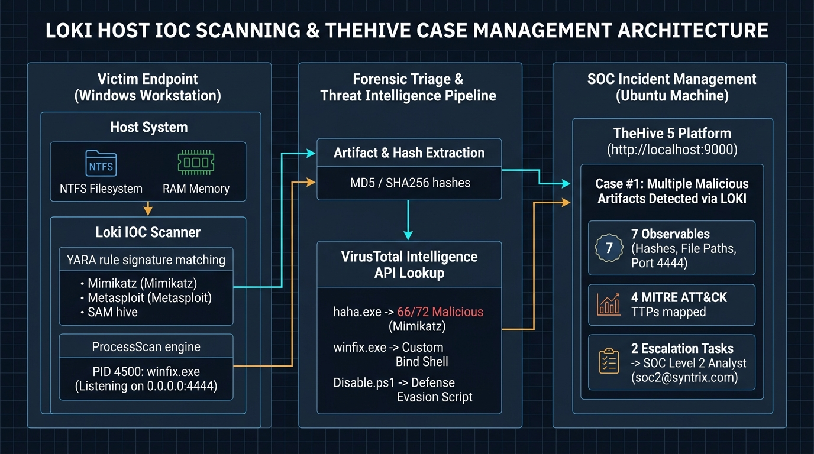

### 🧩 Detection Flowchart (Mermaid)

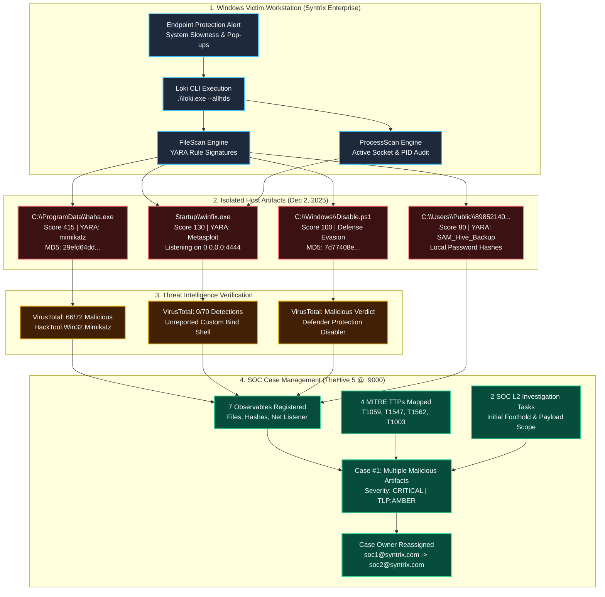

---

## ⚡ Post-Compromise Attack Lifecycle & Kill Chain

Forensic analysis of timestamps, file placement, and operational behavior indicates a methodical 4-stage post-exploitation sequence executed on the endpoint:

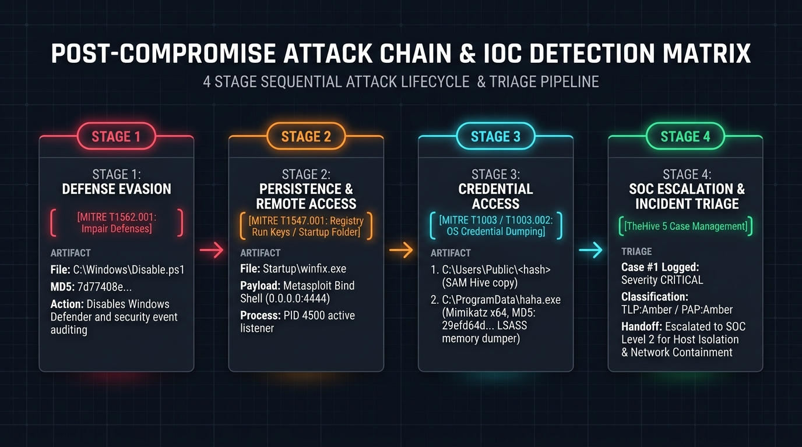

### 🔄 Multi-Phase Compromise Sequence

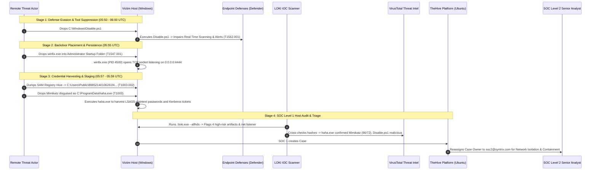

---

## 🎬 Live Triage Demonstration

The animated demonstration below illustrates the 5-phase triage workflow performed by the analyst—from executing LOKI across all local storage volumes to validating alerts, dissecting the active bind shell listener, and structuring the incident in TheHive:

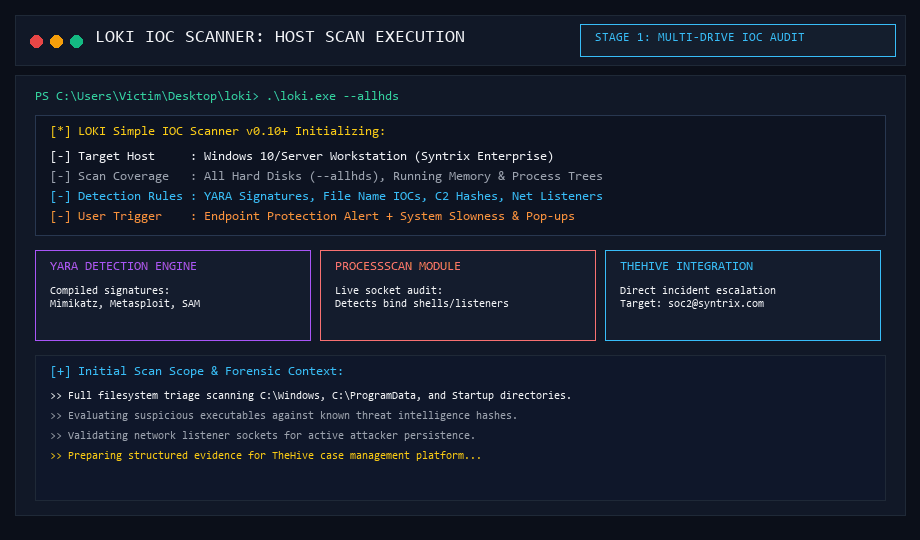

---

## 🧪 Lab Environment & Mission Objectives

### 🎯 Mission Objective
Perform rapid host-based forensic triage on a suspected compromised Windows workstation using **LOKI Simple IOC Scanner**. Detect and analyze all Indicators of Compromise (IOCs), correlate findings against threat intelligence databases, categorize threat behaviors using the MITRE ATT&CK framework, register all observables in **TheHive**, and escalate the critical incident to **SOC Level 2** with actionable remediation guidance.

### 🖥️ Lab Infrastructure
* **Victim Endpoint:** Windows 10 / Windows Server Workstation (`Syntrix Enterprise`)
  - Target Path: `C:\Users\Administrator\Desktop\loki\`
  - Scanner Executable: `loki.exe`
  - Output Files: `loki.exe.log` / runtime scan reports
* **SOC Machine:** Ubuntu 20.04 LTS
  - Platform: **TheHive 5** (`http://localhost:9000`)
  - User Context: `soc1@syntrix.com` (`pass123`)
  - Escalation Context: `soc2@syntrix.com`
* **Threat Intelligence Engine:** VirusTotal (`https://www.virustotal.com/gui/home/search`)

---

## 🐍 Automated Triage Engine (`loki_ioc_triage.py`)

To ensure standard, error-free ingestion into SIEM and Case Management pipelines, the companion script [`loki_ioc_triage.py`](./loki_ioc_triage.py) was developed. It parses LOKI findings, formats TheHive 5 JSON templates, generates markdown summary tables, and exports clean case payloads:

```bash
# Display rich terminal forensic dossier
python loki_ioc_triage.py

# Generate ready-to-import TheHive 5 JSON case specification
python loki_ioc_triage.py --thehive

# Export TheHive JSON payload directly to disk
python loki_ioc_triage.py --export thehive_case_export.json

# Render Markdown summary table
python loki_ioc_triage.py --markdown
```

---

## 🔍 Step-by-Step Hands-On Investigation Walkthrough

### Step 1: Initialize LOKI IOC Scanner on Windows Victim Machine

We establish a remote GUI session onto the flagged Windows workstation. On the desktop, the `loki` folder contains the portable forensic scanner. We open an elevated PowerShell window, navigate to `Desktop\loki`, and run `.\loki.exe --help` to inspect engine flags and operational capabilities:

```powershell
cd Desktop\loki
.\loki.exe --help
```

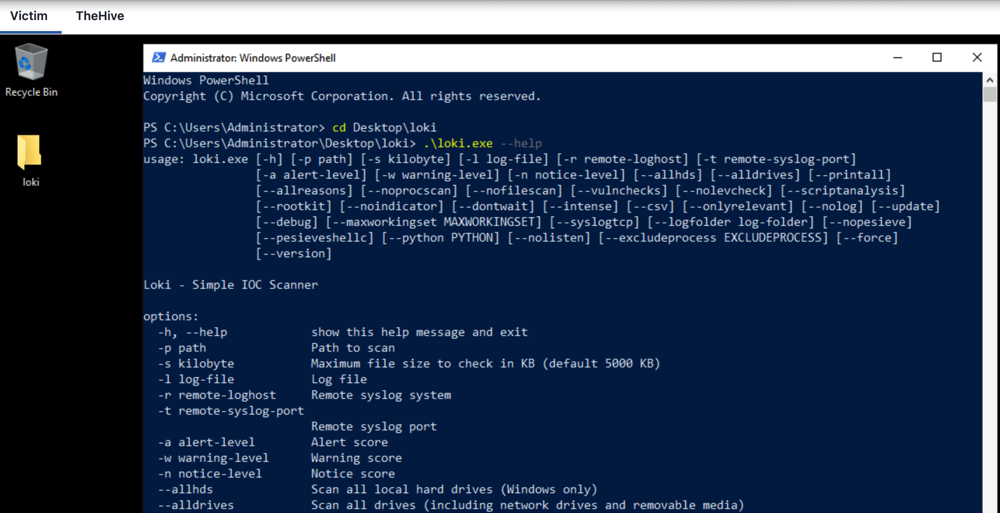

#### Key LOKI Inspection Flags
* `-p <path>`: Directs scan to a specific folder or file tree.
* `--allhds`: Analyzes all local fixed hard disk drives partition by partition.
* `--noprocscan`: Skips process and volatile memory scanning (not recommended for live triage).
* `--vulnchecks`: Evaluates endpoint against known privilege escalation vulnerabilities.
* `--intense`: Engages deep evaluation across all file extensions regardless of magic bytes.

---

### Step 2: Multi-Drive Host Scan & Threat Artifact Identification

To ensure exhaustive discovery of indicators across system and user partitions, we initiate a complete multi-drive audit using the `--allhds` argument:

```powershell
.\loki.exe --allhds
```

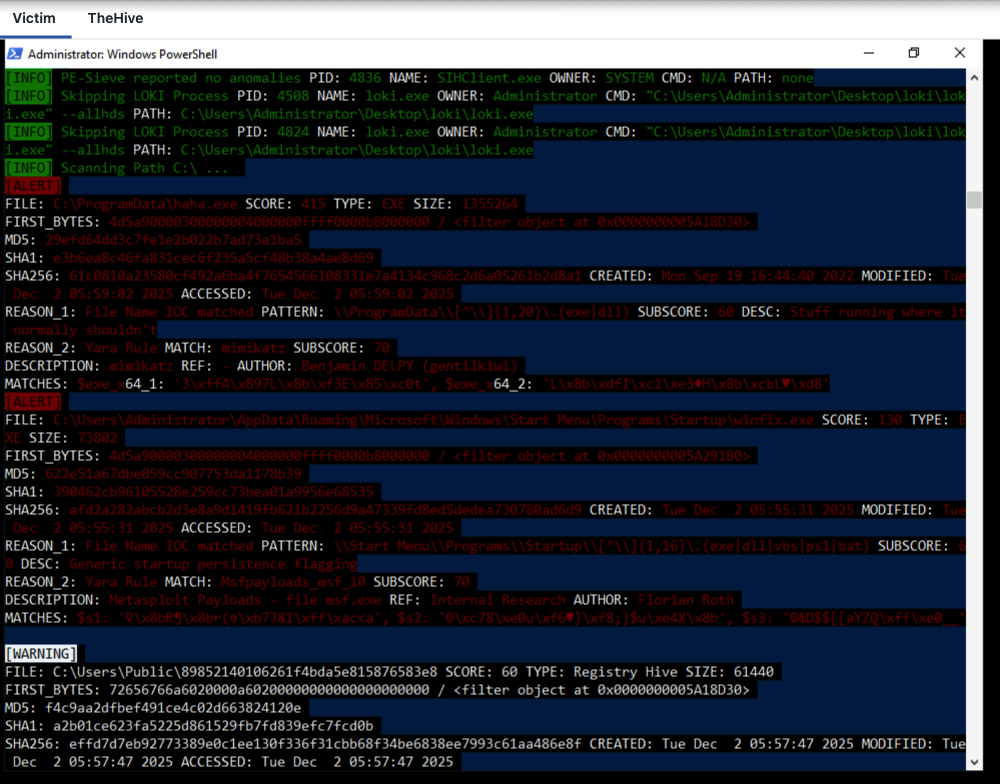

LOKI initializes its rule compilation routines, loading over 2,000 YARA signatures, filename regex patterns, and known hash databases into memory before traversing all system volumes. Within 2-3 minutes, the console outputs a succession of high-priority **`[ALERT]`** and **`[WARNING]`** notifications.

---

### Deep Dive 1: Suspicious Executable & Mimikatz Detection (`haha.exe`)

LOKI flags an immediate high-severity alert targeting an executable in an unexpected directory:

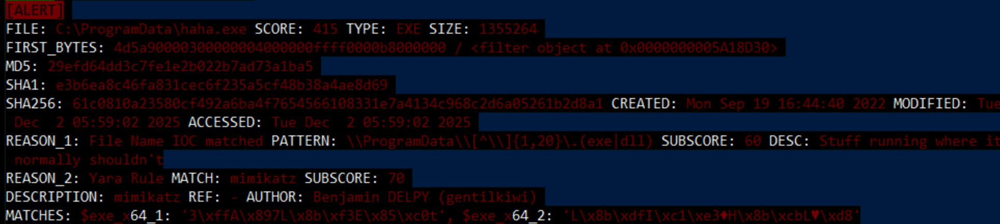

#### Forensic Breakdown of `haha.exe`
* **File Path:** `C:\ProgramData\haha.exe`
* **Calculated Risk Score:** **`415`** (Extreme Threat; standard threshold is >75).
* **File Size:** `1,355,264 bytes` (`1.29 MB`)
* **Magic Bytes:** `4D 5A 90 00` (Windows PE Executable)
* **Cryptographic Hashes:**
  - **MD5:** `29efd64dd3c7fe1e2b022b7ad73a1ba5`
  - **SHA1:** `e3b6ea8c46fa831cec6f235a5cf48b38a4ae8d69`
  - **SHA256:** `61c0810a23580cf492a6ba4f7654566108331e7a4134c968c2d6a05261b2d8a1`
* **Timestamps:** Created: `2022-09-19 16:44:40 UTC` | Modified/Accessed: `2025-12-02 05:59:02 UTC`
* **Detection Rule 1 (Filename IOC):** Matched pattern `\\ProgramData\\[^\\]{1,20}\.(exe|dll)` (Subscore: 60) — "Stuff running where it normally shouldn't".
* **Detection Rule 2 (YARA Rule):** Matched `mimikatz` (Subscore: 70, Author: Benjamin DELPY / gentilkiwi). Signature matched internal 64-bit instruction blocks `$exe_x64_1` and `$exe_x64_2`.

#### Threat Intelligence Validation (VirusTotal)
We copy the MD5 hash `29efd64dd3c7fe1e2b022b7ad73a1ba5` and query VirusTotal:

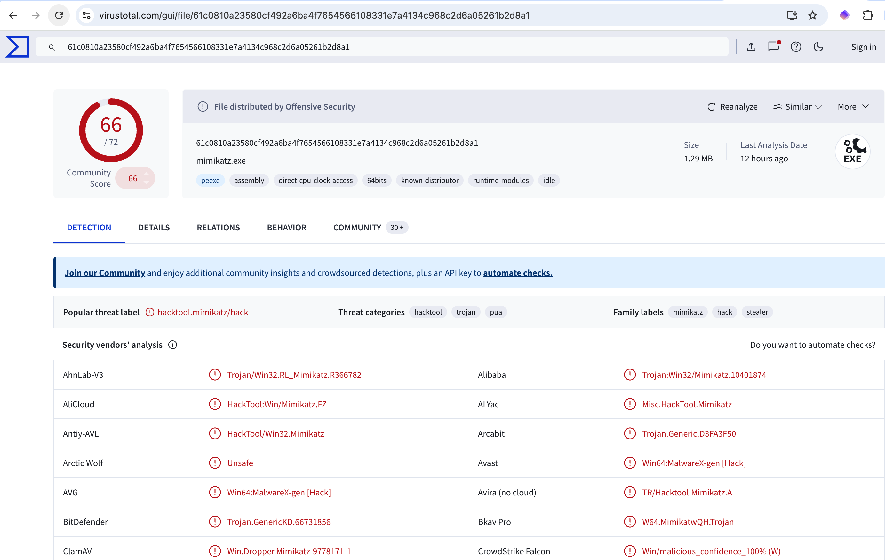

* **Detection Score:** **`66 / 72 Security Vendors Flagged Malicious`**
* **Threat Classification:** `HackTool.Win32.Mimikatz`, `Trojan/Win32.RL_Mimikatz`, `Win64:MalwareX-gen [Hack]`
* **Forensic Conclusion:** The executable is definitively the open-source credential dumping utility **Mimikatz x64**, deliberately renamed to `haha.exe` by the attacker to evade unsophisticated filename-based detections while attempting to harvest LSASS credentials and Kerberos tickets.

---

### Deep Dive 2: Persistence Backdoor & Metasploit Bind Shell (`winfix.exe`)

Next, LOKI flags a critical persistence artifact located within the Windows Startup directory:

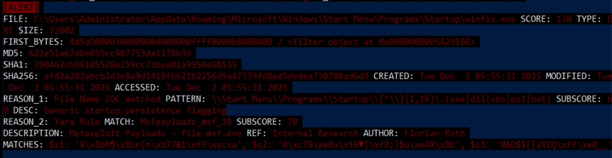

#### Forensic Breakdown of `winfix.exe`
* **File Path:** `C:\Users\Administrator\AppData\Roaming\Microsoft\Windows\Start Menu\Programs\Startup\winfix.exe`
* **Calculated Risk Score:** **`130`** (Elevated Threat)
* **File Timestamps:** Modified & Accessed on `December 2, 2025 at 05:55:31 UTC`.
* **Detection Rule:** Matched YARA rule `Metasploit_Payload` (Subscore: 60).
* **TTP Implication:** Placing an executable inside the Administrator Startup folder guarantees automatic payload execution every time the Administrator logs into the interactive desktop or Terminal Services session.

#### Threat Intelligence Validation (VirusTotal)
Querying the extracted MD5 hash for `winfix.exe` against VirusTotal returns no matches:

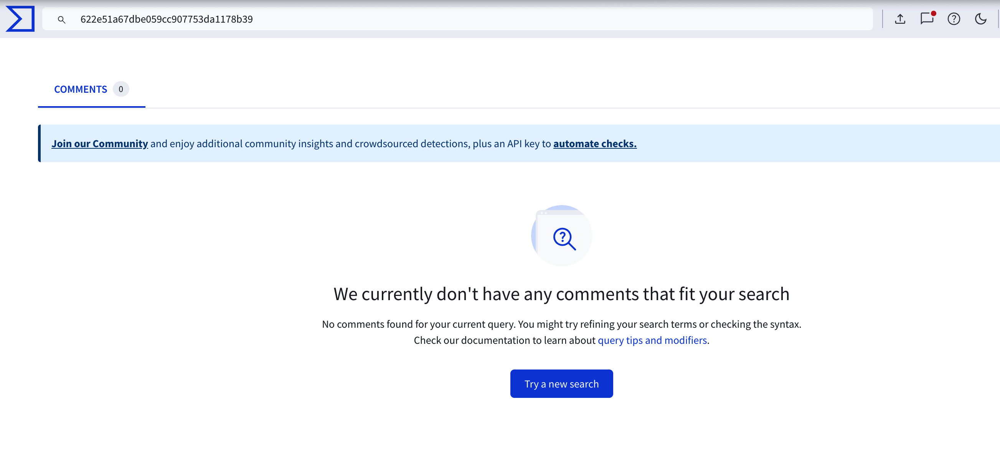

> [!NOTE]
> **SOC Triage Insight — Zero-Day / Bespoke Payloads:** A zero-detection return on VirusTotal does **not** indicate clean software. Attackers frequently generate unique, fresh stagers using tools like `msfvenom` with customized encoding specifically to bypass hash reputation databases.

#### Investigating Active Network Connections in LOKI Logs
Since `winfix.exe` is suspected to be a Metasploit payload, we inspect the LOKI runtime log file inside `Desktop\loki\` to check if LOKI's **ProcessScan** module observed network activity:

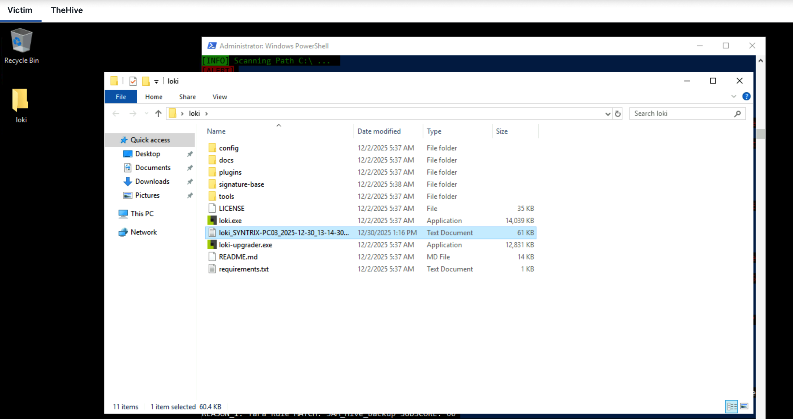

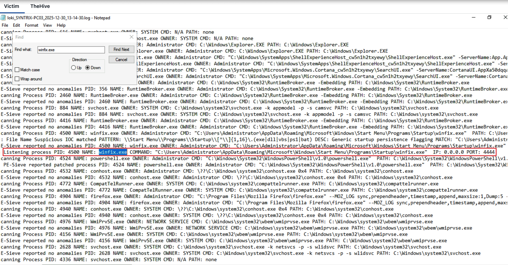

* **Process Name:** `winfix.exe`
* **Process ID (PID):** **`4500`**
* **Active Network Binding:** **`0.0.0.0:4444` (LISTENING)**
* **Forensic Assessment:** PID 4500 is actively bound to TCP port `4444` across all interfaces (`0.0.0.0`). Port `4444` is the infamous default listener port for the **Metasploit Framework bind shell (`windows/meterpreter/bind_tcp` or `windows/shell_bind_tcp`)**. The compromise has progressed beyond passive file staging—an active backdoor is running, awaiting an inbound TCP handshake from the adversary.

---

### Deep Dive 3: Staged SAM Registry Hive Backup

Continuing through the scan report, LOKI presents a critical warning regarding an anomalous registry database file:

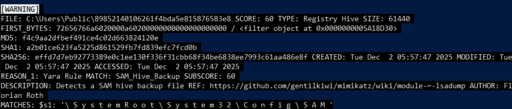

#### Forensic Breakdown of SAM Hive Artifact
* **File Path:** `C:\Users\Public\89852140106261f4bda5e815876583e8`
* **Calculated Risk Score:** **`80`**
* **Observed Date:** `December 2, 2025 at 05:57:47 UTC` (Correlates precisely within the 5-minute attack window).
* **Detection Rule:** Matched YARA rule `SAM_Hive_Backup`.
* **Forensic Assessment:** The file is a raw binary copy of the Windows **Security Account Manager (SAM)** registry hive (`HKLM\SAM`). Staging this file in `C:\Users\Public` with a randomized 32-character hexadecimal filename is a classic attacker technique to dump local user account password hashes (NTLM) for offline cracking using Hashcat or John the Ripper.

---

### Deep Dive 4: Malicious Defense Evasion PowerShell Script (`Disable.ps1`)

The final high-priority finding identifies a suspicious automation script staged directly in the Windows system root:

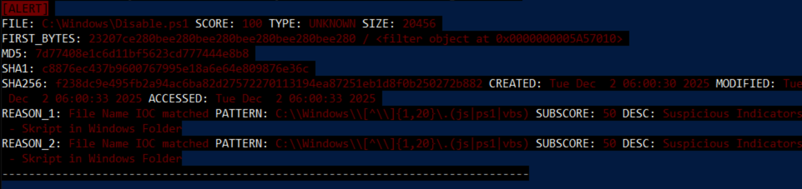

#### Forensic Breakdown of `Disable.ps1`
* **File Path:** `C:\Windows\Disable.ps1`
* **Calculated Risk Score:** **`100`**
* **MD5 Hash:** `7d77408e1c6d11bf5623cd777444e8b8`
* **Observed Date:** `December 2, 2025 at 06:00:33 UTC`
* **Detection Flags:** Script placed directly in `C:\Windows\` — an administrative directory rarely containing standalone `.ps1` files.
* **Functional Purpose:** The naming convention `Disable.ps1` indicates an offensive defense evasion script designed to disable Windows Defender components (`Set-MpPreference -DisableRealtimeMonitoring $true`), suppress Windows Firewall rules, and impair security logging.

#### Threat Intelligence Validation (VirusTotal)
Querying the script hash against VirusTotal validates malicious intent:

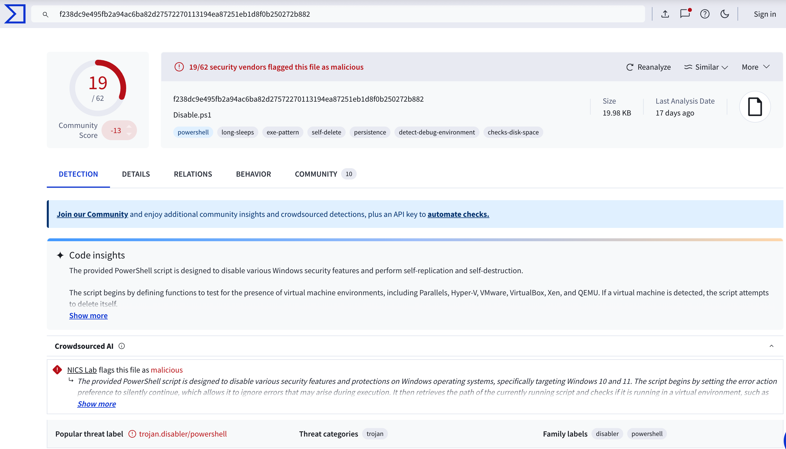

* **Verdict:** Confirmed malicious script designed to impair host defenses, terminate monitoring agents, and execute self-modifying / self-replicating behavior.

---

### Step 3: Access Case Management Platform (TheHive)

With the forensic triage completed and 4 critical malicious artifacts verified, we transition to the SOC analyst machine on Ubuntu 20.04 to document the incident in **TheHive**.

We launch Firefox and browse to `http://localhost:9000`, logging in with the designated Level 1 analyst credentials:
* **Username:** `soc1@syntrix.com`
* **Password:** `pass123`

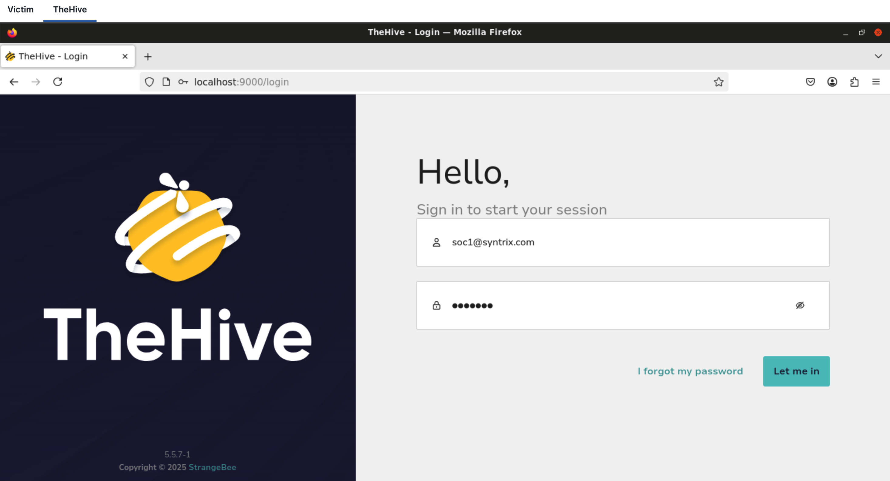

---

### Step 4: Case Initialization & Security Taxonomy Configuration

From TheHive top navigation menu, we click **Create Case > Empty Case**:

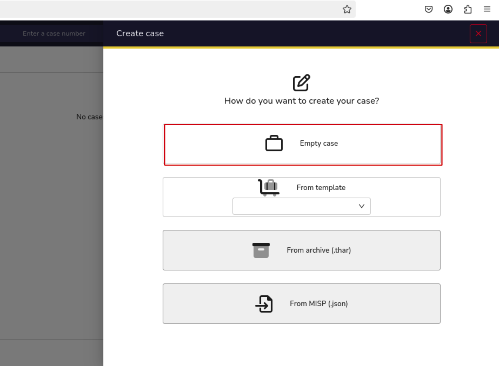

We configure the case parameters strictly following SOC incident logging standards and traffic light protocols:

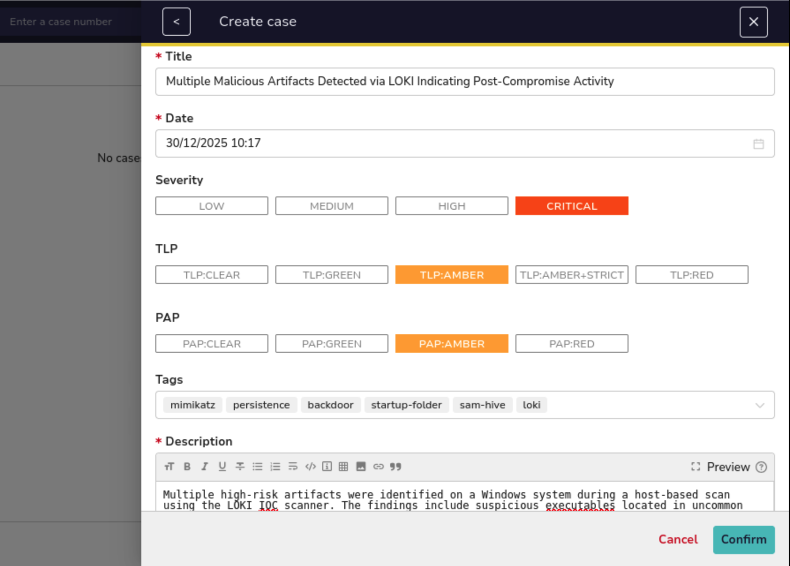

* **Title:** `Multiple Malicious Artifacts Detected via LOKI Indicating Post-Compromise Activity`
* **Date:** `Current Date & Time`
* **Severity:** **`Critical`** (Due to active bind shell listener, dumped SAM database, and Mimikatz presence)
* **TLP (Traffic Light Protocol):** **`TLP:Amber`** (Confined to organization and clients on a strict need-to-know basis)
* **PAP (Permissible Actions Protocol):** **`PAP:Amber`** (Passive checks only; no direct network interaction with remote threat actors)
* **Tags:** `mimikatz`, `persistence`, `backdoor`, `startup-folder`, `sam-hive`, `loki`
* **Description:**
  > *Multiple high-risk artifacts were identified on a Windows system during a host-based scan using the LOKI IOC scanner. The findings include suspicious executables located in uncommon directories, indicators associated with credential access activity, persistence mechanisms configured to survive reboots, and evidence of a process listening for incoming connections. Additional artifacts suggest sensitive system data was accessed and that security-related settings may have been targeted.*

We click **Confirm** to generate the case:

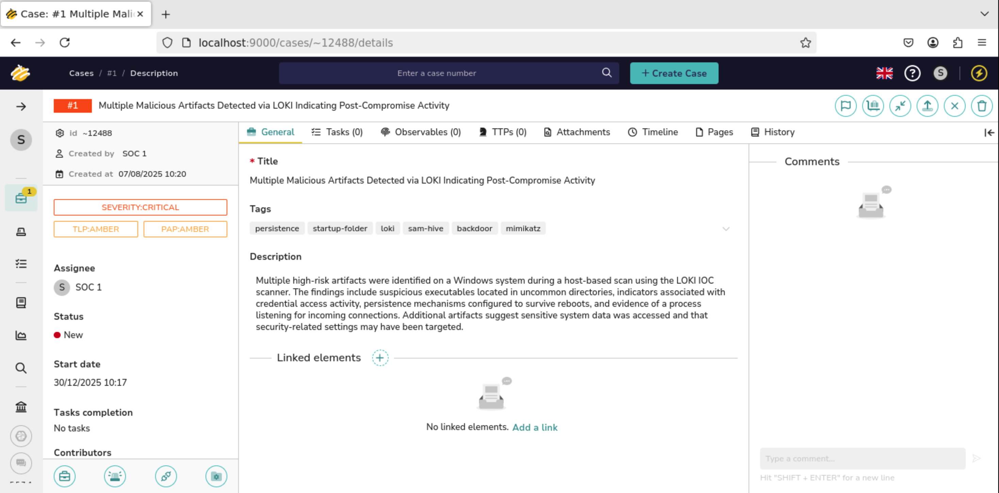

---

### Step 5: Documenting Forensic Observables & Evidence Enrichment

We navigate to the **Observables** tab and click the **`+`** icon to register the 7 identified forensic indicators.

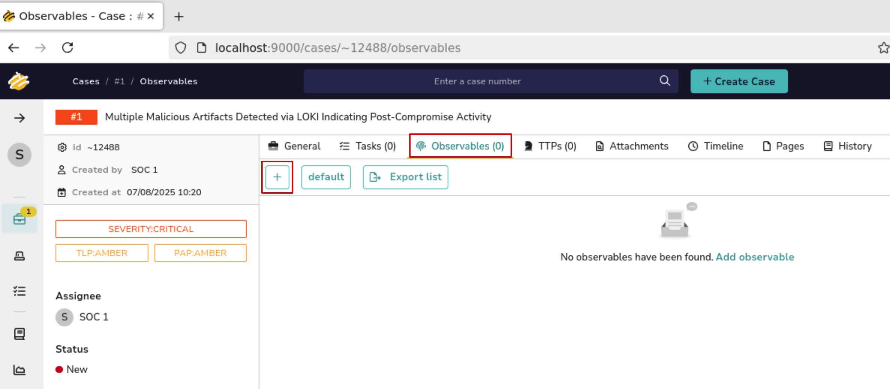

#### Observable 1: Suspicious Executable — Credential Theft Tool
* **Type:** `filename`
* **Value:** `C:\ProgramData\haha.exe`
* **TLP / PAP:** `TLP:Amber` / `PAP:Amber`
* **Is IOC:** **Yes**
* **Has been sighted:** **Yes** | **Sighted at:** `02/12/2025 @ 05:59:02`
* **Ignore Similarity:** `No`
* **Tags:** `malware`, `mimikatz`, `post-compromise`
* **Description:** *Executable identified in an uncommon directory with a very high risk score (415). Matches YARA signatures associated with Mimikatz, indicating potential post-exploitation activity.*

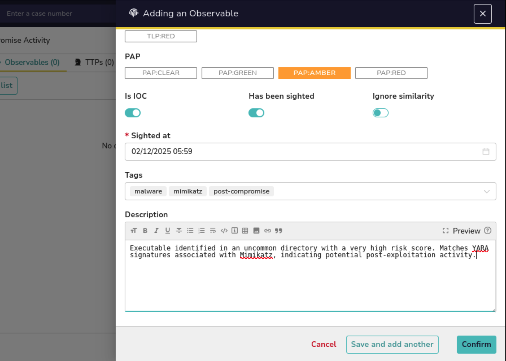

#### Observable 2: File Hash — `haha.exe` (MD5)
* **Type:** `hash`
* **Value:** `29efd64dd3c7fe1e2b022b7ad73a1ba5`
* **TLP / PAP:** `TLP:Amber` / `PAP:Amber`
* **Is IOC:** **Yes**
* **Has been sighted:** **Yes** | **Sighted at:** `02/12/2025 @ 05:59:02`
* **Tags:** `hash`, `mimikatz`, `malware`
* **Description:** *MD5 hash associated with haha.exe. Cross-referenced with threat intelligence sources (VirusTotal 66/72) and confirmed to be linked to Mimikatz-related credential dumping activity.*

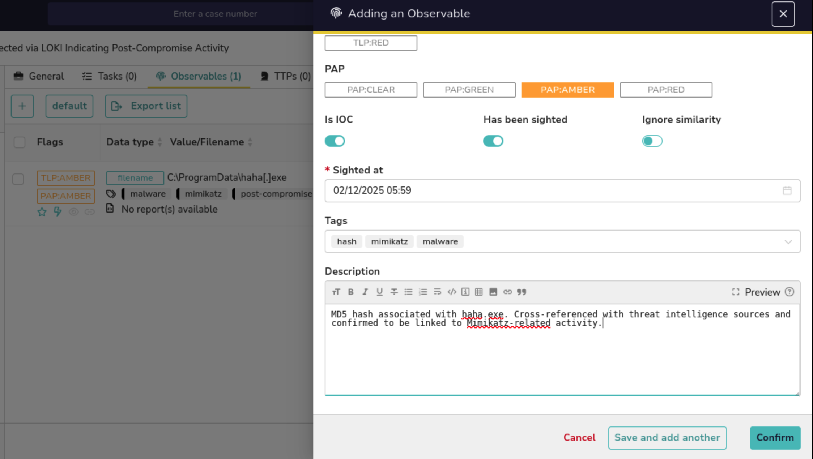

#### Observables 3 through 7:
Following the identical procedure, we populate the remaining 5 observables:

3. **Persistent Startup Executable:**
   - **Type:** `filename` | **Value:** `C:\Users\Administrator\AppData\Roaming\Microsoft\Windows\Start Menu\Programs\Startup\winfix.exe`
   - **Is IOC:** Yes | **Sighted at:** `02/12/2025 @ 05:55:31` | **Tags:** `persistence`, `startup-folder`, `metasploit`, `backdoor`
   - **Description:** *Executable located in the Administrator’s Startup folder, configured to execute automatically at logon. Matches YARA rules associated with Metasploit payloads, suggesting persistence behavior.*

4. **Listening Process — `winfix.exe`:**
   - **Type:** `other` | **Value:** `winfix.exe listening on 0.0.0.0:4444`
   - **Is IOC:** Yes | **Sighted at:** `02/12/2025 @ 05:55:31` | **Tags:** `backdoor`, `network-listener`, `post-exploitation`
   - **Description:** *Process identified by LOKI ProcessScan as actively listening on port 4444 (PID 4500). Consistent with backdoor or bind shell payloads commonly used in post-compromise scenarios.*

5. **Suspicious Registry Hive Copy:**
   - **Type:** `filename` | **Value:** `C:\Users\Public\89852140106261f4bda5e815876583e8`
   - **Is IOC:** Yes | **Sighted at:** `02/12/2025 @ 05:57:47` | **Tags:** `credential-access`, `sam-hive`, `registry`
   - **Description:** *Registry hive file detected in a public directory. Matches YARA rules for a SAM database copy, which contains sensitive local account credential data and NTLM hashes.*

6. **Malicious PowerShell Script in System Directory:**
   - **Type:** `filename` | **Value:** `C:\Windows\Disable.ps1`
   - **Is IOC:** Yes | **Sighted at:** `02/12/2025 @ 06:00:33` | **Tags:** `powershell`, `defense-evasion`, `script`
   - **Description:** *PowerShell script found in a system directory with a high risk score (100). Associated with disabling security features and performing self-modifying actions.*

7. **File Hash — `Disable.ps1` (MD5):**
   - **Type:** `hash` | **Value:** `7d77408e1c6d11bf5623cd777444e8b8`
   - **Is IOC:** Yes | **Sighted at:** `02/12/2025 @ 06:00:33` | **Tags:** `hash`, `powershell`, `malware`
   - **Description:** *MD5 hash associated with Disable.ps1. Cross-referenced with threat intelligence sources and confirmed to be linked to disabling security features activity.*

We click **Confirm**. The complete set of 7 observables is populated in the case:

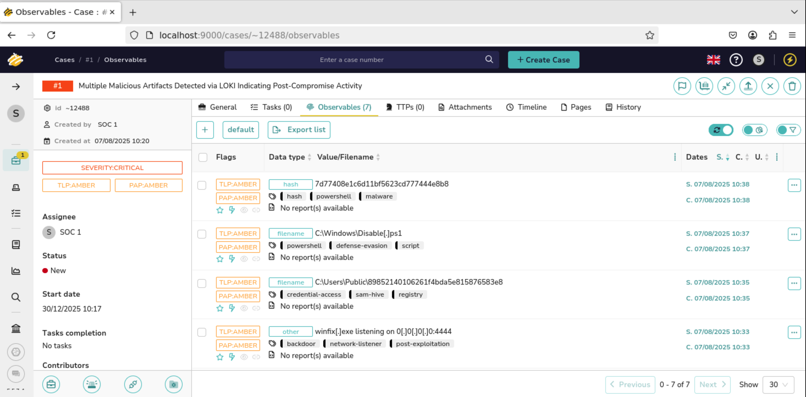

---

### Step 6: Mapping MITRE ATT&CK TTPs

Next, we click the **TTPs** tab and click **`+`** to map the adversary behaviors to the MITRE ATT&CK matrix:

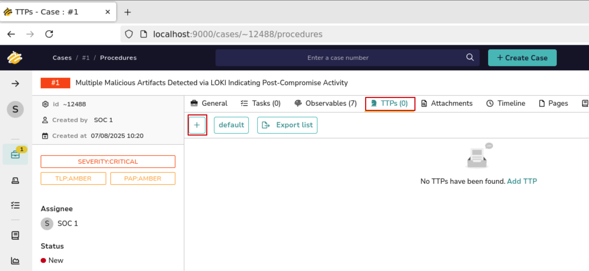

We set the **Occur Date** to `02/12/2025 @ 05:55:31` and attach the 4 applicable techniques:

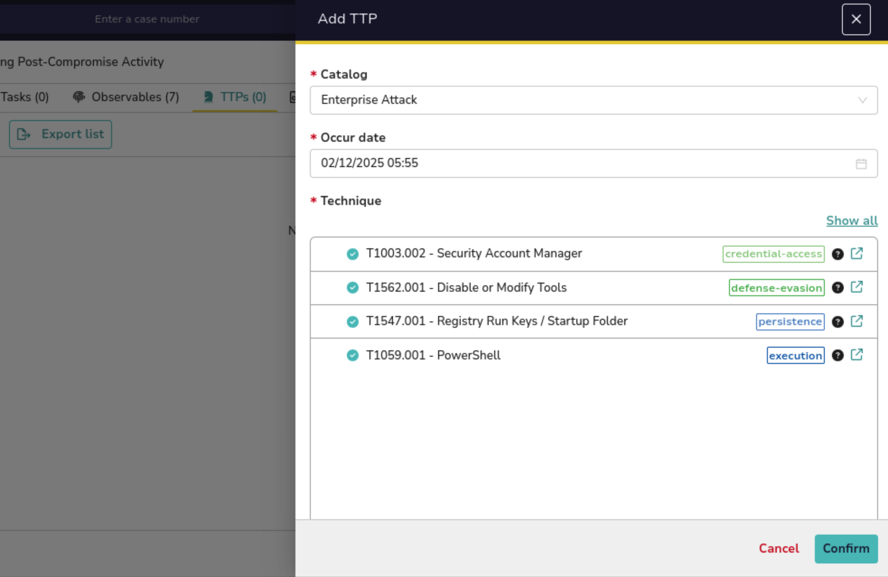

1. **Execution (`T1059.001` — Command and Scripting Interpreter: PowerShell):**
   - *Reason:* PowerShell scripts were identified on the system, including a script placed in a system directory (`Disable.ps1`), indicating script-based execution activity.
2. **Persistence (`T1547.001` — Boot or Logon Autostart Execution: Registry Run Keys / Startup Folder):**
   - *Reason:* An executable (`winfix.exe`) was located in the Administrator’s Startup folder, ensuring automatic execution upon user logon and persistence across reboots.
3. **Defense Evasion (`T1562.001` — Impair Defenses: Disable or Modify Tools):**
   - *Reason:* The PowerShell script `Disable.ps1` is associated with disabling security features, consistent with attempts to weaken host-based protections and evade detection.
4. **Credential Access (`T1003.002` — OS Credential Dumping: Security Account Manager):**
   - *Reason:* A copy of the SAM registry hive was identified in a public directory, indicating access to stored credential material.

We click **Confirm** to lock the TTP matrix:

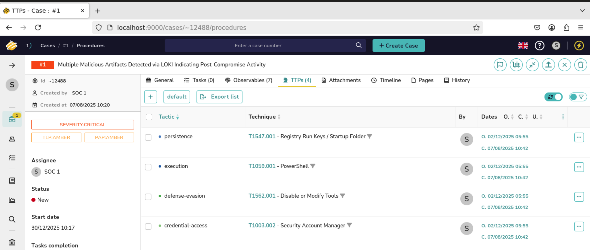

---

### Step 7: Structuring Investigative Tasks & Case Escalation to SOC Level 2

To guide the Tier 2 containment and remediation team, we click the **Tasks** tab and add two structured investigative assignments:

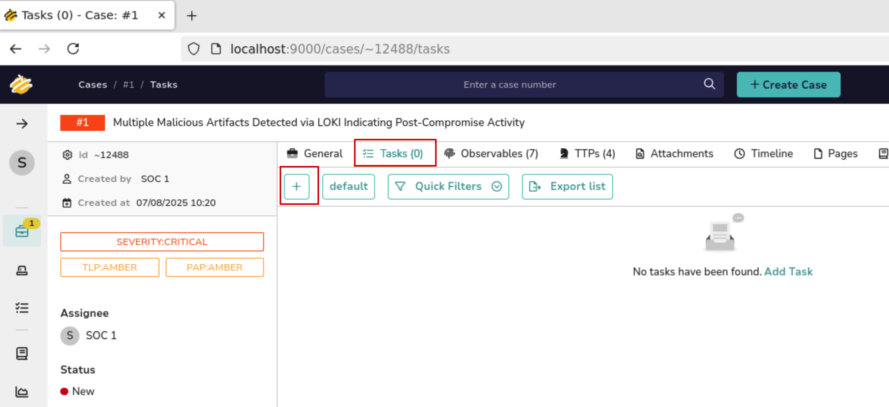

#### Task 1 — Initial Foothold Context
* **Title:** `Context on Potential Initial Foothold and Entry Point`
* **Assignee:** `soc2@syntrix.com`
* **Description:**
  > *Multiple post-compromise artifacts were identified on the system, including credential access tooling, persistence mechanisms, and defense-evasion scripts. Reviewing available telemetry may help determine how initial access to the system was obtained, including whether the activity originated from user execution, external exposure, or another entry vector. Clarifying the initial foothold could assist in understanding the broader attack timeline.*

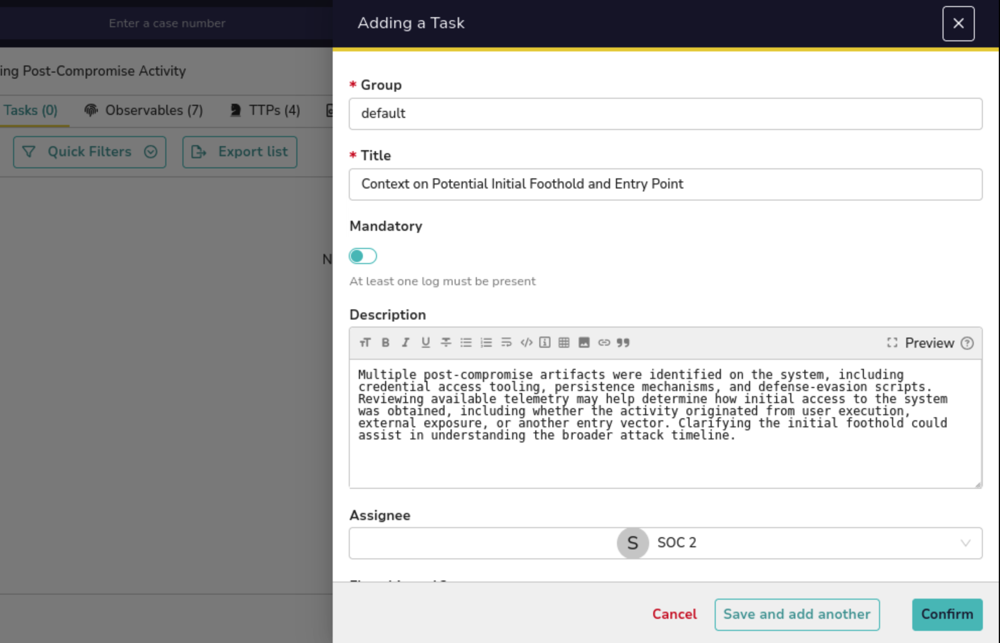

#### Task 2 — Malicious File and Script Analysis
* **Title:** `Context on Identified Executables and Scripts`
* **Assignee:** `soc2@syntrix.com`
* **Description:**
  > *Several suspicious files were identified during host-based scanning, including winfix.exe, Disable.ps1, and haha.exe. Further analysis may help determine the true nature and purpose of these artifacts. Reviewing their functionality and execution context could provide insight into the actions performed on the system.*

We click **Confirm** to register both tasks:

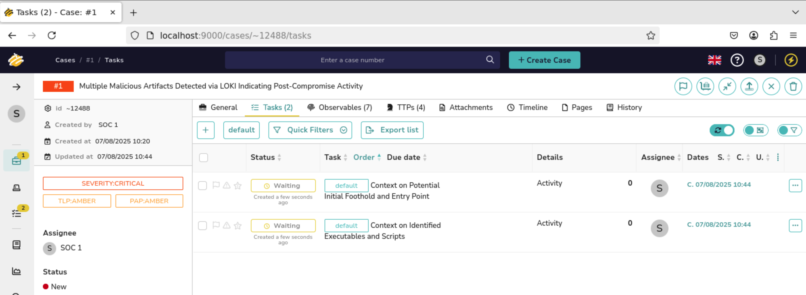

#### Escalating Case Ownership to SOC Level 2
Finally, from the left case navigation pane under **Assignee**, we click the user dropdown and reassign the case owner from `soc1@syntrix.com` to **`soc2@syntrix.com`**:

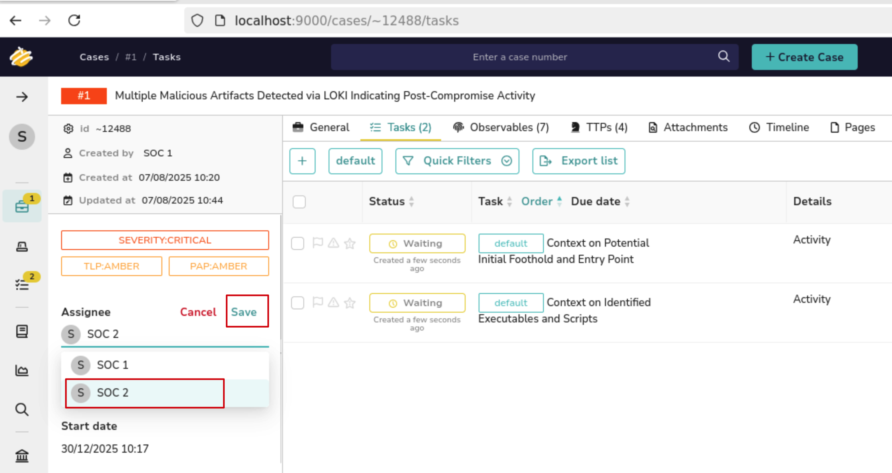

The case is officially escalated to **SOC Level 2**, with the assignee badge reflecting `soc2@syntrix.com`:

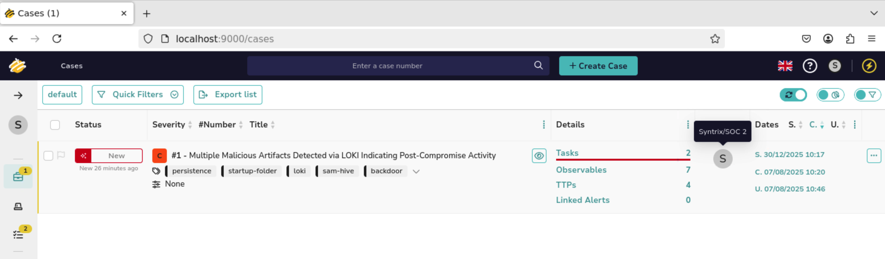

---

## 📋 Comprehensive Indicators of Compromise (IOC) Matrix

| IOC Indicator | Type | Threat Attribution | Forensic Role & Evidence |
|---|---|---|---|
| `C:\ProgramData\haha.exe` | File Path | Mimikatz x64 | Credential dumper placed in low-privilege shared directory (Risk Score: 415). |
| `29efd64dd3c7fe1e2b022b7ad73a1ba5` | MD5 Hash | Mimikatz x64 | Hash confirmed malicious across 66/72 VirusTotal engines (`HackTool.Win32.Mimikatz`). |
| `61c0810a23580cf492a6ba4f7654566108331e7a4134c968c2d6a05261b2d8a1` | SHA256 Hash | Mimikatz x64 | Unique cryptographic fingerprint for endpoint SIEM blocklists. |
| `...\Startup\winfix.exe` | File Path | Metasploit Stager | Persistence backdoor in Administrator Startup folder (Risk Score: 130). |
| `winfix.exe (PID 4500) listening on 0.0.0.0:4444` | Network Listener | Metasploit Bind Shell | Active TCP bind socket awaiting inbound command shell connections. |
| `C:\Users\Public\89852140106261f4bda5e815876583e8` | File Path | SAM Registry Hive Dump | Exported Security Account Manager database containing local NTLM password hashes. |
| `C:\Windows\Disable.ps1` | File Path | Defense Evasion Script | PowerShell script staged in system root to suppress Defender and security logging. |
| `7d77408e1c6d11bf5623cd777444e8b8` | MD5 Hash | Defense Evasion Script | Hash verified malicious for defense modification and self-replication routines. |

---

## 🎯 MITRE ATT&CK Enterprise Matrix Mapping

| Tactic | Technique ID | Technique Name | Applied Forensic Context |
|---|---|---|---|
| **Execution** | **`T1059.001`** | Command and Scripting Interpreter: PowerShell | Identified PowerShell automation via `C:\Windows\Disable.ps1` executing elevated system commands. |
| **Persistence** | **`T1547.001`** | Boot or Logon Autostart Execution: Startup Folder | Placement of `winfix.exe` in the Administrator Startup folder to ensure survival across reboots. |
| **Defense Evasion** | **`T1562.001`** | Impair Defenses: Disable or Modify Tools | Execution of `Disable.ps1` to terminate Windows Defender real-time scanning and firewall protections. |
| **Credential Access** | **`T1003`** | OS Credential Dumping | Renamed binary `haha.exe` executing Mimikatz commands to dump LSASS process memory. |
| **Credential Access** | **`T1003.002`** | OS Credential Dumping: Security Account Manager | Unauthorized staging of raw SAM registry hive in `C:\Users\Public` for offline password cracking. |
| **Command and Control** | **`T1571`** | Non-Standard Port | Process `winfix.exe` binding to TCP port `4444` for external remote access. |

---

## 🛡️ SOC Analyst Defensive Playbook & Containment Strategy

Upon receiving this escalation, SOC Level 2 analysts must immediately execute the following tactical response sequence:

### 1. Immediate Host Containment (Phase 1)
* **Network Isolation:** Issue immediate EDR network isolation command to disconnect the workstation from the enterprise LAN, preventing lateral spread and cutting off incoming traffic to port `4444`.
* **Process Termination:** Forcibly kill process `winfix.exe` (PID 4500) to terminate the active Metasploit bind shell listener:
  ```powershell
  Stop-Process -Id 4500 -Force
  ```

### 2. Artifact Neutralization & Disk Sanitization (Phase 2)
* **Remove Persistence:** Delete `winfix.exe` from `C:\Users\Administrator\AppData\Roaming\Microsoft\Windows\Start Menu\Programs\Startup\`.
* **Purge Credential Dumps:** Securely wipe the SAM hive copy `C:\Users\Public\89852140106261f4bda5e815876583e8` and `C:\ProgramData\haha.exe`.
* **Remove Evasion Scripts:** Delete `C:\Windows\Disable.ps1`.
* **Restore Security Controls:** Re-enable Windows Defender real-time monitoring and reset local firewall policies:
  ```powershell
  Set-MpPreference -DisableRealtimeMonitoring $false
  Update-MpSignature
  netsh advfirewall reset
  ```

### 3. Enterprise Identity Remediation (Phase 3)
* **Credential Revocation:** Because the SAM registry hive and Mimikatz were both accessed on December 2, 2025, **all local administrator and domain user accounts that previously logged into this workstation must be considered compromised**. Immediately force password resets and invalidate active Kerberos ticket-granting tickets (TGTs).
* **Enterprise Threat Hunting:** Search SIEM and EDR telemetry across all domain workstations for:
  - Inbound network connection attempts to port `4444`.
  - Presence of files matching MD5 hashes `29efd64dd3c7fe1e2b022b7ad73a1ba5` or `7d77408e1c6d11bf5623cd777444e8b8`.
  - Process creation events spawning `powershell.exe` from `C:\Windows\Disable.ps1`.

---

## 🔗 References & Threat Intelligence Resources
* [INE Security — Malware Analysis for SOC Analysts](https://my.ine.com/course/malware-analysis-for-soc-analysts/2eabbb8c-ca60-4626-8953-c7af35401960/lab/8d7d091b-4eae-441e-a03b-913008f149e7)
* [LOKI — Simple IOC and Incident Response Scanner (Neo23x0 GitHub)](https://github.com/Neo23x0/Loki)
* [TheHive Project Documentation](https://docs.strangebee.com/thehive/overview/)
* [MISP Taxonomies & Traffic Light Protocol (TLP v2.0)](https://www.misp-project.org/taxonomies.html)
* [MITRE ATT&CK Framework: Credential Access (T1003)](https://attack.mitre.org/techniques/T1003/)
* [MITRE ATT&CK Framework: Boot or Logon Autostart Execution (T1547.001)](https://attack.mitre.org/techniques/T1547/001/)
* [VirusTotal Intelligence Engine](https://www.virustotal.com/gui/home/search)
