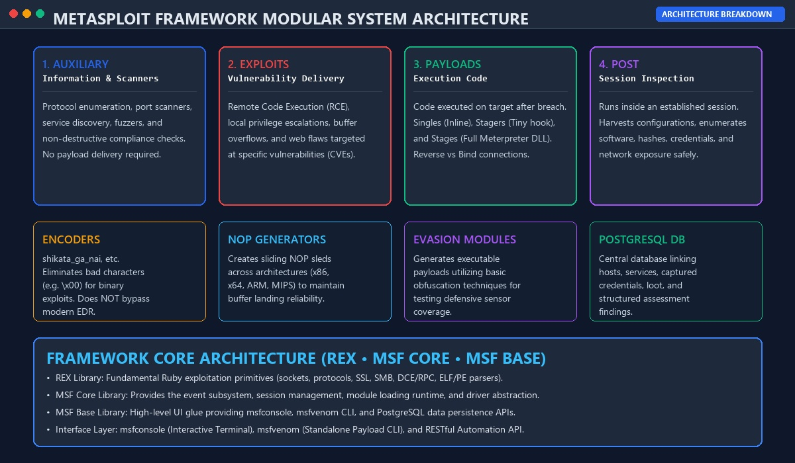
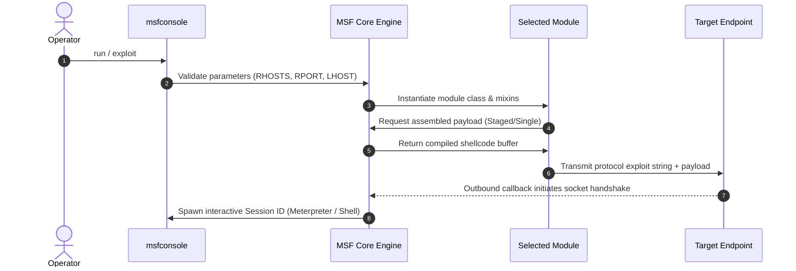
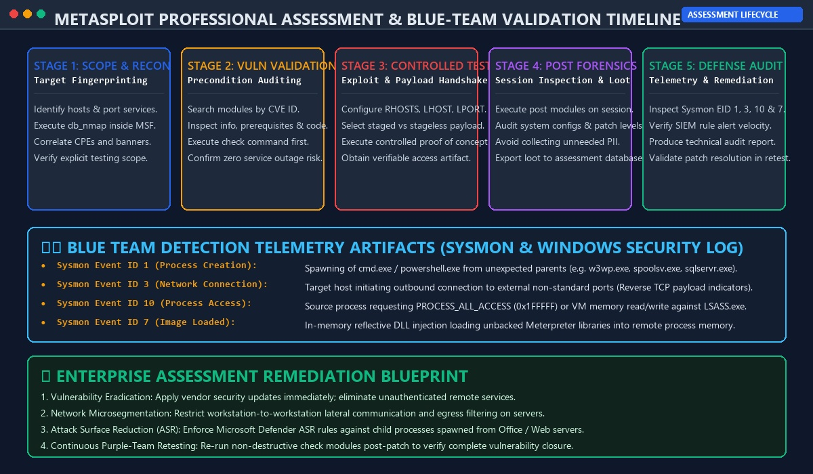

# Metasploit Framework — Complete Technical Architecture & Security Tool Guide

> **Target Audience:** Security Engineers, Exploit Developers, Red/Purple Teams, Vulnerability Researchers, and SOC Detection Engineers.
>
> **Technical Scope:** Metasploit Framework Internal Architecture, Ruby Engine State Machine, Rex Library Primitives, 7 Module Subsystems (Auxiliary, Exploits, Payloads, Post, Encoders, NOPs, Evasion), `msfconsole` Command Subsystems, `msfvenom` Code Generation, Meterpreter TLV Protocol & In-Memory Execution, PostgreSQL Data Services, and Tool Applications Across 12 Cybersecurity Domains.
>
> **Classification:** Technical Reference Manual & Systems Architecture Guide.

---

<div align="center">


# ⚔️ Metasploit Framework: Technical Tool Architecture & Systems Guide ⚔️
### Internal Component Stack • Modular Subsystems • Payload Engine • Multi-Domain Security Applications

[](https://www.metasploit.com/)
[](https://github.com/rapid7/metasploit-framework)
[](https://docs.metasploit.com/)
[](https://github.com/rapid7/metasploit-framework/blob/master/COPYING)
[](https://github.com/sivaoffl04/Cyber-Blog)

</div>

---

### 💻 Real-Time Terminal Session & Component Execution

The animated demonstration below illustrates the internal execution lifecycle inside `msfconsole`: module resolution, parameter validation, target fingerprinting via auxiliary SMB scanners, non-destructive `check` routine execution, staged Meterpreter payload delivery, and blue-team SIEM telemetry capture:


---

# 📋 Table of Contents

1. [What Exactly is the Metasploit Framework?](#1-what-exactly-is-the-metasploit-framework)
2. [Internal Systems Architecture & Execution Lifecycle](#2-internal-systems-architecture--execution-lifecycle)
3. [The Seven Module Families: Deep Technical Breakdown](#3-the-seven-module-families-deep-technical-breakdown)
4. [The `msfconsole` Command & Navigation Engine](#4-the-msfconsole-command--navigation-engine)
5. [`msfvenom`: Standalone Payload Generation & Formatting](#5-msfvenom-standalone-payload-generation--formatting)
6. [Meterpreter: The In-Memory Runtime & Protocol Architecture](#6-meterpreter-the-in-memory-runtime--protocol-architecture)
7. [Database Subsystem, Workspaces, Hosts & Services](#7-database-subsystem-workspaces-hosts--services)
8. [Web Application Security: HTTP Mixins & Flaw Verification](#8-web-application-security-http-mixins--flaw-verification)
9. [Network Security & Protocol Modules: Raw Socket Engine](#9-network-security--protocol-modules-raw-socket-engine)
10. [Windows Security & OS Internals: Win32/64 Primitives](#10-windows-security--os-internals-win3264-primitives)
11. [Linux & Unix Security: POSIX, SUID & Kernel Interfaces](#11-linux--unix-security-posix-suid--kernel-interfaces)
12. [Active Directory & Identity Security: Kerberos, LDAP & RPC](#12-active-directory--identity-security-kerberos-ldap--rpc)
13. [Wireless Security: Context, Service Testing & Boundaries](#13-wireless-security-context-service-testing--boundaries)
14. [Cloud Security: Workloads, IMDS Metadata & API Flaws](#14-cloud-security-workloads-imds-metadata--api-flaws)
15. [Containers & DevSecOps: Exposed Daemons & Namespaces](#15-containers--devsecops-exposed-daemons--namespaces)
16. [IoT & Embedded Devices: Cross-Architecture Exploit Execution](#16-iot--embedded-devices-cross-architecture-exploit-execution)
17. [Mobile Security: Android Runtime (ART/Dalvik) & iOS Scope](#17-mobile-security-android-runtime-artdalvik--ios-scope)
18. [Exploit Development & Module Authoring: Ruby Class Anatomy](#18-exploit-development--module-authoring-ruby-class-anatomy)
19. [SOC, EDR Telemetry & Purple-Team Operations](#19-soc-edr-telemetry--purple-team-operations)
20. [Plugins & Framework Extensibility](#20-plugins--framework-extensibility)
21. [Source Code Repository Structure & Module Tree](#21-source-code-repository-structure--module-tree)
22. [Comprehensive Command Reference Matrix](#22-comprehensive-command-reference-matrix)
23. [Architectural Boundaries & Technical Limitations](#23-architectural-boundaries--technical-limitations)
24. [Official Authoritative Documentation & Source Repositories](#24-official-authoritative-documentation--source-repositories)

---

# 1. What Exactly is the Metasploit Framework?

The **Metasploit Framework (MSF)** is an open-source, modular security testing and exploit execution platform maintained by **Rapid7** and an international research community. Written predominantly in **Ruby**, with critical performance-sensitive stagers authored in Assembly and C, Metasploit is not an automated hacking tool or single exploit binary. It is an **extensible software framework** that standardizes the development, testing, and execution of vulnerability verification code.

Metasploit integrates several distinct subsystems into a single software suite:
* **Module Discovery and Class Loading:** Dynamic on-demand loading of specialized Ruby modules into a centralized runtime.
* **Protocol & Service Client Libraries:** Built-in network protocol implementations (HTTP/HTTPS, SMBv1/v2/v3, DCE/RPC, SSH, MSSQL, LDAP, SNMP, DNS).
* **Payload Assembly Engine:** Automatic assembly of stagers, stages, inline singles, and encoders across x86, x64, ARM, MIPS, and PPC architectures.
* **Interactive Session Management:** Multi-channel session controllers managing raw command shells, Meterpreter runtime channels, and background execution jobs.
* **Relational Assessment Database:** Centralized PostgreSQL backend tracking hosts, ports, service banners, captured credentials, and operational loot.

---

# 2. Internal Systems Architecture & Execution Lifecycle

The framework operates as a multi-tier software stack:



```text
+-----------------------------------------------------------------------------------------------+
|                                      USER INTERFACES                                          |
|                msfconsole (Terminal)  •  msfvenom (CLI Generator)  •  RPC / REST API          |
+-----------------------------------------------------------------------------------------------+
|                                      MSF BASE LIBRARY                                         |
|              Session Dispatcher   •   Plugin Manager   •   Command Interpreter                |
+-----------------------------------------------------------------------------------------------+
|                                      MSF CORE LIBRARY                                         |
|          Module Loading Engine   •   Event Dispatcher   •   Payload Linker / Assembler        |
+-----------------------------------------------------------------------------------------------+
|                                    REX (RUBY EXTENSION)                                       |
|    Socket Abstraction (TCP/UDP/SSL)  •  Protocol Mixins (SMB/HTTP)  •  PE/ELF Format Engines   |
+-----------------------------------------------------------------------------------------------+
|                                      DATA SERVICES LAYER                                      |
|                     PostgreSQL Database Engine (Hosts, Services, Loot, Creds)                 |
+-----------------------------------------------------------------------------------------------+
```

### 1. REX (Ruby Extension Library)
Rex is the underlying bedrock library. It operates completely independently of the Metasploit core, providing:
* Low-level networking primitives (raw sockets, SSL/TLS wrappers, proxychains support).
* Protocol state engines (DCE/RPC clients, SMB client, HTTP client, Telnet client).
* Binary parsing and architecture manipulation engines (PE, ELF, Mach-O inspection, shellcode generation helpers).

### 2. MSF Core Library
MSF Core defines the fundamental object-oriented interfaces:
* Manages the lifecycle of modules (instantiation, option registration, cleanup).
* Houses the **Event Subsystem** (notifying the framework when sessions open, jobs finish, or modules fail).
* Provides the runtime payload assembly subsystem.

### 3. MSF Base Library
MSF Base wraps Core into human-accessible APIs:
* Supplies the command interpreters powering `msfconsole`.
* Manages data persistence with the PostgreSQL storage layer.
* Provides the plugin architecture to dynamically hook external utilities.

### The Internal Execution Sequence

When an operator executes `run` or `exploit` inside `msfconsole`:



---

# 3. The Seven Module Families: Deep Technical Breakdown

Metasploit partitions all functional units into seven distinct directories inside `modules/`:

```text
modules/
  ├── auxiliary/     <- Scanners, fuzzers, DoS, protocol clients (No payload)
  ├── exploits/      <- Vulnerability delivery mechanisms (Requires payload)
  ├── payloads/      <- Execution code delivered to target (Singles, Stagers, Stages)
  ├── post/          <- Session-bound system enumeration, pivoting, credential collection
  ├── encoders/      <- Shellcode byte-transform algorithms (Bad character avoidance)
  ├── nops/          <- Architecture-specific sliding NOP sequence generators
  └── evasion/       <- Executable wrappers designed to test endpoint defensive rules
```

### 3.1 Auxiliary Modules (`auxiliary/`)
Auxiliary modules perform network scanning, service discovery, protocol fuzzing, and compliance verification. They **do not deliver payloads** and **do not create command sessions**.
* **Scanners (`auxiliary/scanner/*`):** Multi-threaded network probes (e.g., `auxiliary/scanner/portscan/tcp`, `auxiliary/scanner/smb/smb_version`).
* **Fuzzers (`auxiliary/fuzzers/*`):** Transmit corrupted protocol frames to identify memory fault crashes.
* **Server Daemons (`auxiliary/server/*`):** Rogue network listeners (e.g., rogue DHCP, capture/http_ntlm, socks_proxy).

### 3.2 Exploit Modules (`exploits/`)
Exploits contain code designed to leverage a specific software flaw (buffer overflow, memory corruption, command injection, path traversal).
* Organized hierarchically by platform: `windows/`, `linux/`, `osx/`, `multi/`, `unix/`, `freebsd/`.
* **Exploit Ranks:**
  * **Manual:** Requires manual intervention or is unstable.
  * **Low / Average:** Unreliable; target crash risk is elevated.
  * **Normal / Good:** Standard reliable exploit with target profiles.
  * **Great / Excellent:** Automatic target detection with zero risk of service crash (e.g., pure command injection).

### 3.3 Payload Modules (`payloads/`)
Payloads represent the code executed on the target after the exploit primitive succeeds:
* **Singles (Inline):** Self-contained payloads executing a static task (e.g., spawning `/bin/sh` or creating a local user).
* **Stagers:** Lightweight network hooks (usually under 350 bytes) designed to establish a socket connection and download the larger stage into memory.
* **Stages:** Sophisticated payloads (e.g., the complete DLL/SO of **Meterpreter** or VNC injection) pulled across the wire by the stager.

### 3.4 Post-Exploitation Modules (`post/`)
Post modules operate **only on an existing, open session**. They leverage established operating system handles to enumerate installed patches, dump hashes from the local SAM, gather network interfaces, and inspect running processes without dropping new executables.

### 3.5 Encoders (`encoders/`)
Encoders apply mathematical transformations (such as polymorphic XOR via `x86/shikata_ga_nai`) to shellcode buffers. 
* **Primary Technical Purpose:** Eliminating restricted "bad characters" (such as null bytes `\x00`, line feeds `\x0a`, or carriage returns `\x0d`) that break string-copy functions (`strcpy`, `sprintf`) in vulnerable software.
* **Crucial Reality:** Encoders are **not** an antivirus/EDR evasion solution. Because the decoding stub at the beginning of the payload must execute in cleartext to decrypt the shellcode, modern behavioral EDR engines detect the stub structure immediately.

### 3.6 NOP Generators (`nops/`)
NOP generators construct sliding sequence sleds of No-Operation machine instructions. They ensure that if an exploit's hijacked instruction pointer (`EIP`/`RIP`) lands anywhere within the sled buffer, CPU execution slides smoothly into the shellcode entry point.

### 3.7 Evasion Modules (`evasion/`)
Introduced in Metasploit 5, evasion modules generate Windows executable binaries (`.exe`) utilizing basic packing and obfuscation techniques. They provide controlled test artifacts to measure whether corporate antivirus software detects payload droppers.

---

# 4. The `msfconsole` Command & Navigation Engine

`msfconsole` provides the central readline-based interactive environment.

### Command Execution Mechanics

```text
+-------------------+---------------------------------------------------------------------------+
| Command           | Execution Context & Technical Purpose                                     |
+-------------------+---------------------------------------------------------------------------+
| search <filter>   | Searches the module index using metadata filters (cve, type, platform)    |
| use <module>      | Instantiates a module class and mounts its configuration schema           |
| info              | Queries module attributes: description, references, targets, authors      |
| show options      | Enumerates required, optional, and default parameters for active module   |
| show advanced     | Displays low-level tuning options (timeouts, SSL ciphers, chunking)      |
| show targets      | Displays supported CPU architectures, OS versions, and return addresses   |
| set <VAR> <VAL>   | Assigns a value to a parameter scoped strictly to the current module      |
| setg <VAR> <VAL>  | Assigns a global value persistent across all subsequently loaded modules  |
| unset / unsetg    | Clears a local or global variable assignment                              |
| check             | Runs a module's check() routine to verify vulnerability non-destructively  |
| run -j / exploit  | Spawns module execution; -j flag dispatches execution as a background job |
| back              | Dereferences the active module and returns to the root prompt             |
| jobs -l / -k <ID> | Lists or terminates background execution jobs                             |
| sessions -l       | Enumerates established interactive sessions (ID, Type, Host, Info)        |
| sessions -i <ID>  | Attaches the console stdin/stdout to an active interactive session        |
| spool <path>      | Directs all console stdout and stderr to a permanent local log file       |
| makerc <path>     | Exports the current command history to a reusable Metasploit script (.rc) |
+-------------------+---------------------------------------------------------------------------+
```

### Advanced Search Filtering

The Metasploit search engine queries cached database metadata, allowing operators to filter with surgical precision:

```text
# Search for remote Windows SMB exploits released in 2020 or later
msf6 > search type:exploit platform:windows smb cve:2020

# Search for high-reliability auxiliary scanners targeting SSH
msf6 > search type:auxiliary name:ssh rank:excellent
```

---

# 5. `msfvenom`: Standalone Payload Generation & Formatting

`msfvenom` combines shellcode generation (`msfpayload`) and bad-character encoding (`msfencode`) into a single command-line compiler:

```bash
msfvenom -p <PAYLOAD> [OPTIONS] -f <FORMAT> -o <OUTPUT_PATH>
```

```text
+-----------------------------------------------------------------------------------------------+
|                                  MSFVENOM ARGUMENT ENGINE                                     |
+-------------------+---------------------------------------------------------------------------+
| Flag              | Technical Function                                                        |
+-------------------+---------------------------------------------------------------------------+
| -p, --payload     | Specifies the framework payload module to compile                         |
| -l, --list        | Queries available payloads, formats, encoders, nops, or platforms         |
| -f, --format      | Selects output format: Executable (exe, elf), Transform (c, py), Web (war)|
| -e, --encoder     | Specifies the encoding algorithm to apply to the shellcode                |
| -b, --bad-chars   | Defines hex bytes to avoid (e.g., -b '\x00\x0a\x0d')                      |
| -i, --iterations  | Number of encoding passes to apply                                        |
| -a, --arch        | Specifies architecture (x86, x64, armle, mipsbe)                          |
| --platform        | Specifies OS platform (windows, linux, osx, android, java)                |
| -s, --space       | Maximum allowable payload buffer size in bytes                            |
| -x, --template    | Injects shellcode into an existing clean binary executable template       |
+-------------------+---------------------------------------------------------------------------+
```

### Staged vs. Stageless Payload Syntax

The distinction between a staged and stageless payload is denoted by the delimiter:
* **Staged:** `windows/x64/meterpreter/reverse_tcp` (separated by `/`) $\rightarrow$ Outputs a lightweight stager that contacts a handler to pull the Meterpreter stage DLL into memory.
* **Stageless:** `windows/x64/meterpreter_reverse_tcp` (separated by `_`) $\rightarrow$ Bundles the stager and the full Meterpreter DLL into one self-contained binary blob.

---

# 6. Meterpreter: The In-Memory Runtime & Protocol Architecture

**Meterpreter (Meta-Interpreter)** is an advanced in-memory payload runtime. It does not execute a native command shell (`cmd.exe` or `/bin/sh`). Instead, it injects an interpreter DLL directly into volatile process memory using **Reflective DLL Injection**.

```text
+-----------------------------------------------------------------------------------------------+
|                                 METERPRETER ARCHITECTURE                                      |
+-----------------------------------------------------------------------------------------------+
|       CONTROLLER SIDE (Kali Linux)               |           TARGET SIDE (Compromised Host)   |
|  msfconsole / multi_handler                      |  Victim Process (e.g., explorer.exe)       |
|            │                                     |            │                               |
|   Ruby Client Session Driver                     |   Reflective Meterpreter Core DLL          |
|            │                                     |            │                               |
|   TLV Protocol Engine (Type-Length-Value)        |   TLV Protocol Deserializer                |
|            │                                     |            │                               |
|   Transport Encryption (TLS Encrypted Socket)    |   AES / TLS Transport Sockets              |
|            │                                     |            │                               |
|   Extension APIs (stdapi, priv, kiwi)            |   In-Memory Extension DLLs (.dll/.so)      |
+-----------------------------------------------------------------------------------------------+
```

### The TLV Protocol (Type-Length-Value)
All communication between `msfconsole` and target-side Meterpreter occurs via structured **TLV packets**:
* **Type (4 bytes):** Identifies the command or response type (e.g., `TLV_TYPE_STRING`, `TLV_TYPE_UINT`).
* **Length (4 bytes):** Length of the accompanying payload data buffer.
* **Value (Variable):** The raw encrypted parameters or data buffer.

Because Meterpreter operates entirely in memory:
1. It does not write new executable binaries to target disk drives.
2. It does not create new processes unless explicitly commanded (`execute`).
3. It supports live process migration (`migrate <PID>`) to seamlessly move execution into stable processes (e.g., `explorer.exe` or `svchost.exe`).

---

# 7. Database Subsystem, Workspaces, Hosts & Services

Metasploit includes a data management layer backed by **PostgreSQL**. When managing large network assessments, the database prevents duplicate scanning and correlates services with available modules.

```bash
# Initialize and verify local database
sudo msfdb init
msfconsole -q
```

Inside `msfconsole`:

```text
msf6 > db_status
[*] Connected to msf. Connection type: postgresql. Connection name: local_db.
```

### Workspace Segmentation

Workspaces isolate engagement data:

```text
msf6 > workspace -a Internal_PCI_Audit        <- Create workspace
msf6 > workspace Internal_PCI_Audit           <- Switch workspace
msf6 > workspace -d Internal_PCI_Audit        <- Delete workspace
```

### Database Data Ingestion Commands

* **`db_nmap`:** Runs Nmap and automatically imports all discovered hosts, open ports, service banners, and MAC addresses into the database schema.
* **`hosts`:** Displays all stored host records (IP, MAC, OS Name, Architecture).
* **`services`:** Displays open ports across all hosts (`-p` filters specific ports).
* **`creds`:** Centralized table storing captured hashes, SSH keys, and plaintext passwords.
* **`loot`:** Stores captured system files, registry hives, and exfiltrated configuration data.
* **`notes`:** Custom annotations attached to specific hosts or services by modules.

---

# 8. Web Application Security: HTTP Mixins & Flaw Verification

While specialized web vulnerability scanners (e.g., Burp Suite) focus on crawling and fuzzing application logic, Metasploit provides surgical modules for **server-side web infrastructure vulnerabilities** (e.g., Apache Struts OGNL, Log4j JNDI injection, Spring4Shell, PHP CGI execution, Tomcat manager authentication).

### The HTTP Client Mixin (`Msf::Exploit::Remote::HttpClient`)

Ruby modules targeting web services include the `HttpClient` mixin, granting them access to high-level HTTP methods:

```ruby
# How an HTTP module transmits structured requests in Metasploit
res = send_request_cgi({
  'method'    => 'POST',
  'uri'       => normalize_uri(target_uri.path, 'login.php'),
  'vars_post' => {
    'user'    => datastore['USERNAME'],
    'pass'    => datastore['PASSWORD']
  },
  'headers'   => {
    'User-Agent' => 'Mozilla/5.0'
  }
})
```

### Key Web Auxiliary Modules:
* **`auxiliary/scanner/http/title`:** Extracts `<title>` tags and HTTP server banners across CIDR ranges.
* **`auxiliary/scanner/http/dir_scanner`:** Multi-threaded path bruteforcing for exposed admin dashboards.
* **`auxiliary/scanner/http/http_version`:** Fingerprints exact web server patch revisions.

---

# 9. Network Security & Protocol Modules: Raw Socket Engine

Metasploit's network modules leverage the Rex library to establish direct socket connections across fundamental protocols:

### Supported Protocol Stacks:
* **SMB / CIFS (`auxiliary/scanner/smb/*`):** Enumerate SMB dialects (v1/v2/v3), identify domain membership, audit administrative shares (`C$`, `ADMIN$`), and check for null sessions.
* **SSH (`auxiliary/scanner/ssh/*`):** Audit exposed SSH daemon banners, test SSH key authentication, and verify credential sets.
* **Database Daemons (`auxiliary/admin/mssql/*`, `auxiliary/scanner/mysql/*`):** Connect directly to SQL instances, query tables, audit SA accounts, and execute `xp_cmdshell` commands.
* **SNMP (`auxiliary/scanner/snmp/snmp_enum`):** Query community strings (`public`, `private`) to extract routing tables, interfaces, and process listings.

---

# 10. Windows Security & OS Internals: Win32/64 Primitives

Metasploit interacts with the Windows NT kernel through specialized post-exploitation libraries and DLL injectors:

### Core Windows Internals Interfaced:
1. **Token Impersonation (`incognito`):** Meterpreter's `incognito` extension interfaces with Windows Access Tokens, allowing operators to list (`list_tokens -u`) and impersonate (`impersonate_token "DOMAIN\\User"`) active delegation and impersonation tokens.
2. **Local Security Authority (`LSASS`):** Post modules interface directly with `lsass.exe` to read Kerberos tickets, NTLM hashes, and plaintexts in memory.
3. **Named Pipes & RPC:** Exploits (e.g., `ms17_010_eternalblue`) manipulate named pipe structures (`\pipe\spoolss`, `\pipe\srvsvc`) and SMB transaction buffers to achieve kernel-level ring-0 execution.

---

# 11. Linux & Unix Security: POSIX, SUID & Kernel Interfaces

On Linux and Unix platforms, Metasploit exploits interact directly with POSIX system call interfaces:

### Key Linux Interaction Vectors:
* **SUID Binary Exploits:** Targets misconfigured or vulnerable root-owned binaries with the `setuid` permission bit active.
* **Sudo Vulnerabilities:** Validates vulnerabilities in the `sudoers` subsystem (e.g., CVE-2021-3156 "Baron Samedit").
* **Kernel Exploits:** Exploits ring-0 kernel memory vulnerabilities (e.g., Dirty COW, eBPF bugs) by compiling inline C code on the target or executing pre-compiled static ELF binary payloads.

---

# 12. Active Directory & Identity Security: Kerberos, LDAP & RPC

Metasploit provides specialized modules for Active Directory service validation:

* **LDAP Enumeration (`auxiliary/gather/ldap_query`):** Connects to domain controllers on TCP 389/636 to dump user lists, SPNs, and group policy objects.
* **Relay & Spoofing (`auxiliary/server/capture/smb`):** Acts as an SMB authentication capture server to harvest NetNTLMv2 hashes.
* **Service Exploit Validation:** Verifies critical domain-level flaws such as Zerologon (`CVE-2020-1472`) and PrintNightmare (`CVE-2021-34527`).

### Tool Differentiation in Active Directory:
* **Metasploit:** Best for verifying specific CVEs affecting domain controllers and hosting handlers.
* **Impacket:** Better suited for raw Active Directory protocol operations (e.g., `GetUserSPNs.py`, `secretsdump.py`).
* **BloodHound:** Graph theory tool for mapping identity attack paths and ACL abuse.
* **Rubeus:** The industry standard for on-host Windows Kerberos ticket operations.

---

# 13. Wireless Security: Context, Service Testing & Boundaries

Metasploit does **not** provide direct 802.11 radio frequency frame capture or active Wi-Fi cracking tools. It cannot set wireless network cards to RF monitor mode, inject deauthentication frames, or capture EAPOL handshakes.

### Where Metasploit Operates in Wireless:
* Once a test client connects to a wireless network (or during rogue access point simulations), Metasploit is used to assess the **network services exposed by wireless controllers, access points, and isolated client segments**.
* **Companion Tool:** **Aircrack-ng** is the dedicated suite for 802.11 monitor mode, WPA/WPA2/WPA3 frame inspection, and PMKID capture.

---

# 14. Cloud Security: Workloads, IMDS Metadata & API Flaws

In cloud infrastructure (AWS, Azure, GCP), Metasploit validates reachable workloads and server-side vulnerabilities:

### Cloud Attack Vectors Evaluated:
* **SSRF against Instance Metadata Services (IMDS):** Validating Server-Side Request Forgery flaws on cloud web apps to query `http://169.254.169.254/latest/meta-data/iam/security-credentials/` and extract temporary cloud IAM keys.
* **Vulnerable Cloud VMs:** Testing unpatched daemons running on Amazon EC2 or Azure Virtual Machines exposed to perimeter networks.
* **Companion Tools:** Cloud security posture tools such as **Prowler**, **ScoutSuite**, and **Pacu** are used to audit IAM policies and cloud control planes.

---

# 15. Containers & DevSecOps: Exposed Daemons & Namespaces

Metasploit audits containerized microservices and container orchestration endpoints:

* **Exposed Docker Daemon API (`auxiliary/scanner/http/docker_version`):** Identifies unauthenticated Docker TCP sockets on port `2375`.
* **Container Breakout Verification:** Validating whether an established container session possesses elevated Linux capabilities (`CAP_SYS_ADMIN`), mounted host root directories (`/host`), or access to the host socket.
* **Companion Tools:** **Trivy** and **Grype** for static container image vulnerability scanning; **Falco** for runtime container monitoring.

---

# 16. IoT & Embedded Devices: Cross-Architecture Exploit Execution

Embedded routers, IP cameras, and IoT gateways frequently run specialized embedded Linux distributions on diverse hardware:

* **Multi-Architecture Payloads:** Metasploit compiles payloads for **MIPS (Big/Little Endian)**, **ARM (ARMLE/ARMBE)**, **PowerPC (PPC)**, and **SuperH (SH4)**.
* **Embedded Daemon Checks:** Probing UPnP services (`auxiliary/scanner/upnp/upnp_traffic`), embedded HTTP administration panels, and default hardcoded vendor credentials across Telnet and SSH.
* **Companion Tools:** **Binwalk** for firmware extraction and file-system unpacking; **Ghidra** for firmware disassembly.

---

# 17. Mobile Security: Android Runtime (ART/Dalvik) & iOS Scope

Metasploit provides Android payloads compiled to Dalvik Executable (DEX) bytecode:

* **Android Payloads:** `android/meterpreter/reverse_tcp` operates within the Android application sandbox, interfacing with Android Java APIs (recording audio, inspecting contacts, reading SMS).
* **Technical Scope Boundaries:** Metasploit is **not** an APK reverse-engineering suite. It does not inspect DEX bytecode or analyze exported broadcast receivers.
* **Companion Tools:** **JADX-GUI** for decompiling APKs to Java; **MobSF** for automated static and dynamic security auditing; **Frida** for runtime hook injection.

---

# 18. Exploit Development & Module Authoring: Ruby Class Anatomy

Writing a custom Metasploit module requires understanding object-oriented Ruby class design:

### Anatomy of an Auxiliary Module

```ruby
##
# Custom Auxiliary Port Check Module
##
class MetasploitModule < Msf::Auxiliary
  include Msf::Exploit::Remote::Tcp
  include Msf::Auxiliary::Scanner

  def initialize(info = {})
    super(
      update_info(
        info,
        'Name'        => 'Custom TCP Service Fingerprinter',
        'Description' => 'Connects to target port and checks service response banner.',
        'Author'      => ['Security Researcher'],
        'License'     => MSF_LICENSE,
        'References'  => [['URL', 'https://docs.metasploit.com']]
      )
    )
    register_options([
      Opt::RPORT(8080),
      OptInt.new('TIMEOUT', [true, 'Socket timeout in seconds', 5])
    ])
  end

  def run_host(ip)
    connect
    sock.put("PING\r\n")
    banner = sock.get_once(1024, datastore['TIMEOUT'])
    if banner
      print_good("#{ip}:#{rport} - Received Response: #{banner.strip}")
    else
      print_status("#{ip}:#{rport} - No banner returned.")
    end
  ensure
    disconnect
  end
end
```

### Exploit Authoring Utilities
* **`pattern_create.rb`:** Generates unique cyclical alphanumeric string sequences to pinpoint exact buffer overflow offsets in debuggers.
* **`pattern_offset.rb`:** Calculates the exact offset value when the CPU instruction pointer (`EIP`/`RIP`) is overwritten with a cyclic string chunk.

---

# 19. SOC, EDR Telemetry & Purple-Team Operations

Metasploit execution generates measurable forensic footprints on endpoint operating systems:



### Primary Endpoint Detection Indicators:
1. **Process Lineage (Sysmon EID 1):** Command interpreters (`cmd.exe`, `powershell.exe`, `/bin/bash`) spawned by unexpected parent processes (e.g., `spoolsv.exe`, `w3wp.exe`, `httpd.exe`).
2. **Network Sockets (Sysmon EID 3):** Standard system binaries establishing unexpected outbound TCP connections on non-standard ports (e.g., 4444, 4445, 8443).
3. **Memory Injection (Sysmon EID 10):** Calling `OpenProcess` with `PROCESS_ALL_ACCESS` (0x1FFFFF) against `lsass.exe` to harvest authentication tokens.
4. **Unbacked Memory Execution:** EDR memory scanners detect thread execution originating from memory regions not backed by an executable image on disk (classic reflective DLL footprint).

---

# 20. Plugins & Framework Extensibility

Plugins extend the console with additional commands and third-party integrations. Unlike modules, plugins alter the behavior of `msfconsole`:

```text
msf6 > load -l                               <- Enumerate available plugins
msf6 > load alias                            <- Load command alias utility
msf6 > load wmap                             <- Load web application assessment engine
```

### Standard Framework Plugins:
* **`wmap`:** Web application vulnerability scanner integrated into msfconsole.
* **`alias`:** Creates command shortcuts for frequently used console operations.
* **`nessus` / `openvas`:** Connects directly to external enterprise vulnerability scanners to import scan policies and XML reports directly into the database.
* **`pcap_log`:** Captures all network packets transmitted by the framework to a `.pcap` file for Wireshark inspection.

---

# 21. Source Code Repository Structure & Module Tree

The official source code at [`rapid7/metasploit-framework`](https://github.com/rapid7/metasploit-framework) is structured as follows:

```text
metasploit-framework/
  ├── lib/                  <- Core libraries (Rex, MSF Core, MSF Base, Database drivers)
  ├── modules/              <- The modular engine
  │   ├── auxiliary/        <- Information gathering, scanners, fuzzers, DoS
  │   ├── exploits/         <- Vulnerability exploitation delivery code
  │   ├── payloads/         <- Singles, stagers, and stages
  │   ├── post/             <- Session-bound system auditing and pivoting
  │   ├── encoders/         <- Bad-character removal algorithms
  │   ├── nops/             <- CPU sled generators
  │   └── evasion/          <- Obfuscation testing wrappers
  ├── data/                 <- Static binary files, Meterpreter compiled stages, wordlists
  ├── plugins/              <- Plugins extending msfconsole functionality
  ├── tools/                <- Standalone helper scripts (pattern_create, pattern_offset)
  ├── spec/                 <- Automated RSpec unit and integration testing suite
  └── msfconsole, msfvenom  <- Executable CLI entry points
```

---

# 22. Comprehensive Command Reference Matrix

| Operational Goal | Precise Command Syntax |
| :--- | :--- |
| **Launch Console Quietly** | `msfconsole -q` |
| **Verify Database Connection** | `db_status` |
| **Create Assessment Workspace** | `workspace -a <NAME>` |
| **Run & Import Nmap Scan** | `db_nmap -sS -sV -O <IP_RANGE>` |
| **Query Recorded Hosts** | `hosts` |
| **Query Recorded Open Ports** | `services` |
| **Search Exploits by CVE** | `search cve:2021 type:exploit platform:windows` |
| **Load Module** | `use <MODULE_PATH>` |
| **Inspect Module Metadata** | `info` |
| **Display Options** | `show options` |
| **Display Advanced Options** | `show advanced` |
| **Set Parameter Locally** | `set RHOSTS <IP>` |
| **Set Parameter Globally** | `setg RHOSTS <IP>` |
| **Execute Vulnerability Check** | `check` |
| **Execute Module** | `run` or `exploit` |
| **Execute in Background** | `run -j` |
| **List Established Sessions** | `sessions -l` |
| **Interact with Session** | `sessions -i <ID>` |
| **List Background Jobs** | `jobs -l` |
| **Terminate Background Job** | `jobs -k <ID>` |
| **Log Terminal Session** | `spool /path/to/log.txt` |
| **Compile Standalone Payload** | `msfvenom -p <PAYLOAD> LHOST=<IP> LPORT=<PORT> -f <FMT> -o <FILE>` |

---

# 23. Architectural Boundaries & Technical Limitations

Understanding what Metasploit **cannot** do is essential for technical leadership:

1. **Not a Universal Exploit Engine:** Metasploit does not automatically generate exploits for unresearched or proprietary software flaws. An exploit module must be designed and coded for that specific vulnerability.
2. **Exploit Success is Not Guaranteed:** Modern OS exploit mitigations (ASLR, DEP/NX, Stack Canaries, Control Flow Guard) and EDR memory inspection often prevent generic shellcode execution.
3. **No Automatic Elevation:** Gaining a shell does not automatically grant root or SYSTEM permissions. Privilege escalation requires separate local modules or misconfigurations.
4. **Encoding $\ne$ Cryptographic Obfuscation:** Metasploit encoders (`shikata_ga_nai`) eliminate bad characters for buffer integrity; they do not evade modern behavior-based EDR agents.
5. **Domain Scope Boundaries:** Metasploit requires companion tools for Wi-Fi frame auditing (**Aircrack-ng**), web application logic fuzzing (**Burp Suite**), Active Directory graph attack pathing (**BloodHound**), and cloud IAM posture analysis (**Prowler**).

---

# 24. Official Authoritative Documentation & Source Repositories

* **Official Rapid7 Website:** [https://www.metasploit.com](https://www.metasploit.com)
* **Official Open-Source GitHub Repository:** [https://github.com/rapid7/metasploit-framework](https://github.com/rapid7/metasploit-framework)
* **Official Metasploit Documentation:** [https://docs.metasploit.com](https://docs.metasploit.com)
* **Official Module Reference Library:** [https://docs.rapid7.com/metasploit/modules/](https://docs.rapid7.com/metasploit/modules/)
* **Official Developer Guide (Writing Modules):** [https://docs.metasploit.com/docs/development/developing-modules/](https://docs.metasploit.com/docs/development/developing-modules/)
* **Official Meterpreter Architecture Guide:** [https://docs.metasploit.com/docs/using-metasploit/advanced/meterpreter/meterpreter.html](https://docs.metasploit.com/docs/using-metasploit/advanced/meterpreter/meterpreter.html)
* **Rapid7 Metasploitable 2 Lab Environment:** [https://docs.rapid7.com/metasploit/metasploitable-2/](https://docs.rapid7.com/metasploit/metasploitable-2/)
* **Rapid7 Metasploitable 3 Lab Environment:** [https://github.com/rapid7/metasploitable3](https://github.com/rapid7/metasploitable3)
