# 🧰 Cybersecurity Tool Masterclasses & Open-Source Ecosystem

Welcome to the **Cybersecurity Tool Masterclasses** repository section. Rather than basic command cheat sheets, each guide in this directory provides a comprehensive, production-grade operational reference covering underlying protocol architecture, hardware acceleration mechanics, real-world attack tradecraft, detection engineering (SIEM/Sigma), and enterprise defensive hardening.

Every tool featured below is paired with its **official project domain**, **official open-source GitHub repository** for source code auditing and compilation, **official branding assets**, and **real-time terminal demonstration recordings**.

---

## 📚 Masterclass & Open-Source Tool Ecosystem Index

| Tool | Official Emblem | Category & Architecture | 🌐 Official Domain | 🐙 Open-Source GitHub | Comprehensive Documentation |
| :--- | :---: | :--- | :---: | :---: | :--- |
| **Nmap** |  | Network Reconnaissance, Raw Packet Probes & Lua NSE | [nmap.org](https://nmap.org/) | [nmap/nmap](https://github.com/nmap/nmap) | [README Overview](./Nmap/README.md)<br>• [Technical Guide](./Nmap/Nmap_Network_Discovery_and_Vulnerability_Auditing_Guide.md) |
| **John the Ripper** |  | Password Cryptanalysis, CPU SIMD/AVX-512 & `*2john` Suite | [openwall.com/john](https://www.openwall.com/john/) | [openwall/john](https://github.com/openwall/john) | [README Overview](./John%20the%20ripper/README.md)<br>• [Technical Guide](./John%20the%20ripper/John_the_Ripper_Password_Cryptanalysis_and_Security_Guide.md) |
| **Hashcat** | 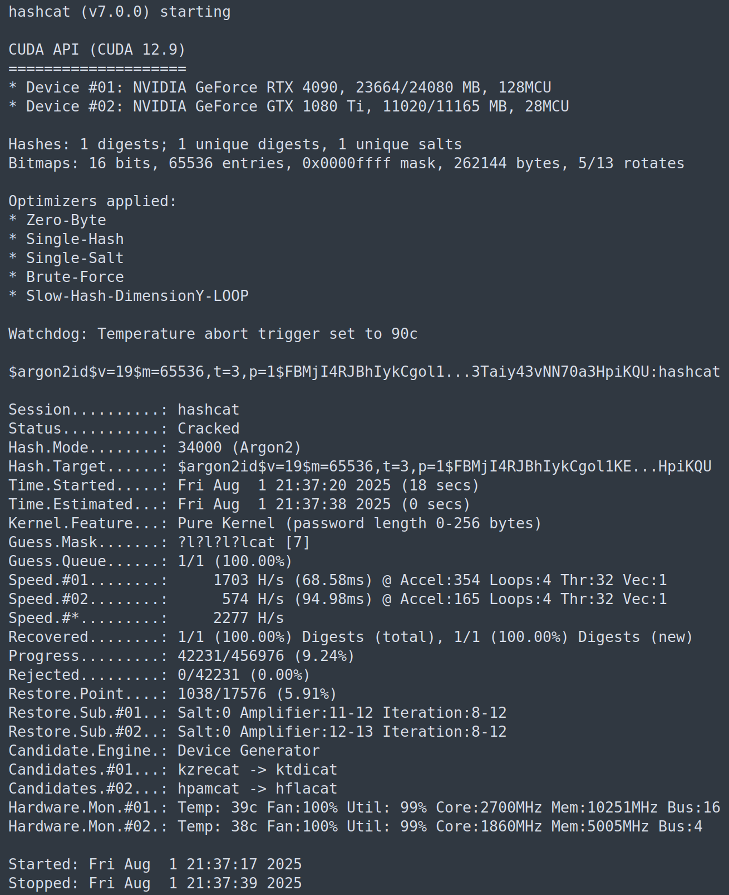 | Massively Parallel GPU Acceleration (CUDA / ROCm / OpenCL) | [hashcat.net](https://hashcat.net/hashcat/) | [hashcat/hashcat](https://github.com/hashcat/hashcat) | [README Overview](./Hashcat/README.md)<br>• [Technical Guide](./Hashcat/Hashcat_Advanced_GPU_Cracking_and_Cryptanalysis_Guide.md) |
| **Aircrack-ng** |  | 802.11 Layer 2 Frame Auditing, RF Injection & PMF/WPA3 | [aircrack-ng.org](https://www.aircrack-ng.org/) | [aircrack-ng/aircrack-ng](https://github.com/aircrack-ng/aircrack-ng) | [README Overview](./Aircrack-ng/README.md)<br>• [Technical Guide](./Aircrack-ng/Aircrack-ng_Wireless_Security_and_Protocol_Auditing_Guide.md) |
| **Kerberos Suite** |  | RFC 4120 Ticket Authentication, AD Identity & Ticket Forging | [web.mit.edu/kerberos](https://web.mit.edu/kerberos/) | [GhostPack/Rubeus](https://github.com/GhostPack/Rubeus)<br>[fortra/impacket](https://github.com/fortra/impacket) | [README Overview](./Kerberos/README.md)<br>• [Technical Guide](./Kerberos/Kerberos_Deep_Explanation_Tools_Attack_Research_and_Lab_Guide.md) |
| **Metasploit** |  | Modular Exploitation, Meterpreter TLV Engine & Post-Exploitation | [metasploit.com](https://www.metasploit.com/) | [rapid7/metasploit-framework](https://github.com/rapid7/metasploit-framework) | [README Overview](./Metasploit/README.md)<br>• [Technical Guide](./Metasploit/Metasploit_Framework_Technical_Architecture_and_Security_Tool_Guide.md) |

---

## 🛠️ Tool Masterclass Highlights & Operational Deep Dives

```text
====================================================================================================
                             ENTERPRISE CYBERSECURITY TOOLCHAIN ECOSYSTEM
====================================================================================================
 [Perimeter & Network]       [Identity & Domain]         [Host & Exploitation]       [Cryptanalysis]
  • Nmap (L2/L4 Probing)      • Kerberos V5 Protocol      • Metasploit Framework      • Hashcat (GPU Compute)
  • Zenmap (GUI Topology)     • Rubeus / Impacket         • Meterpreter (In-Memory)   • John the Ripper (CPU)
  • Aircrack-ng (802.11 RF)   • Event IDs 4768 / 4769     • Sysmon EID 1, 3, 7, 10    • *2john Hash Extractors
====================================================================================================
```

---

### 1. [Nmap — Complete Network Discovery, Packet Analysis & Security Auditing Guide](./Nmap/README.md)

<div align="center">

<p align="center">
  
</p>

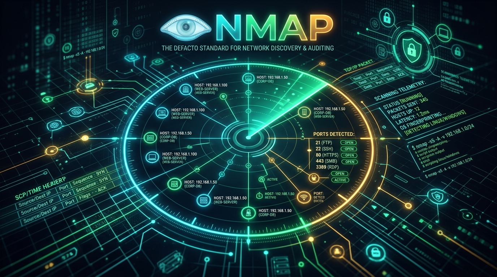

</div>

* **🌐 Official Project Domain:** [https://nmap.org](https://nmap.org/) • **Official Docs:** [https://nmap.org/book/man.html](https://nmap.org/book/man.html)
* **🐙 Official Open-Source GitHub:** [https://github.com/nmap/nmap](https://github.com/nmap/nmap)
* **Underlying Protocol Mechanics:** Low-level TCP three-way handshake manipulation (SYN `-sS`, Connect `-sT`, FIN `-sF`, Xmas `-sX`, Null `-sN`), raw UDP half-duplex probing (`-sU`), and ICMP/ARP layer 2 discovery heuristics.
* **Nmap Scripting Engine (NSE):** Architecture of the 14 script categories (`default`, `vuln`, `exploit`, `auth`, `safe`, `discovery`), asynchronous Lua socket dispatching, and high-impact vulnerability auditing (Log4Shell, MS17-010 EternalBlue).
* **Firewall Evasion & Packet Crafting:** MTU-aligned packet fragmentation (`-f`), decoy IP address spoofing (`-D`), source port pinning (`-g 53`), MAC address spoofing, and timing template tuning (`-T0` to `-T5`).
* **Visual Reconnaissance:** Includes coverage of **Zenmap**, the official graphical interface for interactive network topology exploration:
  <div align="center">
    
  </div>
* **Live Terminal Scanning Demonstration:**
  
  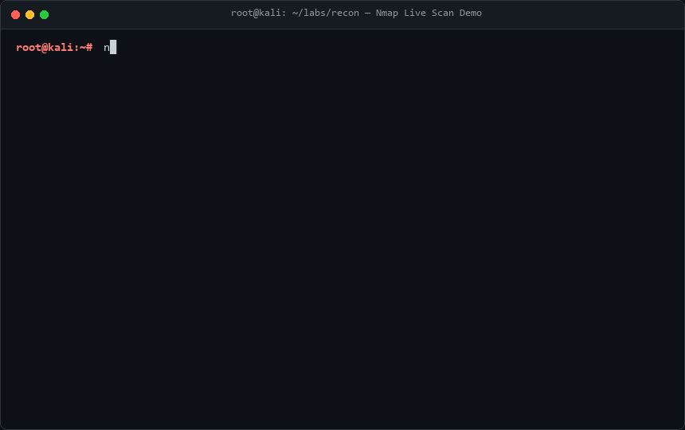

* **📖 Documentation Links:** [Nmap README Overview](./Nmap/README.md) • [Nmap Network Discovery & Vulnerability Auditing Guide](./Nmap/Nmap_Network_Discovery_and_Vulnerability_Auditing_Guide.md)

---

### 2. [John the Ripper — Enterprise Password Cryptanalysis, Hash Auditing & Defensive Hardening Guide](./John%20the%20ripper/README.md)

<div align="center">

<p align="center">
  
  &nbsp;&nbsp;&nbsp;&nbsp;
  
</p>


</div>

* **🌐 Official Project Domain:** [https://www.openwall.com/john/](https://www.openwall.com/john/) • **Community Wiki:** [https://openwall.info/wiki/john](https://openwall.info/wiki/john)
* **🐙 Official Open-Source GitHub:** [https://github.com/openwall/john](https://github.com/openwall/john)
* **Cryptanalytic Engine:** John the Ripper (Jumbo edition) multi-core CPU architecture, SIMD vectorization (SSE2, AVX2, AVX-512), and adaptive algorithmic candidate testing.
* **Cracking Modes Dissected:**
  - **Single Crack Mode:** Leverages GECOS field metadata (usernames, initials, room numbers) to crack local user accounts in microseconds without dictionary overhead.
  - **Wordlist Mode:** Employs pre-computed wordlists coupled with powerful regex mutation rules (`--rules=Jumbo`).
  - **Incremental Mode:** Exhaustive mathematical character space permutation based on statistical tri-graph frequency models.
* **The `*2john` Extraction Ecosystem:** Extracting cryptographic hashes from non-plaintext targets: `ssh2john.py`, `zip2john`, `rar2john`, `keepass2john`, `bitlocker2john`, and `pdf2john.py`.
* **Live Terminal Cracking Demonstration:**
  
  

* **📖 Documentation Links:** [John the Ripper README Overview](./John%20the%20ripper/README.md) • [John the Ripper Password Cryptanalysis Guide](./John%20the%20ripper/John_the_Ripper_Password_Cryptanalysis_and_Security_Guide.md)

---

### 3. [Hashcat — Advanced GPU Cryptanalysis, Rule Engineering & Credential Auditing Guide](./Hashcat/README.md)

<div align="center">

<p align="center">
  
</p>

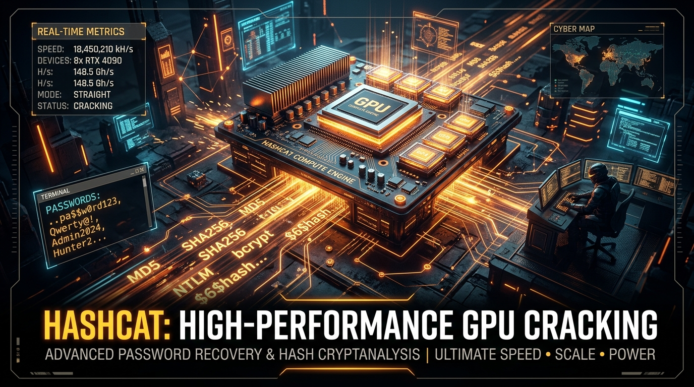

</div>

* **🌐 Official Project Domain:** [https://hashcat.net/hashcat/](https://hashcat.net/hashcat/) • **Official Wiki:** [https://hashcat.net/wiki/](https://hashcat.net/wiki/)
* **🐙 Official Open-Source GitHub:** [https://github.com/hashcat/hashcat](https://github.com/hashcat/hashcat)
* **GPU Compute Architecture:** Unleashing massive parallelism across NVIDIA CUDA Tensor Cores, AMD ROCm OpenCL kernels, and Apple Metal runtimes, achieving billions of hashes per second.
* **Five Attack Modes (`-a`):**
  - Mode 0: Straight Dictionary (`-a 0`)
  - Mode 1: Combinator Attack (`-a 1`)
  - Mode 3: Pure Mask Brute-Force (`-a 3`)
  - Mode 6: Hybrid Wordlist + Mask (`-a 6`)
  - Mode 7: Hybrid Mask + Wordlist (`-a 7`)
* **Algorithm Coverage:** High-throughput unsalted hashes (MD5, SHA1, NTLM mode 1000), Active Directory Kerberos tickets (Kerberoasting mode 13100, AS-REP Roasting mode 18200), Wi-Fi WPA2/WPA3 PMKID (mode 22000), and memory-hard Key Derivation Functions (bcrypt mode 3200, scrypt mode 8900, Argon2 mode 19700).
* **Live Terminal Cracking Demonstration:**
  
  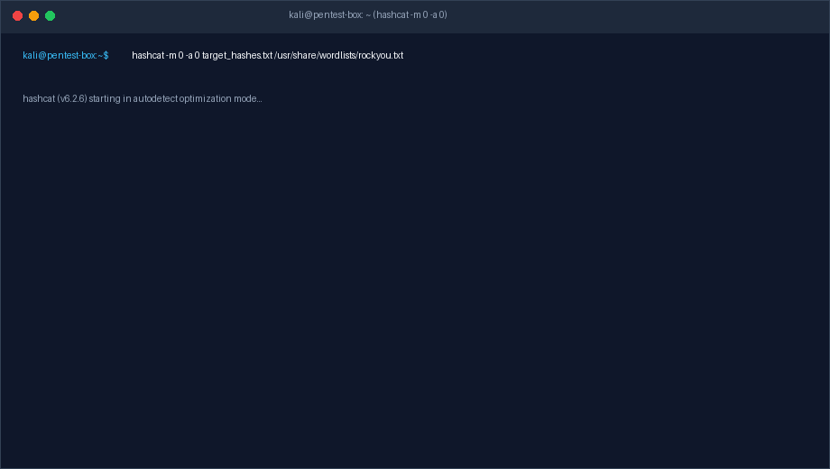

* **📖 Documentation Links:** [Hashcat README Overview](./Hashcat/README.md) • [Hashcat Advanced GPU Cracking Guide](./Hashcat/Hashcat_Advanced_GPU_Cracking_and_Cryptanalysis_Guide.md)

---

### 4. [Aircrack-ng — Wireless Security Architecture, 802.11 Protocol Cryptanalysis & Defense Guide](./Aircrack-ng/README.md)

<div align="center">

<p align="center">
  
</p>

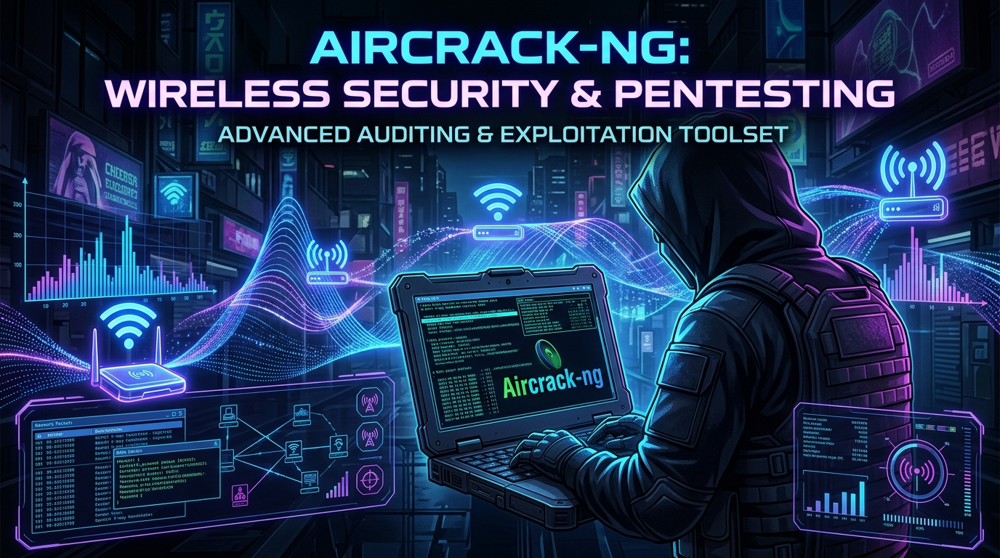

</div>

* **🌐 Official Project Domain:** [https://www.aircrack-ng.org/](https://www.aircrack-ng.org/) • **Official Wiki:** [https://www.aircrack-ng.org/doku.php](https://www.aircrack-ng.org/doku.php)
* **🐙 Official Open-Source GitHub:** [https://github.com/aircrack-ng/aircrack-ng](https://github.com/aircrack-ng/aircrack-ng)
* **802.11 RF Physical & Data Link Layer:** Wireless network interface card (NIC) architecture, monitor mode injection drivers (`airmon-ng`), 2.4 GHz vs. 5 GHz channel hopping, and RF beacon frame analysis.
* **Attack Tradecraft & Cryptanalysis:**
  - EAPOL 4-Way Handshake interception (`airodump-ng`)
  - Targeted Layer 2 802.11 deauthentication frame injection (`aireplay-ng`)
  - Clientless PMKID harvesting via RSN Information Elements
  - Offline cryptographic dictionary verification (`aircrack-ng`)
* **Defensive Hardening:** Transitioning from WPA2-PSK to WPA3-SAE (Simultaneous Authentication of Equals) Dragonfly handshake, and enforcing IEEE 802.11w Protected Management Frames (PMF) to neutralize deauthentication spoofing.
* **Live Terminal Interception Demonstration:**
  
  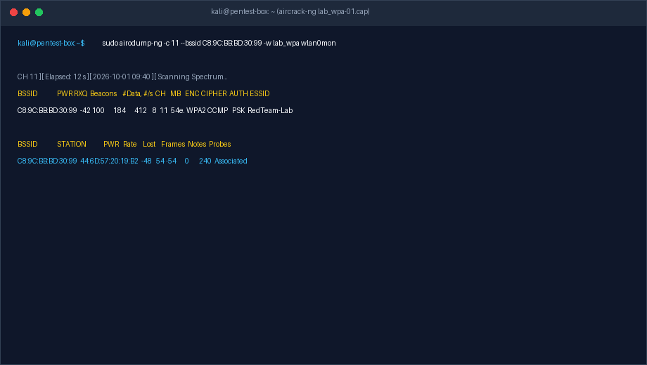

* **📖 Documentation Links:** [Aircrack-ng README Overview](./Aircrack-ng/README.md) • [Aircrack-ng Wireless Security & Protocol Auditing Guide](./Aircrack-ng/Aircrack-ng_Wireless_Security_and_Protocol_Auditing_Guide.md)

---

### 5. [Kerberos Protocol & Active Directory Identity Security Playbook](./Kerberos/README.md)

<div align="center">

<p align="center">
  
  &nbsp;&nbsp;&nbsp;&nbsp;
  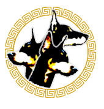
</p>

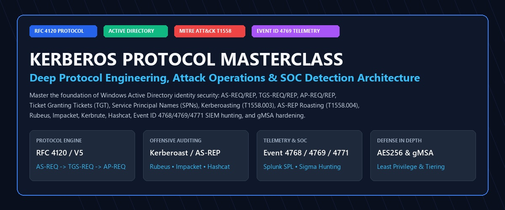

</div>

* **🌐 Official Protocol Standard & Docs:** [MIT Kerberos (web.mit.edu/kerberos)](https://web.mit.edu/kerberos/) • [Microsoft Kerberos Architecture](https://learn.microsoft.com/en-us/windows-server/security/kerberos/kerberos-authentication-overview) • [IETF RFC 4120](https://datatracker.ietf.org/doc/html/rfc4120)
* **🐙 Open-Source Ecosystem Repositories:**
  - **Impacket (Python Network Protocols):** [https://github.com/fortra/impacket](https://github.com/fortra/impacket)
  - **Rubeus (C# Windows Kerberos Suite):** [https://github.com/GhostPack/Rubeus](https://github.com/GhostPack/Rubeus)
  - **Kerbrute (Go Pre-Auth Sprayer):** [https://github.com/ropnop/kerbrute](https://github.com/ropnop/kerbrute)
  - **NetExec (Network Execution Suite):** [https://github.com/Pennyw0rth/NetExec](https://github.com/Pennyw0rth/NetExec)
  - **Mimikatz (Credentials & Ticket Forging):** [https://github.com/gentilkiwi/mimikatz](https://github.com/gentilkiwi/mimikatz)
  - **MIT Kerberos V5 Core:** [https://github.com/krb5/krb5](https://github.com/krb5/krb5)
* **Underlying Protocol Mechanics:** RFC 4120 state machine; AS-REQ/AS-REP, TGS-REQ/TGS-REP, and AP-REQ/AP-REP handshakes; Pre-Authentication (`PA-ENC-TIMESTAMP`); PAC (Privilege Attribute Certificate) validation; and symmetric ticket encryption (RC4-HMAC vs. AES-128/256-CTS).
* **Adversary Tradecraft (MITRE ATT&CK T1558):**
  - **Kerberoasting (`T1558.003`):** Requesting TGS tickets for SPN accounts and offline cryptanalysis.
  - **AS-REP Roasting (`T1558.004`):** Harvesting encrypted timestamps for accounts with `DONT_REQ_PREAUTH`.
  - **Ticket Forgery:** Golden Tickets (`krbtgt` ticket-granting ticket forgery) and Silver Tickets (targeted service ticket forgery).
* **Detection & Hardening:** High-fidelity Windows Event IDs (4768 TGT Request, 4769 Service Ticket, 4771 Pre-Auth Failure), Splunk SPL correlation rules, Group Managed Service Accounts (gMSA), and Kerberos armoring (FAST).
* **Live Auditing & SIEM Detection Demonstration:**
  
  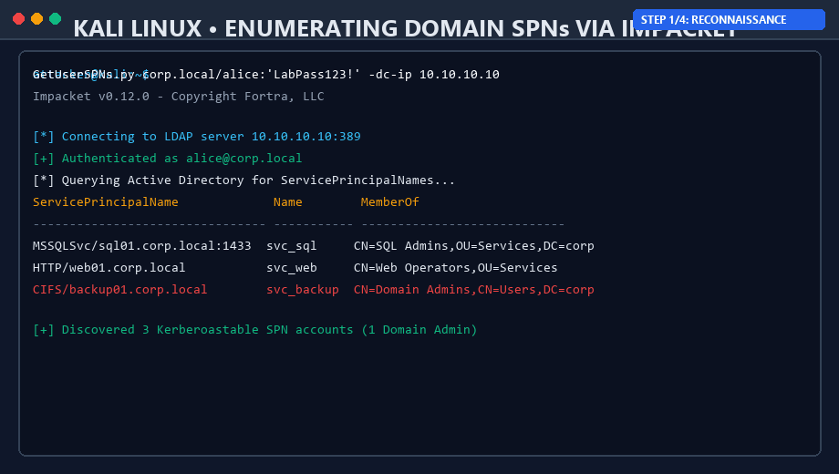

* **📖 Documentation Links:** [Kerberos README Overview](./Kerberos/README.md) • [Kerberos Deep Explanation, Attack Research & Practical Lab Guide](./Kerberos/Kerberos_Deep_Explanation_Tools_Attack_Research_and_Lab_Guide.md)

---

### 6. [Metasploit Framework — Technical Tool Architecture & Systems Guide](./Metasploit/README.md)

<div align="center">

<p align="center">
  
</p>

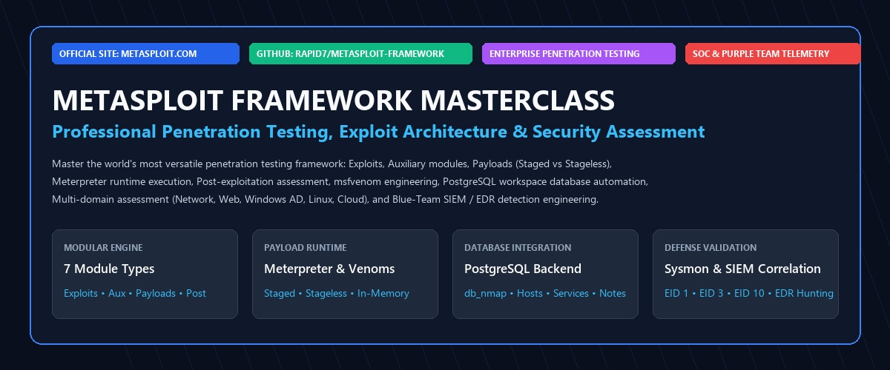

</div>

* **🌐 Official Project Domain:** [https://www.metasploit.com](https://www.metasploit.com/) • **Official Docs:** [https://docs.metasploit.com](https://docs.metasploit.com/)
* **🐙 Official Open-Source GitHub:** [https://github.com/rapid7/metasploit-framework](https://github.com/rapid7/metasploit-framework)
* **Internal Systems Architecture:** Three-tier component stack: Rex (Ruby Extension library for sockets, SSL, and protocol mixins), MSF Core (module lifecycle, event routing), and MSF Base (console API, database drivers).
* **The Seven Module Subsystems:** Exploits, Auxiliary scanners, Payloads (Singles, Stagers, Stages), Post-exploitation, Encoders, NOP generators, and Evasion wrappers.
* **Payload Architecture & Meterpreter:** Staged vs. Stageless payload engineering, Reflective DLL Injection memory execution, and encrypted Type-Length-Value (TLV) channel communication.
* **Cross-Domain Tool Applications:** Concrete technical workflows across 12 cybersecurity domains: Network, Web (HTTP mixins), Windows, Linux, Active Directory, Wireless, Cloud, Containers/DevSecOps, IoT/Embedded, Mobile, Exploit Development (pattern offsets, bad characters), and SOC operations.
* **SOC Telemetry & Defense:** Windows Sysmon Event IDs (1 process spawn, 3 outbound network socket, 7 DLL load, 10 LSASS memory injection), Splunk SPL correlation queries, and enterprise patch governance.
* **Live Console Session Demonstration:**
  
  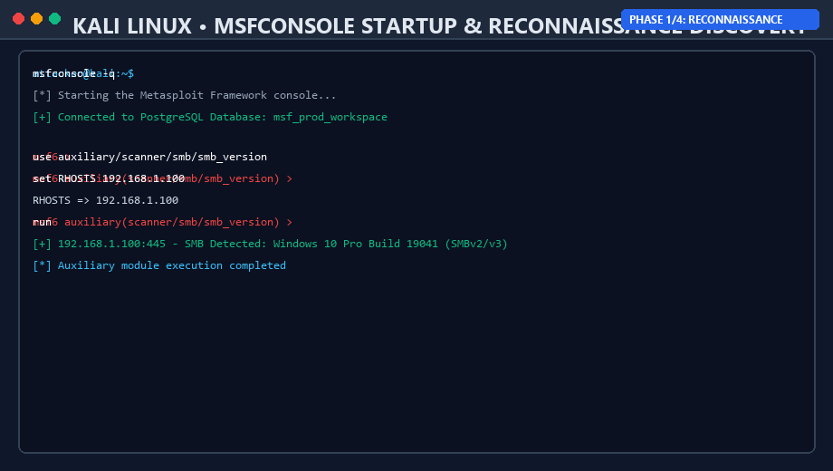

* **📖 Documentation Links:** [Metasploit README Overview](./Metasploit/README.md) • [Metasploit Technical Tool Architecture Guide](./Metasploit/Metasploit_Framework_Technical_Architecture_and_Security_Tool_Guide.md)

---

## 🔒 Enterprise Defensive Hardening & Detection Telemetry Matrix

| Attack / Tool Pattern | Target Protocol / Asset | Primary Endpoint Telemetry | Windows / Linux Event ID | Primary Detection Rule / Splunk SPL | Enterprise Hardening Strategy |
| :--- | :--- | :--- | :---: | :--- | :--- |
| **Port & Service Sweep (Nmap)** | TCP / UDP / ICMP | Firewall connection drops, high connection reset rates | Firewall log / Zeek conn.log | `index=firewall action=drop \| stats count by src_ip, dest_port \| where count > 100` | Implement stateful firewall drop limits, rate limiting, and port knocking |
| **Password Spray / Crack (JtR)** | `/etc/shadow`, NTLM, BitLocker | Repeated authentication failures across local accounts | Linux `/var/log/auth.log`, Win 4625 | `index=linux sourcetype=syslog "Failed password" \| stats count by user, src_ip` | Enforce bcrypt/Argon2id hashing, cryptographic salting, PAM tally2 lockout |
| **GPU High-Speed Brute Force (Hashcat)** | Active Directory, Kerberos, WPA2 | Offline hash cracking (no live network footprint) | Target hash acquisition telemetry | Detect raw extraction: NTDS.dit access (EID 4663), LSASS dump (Sysmon 10) | Deploy long 25+ char service passwords, gMSA, and AES-256 Kerberos keys |
| **802.11 Deauth Attack (Aircrack-ng)** | Wi-Fi Management Frames | Rapid burst of 802.11 deauthentication reason codes | Wireless WIDS / AP Syslog | `sourcetype=wids "deauth_flood" OR "reason_code=7" \| stats count by bssid` | Mandate 802.11w Protected Management Frames (PMF) and migrate to WPA3-SAE |
| **Kerberoasting (Rubeus / Impacket)** | Active Directory TGS | Unusually high volume of RC4 (`0x17`) TGS ticket requests | Windows Security Event ID 4769 | `index=wineventlog EventCode=4769 TicketEncryptionType=0x17 ServiceName!="*$" \| stats count by TargetUserName` | Implement Group Managed Service Accounts (gMSA) and disable RC4 domain-wide |
| **Meterpreter Payload (Metasploit)** | Windows / Linux memory | Remote thread creation, unbacked executable memory regions | Sysmon Event ID 1, 3, 7, 10 | `index=sysmon EventCode=10 TargetImage="*\\lsass.exe" GrantedAccess="0x1010" \| table _time, SourceImage, TargetImage` | Enable Windows Defender Exploit Guard (ASR rules), Credential Guard, and patch CVEs |

---

<div align="center">

**[Return to Main Cyber-Blog Repository](../README.md)**

</div>
